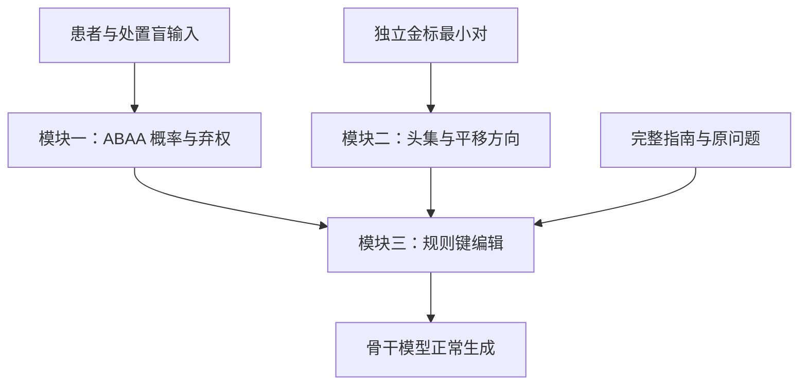

# TRIAGE · ASTER

**当前主线：处置盲适用性评估（ABAA）→ 离线适用性子空间 → 在线规则键平移。** ASTER 的展开更新为 *Action-blind Selection, Then Eigen-subspace Re-routing*。模块一于 **2026-10-27** 固定为最新简化版本：同一骨干模型、处置盲输入、组内受限分类、单温度校准和概率／间隔弃权。

> **状态：研究工作稿与模块一参考实现。** 已提供新版模块一、温度拟合及模块一到模块三的规则增益接口。模块二方向学习、实际注意力编辑与完整流水线仍待实现。没有新增预训练模型实验或性能结论；历史 CARE／ACRE／V6 代码与既有结果不自动成为新版 ASTER 的实现或证据。

[主线文档](docs/ASTER/README.md) · [论文工作稿](docs/ASTER/manuscript.zh.md) · [模块一确定版](docs/ASTER/module1-spec.zh.md) · [新版代码](src/aster/README.md) · [实验计划](docs/ASTER/experiment-plan.zh.md) · [实现状态](docs/ASTER/implementation-status.zh.md)

## 研究问题与三模块分工

研究拟检验：不适用兄弟分支上的熟悉处置，是否会反过来影响模型对患者条件的判断。该候选现象称为处置先行的分支选择（TLBS）。保留五卷配对反事实评测、因果诊断和同信息对照，不预设机制或性能结论。

| 模块 | 默认方法 | 职责 |
|---|---|---|
| 一：处置盲适用性评估（ABAA） | 同一部署骨干只读患者及条件；合法标签 logits；温度缩放；弃权 | 判定哪条规则适用，是否允许干预 |
| 二：离线适用性子空间 | 独立金标最小对；差分谱估计；可分性与可读性选头 | 学习如何改变规则读取 |
| 三：在线键平移 | 高置信规则正增益、兄弟规则负增益；弃权／NONE／不可达组为零 | 按病例决定编辑目标和符号 |



**模块一的病例输出进入模块三，不进入模块二的方向估计。** 模块一不做患者原子抽取、不调用外部事实核查模型、不生成处置；医学自然语言推断仅作为可选辅助消融。主方法不包含证据绑定、原子概率乘积、保形预测或 LTT 风险认证。

## 模块一的确定接口

```json
{
  "group_id": "G1",
  "probabilities": {"R1": 0.82, "R2": 0.11, "NONE": 0.07},
  "prediction": "R1",
  "probability": 0.82,
  "margin": 0.71,
  "entropy": 0.591678,
  "abstain": false
}
```

以上为算术示例。`prediction` 始终保留概率最大类别，弃权时不改写成 `NONE`。`NONE` 表示依现有信息无法确认任何分支适用；`abstain` 表示分类不够可靠。高置信 `NONE` 也不触发干预。单组增益为零不等于整个病例回退，只有所有组关闭且原始计算保持一致时才能作整例回退。

处置盲通过结构化字段白名单构造处置盲输入。患者既往用药等事实保留；原问题与选项默认不输入分类器。分支使用在真实模板边界验证过的单词元代理标签。温度与阈值仅由开发资料确定，不提供统计风险认证。完整定义见[模块一规格](docs/ASTER/module1-spec.zh.md)。

## 新版入口

```bash
python -m unittest discover -s tests -p 'test_aster*.py' -v
python -m scripts.run_aster_module1 --help
```

[输入示例](examples/aster_action_blind_input.json) · [调用与校准说明](src/aster/README.md)。真实分类需要已加载或本地缓存的骨干模型；完整系统通过 `HFLabelScorer(model, tokenizer)` 复用同一模型对象。参数必须显式给出，不把示例阈值当成已校准配置。

## 主线阅读入口

| 内容 | 入口 |
|---|---|
| 完整方法、公式和边界 | [论文工作稿](docs/ASTER/manuscript.zh.md) |
| 模块一输入、概率、弃权与代码契约 | [模块一确定版](docs/ASTER/module1-spec.zh.md) |
| 为什么改版、哪些主张需要收窄 | [2026-10-27 设计决策](docs/ASTER/design-update-20261027.zh.md) |
| 六项可证伪主张 | [主张与证伪](docs/ASTER/claims-and-falsification.zh.md) |
| 同信息基线、指标和冻结流程 | [实验计划](docs/ASTER/experiment-plan.zh.md) |
| 实现与证据范围 | [实现状态](docs/ASTER/implementation-status.zh.md) · [证据状态](docs/ASTER/evidence-status.zh.md) |
| 已核对与待核对的来源 | [引用清单](docs/ASTER/references-to-verify.zh.md) |

## 历史版本与实验资产

2026-10-26 的两阶段注意力掩码、证据员、软否决及对数门控方案保存在[改版前固定提交](https://github.com/chunxi-alpc/TRIAGE/tree/781ee863784c60f1f6710ba5eede22bc8ee6b93c)。[旧图稿](docs/ASTER/figures/README.md)中的图 2、图 4 对应该版本，不再定义当前方法。图 1 和图 3 仍可作为任务与五卷协议示意，不能作为实验结果。

更早的 CARE、ACRE 与原三模块实现仍按原接口保存。`src/module1`、`src/module2`、`src/module3`、`src/pipeline` 及其默认命令均为历史接口；当前模块一入口是 `src/aster`，不把新版结果强行转换为 V6 图结构。既有实验、预测和负结果保留原版本含义。

[历史支线索引](docs/BRANCHES.md) · [旧实验索引](experiments/README.md) · [旧结果索引](results/README.md) · [版本记录](docs/REPOSITORY_STATUS.md)。整理前的更早完整快照仍在 [archive/pre-aster-main-20261026](https://github.com/chunxi-alpc/TRIAGE/tree/archive/pre-aster-main-20261026)。
