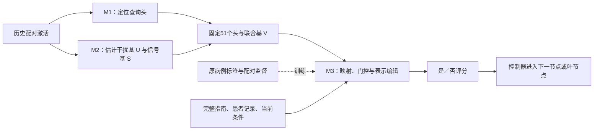

# 历史稿：ASTER 表示编辑研究（2026-11-07）

> 本文为2026-11-07以前的ASTER表示编辑路线稿件。当前论文唯一正文已迁移至[ASTER-CR论文](../../manuscript.zh.md)。本文件仅保留历史方法与论证记录，不作为当前论文正文，也不与ASTER-CR结果合并。

# ASTER：面向指南条件判断的注意力头定位、子空间估计与可学习编辑

> **最新论文入口（2026-11-09）**：本文件是此前的 **ASTER 表示编辑**研究稿，不能与另一条 **ASTER-CR 分数对消**研究的成绩直接合并。当前 ASTER-CR 正文见[《对消，而非擦除》](../../reports/aster_cancel_story_20261109/paper_story_latest.zh.md)：第4.5节为MEGA受控实验，第4.6节为MEGA-CDP、NLI4CT-2024、MedPIC三任务总体对照，第4.7、4.8节分别给出NLI、MedPIC原生指标；表B4列出13种外部方法及3种控制在三个任务中的运行状态。现有实测与解析缩放明确区分，未运行的新方法不冒称取得真实成绩。

> 更新：2026-11-07。中文主稿。方法章节描述最新 P0–P3 中预设的 `paired_ns`；该版本已实现，正式训练和评测尚未完成。最新完整结果来自上一阶段辅助参考／自身参考 M3。[实验索引](experiments.zh.md)维护进度，[版本演变](versions.zh.md)记录历史公式和实验。

## 1 摘要

临床指南执行要求模型依据患者事实判断当前条件，再沿指南树选择分支。完整文本同时包含决定性事实、后续处置和其他背景，条件判断可能受到非决定性信息影响。ASTER 将这一问题分为三个步骤：M1 通过激活修补定位传导干扰效应的注意力头，M2 通过配对激活差估计干扰与信号子空间，M3 在固定子空间内学习输入相关的表示编辑。最新版保留已选头和基，在干扰与信号的联合空间中训练映射和门控，并用保持真值与改变真值的配对分别监督判断的一致性和响应。已完成的辅助参考 M3 在 MEGA-CDP 的7,458例测试中正确执行7,072条路径（94.82%），完整阅读为7,068条（94.77%），旧闭式 M3 为7,045条（94.46%）。辅助参考相对完整阅读纠正6例、新增错误2例，差值的来源重采样区间包含零。最新联合空间配对训练的结果将按原分母补入，现有分数保持其对应版本。

待补：P0–P3完整结果、迁移结果与实测成本后，更新摘要末段。

## 2 引言

指南条件判断连接了文本理解与结构化决策。给定指南树和患者记录，模型需要解释当前条件、读取相关事实，并决定下一分支。程序控制器可以保证按树结构执行，但条件判断错误仍会改变后续路径。因此，本研究将模型作用集中在节点判断，将路径推进交给确定性程序。

非决定性信息的影响需要结合当前条件理解。相同患者属性可能在一个节点决定分支，在另一个节点只是背景；后续处置也可能诱导模型倾向某种答案。直接删除文本可能同时删除条件解释或必要定义。ASTER 因此保留完整输入，研究在判定位置的内部表示上调整这些信息的作用。

已有机制实验为干预位置提供了依据。在 Qwen3-8B 的1,152个查询头中，51个选中头的联合修补恢复了 A/P 配对分数效应的87.71%/84.11%。将修补限制到 M2 未筛选干扰方向后，恢复率为63.08%/69.34%；硬夹角筛选后的正交分量进一步降至11.88%/11.85%。这些结果说明头定位和方向处理应分别研究，也为保留 M1/M2、改造 M3 提供了动机。[机制结果](../../results/aster_existing_data_20261106/REPORT.zh.md)

本文以定位和估计得到的结构为基础，学习每个节点的编辑目标与强度。最新版进一步比较干扰、信号及联合空间，并让真值保持与真值翻转直接参与训练。本文组织三方面证据：固定节点上的机制恢复、原版病例上的自主路径表现，以及迁移和选头对照。已完成结果与运行中的比较分别呈现。

待补：依据最新版结果确定贡献表述，补齐与同预算表示编辑方法的直接比较。

## 3 相关工作

**上下文利用与注意力干预。** CAD 对比有／无上下文的输出分布；PASTA 在部分头上调整对指定片段的注意力；ITI 沿选定头中的方向移动激活。这些工作分别作用于输出分布、注意力权重和头表示。ASTER 在最终判定位置编辑查询头输出，并将定位、方向估计和监督训练分开记录。[CAD](https://aclanthology.org/2024.naacl-short.69/)、[PASTA](https://arxiv.org/abs/2311.02262)、[ITI](https://arxiv.org/abs/2306.03341)

**概念擦除与表示微调。** INLP 反复训练线性分类器并投影到其零空间；LEACE 提供闭式线性概念擦除映射；ReFT 在冻结骨干上学习表示干预，其中 LoReFT 使用低秩子空间。ASTER 的闭式历史版本与概念擦除有关，当前版本则在配对差分确定的固定空间内训练映射和门控，以任务结果评价编辑。[INLP](https://aclanthology.org/2020.acl-main.647/)、[LEACE](https://arxiv.org/abs/2306.03819)、[ReFT](https://arxiv.org/abs/2404.03592)

**指南执行评测。** MEGA-CDP 提供指南、病例描述和参考决策路径，适合评价逐节点判断的累积结果。MedGUIDE 以指南衍生的选择题评价决策，当前迁移实验使用其原生题目和选项。两类任务分别报告路径完全正确率和选项正确率。[MEGA-CDP 数据卡](https://huggingface.co/datasets/nchennnn/MEGA-CDP)、[MedGUIDE](https://arxiv.org/abs/2505.11613)

待补：相关方法的同模型、同预算复现结果。文献成绩不填入 ASTER 结果表。

## 4 任务定义

给定指南树 $`G`$、患者记录 $`p`$ 和当前内部节点 $`n`$，构造完整输入 $`x=\pi(G,p,n)`$。模型输出条件成立与否的标签分数：

```math
\ell(x)=\operatorname{logit}(\text{是}\mid x)-\operatorname{logit}(\text{否}\mid x),
\qquad \widehat y(x)=\mathbf 1[\ell(x)\gt0].
```

同分选择“否”。控制器从根节点开始，按本方法预测访问下一节点，到达叶节点后返回该叶处置。完整路径正确要求预测节点—分支序列和叶节点均与参考一致；参考路径只用于训练节点选择、开发选轮和预测结束后的评分。

配对输入用于估计和诊断。A 改变后续处置，P 改变非决定性患者背景，两者期望真值保持；C 改变条件，F 改变决定性事实，两者期望真值随标签翻转。P3 增加 F_same：改变相关数值但仍处于条件同侧，期望真值保持。原版病例与构造配对使用各自分母。

| 对象 | 表示 | 实现含义 |
|---|---|---|
| 判定位置头输出 | $`z_h\in\mathbb R^{128}`$ | 查询头进入输出投影前的向量 |
| 干扰基／信号基 | $`U_h,S_h`$ | M2 固定正交基，代码字段 `U_N`、`S` |
| 编辑空间 | $`V_h`$ | N、S或NS使用的固定基 |
| 头集合 | $`\mathcal H`$ | M1选中的51个查询头 |
| 编辑量 | $`\Delta_h`$ | 加到当前头表示的向量 |

待补：在附录加入一个绑定已有病例编号的原文节点与预测路径示例。

## 5 方法：ASTER

### 5.1 判定位置的注意力头干预及其依据

为把干预直接连接到当前条件的标签分数，ASTER 只在最终输入位置、注意力输出投影 `o_proj` 之前编辑选中查询头。对该位置按层序执行，前层编辑可以影响后层的当前表示。更早输入位置形成的缓存来自无编辑前向。选头依据来自修补实验，分数恢复率与准确率收益分别评价。



**图1：最新版 ASTER。** NS联合空间和在线自身参考对应 `paired_ns`。辅助参考版本作为已完成对照在第7节报告。

### 5.2 M1：干扰通路定位

为识别传导非决定性信息影响的头，M1 对 A/P 配对先进行一阶归因预筛，再做双向精确激活修补。设 $`\mathrm{TE}=\ell(x')-\ell(x)`$，单头恢复效应为：

```math
\mathrm{NIE}_h=\frac12\mathbb E\left[
\frac{\ell(x\mid z_h\leftarrow z_h(x'))-\ell(x)}{\mathrm{TE}}
+
\frac{\ell(x'\mid z_h\leftarrow z_h(x))-\ell(x')}{-\mathrm{TE}}
\right].
```

归一化只使用 $`|\mathrm{TE}|\ge0.1`$ 的既有配对，其余保留原始效应。A/P分别排序，在开发配对上比较联合修补的头集合前缀，再合并 $`\mathcal H_A,\mathcal H_P`$，保存每头类型 $`T_h`$。当前复用22个A头、39个P头，去重为51头。最新双模型诊断检查此冻结集合及组合效应，作为第8节分析；P2的随机头等另作对照。[M1实现](../../experiments/aster_closed_form/m1.py)、[固定选择](../../results/aster_existing_data_20261106/m1/selection.json)

### 5.3 M2：干扰与信号子空间估计

为确定可编辑方向，M2 对每类未编辑配对激活差估计未中心化二阶矩，提取主要特征方向：

```math
\begin{aligned}
\delta_h^q &=z_h(x')-z_h(x),\\
M_h^q &=\mathbb E[\delta_h^q(\delta_h^q)^\top],\\
U_h &=\operatorname{orth}([U_h^q]_{q\in T_h}),\\
S_h &=\operatorname{orth}([U_h^C,U_h^F]).
\end{aligned}
```

每类先按能量目标与秩上限截断，再合并为正交基。当前加载目标0.95、每类秩上限4的已选产物：干扰总秩244、信号总秩356。目标受秩上限限制；原记录的A/P实际干扰能量覆盖为55.27%/75.84%。方向描述已观测配对变化，不意味着每个方向只含一种信息。

为比较编辑空间，最新实现定义：

```math
V_h^{N}=U_h,\qquad V_h^{S}=S_h,\qquad
V_h^{NS}=\operatorname{orth}([U_h,S_h]).
```

预设主方法 `paired_ns` 采用联合空间，总秩600；`paired_n`、`paired_s` 分别用N/S。所有基固定，仅训练M3。P2对照头的基由相同历史拟合激活估计，随机头匹配层分布、头数及原干扰秩。[原估计](../../experiments/aster_closed_form/operators.py)、[最新空间构造](../../experiments/aster_m3_followup/bases.py)

### 5.4 M3：最新编辑方法

为学习各条件所需的表示变化，M3 在固定空间内构造目标坐标，通过标量门控控制编辑强度。最新版使用本次前向、该头编辑前的当前表示作为参考：

```math
\begin{aligned}
r_h&=\operatorname{stopgrad}(z_h),\\
c_h&=V_h^\top z_h,\qquad t_h=W_hr_h,\\
g_h&=\sigma(a_h^\top[c_h;t_h]+b_h),\\
\Delta_h&=g_hV_h(t_h-c_h),\qquad z'_h=z_h+\Delta_h.
\end{aligned}
```

$`W_h\in\mathbb R^{k_h\times128}`$、$`a_h\in\mathbb R^{2k_h}`$和标量$`b_h`$可训练，$`k_h`$为当前空间秩。停止梯度只作用于参考分支，当前坐标仍保留到前层编辑器的梯度。初始化$`W_h=V_h^\top`$、$`a_h=0`$、$`b_h=\log(0.01/0.99)`$，初始门控0.01。联合空间共78,051个参数，骨干与基冻结。

在线自身参考来自本次编辑前向，每节点推理只需一次末位置评分。上一阶段 `learned_self` 则先保存无干预完整输入激活，再编辑评分，需要两次末位置评分。辅助参考版本从原患者记录、原当前条件和原祖先条件构造另一提示，单独计算无干预参考激活。

更新始终位于$`\operatorname{span}(V_h)`$。信号基用于记录$`\|S_h^\top\Delta_h\|_2^2`$，当前不施加严格信号保持约束。旧闭式算子的$`ES_h=S_h`$和幂等性不移作学习式映射与门控的保证。初始化时自身参考编辑量为零，训练后映射可以产生非零编辑。

公式对应[HeadEditor.forward](../../experiments/aster_learnable_m3/m3.py)；在线参考对应[最新引擎](../../experiments/aster_m3_followup/engine.py)中 `reference is None` 时传入当前头的停止梯度副本。

### 5.5 训练目标与推理流程

为同时学习原病例判断及配对响应，训练包含原病例节点损失和按类型平均的配对损失。单节点基本损失为：

```math
\begin{aligned}
B_i&=\mathrm{CE}(p_{\theta,i},y_i)
+0.1\,\mathbf1[\widehat y_{0,i}=y_i]\mathrm{KL}(p_{0,i}\Vert p_{\theta,i})
+0.001\,R_i,\\
R_i&=\frac1{|\mathcal H|}\sum_{h\in\mathcal H}
\frac{\|\Delta_{i,h}\|_2^2}
{\max(\operatorname{stopgrad}(\|z_{i,h}\|_2^2),10^{-8})}.
\end{aligned}
```

$`p_0`$为无编辑完整输入的两类概率。KL保持项按正确指示乘到节点损失上，再随全部节点平均，不另按正确节点数归一化。原病例取标准路径首、中、末节点，去重后最多3个，先在病例内平均，再对病例平均。

设配对两侧为$`a,b`$、类型为$`q`$。保持型使用Jensen–Shannon散度，翻转型使用各侧标签定向的间隔损失：

```math
J_q(a,b)=
\begin{cases}
\mathrm{JS}(p_{\theta,a},p_{\theta,b}),&q\in\{A,P,F_{\rm same}\},\\
\frac12\sum_{j\in\{a,b\}}\max(0,1-(2y_j-1)\ell_{\theta,j}),&q\in\{C,F\}.
\end{cases}
```

```math
\mathcal L=
\mathbb E_{\rm case}\left[\frac1{|I_{\rm case}|}\sum_{i\in I_{\rm case}}B_i\right]
+\frac1{|\mathcal Q|}\sum_{q\in\mathcal Q}
\mathbb E_{(a,b)\in\mathcal P_q}\left[\frac{B_a+B_b}{2}+J_q(a,b)\right].
```

配对系数1，$`\mathcal Q`$包含实际训练的五类；实现按各类样本数加权，使每类分别平均。`online_n`用相同在线自身参考和N空间，只保留第一项，直接对照配对训练作用。训练还计算无干预分数供KL使用，“一次末位置评分”仅指最新版推理。[训练实现](../../experiments/aster_m3_followup/training.py)

AdamW学习率$`10^{-3}`$、权重衰减0.01，累计8个病例或配对任务后更新，共3轮。每轮在100例开发病例上自主执行路径，先取路径正确率最高者，并列取编辑量小、轮次早者。训练种子20261105，P0统计种子20261107。

推理依次加载冻结模型、头集合、基和选定M3；构造当前节点输入；缓存无编辑前缀；在末位置按层编辑头；比较“是／否”分数；按预测进入下一节点直至叶节点。测试路径不读取标准分支。

待补：正式训练完成后填入 `paired_ns` 选定轮次和实测成本。

## 6 实验设置

### 6.1 数据与指标

| 实验 | 训练／开发／测试 | 指标与状态 |
|---|---|---|
| 原版MEGA-CDP | 200／100／7,458病例；来源20／10／440 | 自主完整路径；上一阶段五方法已完成 |
| P0固定标准路径 | 测试45,627节点 | 节点正确、首错纠正；补评分阶段 |
| 构造配对 | 训练463／开发102／测试522对 | 双侧全对率、预测翻转；最新方法待评 |
| MedGUIDE原生题 | 校准200题、试测200题 | 固定权重迁移；本轮待完成 |
| MedGUIDE扩展 | 4,955题、9个疾病家族 | 按既有流程条件启动，尚无结果 |

原版训练／开发病例身份继承历史划分，M1/M2使用历史构造配对产物。官方测试此前已用于项目研究。发布病例为数据集提供的病例描述。路径评分采用本项目节点序列及叶节点精确匹配，不等同于官方全部评分指标。

配对A为156/40/200、P为114/19/98、C为13/1/14、F为158/40/200、F_same为22/2/10（训练/开发/测试）。历史闭式测试512对，加入10对F_same后为522对。

MedGUIDE保留原题提示和选项，未额外提供完整指南树；辅助参考只用 `profile`，不读答案或标准路径。校准和扩展集按疾病家族分离，排除原试测病例。试测覆盖17个家族，扩展家族已有试测暴露。[最新配置](../../results/aster_m3_followup_20261107/configuration.json)

### 6.2 模型与对照

主模型Qwen3-8B，骨干及标签投影BF16、编辑器FP32。各主方法共享是／否模板和控制器。上一阶段比较完整阅读、旧闭式M3、辅助参考M3、自身参考M3和直接参考；最新增加如下训练对照。

| 方法 | 头数 | 总秩 | 参数量 | 参考与监督 |
|---|---:|---:|---:|---|
| 随机头13/37/73，各一组 | 51 | 244 | 31,771 | 辅助参考，原病例损失 |
| 全部候选头 | 94 | 512 | 66,654 | 辅助参考，原病例损失 |
| 全部查询头 | 1,152 | 9,216 | 1,199,232 | 辅助参考，原病例损失 |
| paired_n | 51 | 244 | 31,771 | 在线自身参考，配对损失 |
| paired_s | 51 | 356 | 46,331 | 在线自身参考，配对损失 |
| paired_ns（预设主方法） | 51 | 600 | 78,051 | 在线自身参考，配对损失 |
| online_n | 51 | 244 | 31,771 | 在线自身参考，原病例损失 |

随机头匹配层分布、头数和参数量，允许抽中原头；S/NS与N容量不同。另设单一加性偏置：MEGA修改“是”分数，MedGUIDE修改A选项分数，仅用校准数据拟合。[头集合和参数](../../results/aster_m3_followup_20261107/p2/head_controls.json)

### 6.3 统计与成本

报告正确数／总数、纠正、新增错误和净变化。上一阶段使用2,000次指南来源重采样；P0复用同批预测，以20,000次来源重采样计算直接差值区间，并报告整来源配对置换和病例级McNemar。设置分别注明。MedGUIDE按各评价集实际出现的疾病家族聚类。

已有实验使用服务器GPU 0、1。本次整理没有启动训练或评测。推理成本区分前缀和末位置：完整阅读与在线自身参考各一次末位置评分；上一阶段自身参考两次，辅助参考另有一套参考提示。

待补：九个新配置的选轮、实际GPU时长和完整推理成本；首批估时和断点恢复耗时不作为总耗时。

## 7 实验结果

### 7.1 已完成的可学习M3全量结果

**表1：MEGA-CDP 7,458例自主路径。** 同一模板、控制器与分母；纠正／新增错误相对完整阅读。

| 方法 | 正确／总数 | 路径正确率 | 来源95%区间（2,000次） | 纠正／新增错误 |
|---|---:|---:|---|---:|
| 完整阅读 | 7,068/7,458 | 94.77% | 93.86–95.70% | 0/0 |
| 旧闭式M3 | 7,045/7,458 | 94.46% | 93.56–95.40% | 22/45 |
| 辅助参考M3 | 7,072/7,458 | 94.82% | 93.93–95.73% | 6/2 |
| 自身参考M3 | 7,068/7,458 | 94.77% | 93.86–95.70% | 3/3 |
| 直接读取参考 | 6,445/7,458 | 86.42% | 84.81–87.92% | 137/760 |

两种学习式版本均训练3轮，开发均选第1轮，开发路径正确率90%。辅助参考比旧闭式方法净增27例，比完整阅读净增4例。直接参考错误更多，说明该提示下独立参考判断与完整输入内部编辑具有不同效果。[完整结果](../../results/aster_learnable_m3_20261106/comparison.json)

**表2：P0对同批冻结预测的直接比较。** 差值单位为百分点，来源重采样20,000次。

| 比较 | 净变化 | 差值 | 差值95%区间 | 来源置换p |
|---|---:|---:|---|---:|
| 辅助参考−完整阅读 | +4 | +0.0536 | [-0.0138, +0.1300] | 0.2891 |
| 自身参考−完整阅读 | 0 | 0.0000 | [-0.0669, +0.0657] | 1.0000 |
| 辅助参考−自身参考 | +4 | +0.0536 | [-0.0137, +0.1322] | 0.2891 |
| 辅助参考−旧闭式M3 | +27 | +0.3620 | [+0.1369, +0.5985] | 0.0028 |

辅助参考优于旧闭式方法；相对完整阅读和自身参考的差值区间包含零。以上按实际结果记录。[P0直接统计](../../results/aster_m3_followup_20261107/p0/REPORT.zh.md)

### 7.2 最新P0–P3进度

| 阶段 | 已有内容 | 待完成结果 |
|---|---|---|
| P0节点分析 | 全量预测直接统计完成；固定节点缓存复用；8例变化已定位 | 45,627固定节点补齐；32条方法—节点gate／编辑量记录补齐 |
| P1迁移 | 原生输入、校准及评测代码已准备 | 本轮200题成绩和共同错误；扩展是否触发及其结果 |
| P2选头 | 三组随机头、94候选头、1,152全头的配置和基已准备 | 五组训练、开发选轮和评测 |
| P3 N/S/NS | 空间和配对损失已实现；paired_ns正式训练中 | 四组训练及配对、自主路径结果 |

进度快照为2026-11-07 17:41（北京时间）：`paired_ns`进入第3轮；P0一个分片完成，另一个运行中；变化节点已保存16/32条记录。此时九个新配置均未保存正式完成记录。阶段报告的“0/固定分母”表示未形成完整结果，不是准确率为零。[带时间的快照](../../results/aster_documentation_20261107/progress.json)

待补：新增九配置同设置主表；P1单列原生选择题表，不与路径准确率合并。

## 8 消融与机制分析

### 8.1 从头定位到方向处理

**表3：历史测试A/P双向修补恢复率。** A/P全部配对200/98，可归一化185/92。

| 修补分量 | A | P |
|---|---:|---:|
| 51头完整差分 | 87.71% | 84.11% |
| 未筛选干扰正交分量 | 63.08% | 69.34% |
| 硬筛选后正交分量 | 11.88% | 11.85% |
| 旧斜投影分量 | 15.26% | 14.42% |
| 连续衰减分量 | 9.98% | 20.67% |

结果定位方向处理中的效应损失，修补恢复不能代替在线纠错。硬筛选和连续衰减在432例路径上分别正确401和399例，完整阅读404例。[连续衰减报告](../../results/aster_soft_angle_20261106/REPORT.zh.md)

### 8.2 M1最新诊断

最新冻结类型专用头诊断得到Qwen A/P恢复率84.21%/74.96%，MedGemma为74.17%/82.10%。其类型专用集合及本轮评分口径区别于表3的51头联合集合。候选外仍有贡献，组合效果与单头效果之和不同，支持继续研究候选覆盖与组合选择。此诊断没有更换当前M1，不单列为方法版本。[双模型诊断](../../results/m1_diagnostics_20261106/README.md)

**表4：诊断附带的基础模型原文试测。** 每任务200例，未进行新M3训练。

| 模型 | MedGUIDE正确 | MEGA完整路径正确 | MEGA原标注节点正确 |
|---|---:|---:|---:|
| Qwen3-8B | 103/200 | 193/200 | 1,074/1,081 |
| MedGemma 27B | 111/200 | 196/200 | 1,077/1,081 |

MedGUIDE共同错误71题，MEGA共同错误1例。此表属于基础模型分析，FP32标签投影与P1的Qwen BF16评分分别记录，不充当P1新版成绩。

### 8.3 参考和信号空间

未筛选方向实验固定$`UU^\top`$，只改参考。610个测试输入中，全局均值产生92个新增错误，同事实参考6个；实际改变参考的406个输入中，对应新增错误51与6。同事实编辑与直接读取参考在全部610输入上同判。这支持研究参考引起的共同偏移，尚不表明当时内部编辑超过直接参考。[参考对照](../../results/aster_reference_anchor_20261106/REPORT.zh.md)

最新版通过 `paired_n`、`paired_s`、`paired_ns` 比较N/S/NS编辑空间；`paired_n`对`online_n`比较配对训练；辅助参考M3对三个随机头版本比较选头对学习式纠错的作用。不同参数量随结果报告，结果待完成。

### 8.4 变化节点及信号保持的含义

辅助参考纠正的6例和退化的2例，其原分数差均为0、0.25或0.5，接近判定阈值。P0补评逐节点门控、编辑量和补跑分数，检查变化位置。单参数偏置对照用于判断其与简单校准是否相似。

旧斜投影$`ES=S`$保持纯信号方向，不意味着任意混合输入的$`S^\top z`$不变。新版仅保证更新位于固定空间，信号变化作为实测诊断。两者见[版本公式对照](versions.zh.md)。

待补：补评后的节点分布图、P2选头表和P3空间／监督消融表。

## 9 参考文献

1. Shi et al. 2024. [Trusting Your Evidence: Hallucinate Less with Context-aware Decoding](https://aclanthology.org/2024.naacl-short.69/).
2. Zhang et al. 2024. [Tell Your Model Where to Attend: Post-hoc Attention Steering for LLMs](https://arxiv.org/abs/2311.02262).
3. Li et al. 2023. [Inference-Time Intervention: Eliciting Truthful Answers from a Language Model](https://arxiv.org/abs/2306.03341).
4. Ravfogel et al. 2020. [Null It Out: Guarding Protected Attributes by Iterative Nullspace Projection](https://aclanthology.org/2020.acl-main.647/).
5. Belrose et al. 2023. [LEACE: Perfect linear concept erasure in closed form](https://arxiv.org/abs/2306.03819).
6. Wu et al. 2024. [ReFT: Representation Finetuning for Language Models](https://arxiv.org/abs/2404.03592).
7. Li et al. 2025. [MedGUIDE: Benchmarking Clinical Decision-Making in Large Language Models](https://arxiv.org/abs/2505.11613).
8. [MEGA-CDP作者数据卡](https://huggingface.co/datasets/nchennnn/MEGA-CDP).

待补：按投稿格式完善书目与BibTeX。来源支持范围见[引用说明](references.zh.md)。

## 10 附录

### 10.1 公式、代码与结果入口

| 内容 | 实现或记录 |
|---|---|
| M1定位 | [m1.py](../../experiments/aster_closed_form/m1.py) |
| M2和旧M3 | [operators.py](../../experiments/aster_closed_form/operators.py) |
| 映射与门控 | [m3.py](../../experiments/aster_learnable_m3/m3.py) |
| 在线自身参考 | [engine.py](../../experiments/aster_m3_followup/engine.py) |
| 配对训练和选轮 | [training.py](../../experiments/aster_m3_followup/training.py) |
| 推理及路径评分 | [scoring.py](../../experiments/aster_m3_followup/scoring.py) |
| 已完成全量结果 | [comparison.json](../../results/aster_learnable_m3_20261106/comparison.json) |
| 实验和运行路径 | [实验索引](experiments.zh.md) |
| 历史公式及继承 | [版本演变](versions.zh.md) |

### 10.2 图表安排与待补材料

| 图表 | 内容 | 来源 | 状态 |
|---|---|---|---|
| 图1 | 最新三模块训练／推理 | 第5.1节 | 已有可编辑图 |
| 图2 | 定位、截断、筛选的效应变化 | 表3及历史机制CSV | 数据齐备，待绘图 |
| 图3 | 8例节点分数、门控和编辑量 | P0补评 | 部分记录，待齐 |
| 表1–2 | 全量成绩及配对统计 | 第7.1节 | 已填 |
| 表3–4 | 历史机制及最新M1分析 | 第8节 | 已填 |
| 最新主表 | paired_ns及对照 | P0–P3阶段报告 | 待完成 |
| 迁移表 | 200题及条件扩展 | P1 | 待完成 |
| 成本表 | 训练、前缀、末位置、显存 | 运行记录 | 待完整汇总 |

旧图稿保留原路径，其模块含义不作为当前方法图。逐章待补项随结果更新，不用示例数字替代实测值。更早表示干预、TRIAGE、ACRE、CARE文稿保留原位置，通过[历史入口](archive/README.md)查阅。
