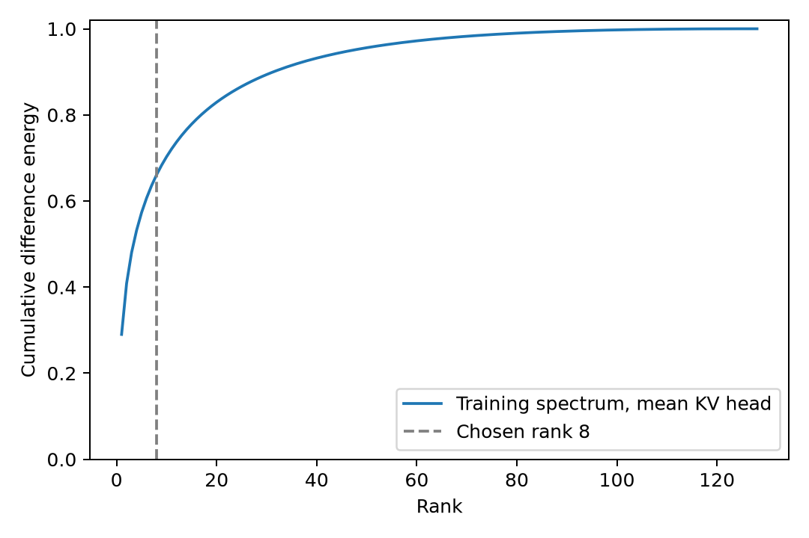

# ASTER 临床实验执行报告：2026-10-30

真实预训练权重接口、临床当前年龄三态标注、方向学习、局部机制及内部确认已实际执行。MEGA-CDP 官方测试已在物理 GPU **0、1、5、6** 启动，尚未完成；MedGUIDE 已做来源归并，尚未完成端到端实验。本报告保留不支持谱方法优势的结果。

## 版本、模型与运行

- 方法规格：主稿 `60027c426a3155bf55c26273f4c3f49fd563ce1f` 第 4.2–4.4 节及补充 A–D。
- 本轮接续代码：`1d996f117c5be022f21cd8b29f4fbf7ecf645ddb`；分支 `codex/aster-manuscript-implementation-20261030`；运行编号 `clinical01`。
- 方法冻结代码：`f65bf5d32e1aca4a2a378a67718d3d96da3108e5`；四卡官方执行代码：`a2d7691f9789bd609cae1a879a3eb86f07c32c89`。之后只补汇总、发布脚本和报告，不改变已启动的预测器及冻结参数。
- 主模型实际从 ModelScope 的 `Qwen/Qwen3-8B` 固定提交 **`26028140be3ee69b82b1d1450179ab71bb1121b9`** 下载，15 个所需文件下载完成，配置、分词器和五个权重分片均使用这个修订。旧修订未知的下载目录没有覆盖。
- 模型目录 `/home/gcx/aster_manuscript_20261030/clinical01/models/Qwen3-8B-2602814`；实际解释器 `/home/gcx/aster_manuscript_20261030/venv-overlay/bin/python`；Transformers 4.57.6、PyTorch 2.8.0+cu128、BF16。
- 单设备单病例，全注意力，非量化 DynamicCache；模板 v2，未扩大编号或处置边界。主方法仍使用原 eager 参考路径，仅原始长指南 native 对照采用经过比较的注意力查询行分段计算。
- 四卡启动前均空闲，每卡一个独立模型，动态领取完整病例，不做张量批量或模型切分。通常每卡约 25–50 GB，长输入保留显存可接近 80 GB。7,458 例 × 13 方法 = **96,954 个预测单元**；附加 Qwen 适配的官方评分。预计 2–4 天，取决于长度和评审输出。只等待完成，不持续监控 GPU。
- 所有原始临床文本、病例标识、提示、词元、缓存、表示和输出留在服务器。公开产物只含代码、允许公开的合成示例、来源指南编号和汇总。不新增文件哈希计算，不修改 PR #41 或其他实验。

## 实际验收与工程问题

63 项 `test_aster*.py` 回归全部通过，无跳过，包含真实 Transformers Qwen3/Llama 微型架构测试。固定修订的真实 Qwen3-8B 权重验收通过；四个正式执行进程也分别通过真实临床提示的零编辑及零偏置 logits 逐项一致检查。

真实权重已核验：三态总长度、词元标识和位置；k_norm 后、RoPE 前的键；已经旋转的查询及全部四个共享查询头；共享原始指南缓存及患者只出现一次；编辑不修改原缓存、值或非目标键；加性分数公式和低精度误差界；相同分段下零编辑、空专家一致；同一未更新骨干分类和生成；祖先弃权关闭下游；分类失败不充当 NONE。全文与分段的数值误差单独保存，不要求逐位相等。

本轮实际处理的问题如下，旧产物均保留。

| 问题 | 处理及证据 |
|---|---|
| 原下载模型没有真实上游修订 | 新目录下载固定 ModelScope 提交，重新做权重验收；不追认旧目录修订 |
| 原始树叶字段不是 description | 适配原始 conclusion 字段，生成前完成数据修复 |
| 自然未知年龄文字的分词长度不齐 | 保留自然缺失年龄表达，逐三态真实分词，失败排除；不扩编辑片段或补位 |
| 局部根读取把缺失输出误记成 NONE | 单独新增评分 v2，显式 NONE 才计入未知正确；保存旧字段，未重新生成或选参数 |
| 原始完整指南 native 对照 25/43 显存不足 | 旧失败保留；只对 native 分割注意力查询行，每行仍读取全部因果键，不改 RoPE、上下文或精度 |
| 初版 256 行分割有数值差异 | 修复运行 43 例无显存失败，但原先成功的 18 例中 1 例输出漂移，未将其冒充等价路径 |
| 分割末尾短块导致 BF16 数值差异 | 改为均匀分割，实际敏感输入比较 512/1024/2048 三种分割的缓存与 logits 均为零误差；2048 行完整生成与全部 18 个既有成功样本 **18/18 一致**，据此登记官方运行执行方式 |

不能将有限样本的一致性说成所有长度都逐位一致。长输入超过原模型上下文时保留失败，不改变位置编码。核心键编辑路径与其余 12 种对照在 43 例确认中没有技术失败。

## 临床三态与来源分母

MEGA-CDP 实际库存：train_val 1,834 棵树、34,895 例；test 440 棵树、7,458 例。数据版本 `8f058c88ce1ed43693785b435ad0ff99907a2890`。这里的临床病例是基准生成的临床情景，不是前瞻医院病历。

来源归并采用完整 markdown 规范化内容、原始文件名、文首 DOI、去年份标题及相似标题，2,274 条来源记录归并为 1,898 簇，376 次归并。已核对 PR #40 的 12 个既用指南文件名，全部作为来源暴露排除；先前合成机制来源不得进入新临床确认。官方测试来源簇不进入拟合或开发。这是可复现的操作性来源核验，不等于排除全部跨语言、改写或跨语料同一性。

MedGUIDE 数据版本 `1460ec478280a7295040b92f7eb985327f77dcbe`，7,747 条、53 个疾病/页编号值；统一去掉末尾数字及可选下划线，得到 **17 个来源家族**。其 NCCN 版本关系仍未完全核定，因此不声称独立外部验证。临床方向开发排除命中文首 NCCN/肿瘤条件的来源，只作来源留出迁移的准备；MedGUIDE 尚未完成实际系统评测。

三态构造限于可独立验证的**当前年龄**根条件，完整指南、处置、问题及其他病例事实固定。删除同步年龄及年龄类别描述，再写入自然语言当前年龄；正/负状态跨越真实指南阈值，未知状态明确年龄缺失。独立规则验证器读取真实条件与年龄，不使用 Qwen 分类结果造标签。根组没有祖先；全树的其他组保留完整祖先条件和父边。

| 纳入步骤 | 实际数量 |
|---|---:|
| 明确编码的原指南年龄根条件 | 55 |
| 排除官方测试/PR #40 暴露 | 6 |
| 排除 NCCN/肿瘤来源 | 18 |
| 进入自然病例及分词构造 | 31 条来源记录 |
| 构造/长度对齐失败 | 10 |
| 已接受的同簇重复记录 | 1 |
| 提交独立一致性复核 | 20 来源、40 三元组 |
| 通过规则验证及独立 Llama 复核 | **17 来源、34 三元组** |
| 复核未通过并保留 | 6 三元组 |
| 医生独立裁定 | **0** |

每个原始病例锚点生成两条相反目标规则，不能把它们算作两个独立临床病例。Llama 复核时看不到期望标签，判断真/假/未知及显式事实冲突；只作一致性复核。它使用既有 Meta-Llama-3.1-8B-Instruct，本地快照的上游修订仍未知，记录为未知；主模型和正式评分 Qwen 则使用上述已固定真实修订。

| 来源划分 | 提交三元组 | 接受三元组 | 接受来源簇 |
|---|---:|---:|---:|
| 拟合 | 20 | 16 | 8 |
| 温度校准 | 4 | 4 | 2 |
| 选头 | 8 | 8 | 4 |
| 增益/阈值开发 | 4 | 2 | 1 |
| 临床方向留出 | 4 | 4 | 2 |

自然临床语义适用性不只由年龄决定。该批不能称为普遍临床金标完成，更不能称为医生审核金标。临床其他事实扰动、等义改写、处置映射控制尚未完成；旧合成控制另列，不混作临床证据。

## 冻结与统计结构

按最小对等权计算编号/处置每个词元的键差分外积；主方向为前 m 个特征方向对有向均值的投影后归一化。在线查询只作读取验证和选头。秩候选 1/2/4/8，样本量 4/8/16、3 次固定重复；秩准则为选头集全部差分能量减 rank/128；最多 4 个有效头，无效头不补齐。符号交换不作为谱结构零分布。

最终秩 8，所选 KV 头 **33:3、31:1、33:4、23:4**。全部 280 个有效候选头的训练差分能量平均保留 **66.10%**，固定训练子空间在留出全部差分上的平均保留 **47.99%**；同秩随机子空间参考 **6.24%**。均值范数保留另列。

| KV 头 | 训练能量 | 留出全部差分能量 | 均值范数保留 | 指南分半重叠 | 未见规则方向余弦 | 正向比例 |
|---|---:|---:|---:|---:|---:|---:|
| 33:3 | .7584 | .6550 | .9951 | .5696 | .6864 | 1.00 |
| 31:1 | .7493 | .6387 | .9931 | .5703 | .7032 | 1.00 |
| 33:4 | .7450 | .6528 | .9949 | .5411 | .6965 | 1.00 |
| 23:4 | .6152 | .5099 | .9897 | .4644 | .6481 | 1.00 |



温度 **5.74809379053039**，来自独立校准来源的 18 个原始病例、87 条访问组标签，加 12 条独立三态标签，共 99 条。接受概率/间隔候选只在开发集确定，最终均为 0；这不保证预测正确，错误接受也保留，不用测试金标决定是否编辑。祖先不可达仍关闭下游。

增益候选 0.25/1/4，开发集 35 例各为 16/35 正确，按预定并列取小值选择正负增益 **0.25**。原始方案的 256 输出预算在运行开发搜索前明确登记为 512；最终全程主评测 greedy、512 新词元、1 次生成，不在确认/测试上重选。

谱、原始均值、固定随机方向均为同头集同范数的加性平移；随机种子 20261030、每头一个方向，只是有限参照。直接分数偏置按开发集固定查询扰动 RMS 校准，不把偏置单位等同键平移增益。另有反向、仅增强、仅抑制和联合编辑。

## 局部机制

两个临床留出病例锚点、四个相反目标三元组，形成 12 条状态记录但仅 **6 个不同输入**。9 方法 × 2 路由 × 12 状态 = **216 个单元**，全部执行，技术失败 0。

金标只作为根组独立机制诊断；未知子组决定不伪造金标，诊断不进部署排名。正负状态固定查询逐共享查询头和目标词元响应、实际键变化、正确/兄弟质量、后续生成位置均在服务器保存。

金标根诊断的首查询正确/兄弟注意力质量比：原模型 **3.6855**，谱 **4.2780**，均值 **4.3071**，直接分数偏置 **4.3110**，反向 **3.1279**。各方法根读取正确均为 **8/12**。真实预测根诊断为原模型 3.6855、谱 3.8508、均值 3.8598、偏置 3.8598，仍均为 8/12。不能从局部注意力上升推出最终任务改善；谱相对均值/偏置在此没有局部优势。

## 冻结后的原始临床确认

完整原始病例评测：校准 18 例，开发 35 例，确认 **43 例、2 来源簇**。确认使用原始未改写病例和完整树，组级分类仅看患者与条件，所有部署方法共享同一未编辑骨干分类缓存。测试金标只用于评分。

主要结构指标为源树终点编号准确率、路径规则 F1、路径精确匹配，不冒充官方临床结论评审。

| 方法 | 正确/43 | 路径规则 F1 | 纠正/退化 | 技术失败 |
|---|---:|---:|---:|---:|
| 原模型 | 19 | .7763 | 0 / 0 | 0 |
| 零编辑 | 19 | .7763 | 0 / 0 | 0 |
| 谱平移 | 20 | .8022 | 1 / 0 | 0 |
| 原始均值平移 | 19 | .7848 | 0 / 0 | 0 |
| 固定随机同范数平移 | 19 | .7848 | 0 / 0 | 0 |
| 反向平移 | 19 | .7848 | 0 / 0 | 0 |
| 同目标分数偏置 | 19 | .7848 | 0 / 0 | 0 |
| 仅增强 | 19 | .7763 | 0 / 0 | 0 |
| 仅抑制 | 19 | .7848 | 0 / 0 | 0 |
| 分类直接映射 | 12 | .7371 | 3 / 10 | 0 |
| 文本附注 | 19 | .8220 | 4 / 4 | 0 |
| 文本裁剪 | **25** | **.8529** | 7 / 1 | 0 |
| 原始官方提示 native | 结构指标不适用 | 不适用 | 不适用 | **25**（旧 eager，完整保留） |

12 种结构方法共 516 单元，无技术失败、无效生成或输出截断。加 native 总 559 单元，旧 native 的 25 例 OOM 不删除。之后的 native 显存修复和数值比较使用独立目录，不覆盖这些成绩。

按指南簇配对 bootstrap 1,000 次、种子 20261030：谱准确率 **46.51% [38.89%, 52.00%]**，原模型 **44.19% [38.89%, 48.00%]**，谱减原模型 **2.33 个百分点 [0, 4]**。只有两个来源簇，区间不稳定，不能据此宣称可靠泛化收益。文本裁剪为 **58.14%**，比谱更高。谱与均值、直接偏置及文本裁剪的配对差值单独保存。

## 官方评分适配与正在运行的全量测试

官方评测来源固定为 `nchennnn/MEGA-CDP@15a3a12e73a9169a870bff2ac431ec2e9968b8c7`。沿用其输出解析、路径引用、PCC/DTW 和结论评分逻辑；只将原 SGLang HTTP 传输换成同一固定 Qwen3-8B 的本地 Transformers 调用。英文/中文原始 native 模板与固定官方源码一致。

这产生 **Qwen 评审**结果，不是 GPT 主表。每条路径和结论各要求 5 个评分结果；固定官方实现对路径和结论各进行 5 次独立模型调用，每个未复用预测表示共 10 次 generate。此前报告误写为一次请求内五个结果；本次核对源码后纠正，实际运行代码和冻结重复次数一直为每项 5 次。评审 temp=.7、top_p=.8、top_k=20、输出上限 8192。原始官方格式直接解析；结构编号输出先按其预测路径/终点映射成源指南条件/结论文字，不使用金标构造预测；该表示适配必须与原生提示比较时一起披露。同一病例的完全相同预测表示复用同一评分，避免额外评审随机性。评分失败及覆盖率单独列出。

已完成两个确认来源各首例的 26 个评分单元冒烟验收：25 个成功，1 个失败来自既有 native 预测 OOM。这不是全确认集临床评审完成。

官方测试清单 7,458 例，13 方法，四卡动态队列；每卡串行处理完整病例，共享该病例分类缓存，分类、生成及评审使用同一未更新 Qwen。四个进程的真实提示零编辑参考均通过。启动检查时已生成 206 个预测单元，预测技术失败 0；完成 156 个评分单元，其中评分失败 1，均保留；12 个病例的全部方法和评分已结束。这是启动快照，不是最终成绩。**全量仍在运行，没有可发布的最终官方成绩**。未按成绩选择子集、种子或重跑。

## 五个问题的当前回答

1. **低维结构**：本批当前年龄临床反事实差分有集中性，rank-8 留出能量 47.99%、随机 6.24%；不能外推到全部临床语义。
2. **共享方向跨规则复用**：所选头在两个未见来源的方向余弦约 .648–.703，正向比例为 1；来源和语义范围很窄。
3. **在线双向读取**：本批正负状态固定查询响应为正，反向和正向平移产生预期局部差异；未知与生成行为另列，不等同于可靠任务收益。
4. **谱投影独立收益**：局部质量比低于均值/偏置；43 例确认终点仅比它们多 1 例，当前没有充分证据证明谱优于简单方法。
5. **真实预测路由最终任务**：谱 20/43、原模型 19/43、文本裁剪 25/43。存在 1 例纠正但不能宣称稳定改善；官方全量结果待完成。

## 复现、恢复和未完成项

在独立服务器工作树运行，先进入原环境，再进入私有 overlay。不修改公共环境。原始源数据及私有临床清单不进入公开仓库；公开汇总在 `experiments/aster_manuscript_clinical_20261030/public/clinical01/`。

```bash
cd /home/gcx/TRIAGE-worktrees/aster-manuscript-20261030
source /home/gcx/gcx261014/bin/activate
source /home/gcx/aster_manuscript_20261030/venv-overlay/bin/activate
python -m unittest discover -s tests -p 'test_aster*.py' -v
# 首次启动仅允许在没有启动清单时执行，执行前检查四卡空闲：
python -m experiments.aster_manuscript_clinical_20261030.launch
# 中断后只补缺失单元：确认相应 GPU 空闲后分别恢复逻辑 worker 0/1/2/3，映射物理 0/1/5/6。
CUDA_VISIBLE_DEVICES=0 python -m experiments.aster_manuscript_clinical_20261030.worker   --run /home/gcx/aster_manuscript_20261030/clinical01 --phase official_test --shard 0   --dynamic --official-judge --native-query-chunks 2048 --native-balanced --resume
# 全部进程完成后（启动器会自动执行汇总）：
python -m experiments.aster_manuscript_clinical_20261030.report   --run /home/gcx/aster_manuscript_20261030/clinical01 --phase official_test
python -m experiments.aster_manuscript_clinical_20261030.publish   --out experiments/aster_manuscript_clinical_20261030/public/clinical01
```

恢复依据病例/方法文件是否缺失，不依据模型成绩；已有技术失败和评分失败均保留，不自动重抽。死进程的病例锁可回收。启动器等待四个进程结束后只汇总一次，不持续监控。

完整数据、复核、采集、学习、原始病例清单、校准、开发、机制及执行命令见同目录实验脚本说明。需要从头复现时必须新建运行目录并明确传入/登记新数据来源；现有脚本部分只读依赖指向本次 clinical01 的固定模型和来源证据，不能只改输出根就宣称完全独立重建。

尚未完成：更丰富临床条件的语义最小对及医生裁定、临床混杂控制、完整确认集 Qwen 官方评分、正在运行的 MEGA-CDP 官方全量及 MedGUIDE 端到端。当前任务尚未全部完成，PR 保持草稿；合成历史报告及所有负结果继续保留。
