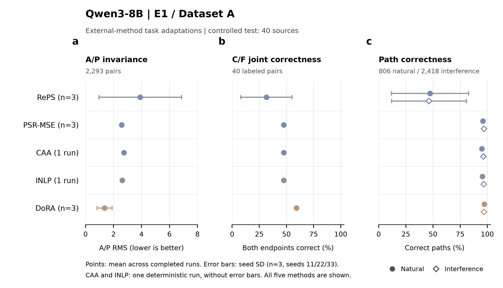

# ASTER-CR 新增外部方法结果（2026-11-14）

Qwen3-8B 上的 RePS、PSR、CAA、INLP 和 DoRA 共完成11次正式实验。DoRA、RePS、PSR使用种子11、22、33，CAA和INLP使用冻结配置。主训练数据为 E1 / Dataset A 的2,540对。

DoRA在本轮五种新增方法中取得最高的平均自然路径正确率（97.19%）、干扰路径正确率（96.91%）和C/F双端全对率（59.17%），A/P方差降低率为70.65%。PSR的C/F修正RMS为0.574，C/F证据响应保留率为99.13%，自然与干扰路径正确率分别为95.99%和96.84%。这些数字对应本轮受控测试和各方法的任务适配版本。

## 第4.5节数据

测试分母：A/P 2,293对、C/F 40对、自然路径806条、干扰路径2,418条；拟合/开发/测试按来源分离（80/20/40）。层、秩、方向、强度和阈值均在拟合/开发集确定后冻结。

下表为均值 ± 种子样本标准差；单次确定性配置不添加标准差。准确率、VR和ER以百分比显示，RMS单位为logit。

| 方法 | 运行数 | A/P RMS | VR % | C/F ER % | C/F修正RMS | C/F双端全对 % | 自然路径 % | 干扰路径 % |
|---|---:|---:|---:|---:|---:|---:|---:|---:|
| CAA | 1 | 2.75 | -9.66 | 99.55 | 1.08 | 47.50 | 95.04 | 96.44 |
| DoRA | 3 | 1.36 ± 0.54 | 70.65 ± 18.81 | 52.12 ± 10.58 | 21.17 ± 2.50 | 59.17 ± 1.44 | 97.19 ± 0.31 | 96.91 ± 0.36 |
| INLP | 1 | 2.63 | -0.04 | 100.02 | 0.02 | 47.50 | 95.41 | 96.73 |
| PSR-MSE | 3 | 2.58 ± 0.04 | 3.28 ± 2.84 | 99.13 ± 0.76 | 0.57 ± 0.50 | 47.50 ± 0.00 | 95.99 ± 0.61 | 96.84 ± 0.10 |
| RePS | 3 | 3.91 ± 2.95 | -201.70 ± 260.81 | 84.17 ± 94.10 | 28.23 ± 8.97 | 31.67 ± 23.63 | 47.27 ± 35.49 | 46.26 ± 34.35 |

## 结论与完整交付

- [完整结果与结论](../../reports/aster_codex03_external_20261112/REPORT.zh.md)：逐运行指标、纠正和新增错误、参数量、训练与推理成本、官方实现差异。
- [逐运行主表](../../reports/aster_codex03_external_20261112/section4_5_new_methods.csv)与[方法汇总](../../reports/aster_codex03_external_20261112/section4_5_method_summary.csv)。
- [逐例、逐对与路径预测](../../reports/aster_codex03_external_20261112/evaluation/test/)：无损gzip压缩文件及完整统计。
- [代码与复现说明](../../experiments/aster_codex03_external_20261112/README.md)，[交付说明](../../reports/aster_codex03_external_20261112/DELIVERY.zh.md)，[服务器资产位置](../../reports/aster_codex03_external_20261112/SERVER_ARTIFACTS.json)。

完整报告保留全部11次实际结果。官方代码版本、训练配置、开发选择和冻结配置随交付保存。论文正文保持原状。
