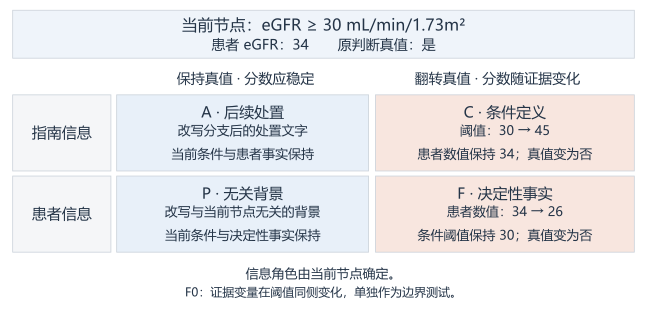
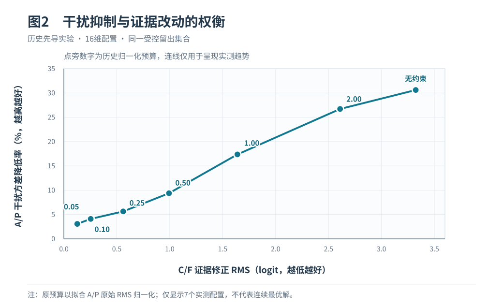

# 对消，而非擦除：用干扰痕迹修正大模型的指南条件判断

[附录 A：理论分析](manuscript.appendix.zh.md#appendix-a) · [附录 B：评价与实现](manuscript.appendix.zh.md#appendix-b) · [附录 C：补充实测](manuscript.appendix.zh.md#appendix-c) · [附录 D：合成实验](manuscript.appendix.zh.md#appendix-d)

## 摘要

医学指南条件判断需要区分当前条件的决定性证据与后续处置、无关背景等干扰信息。ASTER-CR保留完整指南与患者输入，使用A/P配对估计输入相关的干扰修正，并通过C/F配对约束修正对决定性证据响应的改变。已有实验以MEGA-CDP的2,540对均衡配对训练含截距的历史配置，在Qwen3-8B上完成80个指南来源的五折验证，并完成E5扩展基线、E6多模型官方MEGA评价、E7冻结迁移和E8 Base/IT检查点比较。五折合并结果中，E1将A/P分数差方差降低3.50%，C/F有向响应保留率为99.98%，证据修正RMS为0.123 logit；但相对独立截距基线，自然路径正确率差值的95%区间为−0.170至+0.172个百分点，未显示稳定的额外任务收益。五个IT检查点的官方MEGA评价中，E1相对原模型仅在Llama-3.1-8B-Instruct（+2.82个百分点）和MedGemma-27B-Text-IT（+0.32个百分点）取得区间不跨零的正差值；但相对独立截距的点差仅为1和2条路径。两个Base检查点也观察到较大提升，但模型版本追溯并不完整。冻结迁移覆盖五个模型的20个模型—任务总体，结果随模型和任务变化，Gemma3在MedPIC188上出现明确下降。E5扩展基线同样显示任务效用、干扰抑制和证据保护之间的权衡。结果支持ASTER-CR能够实施低维、受约束的输入相关分数修正，但尚不足以证明稳定的普遍准确率提升或临床效益。

## 1 引言

大型语言模型正被用于解读临床指南和患者记录，并判断患者是否满足具体决策条件。近期研究建立了临床决策路径遵循基准，并通过患者信息的反事实变化评价用药安全推理（Chen et al., 2026; Hou et al., 2026）。可靠的指南判断要求模型在条件定义与患者决定性事实保持不变时维持判断，并随这些证据变化更新判断（Jacovi & Goldberg, 2020; Veitch et al., 2021）。

根据主要干预位置，相关研究可分为输入/输出层行为控制和表示层信息控制。输入/输出层方法围绕忠实性评价、反事实稳定性、分数校准与上下文解码展开，直接分析模型可观察的判断并调整输出分布。Jacovi and Goldberg（2020）提出自然语言处理系统的解释忠实性定义与评价框架，Veitch et al.（2021）研究模型对虚假相关因素的反事实不变性。Turpin et al.（2023）分析思维链解释与模型实际决策之间的偏差，Lampinen et al.（2024）研究内容变化对推理任务表现的影响。Guo et al.（2017）使用温度缩放调整模型置信度。Zhao et al.（2021）通过无内容参考输入估计标签偏置，Zhou et al.（2024）利用无标签批次输出进行批量校准。Shi et al.（2024）比较模型在有无上下文时的输出，以强化上下文证据的作用；Liu et al.（2021）组合基础模型、专家模型和反专家模型的输出，以控制生成属性。Chen et al.（2026）提出 MEGA-CDP，评价模型对临床指南决策路径的遵循情况；Hou et al.（2026）提出 MedPIC-Bench，通过患者信息反事实配对评价条件化用药安全推理。

表示层方法通过隐藏状态干预与参数更新控制模型内部信息和生成行为。概念擦除方法包括迭代零空间投影 INLP、对抗式线性擦除 R-LACE、闭式线性擦除 LEACE，以及基于交叉协方差的 SAL（Ravfogel et al., 2020, 2022a; Belrose et al., 2023; Shao et al., 2023）。非线性概念擦除进一步采用核化对抗优化、率失真目标、类别条件分布匹配和交替编码器训练（Ravfogel et al., 2022b; Chowdhury et al., 2023; Saillenfest & Lemberger, 2025; Akbari et al., 2025）；Chowdhury et al.（2025）分析完全概念擦除的信息论极限。激活引导方法沿特定表示方向调节模型行为：ITI 使用注意力头方向引导输出，CAA 从成对示例的残差激活差估计干预向量，CAST 根据输入激活选择性触发行为向量（Li et al., 2023; Rimsky et al., 2024; Lee et al., 2025）。LoFiT 和 LoReFT 分别学习局部表示调整与低秩表示变换（Yin et al., 2024; Wu et al., 2024）。近期研究进一步发展了动态引导与统一评价：Stolfo et al.（2025）利用指令差分激活构造可组合的引导向量；AxBench 统一比较提示、微调、线性表示方法、监督引导和稀疏自编码器（Wu et al., 2025a）；RePS 通过双向偏好优化学习表示引导，PSR 则从提示行为中蒸馏位置相关的激活干预系数（Wu et al., 2025b; Heyman & Vandeputte, 2026）。机制研究方面，Cheng et al.（2026）通过多词元激活修补分析表示引导与注意力 OV 回路的交互；SteeringSafety 在九类安全维度上系统评价表示引导，并揭示不同目标之间的行为纠缠（Siu et al., 2026）。Venhoff et al.（2026）通过匹配基础模型与思考模型检查点分析后训练对推理机制和触发策略的影响，Xu（2026）则考察指令暴露与潜在行为方向可干预性之间的关系。参数高效微调方法通过权重更新调整模型行为，包括 LoRA 的低秩适配、DoRA 的幅值与方向分解，以及 FourierFT 的频域参数化（Hu et al., 2022; Liu et al., 2024; Gao et al., 2024）。

指南节点的判断真值由当前条件定义 C 与患者决定性事实 F 共同确定；后续处置 A 与无关背景 P 构成完整上下文中的非决定性变化。因此，指南条件判断具有两类互补要求：A/P 配对保持决定性证据，要求判断分数对非决定性变化保持稳定；C/F 配对改变条件或决定性事实，要求判断分数跟随证据变化。实现这两类响应的关键，是从内部表示中识别能够预测完整干扰分数贡献的信息，并利用证据变化约束修正函数。我们的诊断显示，16 维痕迹坐标可解释开发集 A 类配对中 40.63% 的干扰分数差变异；沿痕迹方向的直接修补效应占完整干扰效应 RMS 的 13.91%。这一结果表明，内部痕迹包含可用于估计总干扰贡献的预测信息。基于这一观察，我们将痕迹预测与证据约束结合起来，形成面向决策分数的预测式干扰对消目标。

本文提出 ASTER-CR，一种利用内部痕迹估计干扰贡献、并在证据约束下修正决策分数的框架。具体而言，机制引导的注意力头定位模块结合梯度归因与双向激活修补，筛选对当前判断分数具有实际影响的注意力头。证据感知痕迹提取模块根据所选注意力头的答案位置激活，分别估计证据子空间与干扰子空间，并将干扰子空间投影到证据子空间的正交补，以构造内部痕迹。证据约束的干扰对消与判断校准模块利用痕迹差拟合 A/P 配对的原始分数差，通过 C/F 配对逐对约束修正幅度，并使用自然训练节点拟合保持分数符号的正比例概率校准。在 Qwen3-8B 的MEGA-CDP八十来源五折验证中，含截距的历史配置将A/P干扰方差降低3.498%（95% CI：0.747%–6.359%），保留99.984%的C/F有向证据响应，证据修正RMS为0.1225 logit。E6进一步在五个IT检查点及两个Base检查点上评价官方MEGA完整路径，并在两款27B模型上完成受控来源评价；E7补齐五模型冻结跨任务评价。结果显示，多模型与跨任务收益并不一致，且相对独立截距的额外收益小于相对原模型的表面差值。

我们的贡献如下：首先，我们将指南条件判断形式化为条件不变性与证据敏感性相结合的决策分数问题，并提出 A/P 与 C/F 配对评价，分别刻画非决定性变化下的分数稳定性和决定性证据响应。其次，我们提出 ASTER-CR，通过注意力头定位、证据感知痕迹提取和受约束分数修正，实现输入相关的干扰贡献估计与证据保持，并用可分离可预测性与证据覆盖残差刻画干扰修正和证据保持。最后，我们在 MEGA-CDP、NLI4CT 和 MedPIC 上开展配对行为、任务效用与冻结跨任务评价，并补充五个IT、两个Base检查点的官方MEGA评价及Base/IT注意力头集合比较。来源五折验证显示，ASTER-CR将A/P干扰方差降低3.498%，同时保留99.984%的C/F有向证据响应；多模型与跨任务结果则揭示了模型和任务依赖的性能差异，未显示普遍的整体准确率提升。

## 2 相关工作

### 2.1 行为忠实性与输入干预

解释忠实性关注解释与实际决策过程的联系（Jacovi & Goldberg, 2020）。模型可能受到解释未充分揭示的偏置影响（Turpin et al., 2023），也可能呈现推理内容效应（Lampinen et al., 2024）。本文将规则规定的输入干预转化为两类配对评价：A/P配对保持决定性证据和标签不变，检验判断对无关变化的稳定性；C/F配对改变条件或决定性事实，检验判断对证据变化的响应。该设计将反事实不变性研究（Veitch et al., 2021）落实为可测的分数差与配对正确率。

处置遮挡、仅保留条件和证据抽取构成输入层对照，用于评价输入删除对条件定义及任务信息的影响。方法消融、输入层对照和外部算法基线分别承担机制分析、信息保留和方法比较的论证职责。

相关方法按主要作用位置及优化目标组织。第4.1.5节给出五种新增外部方法的主比较，第4.1.6节给出扩展输出控制与监督基线；函数容量和修正位置的内部比较见第4.2.4节。

### 2.2 输出校准、监督读出与对比解码

输出层方法包括分数缩放、偏置估计和输入相关修正。温度缩放用一个正温度调整置信度（Guo et al., 2017），本文以固定正比例缩放作为整体幅度控制。上下文校准（CC）从无内容参考估计标签偏置（Zhao et al., 2021）；批量校准（BC）利用无标签输入的平均输出估计偏置（Zhou et al., 2024）。本文的仅截距校准使用自然训练输入的任务标签，普通监督线性读出重新学习分类方向。这些方法分别提供幅度、偏置和任务监督读出的比较基准。

上下文感知解码（CAD）组合同一模型在有、无上下文时的输出，强化上下文相对于模型先验的影响（Shi et al., 2024）。DExperts组合基础模型、专家和反专家的输出以控制生成属性（Liu et al., 2021）。CAD提供条件对比分数基线；DExperts代表需要额外专家训练的解码控制路线。

AxBench在Gemma-2-2B和9B上统一比较提示、微调、线性表示方法、监督引导和稀疏自编码器，报告提示在行为引导任务上的表现，以及微调和线性方法在不同任务上的优势（Wu et al., 2025a）。据此，本文将监督线性读出和参数微调纳入Qwen3-8B主实验比较，与表示干预方法共同评价。

ASTER-CR以A/P配对差分监督输入相关分数修正，并以C/F配对约束证据响应。固定截距在配对差分中抵消；统一正比例缩放按相同比例改变干扰与证据响应。两类控制为输入相关修正提供明确的比较参照。

### 2.3 概念擦除

概念擦除包含多种优化路线。INLP迭代移除线性分类方向（Ravfogel et al., 2020）；R-LACE通过带秩约束的线性对抗优化学习投影（Ravfogel et al., 2022a）；LEACE给出闭式线性擦除（Belrose et al., 2023）。谱属性移除（SAL）依据表示与概念的交叉协方差移除高协变方向，其核化版本kSAL扩展到核特征空间（Shao et al., 2023）。

非线性概念擦除包括核化对抗擦除（Ravfogel et al., 2022b）、核化率失真方法KRaM（Chowdhury et al., 2023）、基于类别条件分布匹配的非线性LEOPARD（Saillenfest & Lemberger, 2025），以及交替训练编码器与核空间变换的Obliviator（Akbari et al., 2025）。FaRM研究率失真目标下的公平表示，并包含使用任务标签的设置（Chowdhury & Chaturvedi, 2022）；完全概念擦除的信息论极限也已有专门研究（Chowdhury et al., 2025）。

本文将概念擦除作为表示层参照，重点评价指定判断分数对无关变化的响应，以及对决定性证据变化的保留。该任务目标由A/P和C/F配对指标共同刻画。

### 2.4 表示干预与表示微调

表示干预可以使用固定方向，也可以依输入决定是否干预。ITI沿估计的注意力头方向调整激活（Li et al., 2023）；对比激活相加（CAA）用成对行为示例的残差激活差估计干预向量（Rimsky et al., 2024）；条件激活引导（CAST）用输入激活识别条件，再选择性施加行为向量（Lee et al., 2025）。三者分别提供共享方向、成对方向和条件触发的表示干预参照。

LoFiT学习局部表示调整（Yin, Ye & Durrett, 2024）；LoReFT学习低秩表示干预，同一研究中的DiReFT提供简化的表示变换对照（Wu et al., 2024）。本文以共享痕迹和配对监督构造线性及多层感知机表示编辑，用于分析函数容量与干预位置。

近年的表示引导研究进一步发展了成对监督和动态干预。Stolfo et al.（2025）研究指令差分激活向量及其跨模型迁移；AxBench建立提示、微调和表示干预的统一基准（Wu et al., 2025a）。RePS以双向偏好优化学习表示引导（Wu et al., 2025b）；PSR从输入激活估计位置相关的引导系数（Heyman & Vandeputte, 2026）。这些方法分别提供成对偏好学习和动态引导强度的设计参照。

Cheng et al.（2026）通过多词元激活修补研究拒绝行为中的表示引导，报告引导向量主要与注意力OV回路交互。该机制结果为本文M1的注意力头定位和OV路径分析提供研究线索。

Venhoff et al.（2026）比较基础模型与思考模型检查点，分析RL训练、SFT蒸馏及混合训练对模型行为的影响；Xu（2026）的预印本比较Gemma-2、Llama-3.1和Qwen-2.5的Base/IT匹配检查点，报告指令暴露程度与方向的行为可干预性相关。这些研究支持通过同家族匹配检查点分析后训练对表示行为的影响。

### 2.5 参数高效权重微调

LoRA用低秩矩阵参数化权重更新（Hu et al., 2022）。DoRA将权重幅值和方向分开，并对方向采用低秩适配（Liu et al., 2024）。FourierFT学习权重增量的部分傅里叶系数，再重建权重更新（Gao et al., 2024）。三者分别代表低秩更新、幅值—方向分解和频域参数化。

权重微调与表示干预按参数作用位置区分。成本评价同时记录训练参数、更新模块、训练量、搜索开销、选头、标准化和子空间存储。ASTER-CR的M3线性校正层包含16个输出系数；完整方法成本按全部模块统计。

## 3 方法

ASTER-CR 在冻结模型的完整前向计算后，读取内部表示并修正当前节点的判断分数。三个模块依次确定从哪里读、读哪一部分、修正多少：M1 选择判断位置的注意力头；M2 提取与主要证据方向正交的表示分量；M3 学习受证据预算约束的线性读出。

证据保护分为两层：M2 使修正对估计证据子空间内的变化恒为零，M3 限制剩余证据变化引起的修正。下文先定义输入、分数与配对目标，再依次构造表示、子空间和读出系数，最后给出完整修正函数。推理时固定全部参数，保留完整指南和患者输入，并将修正分数映射为判断概率。

### 3.1 问题形式化：干扰稳定性与证据保持

信息的作用由当前判断节点及具体改动确定。改变当前条件或患者事实使真值翻转时，该改动提供决定性证据；保持当前条件和决定性事实的改动用于检验非决定性信息的影响。年龄在年龄条件节点上可以决定真值，在其他节点上可以作为无关背景。四类配对将“信息来自指南还是患者”和“是否改变当前真值”交叉起来（图1）。



**图1：节点条件化的信息角色。** 以“eGFR ≥ 30 mL/min/1.73m²”、患者 eGFR 为 34 为例，A 改写后续处置，P 改写无关背景；C 将阈值改为 45，F 将患者数值改为 26。A/P 保持真值，C/F 翻转真值。该例用于说明配对定义。

**输入与判断分数。** 记 $`m`$ 为基础模型索引，$`f_m`$ 为冻结模型，$`x`$ 为包含当前节点、完整指南和患者信息的输入，$`y\in\{0,1\}`$ 为其二元真值。第 $`i`$ 个配对的左、右输入记为 $`x_i^L,x_i^R`$，类别为 $`q_i\in\{A,P,C,F\}`$，两端标签为 $`y_i^L,y_i^R\in\{0,1\}`$，其中 1 表示满足当前条件。指南来源的集合记为 $`\mathcal G`$，第 $`i`$ 对的来源为 $`g_i\in\mathcal G`$。

模型对正、负答案词元的输出 logit 分别记为 $`o_+(x),o_-(x)`$；原判断分数记为 $`\ell_0(x)`$，原二元预测记为 $`\hat y_0(x)`$。指示函数 $`\mathbf1[\cdot]`$ 在括号内条件成立时取 1，否则取 0。分数和预测定义为

```math
\ell_0(x)=o_+(x)-o_-(x),
\qquad
\hat y_0(x)=\mathbf1[\ell_0(x)\gt 0].
```

固定模型时，原分数及答案 logit 省略下标 $`m`$。对任意标量或向量函数 $`u`$，配对差分算子统一定义为 $`\Delta u_i=u(x_i^R)-u(x_i^L)`$；因此原分数差为 $`\Delta\ell_{0,i}=\ell_0(x_i^R)-\ell_0(x_i^L)`$。全文的 $`(\cdot)^\top`$ 表示转置，$`\|\cdot\|_2`$ 表示欧氏范数。

**配对集合与权重。** 用 $`Q`$ 表示单类或合并类别：$`Q\in\{A,P,C,F,AP,CF\}`$，其中 AP 合并 A、P，CF 合并 C、F。训练和评价配对的索引集合分别记为 $`\mathcal I_Q^{\mathrm{train}}`$ 与 $`\mathcal I_Q^{\mathrm{eval}}`$；全部训练配对的索引集合记为 $`\mathcal I^{\mathrm{train}}`$。在当前数据集合中，以 $`\omega_i`$ 表示按类别、来源、病例及变体分配的非负基础权重。对任一权重总和为正的非空子集 $`\mathcal J`$，其归一化权重定义为

```math
\omega_i(\mathcal J)=
\frac{\omega_i}{\sum_{j\in\mathcal J}\omega_j},
\qquad i\in\mathcal J.
```

训练与评价分别在各自的数据集合内应用同一加权规则，层级权重的具体构造见[附录 B.7](manuscript.appendix.zh.md#appendix-b-7)。

**修正目标。** 记 $`c(x)`$ 为待学习的附加分数，$`\ell_c(x)`$ 为修正后的判断分数，定义 $`\ell_c(x)=\ell_0(x)+c(x)`$。由上述差分约定，修正差为 $`\Delta c_i=c(x_i^R)-c(x_i^L)`$。给定非负证据预算 $`\delta`$，目标是在训练 C/F 配对满足逐对预算的条件下，最小化训练 A/P 的加权平方分数差：

```math
\min_c\quad
\sum_{i\in\mathcal I_{AP}^{\mathrm{train}}}
\omega_i(\mathcal I_{AP}^{\mathrm{train}})
\bigl(\Delta\ell_{0,i}+\Delta c_i\bigr)^2,
\qquad
|\Delta c_i|\leq\delta,\quad
i\in\mathcal I_{CF}^{\mathrm{train}}.
```

A/P 目标抑制非决定性变化下的敏感度，C/F 约束保持原模型随证据变化的响应。F0 改变当前节点使用的证据变量，但改动仍位于阈值同侧；它作为边界测试，检查修正是否把证据变量的变化当作干扰，单独报告分数变化与判断正确率。

**修正需要分数之外的信息。** 输入无关的修正满足 $`\Delta c_i=0`$，对配对目标没有作用。用 $`g`$ 表示一个仅接收原分数的标量函数；若 $`c(x)=g(\ell_0(x))`$，原分数相同的输入必然获得相同修正。当一个 A/P 配对与一个 C/F 配对具有相同的两端原分数时，这种修正也给出相同的修正差；若抵消 A/P 所需幅度超过 C/F 预算，两项要求无法同时满足。本文读取判断位置的内部表示，为区分干扰与证据引起的偏移提供额外信息。

**线性读出把两类要求写成可解的约束。** 记 $`t(x)`$ 为固定的内部特征向量，$`w`$ 为同维数的待学习系数，$`\mu_c`$ 为给定系数后的中心化常数。线性修正定义为 $`c(x)=w^\top t(x)-\mu_c`$，由差分约定得到 $`\Delta c_i=w^\top\Delta t_i`$。A/P 平方损失关于 $`w`$ 为凸函数，C/F 预算对应线性不等式。选择输出读出使约束直接作用于最终分数差；将变化写回激活后，后续网络会继续变换该变化，需要通过完整前向重新计算其分数效应。M1、M2 固定后，M3 因而是一个凸二次规划。

### 3.2 M1：判断位置的注意力头定位

判断位置的注意力头汇集了当前节点与上下文的信息。在本文使用的标准 Transformer 中，注意力承担跨位置的信息传递，前馈网络在各位置分别计算。头输出经输出投影线性加入残差流；固定后续归一化尺度时，其沿残差直达答案 logit 的贡献具有线性形式。这一结构支持从头输出构造线性读出，完整前向中的总效应则由激活修补测量。用因果中介分析定位少数关键头已有先例（[Vig et al., 2020](https://arxiv.org/abs/2004.12265)）。

用 $`h`$ 索引一个包含层号的注意力头，$`\mathbf z_h(x)`$ 表示该头在最后一个输入词元、注意力输出投影之前的激活。定位分为梯度筛选与精确修补两阶段：梯度归因以一次局部线性近似估计大量头的作用，精确修补随后验证候选头的实际分数效应（[Nanda, 2023](https://www.neelnanda.io/mechanistic-interpretability/attribution-patching)）。梯度近似存在显著假阴性，修补结果也随评价指标而变化（[Kramár et al., 2024](https://arxiv.org/abs/2403.00745)；[Zhang & Nanda, 2024](https://arxiv.org/abs/2309.16042)）。因此，全流程固定使用同一二元 logit 差，候选阈值采用偏重召回的设置，并以全头精确修补评价筛选召回率。

**两阶段效应估计。** 训练来源按指南划分为互斥折，每折在其余来源筛选候选，在该折留出的来源验证。记 $`q\in\{A,P,C,F\}`$ 为当前类别，$`\mathcal D_q`$ 为当前筛选来源内该类配对的索引集合，$`a_{q,h}`$ 为头的候选归因分数。头激活差按前述约定写为 $`\Delta\mathbf z_{i,h}=\mathbf z_h(x_i^R)-\mathbf z_h(x_i^L)`$，$`\nabla_{\mathbf z_h}\ell_0(x)`$ 表示判断分数对该头激活的梯度。候选分数取两端梯度归因绝对值的加权平均：

```math
a_{q,h}=
\sum_{i\in\mathcal D_q}\omega_i(\mathcal D_q)
\frac{
|\nabla_{\mathbf z_h}\ell_0(x_i^L)^\top\Delta\mathbf z_{i,h}|
+
|\nabla_{\mathbf z_h}\ell_0(x_i^R)^\top\Delta\mathbf z_{i,h}|
}{2}.
```

候选集合记为 $`\mathcal K_q`$，其稳健标准化与阈值细节见[附录 B.7](manuscript.appendix.zh.md#appendix-b-7)。对候选头，分别将右端激活移入左端输入、将左端激活移入右端输入。对当前输入 $`x`$ 和供体输入 $`x'`$，将替换头激活并继续前向后得到的分数记为 $`\ell_0(x;\mathbf z_h\leftarrow\mathbf z_h(x'))`$。两向修补引起的分数变化分别记为 $`\Delta_{i,h}^{L\leftarrow R},\Delta_{i,h}^{R\leftarrow L}`$，对称修补贡献记为 $`\phi_{i,h}`$，定义为

```math
\begin{aligned}
\Delta_{i,h}^{L\leftarrow R}
&=\ell_0(x_i^L;\mathbf z_h\leftarrow\mathbf z_h(x_i^R))-\ell_0(x_i^L),\\
\Delta_{i,h}^{R\leftarrow L}
&=\ell_0(x_i^R;\mathbf z_h\leftarrow\mathbf z_h(x_i^L))-\ell_0(x_i^R),\\
\phi_{i,h}
&=\tfrac12\bigl(\Delta_{i,h}^{L\leftarrow R}-\Delta_{i,h}^{R\leftarrow L}\bigr).
\end{aligned}
```

A/P 以 $`|\phi_{i,h}|`$ 衡量干扰贡献幅度；C/F 以 $`\phi_{i,h}(y_i^R-y_i^L)`$ 衡量与真值变化对齐的证据贡献。精确修补可以排除候选中的假阳性，筛选阶段遗漏的头需要全头修补才能检出。补充实验在 Qwen3-8B 上覆盖全部头，按类别报告候选阈值变化下的召回率和修补成本；具体状态见实验框架。

**来源级统计与头集合。** 统计单位是指南来源。同一来源内的病例和改写先汇总为来源级效应，再对来源进行符号翻转检验和自助重采样。匹配对照在相同来源、配对类别与有序标签转换模式内交换供体。A/P 使用单侧检验识别高于对照的干扰幅度；C/F 使用双侧检验，覆盖同向和反向承载证据变化的通路。类别内多重检验采用 BH 校正，选择条件和稳定性阈值列于[附录 B.7](manuscript.appendix.zh.md#appendix-b-7)。

记 $`\mathcal H_q`$ 为类别 $`q`$ 中通过候选筛选、来源效应检验和稳定性条件的头集合。干扰相关集合、证据相关集合及模型最终使用的头集合分别记为 $`\mathcal H_{AP},\mathcal H_{CF},\mathcal H_m`$，按类别合并：

```math
\mathcal H_{AP}=\mathcal H_A\cup\mathcal H_P,\qquad
\mathcal H_{CF}=\mathcal H_C\cup\mathcal H_F,\qquad
\mathcal H_m=\mathcal H_{AP}\cup\mathcal H_{CF}.
```

集合两侧的竖线表示元素数。干扰与证据在组件层面的共享由 $`|\mathcal H_{AP}\cap\mathcal H_{CF}|`$ 衡量，同时报告两类集合的大小与交集比例。M1 输出头索引、类别和修补效应。记 $`d_m`$ 为所选头激活的总维数，$`\mathrm{Concat}`$ 为按固定头顺序拼接向量的操作，向 M2 提供的拼接表示 $`\mathbf z_{\mathcal H,m}(x)`$ 定义为

```math
\mathbf z_{\mathcal H,m}(x)=
\mathrm{Concat}_{h\in\mathcal H_m}\mathbf z_h(x)
\in\mathbb R^{d_m}.
```

### 3.3 M2：证据正交的表示读出

干扰与证据可以进入同一组头，M2 因而在所选表示中进一步分离可读方向。标准化、子空间估计和 M3 回归共用第3.1节的权重规则。训练配对中所有不同输入端点构成集合 $`\mathcal V_{\mathrm{pair}}`$，以 $`v`$ 索引其中一个端点，其权重记为 $`\omega_v^{\mathrm{pair}}`$；每个配对向两端各分一半权重，并合并重复端点（[附录 B.7](manuscript.appendix.zh.md#appendix-b-7)）。

训练端点表示的加权均值和逐维标准差分别记为 $`\mu_m,\sigma_m`$，标准差下限见[附录 B.7](manuscript.appendix.zh.md#appendix-b-7)；$`\oslash`$ 表示逐元素除法。标准化表示记为 $`\tilde{\mathbf z}_{\mathcal H,m}(x)`$，其第 $`i`$ 个配对差记为 $`\Delta\tilde{\mathbf z}_{m,i}`$，定义为

```math
\tilde{\mathbf z}_{\mathcal H,m}(x)
=(\mathbf z_{\mathcal H,m}(x)-\mu_m)\oslash\sigma_m,
\qquad
\Delta\tilde{\mathbf z}_{m,i}
=\tilde{\mathbf z}_{\mathcal H,m}(x_i^R)
-\tilde{\mathbf z}_{\mathcal H,m}(x_i^L).
```

记 $`X_{Q,m}`$ 为类别组 $`Q\in\{AP,CF\}`$ 的训练加权差分矩阵，$`k_m`$ 为保留方向数的上限。算子 $`\mathrm{basis}_{k_m}`$ 提取至多 $`k_m`$ 个主要、非零右奇异方向，$`\mathrm{orth}`$ 对矩阵的列空间作正交归一化并去除数值零方向，$`I`$ 为所在空间的单位矩阵。证据基、初始干扰基、投影后的读出基分别记为 $`S_m,U_m,N_m`$，内部特征记为 $`t_m(x)`$。它们按以下顺序构造：

```math
\begin{aligned}
X_{Q,m}
&=\left[\sqrt{\omega_i(\mathcal I_Q^{\mathrm{train}})}
\,\Delta\tilde{\mathbf z}_{m,i}^{\top}\right]_{i\in\mathcal I_Q^{\mathrm{train}}},
\quad Q\in\{AP,CF\},\\
S_m&=\mathrm{basis}_{k_m}(X_{CF,m}),\qquad
U_m=\mathrm{basis}_{k_m}(X_{AP,m}),\\
N_m&=\mathrm{orth}\bigl((I-S_mS_m^\top)U_m\bigr),\qquad
t_m(x)=N_m^\top\tilde{\mathbf z}_{\mathcal H,m}(x).
\end{aligned}
```

各基按列正交归一，故 $`S_m^\top N_m=0`$。内部特征的维数等于 $`N_m`$ 的列数；子空间维度及数值阈值见[附录 B.7](manuscript.appendix.zh.md#appendix-b-7)。

**命题1（证据子空间内的精确保留）。** 记 $`\mathrm{span}(S_m)`$ 为证据基各列张成的子空间。对任意与内部特征同维的读出系数 $`w`$ 和任意配对 $`i`$，若 $`\Delta\tilde{\mathbf z}_{m,i}\in\mathrm{span}(S_m)`$，则 $`\Delta c_i=w^\top N_m^\top\Delta\tilde{\mathbf z}_{m,i}=0`$。

证明：子空间条件保证存在坐标向量 $`a`$，使 $`\Delta\tilde{\mathbf z}_{m,i}=S_ma`$，再由 $`N_m^\top S_m=0`$ 得到结论。一般证据变化可分解为子空间内外两部分，因此

```math
\Delta c_i=
w^\top N_m^\top(I-S_mS_m^\top)\Delta\tilde{\mathbf z}_{m,i}.
```

修正对证据的剩余响应全部来自 $`S_m`$ 之外且能被 $`N_m`$ 读到的分量，M3 对实际 C/F 配对约束这一部分。该保护同时放弃了对 $`S_m`$ 内干扰分量的修正。其代价用 A/P 差分落在证据子空间内的加权能量比例，以及投影前后可预测性的变化衡量；二者分别描述被放弃的表示变化和可用于分数修正的信息。

**节点条件化与可证伪解释。** 读出发生在判断位置，此处表示已经随当前节点和完整输入共同变化。全局基是在这些节点条件化表示上估计的；其跨节点适用性通过按节点类型分层的可预测性、证据覆盖残差和任务结果检验。若“处置文字可充当条件定义的代理”解释成立，A 类方向应更接近证据方向。分别用 A、P 训练差分估计同维数的初始干扰基，记为 $`U_A,U_P`$。对两个列正交基 $`B_1,B_2`$，以 $`j`$ 索引从小到大排序的主角度，第 $`j`$ 个角度记为 $`\theta_j(B_1,B_2)`$，由 $`B_1^\top B_2`$ 的第 $`j`$ 大奇异值取反余弦得到。可检验的预期为 $`\theta_j(U_A,S_m)\lt \theta_j(U_P,S_m)`$；报告角度分布与来源重采样区间。

M2 投影的是读出方向。AlphaEdit 将参数扰动投影到保留知识的零空间，SEA 则通过谱分解编辑输入激活（[Fang et al., 2025](https://proceedings.iclr.cc/paper_files/paper/2025/hash/29c8c615b3187ee995029284702d3f43-Abstract-Conference.html)；[Qiu et al., 2024](https://proceedings.neurips.cc/paper_files/paper/2024/hash/684c59d614fe6ae74a3be8c3ef07e061-Abstract-Conference.html)）。ASTER-CR 将投影结果用于计算附加分数，原前向中的激活和参数保持固定。

### 3.4 M3：证据约束的分数修正

M3 从 A/P 配对分数差学习修正，并用 C/F 配对限定证据响应的改动。固定 M1、M2 后，内部特征差 $`\Delta t_{m,i}=t_m(x_i^R)-t_m(x_i^L)`$ 已知。沿用第3.1节的线性系数 $`w`$，将训练 A/P 的加权平方损失记为 $`L_{AP}(w)`$，定义为

```math
L_{AP}(w)=
\sum_{i\in\mathcal I_{AP}^{\mathrm{train}}}
\omega_i(\mathcal I_{AP}^{\mathrm{train}})
\bigl(\Delta\ell_{0,i}+w^\top\Delta t_{m,i}\bigr)^2.
```

**预算与凸优化。** 记 $`\kappa\geq0`$ 为无量纲预算参数，$`\delta_m`$ 为模型 $`m`$ 的证据预算，$`\mathrm{median}`$ 表示中位数。预算用训练 C/F 的原分数变化定标：

```math
\delta_m=\kappa\,
\mathrm{median}_{i\in\mathcal I_{CF}^{\mathrm{train}}}
|\Delta\ell_{0,i}|.
```

整体分数单位改变时，预算随之等比例变化；中位数为零时，定义给出 $`\delta_m=0`$。给定正的岭正则系数 $`\lambda_m`$，将最优读出系数记为 $`\hat w_m`$。它由以下凸二次规划确定：

```math
\begin{aligned}
\hat w_m=\arg\min_w\quad&
L_{AP}(w)+\lambda_m\|w\|_2^2,\\
\text{subject to}\quad&
-\delta_m\leq w^\top\Delta t_{m,i}\leq\delta_m,
\quad i\in\mathcal I_{CF}^{\mathrm{train}}.
\end{aligned}
```

正则项控制读出系数的大小，并使目标严格凸。对任何 $`\delta_m\geq0`$，$`w=0`$ 恒可行，故最优解满足

```math
L_{AP}(\hat w_m)+\lambda_m\|\hat w_m\|_2^2
\leq L_{AP}(0).
```

因此，训练集上的 A/P 加权平方分数差不会增加；$`\delta_m=0`$ 时，训练 C/F 的分数响应完全保持。留出配对的证据改动由[附录 A](manuscript.appendix.zh.md#appendix-a) 的覆盖残差界和实测共同刻画。图3以 $`\kappa`$ 扫描生成 ASTER-CR 的干扰抑制—证据改动曲线，并与基线的强度曲线比较。

**证据响应的评价。** 证据约束以原模型的 C/F 响应为保持对象，A/P 监督则负责识别待消除的分数变化。增强 C/F 响应会引入额外的证据监督目标。因此，实验同时报告原模型和修正后的 C/F 方向正确率。对待评价分数函数 $`\ell`$，按第3.1节约定计算 $`\Delta\ell_i`$；方向正确率记为 $`\mathrm{DirAcc}_{CF}(\ell)`$，定义为

```math
\mathrm{DirAcc}_{CF}(\ell)
=\frac{1}{|\mathcal I_{CF}^{\mathrm{eval}}|}
\sum_{i\in\mathcal I_{CF}^{\mathrm{eval}}}
\mathbf1\!\left[(y_i^R-y_i^L)\Delta\ell_i\gt 0\right].
```

实验还报告双端全对率及原正向配对的方向退化数，以说明被保留的响应是否符合真值变化。

**中心化与判断。** 修正函数刻意不设置独立可训练截距，判断变化由随输入变化的读出项决定。中心化使用 M2 的训练端点集合 $`\mathcal V_{\mathrm{pair}}`$ 和权重 $`\omega_v^{\mathrm{pair}}`$。将模型对应的中心化常数、修正函数和最终分数分别记为 $`\mu_{c,m},c_m(x),\ell_{c,m}(x)`$，依次定义为

```math
\begin{aligned}
\mu_{c,m}
&=\sum_{v\in\mathcal V_{\mathrm{pair}}}
\omega_v^{\mathrm{pair}}\hat w_m^\top t_m(v),\\
c_m(x)
&=\hat w_m^\top t_m(x)-\mu_{c,m}
=\hat w_m^\top N_m^\top\tilde{\mathbf z}_{\mathcal H,m}(x)-\mu_{c,m},\\
\ell_{c,m}(x)&=\ell_0(x)+c_m(x).
\end{aligned}
```

该式汇总了三个模块：头集合确定表示来源，读出基选择可读分量，读出系数确定修正幅度。中心化常数由特征与系数确定。在同一端点分布上精确计算加权标准化时，$`\sum_{v\in\mathcal V_{\mathrm{pair}}}\omega_v^{\mathrm{pair}}t_m(v)=0`$，从而 $`\mu_{c,m}=0`$；保留该项明确中心化约定。任意配对中该常数均抵消，故模型对应的修正差满足 $`\Delta c_{m,i}=\hat w_m^\top\Delta t_{m,i}`$。

固定修正后，使用训练来源的自然节点和同一来源均衡规则拟合正比例系数 $`\beta_m\gt 0`$，将加权二元交叉熵最小化得到的系数记为 $`\hat\beta_m`$。对实数自变量 $`a`$，定义 sigmoid 函数 $`\mathrm{sigmoid}(a)=1/(1+\exp(-a))`$。最终正类概率记为 $`p_m(y=1\mid x)`$，二元预测记为 $`\hat y_m(x)`$，计算为

```math
p_m(y=1\mid x)=\mathrm{sigmoid}(\hat\beta_m\ell_{c,m}(x)),
\qquad
\hat y_m(x)=\mathbf1[\ell_{c,m}(x)\gt 0].
```

正比例校准保持判断分支。A/P 与 C/F 的分数指标统一在校准前的 $`\ell_{c,m}`$ 上计算，概率质量在校准后的输出上评价。

LitCab 同样从内部表示通过线性层预测附加 logit 偏置，用于语言模型校准（[Liu, Khalifa & Wang, 2024](https://openreview.net/forum?id=jH67LHVOIO)）。ASTER-CR 的方法区别在于三项联合设计：监督来自 A/P 配对分数差，读出方向与估计证据子空间正交，修正量受 C/F 逐对证据预算约束。这三项设计分别由可预测性分析、去投影消融和去约束消融检验。

**表1：主要记号汇总。**

| 记号 | 含义 |
|---|---|
| $`o_\pm,\ell_0,\ell_c`$ | 答案 logit、原判断分数、修正分数 |
| $`\phi_{i,h}`$ | 头 $`h`$ 对配对 $`i`$ 的对称修补贡献 |
| $`\mathcal K_q,\mathcal H_{AP},\mathcal H_{CF}`$ | 候选头集合、干扰相关头集合、证据相关头集合 |
| $`\mathbf z_{\mathcal H,m},\tilde{\mathbf z}_{\mathcal H,m}`$ | 所选头的拼接表示及其标准化表示 |
| $`S_m,U_m,N_m`$ | 证据基、初始干扰基、投影后的读出基 |
| $`t_m,c_m,\hat w_m`$ | 内部特征、分数修正、读出系数 |
| $`\omega_i,g_i,\mathcal G`$ | 配对基础权重、配对来源、来源集合 |

## 4 实验

本节报告已归档配置在核心行为、任务效用、跨模型与跨任务评价、外部基线、模块消融和机制方面的实验。归档配置采用 M1-v1 选头与截距校准，版本对应关系见[附录 B.7](manuscript.appendix.zh.md#appendix-b-7)。所有主结论均以真实模型预测和对应评价分母为依据。不同实验使用的训练协议、数据来源和评价总体并不完全相同，因此不将其合并为单一总分。

### 4.1 主实验

#### 4.1.1 实验设置

**模型与主训练数据。** 主干模型为冻结的BF16 Qwen3-8B，使用固定提示、分词器和最终答案位置的“是／否”logit差作为分数，标签投影采用FP32。主配置E1使用MEGA-CDP内的2,540对均衡配对，A、P、C、F各635对，覆盖80个指南来源。E1按类别及类别内来源均衡加权；现有E1/E2/E3结果使用旧版M1-v1（每类Top-64候选、最终固定51头），M2子空间秩为16，M3使用正则系数0.01和0.2923349 logit的逐对证据预算。第 3 节的方法采用 M1 自适应选头、统一配对权重、C/F 尺度预算，以及 M3 中心化修正和正比例概率校准。该三模块配置的对应实验结果待重新拟合与评价。E2使用6,345对合格配对并采用类别与来源均衡权重；E3使用相同数据池并采用自然样本权重。E2和E3仅作为同任务数据规模及权重消融，不替代E1主配置。

**数据划分与评价分母。** MEGA-CDP按指南来源划分为80个拟合来源、20个开发来源和40个受控留出来源。受控留出包含2,293对A/P、40对C/F、806条自然路径和2,418条干扰路径。另在MEGA官方测试集评价7,458条动态路径。NLI4CT-2024以500条原始声明计算原生准确率，并保留1,500组标签保持关系和864组标签翻转关系。MedPIC-Bench的本轮冻结测试为188道题，包含85组原生保持对、110组原生翻转对和1,880组背景保持对；93道开发题用于预先指定的集合校准。各任务按原生统计单位分别报告。

**指标与统计。** A/P干扰抑制报告分数差RMS及方差降低率（VR）；C/F证据保护报告有向响应保留率（ER）、证据修正RMS、双端全对率、方向退化数和超预算比例。任务效用报告自然节点、自然完整路径和干扰完整路径正确率；跨任务报告原生准确率、保持／翻转配对全对率及整题答案集合全对率。来源区间以指南来源为重采样单位，采用2,000次配对自助重采样。同一组来源抽样用于比较方法差值。训练式基线使用种子11、22、33并报告均值和样本标准差；确定性方法不添加虚构的种子波动。

**基线协议。** 新增外部方法包括RePS、PSR-MSE、CAA、INLP和DoRA，均使用E1任务数据和当前二元评分任务的适配版本。它们保留各自核心优化目标，不加入本文A/P一致性或C/F保持损失。CAA和INLP为确定性运行；RePS、PSR-MSE和DoRA各使用三个种子。LEACE、LoFiT、LoRA、CAD和ITI的统一效率结果另列；其历史检查点计时不等同于当前E1协议下的效能复现。外部方法的实现来源、任务适配、配置和逐运行结果见[外部方法报告](../../reports/aster_codex03_external_20261112/REPORT.zh.md)。

<a id="paired-diagnostics"></a>

#### 4.1.2 双重分离、干扰抑制与证据保持

表2将方法需要的两个条件放在同一评价中：证据正交特征能否预测 A/P 分数差，以及 C/F 变化在该特征中剩余多少。全部数值使用同一训练配置、来源划分和冻结特征。

**可分离可预测性。** 固定模型 $`m`$，将去掉 M3 证据约束、保留相同训练损失和岭系数后得到的读出记为 $`w_{\mathrm{ridge}}`$，即

```math
w_{\mathrm{ridge}}
=\arg\min_w\left[L_{AP}(w)+\lambda_m\|w\|_2^2\right].
```

记 $`\mathcal J_{AP}\subseteq\mathcal I_{AP}^{\mathrm{eval}}`$ 为当前评价的非空 A/P 子集，$`L_{AP,\mathcal J_{AP}}(w)`$ 为该子集上的加权平方残差。将相对零修正的残差降低比例称为可分离可预测性，记为 $`R^2_{\mathrm{sep}}(\mathcal J_{AP})`$，依次定义为

```math
\begin{aligned}
L_{AP,\mathcal J_{AP}}(w)
&=\sum_{i\in\mathcal J_{AP}}\omega_i(\mathcal J_{AP})
\bigl(\Delta\ell_{0,i}+w^\top\Delta t_{m,i}\bigr)^2,\\
R^2_{\mathrm{sep}}(\mathcal J_{AP})
&=1-\frac{L_{AP,\mathcal J_{AP}}(w_{\mathrm{ridge}})}
{L_{AP,\mathcal J_{AP}}(0)}.
\end{aligned}
```

分母为零时该指标记为不适用。评价使用冻结的训练读出；同一公式应用于训练配对时描述拟合能力。

**证据覆盖残差。** 记 $`\mathcal J_{CF}\subseteq\mathcal I_{CF}^{\mathrm{eval}}`$ 为当前评价的非空 C/F 子集，$`R_{\mathrm{cov}}(\mathcal J_{CF})`$ 为证据变化经过读出映射后的加权均方根：

```math
R_{\mathrm{cov}}(\mathcal J_{CF})
=
\sqrt{\sum_{i\in\mathcal J_{CF}}\omega_i(\mathcal J_{CF})
\left\|N_m^\top(I-S_mS_m^\top)
\Delta\tilde{\mathbf z}_{m,i}\right\|_2^2}.
```

该指标衡量证据子空间之外仍可被读出的变化。[附录 A](manuscript.appendix.zh.md#appendix-a) 给出岭解的闭式表达及该残差对应的证据改动界。

| 信息来源及配对类别 | 可分离可预测性 $`R^2_{\mathrm{sep}}`$ ↑ | 证据覆盖残差 $`R_{\mathrm{cov}}`$ ↓ |
|---|---:|---:|
| 指南信息：A / C | 待测（A） | 待测（C） |
| 患者信息：P / F | 待测（P） | 待测（F） |
| 总体：A/P / C/F | 待测（A/P） | 待测（C/F） |

**表2：干扰可预测性与证据覆盖的双重分离。** 每行第一列使用保持配对，第二列使用翻转配对；开发来源与留出来源分别报告，并按节点类型分层。表中指标对应第3节修订后的方法，结果待补。历史中心化决定系数及含截距配置的结果保留各自口径。



**图2：干扰抑制与证据保护的连续取舍。** 使用附录表C2的历史16维配置、同一受控留出集合。预算从0.05放宽至无约束时，A/P方差降低率由3.07%升至30.61%，C/F修正RMS由0.1266增至3.3240 logit。横轴预算按历史拟合A/P原始RMS归一化；第3.4节的新预算按训练C/F中位绝对分数差定标。该图为既有数据重绘，数值和来源见[图2数据](figures/fig02_pilot_tradeoff.csv)。

表3比较历史E0与新配对数据配置E1—E3在40个受控留出来源上的表现。E1将C/F证据修正RMS由E0的0.2539降至0.0950 logit，超预算配对由11/40降至1/40，且未观察到证据方向退化。然而，E1的A/P方差降低率为1.46%，低于E0的4.10%；该差值的95%区间为−5.78至−0.10个百分点。自然和干扰路径的点估计变化均较小，差值区间包含零。因此，新数据减少了证据修正幅度和超预算事件，但同时减弱了A/P方差抑制，不能据此声称任务准确率稳定提高。

| 配置 | A/P分数差RMS↓ | VR（%）↑ | C/F ER（%） | C/F修正RMS↓ | 方向退化 | 超预算 | 自然路径 | 干扰路径 |
|---|---:|---:|---:|---:|---:|---:|---:|---:|
| 原模型 | 2.6282 | 0.00 | 100.00 | 0.0000 | 0 | 0/40 | 768/806 | 2339/2418 |
| E0历史参照 | 2.5730 | 4.10 | 99.60 | 0.2539 | 0 | 11/40 | 767/806 | 2330/2418 |
| E1 / Dataset A | 2.6118 | 1.46 | 100.10 | 0.0950 | 0 | 1/40 | 768/806 | 2333/2418 |
| E2 / Dataset B均衡权重 | 2.5994 | 2.56 | 99.97 | 0.0826 | 0 | 0/40 | 768/806 | 2331/2418 |
| E3 / Dataset B自然权重 | 2.5875 | 3.27 | 99.97 | 0.0909 | 0 | 0/40 | 767/806 | 2332/2418 |

**表3：新旧配对数据配置的受控留出结果。** A/P为2,293对，C/F为40对；路径分母分别为806和2,418。RMS单位为logit。历史E0使用此前训练流程的参数，故E0与E1—E3之间的差异同时包含数据和流程变化。

在80个拟合来源上进行五折验证时，每折使用64个来源拟合、16个来源验证，并独立估计各模块。表4汇总五个留出折的逐例预测。E1的A/P方差降低率为3.50%，95%区间为0.75%至6.36%；C/F修正RMS为0.1225 logit，1,342对验证C/F中有25对超过预算，未观察到方向退化。E1、E2和E3的自然节点及自然路径正确数相同或接近；E1仅比E0多3条干扰路径正确。E2的C/F修正RMS和超预算数略低于E1，但没有显示一致的任务正确率收益。

| 配置 | A/P分数差RMS↓ | VR（%）↑ | C/F ER（%） | C/F修正RMS↓ | C/F超预算 | 方向退化 | 自然节点 | 自然路径 | 干扰路径 |
|---|---:|---:|---:|---:|---:|---:|---:|---:|---:|
| E0历史参照 | 2.5455 | 5.06 | 99.57 | 0.4120 | 628/1,342 | 1 | 754/761 | 1546/1712 | 4687/5136 |
| E1 / Dataset A | 2.5665 | 3.50 | 99.98 | 0.1225 | 25/1,342 | 0 | 754/761 | 1546/1712 | 4690/5136 |
| E2 / Dataset B均衡权重 | 2.5653 | 3.72 | 99.98 | 0.1136 | 15/1,342 | 0 | 754/761 | 1546/1712 | 4687/5136 |
| E3 / Dataset B自然权重 | 2.5706 | 3.20 | 100.00 | 0.1164 | 18/1,342 | 0 | 754/761 | 1546/1712 | 4684/5136 |

**表4：80个来源的五折合并结果。** 五折合并包含761个自然节点、1,712条自然路径、5,136条干扰路径和1,342对C/F。VR为配对差的中心化方差降低率；五折计数是留折预测汇总，不将五折视为额外独立样本。

为区分配对修正与任务阈值的贡献，我们将E1完整方法与独立截距基线比较。五折合并中，两者自然节点准确率差为0.000个百分点，自然路径差为0.000个百分点，95%区间为[−0.170，+0.172]；干扰路径差为+0.097个百分点，95%区间为[0.000，+0.214]。这些区间未严格排除零，说明尚未建立完整方法相对简单截距校准的稳定任务准确率收益。仅配对修正相对独立截距基线的干扰路径差为+0.740个百分点，95%区间为[+0.068，+1.472]；加入截距后，这一差值明显缩小。

#### 4.1.3 多模型官方MEGA评价与受控测试（E6）

E6在五个指令微调检查点上完成MEGA官方完整路径评价，并补齐Qwen3-8B-Base和Gemma-2-9B-Base的官方结果。每个检查点均使用其已冻结的模型对应E1参数；本轮不重新拟合E1，也不使用目标任务标签选择参数。官方评价每个检查点包含7,458条动态路径、418个来源簇和45,627个金标准自然节点。

| 检查点 | 原模型 | 仅截距 | ASTER-CR E1 | E1−原模型差值（百分点，95%CI） |
|---|---:|---:|---:|---:|
| Qwen3-8B-IT | 7037/7,458（94.36%） | 7038/7,458（94.37%） | 7033/7,458（94.30%） | −0.05 [−0.36, +0.25] |
| Llama-3.1-8B-Instruct | 5689/7,458（76.28%） | 5898/7,458（79.08%） | 5899/7,458（79.10%） | +2.82 [+1.69, +3.90] |
| Gemma-2-9B-IT | 6890/7,458（92.38%） | 6900/7,458（92.52%） | 6896/7,458（92.46%） | +0.08 [−0.19, +0.35] |
| Gemma-3-27B-IT | 7094/7,458（95.12%） | 7079/7,458（94.92%） | 7078/7,458（94.90%） | −0.21 [−0.65, +0.18] |
| MedGemma-27B-Text-IT | 7103/7,458（95.24%） | 7125/7,458（95.53%） | 7127/7,458（95.56%） | +0.32 [+0.08, +0.57] |
| Qwen3-8B-Base | 521/7,458（6.99%） | 1009/7,458（13.53%） | 1087/7,458（14.57%） | +7.59 [+6.65, +8.50] |
| Gemma-2-9B-Base | 2369/7,458（31.76%） | 3716/7,458（49.83%） | 4128/7,458（55.35%） | +23.59 [+20.33, +26.76] |

**表5：E6官方MEGA完整路径评价。** 区间按418个来源簇进行2,000次配对自助重采样，随机种子11。IT与Base为不同检查点，不将其原始准确率直接作模型优劣排名。

五个IT检查点中，E1相对原模型的差值区间仅在Llama-3.1-8B-Instruct（+2.82个百分点）和MedGemma-27B-Text-IT（+0.32个百分点）排除零。相对独立截距，Llama仅多1条正确路径，MedGemma仅多2条；Qwen、Gemma2和Gemma3分别少5、4和1条。因而，Llama的主要收益来自截距校准，MedGemma虽相对原模型有小幅提升，但输入相关修正相对截距的额外点差很小。不能将相对原模型的差值全部归因于ASTER-CR的输入相关修正。

两个Base检查点的结果不同。Qwen3-8B-Base的E1相对原模型提高7.59个百分点（95%CI：[6.65，8.50]），相对独立截距再提高1.05个百分点（[0.53，1.58]）；Gemma-2-9B-Base分别提高23.59个百分点（[20.33，26.76]）和5.52个百分点（[4.45，6.62]）。这些结果是对应本地Base检查点上的完整路径结果，不能直接解释为Base到IT的因果变化；检查点身份追溯限制见局限性。

受控来源归档还包含四个既有检查点（Qwen Base、Gemma2 Base、Llama-3.1-8B-Instruct和Gemma-2-9B-IT），并补齐Gemma-3-27B-IT与MedGemma-27B-Text-IT，共六个检查点。各模型均使用已冻结的模型对应E1参数；每个评价包含40个来源、2,293对A/P、40对C/F、6对F0和806条自然路径。

| 检查点 | A/P RMS↓ | A/P VR（%）↑ | C/F ER（%） | C/F修正RMS↓ | 原模型路径 | 仅截距路径 | E1路径 | 方向退化/超预算 |
|---|---:|---:|---:|---:|---:|---:|---:|---:|
| Qwen3-8B-Base | 1.011 | 11.17 | 101.55 | 0.061 | 52/806 | 114/806 | 111/806 | 0/0 |
| Gemma-2-9B-Base | 0.402 | 26.94 | 100.75 | 0.074 | 242/806 | 406/806 | 435/806 | 3/0 |
| Llama-3.1-8B-Instruct | 1.014 | 7.48 | 100.01 | 0.072 | 629/806 | 677/806 | 672/806 | 0/0 |
| Gemma-2-9B-IT | 0.785 | 24.66 | 100.10 | 0.091 | 761/806 | 765/806 | 763/806 | 0/1 |
| Gemma-3-27B-IT | 2.144 | 7.59 | 99.98 | 0.119 | 787/806 | 774/806 | 775/806 | 0/0 |
| MedGemma-27B-Text-IT | 0.890 | 6.67 | 99.35 | 0.107 | 773/806 | 772/806 | 771/806 | 0/0 |

**表6：六个检查点的受控来源评价。** A/P RMS和C/F修正RMS单位为logit；C/F有40对。方向退化/超预算分别按C/F配对计数。前四个检查点来自既有受控归档，Gemma3和MedGemma为本轮补齐；这些来源集合均有既往使用记录，不构成新的独立确认。27B受控汇总只报告自然路径计数，不将未归档的干扰路径计数补作估计。

E8进一步比较Qwen和Gemma2的Base/IT注意力头集合。每个检查点均选出51个头：Qwen共享20个头、并集82个，Jaccard系数为0.2439；Gemma2共享36个头、并集66个，Jaccard系数为0.5455。未找到中间SFT/RL检查点，因此该比较仅描述两个端点的头集合重叠，不用于归因具体后训练阶段。详细记录见[Base/IT比较表](../../reports/aster_completion_20261114/Base_IT_head_comparison.csv)。

#### 4.1.4 冻结跨任务迁移（E7）

E7使用源任务中已冻结的E1参数和源任务独立截距评价五个模型，不在目标任务上重新拟合，也不使用目标任务标签选择参数。表7列出20个模型—任务总体；Qwen的MedPIC188结果沿用此前冻结评价，其余迁移总体使用本轮统一计分和来源簇区间。

| 模型 | 评价总体 | 原模型 | 仅截距 | E1 | E1−原模型差值（百分点，95%CI） | 来源簇 |
|---|---|---:|---:|---:|---:|---:|
| Qwen3-8B-IT | NLI4CT原声明500（113簇） | 378/500（75.60%） | 372/500（74.40%） | 375/500（75.00%） | −0.60 [−1.76, +0.41] | 113 |
| Qwen3-8B-IT | NLI4CT正式测试5,500（500簇） | 4073/5500（74.05%） | 4033/5500（73.33%） | 4043/5500（73.51%） | −0.55 [−0.95, −0.13] | 500 |
| Qwen3-8B-IT | MedPIC冻结188（既有冻结评价） | 70/188（37.23%） | — | 66/188（35.11%） | −2.13 [−4.89, +0.52] | — |
| Qwen3-8B-IT | MedPIC全467（376簇，描述性） | 188/467（40.26%） | 184/467（39.40%） | 183/467（39.19%） | −1.07 [−2.73, +0.44] | 376 |
| Llama-3.1-8B-Instruct | NLI4CT原声明500（113簇） | 347/500（69.40%） | 342/500（68.40%） | 343/500（68.60%） | −0.80 [−3.03, +0.84] | 113 |
| Llama-3.1-8B-Instruct | NLI4CT正式测试5,500（500簇） | 3883/5500（70.60%） | 3941/5500（71.65%） | 3923/5500（71.33%） | +0.73 [−0.04, +1.50] | 500 |
| Llama-3.1-8B-Instruct | MedPIC冻结188（150簇） | 59/188（31.38%） | 63/188（33.51%） | 63/188（33.51%） | +2.13 [−1.61, +5.85] | 150 |
| Llama-3.1-8B-Instruct | MedPIC全467（376簇，描述性） | 144/467（30.84%） | 149/467（31.91%） | 147/467（31.48%） | +0.64 [−1.51, +2.74] | 376 |
| Gemma-2-9B-IT | NLI4CT原声明500（113簇） | 359/500（71.80%） | 368/500（73.60%） | 366/500（73.20%） | +1.40 [−0.26, +3.04] | 113 |
| Gemma-2-9B-IT | NLI4CT正式测试5,500（500簇） | 4101/5500（74.56%） | 4122/5500（74.95%） | 4109/5500（74.71%） | +0.15 [−0.31, +0.59] | 500 |
| Gemma-2-9B-IT | MedPIC冻结188（150簇） | 24/188（12.77%） | 23/188（12.23%） | 25/188（13.30%） | +0.53 [0.00, +1.64] | 150 |
| Gemma-2-9B-IT | MedPIC全467（376簇，描述性） | 78/467（16.70%） | 70/467（14.99%） | 75/467（16.06%） | −0.64 [−1.94, +0.63] | 376 |
| Gemma-3-27B-IT | NLI4CT原声明500（113簇） | 374/500（74.80%） | 382/500（76.40%） | 381/500（76.20%） | +1.40 [−0.94, +3.37] | 113 |
| Gemma-3-27B-IT | NLI4CT正式测试5,500（500簇） | 4280/5500（77.82%） | 4246/5500（77.20%） | 4250/5500（77.27%） | −0.55 [−1.35, +0.25] | 500 |
| Gemma-3-27B-IT | MedPIC冻结188（150簇） | 61/188（32.45%） | 46/188（24.47%） | 48/188（25.53%） | −6.91 [−11.73, −2.51] | 150 |
| Gemma-3-27B-IT | MedPIC全467（376簇，描述性） | 157/467（33.62%） | 120/467（25.70%） | 124/467（26.55%） | −7.07 [−10.09, −4.15] | 376 |
| MedGemma-27B-Text-IT | NLI4CT原声明500（113簇） | 364/500（72.80%） | 366/500（73.20%） | 366/500（73.20%） | +0.40 [−1.76, +2.78] | 113 |
| MedGemma-27B-Text-IT | NLI4CT正式测试5,500（500簇） | 4171/5500（75.84%） | 4172/5500（75.85%） | 4176/5500（75.93%） | +0.09 [−0.58, +0.73] | 500 |
| MedGemma-27B-Text-IT | MedPIC冻结188（150簇） | 74/188（39.36%） | 77/188（40.96%） | 74/188（39.36%） | 0.00 [−2.60, +2.59] | 150 |
| MedGemma-27B-Text-IT | MedPIC全467（376簇，描述性） | 199/467（42.61%） | 201/467（43.04%） | 197/467（42.18%） | −0.43 [−2.16, +1.46] | 376 |

**表7：五模型冻结跨任务迁移结果。** NLI500按113个试验或试验组合聚类；NLI正式5,500条按500个原始声明及其变体聚类；新增四模型的MedPIC188按150个来源簇；MedPIC467按376个既有来源标识聚类。Qwen的MedPIC188结果沿用既有冻结评价，其原统计口径见历史归档。MedPIC467包含开发题，故仅作描述性评价，不作为冻结测试集结果。

NLI正式5,500条中，四个新增模型的E1差值区间均包含零；Qwen的差值为−0.55个百分点（95%CI：[−0.95，−0.13]）。MedPIC188中，Gemma3由61/188降至48/188，差值为−6.91个百分点（[−11.73，−2.51]）；其他模型区间包含或接触零。MedPIC467上，Gemma3差值为−7.07个百分点（[−10.09，−4.15]），其余模型区间包含零。Qwen既有MedPIC188冻结结果由70/188降至66/188（−2.13个百分点，95%CI：[−4.89，+0.52]）。总体上，跨任务效应依赖模型和任务，不支持普遍迁移收益。

#### 4.1.5 外部基线比较

在相同Qwen3-8B、E1训练数据和40来源受控测试集上，新增五种任务适配方法共完成11次正式运行。表8报告均值及种子样本标准差；CAA和INLP为确定性运行，不报告标准差。原模型和E1作为共同参照。

| 方法 | 运行数 | A/P RMS↓ | VR（%）↑ | C/F ER（%） | C/F修正RMS↓ | C/F双端全对（%） | 自然路径（%） | 干扰路径（%） |
|---|---:|---:|---:|---:|---:|---:|---:|---:|
| 原模型 | 1 | 2.628 | 0.00 | 100.00 | 0.000 | 47.50 | 95.285 | 96.733 |
| ASTER-CR E1 | 1 | 2.612 | 1.46 | 100.10 | 0.095 | 47.50 | 95.285 | 96.485 |
| CAA | 1 | 2.752 | −9.66 | 99.55 | 1.076 | 47.50 | 95.037 | 96.443 |
| INLP | 1 | 2.628 | −0.04 | 100.02 | 0.024 | 47.50 | 95.409 | 96.733 |
| PSR-MSE | 3 | 2.584±0.039 | 3.28±2.84 | 99.13±0.76 | 0.574±0.501 | 47.50±0.00 | 95.988±0.612 | 96.843±0.096 |
| DoRA | 3 | 1.361±0.539 | 70.65±18.81 | 52.12±10.58 | 21.170±2.504 | 59.17±1.44 | 97.188±0.312 | 96.912±0.357 |
| RePS | 3 | 3.909±2.952 | −201.70±260.81 | 84.17±94.10 | 28.233±8.969 | 31.67±23.63 | 47.270±35.493 | 46.264±34.347 |

**表8：新增外部方法的E1任务适配比较。** 测试分母为2,293对A/P、40对C/F、806条自然路径和2,418条干扰路径。RMS单位为logit；种子标准差与来源自助区间表示不同不确定性。

DoRA取得最高的自然路径点估计，但其C/F证据响应保留率仅52.12%，证据修正RMS为21.170 logit，说明任务准确率与证据保护之间存在明显代价。PSR-MSE的证据响应更接近原模型，路径准确率仅小幅变化；其中一个种子的七项任务指标与原模型相同。RePS表现出很大的种子差异，三个种子的自然路径正确率范围为7.44%至75.56%。因此，没有一种新增外部方法在本协议下同时优于其他方法的任务效用、干扰抑制和证据保护。全部逐运行结果、纠正与新增错误及实现版本见[外部方法报告](../../reports/aster_codex03_external_20261112/REPORT.zh.md)。

#### 4.1.6 扩展输出控制与监督基线（E5）

在五种新增外部方法之外，E5还完成12种扩展方法的18行正式运行结果，并保留原模型、固定比例缩放和冻结ASTER-CR E1三个参照。所有方法在同一Qwen3-8B、E1 / Dataset A（2,540对）和40来源受控测试集上评价；测试包含2,293对A/P、40对C/F和806条自然路径。训练式方法保留各自训练目标，不统一加入ASTER-CR的A/P或C/F损失。LoRA和LoFiT使用完整词表交叉熵，LoReFT使用二元任务适配；LEACE-pair、ITI-style和SEA均明确标注为任务适配版本。

| 方法/运行 | A/P响应RMS↓ | C/F修正RMS↓ | C/F双端全对 | 自然路径正确/806（95%CI） | 自然路径差值 vs 原模型（百分点，95%CI） |
|---|---:|---:|---:|---:|---:|
| 原模型（历史复用） | 2.628 | 0.000 | 19/40 | 768/806（95.29%；95%CI 93.52–96.99%） | 参照 |
| 固定比例缩放（α=0.95） | 2.497 | 1.815 | 19/40 | 768/806（95.29%；95%CI 93.52–96.99%） | 解析不变 |
| ASTER-CR E1（冻结复用） | 2.612 | 0.095 | 19/40 | 768/806（95.29%；95%CI 93.60–96.93%） | 历史复用 |
| 温度缩放 | 0.383 | 31.011 | 19/40 | 768/806（95.29%；95%CI 93.39–97.07%） | 0.00 [0.00, 0.00] |
| 仅截距校准 | 2.628 | 0.000 | 19/40 | 763/806（94.67%；95%CI 91.33–96.99%） | −0.62 [−2.83, +1.01] |
| 仿射校准 | 0.389 | 30.920 | 19/40 | 769/806（95.41%；95%CI 92.86–97.34%） | +0.12 [−1.36, +1.46] |
| 监督线性读出 | 0.778 | 29.790 | 20/40 | 766/806（95.04%；95%CI 93.22–96.63%） | −0.25 [−1.62, +0.95] |
| LoRA SFT（seed 11） | 2.434 | 18.735 | 21/40 | 756/806（93.80%；95%CI 91.20–96.18%） | −1.49 [−3.77, +0.81] |
| LoRA SFT（seed 22） | 2.311 | 14.842 | 23/40 | 774/806（96.03%；95%CI 94.25–97.62%） | +0.74 [−0.94, +2.28] |
| LoRA SFT（seed 33） | 2.517 | 12.612 | 20/40 | 737/806（91.44%；95%CI 88.75–93.85%） | −3.85 [−6.04, −1.82] |
| LoFiT SFT（seed 11） | 2.627 | 0.043 | 19/40 | 768/806（95.29%；95%CI 93.52–96.99%） | 0.00 [0.00, 0.00] |
| LoFiT SFT（seed 22） | 2.627 | 0.046 | 19/40 | 769/806（95.41%；95%CI 93.63–97.14%） | +0.12 [0.00, +0.43] |
| LoFiT SFT（seed 33） | 2.628 | 0.058 | 19/40 | 769/806（95.41%；95%CI 93.63–97.14%） | +0.12 [0.00, +0.43] |
| LoReFT二元任务适配（seed 11） | 2.132 | 13.432 | 20/40 | 764/806（94.79%；95%CI 93.19–96.58%） | −0.50 [−2.07, +1.17] |
| LoReFT二元任务适配（seed 22） | 1.852 | 14.745 | 20/40 | 772/806（95.78%；95%CI 93.56–97.64%） | +0.50 [−1.13, +2.13] |
| LoReFT二元任务适配（seed 33） | 1.868 | 18.838 | 22/40 | 650/806（80.65%；95%CI 75.58–85.15%） | −14.64 [−19.64, −10.13] |
| LEACE-pair（任务适配） | 2.635 | 0.556 | 19/40 | 767/806（95.16%；95%CI 93.28–96.94%） | −0.12 [−0.61, +0.24] |
| ITI-style（任务适配） | 1.104 | 31.905 | 8/40 | 321/806（39.83%；95%CI 32.11–49.13%） | −55.46 [−62.96, −46.66] |
| SEA（任务适配） | 2.152 | 9.698 | 19/40 | 768/806（95.29%；95%CI 93.52–96.95%） | 0.00 [−0.50, +0.46] |
| 上下文校准（CC） | 2.628 | 0.000 | 19/40 | 769/806（95.41%；95%CI 93.63–97.14%） | +0.12 [0.00, +0.43] |
| 强证据提示 | 2.748 | 2.102 | 19/40 | 772/806（95.78%；95%CI 94.34–97.31%） | +0.50 [−0.59, +1.56] |

**表9：E5扩展输出控制与监督基线。** RMS单位为logit；C/F双端全对按40对计算。自然路径准确率区间和相对原模型差值区间均按来源配对重采样。三个历史／解析参照不作为新独立确认；完整A/P、C/F、自然路径及干扰路径逐例统计见[E5统一结果表](../../reports/aster_completion_20261114/section_4_5_E1_with_95ci.csv)和[路径汇总](../../reports/aster_final_gap_completion_20261114/e5_path_summary.csv)。

温度缩放和仿射校准显著压低A/P响应RMS，但C/F修正RMS分别达到31.011和30.920 logit，说明全局概率校准可能大幅改变决定性证据差分。仅截距校准的C/F修正接近零，但自然路径为763/806；相对原模型差值为−0.62个百分点，95%CI包含零。LoFiT三个种子的自然路径结果集中在768–769/806；LoRA和LoReFT呈现更明显的种子差异，LoReFT seed33降至650/806。ITI-style为321/806，不能仅因其A/P响应RMS较低而视为有效方法。LEACE-pair、SEA、CC和强证据提示的自然路径点估计接近原模型，但没有显示一致的任务收益。完整种子变异、干扰路径结果和实现差异均保留在归档中。

### 4.2 消融实验

#### 4.2.1 历史配置的配对修正与截距校准

我们将历史配置的分数拆分为原模型分数、仅配对修正、仅截距校准和完整方法，以分析输入相关修正与任务阈值的作用。五折合并中，原模型自然路径为1,549/1,712，加入配对修正后仍为1,549/1,712；加入截距后为1,546/1,712。干扰路径则由原模型的4,722/5,136变为仅配对修正的4,723/5,136，再变为完整方法的4,690/5,136。完整方法相对独立截距基线的干扰路径差仅为+0.097个百分点，区间下限为0。

MedPIC上，加入截距后保持配对双端全对率从仅配对修正的78.82%降至63.53%，翻转配对双端全对率则从10.00%升至29.09%。其机制原因是：对每个候选选项加入同一截距，会使包含k个选项的集合分数增加k倍截距，从而改变不同大小合法答案集合的排序。开发集选择的集合级校准D_none_calibrated将测试保持配对全对率提高到74.12%，但翻转配对全对率降至16.36%，整题正确率为34.57%；相对完整方法的整题差值区间仍包含零。

| MedPIC解码 | 整题正确率 | 保持配对全对率 | 翻转配对全对率 |
|---|---:|---:|---:|
| 原模型 | 37.23% | 77.65% | 14.55% |
| 仅配对修正 | 37.23% | 78.82% | 10.00% |
| 完整方法（配对修正＋截距） | 35.11% | 63.53% | 29.09% |
| D_none_calibrated | 34.57% | 74.12% | 16.36% |
| C_mean_full（未被开发集选中） | 39.36% | 84.71% | 11.82% |

**表10：MedPIC合法答案集合解码消融。** 测试为188道题、85组保持配对和110组翻转配对。C_mean_full在46道多选题上正确数为0，因此不能依据其保持配对点估计将其视为有效主方案。

#### 4.2.2 数据规模与样本权重

E1在开发集自然完整路径上为385/420，E2为384/420；E1相对E2的差值为+0.238个百分点，95%区间为[0.000，+0.696]，未严格排除零。40来源留出集上，E1和E2的自然路径均为768/806；E2的C/F修正RMS略低，但自然和干扰路径差值区间包含零。80来源五折合并中，E2的VR为3.72%，E3为3.20%；但E2相对E3的干扰路径差异很小，且评价集之间的权重效应方向并不完全一致。结果不支持“更大数据池”或“类别与来源均衡权重”带来稳定整体正确率收益。

#### 4.2.3 证据预算与集合级校准

E1开发集的预算敏感性显示，较小预算降低C/F修正RMS，但A/P方差抑制可能消失；较大预算提高A/P方差降低率，同时增加证据改动。以默认预算0.2923349 logit为参照，0.05预算的VR为−0.01%、C/F修正RMS为0.07 logit；0.25预算的VR为2.16%、C/F修正RMS为0.26 logit。该结果体现干扰抑制与证据保护之间的连续取舍，不构成测试集上的重新选型。


**图3（待补）：新方法预算曲线与基线强度曲线。** 固定 M1、M2 和来源划分，扫描 $`\kappa`$ 并记录对应 $`\delta_m`$；各基线扫描自己的干预强度。主面板以留出 A/P 方差降低率为横轴、C/F 修正 RMS 为纵轴，并列方向正确率和预算超出比例。所有点使用相同评价配对与来源区间；选参使用开发来源，测试报告冻结的整组扫描点。新预算曲线的实测状态见[实验框架](experiments.zh.md)。


#### 4.2.4 函数容量与修正位置

已有输出MLP和表示编辑实验来自较早的历史配置，并非本轮E1数据协议下的重新训练。其结果仅作为函数容量与修正位置的探索性证据保留在[附录C](manuscript.appendix.zh.md#appendix-c)，不用于证明当前E1主配置优于线性修正，也不与本轮外部基线合并比较。后续若将非线性修正纳入主表，需在E1拟合／开发划分下重新冻结参数，并报告来源级测试结果。

#### 4.2.5 三模块消融与反事实增广微调（待执行）

随机头、去投影和去约束分别检验 M1、M2 和 M3 的作用。随机头保持头数与层分布匹配，并重新拟合下游模块；去投影使用 $`U_m^\top\tilde{\mathbf z}_{\mathcal H,m}`$，保留 C/F 预算；去约束保留 $`N_m`$，使用同一 A/P 目标与岭系数。各变体使用同一来源划分，报告 A/P 抑制、C/F 方向正确率、修正 RMS 和任务正确率。

反事实增广微调将同一 E1 配对的两个端点及各自标签用于监督微调，直接检验从配对数据更新模型的效果；采用可复现的 LoRA 实现，并计入训练和开发搜索成本。该对照借鉴反事实增广训练（[Kaushik, Hovy & Lipton, 2020](https://arxiv.org/abs/1909.12434)），与当前主干上的冻结读出共同评价干扰稳定性和证据敏感性。结果待执行。

F0 单列为边界测试，报告证据变量在阈值同侧变化时的原分数差、修正差、方向变化及双端正确率。其评价目标是观察修正是否压低有效的证据变量响应，F0 保持独立于 A/P 拟合目标。


### 4.3 分析实验

#### 4.3.1 注意力头、输出投影与注意力路由

E9固定E1的51个选中头和16维M2/M3参数，在20个开发来源上抽取71对配对样本（A/P/C/F分别为40/3/18/10），双向执行六种干预，共得到1,704条干预预测。干预包括头输出修补、输出修补并冻结Q/K、对齐位置的OV值路径替换、仅替换注意力权重、经原输出投影的加法修正及层匹配随机头输出投影。

选中头输出修补的平均绝对分数变化为12.13，层匹配随机头为0.49；按来源等权重计算，二者差值为7.1497，95%区间为[2.7571，12.1894]。经原输出投影与随机输出投影的差值为7.7539，95%区间为[2.7940，13.5121]。在相同对齐位置内，仅替换注意力权重的分数变化大于替换V值，差值为2.3825，95%区间为[0.7053，4.3566]。这些结果表明，选中头、输出映射和注意力路由均影响最终判断分数。

该实验是机制干预，不是面向接收样本的预测改进策略。供体交换后，接收事件正确数由130/142降至98/142，新增错误集中在C/F供体交换条件；A/P的86个接收事件没有发生正确性变化。P类只有3对，随机头仅使用一个匹配组，故不据此推断跨种子机制稳定性或完整任务收益。详见[E9机制报告](../../reports/aster_e9_e11_20261112/E9_REPORT.zh.md)。

#### 4.3.2 痕迹预测、随机对照与来源泛化

既有痕迹有效性验证显示，16维选中痕迹在开发A类配对上的分数差预测决定系数为0.4063；50种子随机16维子空间平均为0.3115，随机51头平均为0.0182；每折重新选头并估计子空间的80来源五折合并决定系数为0.3454，80个来源中62个来源的来源内决定系数为正。这些结果支持痕迹中包含可预测干扰变化的信息，但不等同于最终决策准确率提升。该组随机探针和旧版痕迹实验使用历史数据与协议，故与E1新配对训练结果分开解释。

#### 4.3.3 计算成本与部署效率

E11在Qwen3-8B、BF16、SDPA、批量1条件下，对4条固定开发输入分别截取512和2,048个末尾词元。每档预热3次，再进行5轮、每轮4条输入，共320次测量。端到端时间包括模板、分词、输入传输、预填充、最终判断、方法修正和分数返回；CAD额外参考前向也计入。

| 方法 | 词元数 | 预填充（ms） | 端到端（ms） | 吞吐量（条/s） | 峰值显存（GiB） |
|---|---:|---:|---:|---:|---:|
| 原模型 | 512 | 50.91±0.37 | 80.35±2.38 | 12.45±0.24 | 15.407 |
| ASTER-CR E1 | 512 | 50.82±0.47 | 82.42±2.39 | 12.14±0.21 | 15.407 |
| LEACE历史检查点 | 512 | 50.95±0.23 | 85.07±2.25 | 11.76±0.20 | 15.407 |
| LoFiT历史检查点 | 512 | 51.09±0.31 | 81.88±2.07 | 12.22±0.18 | 15.407 |
| LoRA历史检查点 | 512 | 51.29±0.31 | 83.83±3.26 | 11.94±0.40 | 15.406 |
| CAD双前向 | 512 | 90.66±9.28 | 153.90±10.54 | 6.50±0.02 | 15.406 |
| ITI任务适配 | 512 | 55.21±0.26 | 87.87±2.21 | 11.38±0.17 | 15.407 |
| DoRA，种子11 | 512 | 95.67±0.45 | 155.01±0.78 | 6.45±0.02 | 15.670 |
| 原模型 | 2048 | 187.04±1.02 | 216.29±1.26 | 4.62±0.01 | 15.829 |
| ASTER-CR E1 | 2048 | 187.35±1.01 | 219.77±1.08 | 4.55±0.01 | 15.829 |
| LEACE历史检查点 | 2048 | 188.08±1.10 | 221.83±1.28 | 4.51±0.01 | 15.829 |
| LoFiT历史检查点 | 2048 | 188.71±0.77 | 219.61±1.95 | 4.55±0.02 | 15.829 |
| LoRA历史检查点 | 2048 | 189.12±0.96 | 219.98±1.27 | 4.55±0.02 | 15.828 |
| CAD双前向 | 2048 | 228.48±9.03 | 292.85±9.94 | 3.41±0.03 | 15.828 |
| ITI任务适配 | 2048 | 205.94±1.13 | 237.88±1.21 | 4.20±0.01 | 15.829 |
| DoRA，种子11 | 2048 | 262.54±2.33 | 323.99±2.37 | 3.09±0.02 | 16.086 |

**表11：统一推理效率测量。** LEACE、LoFiT和LoRA使用历史检查点，表中仅比较推理成本，不代表它们通过了当前E1效能审计。ASTER-CR相对原模型的端到端开销在512和2,048词元下分别为2.58%和1.61%。

ASTER-CR线性修正包含17个训练参数（16个权重和1个截距），部署数值存储为918.531 KiB，检查点为1,225.440 KiB；每个逻辑前向对应两次底层模型调用。相比之下，ITI部署6,528个偏移数值，DoRA新增并训练4,018,176个参数；CAD使用两次逻辑前向。各方法的参数、KV缓存、训练时间及推理成本见[E11统一效率报告](../../reports/aster_e9_e11_20261112/E11_REPORT.zh.md)。

#### 4.3.4 MedEinst反事实配对兼容性审计

MedEinst曾被用于构造混合训练配置中的F类配对。审计发现，MedEinst原生任务是固定候选下的两候选诊断比较，而MEGA-CDP中的二元判断是在固定指南条件下判断当前条件是否成立。二者即使使用相同的“是／否”分数，也不具有相同预测目标或分数解释。因此，MedEinst F不再进入ASTER-CR核心训练。

审计完成了4,368对程序普查和600对分层抽样语义审查。样本中S1严格兼容为0，S2跨任务辅助候选7对，S3明确不兼容512对，S4证据不足或不确定81对；按分层抽样权重估计，S2、S3和S4分别占1.399%、82.986%和15.614%。另有3,768对未进行语义审查，不能把它们视为已确认的不确定病例。此次审计没有临床专家逐对审核，三个审查上下文也没有重复评分，故不能估计审查者间一致性。该结果支持从核心训练中移除MedEinst F，但不意味着MedEinst所有标签均错误。完整分析见[兼容性审计报告](../../reports/aster_cr_medeinst_alignment_audit_20261112/REPORT.zh.md)。

## 6 结论

ASTER-CR通过证据正交的内部读出修正指南条件判断。该方法保留完整指南与患者输入，以A/P配对学习分数修正，以C/F配对约束证据改动，再用正比例校准生成判断概率。理论分析将修正效果与两个可测量的量联系起来：干扰分数差的可分离可预测性，以及证据变化在读出特征中的覆盖残差。

在Qwen3-8B的80来源五折验证中，含截距的历史配置E1将A/P分数差方差降低3.50%，C/F有向响应保留率为99.98%，证据修正RMS为0.1225 logit，方向退化数为0；但相对独立截距基线，自然路径差值区间包含零，尚未建立稳定的额外任务准确率收益。E6的五个IT检查点中，只有Llama和MedGemma相对原模型的官方MEGA差值区间排除零；相对独立截距的点差仅为1和2条路径。两个Base检查点呈现更大的相对提升，但其结果受模型版本追溯限制，且不能解释为Base到IT的因果变化。两款27B模型的受控评价显示A/P方差有所降低、C/F响应基本保留，但自然路径正确数没有改善。

E7的冻结跨任务评价覆盖五个模型的20个模型—任务总体，结果具有明显异质性；Gemma3在MedPIC188和MedPIC467上均出现下降。MedPIC还呈现保持关系下降与翻转关系上升之间的取舍。E5扩展基线和五种外部方法同样揭示任务效用、干扰抑制与证据保护之间的权衡，而非单一方法的全面优势。

机制干预表明，选中注意力头、输出投影和注意力路由均能影响最终分数；统一效率测量显示，E1线性修正在固定短答案评分负载下只引入较小的端到端延迟开销。这些结果支持ASTER-CR作为一种低维、输入相关且可显式约束证据改动的分数修正方法，但尚不能证明稳定的普遍任务收益或临床效益。

## 局限性

本文的主训练与80来源五折验证以Qwen3-8B为核心。E6补充了五个IT检查点和两个Base检查点的官方MEGA评价，并对两款27B模型完成受控评价；但这些跨模型结果复用各模型已冻结的E1参数，并非在所有检查点上重新开展独立训练。MEGA受控留出、官方测试、NLI4CT和MedPIC评价集合均有既往使用记录，不能视为全新独立确认集。部分模型未记录上游不可变revision：Qwen Base记录了revision，其余若干IT/Base快照仍需版本追溯。E8只比较Base与IT两个端点，未找到中间SFT/RL检查点，不能将头集合差异归因于某个具体后训练阶段。E1相对独立截距基线的任务收益并不稳定，因此本文不主张已经证明普遍的整体准确率提升。

配对数据经过独立智能体语义审核和程序检查，但尚未进行临床专家逐对审核。MedEinst兼容性审计基于600对分层抽样的模型辅助语义审查，没有临床专家复核，也没有重复审查以估计审查者间一致性；另有3,768对未进行语义审查。对MedEinst的结论仅限于其与MEGA固定指南条件判断的任务不等价，不代表其原生诊断标签均有误。已核验的7对S2样本只作为跨任务辅助候选，不能自动纳入核心证据保护训练。

外部基线均经过不同程度的E1任务适配，保留各自核心训练目标，但不等同于所有方法的原生任务复现。不同方法的训练参数量、种子波动和额外推理成本存在差异。MedPIC467包含开发题，只作描述性评价；跨任务结果应优先依据冻结188题和任务原生测试总体解释。E9机制实验使用开发集上的71对样本，主要测量分数敏感性而非任务效用；E11效率测试采用批量1、固定输入长度和单答案评分，不代表长文本生成、批处理或真实临床工作流中的端到端成本。

最后，C/F有向响应保留率是总体有向分数响应的比值，不是逐对医学正确率；方差降低率也不等同于路径正确率。本文同时报告双端全对率、方向退化、超预算和任务原生准确率，但这些指标仍不能替代专家对反事实事实变化及临床决策合理性的评估。后续工作需在独立来源、更多模型家族和临床专家审核下验证方法的稳健性。

## 伦理说明

本文研究模型判断依赖，不提供临床决策建议。数据按发布条款使用；生成病例仅用于研究，不用于实际临床决策。配对的医学语义与标签仍需专业核验，完成状态如实报告。新增NLI复算清单仅保存公开记录标识、标签及配对关系，不复制临床文本。

## 参考文献

- Jacovi, A. & Goldberg, Y. (2020). *Towards Faithfully Interpretable NLP Systems: How Should We Define and Evaluate Faithfulness?* [ACL](https://aclanthology.org/2020.acl-main.386/).
- Veitch et al. (2021). *Counterfactual Invariance to Spurious Correlations: Why and How to Pass Stress Tests*. [原文](https://arxiv.org/abs/2106.00545).
- Turpin et al. (2023). *Language Models Don't Always Say What They Think: Unfaithful Explanations in Chain-of-Thought Prompting*. [NeurIPS](https://proceedings.neurips.cc/paper_files/paper/2023/hash/ed3fea9033a80fea1376299fa7863f4a-Abstract.html).
- Lampinen et al. (2024). *Language models, like humans, show content effects on reasoning tasks*. [PNAS Nexus](https://doi.org/10.1093/pnasnexus/pgae233).
- Chen et al. (2026). *Benchmarking Clinical Decision Pathway Adherence in Large Language Models*. [原文](https://arxiv.org/abs/2608.26592).
- Qwen Team. (2025). *Qwen3 Technical Report*. [arXiv:2505.09388](https://arxiv.org/abs/2505.09388).
- Alain, G. & Bengio, Y. (2016). *Understanding Intermediate Layers Using Linear Classifier Probes*. [arXiv:1610.01644](https://arxiv.org/abs/1610.01644).
- Hou, Z. et al. (2026). *Evaluating Counterfactual Sensitivity to Patient Information in Medication-Safety Reasoning*. [arXiv:2608.03028](https://arxiv.org/abs/2608.03028).
- Jullien et al. (2023). *NLI4CT: Multi-Evidence Natural Language Inference for Clinical Trial Reports*. [EMNLP](https://aclanthology.org/2023.emnlp-main.1041/).
- Jullien, M., Valentino, M. & Freitas, A. (2024). *SemEval-2024 Task 2: Safe Biomedical Natural Language Inference for Clinical Trials*. [任务论文](https://aclanthology.org/2024.semeval-1.271/)、[勘误](https://aclanthology.org/2024.semeval-1.271e1.pdf)。
- Belrose et al. (2023). *LEACE: Perfect linear concept erasure in closed form*. [原文](https://arxiv.org/abs/2306.03819).
- Ravfogel et al. (2020). *Null It Out: Guarding Protected Attributes by Iterative Nullspace Projection*. [ACL](https://aclanthology.org/2020.acl-main.647/).
- Ravfogel, S., Vargas, F., Goldberg, Y. & Cotterell, R. (2022b). *Adversarial Concept Erasure in Kernel Space*（PDF 题名 *Kernelized Concept Erasure*）. [EMNLP](https://aclanthology.org/2022.emnlp-main.405/).
- Akbari, R., Afshari, M. & Boddeti, V. N. (2025). *Obliviator Reveals the Cost of Nonlinear Guardedness in Concept Erasure*. [NeurIPS 正式论文](https://proceedings.neurips.cc/paper_files/paper/2025/file/d55f39791f04745b2e0c8abebf3dd5d7-Paper-Conference.pdf)，[作者全文](https://arxiv.org/html/2603.07529v1).
- Li et al. (2023). *Inference-Time Intervention: Eliciting Truthful Answers from a Language Model*. [原文](https://arxiv.org/abs/2306.03341).
- Zhao et al. (2021). *Calibrate Before Use: Improving Few-Shot Performance of Language Models*. [ICML](https://proceedings.mlr.press/v139/zhao21c.html).
- Wu et al. (2024). *ReFT: Representation Finetuning for Language Models*. [原文](https://arxiv.org/abs/2404.03592).
- Yin, Ye & Durrett (2024). *LoFiT: Localized Fine-tuning on LLM Representations*. [原文](https://arxiv.org/abs/2406.01563).
- Hu et al. (2022). *LoRA: Low-Rank Adaptation of Large Language Models*. [原文](https://arxiv.org/abs/2106.09685).
- Guo, C., Pleiss, G., Sun, Y. & Weinberger, K. Q. (2017). *On Calibration of Modern Neural Networks*. [ICML](https://proceedings.mlr.press/v70/guo17a.html).
- Zhou et al. (2024). *Batch Calibration: Rethinking Calibration for In-Context Learning and Prompt Engineering*. [ICLR](https://proceedings.iclr.cc/paper_files/paper/2024/hash/003e438cf04e3caf0a5c908495e484fe-Abstract-Conference.html)、[作者全文](https://arxiv.org/html/2309.17249v3).
- Shi et al. (2024). *Trusting Your Evidence: Hallucinate Less with Context-aware Decoding*. [NAACL](https://aclanthology.org/2024.naacl-short.69/)、[作者代码](https://github.com/xhan77/context-aware-decoding).
- Liu, A. et al. (2021). *DExperts: Decoding-Time Controlled Text Generation with Experts and Anti-Experts*. [ACL](https://aclanthology.org/2021.acl-long.522/)、[作者代码](https://github.com/alisawuffles/DExperts).
- Ravfogel, S., Twiton, M., Goldberg, Y. & Cotterell, R. D. (2022a). *Linear Adversarial Concept Erasure*. [ICML](https://proceedings.mlr.press/v162/ravfogel22a.html)、[R-LACE作者代码](https://github.com/shauli-ravfogel/rlace-icml).
- Shao, S., Ziser, Y. & Cohen, S. B. (2023). *Gold Doesn't Always Glitter: Spectral Removal of Linear and Nonlinear Guarded Attribute Information*. [EACL及修订稿](https://aclanthology.org/2023.eacl-main.118/)、[SAL作者代码](https://github.com/jasonshaoshun/SAL).
- Chowdhury, S. B. R. et al. (2023). *Robust Concept Erasure via Kernelized Rate-Distortion Maximization*. [NeurIPS](https://papers.neurips.cc/paper_files/paper/2023/hash/86bd650f85480c595ecab29081a3774e-Abstract-Conference.html)、[KRaM作者代码](https://github.com/brcsomnath/KRaM).
- Saillenfest, A. & Lemberger, P. (2025). *Nonlinear Concept Erasure: A Density Matching Approach*. ECAI 2025. [作者全文](https://arxiv.org/html/2507.12341v2)、[非线性LEOPARD作者代码](https://github.com/ToineSayan/non-LEOPARD).
- Chowdhury, S. B. R. & Chaturvedi, S. (2022). *Learning Fair Representations via Rate-Distortion Maximization*. [TACL](https://aclanthology.org/2022.tacl-1.67/).
- Chowdhury, S. B. R. et al. (2025). *Fundamental Limits of Perfect Concept Erasure*. [AISTATS](https://proceedings.mlr.press/v258/chowdhury25a.html)、[作者代码](https://github.com/brcsomnath/PEF).
- Rimsky et al. (2024). *Steering Llama 2 via Contrastive Activation Addition*. [ACL](https://aclanthology.org/2024.acl-long.828/)、[CAA作者代码](https://github.com/nrimsky/CAA).
- Lee, B. W. et al. (2025). *Programming Refusal with Conditional Activation Steering*. [ICLR](https://proceedings.iclr.cc/paper_files/paper/2025/hash/e2dd53601de57c773343a7cdf09fae1c-Abstract-Conference.html)、[CAST作者代码](https://github.com/IBM/activation-steering).
- Liu, S.-Y. et al. (2024). *DoRA: Weight-Decomposed Low-Rank Adaptation*. [ICML](https://proceedings.mlr.press/v235/liu24bn.html)、[作者代码](https://github.com/NVlabs/DoRA).
- Gao et al. (2024). *Parameter-Efficient Fine-Tuning with Discrete Fourier Transform*. [ICML](https://proceedings.mlr.press/v235/gao24o.html)、[FourierFT作者代码](https://github.com/Chaos96/fourierft).
- Stolfo, A., Balachandran, V., Yousefi, S., Horvitz, E. & Nushi, B. (2025). *Improving Instruction-Following in Language Models through Activation Steering*. [ICLR 2025](https://proceedings.iclr.cc/paper_files/paper/2025/hash/8c3262a4c965ba9888f120d4f9e13478-Abstract-Conference.html)、[作者代码](https://github.com/microsoft/llm-steer-instruct)。
- Wu, Z. et al. (2025a). *AxBench: Steering LLMs? Even Simple Baselines Outperform Sparse Autoencoders*. [ICML 2025](https://proceedings.mlr.press/v267/wu25a.html)。
- Wu, Z., Yu, Q., Arora, A., Manning, C. D. & Potts, C. (2025b). *Improved Representation Steering for Language Models (RePS)*. [NeurIPS 2025](https://proceedings.neurips.cc/paper_files/paper/2025/hash/eb1ef82926376d252dde00d5dd909f4b-Abstract-Conference.html)。
- Heyman, G. & Vandeputte, F. (2026). *Steer Like the LLM: Activation Steering that Mimics Prompting*. [ICML 2026](https://proceedings.mlr.press/v306/heyman26a.html)。
- Siu, V. et al. (2026). *SteeringSafety: Benchmarking Representation Steering in LLMs Across Safety Perspectives*. [ICML 2026](https://proceedings.mlr.press/v306/siu26a.html)。
- Cheng, S. S., Wiegreffe, S. & Manocha, D. (2026). *What Drives Representation Steering? A Mechanistic Case Study on Steering Refusal*. [EMNLP 2026](https://aclanthology.org/2026.emnlp-main.79/)。
- Venhoff, C., Arcuschin, I., Torr, P., Conmy, A. & Nanda, N. (2026). *Base Models Know How to Reason, Thinking Models Learn When*. [ICML 2026](https://proceedings.mlr.press/v306/venhoff26a.html)。
- Xu, S. (2026). *From Geometry to Behavior: How Instruction Exposure Unlocks Latent Rhetorical Directions in LLMs*. [arXiv预印本](https://arxiv.org/abs/2610.37685)。
- 官方模型资料：[Qwen3-8B](https://huggingface.co/Qwen/Qwen3-8B)、[Llama-3.1-8B-Instruct](https://huggingface.co/meta-llama/Llama-3.1-8B-Instruct)、[Gemma-2-9B-IT](https://huggingface.co/google/gemma-2-9b-it)、[MedGemma-27B](https://huggingface.co/google/medgemma-27b-text-it)、[Gemma-3-27B-IT](https://huggingface.co/google/gemma-3-27b-it)。

**仓库内证据**（chunxi-alpc/TRIAGE）

- [R2] ASTER 全部实验汇总与问题定位. https://github.com/chunxi-alpc/TRIAGE/blob/742e6b32c59fade4ddd2639314785209e85f1006/reports/aster_synthesis_20261106/ANALYSIS.zh.md
- [R3] 未筛选方向的全局均值与同事实参考对照. https://github.com/chunxi-alpc/TRIAGE/blob/742e6b32c59fade4ddd2639314785209e85f1006/results/aster_reference_anchor_20261106/REPORT.zh.md
- [R5] 冻结 M1：机制诊断与原文基础模型试测. https://github.com/chunxi-alpc/TRIAGE/blob/742e6b32c59fade4ddd2639314785209e85f1006/results/m1_diagnostics_20261106/REPORT.zh.md
- [R6] ASTER-CR 实现：experiments/aster_cr/mechanisms.py、readout.py. https://github.com/chunxi-alpc/TRIAGE/tree/742e6b32c59fade4ddd2639314785209e85f1006/experiments/aster_cr
- [R8] ASTER 中文主稿. https://github.com/chunxi-alpc/TRIAGE/blob/742e6b32c59fade4ddd2639314785209e85f1006/docs/ASTER/manuscript.zh.md

**当前方法与结果。** 有约束拟合记录见[证据保护目录](https://github.com/chunxi-alpc/TRIAGE/tree/08fc9dc6ef65236f697c10278648a024c89541a0/reports/aster_cancel_story_20261109/meeting/evidence_preserving/)，受控结果见[完整计分目录](https://github.com/chunxi-alpc/TRIAGE/tree/08fc9dc6ef65236f697c10278648a024c89541a0/reports/aster_cancel_story_20261109/meeting/real_completion/)，新增NLI缓存计分见[复算材料](https://github.com/chunxi-alpc/TRIAGE/tree/08fc9dc6ef65236f697c10278648a024c89541a0/reports/aster_cancel_story_20261109/meeting/experiment_review_20261109/)。实际合成机制拟合见[实验归档](https://github.com/chunxi-alpc/TRIAGE/tree/08fc9dc6ef65236f697c10278648a024c89541a0/reports/aster_cancel_story_20261109/simulated_study/)，不合入真实结果。MedPIC全467题的四种方法整题记录、2,335条选项分数及配对结果见[迁移研究归档](../../results/aster_cr_transfer_20261110.zip)，包内aster_medpic_20261109目录保留原报告和逐例文件。

- Hao et al. (2025). *MedPAIR: Measuring Physicians and AI Relevance Alignment in Medical Question Answering*. [作者项目](https://medpair.csail.mit.edu/)、[论文](https://arxiv.org/abs/2505.24040)。
- Chen, W., Zhu, Z., Huang, G. & Wang, W. (2026). *MedEinst: Benchmarking the Einstellung Effect in Medical LLMs through Counterfactual Differential Diagnosis*. [论文](https://arxiv.org/abs/2601.06636)、[官方说明](https://github.com/zhui711/MedEinst/blob/main/README.md)。
- Li et al. (2025). *MedGUIDE: Benchmarking Clinical Decision-Making in Large Language Models*. [论文](https://arxiv.org/abs/2505.11613)、[数据](https://huggingface.co/datasets/MedGUIDE/MedGUIDE-MCQA-8K)。
- Jin et al. (2024). *Matching patients to clinical trials with large language models*. [Nature Communications](https://doi.org/10.1038/s41467-024-53081-z)、[专家条款数据](https://huggingface.co/datasets/ncbi/TrialGPT-Criterion-Annotations)。

- Vig, J. et al. (2020). *Causal Mediation Analysis for Interpreting Neural NLP: The Case of Gender Bias*. [原文](https://arxiv.org/abs/2004.12265).
- Nanda, N. (2023). *Attribution Patching: Activation Patching At Industrial Scale*. [作者技术文章](https://www.neelnanda.io/mechanistic-interpretability/attribution-patching).
- Kramár, J., Lieberum, T., Shah, R. & Nanda, N. (2024). *AtP\*: An efficient and scalable method for localizing LLM behaviour to components*. [原文](https://arxiv.org/abs/2403.00745).
- Zhang, F. & Nanda, N. (2024). *Towards Best Practices of Activation Patching in Language Models: Metrics and Methods*. [原文](https://arxiv.org/abs/2309.16042).
- Fang, J. et al. (2025). *AlphaEdit: Null-Space Constrained Knowledge Editing for Language Models*. [ICLR](https://proceedings.iclr.cc/paper_files/paper/2025/hash/29c8c615b3187ee995029284702d3f43-Abstract-Conference.html).
- Qiu, Y. et al. (2024). *Spectral Editing of Activations for Large Language Model Alignment*. [NeurIPS](https://proceedings.neurips.cc/paper_files/paper/2024/hash/684c59d614fe6ae74a3be8c3ef07e061-Abstract-Conference.html).
- Liu, X., Khalifa, M. & Wang, L. (2024). *LitCab: Lightweight Language Model Calibration over Short- and Long-form Responses*. [ICLR](https://openreview.net/forum?id=jH67LHVOIO).
- Kaushik, D., Hovy, E. & Lipton, Z. C. (2020). *Learning the Difference that Makes a Difference with Counterfactually-Augmented Data*. [原文](https://arxiv.org/abs/1909.12434).

---

[附录 A：理论分析](manuscript.appendix.zh.md#appendix-a) · [附录 B：评价与实现](manuscript.appendix.zh.md#appendix-b) · [附录 C：补充实测](manuscript.appendix.zh.md#appendix-c) · [附录 D：合成实验](manuscript.appendix.zh.md#appendix-d)
