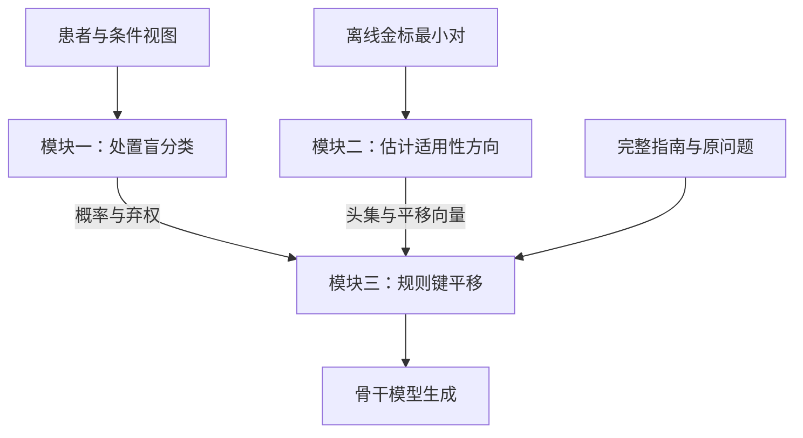

# 别让处置替你选分支：处置盲分支分类与适用性子空间重路由

**ASTER：Action-blind Selection, Then Eigen-subspace Re-routing。三模块主线，模块一规格于 2026-10-27 确定。**

> **文档状态：研究方案与论文工作稿，2026-10-27。** 本版替代 2026-10-26 的注意力掩码、证据员与对数门控方案。模块一固定为同一骨干模型的处置盲分支分类；模块二离线学习适用性子空间；模块三在线执行有符号键平移。已提供模块一、规则增益及独立的模块二学习与缓存平移接口，并开展 [Qwen3-0.6B-Base 预实验](../../experiments/module2_applicability_20261027/RESULTS.zh.md)。该实验使用金标适用性、局部兄弟规则、单头单目标干预与受约束 A/B 评分，尚未验证新版模块一或端到端流水线。原稿占位成绩继续不作为证据。

[主线索引](README.md) · [主张与证伪](claims-and-falsification.zh.md) · [原稿审计](audit.zh.md) · [引用核验](references-to-verify.zh.md) · [编辑记录](editorial-notes.zh.md)

## 摘要

将临床指南放入大语言模型的上下文后，模型仍需先根据患者事实判断适用分支，再执行该分支的处置。本研究考察一种候选失败模式：模型对某项处置的先验偏好可能反过来影响分支判断。我们将其称为**处置先行的分支选择**（treatment-led branch selection，TLBS）。为检验这一假设，我们设计五卷配对反事实评测，并设置处置盲判与明判、熟悉处置与中性代号、分支顺序及闭卷置信度等对照。机制分析拟结合注意力敲除、键值激活修补和残差流探针，检验偏差是否经由对处置段的信息读取产生。

我们提出 **ASTER**（Action-blind Selection, Then Eigen-subspace Re-routing）。模块一使用部署时的同一骨干模型，只读取患者事实和条件视图，在互斥分支及 NONE 上做受限分类，经单一温度校准后输出概率与弃权信号。模块二只用独立金标最小对，估计规则键中的适用性子空间及平移方向。模块三依据模块一的结果，对高置信适用规则与兄弟规则施加相反符号的键平移；不确定、NONE 或无法可靠到达的分支组不编辑。主方法不进行患者原子抽取、外部事实核查、证据绑定、自然语言推断融合、保形预测或风险认证。研究重点是处置盲分类与患者相关重路由在同信息、匹配预算下的增量作用。当前不预设准确率、临床有效性或相对训练方法的优势。

## 1 引言

条件化指南要求模型完成两个相互关联的步骤：判断规则条件是否适用于患者，以及按照适用规则执行处置。如果模型熟悉的处置恰好出现在不适用的兄弟分支中，增加对整份指南的关注未必能够消除冲突。模型还需要辨别指南内部哪些条件与当前患者相符。

本研究将“处置偏好影响条件判断”作为待检验机制。它与一般的上下文忽视不同：可能吸引模型的处置本身就写在上下文中，但属于错误分支。盲判与明判的差异可以作为行为诊断；该差异是否由特定信息通路造成，需要额外的因果干预，不能从注意力可视化或相关性直接推出。

**图 1：虚构规则下的任务示意。** 设 R1 的条件为“复发距缓解不足 6 个月，且既往未用 H”，处置为 X；R2 的条件为“复发距缓解至少 6 个月”，处置为 Y。某患者在缓解后 4 个月复发，且既往未用 H，因而在所给规则中应选择 R1。图中可以展示“先偏好 Y，再选择 R2”的假设性错误路径，以及“先盲判 R1，再执行 X”的设计路径。该例仅用于解释计算任务，不是模型实测记录，也不构成医疗建议。


本研究拟回答三个层次的问题：

1. **现象：** 处置可见性是否系统性改变分支判断？差异是否依赖处置的熟悉程度，而不是长度、顺序或选项提示？
2. **机制：** 偏差是否依赖判断位置对处置段的读取？相关表征变化是否出现在这一读取之后？
3. **方法：** 在共享相同适用性信息时，离线学习的键平移是否改善生成路径，经验弃权能否降低错误干预率？

本文的当前贡献是问题定义、可证伪的实验协议和方法规格。跨模型复现、机制定位、低伤害率与成本优势均属于待验证主张。

## 2 任务与评测协议

### 2.1 问题定义

输入包括指南 $G$、病历 $P$、问题 $Q$，以及可选的选项 $O$。指南由分支组 $\mathcal G=\{g_1,\ldots,g_m\}$ 构成。组内规则互为兄弟分支，每条规则 $r=(C_r,A_r)$ 包含条件 $C_r$ 和处置 $A_r$。

金标适用分支记为 $r_g^{\mathrm{gold}}(P,G)$。它由所给指南的条件与患者事实决定；金标处置来自该分支在**所给指南**中的处置。不能用模型记忆中的常规处置替代这一金标。若条件缺失、冲突或分支不完备，应显式记录无法确定，不强行指定唯一分支。

模型预测的最可能分支记为 $\hat r_g$，与金标符号区分。后文中的“伤害”仅指评测中相对于基线由对变错的现象，不表示临床伤害。

### 2.2 五卷配对设计

**表 1　五卷设计。**

| 卷 | 改动 | 金标 | 检验目的 |
|---|---|---|---|
| NC：原规则 | 不改动 | 原适用分支的处置 | 基本遵循；先验与指南一致的情形 |
| AC：适用处置改写 | 将适用分支处置替换为预先规定的候选处置 | 新处置 | 检验模型是否覆盖所给处置 |
| IC：不适用处置改写 | 仅改写兄弟分支处置 | 原处置 | 处置改写的阴性对照 |
| SW：处置交换 | 交换适用分支与指定兄弟分支的处置 | 原兄弟分支的处置 | 将先验偏好的处置置于错误分支 |
| CS：条件漂移 | 修改数值或时间阈值，使适用分支改变 | 修改后适用分支的处置 | 检验条件读取和旧分支诱饵 |

NC、AC、IC、SW 使用同一病例与问题底稿；CS 使用具备可验证阈值的底稿。所有变体保留底稿标识、决策树标识和配对关系。按决策树或指南划分开发集与测试集，同一底稿的全部变体必须进入同一划分。

CS 的金标翻转须由独立规则执行器核验。处置交换如改变下游可达路径或造成结构不一致，应剔除或单列，不以局部文本交换冒充有效反事实。

### 2.3 诱饵对照

在同一 SW 底稿上固定适用分支处置，仅改变不适用分支中的内容，形成熟悉处置、陌生处置和中性代号三种条件。每个模型分别测量闭卷偏好；不能假定同一处置对所有模型都同样熟悉。闭卷概率阈值、同类处置候选集及中性代号构造方式在开发阶段确定并冻结。

对照包括：

- **盲判与明判：** 均仅输出分支编号。盲判屏蔽指南处置、选项及问题中的处置名称。
- **顺序与选项：** 对调兄弟分支顺序；移除选项并采用开放作答。
- **熟悉度与长度：** 按各模型的分词器匹配被替换片段的长度，并检查所有可见片段的位置。等总长度不足以保证等位置。
- **置信度分层：** 使用冻结的闭卷测量按预定分位分层，报告每层样本数及区间估计。
- **相反分支病例：** 构造共享指南但金标分支相反的配对病例，用于检验患者无关目标是否出现取舍。

原稿中的“Decoy-2×2”名称与三种处置条件不一致。正式数据集暂称“诱饵配对诊断集”，直至析因设计明确。

### 2.4 指标与分母

选择题中，每卷准确率均按该卷锁定的全部有效样本计算。采用分卷宏平均：

$$\mathrm{NCA}=\frac{\mathrm{Acc}_{NC}+\mathrm{Acc}_{IC}}{2},\qquad
\mathrm{CA}=\frac{\mathrm{Acc}_{AC}+\mathrm{Acc}_{SW}+\mathrm{Acc}_{CS}}{3},$$

$$H=\frac{2\,\mathrm{NCA}\,\mathrm{CA}}{\mathrm{NCA}+\mathrm{CA}}.$$

两项均为零时约定 $H=0$。所有计算采用未四舍五入的底层计数或准确率，最终展示时统一保留位数。若各卷样本量不同，同时报告宏平均和微平均，不能混用。

| 指标 | 定义与分母 | 方向 |
|---|---|---|
| 伤害率 | NC∪IC 中“Vanilla 正确且当前方法错误”的样本数，除以 NC∪IC 全部样本数 | 越低越好 |
| 纠正率 | NC∪IC 中“Vanilla 错误且当前方法正确”的样本数，除以同一全部样本数 | 越高越好 |
| 诱饵采纳率 DA | SW 中选择指定先验处置的样本数，除以 SW 全部有效样本数 | 越低越好 |
| 分支准确率 | 原始预测正确的组数，除以预先固定的待判定组数；病例各组全对率另报 | 越高越好 |
| 干预覆盖率 | 满足预先固定的干预触发条件的病例数，除以全部有效病例数 | 报告覆盖范围 |
| 接受组错误率 | 接受且预测错误的组数，除以全部接受组数；接受组为空时记为未定义 | 与接受覆盖率共同报告 |

在相同分母和微平均下，准确率变化应等于纠正率减伤害率。分卷宏平均 NCA 的变化只有在相同加权方式下才满足对应恒等式。多条规则共享同一处置时，应另记处置正确但分支不明的情况，避免把处置匹配等同于分支正确。

生成任务拟报告路径一致性代价 PathCost、关键节点分支忠实率 BFR、节点诱饵采纳率 DA 和退化率 Deg。PathCost 的正式定义、实现版本及取值范围须与来源核对。BFR 和 DA 使用预先固定的参考关键节点集合；缺失节点、提前结束、不可解析输出的处理规则须在测试前固定。Deg 统计重复循环或达到长度上限的输出，分母为全部生成病例。另报告病例级“路径全部节点正确”，避免节点平均掩盖整条路径失败。

涉及模型评审时，以“输出内容、病例、参考路径、评审提示及评审器版本”的联合标识缓存评分。同一评审上下文中的相同输出复用同一分数；不能在不同病例或参考路径之间仅凭输出文本相同而复用。

## 3 诊断：检验处置先行的分支选择

### 3.1 错误分解

将错误区分为选错分支并采用先验处置、选错分支并采用其他处置、覆盖当前指南而输出已不存在的原处置，以及其他错误。编码规则应互斥、穷尽，并在未知方法名称的条件下人工抽查。

**表 2　冲突卷错误分解，全部待测。各行以该卷全部样本为分母，准确率与互斥错误类别之和应为 100%。**

| 卷 | 准确率 | 错分支：先验处置 | 错分支：其他 | 覆盖指南：已不存在的原处置 | 其他 |
|---|---|---|---|---|---|
| AC | 待测 | 按构造判定是否适用 | 待测 | 待测 | 待测 |
| SW | 待测 | 待测 | 待测 | 按构造判定是否适用 | 待测 |
| CS | 待测 | 待测 | 待测 | 按构造判定是否适用 | 待测 |

“冲突卷错误中有多少属于分支错误”必须从各卷错误计数汇总得到，不能直接平均以全部样本为分母的错误百分比。金标裁剪仅用于分析在适用分支已知时仍有多少处置执行错误。

### 3.2 处置可见性是否改变分支判断

**表 3　盲判与明判分支准确率，全部待测。**

| 条件 | NC | IC | AC | SW | CS |
|---|---|---|---|---|---|
| 盲判 | 待测 | 待测 | 待测 | 待测 | 待测 |
| 明判 | 待测 | 待测 | 待测 | 待测 | 待测 |
| 明判−盲判 | 待测 | 待测 | 待测 | 待测 | 待测 |

NC、AC、IC、SW 仅改变被排除的处置字段，且患者、条件、组顺序与经核验的条件语境相同时，模块一的完整提示及词元序列必须一致。在确定性推理下应得到相同分布；实际数值容差与运行配置须记录。主方法使用单独的条件视图，不再依赖跨层注意力掩码。CS 改变条件，因此不要求其盲判输出不变。

**表 4　诱饵控制与复现，全部待测。**

| 比较 | 分支准确率差及区间 | 样本数 | 必须同时报告 |
|---|---|---|---|
| 熟悉处置：明判−盲判 | 待测 | 待定 | 每个模型的闭卷偏好 |
| 陌生处置：明判−盲判 | 待测 | 待定 | 候选筛选与长度匹配 |
| 中性代号：明判−盲判 | 待测 | 待定 | 代号随机化及位置一致性 |
| 移除选项 | 待测 | 待定 | 开放输出的解析失败率 |
| 分支顺序交换 | 待测 | 待定 | 两种顺序的配对结果 |
| 闭卷置信度分层 | 待测 | 待定 | 分层边界、各层计数 |
| 跨模型及思考模式 | 待测 | 待定 | 模型版本与模式 |

中性代号下差异缩小只能排除相应控制下的部分替代解释。不能仅凭剂量关系就断言先验吸引是唯一原因。

### 3.3 偏差是否依赖处置信息读取

机制实验在开发数据上选定干预位置和强度，独立留出数据用于复验。预先规定三个互补实验：

1. **注意力敲除：** 在连续层窗口内屏蔽判断查询到处置键的边。与同规模随机边、非处置片段和其他层窗口对照，报告恢复量及原生性能损失。分母差距接近零时，不报告不稳定的“恢复百分比”。
2. **键值激活修补：** 构造仅兄弟处置不同且位置对齐的熟悉／中性最小对，分别修补键 K、值 V 和 K/V。报告修补范围、源与目标运行及失配风险。V 修补有效不自动证明某个语义属性已经被定位。
3. **残差流探针：** 用独立训练、验证划分读出金标分支，控制模型容量、标签泄漏和跨层比较。探针可读性不等于模型实际使用该信息；只有与干预结果共同分析，才能讨论信息通路。

层窗口、恢复率、探针准确率以及推理链标注一致性均待测。若偏差在读取处置之前已出现，或切断／修补相应通路不改变判断，应修改或放弃“处置读取导致偏差”的机制主张。

### 3.4 患者无关目标的理论边界与实证检验

**性质 1：固定注意力分数下的兄弟质量比。** 在给定查询和键表示下，若干预在规则段 $S_a$、$S_b$ 内分别施加常数偏置 $\beta_a$、$\beta_b$，记两段原有注意力质量为 $M_a$、$M_b$，则

$$\Delta\log\frac{M_a}{M_b}=\beta_a-\beta_b.$$

若两段得到相同偏置，则该次注意力计算中的相对质量不变。若偏置与患者无关，则这项直接的相对推力对金标相反的病例方向相同。

该性质**不推出**整体模型只能改善一个病例，也不证明准确率必然出现跷跷板。其他上下文、后续层、查询变化和非线性计算都可能改变输出。规则内非恒定偏置或随查询自适应的方法也不满足上述简化前提，须直接实验比较。

**表 5　简单修复的诊断对照，全部待测。**

| 方法 | ΔNCA | ΔCA | SW 明判−盲判 | 适用／诱饵质量比变化 |
|---|---|---|---|---|
| Reorder | 待测 | 待测 | 待测 | 待测 |
| PromptRep | 待测 | 待测 | 待测 | 待测 |
| 分支优先思维链 | 待测 | 待测 | 待测 | 待测 |
| CAD | 待测 | 待测 | 按接口确定 | 按接口确定 |
| JuICE | 待测 | 待测 | 按接口确定 | 待测 |
| PASTA：整份指南 | 待测 | 待测 | 待测 | 待测 |
| SEKA：整份指南 | 待测 | 待测 | 待测 | 待测 |
| AutoPASTA | 待测 | 待测 | 待测 | 待测 |

## 4 方法：三个模块的职责与接口

### 4.1 总体设计

| 模块／阶段 | 输入 | 输出 | 决定什么 |
|---|---|---|---|
| 模块一：在线处置盲分支分类 | 患者、祖先条件、组内条件、必要的条件语境 | 每组概率、原始预测、最大概率、间隔、熵、弃权 | 哪条规则适用，是否允许干预 |
| 模块二：离线适用性子空间学习 | 独立开发树上的金标最小对；同一骨干的表征 | 头集、角色子空间、平移向量 | 如何改变模型对规则的读取 |
| 开发阶段校准与选参 | 非测试分支标签及分类 logits；端到端开发结果 | 一个温度、两个弃权阈值、固定增益与头数 | 将配置固定后用于测试 |
| 模块三：在线规则键编辑 | 模块一输出、模块二产物、规则词元位置 | 编辑后的键及正常模型输出 | 编辑哪些规则、采用哪个符号 |



模块一的病例输出只进入模块三。模块二不接收模块一的伪标签、概率或证据句来估计子空间。离线校准可以使用模块一在开发资料上的输出；这不等于让它监督模块二。整个系统冻结骨干模型权重，不新增分类头；“不训练骨干”不意味着不需要标注开发数据或参数选择。

### 4.2 模块一：处置盲分支分类器

**任务。** 给定患者事实 $P$、必要的条件语境 $Q_c$，以及一个经过核验的互斥分支组 $g$，直接估计

$$p_T(r\mid P,Q_c,C_g),\quad r\in\bar g=g\cup\{\mathrm{NONE}\}.\tag{1}$$

它不生成处置、患者属性表、原子状态或证据链。主方法使用执行阶段同一骨干模型的相同权重和分词器，以单独的无干预前向完成分类。主配置采用固定的直接标签接口；自由生成思考链另作消融，不能共用未经重新校准的温度。

**条件视图。** 从已结构化规则中只选取中性编号、完整条件与祖先条件。排除处置字段、处置标题、推荐结论、选项、处置相关脚注及原问题中的处置提示。默认把原问题替换为固定的中性分类指令；只有经过独立核验的条件语境才可进入 $Q_c$。这避免把“删除全部药名”误当作处置遮蔽：患者既往用药、检查结果、治疗反应，以及“既往未用 H”这样的条件必须保留。

规则切分是输入数据契约。它不要求在线抽取患者变量，但也不能假设任意原始指南已经自动、正确地分离条件与处置。自由文本指南先离线规范化并审查；不把未经验证的整篇文本清洗包装成已完成的遮蔽算法。结构化字段仍须核验条件内是否夹带推荐结论；字段名本身不能证明语义无泄漏。

**互斥与可达性。** 只对互斥兄弟分支做单选。并行建议或重叠条件应先重组，不能强制 softmax。一个下游组需要其祖先条件；不能仅给局部阈值。未记录不等于否定，“否则”也不能在其他条件未知时被自动视为适用。

**NONE 与弃权。** NONE 是分类标签：根据已提供信息无法确认任何候选分支适用，包括没有匹配分支或关键信息不足。弃权是置信度规则：模型不能可靠地区分类别。NONE 可以高置信且不弃权；低置信的实际规则也可以被弃权。两者都使模块三不编辑该组，但统计含义不同。

#### 4.2.1 受限标签评分

为每组建立规则编号及 NONE 到中性代理标签的双射，例如 $\{R1,R2,\mathrm{NONE}\}\leftrightarrow\{A,B,C\}$。在真实聊天模板和答案边界上验证每个代理标签恰好增加一个词元，并且词元编号互异。不能默认 `R1`、`R2`、`NONE` 是单词元，也不能只读取共享首词元。

设合法标签的原始下一词元 logits 为 $z_r$，则

$$p_T(r\mid g)=\frac{\exp(z_r/T)}{\sum_{u\in\bar g}\exp(z_u/T)},\qquad T>0.\tag{2}$$

这是在合法标签集合上重新归一化的分类分布，不是全词表中标签的绝对概率，也不是模型自由回答时的答案频率。不从模型生成的 JSON 小数获取概率。不把只返回部分合法标签的 top-k 接口当作完整 logits。合法标签验证失败、上下文过长、非有限分数或格式无效时，参考接口显式拒绝输入；端到端调用者应记录失败并禁用相应干预，不能静默截断或伪造高置信 NONE。

多词元标签可另设完整序列对数似然基线，包含明确的终止约定；第一版不启用这一分支。模板、标签映射、候选顺序、精度与思考模式均固定并留存指纹。首词元受限分类与自由文本回答的行为不能混称，相关实证区别见 [Wang 等，2024](https://aclanthology.org/2024.findings-acl.441/)。

#### 4.2.2 校准、置信度与弃权

每个骨干与固定提示协议只拟合一个全局温度，不按规则或原子分别拟合：

$$T^*=\arg\min_{T>0}-\sum_{i\in\mathcal D_{\mathrm{cal}}}\log p_T(y_i\mid x_i).\tag{3}$$

温度缩放采用 [Guo 等，2017](https://proceedings.mlr.press/v70/guo17a.html) 的单参数后处理思路。校准资料与模块二拟合资料、阈值选择资料及测试资料按树隔离；数据有限时可以使用预先定义的交叉拟合，但不能使用测试标签。记录优化范围、样本数与未校准对照。温度缩放不改变 argmax，不能修复数值或逻辑判断错误，也不保证分布外仍然校准。

定义

$$\hat r_g=\arg\max_{r\in\bar g}p_T(r\mid g),\quad
m_g=p_{(1)}-p_{(2)},\quad
H_g=-\sum_{r\in\bar g}p_T(r\mid g)\log p_T(r\mid g).\tag{4}$$

熵使用自然对数，$0\log0=0$。不同分支数的熵不可直接比较；跨组汇总时另报 $H_g/\log|\bar g|$。最大概率、间隔和熵是置信度摘要，不是单例正确性的证明。

$$a_g=\mathbf1\!\left[p_{(1)}<\tau_p\ \lor\ m_g<\tau_m\ \lor\ \text{最高概率并列}\right].\tag{5}$$

$\tau_p,\tau_m$ 仅在开发阶段选择，测试时固定。并列时按固定顺序保存原始预测，但总是弃权。主方法不额外用熵作第三个门槛。连续间隔增益只作为消融。

**输出例。** 以下是算术示例，不是模型结果；自然对数熵为约 0.591678。

```json
{
  "group_id": "G1",
  "probabilities": {"R1": 0.82, "R2": 0.11, "NONE": 0.07},
  "prediction": "R1",
  "probability": 0.82,
  "margin": 0.71,
  "entropy": 0.591678,
  "abstain": false
}
```

若分布为 `R1=0.46, R2=0.42, NONE=0.12` 且未通过阈值，应保存 `prediction=R1, abstain=true`，不把预测改写成 NONE。证据句编号仅可用于另行审计，不参与主方法概率、子空间估计或注意力放大目标。完整输入契约和使用说明见[模块一规格](module1-spec.zh.md)。

#### 4.2.3 模型选择与比较

| 版本 | 判定器 | 地位 |
|---|---|---|
| M1-self | 同一部署骨干；处置盲受限分类 | 唯一默认主方法 |
| M1-NLI | 明确定义的医学自然语言推断辅助方案 | 可选基线或消融，需报告额外模型与融合规则 |
| M1-oracle | 金标分支与 NONE 标签 | 诊断上界，不是可部署系统 |

[MedNLI](https://aclanthology.org/D18-1187/) 研究临床文本上的自然语言推断；[NLI4CT](https://aclanthology.org/2023.semeval-1.307/) 涉及临床试验文本的推断、证据选择及数值推理。它们与互斥指南分支分类相关，但输入结构和输出语义不同。因此主方法以任务一致性和减少外部依赖为理由采用骨干模型；不声称不存在任何可用推断模型，也不预设所有医学推断模型都比骨干模型差。

### 4.3 模块二：离线学习适用性子空间

本节与[模块二实施说明](module2-applicability.zh.md)采用相同的片段均值、指南加权及旋转前坐标。真实预实验的冻结设置、源码、原始测量及限制见[独立实验](../../experiments/module2_applicability_20261027/README.md)。规格与实测范围分别报告。

模块二保留“对比样本→谱估计→选头→冻结产物”的路线，但学习目标改为同一规则的适用性变化。谱分解与键编辑已有相关工作，包括 [SEKA／AdaSEKA](https://arxiv.org/abs/2603.01281) 和 [PRISM-Δ](https://arxiv.org/abs/2603.10705)。本文的候选贡献应定位为患者条件最小对、处置盲选择以及面向指南规则的有符号平移，不把“采用差分谱分解”本身当作新的独立贡献。

#### 4.3.1 金标最小对与对齐

对同一规则 $r$ 构造 $P^+$ 与 $P^-$：只改变决定性患者事实，使 $r$ 从适用变为不适用，并让一个兄弟规则适用。加入 $P^0$，将决定性信息标为未记录，作为缺失与不确定性对照；它不能单独识别一般的“患者信息是否存在”。缺失样本不自动作为负类。

构造时采用“患者→问题→指南”顺序。因果模型中，指南键只能依赖先前词元；如果患者在指南后面，指南键不能随之后的患者事实变化。所有对应指南词元在最小对内保持相同内容、位置与角色。等总长度不足以代替逐位置核验。

独立数据质控利用生成时的显式规则结构、变更元数据、可验证比较和必要人工复核确认标签。它是离线样本构造环节，不是在线模块一的原子抽取器，也不与模块一共享概率或伪标签。处置文本在一对内部固定，并在不同构造间平衡处置身份、规则顺序和条件标签，减少把熟悉处置误学为适用性的混杂。有限样本平衡不自动证明处置置换不变。

#### 4.3.2 差分估计与有方向的平移

记 $\bar k_{nj,h}^{s}$ 为第 $n$ 个三元组中对齐词元 $j$ 的归一化后、旋转前键，$s\in\{+,-,0\}$。先对目标角色片段求均值，再构造配对差分：

$$k_{n,h}^{s,\rho}=\frac{1}{|J_n^\rho|}\sum_{j\in J_n^\rho}\bar k_{nj,h}^{s},\qquad d_{n,h}^{\rho}=k_{n,h}^{+,\rho}-k_{n,h}^{-,\rho}.$$

原始指南 $c$ 的全部派生观测同组，设共有 $G$ 个指南、该指南有 $n_c$ 个观测，取 $w_n=1/(G n_{c(n)})$。省略头与角色下标：

$$\Omega=\sum_n w_n d_nd_n^\top,\quad U=\operatorname{TopEig}_r(\Omega),\quad \Delta=UU^\top\sum_n w_n d_n.\tag{6}$$

这个估计量是片段均值差分的二阶矩，不等于逐词元二阶矩再平均。$U$ 提供候选去噪子空间，均值差赋予“负→正”的方向；逐对翻转差分符号不会改变二阶矩。若共享均值接近零，即便二阶变化很大，也不应强行把该头纳入平移。报告 $\|\mathbb E_w d\|^2/(\mathbb E_w\|d\|^2+\epsilon)$，检验共享均值相对于变化能量的大小。

默认只使用处置角色和一个共享专家。编号扩展要求编号出现在自身完整条件之后，并单独核验。中性样本仅作缺失对照；其范数较大不自动否定整个头。秩、角色划分及额外专家由独立开发证据决定，本轮固定秩 2，不由确认结果调整。每头最终只编辑一个 $\Delta$，所以在线控制仍至多一维。多专家需在留出干预中证明增益，不能仅靠子空间低重合度；不同模型的未对齐子空间不能直接比较重合度。模型、分词器、提示顺序或表示位置变化后，必须重新核验产物。

#### 4.3.3 可分性与可读性共同选头

仅证明键能区分正负样本不足以证明实际决策查询会沿正确方向读取。冻结拟合集的 $U_h,\Delta_h$，在选择集以类内合并协方差 $\Sigma_{h,\mathrm{sel}}$ 定义分离度：

$$\operatorname{Sep}_h=\frac{\|U_h^\top(\mu_{h,\mathrm{sel}}^+-\mu_{h,\mathrm{sel}}^-)\|_2}{\sqrt{\operatorname{tr}(U_h^\top\Sigma_{h,\mathrm{sel}}U_h)+\epsilon}},$$

$$R_h=\frac{\mathbb E_{i\in\mathrm{Dec},j\in A_r}[\bar q_{ij}^{\top}\Delta_h]}{\sqrt d\,(\sigma_h+\epsilon)},\qquad S_h=\operatorname{Sep}_h\max(R_h,0).\tag{7}$$

本轮采用迹归一化分离度。马氏距离可作为后续预先规定的替代估计量，但不能与本轮分母混称同一指标。$\sigma_h$ 只从拟合资料估计；选择与最终确认按原始指南分离。正负病例分别检查读取符号，并结合配对同向率和拟合稳定性筛选；仅对合格头取至多 $K$ 个，允许输出空集合。

$\bar q_{ij}$ 吸收相对位置旋转；$\sigma_h$ 为冻结口径下的基准注意力分数标准差。可读性必须在实际部署提示顺序下测量。分组查询注意力中，在共享该键值头的查询头上按固定权重汇总。本轮选头的正号比例先对共享查询头和处置词元求平均，再统计病例级平均响应为正的比例；它不是逐查询头、逐词元比例。后者在本轮仅对冻结诊断头的实际分数扰动另行记录，不能由总体均值为正推断所有查询均同向。

头数 $K$、秩、角色划分和增益在独立开发资料上选择。机制诊断的敲除窗口用于独立核验，不同时作为待验证结论和选头依据。当前读取值是均匀平均的分数敏感性，不是注意力质量或因果决策证据。若存在可分性但实际顺序下不可读，应报告失败。本轮拟合及干预均使用患者在前；其他顺序必须另建配置重新评测，其缓存与成本也须重新计算。

### 4.4 模块三：按组置信度编辑规则键

定义 $e_g$ 表示该组可可靠到达且输入、映射与分类均有效。平组可以直接设为有效；树结构中，若祖先选择为 NONE、弃权或不通向本组，则该组及相应后代不激活。默认不由一次局部否定自动压低整棵子树。

$$g_r=\begin{cases}
0,&a_g=1\ \lor\ \hat r_g=\mathrm{NONE}\ \lor\ e_g=0,\\
+g^+,&r=\hat r_g,\\
-g^-,&r\ne\hat r_g,\ r\in g,
\end{cases}\qquad g^+,g^-\ge0.\tag{8}$$

主配置中 $g^+,g^-$ 为开发集固定的常数；模块一的概率通过接受判据控制是否施加它们。这样，置信度与强度的作用不混在一起。以间隔连续缩放增益是额外消融，不作为首版必需环节。

本轮独立因果预实验另用逐输入、逐方向的分数均方根匹配来比较算子。其系数随输入变化，约为 $g_{x,m}=s_x\tau/\operatorname{RMS}_x(\Delta_m)$，并核验实际数值误差。这里同一个 $\tau$ 不代表同一个键系数 $g$；该实验不能代替上述固定部署增益的验收。

$$k_{j,h}'=k_{j,h}+g_r\Delta_h,\qquad
h\in H^*,\quad j\in A_r.\tag{9}$$

式（9）给出默认的处置词元编辑。编号与多角色扩展另行验证后，才将目标扩大到 $I_r\cup A_r$ 并使用角色方向 $\Delta_h^{\rho(j)}$；本轮结果不包含该扩展。

模块二采集与模块三编辑统一位于键归一化之后、位置旋转之前；无键归一化的架构直接使用旋转前的键。不同架构若不能采用这一坐标，须另行适配并核验，不能继续套用下文的线性分数公式。主方法不编辑患者证据、条件词元或值向量，也不把模块一预测写成额外答案提示。选项编辑另作有明确映射的消融。目标片段须有不重叠的规则归属；不能让同一词元接收未定义的多个正负增益。

**缓存协议。** 本轮先按“患者→问题→指南→作答提示”预填到最后决策提示词元之前，再编辑该输入的缓存，由最后提示词元读取已编辑规则键。这样能影响首答案分数；若最后提示词元已完成前向再编辑，则首答案分数不会改变。在已旋转缓存中加入相应位置旋转后的 $g_r\Delta$，不能直接加入未旋转向量。原始缓存保持不变。只编辑缓存与在指南预填充时插入钩子会产生不同的后续表示，须分别记录。本轮单层、单目标适配已实现；新版模块一驱动的多规则、多层及自由生成整合仍待验证。

如果以后改用“指南→患者→问题”以复用患者无关的指南前缀，规则键不会自然编码后续患者事实。该配置下仍可施加外部选择的位移，但必须重新验证部署查询的读取、方向迁移与实际效果，不能沿用本轮结果宣称已验收。患者在前的当前配置不具备跨患者复用相同指南前缀的收益。

**回退边界。** 某组全零仅表示该组不直接编辑，其他组仍可能改变整个模型。所有组全零、输入及解码一致、跳过干预且缓存未被污染时，才是整个病例的原模型回退。零增益检查必须比较实际 logits 与生成行为，不能只检查配置中的零。

### 4.5 数学关系与论断边界

**处置盲不变性。** 设 $V(P,G,Q)$ 是严格的条件视图。若两个输入仅在被排除的处置字段不同，而 $V$ 的文本、顺序、模板及分词完全一致，那么相同模型在确定性无干预前向中接收完全相同的输入。输出不变性来自输入相同，不再需要逐层证明复杂掩码。它不意味着模型内部没有医学先验，也不能免除对条件字段泄漏的审查。

**固定查询下的平移效应。** 对固定表示和相对位置：

$$\delta s_{ij}=\frac{g_r\bar q_{ij}^{\top}\Delta_h}{\sqrt d}.\tag{10}$$

平移的符号不依赖当前键在该方向上的坐标；乘性形式 $k'=k+gUU^\top k$ 则仍依赖该坐标。但平移的符号依然取决于查询与方向的内积。只有在相关查询内积为正、比较中其余分数固定时，正负增益才分别增减相应分数。不能推广为所有查询、后续层或端到端准确率的单调保证。

**局部改变量。** $\|\delta k\|=|g_r|\|\Delta_h\|$。若一次固定注意力计算的所有分数变化为 $\delta s_j$，则

$$\mathrm{KL}(a\Vert a')\le\max_j\delta s_j-\min_j\delta s_j
\le2\max(g^+,g^-)\max_j\frac{|\bar q_{ij}^{\top}\Delta_h^{\rho(j)}|}{\sqrt d}.\tag{11}$$

第一项来自 softmax 的对数归一化边界；第二项是不假定所有内积同号的一般界。它约束一次固定计算，不约束整网输出或医疗风险。未选中位置没有直接编辑，但其他层和头可因上游变化间接受影响。

**平移与训练。** 冻结权重、少量离线向量和可逐例关闭是设计性质；不能写成训练方法原则上没有回退开关，适配器也可以关闭或与原模型路由。均值平移在特定均值匹配约束下有几何解释，但不证明临床任务最优。有限样本处置平衡也不证明方向完全不含处置信息。

**没有风险认证。** 本版不使用保形预测或 LTT。概率校准与 margin 弃权提供经验控制，不提供覆盖率或伤害率的有限样本保证。按树隔离是防止泄漏的评测要求，不自动使任意保证成立。

### 4.6 端到端流程

1. 离线核验条件与处置切分、互斥分组、祖先依赖以及规则片段位置。
2. 用独立金标最小对拟合模块二方向，在非测试资料上验证可分性和可读性。
3. 在校准资料上拟合单一温度，在开发资料上选择弃权阈值、头数与固定增益，冻结全部配置。
4. 每例独立执行模块一的处置盲分类；保存完整分布、原始预测与弃权。
5. 按可达性及式（8）生成规则增益，在模块三使用同一骨干和完整原始任务进行键编辑与正常生成。
6. 比较同信息执行器及未干预原模型，记录错误干预、覆盖率与端到端成本。

## 5 实验设置与统计计划

### 5.1 数据与隔离

保留 MedGUIDE-CF 五卷、MEGA-CDP-CF 路径任务、诱饵配对诊断集和 MedPIC-Bench 外部验证的研究方向。具体数据版本、许可、样本数、参考路径及官方评分定义须核验，不采用附件或旧稿中未经核验的固定规模。所有同源病例及其变体按树／指南整体隔离。

区分四个用途：模块二拟合、温度校准、阈值及增益选择、最终测试。外部测试不参加方向选择、阈值拟合或提示修改。数值、时间、否定、缺失信息和复合条件只作为人工／数据元数据切片，不要求恢复在线原子抽取。

### 5.2 模型与同信息对照

主骨干候选为 Qwen3-8B、Llama-3.1-8B-Instruct、Mistral-7B-Instruct 或实际部署医学模型，最终修订标识和聊天模板在测试前锁定。每个骨干的 M1 与执行器共享权重；改变模型或提示协议需重新校准及核验模块二。

| 对照层级 | 方法 | 核心问题 |
|---|---|---|
| 无分支分类信息 | Vanilla、提示重复、重排、CAD、JuICE、PASTA、SEKA 等 | 原有方法能做到什么 |
| 相同 M1 输出 | M1-only／TS-Map、TS-Note、TS-Prune、TS-Fuse、TS-SEKA、TS-Rerank、ASTER | 增益来自分支识别还是执行算子 |
| 相同金标分支 | Gold-Map／Prune、ASTER-oracle | 去除分类误差后的执行差距 |
| 相同开发数据 | 普通 SFT、反事实平衡 SFT、必要的适配器基线 | 冻结方向与参数训练的经验取舍 |

M1-only 在映射完整的选择题中直接将分支映到处置／选项；这是强基线，也是最简单的可用执行器。NONE 和弃权时各执行器采用相同回退政策。若映射已经达到相同效果，不能把选择题增益归于键编辑。自由路径还须比较文本附注、裁剪、候选重排及结构化约束生成；不能宣称只有注意力方法可行。

共享分布的算子比较和各自端到端运行分表报告。所有辅助模型、额外提示、候选数、模型调用及选择数据均计入预算。NLI 辅助与证据审计只作扩展，不设置默认 ASTER-full，也不预设外部模型带来收益。

### 5.3 主要指标与冻结

端到端继续报告 NC、IC、AC、SW、CS、NCA、CA、H、伤害率、诱饵采纳率、路径 BFR／PathCost 与退化率。模块一报告全体组准确率、NONE 子集、负对数似然、Brier 分数、ECE、间隔及熵分布；选择性指标报告接受覆盖率、接受组错误率和实际非零干预组覆盖率。只输出规则增益而尚未执行键编辑时，另称计划非零增益覆盖率，不计为已实施干预。NONE 可被接受而不干预，因此接受覆盖率与干预覆盖率不能混用。

阈值依据开发集覆盖率—错误率曲线选择，测试集固定点为主要结果。阈值扫描只能作为预先规定的诊断，不据此在测试上选择部署点。端到端“伤害率”继续指基线正确而干预后错误的研究指标，不等于真实临床伤害。

统计保留病例配对和树内聚类结构，报告效应量与区间；比较族和多重校正事先确定。非劣效界值必须提前固定，差异不显著不等于等效。全部解析和输入失败计入记录，并对所有方法采用相同处理。详细口径见[实验计划](experiment-plan.zh.md)。

## 6 结果报告模板

当前所有性能结果均为待测。参考实现测试验证的是软件契约，不是以下性能表。

| 模块一 | 全体组准确率 | NLL | Brier | ECE | 接受覆盖率 | 接受组错误率 | 非零干预覆盖率 |
|---|---|---|---|---|---|---|---|
| M1-self，未校准 | 待测 | 待测 | 待测 | 待测 | 待测 | 待测 | 待测 |
| M1-self，单温度 | 待测 | 待测 | 待测 | 待测 | 待测 | 待测 | 待测 |
| M1-NLI，辅助消融 | 待测 | 待测 | 待测 | 待测 | 待测 | 待测 | 待测 |
| M1-oracle | 金标对照 | 不作为校准结果 | 不作为校准结果 | 不作为校准结果 | 按金标政策 | 按定义 | 按金标政策 |

| 方法 | NC | IC | AC | SW | CS | NCA | CA | H | 伤害率 | DA |
|---|---|---|---|---|---|---|---|---|---|---|
| Vanilla | 待测 | 待测 | 待测 | 待测 | 待测 | 待测 | 待测 | 待测 | 基线 | 待测 |
| M1-only／TS-Map | 待测 | 待测 | 待测 | 待测 | 待测 | 待测 | 待测 | 待测 | 待测 | 待测 |
| TS-Note／Prune／Fuse | 分别报告 | 分别报告 | 分别报告 | 分别报告 | 分别报告 | 分别报告 | 分别报告 | 分别报告 | 分别报告 | 分别报告 |
| TS-SEKA | 待测 | 待测 | 待测 | 待测 | 待测 | 待测 | 待测 | 待测 | 待测 | 待测 |
| ASTER，M1-self | 待测 | 待测 | 待测 | 待测 | 待测 | 待测 | 待测 | 待测 | 待测 | 待测 |
| ASTER，M1-oracle | 诊断 | 诊断 | 诊断 | 诊断 | 诊断 | 诊断 | 诊断 | 诊断 | 诊断 | 诊断 |

| 路径执行器 | 原生 PathCost | 原生 BFR | 诱饵 PathCost | 诱饵 BFR | DA | Deg | 端到端成本 |
|---|---|---|---|---|---|---|---|
| Vanilla | 待测 | 待测 | 待测 | 待测 | 待测 | 待测 | 基准 |
| TS-Note／Prune／SEKA／Rerank | 分别报告 | 分别报告 | 分别报告 | 分别报告 | 分别报告 | 分别报告 | 分别报告 |
| ASTER | 待测 | 待测 | 待测 | 待测 | 待测 | 待测 | 待测 |
| Gold-Prune／ASTER-oracle | 分别报告 | 分别报告 | 分别报告 | 分别报告 | 分别报告 | 分别报告 | 诊断成本 |

外部验证另报原题、反事实、成对全对及撤销警示子集；各模型分别列出身份、模板、温度、阈值、方向产物和复现状态。不把条件满足的结构性映射结果当成独立实测性能。

## 7 消融与错误归因

| 问题 | 最小必要比较 |
|---|---|
| 盲判是否有效 | 条件视图 vs 处置可见；标签顺序；问题／选项泄漏 |
| 校准与弃权是否有用 | 单温度 vs 未校准；无弃权 vs 固定阈值；正确犹豫／自信错误分层 |
| 子空间是否对应适用性 | 金标最小对 vs 非配对样本；标签置换；患者顺序；中性诊断 |
| 谱估计是否必要 | 原始均值差、投影均值差、SEKA 型投影、差分谱基线、随机方向 |
| 平移是否有增量 | 相同 M1 目标下平移 vs 乘性投影 vs logit 偏置 vs 文本执行器 |
| 选头是否可读 | 编码分离度、可读性联合评分、随机等量头；独立机制验证 |
| 符号和强度 | 仅正增益、仅负增益、双符号；固定增益 vs 连续间隔增益 |
| 错误放大 | M1 正确／错误 × 接受／弃权；NONE；不可达子组；异常输入 |
| 离线与训练 | 同数据与预算下的反事实训练、方向编辑；原生性能与更新适应 |

高置信错误是主要剩余风险，弃权不能发现所有错误。错误归因至少区分条件视图错误、M1 分类错误、M2 方向或读取符号错误、M3 词元映射／缓存错误和生成执行错误。每类报告样本数、覆盖及端到端影响。

成本包含每组分类前向、温度与离线拟合摊销、完整生成、缓存复制与键编辑。复用同一权重不等于没有额外前向。键编辑是否兼容某种高效注意力内核、是否降低显存及延迟，都须在实际适配上测量，不搬用其他论文的速度数字。

## 8 相关工作与当前结论

已核对的基本来源包括温度缩放、临床自然语言推断、受限首词元评价，以及谱键编辑；链接与支持范围见[引用核验清单](references-to-verify.zh.md)。其他数据集规模、官方路径指标和既有基线实现仍需逐项核验。

这版主线把“适用性判定”“离线编辑方向”和“在线执行”分开，减少在线判断链条的依赖。它更便于同信息消融和定位错误来源，但是否更准确、更稳健或优于训练仍是实验问题。若 M1-only 或文本附注复现全部收益，应收窄注意力方法的贡献；若实际顺序下无可靠可读方向，应报告模块二／三假设失败。

## 9 局限与数据声明

互斥分组、祖先条件和条件／处置切分需要额外的数据质控。受限分类仍可能产生数值、时间、否定与缺失信息错误。选择性干预会牺牲覆盖率；温度与阈值在分布变化后可能失效。组间依赖、缓存复制及模型专用 hook 尚不能由参考 M1 代码证明正确。

反事实指南和虚构示例用于方法研究，忠实执行所给规则不等于临床正确。正式实验前依据真实记录核验数据许可、公开范围、隐私及标注流程；不预先声称伦理、付酬或试验事项已经完成。

## 附录：实现与可追溯记录

| 验证 | 必须观察的行为 |
|---|---|
| 条件视图不变 | 仅替换处置、问题处置提示与选项时，M1 提示和 token IDs 相同；保留既往用药事实 |
| 受限评分 | 所有合法标签是边界上的互异单 token；非有限分数、错误长度与截断被拒绝 |
| 分类契约 | 完整归一化分布；预测始终为 argmax；NONE、弃权和并列分别处理 |
| 校准隔离 | 正温度；仅开发／校准标签；固定模板与身份；测试不重新选参 |
| 增益接口 | 高置信非 NONE 才正负编辑；其他状态全零；独立记录可达性 |
| 实际模型编辑 | 旋转位置、GQA、缓存隔离、退出恢复、全零回退及 token 归属，仍待 M3 实现后验证 |

每次模型运行保存代码提交、模型与分词器修订、条件视图、代理标签映射、原始 logits、温度及阈值、完整 M1 输出、M2 产物指纹、M3 词元位置与增益、缓存状态、生成结果、解析失败和成本。结果表由逐例产物派生。已完成的软件检查与尚未运行的模型实验在[实现状态](implementation-status.zh.md)中分别记录。
