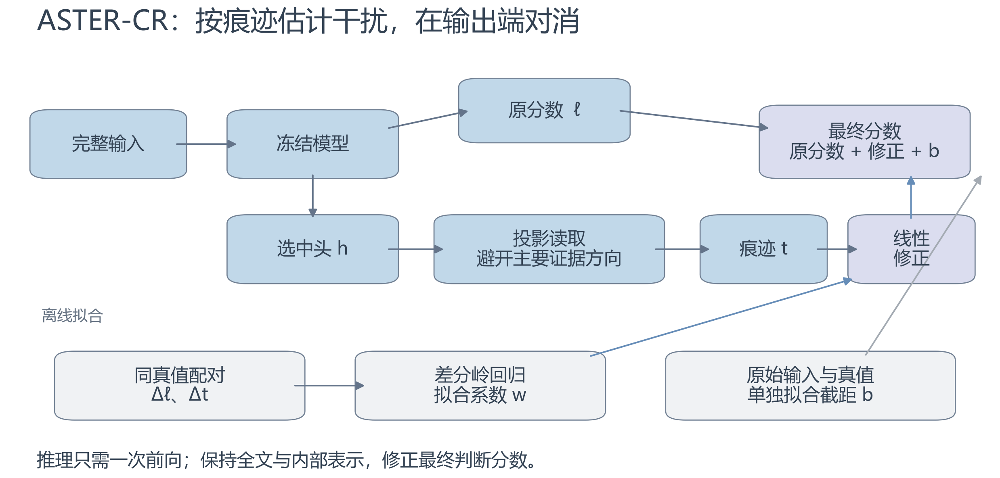

# 对消，而非擦除：用干扰痕迹修正大模型的指南条件判断

## 摘要

指南条件判断应依据条件定义与患者事实，却可能受后续处置影响。ASTER-CR保留完整输入，用证据保持配对学习分数对消，用证据变化配对限制修正，再独立校准阈值。混合痕迹的可行条件说明，能否同时抵消干扰和保留证据取决于可辨识信息。实验聚焦MEGA-CDP、NLI4CT-2024和MedPIC，分别评价干扰抑制、证据改动与原任务正确性。已有Qwen3-8B受控结果中，线性方法将干扰响应RMS从2.6282降至2.5730 logit，平均证据响应保留率为99.60%，但40个证据对中11个超出拟合预算。去掉证据约束可取得更高不变性，同时严重削弱证据响应。官方MEGA路径正确率未建立收益；NLI归档预测补算及MedPIC冻结迁移结果亦未显示总体优势。结果支持部分干扰抑制与受控证据改动，不将分数稳定直接等同于正确判断。

## 1 引言

医学指南通常将临床决策组织为一系列条件节点。给定指南、患者病例和当前节点，模型需要判断条件是否成立，再由决策树控制器沿相应分支执行，直至到达叶节点。本文关注的不是直接生成处置建议，而是模型能否忠实地判断当前条件。

理想情况下，节点判断应由指南条件及其决定性患者事实决定，而不应被后续分支处置或无关背景改变。记当前条件为 $C$、决定性事实为 $F$，节点真值写作 $y=g(C,F)$。然而，模型读取的是完整上下文，其中同时包含条件定义、患者信息和后续处置。历史 Qwen3-8B 结果显示，仅改写处置或无关背景时，判断分数变化的中位数约为 0.5 logit；改变决定性事实时约为 50.8 logit [R5]。虽然干扰响应远小于证据响应，但当原始分数接近判定阈值时，较小的干扰仍可能改变分支选择。历史编辑实验中，被改变节点的原始分数也集中在 0、0.25 或 0.5 [R8]。

一种直接做法是删除处置或无关文本，使模型无法利用这些内容。然而，删除操作也可能移除当前条件所依赖的定义或上下文。历史统计中，275 个可统计节点有 71 个需要条件句之外的定义；遮挡处置后，完整路径正确数由 404/432 降至 394/432 [R2]。另一类方法试图从隐藏表示中擦除干扰概念，但表示层面的不可恢复性强于修复某个指定判断所需的条件：只要干扰信息不再影响目标分数，模型表示仍可保留其他用途所需的信息。输出校准能够调整整体偏置或分数尺度，却不能单独识别随输入变化的干扰贡献。

因此，本文研究一个更直接的问题：**能否保留完整输入，只修正干扰对指定判断分数的贡献，同时限制修正对决定性证据响应的改变？** 我们提出 ASTER-CR。其核心不是让表示忘记干扰，而是从配对干预中提取可用于预测干扰分数变化的痕迹，并学习一个受证据约束的输入相关修正函数。证据保持配对（A/P）提供需要对消的分数差，证据变化配对（C/F）限制修正对证据响应的改动；配对差分消去共享截距，独立校准再处理整体阈值。

ASTER-CR 包含三个相互衔接的模块。首先，**配对干预驱动的注意力头定位**结合梯度归因预筛与双向精确激活修补，选出包含干扰和证据信息的注意力头。其次，**配对子空间估计**从 A/P 与 C/F 激活差分中分别估计干扰相关方向和主要证据方向，并通过正交投影构造低维痕迹。最后，**证据约束的分数修正**利用 A/P 差分拟合干扰对消，并以 C/F 逐对预算约束修正幅度，随后独立拟合截距。三个模块分别回答信息从哪里读取、修正特征如何构造，以及如何在证据约束下学习最终修正。

本文的贡献有三点。第一，我们将指南判断的目标明确为指定输出的不变性，而非整个隐藏表示的干扰不可恢复性，并给出混合痕迹下同时实现分数对消与证据保留的可行条件。第二，我们提出由注意力头定位、配对子空间估计和证据约束分数修正组成的 ASTER-CR，将干扰抑制与证据保护落实为可分离的配对目标。第三，我们在 MEGA-CDP、NLI4CT-2024 和 MedPIC 上分别评价干扰响应、证据响应及原生任务正确性。现有结果显示，所选痕迹包含高于平均随机特征的预测信息，线性修正在受控留出上降低了部分干扰响应；但完整路径正确率和跨任务迁移尚未建立稳定收益。

## 2 相关工作

### 2.1 行为忠实性与输入干预

解释忠实性关注解释与实际决策过程的联系（Jacovi & Goldberg, 2020）。模型可能受到解释未充分揭示的偏置影响（Turpin et al., 2023），也可能呈现推理内容效应（Lampinen et al., 2024）。因此，本文用规则规定的输入干预检验判断依赖：保持决定性证据时应当稳定，改变决定性证据时应当作出相应判断。该目标与反事实不变性研究相联系（Veitch et al., 2021），但不把预测一致直接等同于判断正确。

处置遮挡、仅保留条件或抽取证据是输入层的动机对照。它们直接检查“删除相关文本是否足够”，也可能同时删除条件定义。本文单独评价其信息损失，不把输入删除、方法消融和外部基线混成一类。

下文按**主要作用位置及优化目标**组织相关方法；第4.3节仅比较已有有效运行记录支持的对照。线性与非线性是实现属性，不构成互斥的方法类别。

### 2.2 输出校准、监督读出与对比解码

输出层方法需要区分分数缩放、偏置估计和输入相关修正。温度缩放用一个正温度调整置信度（Guo et al., 2017）。本文使用的固定正比例缩放是解析控制，用于说明整体缩小分数幅度并不改变零阈值下的分类结果；它不是通过验证集拟合得到的温度缩放模型。上下文校准（CC）从无内容参考估计标签偏置（Zhao et al., 2021）；批量校准（BC）利用无标签输入的平均输出估计偏置（Zhou et al., 2024）。本文的仅截距校准使用自然训练输入的任务标签，普通监督线性读出则重新学习分类方向。CC 和 BC 在本文中作为相关方法讨论，不将其列为已完成的直接实测对照。

上下文感知解码（CAD）组合同一模型在有、无上下文时的输出，强化上下文相对于模型先验的影响（Shi et al., 2024）。DExperts组合基础模型、专家和反专家的输出以控制生成属性（Liu et al., 2021）。二者说明输出修正也可以依赖输入，不能将这一类概括为共享截距。不过，CAD强调有无上下文输出的对比，DExperts面向生成属性控制；它们并未以本文的 A/P 分数差作为对消目标，也未采用 C/F 逐对修正预算。CAD 和 DExperts 在本文中用于界定输入相关输出修正的相关路线；由于当前主结果表未报告与其对应的可复核同协议结果，本文不据此声称 ASTER-CR 优于这些方法。

AxBench提供了重要的比较设计依据。该基准在Gemma-2-2B和9B上统一比较提示、微调、线性表示方法、监督引导和稀疏自编码器，发现提示在行为引导任务上表现突出，微调通常优于多种表示干预；简单线性方法在概念检测上仍有优势（Wu et al., 2025）。这一结果说明，只比较表示干预方法不足以建立全面的经验优势。本文因此将普通监督读出和参数微调纳入已完成的Qwen3-8B比较；但当前结果尚未构成包含强提示方法在内的完整基准复现。

ASTER-CR的修正由A/P配对差分监督，并由C/F配对约束。与上述方法的区别是修正的识别目标及证据预算，而非仅仅“在输出层操作”。固定共享截距在配对差分中抵消，统一正比例缩放则同时缩小干扰与证据响应；两者均不能替代对输入相关修复的检验。

### 2.3 概念擦除

概念擦除已有多个不同优化路线。INLP迭代移除线性分类方向（Ravfogel et al., 2020）；R-LACE通过带秩约束的线性对抗优化学习投影（Ravfogel et al., 2022a）；LEACE给出闭式线性擦除（Belrose et al., 2023）。谱属性移除（SAL）依据表示与概念的交叉协方差移除高协变方向，其核化版本kSAL扩展到核特征空间（Shao et al., 2023）。因此，LEACE单一结果不足以代表全部线性擦除方法。

非线性概念恢复也有多条处理路线。核化对抗擦除在核空间中训练（Ravfogel et al., 2022b）；KRaM采用核化率失真目标，支持类别、连续及向量概念（Chowdhury et al., 2023）。非线性LEOPARD通过匹配离散概念的类别条件分布学习正交投影（Saillenfest & Lemberger, 2025）；其变换仍是线性的，“非线性”指所防范的概念恢复能力。Obliviator交替训练编码器与核空间变换，研究非线性依赖消除和任务效用的权衡（Akbari et al., 2025）。本文分别评价保持原表示坐标的投影和需要新读出的重新编码，避免把读出不兼容误判为擦除失败。

任务效用保护并非本文独有的动机。FaRM研究率失真目标下的公平表示，包含使用任务标签的设置（Chowdhury & Chaturvedi, 2022）；完全概念擦除的信息论极限也已有专门研究（Chowdhury et al., 2025）。本文关注固定证据下的指定判断，而非要求整个表示满足概念不可恢复性或观测统计独立。其实际优势必须通过强擦除方法、重新训练的独立探针及保护—效用曲线验证，不能只由两类目标不同推得。

### 2.4 表示干预与表示微调

表示干预可以使用固定方向，也可以依输入决定是否干预。ITI沿估计的注意力头方向调整激活（Li et al., 2023）；对比激活相加（CAA）用成对行为示例的残差激活差估计干预向量（Rimsky et al., 2024）。条件激活引导（CAST）用输入激活识别条件，再选择性施加行为向量（Lee et al., 2025）。CAA与CAST分别检验共享行为方向和条件触发机制是否已经足以改善判断依赖。

LoFiT学习局部表示调整（Yin, Ye & Durrett, 2024）；LoReFT学习低秩表示干预，同一研究中的DiReFT提供简化的表示变换对照（Wu et al., 2024）。这组方法与ITI、CAA、CAST共同覆盖方向估计、条件触发和监督表示学习。本文另设共享痕迹、共享配对监督的线性与多层感知机表示编辑，用于分离函数容量和干预位置。这些内部控制不冒称外部算法复现，也不重复计入方法数量。

近期工作进一步研究输入相关的表示引导。Stolfo et al.（2025）研究指令差分激活向量，并报告由指令微调模型提取的方向可以迁移到基础模型。RePS通过双向偏好优化学习表示引导（Wu et al., 2025）；PSR则从输入激活估计位置相关的引导系数（Heyman & Vandeputte, 2026）。这些工作表明，表示干预的方向或强度可以依赖输入。本文将其作为相关研究背景；当前实测比较仅纳入具有可复核预测记录的方法。

### 2.5 参数高效权重微调

LoRA用低秩矩阵参数化权重更新（Hu et al., 2022）。DoRA将权重的幅值和方向分开，并对方向采用低秩适配（Liu et al., 2024）。FourierFT学习权重增量的部分傅里叶系数，再重建权重更新（Gao et al., 2024）。三者分别覆盖标准低秩更新、幅值—方向分解和频域参数化，避免仅凭一个LoRA配置判断常规任务适配的能力。

这一类按权重增量的参数化方式与上一类表示干预区分；两类均可具有参数高效性。比较须记录任务标签、配对监督、更新模块、训练量和搜索成本。ASTER-CR线性校正层的17个系数不包括选头、标准化和子空间存储，不能据此直接声称完整方法比微调便宜。

## 3 方法

### 3.1 方法概述

ASTER-CR 在冻结语言模型的完整输入和原始判断流程上增加一个轻量分数修正层。给定指南节点与患者病例，基础模型产生“是”和“否”的分数，ASTER-CR 从选定注意力头读取中间表示，并将其映射为低维痕迹。修正函数根据痕迹预测当前输入中的干扰分数贡献；训练时，证据保持配对监督需要对消的变化，证据变化配对限制允许施加的修正。推理时，修正后的分数交由原有指南树控制器选择分支。

方法由三个模块组成。**M1：配对干预驱动的注意力头定位**，输入为拟合集上的 A/P 与 C/F 配对，输出为注意力头集合 $\mathcal H$。**M2：配对子空间估计与痕迹提取**，输入为所选头的配对激活差分，输出为标准化参数、证据子空间基 $S$、痕迹基 $N$ 及低维特征 $t(x)$。**M3：证据约束的分数修正**，输入为基础分数差和痕迹，输出为修正函数参数及独立截距。

三个模块按顺序构成一个完整流程：M1 确定从模型的哪些位置读取信息；M2 将这些位置的高维激活转换为尽量减少主要证据变化的低维痕迹；M3 再利用配对分数差学习输入相关的修正，并直接约束其对证据变化的影响。M2 的正交投影属于特征构造约束，M3 的逐对预算属于输出修正约束，二者作用于不同阶段，不能互相替代。

| 模块 | 输入 | 主要操作 | 输出 |
|---|---|---|---|
| M1：注意力头定位 | 拟合集 A/P、C/F 配对及对应梯度和头激活 | 梯度归因预筛、双向单头激活修补、分组排序融合 | 选中头集合 $\mathcal H$ |
| M2：子空间估计 | $\mathcal H$ 对应的拟合激活及配对差分 | 标准化、奇异值分解、证据正交投影 | $\mu,s,S,N$ 及痕迹 $t(x)$ |
| M3：分数修正 | 原始分数、痕迹及 A/P、C/F 配对 | 受约束岭回归、独立截距校准 | $\hat w,\hat b$ 及修正分数 $\ell'(x)$ |

表中所有可学习参数和统计量均只由拟合集确定；开发集用于预先规定的选择与诊断，测试集不参与头选择、子空间估计、系数拟合或阈值校准。

### 3.2 任务定义与配对构造

给定指南决策树、患者病例和当前节点，模型只判断当前条件是否成立。记 $z_+(x)$ 和 $z_-(x)$ 分别为“是”和“否”的输出分数，定义基础分数差与预测为
```math
\ell(x)=z_+(x)-z_-(x),\qquad
\hat y(x)=\mathbf 1[\ell(x)>0].
```
程序控制器根据该判断选择下一节点，并在到达叶节点后返回指南中的原始处置。模型负责节点判断，控制器负责沿指南树执行。本文使用 MEGA-CDP 的节点判断与程序控制器协议，区别于原数据论文的路径生成评价。

ASTER-CR 使用两类配对监督。**证据保持配对 A/P** 在保持当前条件定义和决定性事实不变时，改变后续处置（A）或无关背景（P）；其理想分数差应保持稳定。**证据变化配对 C/F** 分别改变当前条件定义（C）或决定性患者事实（F），使节点真值翻转；模型分数应随真值变化。另将事实发生变化但仍处于阈值同侧的 F0 配对作为诊断扩展，不纳入主方法的 A/P 对消目标。

以下示例仅用于说明配对定义，并非数据集原文。若当前条件为“eGFR ≥ 30 mL/min/1.73m²”，患者 eGFR 为 34，则改变后续用药处置属于 A，改变无关病史属于 P；将阈值改为 45 或将患者数值改为 26，则分别属于 C 和 F。

| 类型 | 干预对象 | 标签关系 | 预期分数响应 |
|---|---|---|---|
| A：处置改写 | 当前分支之后的处置文字 | 保持 | 尽量稳定 |
| P：背景改写 | 与当前节点无关的背景 | 保持 | 尽量稳定 |
| C：条件改写 | 当前条件的阈值或定义 | 翻转 | 跟随新条件 |
| F：事实改写 | 决定性患者事实 | 翻转 | 跟随新事实 |

**表1：** 指南判断中的配对干预类型。A/P 用于定义应当对消的变化，C/F 用于定义需要保护的证据响应。某项信息是否为干扰取决于当前节点；例如，年龄在一般用药节点可能是无关背景，在年龄阈值节点则可能是决定性事实。

配对的标签关系必须在语义上成立。若处置改写同时改变当前条件定义，则该样本不能视为有效 A 配对。本文将配对语义有效性与审核覆盖范围分开报告；现有配对尚未经过临床专家逐对确认。

### 3.3 M1：配对干预驱动的注意力头定位

为了在有限的模型内部特征中定位与目标判断相关的信息，M1 从 A/P 和 C/F 配对出发，结合梯度归因与双向精确激活修补选择注意力头。本文所称的头均指注意力输出投影 $o_{\mathrm{proj}}$ 输入端的查询头（query head），而非键值头（KV head）；干预对象是当前节点最后一个 token 位置的单头输出。梯度归因用于缩小候选范围；精确修补则直接测量替换该位置的单头输出后，模型判断分数的变化。两种测量分别承担候选筛选和干预验证，避免仅凭梯度大小确定最终头集合。

具体而言，M1 仅使用拟合集执行选择。对每个配对 $p=(x_L,x_R)$，先定义权重
\[
\omega_p=1+
\mathbb I[\hat y_L\ne y_L\ \text{或}\ \hat y_R\ne y_R]+
\mathbb I[\min(|\ell_L|,|\ell_R|)<1],
\]
其中第一项附加权重用于原模型至少一侧判断错误的配对，第二项用于至少一侧原始分数接近零阈值的配对。对配对类型 $k\in\{A,P,C,F\}$，记第 $h$ 个头在两侧输入上的激活为 $a_{L,h}$、$a_{R,h}$，记原始分数对左侧头激活的梯度为 $g_{L,h}$。其加权梯度归因定义为
\[
A_h^{(k)}=
\frac{\sum_{p\in\mathcal P_k^{\mathrm{fit}}}
\omega_p\left|
\langle a_{R,h}-a_{L,h},g_{L,h}\rangle
\right|}
{\sum_{p\in\mathcal P_k^{\mathrm{fit}}}\omega_p}.
\]
每类分别选取 $A_h^{(k)}$ 最高的 64 个候选头。

随后，对每类配对按 $\omega_p$ 从高到低排序，并按来源去重，最多选取 12 个原始分数差非零的配对用于精确修补。对候选头 $h$，分别在左侧输入中以右侧激活替换该头，以及在右侧输入中以左侧激活替换该头，得到双向干预效应
\[
\begin{aligned}
IE_{L\leftarrow R}^{(h)}
&=\ell(x_L; a_{L,h}\leftarrow a_{R,h})-\ell(x_L),\\
IE_{R\leftarrow L}^{(h)}
&=\ell(x_R; a_{R,h}\leftarrow a_{L,h})-\ell(x_R).
\end{aligned}
\]
头 $h$ 在类别 $k$ 下的精确修补得分为
\[
R_h^{(k)}=
\frac{\sum_{p\in\mathcal S_k}
\omega_p\big(
|IE_{L\leftarrow R}^{(h)}|+
|IE_{R\leftarrow L}^{(h)}|
\big)/2}
{\sum_{p\in\mathcal S_k}\omega_p},
\]
其中 $\mathcal S_k$ 为上述来源去重的拟合配对子集。候选头按 $R_h^{(k)}$ 降序排列。该得分衡量头激活替换引起的双向分数变化幅度，不将其解释为该头独立传导的干扰比例。

最后，先分别融合 A 与 P 的排序、C 与 F 的排序。对同一组内的候选头，按两类排名之和排序；未出现在某一类排序中的头按第 64 名计。随后交替取出 A/P 排序与 C/F 排序中的头，并去除重复项，直至达到预设头数。在当前 Qwen3-8B 实例中，最终头数 $k$ 固定为 51，沿用既有配置的头集合规模，而非在开发集或测试集上重新搜索头数。

M1 不把每个入选头解释为纯粹的干扰通道。它同时保留与干扰变化和证据变化相关的头，使 M2 能够从同一特征来源估计两类变化。头定位只决定读取位置；哪些方向进入最终修正特征，以及修正是否改变证据响应，分别由 M2 和 M3 决定。来源五折验证中，每折均在该折训练来源内重新执行梯度筛选、精确修补和排序融合，避免使用验证来源选择头。

### 3.4 M2：配对子空间估计与痕迹提取

为了从选定头的混合激活中提取可用于预测干扰分数变化的特征，同时减少主要证据变化进入修正读出，M2 分别估计证据子空间和干扰相关子空间，并将后者投影到前者的正交补空间。

将 M1 选出的查询头在输入 $x$ 上、位于 $o_{\mathrm{proj}}$ 之前的末位置激活拼接为 $h(x)$。标准化统计量由拟合集中的原始完整输入估计：
```math
\tilde h(x)=\big(h(x)-\mu\big)\oslash s,\qquad
s_j=\max(\operatorname{Std}_{\mathrm{fit}}(h_j),10^{-5}).
```
其中 $\mu$ 为逐维均值，$s$ 为逐维尺度，$\oslash$ 表示逐元素除法。所有统计量均仅由拟合集估计，并在开发和测试阶段冻结。

接下来，分别构造 C/F 与 A/P 的标准化配对差分矩阵。每个拟合配对在矩阵中占一行，不沿用 M1 的错误/边界权重：
```math
D_{CF}=\operatorname{stack}_{(L,R)\in C/F_{\mathrm{fit}}}
\big(\tilde h(x_R)-\tilde h(x_L)\big),
\qquad
D_{AP}=\operatorname{stack}_{(L,R)\in A/P_{\mathrm{fit}}}
\big(\tilde h(x_R)-\tilde h(x_L)\big).
```
记 $\operatorname{Basis}_r(D)$ 为矩阵 $D$ 的右奇异向量中对应前 $r$ 个有效奇异值的列向量。对 C/F 差分进行奇异值分解，得到证据子空间基 $S=\operatorname{Basis}_r(D_{CF})$；对 A/P 差分进行分解，得到干扰相关基 $U=\operatorname{Basis}_r(D_{AP})$。为减少主要证据变化进入最终痕迹，将 $U$ 投影到 $S$ 的正交补并重新正交化：
```math
N=\operatorname{orth}\big((I-SS^\top)U\big),\qquad
t(x)=N^\top\tilde h(x).
```
其中 $N$ 为最终痕迹基，$t(x)$ 为低维痕迹。在当前 Qwen3-8B 实例中，子空间秩设置为 $r=16$，最终读出使用 16 维痕迹。

数值实现采用随机化奇异值分解提取主方向，随机种子固定为 20261108。对 $S$ 和 $U$，仅保留满足 $\sigma_i>\max(10^{-7},10^{-6}\sigma_{\max})$ 的奇异方向；投影后的残差再进行一次双重正交化和奇异值分解，仅保留满足 $\sigma_i>\max(10^{-10},10^{-6}\sigma_{\max})$ 的方向，以减小有限精度误差。该构造满足 $N^\top S\approx0$，表示痕迹与所估计的主要证据方向近似正交。它并不意味着所有可能的证据信息都已被移除，也不保证痕迹与证据在统计意义上独立。有限样本和秩截断可能使 $S$ 未覆盖全部证据变化。因此，M2 只负责降低主要证据方向进入修正特征的程度；最终修正对证据的影响仍由 M3 的逐对约束直接限制。

### 3.5 M3：证据约束的分数修正

为了抵消输入相关的干扰分数变化，同时限制对决定性证据响应的改动，M3 使用 A/P 配对学习修正函数，并在拟合阶段以 C/F 配对施加逐对证据预算。修正后的分数定义为
```math
\ell'(x)=\ell(x)+c_\phi(t(x))+b,
```
其中 $c_\phi$ 为共享修正函数，$b$ 为独立校准的截距。本文的主方法采用线性修正 $c_\phi(t)=w^\top t$；非线性函数仅作为函数容量的探索性比较，不与主线性实例混为一谈。

**A/P 差分对消。** 对任一 A/P 配对 $(x_L,x_R)$，定义
```math
\Delta\ell_{AP}=\ell(x_R)-\ell(x_L),\qquad
\Delta t_{AP}=t(x_R)-t(x_L).
```
令 $X$ 的每一行为一个 A/P 配对的 $\Delta t_{AP}^\top$，令 $d_{AP}$ 为相应的原始分数差。当前线性实例对所有 A/P 配对等权，不使用类别重加权；M1 的配对权重只用于头定位，不进入 M3 的回归目标。理想情况下，修正后的配对分数差应接近零，因此以岭回归目标拟合修正系数：
```math
\hat w=\arg\min_w
\left(\|Xw+d_{AP}\|_2^2+\lambda\|w\|_2^2\right).
```
该目标学习由痕迹预测的完整干扰分数贡献，而不是痕迹方向本身的直接激活修补效应。

**C/F 逐对证据约束。** 仅使用 A/P 目标可能利用混合痕迹中的证据信息获得较大的分数对消。为此，令 $E$ 的每一行为一个拟合 C/F 配对的 $\Delta t_{CF}^\top$，并要求每个证据配对上的修正差均不超过预算：
```math
\|Ew\|_\infty\leq\delta,
\qquad
\Delta t_{CF}=t(x_R)-t(x_L).
```
因此，对每个参与约束的 C/F 配对均有
```math
|\Delta\ell'_{CF}-\Delta\ell_{CF}|
=|w^\top\Delta t_{CF}|\leq\delta.
```
该约束直接限制最终分数修正，而不是要求痕迹的每一维都不含证据信息。若原始证据响应的绝对值大于 $\delta$，修正不会单独将该配对的响应方向翻转。C/F 标签不作为 $w$ 的分类损失目标；它们只用于确定受保护的配对并构造约束矩阵 $E$。因此，该约束不保证原模型或修正模型在 C/F 两端预测正确，双端正确率和方向退化仍需单独评价。$w=0$ 始终可行；当证据预算限制了对消幅度时，未能解释的干扰变化保留在残差中。

**约束优化形式。** 上述目标等价于一个带线性不等式约束的凸二次规划。令
```math
Q=X^\top X+\lambda I,\qquad q=X^\top d_{AP},
```
则
```math
\hat w=\arg\min_w\frac12w^\top Qw+q^\top w,
\qquad
-\delta\mathbf 1\leq Ew\leq\delta\mathbf 1.
```
当 $\lambda>0$ 时，$Q$ 正定，目标函数严格凸；$w=0$ 满足约束，因此问题始终可行。当前实现使用 SLSQP 求解该小规模约束问题，设置 $\mathrm{ftol}=10^{-12}$、最大迭代次数为 1500，并检查求解状态及拟合配对上的最大约束违反量。该优化只有 16 个修正系数，不需要更新基础语言模型参数。

当前线性实例使用拟合集的 4,887 个 A/P 配对和 135 个 C/F 配对拟合修正参数，设置 $r=16$、$\lambda=0.01$。证据预算定义为
```math
\delta=\tau\operatorname{RMS}(d_{AP}),\qquad \tau=0.1.
```
当前拟合集 $\operatorname{RMS}(d_{AP})=2.923349$ logit，故 $\delta=0.2923349$ logit。该预算是当前实验的预设值，不是普适常数。无证据约束的 A/P 岭回归作为消融，用于检验证据约束对干扰抑制与证据响应之间权衡的影响。

**独立截距校准。** 完成 $\hat w$ 的拟合后，固定修正系数，在拟合集的 761 个自然原始输入上使用任务标签和二元交叉熵单独拟合截距 $b$：
```math
\hat b=\arg\min_b
\sum_{i\in\mathcal V_{\mathrm{fit}}^{\mathrm{nat}}}
\operatorname{BCEWithLogits}
\big(\ell(x_i)+\hat w^\top t(x_i)+b,y_i\big).
```
等价地，$\hat b$ 满足
```math
\sum_i\sigma\big(\ell(x_i)+\hat w^\top t(x_i)+\hat b\big)
=\sum_i y_i.
```
由于共享截距在任意配对差分中抵消，它不会改变 A/P 对消目标或 C/F 修正预算。因而，差分回归负责输入相关的修正，截距只负责整体阈值校准。

### 3.6 推理流程与计算成本

推理时，给定当前指南节点和患者输入，冻结的基础模型执行一次标准序列评分流程：先对输入前缀进行预填充，再对最后一个 token 执行评分前向。在该流程中同时读取原始分数差 $\ell(x)$ 和 M1 所选查询头的末位置激活。随后使用拟合集冻结的 $\mu$、$s$ 和 $N$ 计算痕迹 $t(x)$，再通过线性修正层得到
```math
\ell'(x)=\ell(x)+\hat w^\top t(x)+\hat b.
```
当 $\ell'(x)>0$ 时，控制器选择“是”分支；否则选择“否”分支。该过程逐节点重复，直至到达叶节点。测试阶段不需要额外参考提示，也不需要文本边界标注。

当前线性实例有 16 个修正系数和 1 个截距，共 17 个可拟合标量参数。但完整方法还需存储选中头索引、标准化均值与尺度以及子空间基 $N$；因此，17 仅表示输出校正层的参数量，不代表方法的全部存储成本。头定位、配对激活提取和子空间估计属于离线成本，在线推理则在原模型前向中读取所需激活并执行低维修正。

图1概括了训练与推理流程：拟合集上的配对干预用于 M1 和 M2；A/P 分数差与 C/F 预算共同确定 M3 的修正系数；自然节点标签独立确定截距；推理阶段只执行一次基础模型序列评分流程，不额外运行参考提示或第二个模型；随后修正当前节点分数。

**算法1：ASTER-CR 的训练与推理。**

```text
输入：冻结模型 f；拟合集 A/P、C/F 配对；自然节点集合 V_nat；
      头数 k；子空间秩 r；正则系数 λ；预算比例 τ。

训练：
1. 对 A、P、C、F 分别计算加权梯度归因，保留每类前 64 个候选头。
2. 对每类选取至多 12 个来源不同的拟合配对，执行双向单头激活修补并排序。
3. 融合 A/P 与 C/F 排名，得到头集合 H。
4. 用 H 提取拟合完整输入的激活，估计 μ 和 s。
5. 对 C/F 与 A/P 激活差分分别执行秩 r 的 SVD，得到 S 和 U。
6. 计算 N = orth((I - S S^T) U)，并为每个输入提取 t(x)。
7. 构造 A/P 差分矩阵 X、原分数差 d_AP，以及 C/F 差分矩阵 E。
8. 计算 δ = τ RMS(d_AP)，求解带约束的凸二次规划，得到 w。
9. 固定 w，在 V_nat 上拟合共享截距 b。

推理：
1. 对当前节点输入 x 执行一次冻结模型序列评分流程（前缀预填充与末位置评分），得到 ℓ(x) 和 H 对应的头激活。
2. 使用冻结的 μ、s、N 计算 t(x)。
3. 计算 ℓ'(x) = ℓ(x) + w^T t(x) + b。
4. 若 $\ell'(x)>0$ 则选择“是”分支，否则选择“否”分支；重复至叶节点。
输出：修正后的节点判断及指南树路径。
```

算法中的 $k=51$、$r=16$、$\lambda=0.01$ 和 $\tau=0.1$ 对应当前 Qwen3-8B 实验配置；它们不是所有主干模型共享的理论常数。



**图1：** ASTER-CR 的训练和推理流程。M1 定位注意力头，M2 构造低维痕迹，M3 在证据改动预算内学习分数修正，并独立校准阈值。

### 3.7 理论分析

为了说明何时能同时对消干扰并保留证据，考虑基础分数 $\ell=f(e)+\gamma^\top\nu$，其中 $e$ 表示证据，$\nu$ 表示干扰变量；痕迹写为 $t=D\nu+He$。在线性修正 $w^\top t$ 下，精确对消干扰且不改变证据响应要求
```math
D^\top w=-\gamma,\qquad H^\top w=0.
```
令 $Z$ 为 $\ker(H^\top)$ 的正交基，则上述条件可同时满足，当且仅当 $\gamma\in\operatorname{range}(D^\top Z)$。因此，痕迹混入证据并不自动导致修正不可行；关键在于痕迹中是否仍存在能够表征干扰贡献、同时不响应证据变化的方向。

若可微编辑 $T$ 在同一点保持单位证据切向 $s$，同时消去与其夹角为 $\theta$ 的单位干扰切向，则 $\|I-J_T\|_2\geq\csc\theta$。该结论依赖指定的局部切向约束；若方法允许证据重新编码，或只要求最终输出保持，则应采用相应的任务级约束评价，而不能将该界解释为所有输出修正方法的下界。

对于一般共享非线性修正函数，必要条件是需要抵消的标量贡献能够由同一个痕迹函数确定。增加函数容量可以拟合更复杂的映射，但不能恢复痕迹中不存在的信息。完整命题、证明和反例见附录A。

## 4 实验

### 4.1 实验设置

实验分别考察三个方面：保持决定性证据时的干扰抑制、改变证据时的响应保留，以及原生任务正确性。前两者是行为机制指标，后者衡量方法是否改善实际判断，不能相互替代。我们在MEGA-CDP上开展受控配对与动态指南路径评价，并将冻结修正迁移至NLI4CT-2024和MedPIC。所有完整路径均依据模型实际预测自主遍历，不使用金标路径替代推断。

本节报告已经完成的Qwen3-8B实验。主干模型冻结，采用原实验固定提示与二元标签分数差。本文报告的线性实例读取51个选中注意力头，构造16维痕迹，以正则系数0.01拟合A/P配对差分，在C/F配对上施加0.2923349 logit的逐对证据预算，并利用拟合集的自然节点单独校准截距。不同数据版本或其他主干模型的后续实验不计入本节成绩。

### 4.2 数据集与划分

三个医学数据集覆盖不同的证据依赖任务。MEGA-CDP用于源任务拟合及指南路径评价；NLI4CT-2024和MedPIC仅用于冻结跨任务评价，不使用其正式测试标签训练或校准。

| 数据集 | 任务 | 本文评价范围与主要指标 |
|---|---|---|
| MEGA-CDP | 根据患者事实和指南条件逐节点判断 | 受控留出40个指南来源，2,293个A/P对、40个C/F对及806条动态路径；另评价官方7,458条动态路径 |
| NLI4CT-2024 | 临床试验报告与声明的文本推断 | 正式测试5,500条声明（500条原声明），4,136组标签保持关系、864组标签翻转关系；报告准确率、宏平均F1及关系响应 |
| MedPIC | 患者特异的用药规则判断 | 官方467道题、2,335个选项；另有本地映射的244组翻转关系和216组保持关系；报告整题答案集合正确率及选项级结果 |

**表2：数据集与评价单位。** MEGA受控留出与官方测试属于不同总体；NLI和MedPIC的原生标签关系未经逐对语义核验时，不等同于本文定义的纯A/P干扰或C/F证据干预。

MEGA-CDP的拟合、开发和受控留出按指南来源隔离，分别包含80、20和40个来源。本文已完成结果使用旧版拟合集的4,887个A/P对与135个C/F对；其中 A 类为4,869对、P 类仅18对，M3 对所有 A/P 配对等权，因此拟合目标主要由处置改写配对贡献，背景改写的监督覆盖明显不足。截距由761个自然拟合节点估计。所有选头、标准化、子空间和修正系数均在拟合集确定。2026-11-11扩充的配对数据尚未用于本文报告的模型结果，其规模和后续比较状态另见[实验框架](experiments.zh.md)。

三个任务分别遵守原生评价协议：MEGA以完整路径和叶节点均正确为成功条件；NLI在500条原声明上报告宏平均F1，并对全部5,500条声明计分；MedPIC以467题的选项集合全对为主指标。NLI标签保持不自动表示证据未变，MedPIC同侧选项标签也不能据此断定为无关干扰。详细划分、来源与计分定义见附录B。

### 4.3 基础模型与比较方法

全部正文实测以冻结的Qwen3-8B为基础。为了区分输入相关修正与简单阈值变化、概念擦除或表示编辑的作用，受控实验比较原模型、仅截距校准、监督线性读出、LEACE、ITI、LoFiT和LoRA；另以固定正比例缩放作为不改变二元判定的解析控制。ASTER-CR以16维线性修正为主要实例，非线性修正与高维集成作为探索性比较。

| 对照类型 | 已评价的方法 | 对应的替代解释 |
|---|---|---|
| 原始与校准控制 | 原模型、仅截距、固定比例缩放（解析控制） | 效果是否仅来自阈值移动或所有分数的整体收缩 |
| 监督与概念擦除 | 监督线性读出、LEACE | 普通分类学习或线性概念擦除能否产生相近结果 |
| 表示与权重干预 | ITI、LoFiT、LoRA | 直接修改激活或模型参数与输出分数修正有何差异 |
| 本文方法及内部变体 | ASTER-CR线性、非线性读出与高维集成 | 证据约束、函数容量及修正位置的作用 |

**表3：已完成实验中的主要比较方法。** 不同方法覆盖的评价总体并不完全相同。受控806路径上的比较不能直接替代官方7,458路径或其他任务的结果；第4.5—4.8节仅报告确有逐例预测或归档指标支持的条目。

表中的历史实现没有统一匹配全部训练监督、搜索预算和证据代价。因此本文把它们作为已观察的参照，而不据单一成绩宣称对所有外部方法的普遍优势。已完成实验的实现范围和数据版本差异见附录B。代码中存在的 CAD 和提示模板变体未列入本稿主结果表，因此不将其视为本文已完成的主基线，也不以其支持经验优越性结论。

### 4.4 评价指标

在A/P证据保持配对上，以两端判断分数差的均方根（RMS）衡量干扰响应，数值越小表示对无关变化越稳定；干扰方差降低率（VR）仅作为辅助指标。在C/F证据变化配对上，测量方法相对原模型引起的**证据分数差改动RMS**，并报告两端同时正确、证据响应方向退化和超过拟合预算的比例。证据改动小并不证明原判断正确，平均响应保留率（ER）也不能代替逐对正确性。

任务效用分别采用MEGA完整动态路径正确率、NLI原始声明宏平均F1和全部正式声明准确率，以及MedPIC整题选项集合正确率。NLI标签保持一致率不要求两端正确；标签翻转条件忠实性只在原声明被正确预测的适用关系中计算，需同时报告分母和全体翻转对双端正确数。来源分组的不确定性、指标公式与零分母处理见附录B.1。不同模型的原始分数尺度不直接比较。

### 4.5 MEGA受控比较：干扰下降不等于有效修复

| 类别 | 方法 | 干扰响应RMS↓ | 证据修正RMS↓ | C/F配对全对↑ | 动态路径全对↑ |
|---|---|---:|---:|---:|---:|
| 参照 | 原模型 | 2.6282 | 参照 | 19/40 | 768/806 |
| 解析控制 | 固定比例缩放（a=0.95） | 2.4967 | 1.8149 | 19/40 | 768/806 |
| Ⅰ | 仅截距校准 | 2.6282 | 解析不变 | 19/40 | 767/806 |
| Ⅰ | 监督线性读出 | 1.3591 | 25.3734 | 20/40 | 737/806 |
| Ⅱ | LEACE | 2.5524 | 1.1118 | 19/40 | 767/806 |
| Ⅲ | ITI† | 1.1752 | 33.4525 | 未全对 | 45/806 |
| Ⅲ | LoFiT | 2.4911 | 4.6130 | 19/40 | 769/806 |
| Ⅳ | LoRA | 2.3588 | 20.8974 | 20/40 | 773/806 |
| 本文 | ASTER-CR（线性） | 2.5730 | 0.2539 | 19/40 | 767/806 |

**表4：同一受控留出的既有冻结实现及解析缩放控制。** 干扰2,293对、证据40对、路径806条；RMS单位均为logit。† ITI在40个证据对中没有双端全对，该观察保留于此，不换成正数；其异常退化需结合实现与超参数核查，不能泛化为ITI算法无效。原模型没有输入相关修正，仅截距不改变配对差，因此相应证据改动是解析零值。来源：[完整指标](https://github.com/chunxi-alpc/TRIAGE/blob/08fc9dc6ef65236f697c10278648a024c89541a0/reports/aster_cancel_story_20261109/meeting/real_completion/metrics.json)、[共同计分器](https://github.com/chunxi-alpc/TRIAGE/blob/08fc9dc6ef65236f697c10278648a024c89541a0/reports/aster_cancel_story_20261109/meeting/real_completion/evaluate.py)。

线性方法将干扰RMS从2.6282降至2.5730，对应VR为4.10%，来源簇区间为[2.02, 6.77]%。证据修正RMS为0.2539，ER为99.60%。然而，证据配对全对仍为19/40，路径也未提高。监督读出和LoRA具有更大的证据改动，个别任务正确数更高；这些结果说明存在不同的保护—效用取舍，不能凭单项干扰指标给算法排序。

**解析控制。** 固定令原分数乘以0.95且不加截距。根据已归档的A/P原响应RMS=2.62815198、C/F原响应RMS=36.29733329，可严格得到干扰RMS=2.4967、证据修正RMS=1.8149、干扰方差降低率9.75%与平均证据保留率95.00%。正比例缩放不改变零阈值下的任何二元判断，配对全对和动态路径结果因而与原模型一致。该行是从真实统计量解析推导的数值控制，不是训练、推理或拟合温度缩放的结果。[解析控制完整计算](../../reports/aster_cancel_story_20261109/analytic_scale_control_095.json)。

40个证据对中未观察到线性方法新增方向退化，但有11对超出拟合预算，最大改动0.5569 logit。硬约束只保证拟合配对；有限留出样本上的未退化不是总体风险为零。A/P双端全对由原模型2,258/2,293变为2,266/2,293，而仅截距为2,267/2,293，故分类层面的这部分变化不能独立归因于输入相关对消。


### 4.6 三个完整任务总体：冻结迁移的效用

| 方法 | MEGA官方路径全对：7,458例 | NLI正式声明准确率：5,500条 | MedPIC整题集合全对：467题 |
|---|---:|---:|---:|
| 原模型 | 94.36%（7,037/7,458） | 74.05%（4,073/5,500） | 20.99%（98/467） |
| 固定比例缩放（a=0.95；解析控制） | 94.36%（7,037/7,458） | 74.05%（4,073/5,500） | 20.99%（98/467） |
| 仅截距校准 | 94.37%（7,038/7,458） | 73.33%（4,033/5,500） | 未归档 |
| ASTER-CR（线性） | 94.31%（7,034/7,458） | 73.29%（4,031/5,500） | 14.99%（70/467） |
| ASTER-CR（99维强保护集成） | 94.36%（7,037/7,458） | 73.49%（4,042/5,500） | 16.70%（78/467） |
| ASTER-CR（99维平衡集成） | 94.41%（7,041/7,458） | 73.60%（4,048/5,500） | 16.70%（78/467） |
| 仅痕迹MLP（探索） | 94.45%（7,044/7,458） | 73.45%（4,040/5,500） | 未归档 |

**表5：仅Qwen3-8B在三个主数据集的既有全量结果与解析控制。** MEGA、NLI数值来自归档的完整预测及计分；MedPIC的全部467题逐例结果现已补录至[迁移研究归档](../../results/aster_cr_transfer_20261110.zip)，包含四种方法各467条整题记录和2,335条选项分数。固定比例缩放仅由原分数的符号保持性质推导，不是额外模型运行。未归档不能解释为零。仅在MEGA受控806路径上有数据的LEACE、ITI、LoFiT、LoRA等不能冒用官方7,458路径成绩。历史方法的实现与可比性边界见附录B.5；未在相应任务和分母上完成的基线不填入表5。

MEGA平衡配置相对原模型增加4条正确路径，差值为0.054个百分点，既有来源簇配对区间[−0.114, 0.212]包含零。强保护配置与原模型总数相同，但实际纠正26例、又新增26例错误。当前结果未建立路径正确率优势，也不能据不显著差异宣称等效。

NLI线性与平衡配置的全体声明准确率分别下降0.764与0.455个百分点；既有来源分组的差值区间分别为[−1.221, −0.329]和[−0.781, −0.127]个百分点。这些区间未完全校正共享试验相关性。MedPIC既有结果同样未显示整题集合正确率收益。平均证据响应接近原值，不等于任务能力提高。


### 4.7 NLI原生指标：由归档预测补算

| 方法 | 原题宏平均F1（%）↑ | 正式测试准确率（%）↑ | 标签保持一致率（%）↑ | 条件翻转忠实性（%）↑ | 条件成功数/合格关系数 | 全部翻转对双端全对↑ |
|---|---:|---:|---:|---:|---:|---:|
| 原模型 | 75.57 | 74.05（4,073/5,500） | 78.36 | 79.11 | 534/675 | 534/864 |
| 固定比例缩放（a=0.95；解析） | 75.57 | 74.05（4,073/5,500） | 78.36 | 79.11 | 534/675 | 534/864 |
| 仅截距校准 | 74.27 | 73.33（4,033/5,500） | 77.54 | 75.86 | 528/696 | 528/864 |
| ASTER-CR（线性） | 74.27 | 73.29（4,031/5,500） | 77.47 | 75.86 | 528/696 | 528/864 |
| ASTER-CR（99维强保护集成） | 74.93 | 73.49（4,042/5,500） | 78.41 | 76.71 | 527/687 | 527/864 |
| ASTER-CR（99维平衡集成） | 75.14 | 73.60（4,048/5,500） | 78.36 | 77.63 | 531/684 | 531/864 |
| 仅痕迹MLP（探索） | 74.93 | 73.45（4,040/5,500） | 78.36 | 76.71 | 527/687 | 527/864 |

**表6：NLI4CT-2024的原生指标。** 原声明500条，正式测试共5,500条，标签保持关系4,136对，标签翻转关系864对。实际方法由已归档预测重新计分；固定比例缩放一行由正比例缩放不改变类别的性质严格得到，非新增模型运行。条件忠实性的分母随方法的原题正确关系而变，需与全部864对的双端正确数一同阅读。已有补算未估计额外置信区间。[复算脚本](https://github.com/chunxi-alpc/TRIAGE/blob/0694980caa971260bff8f78962d446c5ba4a51cf/reports/aster_cancel_story_20261109/meeting/experiment_review_20261109/nli_recomputed_metrics.py)、[完整计数](https://github.com/chunxi-alpc/TRIAGE/blob/0694980caa971260bff8f78962d446c5ba4a51cf/reports/aster_cancel_story_20261109/meeting/experiment_review_20261109/nli_recomputed_metrics.json)。

原模型保持关系分数差RMS为16.9688 logit，翻转关系分数差RMS为38.2049 logit。解析缩放将两者分别变为16.1204与36.2946 logit，翻转证据修正RMS=1.9102 logit、平均证据响应保留率=95.00%；原题宏平均F1和全部关系的分类指标却完全不变。这说明分数幅度缩小不足以证明忠实性改进。

平衡配置的一致率与原模型相同，强保护略高，但两者原题F1、条件翻转忠实性和无条件双端全对均低于原模型。连续分数上，线性方法翻转证据修正RMS=0.2926、ER=99.48%；平衡配置分别为1.4982、97.38%。当前结果没有支持跨任务总体忠实性提升。补充方向及分项结果见附录C.4。


### 4.8 MedPIC：证据保持与集合正确性

| 方法 | 翻转证据响应保留率（%），参照100 | 翻转证据修正RMS↓ | 翻转选项对双端全对↑ | 选项准确率（%）↑ | 整题集合全对↑ |
|---|---:|---:|---:|---:|---:|
| 原模型 | 参照 | 参照 | 25/244 | 68.65 | 20.99%（98/467） |
| 固定比例缩放（a=0.95；解析） | 95.00 | 0.05×原始翻转响应RMS† | 25/244 | 68.65 | 20.99%（98/467） |
| ASTER-CR（线性） | 100.45 | 0.1179 | 31/244 | 65.82 | 14.99%（70/467） |
| ASTER-CR（99维平衡集成） | 93.82 | 0.9937 | 32/244 | 67.02 | 16.70%（78/467） |
| ASTER-CR（99维强保护集成） | 96.91 | 0.4968 | 33/244 | 66.85 | 16.70%（78/467） |

**表7：MedPIC已有结果及解析控制。** 全部467题、2,335选项，既有本地映射含244个标签翻转选项对。选项对双端全对与整题集合全对的单位不同。MedPIC逐例分数现已收入[迁移研究归档](../../results/aster_cr_transfer_20261110.zip)。本表尚未报告解析缩放的绝对修正RMS，故保留原表达式，†表示该项尚未在表中给出数值；本次未重算统计。ER=95.00%及分类结果不变可由正比例缩放直接证明。其余数字保留既有运行结果；RMS单位为logit。

线性修正保留了原平均证据响应，翻转选项对全对增加6对，但整题集合全对从98题降至70题。两类评价总体及分母不同，平均响应保留不能推出原任务正确率提高。

216个标签保持选项对仍改变患者事实，不能称为纯干扰。本节所述历史合法集合解码与截距探索只复测固定原错误题，未覆盖全部467题；后续188题任务内适配见[实验总表](experiments.zh.md)。全467题冻结迁移的逐例结果已补录，本次没有新增方法成绩、置信区间或解析控制的绝对证据改动统计。


## 5 机制分析与消融

### 5.1 证据约束是否必要

| 设置 | 干扰方差降低率（%）↑ | 证据响应保留率（%），参考100 | 证据修正RMS↓ | 动态路径全对↑ |
|---|---:|---:|---:|---:|
| ASTER-CR（线性） | 4.10 | 99.60 | 0.2539 | 767/806 |
| 去掉截距校准 | 4.10 | 99.60 | 0.2539 | 769/806 |
| 去掉证据约束 | 30.61 | 91.67 | 3.3240 | 769/806 |
| 去掉证据正交投影 | 2.16 | 100.10 | 0.1826 | 767/806 |
| 随机子空间，种子11 | 1.53 | 99.80 | 0.1506 | 767/806 |
| 痕迹与证据坐标合并，32维 | 4.03 | 99.56 | 0.2740 | 767/806 |
| 32维且去掉证据约束 | 84.74 | 9.33 | 33.9492 | 460/806 |

**表8：同一受控留出上的组件消融。** RMS单位为logit，除指定改动外沿用原划分与训练条件。去掉输入相关修正等价于表4的仅截距对照，故不再重复一行定义性零值。随机子空间当前仅一个种子，其差异不构成稳健的随机对照结论。[归档指标](https://github.com/chunxi-alpc/TRIAGE/blob/08fc9dc6ef65236f697c10278648a024c89541a0/reports/aster_cancel_story_20261109/meeting/real_completion/metrics.json)。

移除证据约束提高了干扰方差降低率，同时扩大证据改动。32维无约束配置的干扰降低率达84.74%，但证据响应仅保留9.33%，路径全对降至460/806。该反例直接对应第二项挑战：只追求不变性可通过削弱任务响应取得看似良好的干扰指标。

正交投影与逐对约束作用不同。投影减少主要证据变化进入特征，逐对约束直接限制最终修正；去投影后仍施加约束可以保留较小证据改动，但干扰降低较少。这组结果支持当前实现的互补作用，不证明任意秩、任意来源都需要同一投影。

去掉截距不会改变任何连续配对指标，却改变路径结果。因此，截距带来的任务变化不能算作行为忠实性改善；也不能在看到留出正确数后将更好的一行追认为预先选定主方法。

### 5.2 函数容量与修正位置分别比较

| 位置与函数 | 修正系数，不含独立截距 | 干扰方差降低率（%）↑ | 证据响应保留率（%），参考100 | 证据修正RMS↓ | 路径正确数或种子范围 |
|---|---:|---:|---:|---:|---:|
| 输出线性修正 | 16 | 4.10 | 99.60 | 0.2539 | 767/806 |
| 输出MLP，16维输入 | 576 | 14.59±0.24 | 98.49±0.17 | 0.6491±0.0479 | 770—771/806 |
| 线性表示编辑 | 256 | 3.48±1.11 | 99.69±0.11 | 0.1642±0.0576 | 各种子均767/806 |
| MLP表示编辑 | 1,056 | 13.12±0.17 | 98.43±0.20 | 0.6704±0.0783 | 768—769/806 |

**表9：共享16维痕迹和拟合配对的函数—位置比较。** 三种训练式对照报告三个训练种子的均值±样本标准差；线性输出为固定凸优化解。路径范围是种子间最小与最大正确数，不是置信区间。各方法自然节点均为368/372，故省略重复的节点列及其零标准差。所有行另有一个独立截距，RMS单位为logit。[逐种子结果](https://github.com/chunxi-alpc/TRIAGE/blob/08fc9dc6ef65236f697c10278648a024c89541a0/reports/aster_cancel_story_20261109/meeting/real_completion/seed_summary.json)。

输出MLP与表示MLP均提高干扰降低率，也扩大留出证据改动。表9中的输出 MLP（16→32→1）和表示 MLP（16→32→16）均以 A/P 配对分数差训练，并使用 C/F 配对惩罚；具体采用 600 步 Adam、学习率 0.001、每步 64 个 A/P 配对及全部 135 个拟合 C/F 配对，正则项为 $0.01/n_{AP}$ 倍参数平方和，证据惩罚系数为 100。训练后再按拟合 C/F 配对的最大修正差施加统一收缩因子，并单独校准截距。训练实现见[MLP对照代码](https://github.com/chunxi-alpc/TRIAGE/blob/08fc9dc6ef65236f697c10278648a024c89541a0/reports/aster_cancel_story_20261109/meeting/real_completion/train.py)。它们不是线性主方法所使用的 SLSQP 硬约束二次规划；硬约束只在拟合配对上成立，留出配对仍需单独评价。因而，相同名义预算不代表相同的优化路径或留出证据代价。相同拟合预算没有产生相同留出保护水平，故这张表不能单独证明输出位置优于表示位置。更有说服力的比较应在开发集匹配实际证据改动后冻结配置，再比较独立测试上的干扰、正确率与成本。

99维平衡集成的输入含16维干扰痕迹、16维证据坐标、64维残差主成分和3维分数特征；它还改变保护损失、集成与搜索规模。其结果支持丰富特征与保护策略可以改变经验权衡，不能单独归因于非线性。原16维输出MLP与99维平衡集成恰有相近的VR，二者的证据改动及训练条件并不相同，名称和结果始终分列。

### 5.3 痕迹传导与预测：现有结果说明什么？

在固定有效证据、仅改变后续处置的配对中，记原模型完整分数差为 $z_i=\ell(x_{R,i})-\ell(x_{L,i})$，16维痕迹坐标差为 $\Delta t_i=t(x_{R,i})-t(x_{L,i})$。本研究对**同一痕迹**执行两个实验：一是将右侧的痕迹方向变化注入左侧选中头，继续前向得到直接修补效应 $q_i$，测量 $\mathrm{RMS}(q)/\mathrm{RMS}(z)$；二是在拟合集学习由 $\Delta t_i$ 预测完整 $z_i$ 的岭回归，在来源隔离的开发集上计算 $R^2$。前者衡量“改动这些方向能直接推动多少分数”，后者衡量“读取这些方向能预测多少完整干扰效应”。

| 同版真实机制诊断 | A：1,194对、20来源 | A/P：1,198对、20来源 |
|---|---:|---:|
| 痕迹直接修补RMS／完整干扰效应RMS | **13.91%** | 13.90% |
| 16维痕迹坐标预测完整分数差的 $R^2$ | **0.4063** | 0.4069 |
| 以直接修补效应本身预测完整分数差的 $R^2$ | 0.0786 | — |

**表10：传导与预测的现有实测。** 0.4063表示16维线性读出解释了所评价开发集上约40.63%的干扰分数差变异；13.91%是效应RMS之比，二者不能互相作倍数比较。0.0786对应修补效应这一预测量，与训练后的16维回归器并非同等自由度的模型，不能直接得出算法排名。[回归记录](https://github.com/chunxi-alpc/TRIAGE/blob/08fc9dc6ef65236f697c10278648a024c89541a0/reports/aster_cancel_story_20261109/meeting/paired_fit/metrics.json)支持坐标回归数字；修补比例及0.0786沿用[同批历史固定汇总](https://github.com/chunxi-alpc/TRIAGE/blob/742e6b32c59fade4ddd2639314785209e85f1006/reports/aster_cancel_story_20261109/paper_story_latest.zh.md)，需从逐对修补缓存独立复核。

该结果支持“直接传导效应有限的痕迹仍可携带预测整体干扰的信息”。**预测能力是方法的信息依据，实际修复必须另看有C/F证据约束的干扰降低、证据响应、方向及正确率。** 非线性可扩大贡献估计函数的表达能力，但最终是否有选择性仍由同一组任务指标检验。

### 5.4 随机对照、特征容量与来源泛化

为检验痕迹预测是否来自偶然相关，我们复用了同一Qwen3-8B表示缓存，在来源隔离的开发集上比较选中痕迹、随机头与随机子空间，并在拟合来源内部执行五折交叉验证。所有随机对照各使用50个固定种子，预测目标均为原模型的A/P分数差。

| 对照 | 预测决定系数 \(R^2\) | 评价范围 |
|---|---:|---|
| 选中51头的16维正交痕迹 | 0.4063 | 开发集A类1,194对 |
| 随机16维子空间（50种子均值） | 0.3115 | 同一开发集 |
| 随机51头（50种子均值） | 0.0182 | 同一开发集 |
| 打乱训练分数差（50种子均值） | −0.0062 | 同一开发集 |
| 固定证据子空间的32维痕迹 | 0.5197 | 同一开发集 |
| 16维痕迹的小型网络（3种子均值） | 0.4486 | 同一开发集 |
| 每折重新选头与拟合的完整来源五折 | 0.3454 | 拟合80来源的留折A/P配对 |

**表11：真实预测对照与来源验证。** 五折结果的评价范围与开发集A类不同，不能将其数值直接解释为配置之间的同集性能差。32维结果固定证据子空间，16维网络用于配对差分预测；两者不是本文最终的单输入修正器。[完整实验报告](../../reports/aster_cancel_story_20261109/meeting/trace_validation/REPORT.zh.md)。

在开发集上，选中痕迹超过随机投影的平均水平，但50个随机投影中仍有9个高于它。完整五折的80个来源中62个具有正的来源内预测决定系数，表明预测关系具有一定迁移性，但各来源效果不一致。主要证据子空间的预测决定系数为0.9211，未正交干扰子空间为0.8249；预测能力本身并非正交痕迹独有。是否适合进行安全修正仍需同时考察证据代价与最终路径正确率。

### 5.5 失败条件

已有结果揭示了预测信息与任务收益之间的差距。首先，分数对消不能自动纠正原模型对指南条件或患者事实的语义误读：MEGA受控证据配对的双端正确数仍为19/40，说明低证据改动不等于正确判断。其次，逐对预算仅约束拟合证据对；受控留出40个C/F对中有11个超过训练预算。最后，阈值变化可能改变路径正确数而不改变任意配对差分。因此，局部干扰响应下降、证据变化较小和完整任务性能改善是三个不同的经验命题，现有结果只支持前两者的部分表现。


## 6 结论

ASTER-CR保留完整输入，用证据保持配对学习分数对消，用证据变化配对约束修正，再独立校准阈值。理论区分了指定判断的修复与整个表示的干扰擦除，并给出混合痕迹下共同可行的条件。

实验以三个主数据集构成互补检验。MEGA受控结果支持部分干扰抑制及受限的证据改动；有无约束和32维反例说明，仅提高不变性并不足以保持任务响应。官方MEGA的路径差异尚未建立收益；NLI缓存补算及MedPIC既有结果显示冻结迁移仍有任务损失。本文据此主张一种可检验的修复目标与约束机制，不将其概括为已经超过所有擦除方法或普遍提高医学任务准确率。附录中的合成机制实验与真实医学任务结果分开报告，不用于替代实测效用证据。

## 局限性

本稿的主要可比实测来自Qwen3-8B。已有MEGA受控留出和官方测试曾参与多轮分析，不构成新的独立确认。拟合集 A/P 配对高度不平衡（A为4,869对，P为18对），因此当前主结果主要反映对处置改写的修正，不能据此充分证明对无关背景变化的泛化。受控留出C/F仅40对、覆盖12个指南来源；P仅10对、覆盖5个来源，F仅7对、覆盖2个来源，F0也仅6对。部分语义配对未经临床专家逐对核验。模型在拟合证据对上满足的硬约束不能直接推广为未知来源上的保证。2026-11-11构建的均衡配对数据尚未用于本文结果，故不能用其规模替代当前实测证据。

现有外部方法比较的训练监督、超参数预算和保护强度并未完全匹配；部分表示干预实现还存在需核查的适配器有效性问题。因此不能从个别历史结果得出普遍优于其他方法的结论。NLI声明与变体共享基础试验材料，MedPIC整题答案与选项级指标的统计单位不同，均要求按各自数据结构解释不确定性。模型内部痕迹可预测干扰分数变化，但这并不确保原模型的证据判断正确，也尚未建立完整路径的稳定增益。

## 伦理说明

本文研究模型判断依赖，不提供临床决策建议。数据按发布条款使用；生成病例仅用于研究，不用于实际临床决策。配对的医学语义与标签仍需专业核验，完成状态如实报告。新增NLI复算清单仅保存公开记录标识、标签及配对关系，不复制临床文本。

## 参考文献

- Jacovi, A. & Goldberg, Y. (2020). *Towards Faithfully Interpretable NLP Systems: How Should We Define and Evaluate Faithfulness?* [ACL](https://aclanthology.org/2020.acl-main.386/).
- Veitch et al. (2021). *Counterfactual Invariance to Spurious Correlations: Why and How to Pass Stress Tests*. [原文](https://arxiv.org/abs/2106.00545).
- Turpin et al. (2023). *Language Models Don't Always Say What They Think: Unfaithful Explanations in Chain-of-Thought Prompting*. [NeurIPS](https://proceedings.neurips.cc/paper_files/paper/2023/hash/ed3fea9033a80fea1376299fa7863f4a-Abstract.html).
- Lampinen et al. (2024). *Language models, like humans, show content effects on reasoning tasks*. [PNAS Nexus](https://doi.org/10.1093/pnasnexus/pgae233).
- Chen et al. (2026). *Benchmarking Clinical Decision Pathway Adherence in Large Language Models*. [原文](https://arxiv.org/abs/2608.26592).
- Jullien et al. (2023). *NLI4CT: Multi-Evidence Natural Language Inference for Clinical Trial Reports*. [EMNLP](https://aclanthology.org/2023.emnlp-main.1041/).
- Jullien, M., Valentino, M. & Freitas, A. (2024). *SemEval-2024 Task 2: Safe Biomedical Natural Language Inference for Clinical Trials*. [任务论文](https://aclanthology.org/2024.semeval-1.271/)、[勘误](https://aclanthology.org/2024.semeval-1.271e1.pdf)。
- Belrose et al. (2023). *LEACE: Perfect linear concept erasure in closed form*. [原文](https://arxiv.org/abs/2306.03819).
- Ravfogel et al. (2020). *Null It Out: Guarding Protected Attributes by Iterative Nullspace Projection*. [ACL](https://aclanthology.org/2020.acl-main.647/).
- Ravfogel, S., Vargas, F., Goldberg, Y. & Cotterell, R. (2022b). *Adversarial Concept Erasure in Kernel Space*（PDF 题名 *Kernelized Concept Erasure*）. [EMNLP](https://aclanthology.org/2022.emnlp-main.405/).
- Akbari, R., Afshari, M. & Boddeti, V. N. (2025). *Obliviator Reveals the Cost of Nonlinear Guardedness in Concept Erasure*. [NeurIPS 正式论文](https://proceedings.neurips.cc/paper_files/paper/2025/file/d55f39791f04745b2e0c8abebf3dd5d7-Paper-Conference.pdf)，[作者全文](https://arxiv.org/html/2603.07529v1).
- Li et al. (2023). *Inference-Time Intervention: Eliciting Truthful Answers from a Language Model*. [原文](https://arxiv.org/abs/2306.03341).
- Zhao et al. (2021). *Calibrate Before Use: Improving Few-Shot Performance of Language Models*. [ICML](https://proceedings.mlr.press/v139/zhao21c.html).
- Wu et al. (2024). *ReFT: Representation Finetuning for Language Models*. [原文](https://arxiv.org/abs/2404.03592).
- Yin, Ye & Durrett (2024). *LoFiT: Localized Fine-tuning on LLM Representations*. [原文](https://arxiv.org/abs/2406.01563).
- Hu et al. (2022). *LoRA: Low-Rank Adaptation of Large Language Models*. [原文](https://arxiv.org/abs/2106.09685).
- Guo, C., Pleiss, G., Sun, Y. & Weinberger, K. Q. (2017). *On Calibration of Modern Neural Networks*. [ICML](https://proceedings.mlr.press/v70/guo17a.html).
- Zhou et al. (2024). *Batch Calibration: Rethinking Calibration for In-Context Learning and Prompt Engineering*. [ICLR](https://proceedings.iclr.cc/paper_files/paper/2024/hash/003e438cf04e3caf0a5c908495e484fe-Abstract-Conference.html)、[作者全文](https://arxiv.org/html/2309.17249v3).
- Shi et al. (2024). *Trusting Your Evidence: Hallucinate Less with Context-aware Decoding*. [NAACL](https://aclanthology.org/2024.naacl-short.69/)、[作者代码](https://github.com/xhan77/context-aware-decoding).
- Liu, A. et al. (2021). *DExperts: Decoding-Time Controlled Text Generation with Experts and Anti-Experts*. [ACL](https://aclanthology.org/2021.acl-long.522/)、[作者代码](https://github.com/alisawuffles/DExperts).
- Ravfogel, S., Twiton, M., Goldberg, Y. & Cotterell, R. D. (2022a). *Linear Adversarial Concept Erasure*. [ICML](https://proceedings.mlr.press/v162/ravfogel22a.html)、[R-LACE作者代码](https://github.com/shauli-ravfogel/rlace-icml).
- Shao, S., Ziser, Y. & Cohen, S. B. (2023). *Gold Doesn't Always Glitter: Spectral Removal of Linear and Nonlinear Guarded Attribute Information*. [EACL及修订稿](https://aclanthology.org/2023.eacl-main.118/)、[SAL作者代码](https://github.com/jasonshaoshun/SAL).
- Chowdhury, S. B. R. et al. (2023). *Robust Concept Erasure via Kernelized Rate-Distortion Maximization*. [NeurIPS](https://papers.neurips.cc/paper_files/paper/2023/hash/86bd650f85480c595ecab29081a3774e-Abstract-Conference.html)、[KRaM作者代码](https://github.com/brcsomnath/KRaM).
- Saillenfest, A. & Lemberger, P. (2025). *Nonlinear Concept Erasure: A Density Matching Approach*. ECAI 2025. [作者全文](https://arxiv.org/html/2507.12341v2)、[非线性LEOPARD作者代码](https://github.com/ToineSayan/non-LEOPARD).
- Chowdhury, S. B. R. & Chaturvedi, S. (2022). *Learning Fair Representations via Rate-Distortion Maximization*. [TACL](https://aclanthology.org/2022.tacl-1.67/).
- Chowdhury, S. B. R. et al. (2025). *Fundamental Limits of Perfect Concept Erasure*. [AISTATS](https://proceedings.mlr.press/v258/chowdhury25a.html)、[作者代码](https://github.com/brcsomnath/PEF).
- Rimsky et al. (2024). *Steering Llama 2 via Contrastive Activation Addition*. [ACL](https://aclanthology.org/2024.acl-long.828/)、[CAA作者代码](https://github.com/nrimsky/CAA).
- Lee, B. W. et al. (2025). *Programming Refusal with Conditional Activation Steering*. [ICLR](https://proceedings.iclr.cc/paper_files/paper/2025/hash/e2dd53601de57c773343a7cdf09fae1c-Abstract-Conference.html)、[CAST作者代码](https://github.com/IBM/activation-steering).
- Liu, S.-Y. et al. (2024). *DoRA: Weight-Decomposed Low-Rank Adaptation*. [ICML](https://proceedings.mlr.press/v235/liu24bn.html)、[作者代码](https://github.com/NVlabs/DoRA).
- Gao et al. (2024). *Parameter-Efficient Fine-Tuning with Discrete Fourier Transform*. [ICML](https://proceedings.mlr.press/v235/gao24o.html)、[FourierFT作者代码](https://github.com/Chaos96/fourierft).
- Stolfo, A., Balachandran, V., Yousefi, S., Horvitz, E. & Nushi, B. (2025). *Improving Instruction-Following in Language Models through Activation Steering*. [ICLR 2025](https://proceedings.iclr.cc/paper_files/paper/2025/hash/8c3262a4c965ba9888f120d4f9e13478-Abstract-Conference.html)、[作者代码](https://github.com/microsoft/llm-steer-instruct)。
- Wu, Z. et al. (2025). *AxBench: Steering LLMs? Even Simple Baselines Outperform Sparse Autoencoders*. [ICML 2025](https://proceedings.mlr.press/v267/wu25a.html)。
- Wu, Z., Yu, Q., Arora, A., Manning, C. D. & Potts, C. (2025). *Improved Representation Steering for Language Models (RePS)*. [NeurIPS 2025](https://proceedings.neurips.cc/paper_files/paper/2025/hash/eb1ef82926376d252dde00d5dd909f4b-Abstract-Conference.html)。
- Heyman, G. & Vandeputte, F. (2026). *Steer Like the LLM: Activation Steering that Mimics Prompting*. [ICML 2026](https://proceedings.mlr.press/v306/heyman26a.html)。
- 官方模型资料：[Qwen3-8B](https://huggingface.co/Qwen/Qwen3-8B)、[Llama-3.1-8B-Instruct](https://huggingface.co/meta-llama/Llama-3.1-8B-Instruct)、[Gemma-2-9B-IT](https://huggingface.co/google/gemma-2-9b-it)、[MedGemma-27B](https://huggingface.co/google/medgemma-27b-text-it)、[Gemma-3-27B-IT](https://huggingface.co/google/gemma-3-27b-it)。

**仓库内证据**（chunxi-alpc/TRIAGE）

- [R2] ASTER 全部实验汇总与问题定位. https://github.com/chunxi-alpc/TRIAGE/blob/742e6b32c59fade4ddd2639314785209e85f1006/reports/aster_synthesis_20261106/ANALYSIS.zh.md
- [R3] 未筛选方向的全局均值与同事实参考对照. https://github.com/chunxi-alpc/TRIAGE/blob/742e6b32c59fade4ddd2639314785209e85f1006/results/aster_reference_anchor_20261106/REPORT.zh.md
- [R5] 冻结 M1：机制诊断与原文基础模型试测. https://github.com/chunxi-alpc/TRIAGE/blob/742e6b32c59fade4ddd2639314785209e85f1006/results/m1_diagnostics_20261106/REPORT.zh.md
- [R6] ASTER-CR 实现：experiments/aster_cr/mechanisms.py、readout.py. https://github.com/chunxi-alpc/TRIAGE/tree/742e6b32c59fade4ddd2639314785209e85f1006/experiments/aster_cr
- [R8] ASTER 中文主稿. https://github.com/chunxi-alpc/TRIAGE/blob/742e6b32c59fade4ddd2639314785209e85f1006/docs/ASTER/manuscript.zh.md

**当前方法与结果。** 有约束拟合记录见[证据保护目录](https://github.com/chunxi-alpc/TRIAGE/tree/08fc9dc6ef65236f697c10278648a024c89541a0/reports/aster_cancel_story_20261109/meeting/evidence_preserving/)，受控结果见[完整计分目录](https://github.com/chunxi-alpc/TRIAGE/tree/08fc9dc6ef65236f697c10278648a024c89541a0/reports/aster_cancel_story_20261109/meeting/real_completion/)，新增NLI缓存计分见[复算材料](https://github.com/chunxi-alpc/TRIAGE/tree/08fc9dc6ef65236f697c10278648a024c89541a0/reports/aster_cancel_story_20261109/meeting/experiment_review_20261109/)。实际合成机制拟合见[实验归档](https://github.com/chunxi-alpc/TRIAGE/tree/08fc9dc6ef65236f697c10278648a024c89541a0/reports/aster_cancel_story_20261109/simulated_study/)，不合入真实结果。MedPIC全467题的四种方法整题记录、2,335条选项分数及配对结果见[迁移研究归档](../../results/aster_cr_transfer_20261110.zip)，包内aster_medpic_20261109目录保留原报告和逐例文件。

- MedPIC-Bench. *Evaluating Counterfactual Sensitivity to Patient Information in Medication-Safety Reasoning*. [论文](https://arxiv.org/abs/2608.03028)、[作者数据卡](https://huggingface.co/datasets/TIM0927/MedPIC-Bench)。
- Hao et al. (2025). *MedPAIR: Measuring Physicians and AI Relevance Alignment in Medical Question Answering*. [作者项目](https://medpair.csail.mit.edu/)、[论文](https://arxiv.org/abs/2505.24040)。
- Chen, W., Zhu, Z., Huang, G. & Wang, W. (2026). *MedEinst: Benchmarking the Einstellung Effect in Medical LLMs through Counterfactual Differential Diagnosis*. [论文](https://arxiv.org/abs/2601.06636)、[官方说明](https://github.com/zhui711/MedEinst/blob/main/README.md)。
- Li et al. (2025). *MedGUIDE: Benchmarking Clinical Decision-Making in Large Language Models*. [论文](https://arxiv.org/abs/2505.11613)、[数据](https://huggingface.co/datasets/MedGUIDE/MedGUIDE-MCQA-8K)。
- Jin et al. (2024). *Matching patients to clinical trials with large language models*. [Nature Communications](https://doi.org/10.1038/s41467-024-53081-z)、[专家条款数据](https://huggingface.co/datasets/ncbi/TrialGPT-Criterion-Annotations)。

## 附录 A 详细证明与理论条件

标量贡献的识别条件说明对消何时成立，局部几何下界解释保留原证据方向时的编辑代价。方法的实际效果与成本通过同目标对照评价。

### A.1 命题 1：保留证据切向的擦除具有局部几何代价

为了分析线性和非线性擦除在相同局部约束下的代价，设 s、q 为正交单位向量，s 属于证据切空间，单位干扰方向为

```math
b=\cos\theta\,s+\sin\theta\,q,\qquad 0<\theta\leq\pi/2.
```

在线性编辑 E 中，若 Es=s 且 Eb=0，则

```math
\|I-E\|_2\geq\csc\theta.
```

对任意在 h₀ 可微的非线性编辑 T，令 J=J_T(h₀)。若它在同一点保持证据切向且消去干扰切向，即 Js=s、Jb=0，同样有

```math
\boxed{\|I-J_T(h_0)\|_2\geq\csc\theta.}
```

证明：由 Jb=0、Js=s 得 Jq=−cotθ·s，故 (I−J)q=q+cotθ·s，其范数为 cscθ。线性情形取 J=E 即得。

若允许误差 ||Js−s||≤ε_s、||Jb||≤ε_b，则三角不等式给出

```math
\|I-J\|_2\geq
\frac{[1-\cos\theta\,\varepsilon_s-\varepsilon_b]_+}{\sin\theta}.
```

该命题说明，增加非线性并不自动消除“同点保持原有证据切向、同时压平干扰切向”的局部约束。它给出编辑改变量的局部最坏方向增益；实际误差取决于数据、误差方向及后续计算。只保持最终任务分数而允许证据表示重编码的编辑，采用的是更弱的保留条件，应通过对应任务目标评价。

θ=45° 的精确下界为约 1.414。历史约 1.412 的算子值 [R2] 仅作为不同实测条件下的近似参照，不作严格数值验证。

### A.2 命题 2：混合痕迹下的对消与证据保留

为了明确痕迹混入证据后何时仍可使用，考虑局部模型

```math
\ell=f(e)+\gamma^\top\nu,
\qquad t=D\nu+He.
```

D 描述干扰进入痕迹的方式，H 描述证据进入痕迹的方式。加入线性修正后，

```math
\ell'=f(e)+(\gamma+D^\top w)^\top\nu+w^\top He+b.
```

同时完全对消干扰、保持原证据响应，要求

```math
D^\top w=-\gamma,\qquad H^\top w=0.
```

取 Z 为 ker(Hᵀ) 的正交基，则 w=Zα。上述两个条件可同时满足，当且仅当

```math
\boxed{\gamma\in\mathrm{range}(D^\top Z).}
```

证明：Hᵀw=0 等价于 w=Zα；代入干扰条件后，方程 DᵀZα=−γ 可解恰好等价于上述值域条件。最小范数解可写为 w*=−Z(DᵀZ)⁺γ。

**痕迹混入证据并不自动使对消失效。** 所需条件是仍存在一个对证据不响应、又能识别判断相关干扰贡献的读出方向。H=0 时，条件退化为 γ∈range(Dᵀ)，痕迹不必恢复全部干扰变量。若干扰与证据在可读特征中完全重合，精确保留可能只允许 w=0；在上述线性修正与精确证据保留要求下，此时无法取得非零对消。

**配对分别监督两个条件。** 在固定证据的 A/P 配对中，Δt=DΔν、Δℓ=γᵀΔν，因而差分损失监督 γ+Dᵀw。在固定干扰的证据配对中，Δt=HΔe，限制 wᵀΔt 则直接限制 Hᵀw 在所覆盖证据变化上的作用。这比仅要求 N 与有限秩 S 正交更直接。

实际特征带噪、证据变化有限，因此主方法采用 |Ew|≤δ 的有界约束。它给出训练配对的逐对响应改动界，并由独立留出的证据配对检验迁移。若 E 满列秩，δ=0 只能得到零修正；报告非零预算的干扰降低和证据改动，可以明确展示两者的实际权衡。

**只识别与判断相关的干扰仍是较弱目标。** 所需的是 γᵀν，而非重建全部 ν；表示也可继续保存处置信息。岭惩罚进一步控制小奇异值与痕迹噪声带来的系数放大。本文的结构选择保持原前向，通过受约束的标量估计修复判断。

### A.3 预测能力与方差降低的关系

为了将诊断与最终效果对齐，令原配对分数差为 z，预测要减去的干扰差为 p，修正后差值为 r=z−p。中心化 R² 与方差降低比例分别为

```math
R^2=1-\frac{\sum r_i^2}{\sum(z_i-\bar z)^2},
\qquad
\mathrm{VR}=1-\frac{\mathrm{Var}(r)}{\mathrm{Var}(z)}.
```

采用一致的总体方差约定时，

```math
\mathrm{VR}=R^2+\frac{\bar r^2}{\mathrm{Var}(z)}.
```

残差均值接近零时两者接近。开发集预测关系在留出测试上保持，才支持对消关系的迁移；同一残差的两种汇总不能作为两份独立机制证据。

### A.4 共享非线性修正的成立条件

为了将对消扩展到一般函数，要求分数中需要移除的贡献可由同一个痕迹函数确定：存在共享函数 a 和仅依赖证据的 f_*，使

```math
\ell(e,\nu)=f_*(e)+a(t(e,\nu)).
```

取 cφ=−a，则 ℓ′=f_*(e)+b，实现固定证据时的干扰不变性。痕迹只需确定这个标量贡献；神经网络增加对 a 的拟合能力。

共享函数的存在是信息条件。例如 ℓ=e+eν、t=ν，且 e 可取正负值时，同一干扰变化在不同证据条件下产生相反的分数变化，单个 c(t) 无法同时抵消。此时需要检验痕迹是否还提供了区分这些贡献的信息。现有信息不足以保证共享修正函数可跨所有证据条件使用；附录D.1仅在受控合成条件下检验了可加情形。

为了同时保持原分数在固定干扰下的证据响应，还需 a(t(e,ν)) 在固定 ν 时不随 e 改变。局部模型中 H=0 且分数可加时满足这一要求。若目标包含证据与干扰的交互，去掉交互贡献也可能改变原 C/F 响应，因此 ER 与逐对方向、正确率共同解释。

A/P 配对监督干扰修正的变化，C/F 约束限制随证据变化的 k(e)，全局加法常数由 b 校准。有限配对所覆盖的变化具有直接约束，留出证据配对用于检验同一函数的迁移。线性实例的特征中心平移只产生常数，一般非线性实例保持训练时的标准化。

表示编辑也能实现与输出修正相同的分数函数。同监督对照比较达到相同不变性和证据保留时的数据、计算及实现代价。痕迹噪声与不同条件下的迁移通过留出预测评价。

### A.5 非线性分离、信息可辨识性与决策修复

线性子空间中证据与干扰的方向重叠，并不构成非线性不可分的证明。一个由坐标乘积或更复杂的交互决定的属性，可能不能由单个线性判别边界准确恢复，却能由神经网络恢复。因此，本文不把历史方向重叠诊断[R2]解释为“所有线性模型均无法分离”，更不推出“非线性分离不可能”。但能够识别干扰与能够在保留证据时安全删除干扰，是两个不同命题；是否有必要删除，则是第三个、由任务决定的问题。

**表达能力与可用信息必须区分。** 例如 ℓ(e,ν)=e+eν 且 t(e,ν)=ν，在不同 e 下，同一 ν 变化对分数产生不同幅度甚至不同方向的影响；任何只以 t 为输入的共享修正 c(t)，不论是线性函数还是神经网络，都不能同时准确抵消所有条件下的贡献。相反，如果增加的痕迹坐标提供了 e 或相关交互信息，一个非线性 cφ(t) 就可能实现线性函数无法实现的修正。这说明更高的函数容量有价值，但不能凭空补足缺失的可辨识信息。

更极端地，若可读表示只有 h=e+ν，且 e、ν∈{0,1}，那么 h=1 同时对应 (e,ν)=(1,0) 和 (0,1)。仅凭 h 无法唯一恢复期望的证据判断 e；换用任意复杂的非线性函数也不能解除这个输入歧义。这只是信息不足的反例，不意味着实际大模型的完整表示具有同样的歧义，亦不排除读取其他层或其他特征后恢复可辨识性。

**非线性表示编辑仍须明确保留约束。** 第 A.1 节的雅可比下界适用于在同一点严格保留原证据切向、同时消去干扰切向的可微编辑。它不是所有非线性编辑的无条件不可能定理：允许证据重编码、改变保护对象或只要求输出不变时，约束可能更弱，非线性方法也可能取得更好效果。因此，应在同一任务指标和可比较的证据保护预算下检验，而不是凭函数类别断言优劣。

**修正函数的非线性与干预位置彼此独立。** 即使神经网络能把两类信息分开，我们仍可以用该网络估计最终分数应减去多少，而无需写回隐藏状态。第5.2节用同一 16 维痕迹比较输出 MLP 与末层表示编辑，附录C.3进一步扩大特征和证据保护训练；两者共同检验“更多表达能力是否有益”与“为什么修正必须放在表示层”这两个独立问题。

## 附录 B 评价定义、实现与结果来源

### B.1 完整指标与计分约定

**分数与配对方向。** 二元任务固定“是/否”或“蕴含/矛盾”的正负映射，用两个输出的logit差作为分数。MedPIC对每个对齐选项独立判断。多类别扩展固定同一类别对比，不相减类别编号。对左右输入定义

```math
\Delta\ell_i=\ell(x_i^R)-\ell(x_i^L),\quad
\Delta\ell_{m,i}=\ell_m(x_i^R)-\ell_m(x_i^L),\quad
\Delta c_i=\Delta\ell_{m,i}-\Delta\ell_i.
```

二元正类预测使用严格大于零的阈值；等于零归负类。共享截距在配对差分中抵消。真实模型分数以logit计，合成分数以生成模型的分数单位计，二者不直接合并。

**干扰指标。** 主文的干扰RMS对合格A/P配对求均方根。辅助VR定义为

```math
\mathrm{VR}(m)=100\left[1-
\frac{\operatorname{Var}_{\mathcal I}(\Delta\ell_m)}
     {\operatorname{Var}_{\mathcal I}(\Delta\ell)}\right].
```

两种方差均为同一配对集合的中心化总体方差。VR可为负；原方差为零时未定义。干扰差分预测的决定系数另定义为

```math
R^2(m)=1-
\frac{\sum_{i\in\mathcal I}(\Delta\ell_{m,i})^2}
     {\sum_{i\in\mathcal I}(\Delta\ell_i-\overline{\Delta\ell})^2}.
```

被修正去掉的分数差作为对原差分的预测，修正后差分为残差。该决定系数与VR相差残差均值项，不作为另一项独立机制发现。VR不度量平均偏移，这也是正文优先报告RMS的原因。

**证据响应与改动。** 对翻转标签取 $d_i=y_i^R-y_i^L\in\{-1,1\}$；有向响应保留率为

```math
\mathrm{ER}(m)=100\frac{\sum_{i\in\mathcal E}d_i\Delta\ell_{m,i}}
{\sum_{i\in\mathcal E}d_i\Delta\ell_i}.
```

它是有向响应总和的比值，不是逐对比值均值。原分母为零时未定义；原平均响应非正或接近零时，不能把保留比例解释为正确证据利用，应同时给出原量纲响应。100%仅表示保留平均响应。例如两对原响应均为1，修改后为3和−1，平均保留仍为100%，但一对已反向。

证据修正RMS按第4.4节定义。补充归一化量为 $\mathrm{DU}=\mathrm{RMS}_{\Delta c,E}/\mathrm{RMS}_I(\mathrm{base})$，原干扰RMS为零时未定义。DU以百分比展示时乘100，不与ER混淆。另报告 $|\Delta c|$ 的中位数、第95百分位和最大值，以及超预算比例

```math
\mathrm{Exceed}_{\delta}(m)=
\frac{\sum_{i\in\mathcal E}\mathbf1[|\Delta c_i|>\delta]}{|\mathcal E|}.
```

这些指标使用原训练预算，不根据测试响应重新定阈值。正文仅呈现已有记录支持的数字；尚未重算的尾部指标不填示例实测。

**方向。** 令 $r_i=d_i\Delta\ell_i$、$r_{m,i}=d_i\Delta\ell_{m,i}$。全部正确方向率为 $\sum_i\mathbf1[r_{m,i}>0]/|\mathcal E|$；新增退化条件率为

```math
\frac{N_{\mathrm{deg}}}{N_+}=
\frac{\sum_i\mathbf1[r_i>0\ \land\ r_{m,i}\leq0]}
     {\sum_i\mathbf1[r_i>0]}.
```

原正向数 $N_+$ 是条件退化率分母，全部证据对数不能代替它；分母为空时未定义。方向正确与双端分类全对不是同一事件。没有新增退化也不保证幅度保留、原错误修复或总体风险为零。

**任务与配对正确率。** 配对全对要求 $\hat y_m(x_i^L)=y_i^L$ 且 $\hat y_m(x_i^R)=y_i^R$。MedPIC选项对使用两个二元标签，病例对则要求两端预测答案集合分别与金标集合完全相同；后者称集合配对全对率，两种分母不得混用。整题集合全对率以467题为分母，不由选项准确率推算。F0只保持二元真值、改变证据数值，判断一致率不等于正确率。

MEGA控制器由每种方法从根节点按自身分数动态执行。路径正确要求执行无错误、带标签节点序列与参考路径一致、目标叶节点正确。叶节点正确率只看终点，自然节点准确率只看指定节点；三者不是同一指标。对固定共享节点序列的合成全对率不称作真实动态路径全对率。

**NLI固定口径。** 设 $\mathcal O$ 为官方500条原声明，$\mathcal P$ 为4,136个标签保持关系，$\mathcal A$ 为864个翻转关系。宏平均F1为两个类别F1的等权平均：

```math
\mathrm{MacroF1}=\frac{1}{2}\sum_{k\in\{0,1\}}
\frac{2TP_k}{2TP_k+FP_k+FN_k}.
```

本次两个类别均有金标支持；计分脚本保存各类真阳性、假阳性、假阴性及支持数。一般情形的零分母必须明确实现规则，不静默删除类别。

保持一致率为

```math
C(m)=\frac{1}{|\mathcal P|}\sum_{i\in\mathcal P}
\mathbf1[\hat y_{m,i}^{L}=\hat y_{m,i}^{R}].
```

令 $\mathcal A_m^+=\{i\in\mathcal A:\hat y_{m,i}^{L}=y_i^L\}$，按任务论文定义的条件翻转忠实性为

```math
F_{\mathrm{cond}}(m)=\frac{1}{|\mathcal A_m^+|}
\sum_{i\in\mathcal A_m^+}\mathbf1[\hat y_{m,i}^{R}\ne\hat y_{m,i}^{L}].
```

二元翻转下，其分子等于全部翻转关系的双端正确数，但分母不同。条件分母随方法变化，也可能因覆盖减少而提高比值；因此正文同时报告 $|\mathcal A_m^+|$、原题F1及无条件配对全对。它与连续分数方向退化的 $N_+$ 也不同。

任务论文规定宏平均F1与条件忠实性，后续勘误修正了预测一致性实现及相关成绩。公开脚本的固定版本仍存在F1平均方式、忠实性筛选及一致性调用差异。本文明确采用上述定义，独立复算，不声称执行了该脚本或复现官方榜单。参见[任务论文](https://aclanthology.org/2024.semeval-1.271.pdf)、[勘误](https://aclanthology.org/2024.semeval-1.271e1.pdf)、[公开脚本固定版本](https://github.com/ai-systems/Task-2-SemEval-2024/blob/7f32fa6c7db43e577f22e9fc6c28eef1cc6d223e/evaluate.py)。

**不确定性。** 受控MEGA按40个指南来源成组配对重采样2,000次，种子11；同一次抽样用于全部方法，再计算差值区间。证据配对仅覆盖12个来源，稀疏分项会有未定义重采样，需报告有效次数。官方MEGA按归档同源簇计分。原NLI准确率区间按试验编号组合，配对响应区间按基础声明家族；二者分组不同，共享试验造成的更高层依赖尚未完全处理。新补算NLI指标没有置信区间，不从已有准确率区间推导。

不同随机训练配置分别计算指标与种子间差异，来源自助重采样区间则衡量另一种不确定性，两者不混用。三个任务不合并总分；既有区间包含零只能说明未建立差异，不能解释为方法等效。

### B.2 数据、冻结配置与复算

| MEGA划分 | A：处置 | P：背景 | C：条件 | F：翻转事实 | F0：同侧事实 |
|---|---:|---:|---:|---:|---:|
| 拟合 | 4,869 | 18 | 66 | 69 | 82 |
| 开发 | 1,194 | 4 | 29 | 31 | 29 |
| 受控留出 | 2,283 | 10 | 33 | 7 | 6 |

**表B1：既有配对清单。** F0不进入主方法A/P目标。拟合、开发、受控留出分别有80、20、40个来源及1,712、420、806条路径；自然校准、开发、留出节点分别为761、199、372。A/P合计4,887个拟合对，C/F合计135个拟合对。划分记录见[修订前固定稿](https://github.com/chunxi-alpc/TRIAGE/blob/742e6b32c59fade4ddd2639314785209e85f1006/reports/aster_cancel_story_20261109/paper_story_latest.zh.md)附录B.3，受控结果见[当前归档](https://github.com/chunxi-alpc/TRIAGE/blob/08fc9dc6ef65236f697c10278648a024c89541a0/reports/aster_cancel_story_20261109/meeting/real_completion/metrics.json)。

留出A/P中的A占2,283对、覆盖40来源，P仅10对、5来源；C为33对、11来源，F为7对、2来源，C/F合并12来源；F0为6对、2来源。没有因样本量小而补造配对或显著性。

线性方法读取51个选中头，标准化与子空间仅在拟合集估计。16个修正系数和一个截距之外，还需保存头索引、均值、标准差及子空间基。每次在线判断执行一次主干序列评分流程（前缀预填充与末位置评分），不额外运行参考提示；离线定位、配对提取与子空间估计成本不能省略。已有缓存小模型训练计时不包含这些成本，不作为端到端加速证据。

**实现对应关系。** 本文 M1 的梯度筛选、来源去重配对抽样和排序融合见 [mechanisms.py](https://github.com/chunxi-alpc/TRIAGE/blob/0e702e64bbfa4a8b41d0a9cb6f1ae44898030945/experiments/aster_cr/mechanisms.py)；双向单头修补算子见 [m1.py](https://github.com/chunxi-alpc/TRIAGE/blob/0e702e64bbfa4a8b41d0a9cb6f1ae44898030945/experiments/aster_closed_form/m1.py)。M2 的随机化 SVD、数值秩截断和正交化见 [features.py](https://github.com/chunxi-alpc/TRIAGE/blob/0e702e64bbfa4a8b41d0a9cb6f1ae44898030945/experiments/aster_cr/features.py) 及 [mechanisms.py](https://github.com/chunxi-alpc/TRIAGE/blob/0e702e64bbfa4a8b41d0a9cb6f1ae44898030945/experiments/aster_cr/mechanisms.py)。M3 线性受约束回归、SLSQP 求解、拟合 C/F 预算检查及独立截距校准见 [run_repair.py](https://github.com/chunxi-alpc/TRIAGE/blob/0e702e64bbfa4a8b41d0a9cb6f1ae44898030945/reports/aster_cancel_story_20261109/meeting/trace_validation/exp4/run_repair.py)。该线性二次规划的实测结果、求解器配置和拟合约束均对应上述实现。

**新增NLI计分的复现。** 四个预测分片固定为仓库提交 `742e6b32c59fade4ddd2639314785209e85f1006` 的归档。脚本验证其Git内容哈希、57,252条跨划分缓存记录、六方法各5,500条测试预测、逐条金标一致性及已有全测试正确数。官方关系清单提取自 `gold_test.json`，原文件内容哈希为 `38de30f1e7b83fc9668a086a18ea0e05a38959a8`，仅保留标识、标签及干预关系。

以下复算依赖研究分支提交 `08fc9dc6ef65236f697c10278648a024c89541a0` 中的预测缓存、脚本与关系清单。先检出该提交，再从仓库根目录执行：

```bash
python reports/aster_cancel_story_20261109/meeting/experiment_review_20261109/nli_recomputed_metrics.py \
  --predictions-dir reports/aster_cancel_story_20261109/meeting/primary_full/nli4ct_all \
  --manifest reports/aster_cancel_story_20261109/meeting/experiment_review_20261109/nli_official_test_manifest.json \
  --output /tmp/nli_recomputed_metrics.json
```

该操作只读已有预测并计算统计，不加载主干、不拟合、不选择方法。结果内保留完整定义、整数分子分母、类别统计与输入来源。

### B.3 零值为何出现、如何报告

| 情形 | 产生原因 | 本文处理 |
|---|---|---|
| 原模型自比较、共享截距的修正差 | 自比较恒等式，或常数在两端抵消 | 主表写“参照”“解析不变”，表注给出零值原因；保留原始归档 |
| 有限样本未出现方向退化 | 所评价配对中没有观察到该事件 | 删除全零结果列，在正文给出观察范围；不宣称总体风险为零 |
| 原方法在固定原错误池中的正确数 | 错误池按该方法答错定义 | 只作选集说明，不把该行当独立方法发现 |
| 尚未运行、无配对、分母为空 | 缺失、不适用或未定义 | 分别写明状态，不能写成数值零 |
| 标准差显示为零 | 种子结果相同，或舍入精度不足 | 相同计数直接说明；舍入情形给更高精度或仅列均值并链接原始记录 |
| 冻结LoReFT分数与原模型一致 | 可能涉及适配器、干预位置或训练效果 | 移出主比较，先核验实现，不按理论恒等式解释 |

**表B2：零值处理规则。** 不把真实零值改成正数，不通过删除失败样本美化结果。表内省略的是冗余数值展示，事实与原始记录仍可追溯。

零预算还有具体理论价值：当前拟合证据差分矩阵为135×16、秩为16，最小奇异值5.508；要求所有证据差分修正严格为零会迫使 $w=0$。这解释了为何需允许小幅预算，不必在预算表重复一个全零行。线性方法在有限留出中没有新增方向退化的观察，则是另一种零，不能混为同一个证明。

### B.4 结果类型与可追溯性

| 结果类型 | 本文内容 | 可复查材料 |
|---|---|---|
| 已归档真实运行的汇总 | MEGA受控比较、消融及官方路径；NLI连续分数与完整声明结果 | [受控结果](https://github.com/chunxi-alpc/TRIAGE/tree/08fc9dc6ef65236f697c10278648a024c89541a0/reports/aster_cancel_story_20261109/meeting/real_completion/)、[官方任务结果](https://github.com/chunxi-alpc/TRIAGE/tree/08fc9dc6ef65236f697c10278648a024c89541a0/reports/aster_cancel_story_20261109/meeting/primary_full/) |
| 真实预测的新增计分 | NLI原题宏平均F1、预测一致率、条件翻转忠实性 | [计分脚本、关系清单与指标](https://github.com/chunxi-alpc/TRIAGE/tree/08fc9dc6ef65236f697c10278648a024c89541a0/reports/aster_cancel_story_20261109/meeting/experiment_review_20261109/) |
| 真实运行，逐例文件已补录 | MedPIC冻结迁移、历史解码及截距探索 | [迁移研究归档](../../results/aster_cr_transfer_20261110.zip)中的aster_medpic_20261109；不同子集沿用各自分母 |
| 实际合成拟合 | 已知数据生成机制下训练修正函数 | [非线性机制脚本](https://github.com/chunxi-alpc/TRIAGE/blob/08fc9dc6ef65236f697c10278648a024c89541a0/reports/aster_cancel_story_20261109/simulated_study/controlled_nonlinear.py)、[混合痕迹脚本](https://github.com/chunxi-alpc/TRIAGE/blob/08fc9dc6ef65236f697c10278648a024c89541a0/reports/aster_cancel_story_20261109/meeting/evidence_preserving/mixed_trace_control.py) |
| 文献报告 | 数据集定义、方法背景与原始协议 | 参考文献原始论文；不移植为本文同设置结果 |

**表B3：证据层级。** 已归档汇总的核对不等于重新运行主干；新增计分也不增加独立实验样本。历史模拟表和搜索记录保留于原始结果文件，本文只呈现与研究问题直接对应的实测。

### B.5 已评价方法的实现与可比性边界

正文受控实验的已评价方法包括仅截距、普通监督读出、LEACE、ITI、LoFiT、LoRA和ASTER-CR线性实例，所有方法均使用归档的Qwen3-8B评分及相应运行配置。MEGA受控评价为806条动态路径，官方完整评价为7,458条路径；各方法的实际覆盖范围不相同，不能将受控路径成绩当作官方成绩。[受控计分与逐方法指标](https://github.com/chunxi-alpc/TRIAGE/tree/08fc9dc6ef65236f697c10278648a024c89541a0/reports/aster_cancel_story_20261109/meeting/real_completion/)保留实现与参数信息。

固定比例缩放是根据原模型分数解析计算的控制，不是额外训练的温度缩放模型。历史LoReFT缓存与原模型完全一致，尚不能确认干预是否有效加载，因此不将其列入已验证外部方法的性能排名。不同历史方法使用的监督信息和搜索预算未完全统一，本文相关比较属于观察性对照而非严格等预算排行榜。


## 附录 C 补充实测、探索性结果与实现核查

### C.1 同版痕迹诊断与历史动机

| 同一16维痕迹的测量 | A：1,194对、20来源 | A/P：1,198对、20来源 |
|---|---:|---:|
| 修补效应RMS与总效应RMS之比 | 13.91% | 13.90% |
| 总体绝对修补幅度与总效应之比 | 20.41% | 20.38% |
| 拟合后差分预测决定系数 | 0.4063 | 0.4069 |

**表C1：同一版本、同一批配对上的传导与预测。** 回归只在拟合集训练，开发集评价；修补为单向替换。它们分别度量干预传导与可预测信息，不合成单一优势分数。使用痕迹修补效应本身预测A总差分的决定系数为0.0786，坐标回归则为0.4063。[同版回归记录](https://github.com/chunxi-alpc/TRIAGE/blob/08fc9dc6ef65236f697c10278648a024c89541a0/reports/aster_cancel_story_20261109/meeting/paired_fit/metrics.json)直接支持坐标回归指标；传导比及0.0786沿用[修订前固定稿](https://github.com/chunxi-alpc/TRIAGE/blob/742e6b32c59fade4ddd2639314785209e85f1006/reports/aster_cancel_story_20261109/paper_story_latest.zh.md)附录C.1的诊断汇总，不声称本次由该JSON重新验证了全部修补统计。

原动机中的输入遮挡结果属于历史协议：275个可统计节点中71个需要条件句之外的定义，遮挡处置后完整路径正确数由404/432降至394/432 [R2]。它说明无条件删除有风险，但尚未在表4的全部同版输入上完成匹配比较，不能直接与806路径结果相减。历史全局均值表示编辑、人工同事实参考和多层传播结果同样用于提出问题，不能当作已完成同监督的擦除比较 [R2, R3]。

### C.2 预算、基线和同痕迹实现

| 特征 | 归一化拟合预算 | 留出VR（%）↑ | 留出ER（%），参考100 | 留出证据修正RMS↓ |
|---|---:|---:|---:|---:|
| 16维 | 0.05 | 3.07 | 99.82 | 0.1266 |
| 16维 | 0.10 | 4.10 | 99.60 | 0.2539 |
| 16维 | 0.25 | 5.64 | 99.14 | 0.5607 |
| 16维 | 0.50 | 9.38 | 98.22 | 0.9933 |
| 16维 | 1.00 | 17.36 | 96.35 | 1.6394 |
| 16维 | 2.00 | 26.71 | 93.63 | 2.6094 |
| 16维 | 无约束 | 30.61 | 91.67 | 3.3240 |
| 32维 | 0.10 | 4.03 | 99.56 | 0.2740 |
| 32维 | 0.25 | 7.38 | 98.73 | 0.6530 |
| 32维 | 无约束 | 84.74 | 9.33 | 33.9492 |

**表C2：既有预算扫描的受控留出结果。** 归一化预算为实际预算除以拟合A/P原始RMS，RMS单位为logit。预算为零时当前满秩约束只允许零修正，已在附录B.3解释，故不重复该行。没有将插值点混入本表。[完整指标](https://github.com/chunxi-alpc/TRIAGE/blob/08fc9dc6ef65236f697c10278648a024c89541a0/reports/aster_cancel_story_20261109/meeting/real_completion/metrics.json)。

训练预算不是测试上界。开发60个C/F对中，线性主方法有11对超预算，最大改动0.5158；受控留出40对中则有11对超预算，最大0.5569。两组分母不同。开发集无约束修正RMS为3.0869，约束后为0.2029；对应VR为40.71%和4.58%。这些开发结果与表C2留出结果分别报告。

| 补充对照 | 干扰RMS↓ | 证据ER（%），参考100 | 证据修正RMS↓ | 路径全对↑ |
|---|---:|---:|---:|---:|
| 参数匹配的监督线性读出 | 1.2938 | 30.70 | 25.8109 | 734/806 |
| 闭式ASTER，历史内部方法 | 2.5499 | 99.88 | 0.5896 | 771/806 |
| 末层偏移 | 2.6266 | 99.96 | 0.0172 | 769/806 |

**表C3：补充冻结对照。** 与表4共用受控输入及计分器，RMS单位为logit。闭式ASTER不是额外外部算法家族。普通读出使用归档的8维配置，参数匹配配置单列。LoRA、LoFiT、LoReFT历史学习率分别为0.001、0.001、0.01，末层偏移为0.0001，本次没有重搜或重训。[评估实现](https://github.com/chunxi-alpc/TRIAGE/blob/08fc9dc6ef65236f697c10278648a024c89541a0/reports/aster_cancel_story_20261109/meeting/real_completion/evaluate.py)。

**LoReFT实现核查。** 现有测试缓存的分数及汇总与原模型一致，证据改动为零。该结果无法区分适配器未生效与训练后确实无变化，故不放入主表当有效强基线。需核对适配器加载、干预层与位置、实际参数变化和训练日志，再报告新的独立评价；不能人为给它加微小扰动以消除零值。

**同痕迹训练细节。** 表9的三个训练式模型均使用种子11、22、33，各训练600步，学习率0.001。每步64个A/P对，全部135个C/F对参与保护，拟合后只按训练C/F检查修正幅度并缩放，随后校准截距。表示编辑形式为 $h'=h+Vg(t)$，$V$ 为拟合A/P末层残差差分的16个主方向；冻结原最终归一化与输出行计算分数变化，并锚定原缓存。它只验证当前输出的末层编辑行为，不证明完整概念擦除。[训练代码](https://github.com/chunxi-alpc/TRIAGE/blob/08fc9dc6ef65236f697c10278648a024c89541a0/reports/aster_cancel_story_20261109/meeting/real_completion/train.py)、[验证记录](https://github.com/chunxi-alpc/TRIAGE/blob/08fc9dc6ef65236f697c10278648a024c89541a0/reports/aster_cancel_story_20261109/meeting/real_completion/verification.json)。

### C.3 扩展配置与官方MEGA

| 配置 | 受控干扰RMS↓ | 受控VR（%）↑ | 受控ER（%），参考100 | 受控证据修正RMS↓ | 受控路径全对↑ |
|---|---:|---:|---:|---:|---:|
| 16维线性 | 2.5730 | 4.10 | 99.60 | 0.2539 | 767/806 |
| 99维强保护集成 | 2.5196 | 8.02 | 99.88 | 0.1201 | 767/806 |
| 99维平衡集成 | 2.4274 | 14.59 | 99.77 | 0.2403 | 768/806 |

**表C4：探索性扩展的保护—干扰权衡。** RMS单位为logit，仍是已使用的受控集合。[扩展完整结果](https://github.com/chunxi-alpc/TRIAGE/blob/08fc9dc6ef65236f697c10278648a024c89541a0/reports/aster_cancel_story_20261109/meeting/optimization/metrics.json)。

扩展搜索包含540个线性拟合和334次小网络训练，共874个训练配置；后续还评价幅度、阈值与有限集成。99→128→1网络每个12,928个系数，三个网络等权集成后共38,784个系数及一个截距。平衡配置使用1,600步训练、A/P差分目标、C/F均方惩罚和自然节点分类损失，再按开发集保护档确定幅度。它没有采用线性方法的同一个逐对硬约束优化。

最初按开发路径选择的截距在受控留出上泛化较差，后续统一补报搜索时已经保存的拟合自然节点交叉熵截距。该补报发生在首次扩展测试之后，属于校准消融，不称新的独立测试。全部预存截距及配置见[校准消融记录](https://github.com/chunxi-alpc/TRIAGE/blob/08fc9dc6ef65236f697c10278648a024c89541a0/reports/aster_cancel_story_20261109/meeting/optimization/selected_calibration_ablation.json)。

| 方法 | 官方路径正确数/7,458 | 官方路径准确率（%）↑ | 准确率95%来源区间 | 纠正/新增错误 | 相对原模型差值95%区间，百分点 |
|---|---:|---:|---:|---:|---:|
| 原模型 | 7,037/7,458 | 94.36 | [93.44, 95.20] | 参照 | 参照 |
| 仅截距校准 | 7,038/7,458 | 94.37 | [93.45, 95.21] | 45/44 | [−0.31, 0.31] |
| ASTER-CR（线性） | 7,034/7,458 | 94.31 | [93.39, 95.18] | 43/46 | [−0.34, 0.24] |
| 99维强保护集成 | 7,037/7,458 | 94.36 | [93.46, 95.21] | 26/26 | [−0.21, 0.20] |
| 99维平衡集成 | 7,041/7,458 | 94.41 | [93.51, 95.24] | 20/16 | [−0.11, 0.21] |
| 仅痕迹MLP | 7,044/7,458 | 94.45 | [93.55, 95.28] | 23/16 | [−0.09, 0.27] |

**表C5：官方MEGA完整路径结果。** 区间沿用归档来源簇配对重采样；正确数相同不等于逐例一致。官方7,458条路径的C/F与F0配对评价尚未完成，不能挪用受控集合补齐。[官方完整指标](https://github.com/chunxi-alpc/TRIAGE/blob/08fc9dc6ef65236f697c10278648a024c89541a0/reports/aster_cancel_story_20261109/meeting/primary_full/mega_official_test/metrics.json)。

官方测试涉及440个发布指南单元与418个既有同源簇，二者分组不同。归档另标出未记录输入使用的7,286条路径，平衡配置与原模型分别为6,877和6,872条正确；该分层仍未确立收益，也不证明不存在预训练接触。开发集36条错误路径中34条的首次错误分数绝对值超过5，19条集中于同一PMA时间条件来源，提示小幅对消难以修复部分高置信语义错误，但该诊断不替代逐例原因核验。

### C.4 NLI连续响应与记录范围

| 方法 | 保持关系分数差RMS | 翻转ER（%），参考100 | 翻转证据修正RMS↓ | 全部翻转对正确方向 | 新增方向退化 |
|---|---:|---:|---:|---:|---:|
| 原模型 | 16.9688 | 参照 | 参照 | 749/864 | 参照 |
| 仅截距校准 | 16.9688 | 解析不变 | 解析不变 | 749/864 | 解析不变 |
| ASTER-CR（线性） | 16.8750 | 99.48 | 0.2926 | 748/864 | 2/749 |
| 99维平衡集成 | 16.5619 | 97.38 | 1.4982 | 750/864 | 1/749 |
| 99维强保护集成 | 16.7597 | 98.69 | 0.7491 | 750/864 | 未观察到 |

**表C6：冻结迁移的连续分数诊断。** RMS单位为logit。保持关系4,136对，翻转关系864对；原正向响应749对，因此新增退化的分母为749。“未观察到”表示这749个合格关系中事件计数为零，有限样本并不证明总体风险为零。该方向分母与表6原声明答对的条件忠实性分母不同。仅截距的浮点微小差异按解析恒等式解释，不写成经验微小改动。[归档原生配对指标](https://github.com/chunxi-alpc/TRIAGE/blob/08fc9dc6ef65236f697c10278648a024c89541a0/reports/aster_cancel_story_20261109/meeting/primary_full/nli4ct_all/pair_summary/metrics.json)。

NLI原始划分为训练1,700条、开发200条、练习测试2,142条、正式测试5,500条。跨划分记录合计9,542，但仅有9,342个不同原ID。本文不将开发与练习的重复计算为新增测试证据。新增脚本只在正式测试500原题及对应变体上计算表6指标；另外一种使用NLI训练标签拟合残差或截距的结果属于任务内适配，见C.6。

### C.5 MedPIC既有汇总与解码探索

| 方法 | 保持选项对的响应RMS | 方法引起的配对改动RMS↓ | 保持选项对全对↑ |
|---|---:|---:|---:|
| 原模型 | 4.5870 | 参照 | 163/216 |
| ASTER-CR（线性） | 4.6249 | 0.0996 | 145/216 |
| 99维平衡集成 | 4.4393 | 0.5752 | 156/216 |
| 99维强保护集成 | 4.5046 | 0.2876 | 152/216 |

**表C7：MedPIC既有标签保持选项对。** RMS单位为logit，配对仍改变患者信息，响应RMS不按纯干扰指标排名。与表7一样，本表保留既有运行数字，逐例文件已补录至[迁移研究归档](../../results/aster_cr_transfer_20261110.zip)，本次未重算指标。

原结果目录记录为 `/home/gcx/aster_medpic_20261109`，包括 `option_results.jsonl`、`question_results.jsonl`、`pair_results.jsonl` 和 `metrics.json`。当前仓库的该历史结果主要依赖已归档汇总与补录的逐例记录；原服务器文件及部分病例配对映射尚缺少独立复核证据，因此不将90组、92个病例对和460个选项对的映射视作已经逐项验证。

合法集合解码仅允许“以上皆非”单选，或不含该项的其他非空集合。原模型与修正方法使用相同规则。历史校准另按病例组划出93题开发集，各方法单独拟合截距；评价仅覆盖开发集外、按旧线性方法事先定义的324个错误题，不能当作剩余全部测试总体。

| 方法 | 合法解码后全对/324 | 再校准后全对/324 | 校准纠正/新增错误 | 翻转错误选项对：解码后全对 | 翻转错误选项对：校准后全对 |
|---|---:|---:|---:|---:|---:|
| 原模型 | 96/324 | 96/324 | 2/2 | 28/177 | 21/177 |
| ASTER-CR（线性） | 90/324 | 96/324 | 10/4 | 37/177 | 21/177 |
| 99维平衡集成 | 93/324 | 99/324 | 9/3 | 37/177 | 21/177 |
| 99维强保护集成 | 90/324 | 96/324 | 9/3 | 37/177 | 21/177 |

**表C8：MedPIC固定错误池的既有探索汇总。** 分母分别为324题与177个翻转错误选项对。校准少量改善整题却降低该翻转池的双端正确，不宜只挑整题数字。旧方法独立解码前在自身错误池上的正确数由选集定义为零，不重复该列。

### C.6 原错误池与目标任务适配

| 固定池 | 方法 | 修复数/复测数 | 剩余错误 | 额外监督或限制 |
|---|---|---:|---:|---|
| MEGA旧线性错误路径 | 原模型 | 46/424 | 378 | 共用已评价输入 |
| MEGA旧线性错误路径 | 99维平衡集成 | 39/424 | 385 | 冻结MEGA修正 |
| MEGA旧线性错误路径 | 难配对继续训练、开发缩放 | 7/424 | 417 | 仅原拟合来源扩充节点 |
| MEGA旧线性错误路径 | 稳健损失继续训练、开发缩放 | 29/424 | 395 | 仅原拟合来源扩充节点 |
| NLI旧线性错误声明 | 原模型 | 98/1,469 | 1,371 | 冻结迁移 |
| NLI旧线性错误声明 | 99维平衡集成 | 47/1,469 | 1,422 | 冻结迁移 |
| NLI旧线性错误声明 | NLI监督残差适配 | 207/1,469 | 1,262 | 使用NLI训练标签 |
| NLI旧线性错误声明 | 线性修正加NLI截距 | 213/1,469 | 1,256 | 使用NLI训练标签 |
| NLI旧线性错误声明 | 平衡修正加NLI截距 | 214/1,469 | 1,255 | 使用NLI训练标签 |

**表C9：事先按旧线性方法错误定义的条件修复。** 原方法在自身错误池中当然没有正确例，因此不把其定义性零列为新结果。MEGA的424来自旧线性方法，与原模型官方全量421个错误不是同一错误池。新适配未复测原正确全集，不能由这些数推断全量净收益。[冻结方法复测](https://github.com/chunxi-alpc/TRIAGE/tree/08fc9dc6ef65236f697c10278648a024c89541a0/reports/aster_cancel_story_20261109/meeting/primary_full/error_retest/)、[新训练与适配](https://github.com/chunxi-alpc/TRIAGE/tree/08fc9dc6ef65236f697c10278648a024c89541a0/reports/aster_cancel_story_20261109/meeting/primary_full/hard_optimization/)。

NLI监督残差在336个原翻转错误对中的ER为40.10%，证据修正RMS为9.1447，新增方向退化18对；它修复较多错例，也明显压缩证据响应。仅截距适配可修复213或214条声明而不改变连续配对响应，进一步说明阈值作用必须独立分析。上述适配用NLI训练集1,700条标签，监督残差由200条开发集选择配置；不能称冻结迁移。原正确全集未重新评价，纠正数不能代表净收益。

### C.7 成本与归档边界

已有小模型训练复用主干缓存，没有重新加载8B主干。历史记录的峰值小模型显存约0.43 GiB、600步训练约2秒，仅反映该缓存实现，不含主干前向、配对生成、头定位、子空间估计或外部基线训练。该数值不包含离线资源、保存状态、在线额外延迟及显存，因此不能把17个输出系数等同于整个方法的资源开销。

完整历史预算点和细分结果可通过[修订前固定稿](https://github.com/chunxi-alpc/TRIAGE/blob/742e6b32c59fade4ddd2639314785209e85f1006/reports/aster_cancel_story_20261109/paper_story_latest.zh.md)、[受控结果目录](https://github.com/chunxi-alpc/TRIAGE/tree/08fc9dc6ef65236f697c10278648a024c89541a0/reports/aster_cancel_story_20261109/meeting/real_completion/)、[优化目录](https://github.com/chunxi-alpc/TRIAGE/tree/08fc9dc6ef65236f697c10278648a024c89541a0/reports/aster_cancel_story_20261109/meeting/optimization/)及[官方任务目录](https://github.com/chunxi-alpc/TRIAGE/tree/08fc9dc6ef65236f697c10278648a024c89541a0/reports/aster_cancel_story_20261109/meeting/primary_full/)复核。

### C.8 痕迹有效性验证的已完成补充结果

历史痕迹验证在旧版MEGA拟合集上完成了50种子随机对照、4/8/16/32维容量实验、16维小型网络预测以及五折重新选头的来源泛化验证。具体输入、训练配置和逐来源预测见[完整验证报告](../../reports/aster_cancel_story_20261109/meeting/trace_validation/REPORT.zh.md)，其中随机和来源验证的参数、评价分母均与正文第5.4节一致。

| 机制验证 | 实测结果 | 主要解释 |
|---|---:|---|
| 16维选中痕迹的开发集A类预测 \(R^2\) | 0.4063 | 含有可预测干扰分数变化的信息 |
| 50种子随机16维子空间的平均 \(R^2\) | 0.3115 | 选中痕迹超过随机平均，但并非超过全部种子 |
| 50种子随机51头的平均 \(R^2\) | 0.0182 | 头定位具有额外预测价值 |
| 固定证据子空间的32维痕迹 \(R^2\) | 0.5197 | 预测信息受表示维数限制 |
| 16维小型网络三种子平均 \(R^2\) | 0.4486 | 非线性预测有一定增益 |
| 完整来源五折合并A/P \(R^2\) | 0.3454 | 62/80个来源的 \(R^2\) 为正 |

**表C10：** 真实预测与来源泛化结果。前五行均来自开发集A类配对，第六行来自80个拟合来源的留折A/P预测，因此评价总体不同。预测探针的结果不能代替约束后的任务效用。旧版Qwen修正和路径结果见正文第4—5节；新数据版本的重新训练由[实验框架](experiments.zh.md)单独跟踪。

## 附录 D 受控合成机制实验

本附录只保留实际运行、具有固定生成机制和独立测试划分的合成拟合结果，用于检验函数容量与混合痕迹下的可行边界；它们不构成真实语言模型的性能证据。合成结果不用于推断真实医学任务中的改进幅度。


### D.1 实际执行的合成机制实验

本节实际在CPU上训练修正函数并评价独立生成的测试数据。数据、隐藏表示和固定读出均为合成；这些结果不属于真实语言模型或医学数据集评测，也不代表官方擦除算法。

**函数表达能力与修正位置。** 证据与干扰独立，16维痕迹的首坐标为带噪干扰。固定读出含一个痕迹二次项，分别设置近线性和非线性干扰。比较线性岭回归、16→32→1输出网络，以及相同规模的表示编辑网络。后者修改表示并清除痕迹坐标，再执行固定读出；清除这些坐标不等于证明全部干扰信息不可恢复。两个网络共享初始化、数据、批次和600步优化预算。每场景使用三个种子，拟合、开发、测试配对数分别为1,000、300、1,000，开发与测试不参与选型。

| 方法 | 修正系数数目，不含截距 | 近线性场景干扰方差降低率（%）↑ | 非线性场景干扰方差降低率（%）↑ |
|---|---:|---:|---:|
| ASTER-CR（线性） | 16 | 98.53±0.05 | 7.52±1.01 |
| ASTER-CR（16维MLP） | 576 | 98.59±0.09 | 96.48±0.35 |
| MLP表示编辑与痕迹移除 | 576 | 98.60±0.07 | 96.55±0.32 |

**表D1：** 独立合成测试集的均值±样本标准差。基准的相对降低率由定义确定，不重复列行。非线性场景中线性估计不足，两个网络均能有效降低干扰；结果没有建立输出修正优于表示编辑的结论。

所有方法的证据响应保留率约为100%，来自痕迹不含证据、证据配对只改变证据的构造，不能作为真实任务证据保护的验证。复现材料：[训练脚本](https://github.com/chunxi-alpc/TRIAGE/blob/08fc9dc6ef65236f697c10278648a024c89541a0/reports/aster_cancel_story_20261109/simulated_study/controlled_nonlinear.py)、[逐种子结果](https://github.com/chunxi-alpc/TRIAGE/blob/08fc9dc6ef65236f697c10278648a024c89541a0/reports/aster_cancel_story_20261109/simulated_study/controlled_nonlinear_results.csv)。

**混合痕迹与证据约束。** 令原分数为两倍证据加干扰，16维痕迹同时含二者并加入标准差0.03的噪声。可解场景的干扰方向为第一坐标，证据方向同时覆盖第一、第二坐标。每个种子拟合使用5,000个干扰对和200个证据对，独立测试使用2,000和1,000对。正则系数、归一化预算分别固定为0.01、0.1，种子为11、22、33。

| 方法 | 干扰方差降低率（%）↑ | 证据响应保留率（%），参考100 | 证据修正与原干扰RMS之比（%）↓ |
|---|---:|---:|---:|
| 无证据约束的ASTER-CR | 99.91 | 60.03 | 114.91 |
| 证据约束修正 | 99.85 | 99.65 | 4.11 |
| 已知证据方向的参考方法 | 99.85 | 100.03 | 3.89 |

**表D2：** 三个种子的均值。原汇总中部分标准差四舍五入为零，本表统一仅列均值，不把显示精度内的微小波动解释为完全稳定；逐种子精度保留于结果文件。

无约束回归几乎消除全部干扰，却削弱证据响应；可解场景中加入约束可保留大部分干扰收益。当干扰方向与证据方向完全重合时，受约束方法的干扰方差降低率为13.15%，证据响应保留率为96.60%，已知证据方向的参考方法也没有正的干扰降低收益。该负结果说明优化不能补足不可辨识的信息。训练配对全部满足预算，而可解场景测试配对满足相同预算的比例为97.8%–99.2%，训练保证仍不等于测试保证。复现材料：[脚本](https://github.com/chunxi-alpc/TRIAGE/blob/08fc9dc6ef65236f697c10278648a024c89541a0/reports/aster_cancel_story_20261109/meeting/evidence_preserving/mixed_trace_control.py)、[逐种子结果](https://github.com/chunxi-alpc/TRIAGE/blob/08fc9dc6ef65236f697c10278648a024c89541a0/reports/aster_cancel_story_20261109/meeting/evidence_preserving/mixed_trace_results.csv)、[完整指标](https://github.com/chunxi-alpc/TRIAGE/blob/08fc9dc6ef65236f697c10278648a024c89541a0/reports/aster_cancel_story_20261109/meeting/evidence_preserving/mixed_trace_metrics.json)。
