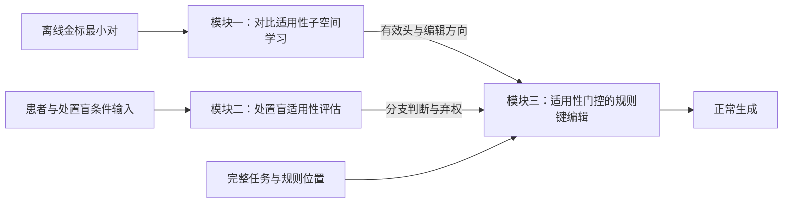
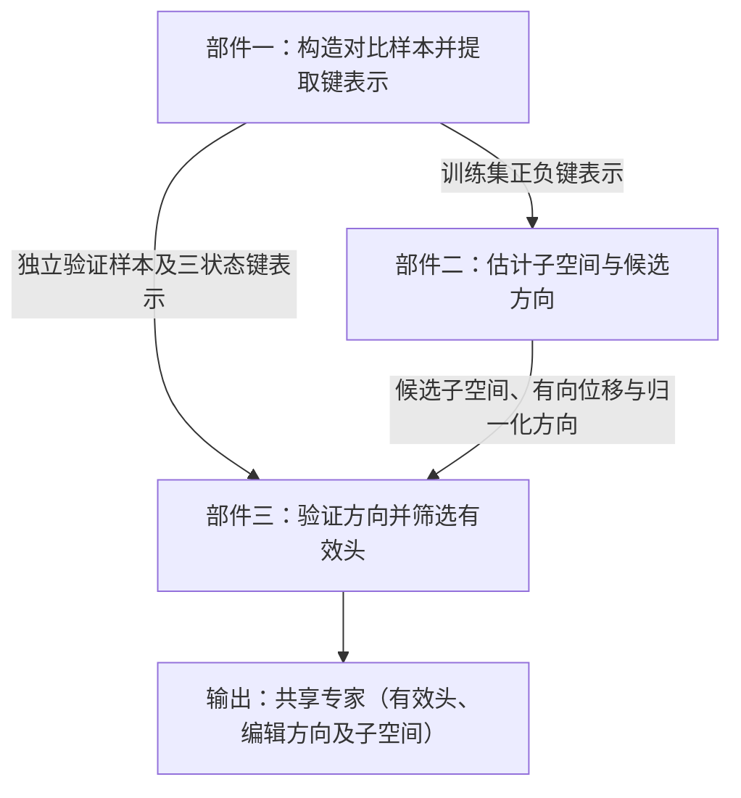

# 别让处置替你选分支：处置盲适用性评估与规则键编辑

**ASTER：Action-blind Selection, Then Eigen-subspace Re-routing。**

> **论文工作稿，2026-10-28。** 方法按“离线学习方向—在线判断适用性—在线执行编辑”组织。当前代码覆盖离线方向估计、处置盲分类、温度拟合、规则增益映射与独立指南前缀键编辑。第 6 节单独报告固定 Qwen3-0.6B-Base 的开发机制预实验；完整系统与正式大模型任务仍待验证，待运行项不得解释为已有发现。

[方法补充](supplementary.zh.md) · [实验协议](experiments.zh.md) · [引用清单](references.zh.md)

## 摘要

临床指南通常要求先根据患者事实选择适用分支，再执行该分支的处置。本研究考察一种候选失败模式：模型对熟悉处置的偏好可能反过来影响分支判断，即处置先行的分支选择。我们用五卷配对反事实评测区分条件判断错误与处置执行错误，并通过处置可见性、熟悉度控制及因果干预检验其机制。

我们提出 ASTER。模块一通过独立金标最小对，离线估计规则键的适用性差分子空间、编辑方向和有效头。模块二使用同一冻结骨干，仅根据患者事实与规则条件进行受限分类，输出温度校准后的概率与弃权信号。模块三结合两者，为接受的适用规则与兄弟规则分配相反符号的键平移；弃权、预测为 NONE 或无法可靠到达的组不编辑。前两个模块分别提供共享专家和病例判断，不相互生成训练标签。评测同时考察冲突遵循、原生保持、完整路径和端到端成本，并用共享同一适用性判断的强基线检验键编辑的独立贡献。小模型开发预实验支持限定协议内的共享方向与可控读取；完整系统性能、谱估计增量和跨模型结论仍待实验。

## 1 引言

将指南放入上下文，并不等于模型会正确执行指南。模型首先需要判断哪些条件适用于当前患者，再读取相应处置。若熟悉处置位于不适用的兄弟分支，增强整份指南的显著性未必能帮助模型区分这些分支。

我们将“处置偏好影响条件判断”称为**处置先行的分支选择**（treatment-led branch selection，TLBS）。这是待验证的机制假设，而不是对全部指南遵循错误的解释。盲判与明判的差异提供行为证据；该差异是否经由处置读取产生，仍需独立干预。

例如，一条虚构规则要求“缓解后不足 6 个月复发，且既往未用 H”时采用 X，兄弟规则要求“至少 6 个月复发”时采用 Y。对 4 个月复发且未用 H 的患者，所给规则要求选择前者。若模型先偏好 Y，再选择其所在分支，就颠倒了条件判断与处置执行的顺序。此例仅说明研究任务，不是实测记录或医疗建议。


研究围绕三个问题展开：处置可见性是否改变分支判断；这种变化是否依赖处置信息读取；在相同适用性信息下，规则键编辑是否比映射、文本执行或简单注意力偏置更有效。方法因此分为三个职责独立的模块：离线学习可复用方向，在线判断当前规则适用性，再将判断转换为键编辑。

## 2 任务定义与配对评测

### 2.1 输入、规则与统一记号

输入为指南 $G$、患者病历 $P$、问题 $Q$ 及可选选项 $O$。指南包含分支组 $\mathcal G=\{g_1,\ldots,g_M\}$；组 $g$ 包含 $K_g$ 条互斥规则，记为 $\mathcal R_g$。规则 $r=(I_r,C_r,A_r)$ 分别包含编号、条件和处置。层级指南中的完整条件为：

```math
\bar C_r=C_r\land\bigwedge_{u\in\mathrm{Anc}(r)}C_u.
```

其中，$\mathrm{Anc}(r)$ 是祖先条件节点集合。互斥性与祖先依赖由数据质控核验，并行建议不强行转成单选分支。

金标分支为 $r_g^{\mathrm{gold}}(P,G)$，预测分支为 $\hat r_g$。金标处置由**当前输入指南**决定，不能用模型记忆中的常规处置替代。$\mathrm{NONE}$ 表示现有信息不足以确认任何候选规则适用，或无规则满足条件；输入结构无效、接口失败与语义 NONE 分别记录。

记 $h=(\ell,b)$ 为层与键值头的组合，$d_k$ 为键维度。$k_{h,j}$ 始终指键归一化之后、旋转位置编码之前的键；$R_j$ 是位置 $j$ 的键旋转。$J_r$ 是规则编号与处置片段中具有唯一规则归属的词元位置。离线样本位置记为 $J_i$，实际在线顺序中的对应位置记为 $\widetilde J_i$，二者不混用。

### 2.2 五卷反事实设计

| 卷 | 唯一主要改动 | 金标依据 | 检验目的 |
|---|---|---|---|
| NC：原规则 | 不改动 | 原适用分支处置 | 原生遵循 |
| IC：不适用处置改写 | 改写兄弟分支处置 | 原适用分支处置 | 阴性对照 |
| AC：适用处置改写 | 改写适用分支处置 | 新处置 | 是否覆盖所给处置 |
| SW：处置交换 | 交换适用与指定兄弟分支的处置 | 交换后的适用分支处置 | 错误分支中的处置诱饵 |
| CS：条件漂移 | 改变数值或时间阈值，使适用分支改变 | 修改后的适用分支处置 | 条件读取与旧分支诱饵 |

同一底稿的全部变体保留配对关系，并进入同一数据划分。CS 的金标翻转由独立规则验证器核验；处置交换若破坏下游依赖，须一致更新后核验，否则剔除或单列。主五卷比较使用全部五卷均通过验收的共同底稿，额外原生样本另报。

多条规则共享同一处置时，处置正确不等于分支正确。后文同时评价分支和答案，避免混淆选择与执行。

## 3 诊断：从行为差异到机制检验

### 3.1 处置可见性与熟悉度

盲判和明判均输出分支标签，主要行为量为盲判准确率减明判准确率。正差值表示处置可见后判断变差。在同一底稿上固定适用分支，分别改变不适用分支中的熟悉处置、陌生处置和中性代号；熟悉度由每个模型的独立闭卷测量确定。

同时控制分支顺序、选项可见性、词元长度与可见片段位置。等总长度不等于等位置。若熟悉诱饵相对中性代号没有更强影响，或效应不能跨顺序复现，应收窄熟悉处置干扰的解释。

错误按“错分支并采用指定先验处置”“错分支并采用其他处置”“覆盖当前指南而输出旧处置”和“其他”互斥编码。金标分支裁剪仅用于分析选择正确后仍存在的执行误差，不作为可部署成绩。

### 3.2 处置信息读取的因果检验

在开发资料上选定位置和强度，在独立留出资料上开展三项互补检验：注意力边敲除、分别修补键与值的激活修补、跨层分支探针。敲除与同规模随机边及非处置片段比较；修补使用位置对齐的最小对，并记录源、目标及修补范围。

探针可读性不等于模型实际使用了信息，注意力热图和生成的解释也不能单独证明因果机制。若切断或修补相应通路不改变判断，或偏差在读取处置前已出现，应修改处置读取机制的主张。恢复比例在基线差距接近零时不稳定，此时仅报告原始变化。

### 3.3 患者相关目标的必要检验

固定一次注意力计算的查询和键，若两个规则片段分别获得常数偏置 $\beta_a,\beta_b$，其注意力质量比的对数变化为 $\beta_a-\beta_b$。相同偏置不会直接改变该比值；患者无关偏置对金标相反的病例施加相同的局部推力。

这不推出完整模型只能改善一个病例，也不证明准确率必然出现取舍。因此，以相反分支病例直接比较整份指南高亮、固定规则高亮与患者相关目标。诊断位置与离线选头分别确定，不用同一证据循环证明机制和方法。

## 4 方法：离线学习、在线评估与门控编辑

### 4.1 分工与数据流

| 模块 | 输入 | 输出 | 职责 |
|---|---|---|---|
| 一：对比适用性子空间学习 | 独立金标最小对、冻结骨干、规则位置 | 共享专家 $\mathcal E_{\mathrm{app}}$ | 学习编辑位置与方向 |
| 二：处置盲适用性评估 | 患者、完整条件、必要非处置语境 | 每组结果 $\mathcal S_g$ | 判断适用性并决定是否接受 |
| 三：适用性门控的规则键编辑 | 两个模块的产物、完整任务、词元映射 | 病例独立的编辑后缓存与答案 | 分配增益并执行编辑 |



模块一与模块二分别向模块三提供输入，不串联训练。模块一不使用模块二的伪标签或概率估计方向；模块二不读取所学方向。温度拟合属于模块二的离线准备，不因其离线执行而并入模块一。方向估计、温度拟合和增益选择使用隔离的非测试资料，所有配置在测试前冻结。

### 4.2 模块一：对比适用性子空间学习

（Contrastive Applicability Subspace Learning）

模块三要通过修改规则键来调节模型对规则的读取，首先需要知道**在哪些键值头上修改，以及沿什么方向修改**。本模块为此离线估计可跨病例复用的编辑位置与方向。输入为冻结骨干 $f_\theta$、经独立条件解析器核验的训练集 $\mathcal D_{\mathrm{train}}$ 与验证集 $\mathcal D_{\mathrm{val}}$，以及目标规则片段的位置标注；输出为共享专家 $\mathcal E_{\mathrm{app}}$，其中保存选定的键值头 $H^*$、各头的编辑方向 $\Delta_h$ 及用于复现的子空间 $U_h$。这里的“专家”是一组可复用的编辑参数，整个估计过程保持骨干参数不变。

三个部件分别负责**提供对比表示、估计候选方向、验证并筛选方向**。第一部件固定规则文本，只改变决定规则是否适用的患者事实，提取适用、不适用和信息不足三种状态下的规则键。第二部件使用训练集中的正负键差分，估计每个头的候选方向。第三部件接收这些候选方向和独立验证材料，同时检查表示分离度与实际输入顺序下的查询响应，再选出有效头。因此，训练表示用于估计方向，验证材料用于筛选方向，筛选时不重新拟合方向。得到的共享专家交给模块三使用；当前患者应选择哪条规则，由模块二另行判断。



#### 4.2.1 适用性对比与键表示提取

如果同时改变患者事实、规则文本和处置，就无法判断规则表示的变化来自哪里。为尽量隔离患者条件的影响，我们围绕同一条目标规则构造对比样本，只改变决定分支的患者事实，再提取该规则在不同状态下的键表示。键向量是注意力机制用来与查询匹配的表示，后续键编辑正是对这些向量施加位移。

设第 $i$ 个样本的目标规则为 $r_i$，构造三种输入 $x_i^s=(P_i^s,Q_i,G_i)$，其中 $s\in\{+,-,0\}$：

- **适用状态 $+$**：患者 $P_i^+$ 满足目标规则的完整条件 $\bar C_{r_i}$，包括其祖先条件。
- **不适用状态 $-$**：患者 $P_i^-$ 满足同组的一条兄弟规则，目标规则不适用，同时保持祖先条件成立，使该分支组仍然可达。
- **未知状态 $0$**：患者 $P_i^0$ 保留已知祖先事实，但缺少区分组内分支的决定性事实，因此无法确认目标规则是否适用。

每个三元组由一个正负最小对和一个未知状态对照组成。例如，对前文“缓解后不足 6 个月复发，且既往未用 H”的虚构规则，可以保持既往未用 H 不变，分别设置为 4 个月复发、8 个月复发和复发时间未知。三种状态须经条件解析器核验；未知状态的成立取决于是否确实缺少判断依据，不能仅由“未记录”字样认定。

同一三元组保持问题、指南、处置及非决定性患者事实不变。不同三元组之间平衡处置内容，以减少方向与某种处置绑定的可能，并核验相关规则的结构依赖。离线提取采用“患者→问题→指南→回答前缀”的顺序。在因果语言模型中，一个位置只能读取此前的上下文；把患者放在指南之前，才能让规则键包含患者事实变化的影响。

沿用第 2.1 节的记号，$h=(\ell,b)$ 表示第 $\ell$ 层的第 $b$ 个键值头，$J_i$ 表示目标规则编号与处置片段的词元位置集合。逐位置核验三种状态下目标词元的标识、绝对位置与片段边界后，提取 $k_{h,i,j}^s\in\mathbb R^{d_k}$，其中 $j\in J_i$。所有键均在键归一化之后、旋转位置编码之前提取，以保持后续差分和编辑使用同一坐标约定。

本部件输出对齐的三状态键表示及其对应样本。训练集的正负表示交给第二部件估计方向；验证集的三状态表示与样本交给第三部件检验方向。未知状态只作为验证参照，不参与方向估计。这样的对比构造减少了规则文本、处置和位置变化的混杂，但是否提取到可迁移的适用性方向，仍需后续验证与对照实验。

#### 4.2.2 差分子空间与编辑方向估计

不同样本产生的键变化并不完全一致。为了得到可跨病例复用的方向，我们先从训练差分中找出变化主要分布的子空间，再在这个子空间中确定从不适用状态指向适用状态的平均位移。本部件只接收训练集的正负键表示。

设训练集包含 $N$ 个三元组。对每个键值头 $h$，计算同一目标规则、同一词元在正负患者状态下的键差分，并汇总其均值与未中心化二阶矩：

```math
\begin{aligned}
d_{h,i,j}&=k_{h,i,j}^+-k_{h,i,j}^-,\\
\bar d_h&=\frac1N\sum_{i=1}^N\frac1{|J_i|}\sum_{j\in J_i}d_{h,i,j},\\
\Omega_h&=\frac1N\sum_{i=1}^N\frac1{|J_i|}\sum_{j\in J_i}d_{h,i,j}d_{h,i,j}^{\top}.
\end{aligned}
\qquad\text{(1)}
```

其中，$d_{h,i,j}$ 描述同一规则从不适用变为适用时的表示变化；$\bar d_h$ 保留这些变化的平均方向；$\Omega_h$ 汇总各个方向上的平均平方变化。计算 $\bar d_h$ 时平均的是差分，计算 $\Omega_h$ 时平均的是每个词元差分的外积。两者均先在片段内平均，再在最小对之间平均，使每个最小对获得相同总权重，避免较长规则仅因词元更多而占据更大权重。计算 $\Omega_h$ 前不对差分作均值中心化，因此该统计量同时保留平均变化与样本间波动。

接着保留 $\Omega_h$ 最大的 $m$ 个特征值对应的正交特征向量，并将平均差分投影到它们张成的子空间中：

```math
\begin{aligned}
U_h&=\mathrm{TopEig}_m(\Omega_h),\\
v_h&=U_hU_h^{\top}\bar d_h,\\
\Delta_h&=\frac{v_h}{\|v_h\|_2+\epsilon}.
\end{aligned}
\qquad\text{(2)}
```

$m$ 是预设的子空间维数，$U_h\in\mathbb R^{d_k\times m}$ 的列向量两两正交且范数为 1。$U_h$ 描述差分主要沿哪些方向变化，但特征向量本身没有固定的正负取向。$\bar d_h$ 则保留了“正状态减负状态”的顺序。因此，$v_h=U_hU_h^{\top}\bar d_h$ 用平均差分确定从不适用到适用的有向位移，并只保留其中位于所选子空间内的部分。它也是该子空间中拟合训练差分的最小二乘共享位移，推导见[方法补充 A 节](supplementary.zh.md#a-差分估计与共享位移)。

最后将 $v_h$ 归一化为候选编辑方向 $\Delta_h$。其中 $\epsilon>0$ 用于数值稳定，因此 $\|\Delta_h\|_2\le1$。过小的 $\|v_h\|_2$ 表示投影后的平均位移接近零，这类头按阈值 $\tau_\Delta$ 排除；数值稳定项不能替代这一筛选。数值秩不足 $m$ 或统计量非有限的头同样排除。

本部件输出各候选头的 $U_h$、$v_h$ 和 $\Delta_h$，交给第三部件验证。对同一个头，不同规则复用同一个 $\Delta_h$；实际编辑的正负号和幅度由模块三分配。这样，方向估计负责提出可复用的候选位移，是否采用这些位移则由独立验证决定。

#### 4.2.3 查询响应筛选与专家构建

能够区分正负表示的方向，未必能改变模型生成时对规则的读取，因为注意力得分还取决于查询与键的内积。为此，本部件固定第二部件得到的候选方向，使用独立验证集检查两个问题：该方向能否在新样本中保持正负分离，以及沿该方向移动规则键时，实际查询的注意力得分是否按预期变化。前者用表示分离度衡量，后者用查询响应衡量。

**首先，检验表示分离度。** 设验证集包含 $N_{\mathrm{val}}$ 个三元组，以下 $i$ 均遍历验证样本。使用第一部件提取的键表示，计算正负差分在 $\Delta_h$ 上的平均投影 $z_{h,i}$，以及正负中点与未知状态之间的投影差 $u_{h,i}$：

```math
\begin{aligned}
z_{h,i}&=\frac1{|J_i|}\sum_{j\in J_i}\Delta_h^{\top}(k_{h,i,j}^+-k_{h,i,j}^-),\\
u_{h,i}&=\frac1{|J_i|}\sum_{j\in J_i}\Delta_h^{\top}\left(\frac{k_{h,i,j}^++k_{h,i,j}^-}{2}-k_{h,i,j}^0\right),\\
\mathrm{Sep}(h)&=\frac{\mathrm{Mean}_i(z_{h,i})}{\mathrm{Std}_i(z_{h,i})+\mathrm{Mean}_i(|u_{h,i}|)+\epsilon}.
\end{aligned}
```

均值与标准差均在验证样本之间计算。分子衡量沿候选方向的平均正负间隔；分母惩罚该间隔的样本间波动，以及未知状态偏离正负中点的程度。当平均正负间隔为正时，间隔越大、波动与未知偏移越小，分离度评分越高。这里将正负中点用作评分参照，不假定未知状态在模型中天然位于中点。

**其次，检验查询响应。** 方向估计采用患者前置顺序，而模块三采用“指南→患者→问题→回答前缀”的顺序。为检验方向能否用于后者，我们在离线验证阶段按实际部署顺序重新运行未编辑骨干。此时目标规则的位置记为 $\widetilde J_i$，与前面的离线位置 $J_i$ 分开记录。

令 $t_i$ 为回答前缀最后一个词元的位置，$\mathcal A(h)$ 为共享键值头 $h$ 的查询头集合。对正负两种状态，取这些查询头在 $t_i$ 处的平均查询，并计算沿 $\Delta_h$ 增加一个单位系数的位移时，目标规则注意力得分的平均直接变化：

```math
\begin{aligned}
\bar q_{h,i,t_i}^s&=\frac1{|\mathcal A(h)|}\sum_{a\in\mathcal A(h)}q_{a,i,t_i}^s,\\
\mathrm{Read}^s(h)&=\frac1{N_{\mathrm{val}}}\sum_{i=1}^{N_{\mathrm{val}}}\frac1{|\widetilde J_i|}\sum_{j\in\widetilde J_i}\frac{(\bar q_{h,i,t_i}^s)^{\top}R_j\Delta_h}{\sqrt{d_k}},\qquad s\in\{+,-\}.
\end{aligned}
```

查询 $q_{a,i,t_i}^s$ 已包含查询侧位置编码，$R_j$ 将旋转前的方向 $\Delta_h$ 变换到位置 $j$ 的键坐标。内积项正是固定查询时增加该位移所产生的注意力得分变化，与模块三式（11）的单位增益情形一致。两种状态使用相同的完整验证最小对。

$\mathrm{Read}^{+}(h)$ 和 $\mathrm{Read}^{-}(h)$ 都测量**加上正方向**时的响应。模块三对适用规则使用正增益，因此希望其得分随正向位移提高；对不适用规则使用负增益，将同一方向反转，因而希望其得分降低。两种操作都要求相应状态下的正向响应为正，所以负状态的筛选条件也是 $\mathrm{Read}^{-}(h)>0$。

**最后，筛选有效头并构建共享专家。** 同时满足方向非零、平均正负分离和双状态正响应的头进入有效集合，再按分离度与平均查询响应的乘积排序：

```math
\begin{aligned}
\mathcal H_{\mathrm{valid}}&=\{h:\|v_h\|_2>\tau_\Delta,\ \mathrm{Sep}(h)>0,\ \mathrm{Read}^{+}(h)>0,\ \mathrm{Read}^{-}(h)>0\},\\
S_h&=\mathrm{Sep}(h)\frac{\mathrm{Read}^{+}(h)+\mathrm{Read}^{-}(h)}2,\qquad
H^*=\mathrm{TopK}_{h\in\mathcal H_{\mathrm{valid}}}(S_h).
\end{aligned}
\qquad\text{(3)}
```

$K$ 是最多保留的键值头数量。有效头不足 $K$ 个时只保留已有头，不补入零分或无效头；没有有效头时输出空集合，由模块三跳过编辑。最终输出为：

```math
\mathcal E_{\mathrm{app}}=\left(H^*,\{(U_h,\Delta_h)\}_{h\in H^*}\right).
```

经过本部件，训练集估计的候选方向被筛选为可供模块三复用的编辑参数。在线执行只读取 $H^*$ 与各头的 $\Delta_h$，$U_h$ 保留用于复现和分析；统计约定与保存字段见[方法补充 B 节](supplementary.zh.md#b-选头评分与共享专家)。这些条件约束的是验证集上的表示间隔和平均直接得分响应，不能保证每个病例、每个生成位置或最终答案都得到改善，跨顺序迁移仍须在留出资料上检验。

### 4.3 模块二：处置盲适用性评估

（Action-Blind Applicability Assessment，ABAA）

本模块判断当前患者适用哪条规则，并保留不确定性。它使用与最终生成相同的冻结骨干，但在任何编辑之前单独完成分类。输入为患者 $P$、完整条件 $\bar C_r$ 和经核验的非处置语境 $Q_c$，不依赖模块一产物。

#### 4.3.1 处置盲输入构建

为每条规则及 NONE 分配中性代理标签 $\ell_r$。原规则编号与代理标签的映射在模型外保存，避免语义性编号泄露处置。对组 $g$ 构建：

```math
X_g=\mathrm{Prompt}\!\left(P,Q_c,\{(\ell_r,\bar C_r)\}_{r\in\mathcal R_g},\ell_{\mathrm{NONE}}\right).
\qquad\text{(4)}
```

采用结构化字段白名单，默认不读取处置、原问题和选项；确需问题语境时，仅传入单独核验的 $Q_c$。患者既往治疗、检查结果和时间事实必须保留，不能按药名全局删除。祖先条件完整传入，数据提供者负责核验分组与切分。

这样隔离的是待执行处置信息，而非骨干内部的医学先验。固定患者、条件和语境，仅改写被排除字段时，$X_g$ 及词元序列应完全相同；确定性无干预前向因此接收相同输入。该不变性是输入契约，不是分类正确性的保证。

#### 4.3.2 受限分类与概率校准

代理标签须在真实聊天模板的回答边界上对应互异的单词元。记合法类别为 $\bar{\mathcal R}_g=\mathcal R_g\cup\{\mathrm{NONE}\}$，读取分数 $z_{g,r}=[f_\theta(X_g)]_{\ell_r}$，在合法类别内归一化：

```math
p_g(r;T)=\frac{\exp(z_{g,r}/T)}{\sum_{u\in\bar{\mathcal R}_g}\exp(z_{g,u}/T)},\qquad T>0.
\qquad\text{(5)}
```

分类采用直接标签读出，不使用自由生成的概率。标签无效、输入超长或分数非有限时记录接口失败，不伪造 NONE。只在独立校准资料上拟合一个全局温度：

```math
T^*=\arg\min_{T>0}\left[-\sum_{i=1}^{N_{\mathrm{cal}}}\log p_{g_i}(y_i;T)\right],\qquad p_g(r)=p_g(r;T^*).
\qquad\text{(6)}
```

温度缩放沿用[既有后处理校准方法](https://proceedings.mlr.press/v70/guo17a.html)。它调整概率尺度而不改变类别排序，因此不能将温度校准解释为纠正原始分支预测。模型、标签池、模板或思考模式改变时需重新核验。

#### 4.3.3 选择性弃权与结果输出

从校准分布计算：

```math
\hat r_g=\arg\max_{r\in\bar{\mathcal R}_g}p_g(r),\qquad
\delta_g=p_{g,(1)}-p_{g,(2)},\qquad
H_g=-\sum_{r\in\bar{\mathcal R}_g}p_g(r)\log p_g(r).
\qquad\text{(7)}
```

$p_{g,(1)},p_{g,(2)}$ 是最大的两个概率。开发阶段固定概率阈值 $\tau_p$ 与间隔阈值 $\tau_m$，定义：

```math
a_g=\mathbb I[p_{g,(1)}<\tau_p\ \lor\ \delta_g<\tau_m\ \lor\ \delta_g=0].
\qquad\text{(8)}
```

全文统一以 $a_g=1$ 表示弃权。并列时按固定标签顺序保留预测，但总是弃权；弃权不改写为 NONE。熵仅用于分析，不新增第三个阈值。输出保持五元组：

```math
\mathcal S_g=(\mathbf p_g,\hat r_g,\delta_g,H_g,a_g).
```

最大概率可从 $\mathbf p_g$ 导出。可达性 $e_g$ 由执行阶段另行核验，不改变本接口。高置信 NONE 可以被分类器接受，但不触发编辑；接受覆盖率不等于编辑覆盖率。阈值提供经验性的选择控制，不构成保形覆盖或风险认证。

### 4.4 模块三：适用性门控的规则键编辑

（Applicability-Gated Rule-Key Editing）

本模块接收 $\mathcal E_{\mathrm{app}}$、各组 $\mathcal S_g$、完整任务及规则位置，将判断转成当前病例的键编辑。它既不重新判断分支，也不重新学习方向。直接输出是病例独立的编辑后键缓存，最终答案由骨干正常生成。

#### 4.4.1 可达性核验与规则增益分配

令 $e_g=1$ 表示输入、映射和分类有效，且本组可可靠到达。平组通过有效性核验后可启用；树中祖先弃权、选择 NONE 或不通向本组时，本组不启用。对 $r\in\mathcal R_g$ 分配：

```math
g_r=\begin{cases}
0,&a_g=1\ \lor\ \hat r_g=\mathrm{NONE}\ \lor\ e_g=0,\\
+g^+,&\text{其余情况且 }r=\hat r_g,\\
-g^-,&\text{其余情况且 }r\ne\hat r_g,
\end{cases}\qquad g^+,g^-\ge0.
\qquad\text{(9)}
```

$g^+,g^-$ 在开发阶段选定并冻结。置信度只控制是否接受，固定增益控制编辑幅度，二者不重复估计。祖先未确认时关闭后代，不把一次局部否定自动扩展为整棵子树抑制。连续间隔缩放和子树抑制仅作为独立消融。

#### 4.4.2 有符号键平移

在模块一选定的键值头与规则片段上执行：

```math
k'_{h,j}=k_{h,j}+g_r\Delta_h,\qquad h\in H^*,\quad j\in J_r.
\qquad\text{(10)}
```

同一头跨规则复用方向；不直接编辑条件、患者事实、选项、值向量或未选中的键值头，也不将分类结果另写成答案提示。选项编辑仅在有明确映射的扩展中评价。

对共享键值头 $h$ 的查询头 $a\in\mathcal A(h)$，令 $q_{a,t}$ 已包含查询侧位置编码。固定当前查询时，式（10）的直接作用为：

```math
\delta s_{a,t,j}=\frac{g_rq_{a,t}^{\top}R_j\Delta_h}{\sqrt{d_k}}.
\qquad\text{(11)}
```

内积为正时，正增益提高相应分数，负增益降低分数，这解释了模块一为何筛选双状态正响应。加性平移不依赖当前键在方向上的投影坐标，但不能保证所有查询同向，更不保证最终准确率单调提高。直接改变量满足：

```math
\|k'_{h,j}-k_{h,j}\|_2=|g_r|\|\Delta_h\|_2\le|g_r|.
\qquad\text{(12)}
```

因此，离线归一化方向与在线增益分别控制方向和幅度。未直接编辑的表示仍可能受后续传播影响；局部界不能解释为完整模型的性能保证。

#### 4.4.3 缓存执行与零编辑回退

在线采用“指南→患者→问题→回答前缀”。先完成未编辑指南的预填充，再为每例建立独立可编辑缓存，保持原始共享缓存不变。由于缓存中的键已经旋转，实际写入为：

```math
R_jk'_{h,j}=R_jk_{h,j}+g_rR_j\Delta_h.
\qquad\text{(13)}
```

随后编码患者、问题及回答前缀，并正常生成。不得在已旋转缓存中直接加入未旋转的 $\Delta_h$，也不对编辑结果再做键归一化。协议只修改预填充完成后的指南键，不在指南自身编码过程中插入编辑。分组查询注意力中，一个键值头的修改会作用于共享它的全部查询头。

当所有规则增益为零，或 $H^*=\varnothing$ 时，跳过编辑并保持相同输入、缓存协议及解码设置。单组零增益只表示该组不直接编辑，不代表整例回退。零编辑分数与生成一致性、病例间缓存隔离、位置旋转和目标命中均须通过实际模型验收。

### 4.5 端到端执行顺序

离线先核验规则结构和数据划分，再由模块一估计方向与选头；模块二在独立资料上拟合温度并选择弃权阈值，模块三的增益由端到端开发结果确定。全部配置冻结后，每例先在无编辑骨干上完成模块二分类，再核验可达性、分配增益、建立病例缓存并执行模块三。模块一产物跨病例复用，不在测试时重新学习。

## 5 实验设置

### 5.1 主要任务与数据隔离

两项主任务分别检验选择题执行和完整路径。MedGUIDE-CF 的主要效应为冲突准确率 CA 的增量，同时检验相对原模型的非冲突准确率 NCA 非劣效。MEGA-CDP 的主要效应为配对 SW 子集的病例宏平均分支忠实率；同底稿 NC 结果用于保持分析。

| 角色 | 来源 | 原稿记录的来源规模 | 使用方式 |
|---|---|---|---|
| 主选择题任务 | MedGUIDE | 7,747 题、55 树、17 癌种 | 匹配完整树后派生五卷 |
| 主路径任务 | MEGA-CDP | 官方测试 7,458 病例、440 份指南 | 单轮 NC／SW 配对为主，其他卷另报 |
| 独立外测 | MedPIC-Bench | 467 道多选题、89 组关联对 | 原生任务与独立规则增强适配分表 |
| 辅助忠实性 | FaithEval | 三个任务子集 | 按各自官方任务评分 |
| 能力保持 | MedCalc-Bench | 仓库修订测试集 1,100 题 | 医疗计算与关闭编辑检查 |

来源身份及版本记录见[引用清单](references.zh.md)，实际纳入数与派生分母仍待数据清单。MedGUIDE 的公开拆分名 train 不代表已具备本研究的独立划分；金标路径不能替代包含兄弟分支的完整指南。

沿用已登记划分：MedGUIDE 按同源指南簇分为方向拟合与训练、温度校准、验证选择和锁定测试，比例为 60/10/10/20；MEGA-CDP 保留官方测试边界，训练侧按 75/12.5/12.5 分配前三种用途，划分种子为 20261028。同底稿、同源版本与近重复内容不跨划分，跨数据集同源检查先于拟合。

MedPIC 不直接提供本方法所需的完整规则包。规则增强适配须使用独立可追溯规则，不根据金标反推；全部方法获得相同新增上下文。原生与适配结果不合并排名，多选按选项集合完全匹配评分。

### 5.2 骨干、解码与冻结

主骨干为 Qwen3-8B、Llama-3.1-8B-Instruct；MedGemma-27B-Text-IT 为医学扩展，Qwen3-1.7B 用于工程先导。正式测试前固定权重、分词器、模板、精度和注意力后端。模块二与最终生成复用同一权重，分类前向成本单独计入。

普通最终生成采用贪心解码，Qwen 主协议关闭思考模式；思考模式另列。TS-Rerank 使用冻结的采样策略、候选预算与种子，最终确定性选择，并以候选序号打破并列。方向拟合和训练使用 13、37、73 三个种子；确定性无拟合方法不重复制造独立结果。超长输入不静默截断，所有失败保留记录。

### 5.3 基线与同信息比较

| 类别 | 主比较 | 扩展或诊断 |
|---|---|---|
| 推理时干预 | CAD、JuICE、PASTA、SEKA | AutoPASTA、AdaSEKA |
| 提示与流程 | 分支优先思维链、病历前置、TS-Map、TS-Note、TS-Prune | 选择题 TS-Fuse；路径 TS-Rerank；提示重复 |
| 训练 | SFT-NC、SFT-CF、SFT-CF+DPO、CPT+SFT-CF | CPT-only |

原模型是公共参照，金标分支或金标片段只进入诊断。第一轨保留各方法原生机制并提供相同完整输入。第二轨复用**同一次模块二运行**的 $\mathcal S_g$ 和相同可达性，比较 TS-Map、TS-Note、TS-Prune、TS-Fuse、TS-Rerank、TS-CAD、TS-PASTA、TS-SEKA、直接有符号分数偏置和 ASTER。

TS-Map 允许无歧义的多对一映射，不能因非双射而排除该强基线。共享 PASTA／SEKA 使用相同预测正向片段，并配套 ASTER 仅正向消融。直接分数偏置复用冻结头集合及正负目标，但执行时不使用 $\Delta_h$；独立选头变体另报。所有组未启用时，各执行器采用同一原模型回退。

训练方法共享基础模型和许可来源，另公开偏好标签、无标签文本、参数量及训练成本；不把不同监督称为完全同预算。具体适配、失败政策与初始搜索范围集中在[实验协议](experiments.zh.md)，不再维护多份平行定义。

### 5.4 评价指标与统计

选择题报告各卷准确率及：

```math
\mathrm{NCA}=\frac{\mathrm{Acc}_{NC}+\mathrm{Acc}_{IC}}2,\qquad
\mathrm{CA}=\frac{\mathrm{Acc}_{AC}+\mathrm{Acc}_{SW}+\mathrm{Acc}_{CS}}3,\qquad
H=\frac{2\,\mathrm{NCA}\,\mathrm{CA}}{\mathrm{NCA}+\mathrm{CA}}.
```

两项均零时 $H=0$。分卷宏平均与逐题微平均分别报告。答案退化率 HR 与纠正率 CR 使用相同 NC∪IC 分母；相同权重下，微平均准确率变化等于 CR−HR。“退化”只指评测中由对变错，不表示临床伤害。SW 诱饵采纳率必须与正确率和失败率同报。

模块二报告分支准确率、NONE 分类、NLL、Brier、ECE、接受覆盖率与选择性错误率。接受仅指 $a_g=0$。信号应用还要求有效可达、预测非 NONE 且执行器实际使用信号；实际键编辑进一步要求发生非零键改写。三种覆盖率分开记录，不复用 $e_g$ 表示编辑事件。

路径报告 PCC、病例宏／节点微平均 BFR、关键分支全对率、终点准确率、节点诱饵采纳和生成退化。PCC 先求累计代价最小的动态时间规整路径，再除以该路径长度；不改为直接最小化平均代价。遗漏节点记错，无关键分支病例只评价终点。空输出或完全不可解析路径按本研究协议记 PCC=1。全部公式和评分器冻结要求见实验协议。

以同源指南簇进行 10,000 次配对重采样，保留簇内全部病例、变体和方法输出。主要对照在验证集选择并于测试前冻结。两个骨干各自的 CA 优效与 NCA 非劣效联合结论，以及各自的 SW 宏平均 BFR 优效，共四项进行 Holm 校正。NCA 非劣效界值为 2 个百分点，仅为研究阈值。报告效应量、区间、簇数和留一指南敏感性；差异不显著不等于等效。

## 6 结果报告

当前版本没有新版端到端模型结果。下表规定主结果的唯一组织方式；真实数值由逐例产物生成，不再维护重复的空白成绩表或假设结果段落。

| 结果组 | 必须包含的比较 | 必报列 | 当前状态 |
|---|---|---|---|
| 五卷主结果 | 原模型、三类主基线、ASTER；每骨干独立面板 | NC、IC、AC、SW、CS、NCA、CA、H、HR、CR、DA、分母 | 待运行 |
| 共享判断的执行器 | 第 5.3 节全部共享轨；仅正向与双向 ASTER | CA、H、HR、接受／应用覆盖率、条件执行错误、成本 | 待运行 |
| 完整路径 | 配对 NC 与 SW 主面板；其他卷另报 | PCC、BFR宏／微、关键分支全对、终点、节点DA、退化率 | 待运行 |
| 外测与能力保持 | MedPIC 原生／适配分表；FaithEval、MedCalc 分任务 | 集合匹配、关联对全对、风险激活／撤销、任务官方指标 | 待运行 |

每项成绩绑定模型与数据版本、种子、运行标识、分子分母和区间。运行失败计错，尚未实现或未运行写“待运行”，不能写零。条件执行错误的病例子集由同一份模块二缓存事先确定，不按执行器结果重新筛选。

解释时先判断冲突改善与原生保持能否同时成立，再比较共享适用性信息后的执行增量。若映射或文本方法复现全部选择题收益，应将其归于判断信息；若只有终点改善而分支指标不改善，不能称为完整路径遵循提高。独立外测、能力保持和成本分别支持不同结论，不能互相替代。

### 独立开发机制预实验：当前模块一与模块三

[2026-10-28 机制实验](../../experiments/module2_mechanism_20261028/RESULTS.zh.md)按照重编号前冻结的逐 token 二阶矩、单位方向、双状态选头和指南前缀协议运行，旧目录名 `module2` 现对应论文模块一。模型为固定修订的 Qwen3-0.6B-Base；12 个开发指南按 6/3/3 划分为拟合、选择和确认，共 96 个目标三元组。144 次离线与 48 次在线表示前向全部完成，四个选择集冻结头在确认集上的有向差分正比例为 16/24–22/24，双状态目标平均查询响应均为正。

实际编辑覆盖 24 个唯一提示与 9 个预设条件，共 216 条记录。联合增益 4 下，12/12 个配置的两名相反患者均提高正确／兄弟规则的局部注意力质量比，几何平均提高 4.827 倍；全部 24 个提示同时提高正确规则质量、降低兄弟规则质量。反向编辑产生反向变化，单独增强与抑制各自有效。原始均值和直接分数偏置同样有效，本轮未建立谱投影的额外优势。

规范单 token ` A`／` B` 读出下，九个配置均为 12/24 正确、1/12 配对全对、0 次预测翻转；谱方向联合增益 4 的平均正确标签间隔变化为 −0.002335。读取控制尚未转化为答案收益。分词边界修正完整重放同一批 216 条配置，旧分数和已保存注意力逐条精确复现；原记录、所有对照和示范筛选清单均保留。

确认集只有 3 个独立指南、6 个基础患者状态；24 个提示和 12 个配对配置包含处置映射与规则顺序变体。病例是显式 Boolean 树条件，不是自然病历；指南与划分已在前轮公开，不能视为新盲测。编辑符号来自金标 oracle，未接入实际模块二预测，因此这些结果不填写上方正式端到端主表，也不构成临床有效性或跨模型证据。全部分母、三图、指纹和复现命令见[实验报告](../../experiments/module2_mechanism_20261028/RESULTS.zh.md)与[数值核验](../../experiments/module2_mechanism_20261028/RUN_VALIDATION.json)。

**后续答案读出诊断。** 为分析原增益下答案不变的原因，在相同 3 个指南、6 个基础患者状态与全部 24 个提示上，固定八个条件后完成 192 条记录。学习方向正向增益 32 的受限 A/B 选择为 15/24 正确、3/12 配对全对，相对基线有 4 次纠正和 1 次由对变错；反向增益 −32 为 8/24 正确。直接分数偏置 +8 为 14/24 正确、2/12 配对全对，有 5 次纠正和 3 次由对变错；反向 −8 为 10/24 正确。前两种正向条件的正确规则平均局部质量分别达到 59.696% 与 86.334%，表明该通路在更大读取量下能够影响标签选择。

这些准确率差不能独立证明答案响应具有稳定的正方向：正向减反向的平均正确标签 logit 间隔，键编辑与分数偏置分别为 −0.018607 和 −0.039127。四种强内部编辑造成的全部离散翻转均为 A→B，尚未建立两个答案方向的稳定控制。显式注释给出正确规则 ID 时为 24/24 正确，给出兄弟 ID 时为 0/24；它只核验标签接口能跟随外部 ID，不证明患者分类能力。局部 Read 为正约束的是查询对键位移的得分响应，答案效用仍需单独检验。本轮是看到旧结果后设计的单点大幅度诊断，没有重新拟合、选头、筛样或搜索剂量，不修改默认增益 4，也不是新盲测。完整对照和[四面板图](../../experiments/rule_readout_diagnostic_20261028/figures/rule_readout_diagnostic.png)见[后续诊断报告](../../experiments/rule_readout_diagnostic_20261028/RESULTS.zh.md)。

## 7 分析与讨论

### 7.1 对比子空间与在线迁移

对应模块一，检验三状态有效性、未见规则的有向差分一致性、分半子空间重叠和正负状态在线响应。比较原始均值差、谱投影均值、随机同范数方向，以及随机头、仅分离度选头、平均响应选头和双状态筛选。数据量、秩与患者顺序的敏感性另报，空专家结果保留。

配对符号置换将 $d$ 变为 $-d$，但不改变 $dd^{\top}$，因此只能用于有向均值或定向干预对照，不能构造谱特征值的零分布。谱结构用分半重现和非决定性事实扰动检验。验证集正响应是选头依据，不是独立测试证据。

### 7.2 处置盲评估与选择性弃权

对应模块二，比较处置可见、处置盲未校准、单温度、仅概率阈值、仅间隔阈值、联合阈值和无弃权。温度前后原始分支准确率应相同；主要部署点只在验证集选择，测试覆盖率曲线用于诊断。

分别统计接受非 NONE 且正确、接受非 NONE 且错误、弃权和接受 NONE。分析高置信错误与最终退化的关系。处置盲输入不变性与盲判准确率是两项不同检查，不能用四卷相同输入冒充四份独立证据。

### 7.3 键编辑的执行增量

对应模块三，固定模块二结果，比较直接分数偏置、PASTA、SEKA 与键平移；比较仅正向、仅负向、双向及连续增益变体。报告固定查询的得分变化、后续生成中的符号分布和最终任务效果，区分局部作用与端到端收益。

旧版诊断尚未建立学习方向优于简单偏置的证据。因此同目标偏置和强文本执行器必须保留；历史计数、协议及负结果由[归档入口](archive/README.md)追溯，不填入新版主表。方向不优于随机或偏置时，应明确报告相应主张未获支持。

### 7.4 稳健性、错误与成本

按数值、时间、否定、既往治疗、缺失信息、组大小和路径深度分层，并控制位置、无关段落、同义改写及标签映射。错误按输入结构、适用性评估、编辑方向、位置／缓存和生成执行的优先级互斥归因；每类给出样本数和来源簇数。

成本分别报告离线方向学习、校准与选参，以及在线模块二分类、缓存和生成。CAD、JuICE、自动片段选择、候选重排及训练成本均计入；共享分类缓存不代表部署时零成本。同后端比较与各方法优化后端比较分开，不通过短输出或提前失败制造加速。

## 8 相关工作与结论边界

温度缩放为概率后处理提供依据；受限标签评分研究提示它与自由回答是不同接口；PASTA、SEKA、AdaSEKA、CAD 和 JuICE 提供不同层面的推理时干预。本文关注的是患者相关的规则适用性目标，以及共享该目标后键平移是否仍有增量。具体来源和支持范围集中在[引用清单](references.zh.md)，不将其他任务的成绩移植为本方法结果。

三个模块通过共享专家和组级判断两个接口连接，便于分别替换判断器与执行器、定位失败来源。该结构不自动带来更高准确率、成本优势或训练方法无法具有的性质。若同信息映射和文本执行解释全部收益，或实际在线顺序中不存在可靠方向，应相应收窄贡献。

## 9 局限与数据声明

互斥分组、祖先条件与规则片段映射依赖数据质控。处置盲分类仍可能在数值、否定或缺失信息上出错，温度和阈值在分布变化后可能失效；高置信错误可能被编辑放大。平均响应筛选与局部幅度界不保证完整路径正确，缓存与模型专用接口还须工程验收。

反事实指南和虚构案例仅用于方法研究。忠实执行所给规则不等于临床正确或安全。数据许可、隐私、标注、伦理和公开范围按真实记录核验，不预先声称已完成。实现状态与可运行接口统一维护于[代码说明](../../src/aster/README.md)；当前文档不构成临床有效性证据。
