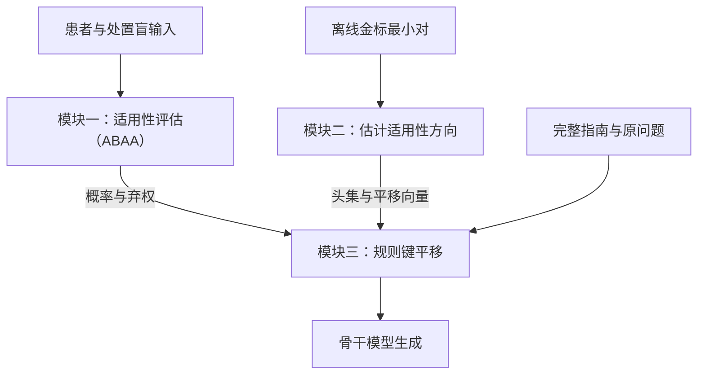

# 别让处置替你选分支：处置盲分支分类与适用性子空间重路由

**ASTER：Action-blind Selection, Then Eigen-subspace Re-routing。三模块主线，模块一规格于 2026-10-27 确定，模块二写作与选头定义于 2026-10-28 更新。**

> **文档状态：论文工作稿，2026-10-28。** 正文给出完整方法，各部分后的实验备注记录需要补充的关键证据。参考代码目前覆盖模块一与模块三增益接口；模块二和实际键编辑的实现状态见专门记录。本次为方法写作更新，不新增模型实验结果。

[主线索引](README.md) · [模块二补充材料](module2-supplement.zh.md) · [主张与证伪](claims-and-falsification.zh.md) · [原稿审计](audit.zh.md) · [引用核验](references-to-verify.zh.md) · [编辑记录](editorial-notes.zh.md)

## 摘要

将临床指南放入大语言模型的上下文后，模型仍需先根据患者事实判断适用分支，再执行该分支的处置。本研究考察一种候选失败模式：模型对某项处置的先验偏好可能反过来影响分支判断。我们将其称为**处置先行的分支选择**（treatment-led branch selection，TLBS）。为检验这一假设，我们设计五卷配对反事实评测，并设置处置盲判与明判、熟悉处置与中性代号、分支顺序及闭卷置信度等对照。机制分析拟结合注意力敲除、键值激活修补和残差流探针，检验偏差是否经由对处置段的信息读取产生。

我们提出 **ASTER**（Action-blind Selection, Then Eigen-subspace Re-routing）。模块一采用处置盲适用性评估（ABAA），根据患者事实与指南条件构建处置盲输入，在互斥分支及 NONE 上执行受限分类，并输出校准概率与弃权信号。模块二只用独立金标最小对，估计规则键中的适用性子空间及平移方向。模块三依据模块一的结果，对高置信适用规则与兄弟规则施加相反符号的键平移；不确定、NONE 或无法可靠到达的分支组不编辑。主方法不进行患者原子抽取、外部事实核查、证据绑定、自然语言推断融合、保形预测或风险认证。研究重点是处置盲分类与患者相关重路由在同信息、匹配预算下的增量作用。当前不预设准确率、临床有效性或相对训练方法的优势。

## 1 引言

条件化指南要求模型完成两个相互关联的步骤：判断规则条件是否适用于患者，以及按照适用规则执行处置。如果模型熟悉的处置恰好出现在不适用的兄弟分支中，增加对整份指南的关注未必能够消除冲突。模型还需要辨别指南内部哪些条件与当前患者相符。

本研究将“处置偏好影响条件判断”作为待检验机制。它与一般的上下文忽视不同：可能吸引模型的处置本身就写在上下文中，但属于错误分支。盲判与明判的差异可以作为行为诊断；该差异是否由特定信息通路造成，需要额外的因果干预，不能从注意力可视化或相关性直接推出。

**图 1：虚构规则下的任务示意。** 设 R1 的条件为“复发距缓解不足 6 个月，且既往未用 H”，处置为 X；R2 的条件为“复发距缓解至少 6 个月”，处置为 Y。某患者在缓解后 4 个月复发，且既往未用 H，因而在所给规则中应选择 R1。图中可以展示“先偏好 Y，再选择 R2”的假设性错误路径，以及“先盲判 R1，再执行 X”的设计路径。该例仅用于解释计算任务，不是模型实测记录，也不构成医疗建议。


本研究拟回答三个层次的问题：

1. **现象：** 处置可见性是否系统性改变分支判断？差异是否依赖处置的熟悉程度，而不是长度、顺序或选项提示？
2. **机制：** 偏差是否依赖判断位置对处置段的读取？相关表征变化是否出现在这一读取之后？
3. **方法：** 在共享相同适用性信息时，离线学习的键平移是否改善生成路径，经验弃权能否降低错误干预率？

本文的当前贡献是问题定义、可证伪的实验协议和方法规格。跨模型复现、机制定位、低伤害率与成本优势均属于待验证主张。

## 2 任务与评测协议

### 2.1 问题定义

输入包括指南 $G$、病历 $P$、问题 $Q$，以及可选的选项 $O$。指南由分支组 $\mathcal G=\{g_1,\ldots,g_M\}$ 构成。组内规则互为兄弟分支，每条规则 $r=(I_r,C_r,A_r)$ 包含规则编号 $I_r$、适用条件 $C_r$ 和处置 $A_r$。

金标适用分支记为 $r_g^{\mathrm{gold}}(P,G)$。它由所给指南的条件与患者事实决定；金标处置来自该分支在**所给指南**中的处置。不能用模型记忆中的常规处置替代这一金标。若条件缺失、冲突或分支不完备，应显式记录无法确定，不强行指定唯一分支。

模型预测的最可能分支记为 $\hat r_g$，与金标符号区分。后文中的“伤害”仅指评测中相对于基线由对变错的现象，不表示临床伤害。

### 2.2 五卷配对设计

**表 1　五卷设计。**

| 卷 | 改动 | 金标 | 检验目的 |
|---|---|---|---|
| NC：原规则 | 不改动 | 原适用分支的处置 | 基本遵循；先验与指南一致的情形 |
| AC：适用处置改写 | 将适用分支处置替换为预先规定的候选处置 | 新处置 | 检验模型是否覆盖所给处置 |
| IC：不适用处置改写 | 仅改写兄弟分支处置 | 原处置 | 处置改写的阴性对照 |
| SW：处置交换 | 交换适用分支与指定兄弟分支的处置 | 原兄弟分支的处置 | 将先验偏好的处置置于错误分支 |
| CS：条件漂移 | 修改数值或时间阈值，使适用分支改变 | 修改后适用分支的处置 | 检验条件读取和旧分支诱饵 |

NC、AC、IC、SW 使用同一病例与问题底稿；CS 使用具备可验证阈值的底稿。所有变体保留底稿标识、决策树标识和配对关系。按决策树或指南划分开发集与测试集，同一底稿的全部变体必须进入同一划分。

CS 的金标翻转须由独立规则执行器核验。处置交换如改变下游可达路径或造成结构不一致，应剔除或单列，不以局部文本交换冒充有效反事实。

### 2.3 诱饵对照

在同一 SW 底稿上固定适用分支处置，仅改变不适用分支中的内容，形成熟悉处置、陌生处置和中性代号三种条件。每个模型分别测量闭卷偏好；不能假定同一处置对所有模型都同样熟悉。闭卷概率阈值、同类处置候选集及中性代号构造方式在开发阶段确定并冻结。

对照包括：

- **盲判与明判：** 均仅输出分支编号。盲判屏蔽指南处置、选项及问题中的处置名称。
- **顺序与选项：** 对调兄弟分支顺序；移除选项并采用开放作答。
- **熟悉度与长度：** 按各模型的分词器匹配被替换片段的长度，并检查所有可见片段的位置。等总长度不足以保证等位置。
- **置信度分层：** 使用冻结的闭卷测量按预定分位分层，报告每层样本数及区间估计。
- **相反分支病例：** 构造共享指南但金标分支相反的配对病例，用于检验患者无关目标是否出现取舍。

原稿中的“Decoy-2×2”名称与三种处置条件不一致。正式数据集暂称“诱饵配对诊断集”，直至析因设计明确。

### 2.4 指标与分母

选择题中，每卷准确率均按该卷锁定的全部有效样本计算。采用分卷宏平均：

```math
\mathrm{NCA}=\frac{\mathrm{Acc}_{NC}+\mathrm{Acc}_{IC}}{2},\qquad
\mathrm{CA}=\frac{\mathrm{Acc}_{AC}+\mathrm{Acc}_{SW}+\mathrm{Acc}_{CS}}{3},
```
```math
H=\frac{2\,\mathrm{NCA}\,\mathrm{CA}}{\mathrm{NCA}+\mathrm{CA}}.
```
两项均为零时约定 $H=0$。所有计算采用未四舍五入的底层计数或准确率，最终展示时统一保留位数。若各卷样本量不同，同时报告宏平均和微平均，不能混用。

| 指标 | 定义与分母 | 方向 |
|---|---|---|
| 伤害率 | NC∪IC 中“Vanilla 正确且当前方法错误”的样本数，除以 NC∪IC 全部样本数 | 越低越好 |
| 纠正率 | NC∪IC 中“Vanilla 错误且当前方法正确”的样本数，除以同一全部样本数 | 越高越好 |
| 诱饵采纳率 DA | SW 中选择指定先验处置的样本数，除以 SW 全部有效样本数 | 越低越好 |
| 分支准确率 | 原始预测正确的组数，除以预先固定的待判定组数；病例各组全对率另报 | 越高越好 |
| 干预覆盖率 | 满足预先固定的干预触发条件的病例数，除以全部有效病例数 | 报告覆盖范围 |
| 接受组错误率 | 接受且预测错误的组数，除以全部接受组数；接受组为空时记为未定义 | 与接受覆盖率共同报告 |

在相同分母和微平均下，准确率变化应等于纠正率减伤害率。分卷宏平均 NCA 的变化只有在相同加权方式下才满足对应恒等式。多条规则共享同一处置时，应另记处置正确但分支不明的情况，避免把处置匹配等同于分支正确。

生成任务拟报告路径一致性代价 PathCost、关键节点分支忠实率 BFR、节点诱饵采纳率 DA 和退化率 Deg。PathCost 的正式定义、实现版本及取值范围须与来源核对。BFR 和 DA 使用预先固定的参考关键节点集合；缺失节点、提前结束、不可解析输出的处理规则须在测试前固定。Deg 统计重复循环或达到长度上限的输出，分母为全部生成病例。另报告病例级“路径全部节点正确”，避免节点平均掩盖整条路径失败。

涉及模型评审时，以“输出内容、病例、参考路径、评审提示及评审器版本”的联合标识缓存评分。同一评审上下文中的相同输出复用同一分数；不能在不同病例或参考路径之间仅凭输出文本相同而复用。

## 3 诊断：检验处置先行的分支选择

### 3.1 错误分解

将错误区分为选错分支并采用先验处置、选错分支并采用其他处置、覆盖当前指南而输出已不存在的原处置，以及其他错误。编码规则应互斥、穷尽，并在未知方法名称的条件下人工抽查。

**表 2　冲突卷错误分解，全部待测。各行以该卷全部样本为分母，准确率与互斥错误类别之和应为 100%。**

| 卷 | 准确率 | 错分支：先验处置 | 错分支：其他 | 覆盖指南：已不存在的原处置 | 其他 |
|---|---|---|---|---|---|
| AC | 待测 | 按构造判定是否适用 | 待测 | 待测 | 待测 |
| SW | 待测 | 待测 | 待测 | 按构造判定是否适用 | 待测 |
| CS | 待测 | 待测 | 待测 | 待测 | 待测 |

“冲突卷错误中有多少属于分支错误”必须从各卷错误计数汇总得到，不能直接平均以全部样本为分母的错误百分比。金标裁剪仅用于分析在适用分支已知时仍有多少处置执行错误。

### 3.2 处置可见性是否改变分支判断

**表 3　盲判与明判分支准确率，全部待测。**

| 条件 | NC | IC | AC | SW | CS |
|---|---|---|---|---|---|
| 盲判 | 待测 | 待测 | 待测 | 待测 | 待测 |
| 明判 | 待测 | 待测 | 待测 | 待测 | 待测 |
| 明判−盲判 | 待测 | 待测 | 待测 | 待测 | 待测 |

NC、AC、IC、SW 仅改变被排除的处置字段，且患者、条件、组顺序与经核验的条件语境相同时，模块一的完整提示及词元序列必须一致。在确定性推理下应得到相同分布；实际数值容差与运行配置须记录。主方法使用单独的处置盲输入，不再依赖跨层注意力掩码。CS 改变条件，因此不要求其盲判输出不变。

**表 4　诱饵控制与复现，全部待测。**

| 比较 | 分支准确率差及区间 | 样本数 | 必须同时报告 |
|---|---|---|---|
| 熟悉处置：明判−盲判 | 待测 | 待定 | 每个模型的闭卷偏好 |
| 陌生处置：明判−盲判 | 待测 | 待定 | 候选筛选与长度匹配 |
| 中性代号：明判−盲判 | 待测 | 待定 | 代号随机化及位置一致性 |
| 移除选项 | 待测 | 待定 | 开放输出的解析失败率 |
| 分支顺序交换 | 待测 | 待定 | 两种顺序的配对结果 |
| 闭卷置信度分层 | 待测 | 待定 | 分层边界、各层计数 |
| 跨模型及思考模式 | 待测 | 待定 | 模型版本与模式 |

中性代号下差异缩小只能排除相应控制下的部分替代解释。不能仅凭剂量关系就断言先验吸引是唯一原因。

### 3.3 偏差是否依赖处置信息读取

机制实验在开发数据上选定干预位置和强度，独立留出数据用于复验。预先规定三个互补实验：

1. **注意力敲除：** 在连续层窗口内屏蔽判断查询到处置键的边。与同规模随机边、非处置片段和其他层窗口对照，报告恢复量及原生性能损失。分母差距接近零时，不报告不稳定的“恢复百分比”。
2. **键值激活修补：** 构造仅兄弟处置不同且位置对齐的熟悉／中性最小对，分别修补键 K、值 V 和 K/V。报告修补范围、源与目标运行及失配风险。V 修补有效不自动证明某个语义属性已经被定位。
3. **残差流探针：** 用独立训练、验证划分读出金标分支，控制模型容量、标签泄漏和跨层比较。探针可读性不等于模型实际使用该信息；只有与干预结果共同分析，才能讨论信息通路。

层窗口、恢复率、探针准确率以及推理链标注一致性均待测。若偏差在读取处置之前已出现，或切断／修补相应通路不改变判断，应修改或放弃“处置读取导致偏差”的机制主张。

### 3.4 患者无关目标的理论边界与实证检验

**性质 1：固定注意力分数下的兄弟质量比。** 在给定查询和键表示下，若干预在规则段 $S_a$、$S_b$ 内分别施加常数偏置 $\beta_a$、$\beta_b$，记两段原有注意力质量为 $M_a$、$M_b$，则

```math
\Delta\log\frac{M_a}{M_b}=\beta_a-\beta_b.
```
若两段得到相同偏置，则该次注意力计算中的相对质量不变。若偏置与患者无关，则这项直接的相对推力对金标相反的病例方向相同。

该性质**不推出**整体模型只能改善一个病例，也不证明准确率必然出现跷跷板。其他上下文、后续层、查询变化和非线性计算都可能改变输出。规则内非恒定偏置或随查询自适应的方法也不满足上述简化前提，须直接实验比较。

**表 5　简单修复的诊断对照，全部待测。**

| 方法 | ΔNCA | ΔCA | SW 明判−盲判 | 适用／诱饵质量比变化 |
|---|---|---|---|---|
| Reorder | 待测 | 待测 | 待测 | 待测 |
| PromptRep | 待测 | 待测 | 待测 | 待测 |
| 分支优先思维链 | 待测 | 待测 | 待测 | 待测 |
| CAD | 待测 | 待测 | 按接口确定 | 按接口确定 |
| JuICE | 待测 | 待测 | 按接口确定 | 待测 |
| PASTA：整份指南 | 待测 | 待测 | 待测 | 待测 |
| SEKA：整份指南 | 待测 | 待测 | 待测 | 待测 |
| AutoPASTA | 待测 | 待测 | 待测 | 待测 |

## 4 方法：三个模块的职责与接口

### 4.1 总体设计

| 模块／阶段 | 输入 | 输出 | 决定什么 |
|---|---|---|---|
| 模块一：处置盲适用性评估（ABAA） | 患者、祖先条件、组内条件、必要的条件语境 | 每组概率、原始预测、最大概率、间隔、熵、弃权 | 哪条规则适用，是否允许干预 |
| 模块二：离线适用性子空间学习 | 训练树金标最小对；验证树查询；同一冻结骨干 | 一个共享专家：头集、每头子空间与位移 | 如何改变模型对规则的读取 |
| 开发阶段校准与选参 | 非测试分支标签及分类 logits；端到端开发结果 | 一个温度、两个弃权阈值、固定增益与头数 | 将配置固定后用于测试 |
| 模块三：在线规则键编辑 | 模块一输出、模块二产物、规则词元位置 | 编辑后的键及正常模型输出 | 编辑哪些规则、采用哪个符号 |



模块一的病例输出只进入模块三。模块二不接收模块一的伪标签、概率或证据句来估计子空间。离线校准可以使用模块一在开发资料上的输出；这不等于让它监督模块二。整个系统冻结骨干模型权重，不新增分类头；“不训练骨干”不意味着不需要标注开发数据或参数选择。

### 4.2 模块一：处置盲适用性评估（Action-Blind Applicability Assessment, ABAA）

#### 4.2.1 处置盲输入构建

为了使指南分支的适用性判断不受处置内容影响，我们根据患者事实和规则条件构建**处置盲输入**（Action-Blind Input）。

给定患者病历 $P$、临床问题 $Q$ 和指南 $G$，我们将指南组织为分支组集合 $\mathcal G=\{g_1,\ldots,g_M\}$。每个分支组 $g\in\mathcal G$ 包含 $K_g$ 条互斥规则，其规则集合记为 $\mathcal R_g=\{r_1,\ldots,r_{K_g}\}$。一条规则 $r=(I_r,C_r,A_r)$ 由编号 $I_r$、适用条件 $C_r$ 和处置 $A_r$ 构成。对于层级指南，我们将规则自身条件与其祖先节点的条件合取，得到完整适用条件：

```math
\bar C_r=C_r\land\bigwedge_{u\in\mathrm{Anc}(r)}C_u.
```
其中，$\mathrm{Anc}(r)$ 表示规则 $r$ 的祖先条件节点集合。

我们从结构化指南中保留规则条件 $\bar C_r$，移除处置 $A_r$，并从问题 $Q$ 中保留必要的非处置任务语境 $Q_c$。患者病历 $P$ 保留既往治疗、检查结果及时间信息。为每个规则编号 $I_r$ 分配唯一的中性代理标签 $\ell_r$，同时为 $\mathrm{NONE}$ 分配标签 $\ell_{\mathrm{NONE}}$；原编号与代理标签的对应关系由分类器保存。对于每个分支组，我们构建：

```math
X_g=\mathrm{Prompt}\!\left(
P,Q_c,\{(\ell_r,\bar C_r)\}_{r\in\mathcal R_g},
\ell_{\mathrm{NONE}}
\right).
\qquad\text{(1)}
```
其中，$\mathrm{NONE}$ 表示现有患者信息不足以确认任何候选规则适用，或没有候选规则满足条件。$X_g$ 仅包含适用性判断所需的信息，作为该组的独立分类输入。

#### 4.2.2 受限分支分类与置信度校准

为了估计各分支的适用概率并控制后续干预，我们使用与答案生成阶段相同的骨干语言模型执行**受限多类别分类**（Constrained Multiclass Classification），并对预测分布进行温度校准。

定义分支组 $g$ 的候选类别集合为 $\bar{\mathcal R}_g=\mathcal R_g\cup\{\mathrm{NONE}\}$。我们在固定的分类输出位置读取模型 $f_\theta$ 对每个合法标签 $\ell_r$ 的下一词元分数。令 $z_{g,r}=[f_\theta(X_g)]_{\ell_r}$，其中 $f_\theta(X_g)$ 表示输出位置的完整词表对数几率向量，$\ell_r$ 对应由分词器验证的单词元标签。将合法类别的分数归一化，得到：

```math
p_g(r;T)=
\frac{\exp(z_{g,r}/T)}
{\displaystyle\sum_{u\in\bar{\mathcal R}_g}\exp(z_{g,u}/T)},
\qquad r\in\bar{\mathcal R}_g,\quad T>0.
\qquad\text{(2)}
```
我们使用单一温度参数 $T$ 校准分支概率。给定校准集 $\mathcal D_{\mathrm{cal}}=\{(X_{g_i},y_i)\}_{i=1}^{N_{\mathrm{cal}}}$，其中 $y_i\in\bar{\mathcal R}_{g_i}$ 是对应分支组的金标类别，通过最小化负对数似然得到：

```math
T^*=
\arg\min_{T>0}
\left[-\sum_{i=1}^{N_{\mathrm{cal}}}\log p_{g_i}(y_i;T)\right].
\qquad\text{(3)}
```
推理时固定 $T=T^*$，并记 $p_g(r)=p_g(r;T^*)$。我们计算最高概率类别、前两名概率间隔与分布熵：

```math
\begin{aligned}
\hat r_g&=\arg\max_{r\in\bar{\mathcal R}_g}p_g(r),\\
\delta_g&=p_{g,(1)}-p_{g,(2)},\\
H_g&=-\sum_{r\in\bar{\mathcal R}_g}p_g(r)\log p_g(r).
\end{aligned}
\qquad\text{(4)}
```
其中，$p_{g,(1)}$ 和 $p_{g,(2)}$ 分别为该组最大的两个类别概率；最高概率并列时，$\hat r_g$ 按固定标签顺序确定。我们进一步通过最大概率与概率间隔定义**选择性弃权**（Selective Abstention）：

```math
a_g=\mathbb{I}\!\left[
p_{g,(1)}<\tau_p
\;\lor\;
\delta_g<\tau_m
\;\lor\;
\delta_g=0
\right].
\qquad\text{(5)}
```
其中，$\tau_p$ 和 $\tau_m$ 为在开发集确定的概率阈值与间隔阈值，$a_g=1$ 表示弃权。$\mathrm{NONE}$ 是候选类别，而 $a_g$ 是是否接受分类结果的决策；即使弃权，我们仍保留原始预测 $\hat r_g$。

模块一对每个分支组输出 $\mathcal S_g=(\mathbf p_g,\hat r_g,\delta_g,H_g,a_g)$，其中 $\mathbf p_g=(p_g(r))_{r\in\bar{\mathcal R}_g}$ 为完整概率向量。模块三结合组的可达性使用该结果：当 $a_g=0$ 且 $\hat r_g\ne\mathrm{NONE}$ 时启用相应规则的有符号键平移；其余情况将该组增益置零。

### 4.3 模块二：离线规则适用性子空间学习

为了将患者条件引起的规则表示变化转化为可复用的编辑方向，我们通过适用性对比提取配对规则键，估计低秩差分子空间，并在该子空间内确定有向位移。随后，结合表示分离度与在线决策查询响应选择干预头，形成共享适用性专家。

模块二的输入为冻结的骨干模型 $f_\theta$、按指南树隔离的训练集 $\mathcal D_{\mathrm{train}}$ 与验证集 $\mathcal D_{\mathrm{val}}$，以及规则片段标注。训练集用于估计子空间和位移，验证集用于选头与选参。适用性标签由独立条件解析器提供；模块一的病例预测只在在线阶段进入模块三。

#### 4.3.1 患者条件对比与规则键表示提取

为了捕获患者决定性事实引起的适用性变化，我们固定目标规则、临床问题和指南文本，构造适用、不适用及信息缺失三种输入：

```math
x_i^s=(P_i^s,Q_i,G_i),\qquad s\in\{+,-,0\}.
```
其中，$P_i^+$ 满足目标规则 $r_i$ 的完整条件 $\bar C_{r_i}$；$P_i^-$ 在保持分支组可达的前提下满足同组兄弟规则，而不满足目标规则；$P_i^0$ 保留已知祖先条件，将区分目标与兄弟分支的决定性事实标为“未记录”，使目标规则的适用性无法由剩余信息确定。三种状态均由条件解析器核验。

同一三元组仅改变决定性患者事实，其余患者信息、问题和指南保持一致。处置文本在不同训练三元组之间进行平衡置换，以降低处置名称与适用性标签的关联；同一三元组内不改变处置，置换后保留有效的规则结构与下游依赖。

离线提取采用“患者→问题→指南→固定回答前缀”的输入顺序，使规则词元在因果注意力计算中能够读取患者条件。格式化、词元化并送入冻结模型：

```math
T_i^s=\mathrm{Tok}(\mathrm{Prompt}(x_i^s)),\qquad
Z_{\ell-1}^s=f_\theta^{(<\ell)}(T_i^s).
```
令 $h=(\ell,b)$ 表示第 $\ell$ 层的第 $b$ 个键值头，$J_i$ 为目标规则编号片段与处置片段的词元位置集合。三种输入使用词元长度匹配的患者事实模板，并逐位置核验规则词元的标识与位置。对 $j\in J_i$，提取键归一化之后、旋转位置编码之前的表示：

```math
k_{h,i,j}^s
=\mathrm{KeyNorm}_h\!\left(
W_h^K\mathrm{Norm}_{\ell}(Z_{\ell-1,j}^s)
\right)\in\mathbb R^{d_k}.
```
其中，$Z_{\ell-1,j}^s$ 为该层输入隐藏状态，$W_h^K$ 为键投影，$\mathrm{Norm}_\ell$ 为注意力输入归一化，$\mathrm{KeyNorm}_h$ 为键归一化；无键归一化的模型使用恒等映射。由此获得同一规则词元的配对表示 $k_{h,i,j}^+$、$k_{h,i,j}^-$ 和 $k_{h,i,j}^0$。

> **实验备注｜对比有效性。** 补充三状态核验与位置对齐统计，并用处置平衡、事实等义改写及非决定性事实扰动对照，检查提取的差异是否主要随规则适用性变化。

#### 4.3.2 适用性差分子空间与有向位移估计

为了汇总不同患者与规则中的共同变化，我们首先计算正负状态的配对键差分：

```math
d_{h,i,j}=k_{h,i,j}^+-k_{h,i,j}^-.
```
随后，以最小对为等权统计单位，构造未中心化差分二阶矩，并提取前 $m$ 个特征向量：

```math
\Omega_h=\frac1N\sum_{i=1}^{N}\frac1{|J_i|}
\sum_{j\in J_i}d_{h,i,j}d_{h,i,j}^{\top},\qquad
U_h=\mathrm{TopEig}_m(\Omega_h).\qquad\text{(6)}
```
其中，$N$ 为训练最小对数量，$U_h\in\mathbb R^{d_k\times m}$ 为正交基。对词元先在最小对内平均，再在最小对间平均，使规则片段长度不改变各最小对的统计权重。该谱估计求解：

```math
U_h\in\arg\max_{U^{\top}U=I_m}
\frac1N\sum_{i=1}^{N}\frac1{|J_i|}
\sum_{j\in J_i}\|U^{\top}d_{h,i,j}\|_2^2.
```
因此，$U_h$ 张成的子空间在给定维数下保留最大的平均平方差分。未中心化估计同时保留平均差分和差分的波动结构。

子空间确定需要保留的变化成分，正负差分的均值则确定适用性极性。我们计算平均差分，并将其投影到所学子空间：

```math
\bar d_h=\frac1N\sum_{i=1}^{N}\frac1{|J_i|}
\sum_{j\in J_i}d_{h,i,j},\qquad
v_h=U_hU_h^{\top}\bar d_h.
```
对满足 $\|v_h\|_2>\tau_\Delta$ 的头，归一化得到适用性位移方向：

```math
\Delta_h=\frac{v_h}{\|v_h\|_2+\epsilon}.
```
其中，$\tau_\Delta>0$ 为近零位移筛选阈值，$\epsilon>0$ 为数值稳定项。$v_h$ 是该子空间内拟合全部配对差分的最小二乘共享位移；$\Delta_h$ 保留由不适用到适用的平均变化方向，将编辑幅度交由模块三控制。同一键值头在不同规则的编号与处置片段上复用该方向。

> **实验备注｜共享性与谱估计增量。** 重点检验未见规则的差分方向一致性，并比较原始均值差、谱投影均值与随机同范数方向。前者检验共享位移，后者检验低秩子空间估计的必要性；详细稳定性分析放入补充材料。

#### 4.3.3 在线查询感知的头选择与共享专家

为了使所选方向同时具有表示区分能力与注意力调控作用，我们在验证集上评估适用性分离度和分状态查询响应。

**适用性分离度。** 按离线提取顺序获取验证键，定义每个最小对在位移方向上的正负差异，以及信息缺失状态相对正负中点的偏移：

```math
z_{h,i}=\frac1{|J_i|}\sum_{j\in J_i}
\Delta_h^{\top}(k_{h,i,j}^+-k_{h,i,j}^-),
```
```math
u_{h,i}=\frac1{|J_i|}\sum_{j\in J_i}
\Delta_h^{\top}\left(
\frac{k_{h,i,j}^++k_{h,i,j}^-}{2}-k_{h,i,j}^0
\right).
```
据此定义：

```math
\mathrm{Sep}(h)=
\frac{\mathrm{Mean}_{i}(z_{h,i})}
{\mathrm{Std}_{i}(z_{h,i})+
\mathrm{Mean}_{i}(|u_{h,i}|)+\epsilon}.
```
分子衡量正负状态的平均有向分离；分母分别惩罚跨样本波动和决定性事实缺失造成的中点偏移。该评分优先选择正负变化一致、且缺失状态偏移较小的头。

**在线查询响应。** 在线推理采用“指南→患者→问题→回答前缀”的顺序，以复用指南前缀。离线患者前置用于学习条件差分，在线则由模块一确定当前患者的编辑目标；两个阶段通过同一键坐标中的位移 $\Delta_h$ 连接。我们按实际在线顺序，在未编辑的冻结模型上计算查询响应。

令 $\widetilde T_i^s$ 为在线顺序的验证输入，$\widetilde J_i$ 为对应规则位置，$t_i$ 为回答前缀最后一个词元位置。设 $\mathcal A(h)$ 为共享键值头 $h$ 的查询头集合，定义：

```math
\bar q_{h,i,t_i}^s=
\frac1{|\mathcal A(h)|}\sum_{a\in\mathcal A(h)}q_{a,i,t_i}^s.
```
各查询包含查询侧位置编码，$R_j$ 表示键侧位置旋转。分别计算适用与不适用状态的平均读取响应：

```math
\mathrm{Read}^{s}(h)=
\frac1{N_{\mathrm{val}}}\sum_{i=1}^{N_{\mathrm{val}}}
\frac1{|\widetilde J_i|}\sum_{j\in\widetilde J_i}
\frac{(\bar q_{h,i,t_i}^{s})^{\top}R_j\Delta_h}{\sqrt{d_k}},
\qquad s\in\{+,-\}.
```
该量是固定查询下，沿 $\Delta_h$ 施加单位键位移所产生的平均注意力得分变化。模块三采用正负双向编辑，因此我们要求两种状态各自具有正的平均响应。

**有效头筛选。** 在数值有效的候选头中保留：

```math
\mathcal H_{\mathrm{valid}}=
\left\{h:\|v_h\|_2>\tau_\Delta,\ 
\mathrm{Sep}(h)>0,\ 
\mathrm{Read}^{+}(h)>0,\ 
\mathrm{Read}^{-}(h)>0\right\}.
```
随后按联合得分选择至多 $K$ 个头：

```math
S_h=\mathrm{Sep}(h)
\frac{\mathrm{Read}^{+}(h)+\mathrm{Read}^{-}(h)}2,
\qquad
H^*=\mathrm{TopK}_{h\in\mathcal H_{\mathrm{valid}}}(S_h).
\qquad\text{(7)}
```
有效头不足 $K$ 个时保留全部有效头，集合为空时跳过键编辑。子空间维数 $m$、头数量上限 $K$ 和近零阈值 $\tau_\Delta$ 在开发阶段确定，并在测试前冻结。

最后，将选定头及其参数组织为一个共享适用性专家：

```math
\mathcal E_{\mathrm{app}}=
\left(H^*,\{(U_h,\Delta_h)\}_{h\in H^*}\right).
```
该专家在同一骨干模型与提示协议内跨患者、跨规则复用。在线阶段直接使用 $H^*$ 与 $\Delta_h$；$U_h$ 保留用于复现和分析。模块三根据模块一的分类与接受结果，为每条规则设置正、负或零增益，并执行式（9）的加性键编辑。

> **实验备注｜在线迁移与双向读取。** 在实际指南缓存协议下分别检验正向增强和负向抑制，报告响应符号分布及最终决策效果。比较双状态筛选与平均响应选头，并消融信息缺失惩罚。主文保留跨顺序迁移和同信息执行增量，逐头、逐位置结果放入补充材料。

谱估计推导、共享位移的最小二乘解释、数值约定及详细实验设计见[模块二补充材料](module2-supplement.zh.md)。

### 4.4 模块三：按组置信度编辑规则键

定义 $e_g$ 表示该组可可靠到达且输入、映射与分类均有效。平组可以直接设为有效；树结构中，若祖先选择为 NONE、弃权或不通向本组，则该组及相应后代不激活。默认不由一次局部否定自动压低整棵子树。

```math
g_r=\begin{cases}
0,&a_g=1\ \lor\ \hat r_g=\mathrm{NONE}\ \lor\ e_g=0,\\
+g^+,&r=\hat r_g,\\
-g^-,&r\ne\hat r_g,\ r\in\mathcal R_g,
\end{cases}\qquad g^+,g^-\ge0.\qquad\text{(8)}
```
主配置中 $g^+,g^-$ 为开发集固定的常数；模块一的概率通过接受判据控制是否施加它们。这样，置信度与强度的作用不混在一起。以间隔连续缩放增益是额外消融，不作为首版必需环节。

```math
k_{h,j}'=k_{h,j}+g_r\Delta_h,\qquad
h\in H^*,\quad j\in J_r.\qquad\text{(9)}
```
模块二采集与模块三编辑统一位于键归一化之后、位置旋转之前；无键归一化的架构直接使用旋转前的键。主方法只编辑具有唯一规则归属的编号与处置词元，不编辑患者证据、条件词元或值向量，也不把模块一预测写成额外答案提示。选项编辑另作有明确映射的消融。

**缓存协议。** 在“指南→患者→问题”的顺序下，先生成未编辑指南前缀，再为每例建立独立缓存视图。在已旋转的键缓存中加入 $g_rR_j\Delta_h$，随后处理患者、问题及回答前缀并正常生成。原始共享缓存保持不变。该协议仅修改已生成的指南键缓存，不在指南预填充内部插入编辑钩子。

**零编辑路径。** 某组全零表示该组不直接编辑。所有组均为零或 $H^*=\varnothing$ 时跳过编辑，并保持原始输入、缓存及解码设置。零编辑一致性通过实际输出分数与生成结果进行验收。

### 4.5 键平移的直接作用

**处置盲输入不变性。** 若两个样本仅在被排除的处置字段不同，而式（1）构造的 $X_g$ 及其词元序列相同，则确定性无干预前向接收相同输入并产生相同分支读数。该性质由处置盲输入构造直接实现。

**固定查询下的平移效应。** 对共享键值头 $h$ 的查询头 $a\in\mathcal A(h)$，令 $q_{a,t}$ 包含查询侧位置编码，规则位置 $j$ 的键为 $R_jk_{h,j}$。由式（9），固定当前查询时，注意力得分的直接变化为：

```math
\delta s_{a,t,j}
=\frac{g_rq_{a,t}^{\top}R_j\Delta_h}{\sqrt{d_k}}.
\qquad\text{(10)}
```
式（10）将规则级增益与查询对适用性方向的读取响应相乘。内积为正时，正增益提高相应得分，负增益降低相应得分；第 4.3.3 节据此分别筛选两种适用状态的查询响应。与乘性投影 $k'=k+gUU^{\top}k$ 相比，加性平移不再依赖当前键在该方向上的投影坐标。

**编辑幅度。** 每个目标键的直接改变量为：

```math
\|k_{h,j}'-k_{h,j}\|_2
=|g_r|\|\Delta_h\|_2\le |g_r|.
\qquad\text{(11)}
```
因此，离线归一化方向与在线固定增益分别控制编辑方向和幅度。局部注意力分布的散度推导见补充材料 D 节。模型权重在整个过程中保持冻结，是否编辑由病例级分类结果和有效头集合共同决定。

> **实验备注｜执行增量。** 式（10）描述单次固定查询的直接得分变化。端到端效果通过共享模块一输出的映射、文本执行和键编辑对照补齐，并记录后续生成中的符号变化与错误放大。

### 4.6 端到端流程

1. 离线核验条件与处置切分、互斥分组、祖先依赖以及规则片段位置。
2. 用独立金标最小对拟合模块二子空间与位移，在验证集筛选表示分离和双状态查询响应均通过的头。
3. 在校准资料上拟合单一温度，在开发资料上选择弃权阈值、子空间维数、有效头数量上限、位移阈值与固定增益，冻结全部配置。
4. 每例独立执行模块一的处置盲分类；保存完整分布、原始预测与弃权。
5. 按可达性及式（8）生成规则增益，在模块三使用同一骨干和完整原始任务进行键编辑与正常生成。
6. 比较同信息执行器及未干预原模型，记录错误干预、覆盖率与端到端成本。

## 5 实验设置与统计计划

### 5.1 数据与隔离

保留 MedGUIDE-CF 五卷、MEGA-CDP-CF 路径任务、诱饵配对诊断集和 MedPIC-Bench 外部验证的研究方向。具体数据版本、许可、样本数、参考路径及官方评分定义须核验，不采用附件或旧稿中未经核验的固定规模。所有同源病例及其变体按树／指南整体隔离。

区分四个用途：模块二拟合、温度校准、阈值及增益选择、最终测试。外部测试不参加方向选择、阈值拟合或提示修改。数值、时间、否定、缺失信息和复合条件只作为人工／数据元数据切片，不要求恢复在线原子抽取。

### 5.2 模型与同信息对照

主骨干候选为 Qwen3-8B、Llama-3.1-8B-Instruct、Mistral-7B-Instruct 或实际部署医学模型，最终修订标识和聊天模板在测试前锁定。每个骨干的 M1 与执行器共享权重；改变模型或提示协议需重新校准及核验模块二。

| 对照层级 | 方法 | 核心问题 |
|---|---|---|
| 无分支分类信息 | Vanilla、提示重复、重排、CAD、JuICE、PASTA、SEKA 等 | 原有方法能做到什么 |
| 相同 M1 输出 | M1-only／TS-Map、TS-Note、TS-Prune、TS-Fuse、TS-SEKA、TS-Rerank、ASTER | 增益来自分支识别还是执行算子 |
| 相同金标分支 | Gold-Map／Prune、ASTER-oracle | 去除分类误差后的执行差距 |
| 相同开发数据 | 普通 SFT、反事实平衡 SFT、必要的适配器基线 | 冻结方向与参数训练的经验取舍 |

M1-only 在映射完整的选择题中直接将分支映到处置／选项；这是强基线，也是最简单的可用执行器。NONE 和弃权时各执行器采用相同回退政策。若映射已经达到相同效果，不能把选择题增益归于键编辑。自由路径还须比较文本附注、裁剪、候选重排及结构化约束生成；不能宣称只有注意力方法可行。

共享分布的算子比较和各自端到端运行分表报告。所有辅助模型、额外提示、候选数、模型调用及选择数据均计入预算。NLI 辅助与证据审计只作扩展，不设置默认 ASTER-full，也不预设外部模型带来收益。

### 5.3 主要指标与冻结

端到端继续报告 NC、IC、AC、SW、CS、NCA、CA、H、伤害率、诱饵采纳率、路径 BFR／PathCost 与退化率。模块一报告全体组准确率、NONE 子集、负对数似然、Brier 分数、ECE、间隔及熵分布；选择性指标报告接受覆盖率、接受组错误率和实际非零干预组覆盖率。只输出规则增益而尚未执行键编辑时，另称计划非零增益覆盖率，不计为已实施干预。NONE 可被接受而不干预，因此接受覆盖率与干预覆盖率不能混用。

阈值依据开发集覆盖率—错误率曲线选择，测试集固定点为主要结果。阈值扫描只能作为预先规定的诊断，不据此在测试上选择部署点。端到端“伤害率”继续指基线正确而干预后错误的研究指标，不等于真实临床伤害。

统计保留病例配对和树内聚类结构，报告效应量与区间；比较族和多重校正事先确定。非劣效界值必须提前固定，差异不显著不等于等效。全部解析和输入失败计入记录，并对所有方法采用相同处理。详细口径见[实验计划](experiment-plan.zh.md)。

## 6 结果报告模板

当前所有性能结果均为待测。参考实现测试验证的是软件契约，不是以下性能表。

| 模块一 | 全体组准确率 | NLL | Brier | ECE | 接受覆盖率 | 接受组错误率 | 非零干预覆盖率 |
|---|---|---|---|---|---|---|---|
| M1-self，未校准 | 待测 | 待测 | 待测 | 待测 | 待测 | 待测 | 待测 |
| M1-self，单温度 | 待测 | 待测 | 待测 | 待测 | 待测 | 待测 | 待测 |
| M1-NLI，辅助消融 | 待测 | 待测 | 待测 | 待测 | 待测 | 待测 | 待测 |
| M1-oracle | 金标对照 | 不作为校准结果 | 不作为校准结果 | 不作为校准结果 | 按金标政策 | 按定义 | 按金标政策 |

| 方法 | NC | IC | AC | SW | CS | NCA | CA | H | 伤害率 | DA |
|---|---|---|---|---|---|---|---|---|---|---|
| Vanilla | 待测 | 待测 | 待测 | 待测 | 待测 | 待测 | 待测 | 待测 | 基线 | 待测 |
| M1-only／TS-Map | 待测 | 待测 | 待测 | 待测 | 待测 | 待测 | 待测 | 待测 | 待测 | 待测 |
| TS-Note／Prune／Fuse | 分别报告 | 分别报告 | 分别报告 | 分别报告 | 分别报告 | 分别报告 | 分别报告 | 分别报告 | 分别报告 | 分别报告 |
| TS-SEKA | 待测 | 待测 | 待测 | 待测 | 待测 | 待测 | 待测 | 待测 | 待测 | 待测 |
| ASTER，M1-self | 待测 | 待测 | 待测 | 待测 | 待测 | 待测 | 待测 | 待测 | 待测 | 待测 |
| ASTER，M1-oracle | 诊断 | 诊断 | 诊断 | 诊断 | 诊断 | 诊断 | 诊断 | 诊断 | 诊断 | 诊断 |

| 路径执行器 | 原生 PathCost | 原生 BFR | 诱饵 PathCost | 诱饵 BFR | DA | Deg | 端到端成本 |
|---|---|---|---|---|---|---|---|
| Vanilla | 待测 | 待测 | 待测 | 待测 | 待测 | 待测 | 基准 |
| TS-Note／Prune／SEKA／Rerank | 分别报告 | 分别报告 | 分别报告 | 分别报告 | 分别报告 | 分别报告 | 分别报告 |
| ASTER | 待测 | 待测 | 待测 | 待测 | 待测 | 待测 | 待测 |
| Gold-Prune／ASTER-oracle | 分别报告 | 分别报告 | 分别报告 | 分别报告 | 分别报告 | 分别报告 | 诊断成本 |

外部验证另报原题、反事实、成对全对及撤销警示子集；各模型分别列出身份、模板、温度、阈值、方向产物和复现状态。不把条件满足的结构性映射结果当成独立实测性能。

## 7 消融与错误归因

| 问题 | 最小必要比较 |
|---|---|
| 盲判是否有效 | 处置盲输入 vs 处置可见；标签顺序；问题／选项泄漏 |
| 校准与弃权是否有用 | 单温度 vs 未校准；无弃权 vs 固定阈值；正确犹豫／自信错误分层 |
| 子空间与共享方向 | 非决定性事实对照、分半子空间重现；配对符号置换检验有向均值；未见规则一致性 |
| 谱估计是否必要 | 原始均值差、投影均值差、SEKA 型投影、差分谱基线、随机方向 |
| 平移是否有增量 | 相同 M1 目标下平移 vs 乘性投影 vs logit 偏置 vs 文本执行器 |
| 选头是否可读 | 编码分离、平均响应、双状态响应筛选、随机等量头；缺失偏移惩罚消融 |
| 符号和强度 | 仅正增益、仅负增益、双符号；固定增益 vs 连续间隔增益 |
| 错误放大 | M1 正确／错误 × 接受／弃权；NONE；不可达子组；异常输入 |
| 离线与训练 | 同数据与预算下的反事实训练、方向编辑；原生性能与更新适应 |

高置信错误是主要剩余风险，弃权不能发现所有错误。错误归因至少区分处置盲输入错误、M1 分类错误、M2 方向或读取符号错误、M3 词元映射／缓存错误和生成执行错误。每类报告样本数、覆盖及端到端影响。

成本包含每组分类前向、温度与离线拟合摊销、完整生成、缓存复制与键编辑。复用同一权重不等于没有额外前向。键编辑是否兼容某种高效注意力内核、是否降低显存及延迟，都须在实际适配上测量，不搬用其他论文的速度数字。

## 8 相关工作与当前结论

已核对的基本来源包括温度缩放、临床自然语言推断、受限首词元评价，以及谱键编辑；链接与支持范围见[引用核验清单](references-to-verify.zh.md)。其他数据集规模、官方路径指标和既有基线实现仍需逐项核验。

这版主线把“适用性判定”“离线编辑方向”和“在线执行”分开，减少在线判断链条的依赖。它更便于同信息消融和定位错误来源，但是否更准确、更稳健或优于训练仍是实验问题。若 M1-only 或文本附注复现全部收益，应收窄注意力方法的贡献；若实际顺序下无可靠可读方向，应报告模块二／三假设失败。

## 9 局限与数据声明

互斥分组、祖先条件和条件／处置切分需要额外的数据质控。受限分类仍可能产生数值、时间、否定与缺失信息错误。选择性干预会牺牲覆盖率；温度与阈值在分布变化后可能失效。组间依赖、缓存复制及模型专用 hook 尚不能由参考 M1 代码证明正确。

反事实指南和虚构示例用于方法研究，忠实执行所给规则不等于临床正确。正式实验前依据真实记录核验数据许可、公开范围、隐私及标注流程；不预先声称伦理、付酬或试验事项已经完成。

## 附录：实现与可追溯记录

模块二的数学推导、构造与数值细节、重点实验安排见[模块二补充材料](module2-supplement.zh.md)。

| 验证 | 必须观察的行为 |
|---|---|
| 处置盲输入不变 | 仅替换处置、问题处置提示与选项时，M1 提示和 token IDs 相同；保留既往用药事实 |
| 受限评分 | 所有合法标签是边界上的互异单 token；非有限分数、错误长度与截断被拒绝 |
| 分类契约 | 完整归一化分布；预测始终为 argmax；NONE、弃权和并列分别处理 |
| 校准隔离 | 正温度；仅开发／校准标签；固定模板与身份；测试不重新选参 |
| 模块二选头 | 近零方向排除、正负状态响应分别筛选、至多 K 个有效头、空专家跳过编辑 |
| 增益接口 | 高置信非 NONE 才正负编辑；其他状态全零；独立记录可达性 |
| 实际模型编辑 | 旋转位置、GQA、缓存隔离、退出恢复、全零回退及 token 归属，仍待 M3 实现后验证 |

每次模型运行保存代码提交、模型与分词器修订、处置盲输入、代理标签映射、原始 logits、温度及阈值、完整 M1 输出、M2 产物指纹、M3 词元位置与增益、缓存状态、生成结果、解析失败和成本。结果表由逐例产物派生。已完成的软件检查与尚未运行的模型实验在[实现状态](implementation-status.zh.md)中分别记录。
