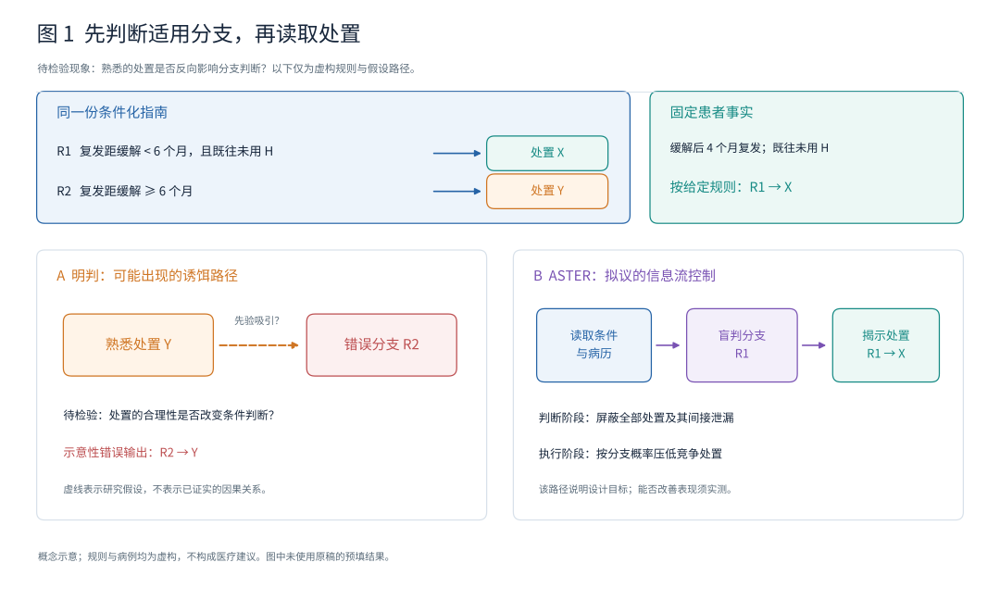

# 基于处置盲适用性判断的指南缓存键编辑

**ASTER：保留三模块，2026-10-31修订默认使用均值差；谱方法保留为对照。**

> **论文工作稿，2026-10-31修订。** 保留三模块主线，优先P0和算子判定；43例只作历史诊断和候选提议，新增100例、10来源选参，120例、12来源验证。拟议组件与实际实现分开，结果完成后单独报告。

[方法定稿说明](method-fixed-20261031.zh.md) · [方法补充](supplementary.zh.md) · [实验协议](experiments.zh.md) · [引用清单](references.zh.md)

## 摘要

临床指南执行需要根据患者事实判断适用条件，再读取相应处置。我们研究是否可以将这两个步骤分开：由处置盲判断模块提供接受的规则路径，再通过缓存键编辑调整生成模型对指南的读取。

我们提出ASTER。模块一从独立患者最小对提取规则键差分，以归一化均值差学习共享方向；模块二由冻结大模型直接判断当前条件为真、假或信息不足，遇到未知或低置信度时停止进一步门控；模块三对已接受规则施加正向键平移，对被排除兄弟及后代施加负向键平移，复用指南预填充缓存。模型权重和值缓存保持不变。

旧43例仅用于历史诊断和候选提议，新100例／10来源选择头、强度及阈值，120例／12来源用于冻结验证。比较均值、谱、反向与随机方向，并以裁剪、硬屏蔽和打分偏置区分方向与算子的作用。实验仍在进行，最终参数、任务增益及效率结果待填，当前不预先声称有效性。

## 1 引言

将指南放入上下文，并不等于模型会正确执行指南。模型首先需要判断哪些条件适用于当前患者，再读取相应处置。若熟悉处置位于不适用的兄弟分支，增强整份指南的显著性未必能帮助模型区分这些分支。

我们将“处置偏好影响条件判断”称为**处置先行的分支选择**（treatment-led branch selection，TLBS）。这是待验证的机制假设，而不是对全部指南遵循错误的解释。盲判与明判的差异提供行为证据；该差异是否经由处置读取产生，仍需独立干预。

例如，一条虚构规则要求“缓解后不足 6 个月复发，且既往未用 H”时采用 X，兄弟规则要求“至少 6 个月复发”时采用 Y。对 4 个月复发且未用 H 的患者，所给规则要求选择前者。若模型先偏好 Y，再选择其所在分支，就颠倒了条件判断与处置执行的顺序。此例仅说明研究任务，不是实测记录或医疗建议。



研究围绕三个问题展开：处置可见性是否改变分支判断；这种变化是否依赖处置信息读取；在相同适用性信息下，规则键编辑是否比映射、文本执行或简单注意力偏置更有效。方法因此分为三个职责独立的模块：离线学习可复用方向，在线判断当前规则适用性，再将判断转换为键编辑。

## 2 任务定义与配对评测

### 2.1 输入、规则与统一记号

输入为指南 $G$、患者病历 $P$、问题 $Q$ 及可选选项 $O$。指南包含分支组 $\mathcal G=\{g_1,\ldots,g_M\}$；组 $g$ 包含 $K_g$ 条互斥规则，记为 $\mathcal R_g$。规则 $r=(I_r,C_r,A_r)$ 分别包含编号、条件和处置。层级指南中的完整条件为：

```math
\bar C_r=C_r\land\bigwedge_{u\in\mathrm{Anc}(r)}C_u.
```

其中，$\mathrm{Anc}(r)$ 是祖先条件节点集合。互斥性与祖先依赖由数据质控核验，并行建议不强行转成单选分支。

金标分支为 $r_g^{\mathrm{gold}}(P,G)$，预测分支为 $\hat r_g$。金标处置由**当前输入指南**决定，不能用模型记忆中的常规处置替代。$\mathrm{NONE}$ 在修订设计中仅表示候选全部不适用；信息不足为UNKNOWN并触发弃权。旧分类器混合这两类状态；输入结构无效、接口失败与语义 NONE 分别记录。

记 $h=(\ell,b)$ 为层与键值头的组合，$d_k$ 为键维度。$k_{h,j}$ 始终指键归一化之后、旋转位置编码之前的键；$R_j$ 是位置 $j$ 的键旋转。$J_r$ 是离线方向提取所用的规则编号与处置词元位置。本轮在线编辑位置 $\widetilde J_r$ 扩展为完整规则片段，含条件以及被排除后代的组说明。两者的顺序与片段范围不同，分别构造，不混用。

### 2.2 五卷反事实设计（后续扩展，不属于本轮已完成评测）

| 卷 | 唯一主要改动 | 金标依据 | 检验目的 |
|---|---|---|---|
| NC：原规则 | 不改动 | 原适用分支处置 | 原生遵循 |
| IC：不适用处置改写 | 改写兄弟分支处置 | 原适用分支处置 | 阴性对照 |
| AC：适用处置改写 | 改写适用分支处置 | 新处置 | 是否覆盖所给处置 |
| SW：处置交换 | 交换适用与指定兄弟分支的处置 | 交换后的适用分支处置 | 错误分支中的处置诱饵 |
| CS：条件漂移 | 改变数值或时间阈值，使适用分支改变 | 修改后的适用分支处置 | 条件读取与旧分支诱饵 |

同一底稿的全部变体保留配对关系，并进入同一数据划分。CS 的金标翻转由独立规则验证器核验；处置交换若破坏下游依赖，须一致更新后核验，否则剔除或单列。主五卷比较使用全部五卷均通过验收的共同底稿，额外原生样本另报。

多条规则共享同一处置时，处置正确不等于分支正确。后文同时评价分支和答案，避免混淆选择与执行。

## 3 诊断：从行为差异到机制检验

### 3.1 处置可见性与熟悉度

盲判和明判均输出分支标签，主要行为量为盲判准确率减明判准确率。正差值表示处置可见后判断变差。在同一底稿上固定适用分支，分别改变不适用分支中的熟悉处置、陌生处置和中性代号；熟悉度由每个模型的独立闭卷测量确定。

同时控制分支顺序、选项可见性、词元长度与可见片段位置。等总长度不等于等位置。若熟悉诱饵相对中性代号没有更强影响，或效应不能跨顺序复现，应收窄熟悉处置干扰的解释。

错误按“错分支并采用指定先验处置”“错分支并采用其他处置”“覆盖当前指南而输出旧处置”和“其他”互斥编码。金标分支裁剪仅用于分析选择正确后仍存在的执行误差，不作为可部署成绩。

### 3.2 处置信息读取的因果检验

在开发资料上选定位置和强度，在独立留出资料上开展三项互补检验：注意力边敲除、分别修补键与值的激活修补、跨层分支探针。敲除与同规模随机边及非处置片段比较；修补使用位置对齐的最小对，并记录源、目标及修补范围。

探针可读性不等于模型实际使用了信息，注意力热图和生成的解释也不能单独证明因果机制。若切断或修补相应通路不改变判断，或偏差在读取处置前已出现，应修改处置读取机制的主张。恢复比例在基线差距接近零时不稳定，此时仅报告原始变化。

### 3.3 患者相关目标的必要检验

固定一次注意力计算的查询和键，若两个规则片段分别获得常数偏置 $\beta_a,\beta_b$，其注意力质量比的对数变化为 $\beta_a-\beta_b$。相同偏置不会直接改变该比值；患者无关偏置对金标相反的病例施加相同的局部推力。

这不推出完整模型只能改善一个病例，也不证明准确率必然出现取舍。因此，以相反分支病例直接比较整份指南高亮、固定规则高亮与患者相关目标。诊断位置与离线选头分别确定，不用同一证据循环证明机制和方法。

## 4 方法：离线学习、在线评估与门控编辑

### 4.1 分工与数据流

保留三模块：模块一从独立正／负／未知最小对学习共享方向；模块二只根据患者事实与条件判断适用性；模块三将接受的判断转换为键编辑。均值差为默认估计，谱方法是对照。硬屏蔽和打分偏置用于检验键编辑的限制，尚不替换主算子。模块一不使用模块二伪标签，模块二不读取方向。

### 4.2 模块一：对比适用性子空间学习

#### 4.2.1 最小对与均值方向

保留模块名称和编号，默认方向改为归一化均值差。正负最小对只改变决定性患者事实；未知不等于否定。键在归一化后、RoPE前提取，最小对等权：

```math
d_{h,i,j}=k^+_{h,i,j}-k^-_{h,i,j},\quad
\bar d_h=\frac1N\sum_i\frac1{|J_i|}\sum_{j\in J_i}d_{h,i,j},\quad
\Delta_h=\frac{\bar d_h}{\|\bar d_h\|_2+\epsilon}.
\qquad\text{(1)}
```

#### 4.2.2 谱对照与一致性

谱方法保留为同头、同范数对照与一致性诊断：

```math
\Omega_h=C_h+\bar d_h\bar d_h^\top,\quad
\Delta_h^{\mathrm{spectral}}=
\frac{U_hU_h^\top\bar d_h}{\|U_hU_h^\top\bar d_h\|_2+\epsilon}.
\qquad\text{(2)}
```

#### 4.2.3 按决策效应选头

表示分离度、差分余弦和平均查询响应不能单独证明任务效力。在开发集固定位置和干预，按实际决策边际变化选择头：

```math
S_h^{\mathrm{task}}=\mathbb E_{\mathcal D_{\mathrm{dev}}}
[m(x;\mathrm{intervene}(h))-m(x;\mathrm{zero})].
\qquad\text{(3)}
```

旧43例的层窗口和头效应只用于提议候选。新100例、10来源比较原4头、B4子集和全部280头，每集合按单位打分位移标定增益并比较0.5、1、2倍；先以边际筛出两名，再以完整路径选择。冻结后在120例、12来源比较均值、谱、反向均值和三个随机方向。若开发任务与边际均无正向信号，则用真实K／V／KV替换和跨顺序差分移植定位问题，不扩大方向组合搜索。本轮不执行LEACE。详见[模块一协议](module-one-plan-20261031.zh.md)。

### 4.3 模块二：处置盲适用性评估

#### 4.3.1 大模型直接判断

直接输入原始患者记录、当前规则条件，以及理解指代所需的祖先条件，由冻结的大模型判断适用性。不抽取结构化事实、不拆原子条件，也不训练额外特征模型。本组候选处置、原问题及选项不进入判断；病历中已有的治疗史保留。已接受祖先条件只作语境，不当作新增患者事实，不逐层重复核验全部祖先。

本轮决策树为二叉树，对当前节点的完整条件直接作三值判断：

```math
v_g=\mathrm{LLM}(P,C_g,\mathrm{ctx}_g)
\in\{\mathrm T,\mathrm F,\mathrm U\}.
\qquad\text{(4)}
```

T表示病历支持，F表示病历反驳，U表示记录不足、不确定或冲突。未提及不等于F。映射到树分支：

```math
\hat r_g=\begin{cases}
r_g^{Y},&v_g=\mathrm T,\\
r_g^{N},&v_g=\mathrm F,\\
\mathrm{UNKNOWN},&v_g=\mathrm U.
\end{cases}
\qquad\text{(5)}
```

这里F对应“否”分支，不是NONE。保留原规则编号加NONE的分类器作为基线，比较它与直接三值判断的差异。

#### 4.3.2 简单排序校正

对原分类器另做NONE偏置校正。在原独立校准集上只拟合一个NONE偏置和一个温度，不增加按条件类型或深度的特征模型：

```math
\tilde p_g(r)=\mathrm{softmax}_r
[(z_{g,r}-b_{\mathrm{NONE}}\mathbb I[r=\mathrm{NONE}])/T].
\qquad\text{(6)}
```

单温度不改变排序，NONE偏置能够改变排序。直接三值判断的标签概率只作为置信度分数，不声称已经给出校准风险保证。本轮不增加置换、事实抽取、原子组合或多步推理对照。

#### 4.3.3 置信度与祖先回退

保留原组级接口，记录模型判断、标签概率和前两名差值：

```math
\mathcal S_g=(\mathbf p_g,\hat r_g,\delta_g,H_g,a_g),\quad
\delta_g=p_{g,(1)}-p_{g,(2)}.
\qquad\text{(7)}
```

其中H_g为标签分布熵。直接三值判断的停止门控条件为：

```math
a_g=1\quad\text{若}\quad
v_g=\mathrm U\ \lor\ \delta_g<\tau\ \lor\ \text{祖先未被接受}.
\qquad\text{(8)}
```

阈值在新100例开发集从0、0.1、0.2中选择，验证集不选参。停止后保留已接受祖先的门控，未确认子树交给骨干。后续执行器使用同一份预测路径；多路径概率集成是执行阶段对照，不增加模块二的输入特征。

### 4.4 模块三：适用性门控的规则键编辑

#### 4.4.1 增益与子树范围

e_g表示组可达。沿用接受组内的有符号键平移：

```math
g_r=\begin{cases}
+g^+,&e_g=1,\ a_g=0,\ r=\hat r_g\ne\mathrm{NONE},\\
-g^-,&e_g=1,\ a_g=0,\ r\ne\hat r_g,\ \hat r_g\ne\mathrm{NONE},\\
0,&\text{其余}.
\end{cases}
\qquad\text{(9)}
```

子树抑制扩展继承首次被排除祖先的负增益，不重复累计；已接受分支下的未确认子树不抑制。本轮主方法的在线键编辑固定为完整规则片段，包含条件、编号、处置及被排除后代的组说明；离线方向仍从编号与处置提取。原窄位置键编辑保留为历史对照，两种范围分别记录。

#### 4.4.2 键平移与打分尺度

```math
k'_{h,j}=k_{h,j}+g_r\Delta_h,\qquad h\in H^*,\ j\in\widetilde J_r.
\qquad\text{(10)}
```

固定查询时：

```math
\delta s_{a,t,j}=g_rq_{a,t}^{\top}R_j\Delta_h/\sqrt{d_k}.
\qquad\text{(11)}
```

实际BF16位移和理想位移分别测量。正增益不保证每个查询同向。方向范数不超过1，因此：

```math
|\delta s_{a,t,j}|\le |g_r|\|q_{a,t}\|_2/\sqrt{d_k}.
\qquad\text{(12)}
```

上界使用实际查询范数，并与同一注意力打分空间的波动比较。RMSNorm的epsilon也影响严格界限，不能无条件使用权重最小值作为范数下界。注意力位移与输出logit边际不能直接比较大小；二者关系由完整前向测量。

#### 4.4.3 缓存执行与对照

在线顺序为指南→患者→问题→回答。共享指南预填充后创建病例独立缓存，实际写入（位置由在线完整规则片段确定）：

```math
R_jk'_{h,j}=R_jk_{h,j}+g_rR_j\Delta_h.
\qquad\text{(13)}
```

原共享缓存不回写患者信息，值向量不变。幅度按开发集目标打分位移标定；值侧替换仅作为失败诊断，不进入部署方法。全零增益回退相同缓存和解码协议。

B2在全部层和头阻断患者、问题及回答查询对非路径完整规则和后代的读取；B3对路径加β、非路径减β。保留起始词元与患者事实。候选对数概率偏置λ log[tilde p(r)/tilde p(selected)]的选中项为0，与对称±β分开。仅在严格排序及相应全覆盖条件下，λ增大才趋近缓存屏蔽；这不等于裁剪后重新预填充。

### 4.5 验证顺序

先做P0和金标路径算子判定，尽早检查新来源；再修模块二并共享预测判断比较执行器。模块一先在新100例选择配置，有正向信号才进入冻结验证；否则开展小规模真实差分诊断。金标路线只用于诊断，不计入部署成绩。

## 5 实验设置

近期依次开展P0、B0–B5、早期新来源验证、模块二修订与共享预测判断下的执行器比较。43例、2来源只作历史诊断和候选提议；新100例、10来源选择最终配置，另120例、12来源冻结验证，均不按模型表现选样。分母、触发条件、指标、统计和资源统一见[实验协议](experiments.zh.md)。

主骨干固定Qwen3-8B、BF16、贪心、关闭思考、512新词元。完整路径为主要任务指标，终点和决策边际分报；金标路线仅用于诊断。多模型、五卷反事实、训练基线及全量任务保留为后续扩展。

## 6 结果报告

本轮修订实验完成后以独立报告更新；历史负结果保留。下表规定主结果的唯一组织方式；真实数值由逐例产物生成，不再维护重复的空白成绩表或假设结果段落。

| 结果组 | 必须包含的比较 | 必报列 | 当前状态 |
|---|---|---|---|
| 五卷主结果 | 原模型、三类主基线、ASTER；每骨干独立面板 | NC、IC、AC、SW、CS、NCA、CA、H、HR、CR、DA、分母 | 待运行 |
| 共享判断的执行器 | 实验协议中全部共享判断轨；仅正向与双向 ASTER | CA、H、HR、接受／应用覆盖率、条件执行错误、成本 | 待运行 |
| 完整路径 | 配对 NC 与 SW 主面板；其他卷另报 | PCC、BFR宏／微、关键分支全对、终点、节点DA、退化率 | 待运行 |
| 外测与能力保持 | MedPIC 原生／适配分表；FaithEval、MedCalc 分任务 | 集合匹配、关联对全对、风险激活／撤销、任务官方指标 | 待运行 |

每项成绩绑定模型与数据版本、种子、运行标识、分子分母和区间。运行失败计错，尚未实现或未运行写“待运行”，不能写零。条件执行错误的病例子集由同一份模块二缓存事先确定，不按执行器结果重新筛选。

解释时先判断冲突改善与原生保持能否同时成立，再比较共享适用性信息后的执行增量。若映射或文本方法复现全部选择题收益，应将其归于判断信息；若只有终点改善而分支指标不改善，不能称为完整路径遵循提高。独立外测、能力保持和成本分别支持不同结论，不能互相替代。

## 7 分析与讨论

先区分方向结构、局部读取和最终决策。谱方向若无增量则只作诊断；温度不能纠正排序；四头覆盖是否足够由全层／窗口／头干预判定。只使用同一判断的执行器比较来解释执行增量。

按来源、条件类型、深度和长度报告结果。错误分为漏读、推导、指代、记录缺失、穷尽结构与标签偏置，允许多重原因。报告错误接受、弃权、NONE、未确认前缀及成本。历史微小差异不作为已验证新贡献。

## 8 相关工作

PASTA支持按实际引导效果选头，TrialGPT提供直接判断患者是否满足条件的先例，CacheBlend提供选择性重算思路。具体来源见[引用清单](references.zh.md)；这些工作不证明本任务中的有效性或缓存速度优势。

## 9 局限与数据声明

互斥分组、祖先条件与规则片段映射依赖数据质控。处置盲分类仍可能在数值、否定或缺失信息上出错，温度和阈值在分布变化后可能失效；高置信错误可能被编辑放大。平均响应筛选与局部幅度界不保证完整路径正确，缓存与模型专用接口还须工程验收。

反事实指南和虚构案例仅用于方法研究。忠实执行所给规则不等于临床正确或安全。数据许可、隐私、标注、伦理和公开范围按真实记录核验，不预先声称已完成。实现状态与可运行接口统一维护于[代码说明](../../src/aster/README.md)；当前文档不构成临床有效性证据。
