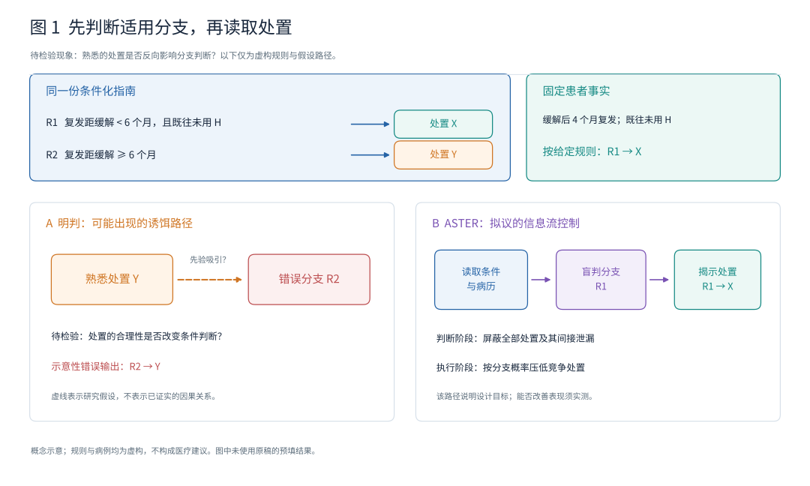
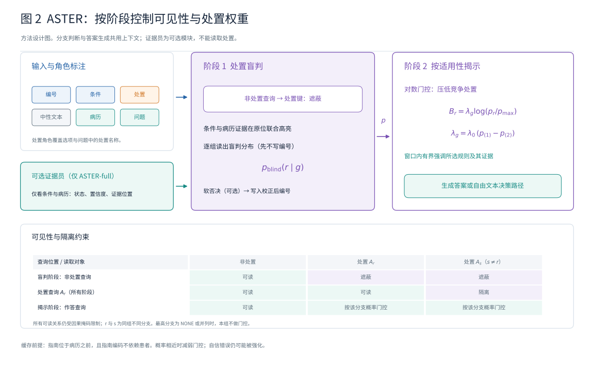
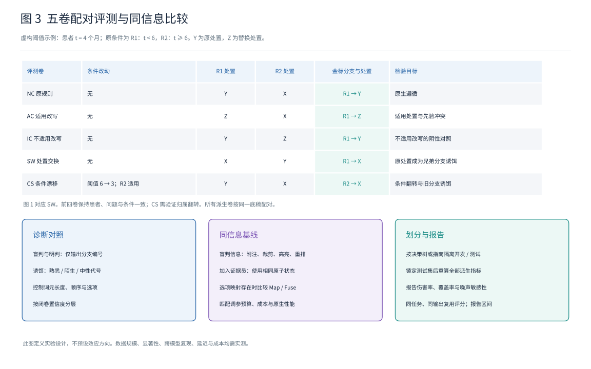
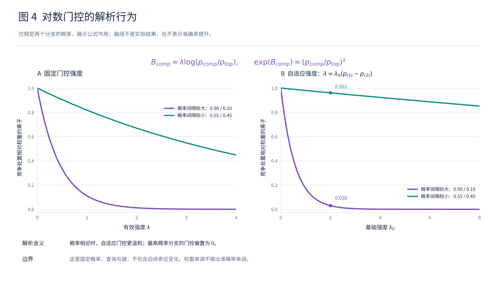

# Don't Let the Treatment Pick the Branch: Action-Blind Adjudication and Applicability-Gated Attention for Guideline-Faithful Clinical Reasoning

**中文题名：别让处置替你选分支——面向指南忠实临床推理的处置盲判与适用性门控注意力**

> **文档状态：研究方案与论文工作稿，2026-10-26。** 本文以本次提供的完整草稿和六项主张为主线，按“现象→机制→方法”组织。尚未完成对原始预测、数据划分和运行记录的独立核验。原稿中的【预填】数值、试点数值及其派生结论均不作为本文的正式结果。下文所有“待测”须由锁定测试集上的真实实验替换。方法设计不代表实现已经完成，理论性质不代表实际模型的准确率改善。

[主线索引](README.md) · [主张与证伪](claims-and-falsification.zh.md) · [原稿审计](audit.zh.md) · [引用核验](references-to-verify.zh.md) · [编辑记录](editorial-notes.zh.md)

## 摘要

将临床指南放入大语言模型的上下文后，模型仍需先根据患者事实判断适用分支，再执行该分支的处置。本研究考察一种候选失败模式：模型对某项处置的先验偏好可能反过来影响分支判断。我们将其称为**处置先行的分支选择**（treatment-led branch selection，TLBS）。为检验这一假设，我们设计五卷配对反事实评测，并设置处置盲判与明判、熟悉处置与中性代号、分支顺序及闭卷置信度等对照。机制分析拟结合注意力敲除、键值激活修补和残差流探针，检验偏差是否经由对处置段的信息读取产生。

我们提出 **ASTER**（Action-blind Selection, Then Evidence-weighted Reveal）作为待验证的方法设计。它在同一上下文中分阶段控制注意力：判断阶段屏蔽处置信息，读出分支分布；执行阶段根据适用性分布对处置段施加非正的对数偏置，并在选定层窗口内对规则与证据作有界强调。可选证据员仅核对原子条件与病历证据，不接触处置。评测将重点比较同信息条件下的文本附注、硬裁剪、输出映射、输出融合与路径重排序，分别考察选择题和自由文本决策路径。研究能否支持处置读取机制、软门控的鲁棒性以及注意力控制的独立价值，取决于预先规定的验证与证伪实验。当前不报告经验性优越结论。

## 1 引言

条件化指南要求模型完成两个相互关联的步骤：判断规则条件是否适用于患者，以及按照适用规则执行处置。如果模型熟悉的处置恰好出现在不适用的兄弟分支中，增加对整份指南的关注未必能够消除冲突。模型还需要辨别指南内部哪些条件与当前患者相符。

本研究将“处置偏好影响条件判断”作为待检验机制。它与一般的上下文忽视不同：可能吸引模型的处置本身就写在上下文中，但属于错误分支。盲判与明判的差异可以作为行为诊断；该差异是否由特定信息通路造成，需要额外的因果干预，不能从注意力可视化或相关性直接推出。

**图 1：虚构规则下的任务示意。** 设 R1 的条件为“复发距缓解不足 6 个月，且既往未用 H”，处置为 X；R2 的条件为“复发距缓解至少 6 个月”，处置为 Y。某患者在缓解后 4 个月复发，且既往未用 H，因而在所给规则中应选择 R1。图中可以展示“先偏好 Y，再选择 R2”的假设性错误路径，以及“先盲判 R1，再执行 X”的设计路径。该例仅用于解释计算任务，不是模型实测记录，也不构成医疗建议。

本研究拟回答三个层次的问题：

1. **现象：** 处置可见性是否系统性改变分支判断？差异是否依赖处置的熟悉程度，而不是长度、顺序或选项提示？
2. **机制：** 偏差是否依赖判断位置对处置段的读取？相关表征变化是否出现在这一读取之后？
3. **方法：** 在共享相同适用性信息时，分阶段注意力控制是否改善生成路径，并在判断不确定时减少硬裁剪造成的退化？

本文的当前贡献是问题定义、可证伪的实验协议和方法规格。跨模型复现、机制定位、低伤害率与成本优势均属于待验证主张。

## 2 任务与评测协议

### 2.1 问题定义

输入包括指南 $G$、病历 $P$、问题 $Q$，以及可选的选项 $O$。指南由分支组 $\mathcal G=\{g_1,\ldots,g_m\}$ 构成。组内规则互为兄弟分支，每条规则 $r=(C_r,A_r)$ 包含条件 $C_r$ 和处置 $A_r$。

金标适用分支记为 $r_g^{\mathrm{gold}}(P,G)$。它由所给指南的条件与患者事实决定；金标处置来自该分支在**所给指南**中的处置。不能用模型记忆中的常规处置替代这一金标。若条件缺失、冲突或分支不完备，应显式记录无法确定，不强行指定唯一分支。

模型预测的最可能分支记为 $\hat r_g$，与金标符号区分。后文中的“伤害”仅指评测中相对于基线由对变错的现象，不表示临床伤害。

### 2.2 五卷配对设计

**表 1　五卷设计。**

| 卷 | 改动 | 金标 | 检验目的 |
|---|---|---|---|
| NC：原规则 | 不改动 | 原适用分支的处置 | 基本遵循；先验与指南一致的情形 |
| AC：适用处置改写 | 将适用分支处置替换为预先规定的候选处置 | 新处置 | 检验模型是否覆盖所给处置 |
| IC：不适用处置改写 | 仅改写兄弟分支处置 | 原处置 | 处置改写的阴性对照 |
| SW：处置交换 | 交换适用分支与指定兄弟分支的处置 | 原兄弟分支的处置 | 将先验偏好的处置置于错误分支 |
| CS：条件漂移 | 修改数值或时间阈值，使适用分支改变 | 修改后适用分支的处置 | 检验条件读取和旧分支诱饵 |

NC、AC、IC、SW 使用同一病例与问题底稿；CS 使用具备可验证阈值的底稿。所有变体保留底稿标识、决策树标识和配对关系。按决策树或指南划分开发集与测试集，同一底稿的全部变体必须进入同一划分。

CS 的金标翻转须由独立规则执行器核验。处置交换如改变下游可达路径或造成结构不一致，应剔除或单列，不以局部文本交换冒充有效反事实。

### 2.3 诱饵对照

在同一 SW 底稿上固定适用分支处置，仅改变不适用分支中的内容，形成熟悉处置、陌生处置和中性代号三种条件。每个模型分别测量闭卷偏好；不能假定同一处置对所有模型都同样熟悉。闭卷概率阈值、同类处置候选集及中性代号构造方式在开发阶段确定并冻结。

对照包括：

- **盲判与明判：** 均仅输出分支编号。盲判屏蔽指南处置、选项及问题中的处置名称。
- **顺序与选项：** 对调兄弟分支顺序；移除选项并采用开放作答。
- **熟悉度与长度：** 按各模型的分词器匹配被替换片段的长度，并检查所有可见片段的位置。等总长度不足以保证等位置。
- **置信度分层：** 使用冻结的闭卷测量按预定分位分层，报告每层样本数及区间估计。
- **相反分支病例：** 构造共享指南但金标分支相反的配对病例，用于检验患者无关目标是否出现取舍。

原稿中的“Decoy-2×2”名称与三种处置条件不一致。正式数据集暂称“诱饵配对诊断集”，直至析因设计明确。

### 2.4 指标与分母

选择题中，每卷准确率均按该卷锁定的全部有效样本计算。采用分卷宏平均：

$$\mathrm{NCA}=\frac{\mathrm{Acc}_{NC}+\mathrm{Acc}_{IC}}{2},\qquad
\mathrm{CA}=\frac{\mathrm{Acc}_{AC}+\mathrm{Acc}_{SW}+\mathrm{Acc}_{CS}}{3},$$

$$H=\frac{2\,\mathrm{NCA}\,\mathrm{CA}}{\mathrm{NCA}+\mathrm{CA}}.$$

两项均为零时约定 $H=0$。所有计算采用未四舍五入的底层计数或准确率，最终展示时统一保留位数。若各卷样本量不同，同时报告宏平均和微平均，不能混用。

| 指标 | 定义与分母 | 方向 |
|---|---|---|
| 伤害率 | NC∪IC 中“Vanilla 正确且当前方法错误”的样本数，除以 NC∪IC 全部样本数 | 越低越好 |
| 纠正率 | NC∪IC 中“Vanilla 错误且当前方法正确”的样本数，除以同一全部样本数 | 越高越好 |
| 诱饵采纳率 DA | SW 中选择指定先验处置的样本数，除以 SW 全部有效样本数 | 越低越好 |
| 分支准确率 | 盲判或明判输出正确分支编号的样本数，除以相同底稿集合大小 | 越高越好 |
| 干预覆盖率 | 满足预先固定的干预触发条件的病例数，除以全部有效病例数 | 报告覆盖范围 |
| 证据员覆盖率 | 给出可用非未知状态及有效证据位置的原子数，除以纳入评测的全部原子数 | 与误差共同报告 |

在相同分母和微平均下，准确率变化应等于纠正率减伤害率。分卷宏平均 NCA 的变化只有在相同加权方式下才满足对应恒等式。多条规则共享同一处置时，应另记处置正确但分支不明的情况，避免把处置匹配等同于分支正确。

生成任务拟报告路径一致性代价 PathCost、关键节点分支忠实率 BFR、节点诱饵采纳率 DA 和退化率 Deg。PathCost 的正式定义、实现版本及取值范围须与来源核对。BFR 和 DA 使用预先固定的参考关键节点集合；缺失节点、提前结束、不可解析输出的处理规则须在测试前固定。Deg 统计重复循环或达到长度上限的输出，分母为全部生成病例。另报告病例级“路径全部节点正确”，避免节点平均掩盖整条路径失败。

涉及模型评审时，以“输出内容、病例、参考路径、评审提示及评审器版本”的联合标识缓存评分。同一评审上下文中的相同输出复用同一分数；不能在不同病例或参考路径之间仅凭输出文本相同而复用。

## 3 诊断：检验处置先行的分支选择

### 3.1 错误分解

将错误区分为选错分支并采用先验处置、选错分支并采用其他处置、覆盖当前指南而输出已不存在的原处置，以及其他错误。编码规则应互斥、穷尽，并在未知方法名称的条件下人工抽查。

**表 2　冲突卷错误分解，全部待测。各行以该卷全部样本为分母，准确率与互斥错误类别之和应为 100%。**

| 卷 | 准确率 | 错分支：先验处置 | 错分支：其他 | 覆盖指南：已不存在的原处置 | 其他 |
|---|---|---|---|---|---|
| AC | 待测 | 按构造判定是否适用 | 待测 | 待测 | 待测 |
| SW | 待测 | 待测 | 待测 | 按构造判定是否适用 | 待测 |
| CS | 待测 | 待测 | 待测 | 按构造判定是否适用 | 待测 |

“冲突卷错误中有多少属于分支错误”必须从各卷错误计数汇总得到，不能直接平均以全部样本为分母的错误百分比。金标裁剪仅用于分析在适用分支已知时仍有多少处置执行错误。

### 3.2 处置可见性是否改变分支判断

**表 3　盲判与明判分支准确率，全部待测。**

| 条件 | NC | IC | AC | SW | CS |
|---|---|---|---|---|---|
| 盲判 | 待测 | 待测 | 待测 | 待测 | 待测 |
| 明判 | 待测 | 待测 | 待测 | 待测 | 待测 |
| 明判−盲判 | 待测 | 待测 | 待测 | 待测 | 待测 |

四个处置改写卷的盲判分布只有在非处置内容、位置、角色与掩码完全相同时才应一致。对文本隐藏基线和注意力掩码盲判分别验证，不能仅凭准确率接近判定无泄漏。

**表 4　诱饵控制与复现，全部待测。**

| 比较 | 分支准确率差及区间 | 样本数 | 必须同时报告 |
|---|---|---|---|
| 熟悉处置：明判−盲判 | 待测 | 待定 | 每个模型的闭卷偏好 |
| 陌生处置：明判−盲判 | 待测 | 待定 | 候选筛选与长度匹配 |
| 中性代号：明判−盲判 | 待测 | 待定 | 代号随机化及位置一致性 |
| 移除选项 | 待测 | 待定 | 开放输出的解析失败率 |
| 分支顺序交换 | 待测 | 待定 | 两种顺序的配对结果 |
| 闭卷置信度分层 | 待测 | 待定 | 分层边界、各层计数 |
| 跨模型及思考模式 | 待测 | 待定 | 模型版本与模式 |

中性代号下差异缩小只能排除相应控制下的部分替代解释。不能仅凭剂量关系就断言先验吸引是唯一原因。

### 3.3 偏差是否依赖处置信息读取

机制实验在开发数据上选定干预位置和强度，独立留出数据用于复验。预先规定三个互补实验：

1. **注意力敲除：** 在连续层窗口内屏蔽判断查询到处置键的边。与同规模随机边、非处置片段和其他层窗口对照，报告恢复量及原生性能损失。分母差距接近零时，不报告不稳定的“恢复百分比”。
2. **键值激活修补：** 构造仅兄弟处置不同且位置对齐的熟悉／中性最小对，分别修补键 K、值 V 和 K/V。报告修补范围、源与目标运行及失配风险。V 修补有效不自动证明某个语义属性已经被定位。
3. **残差流探针：** 用独立训练、验证划分读出金标分支，控制模型容量、标签泄漏和跨层比较。探针可读性不等于模型实际使用该信息；只有与干预结果共同分析，才能讨论信息通路。

层窗口、恢复率、探针准确率以及推理链标注一致性均待测。若偏差在读取处置之前已出现，或切断／修补相应通路不改变判断，应修改或放弃“处置读取导致偏差”的机制主张。

### 3.4 患者无关目标的理论边界与实证检验

**性质 1：固定注意力分数下的兄弟质量比。** 在给定查询和键表示下，若干预在规则段 $S_a$、$S_b$ 内分别施加常数偏置 $\beta_a$、$\beta_b$，记两段原有注意力质量为 $M_a$、$M_b$，则

$$\Delta\log\frac{M_a}{M_b}=\beta_a-\beta_b.$$

若两段得到相同偏置，则该次注意力计算中的相对质量不变。若偏置与患者无关，则这项直接的相对推力对金标相反的病例方向相同。

该性质**不推出**整体模型只能改善一个病例，也不证明准确率必然出现跷跷板。其他上下文、后续层、查询变化和非线性计算都可能改变输出。规则内非恒定偏置或随查询自适应的方法也不满足上述简化前提，须直接实验比较。

**表 5　简单修复的诊断对照，全部待测。**

| 方法 | ΔNCA | ΔCA | SW 明判−盲判 | 适用／诱饵质量比变化 |
|---|---|---|---|---|
| Reorder | 待测 | 待测 | 待测 | 待测 |
| PromptRep | 待测 | 待测 | 待测 | 待测 |
| 分支优先思维链 | 待测 | 待测 | 待测 | 待测 |
| CAD | 待测 | 待测 | 按接口确定 | 按接口确定 |
| JuICE | 待测 | 待测 | 按接口确定 | 待测 |
| PASTA：整份指南 | 待测 | 待测 | 待测 | 待测 |
| SEKA：整份指南 | 待测 | 待测 | 待测 | 待测 |
| AutoPASTA | 待测 | 待测 | 待测 | 待测 |

## 4 方法：ASTER

### 4.1 从候选机制到设计

**表 6　待验证假设、设计要求与组件。**

| 待验证假设 | 设计要求 | ASTER 组件 | 对应检验 |
|---|---|---|---|
| 处置可见性干扰分支判断 | 在读取处置前形成分支判断 | 显式盲判块与掩码 | 表 3–4；A2–A3 |
| 处置信息可经中间位置间接传递 | 同时控制直接与间接读取 | 非处置屏蔽与跨处置隔离 | A11–A12；U2、U4 |
| 阈值、时间与否定条件易被误用 | 显式提供条件状态和证据位置 | 可选证据员、原位高亮、软否决 | A4–A5；表 14 |
| 干预目标需要依赖患者适用性 | 根据病例改变处置抑制目标 | 对数门控 | A6、A9、A13 |
| 选对分支后仍可能覆盖所给处置 | 对所选规则作有界强调 | 层窗口强调 | A7、A10 |
| 适用性判断存在不确定性 | 在软抑制与硬屏蔽之间调节 | 置信度自适应强度 | A8；噪声实验 |

### 4.2 角色、阶段与总体流程

每条规则包含编号段 $I_r$、条件段 $C_r$ 和处置段 $A_r$。定义、脚注等非处置文本记为中性段。每个词元 $j$ 具有角色

$$\rho(j)\in\{\mathrm{id},\mathrm{cond},\mathrm{act},\mathrm{neu},\mathrm{pat},\mathrm{qry}\}.$$

处置词元记录所属片段 $\omega(j)$。选项和问题中的处置名称也必须标记为处置角色。提示和盲判块属于 BLIND 阶段，之后的作答位置属于 REVEAL 阶段。对自回归模型，以下所有掩码都必须与原有因果掩码合并，不允许读取未来词元。

在层 $\ell$、头 $h$ 的注意力分数上施加：

$$s'_{ij}=s_{ij}+M_{ij}+B^{\mathrm{bind}}_{ij}+B^{\mathrm{gate}}_{ij}+B^{\mathrm{emph}}_{ij}.\tag{1}$$

**算法 1　单病例处理流程。**

1. 离线切分指南、标注角色和分支归属，拆分原子条件。在与患者无关的指南掩码下预填充指南前缀。
2. ASTER-full 的证据员读取条件和病历，输出原子状态、置信度与证据位置。ASTER-self 跳过此步。
3. 在盲判掩码下编码病历、问题和选项。患者相关的绑定只作用于指南前缀之后的查询，避免改变可共享前缀。
4. 对当前分支组读出 $p_{\mathrm{blind}}(r\mid g)$，允许 NONE；此时仅记录候选分布，不把其未经校正的 argmax 编号写入上下文。思考模式下，整个盲判思考过程保持 BLIND。
5. 对证据员判为违反的原子施加软否决，得到 $p(r\mid g)$，再将该分布的 argmax 编号写入盲判块；并列时按预先固定的规则写入并记录并列状态。逐组重复步骤 4–5，同时保存校正前后分布及编号，确保显式编号与后续门控目标一致。ASTER-self 不做软否决。
6. 冻结本轮适用性分布，切换到 REVEAL，按分布门控处置，并对所选规则与证据作有界强调，生成答案或路径。

多组顺序读出可能依赖先前生成的分支编号，因此须固定组顺序并设顺序消融。盲判块使用固定的非处置起始前缀；所有用于分支评分的预测位置必须为非处置角色，不能直接使用最后一个处置词元的输出 logits 作为盲判分布。规则编号若不是单词元，应采用受约束的序列评分或等长编码；不能把“下一词元概率”直接视为任意长度编号的概率。先校正、后写入编号是本稿明确的执行规格，尚不代表既有代码已经实现。

**图 2：ASTER 方法设计。** 图中以代表性词元的 query–key 掩码展示盲判约束，并从固定非处置位置 B 读出分布。可选证据员支持指南前缀之后的条件／证据联合高亮和软否决；完成校正后再写入分支编号，同一校正分布控制 REVEAL 的处置门控和有界强调。图中矩阵是算子示意，不是实测注意力热图；其端到端贡献仍需同信息对照验证。完整英文图注与边界条件见[图注文件](figures/captions.en.md)。

### 4.3 处置盲判与隔离

$$
M_{ij}=\begin{cases}
-\infty,&\phi(i)=\mathrm{BLIND},\ \rho(i)\ne\mathrm{act},\ \rho(j)=\mathrm{act},\\
-\infty,&\rho(i)=\rho(j)=\mathrm{act},\ \omega(i)\ne\omega(j),\\
0,&\text{其他情况}.
\end{cases}\tag{2}
$$

第一行切断盲判阶段非处置查询对处置键的读取。它覆盖盲判块、位于处置之后的条件／中性片段、病历和问题等位置。处置名称出现在问题、选项或解释性脚注时，也必须完整标记。第二行隔离不同处置片段；同一处置片段仍受原有因果掩码约束。

这是一种计算图层面的设计约束。词元标注遗漏、跨片段混合、位置变化或未受控的外部输入都可能破坏盲性。共享指南缓存还要求指南确为因果前缀，位置和角色固定，前缀计算不含患者相关的绑定、概率或特征；仅说明“掩码与患者无关”不足以证明所有缓存均可共享。

### 4.4 证据员、原位绑定与软否决

证据员只处理原子条件和病历。数值／时间原子先抽取取值，再进行单位归一与确定性比较；类别／否定原子使用待选定并校准的自然语言推断模块。每个原子 $a$ 输出状态 $\mathrm{SAT}$、$\mathrm{VIOL}$ 或 $\mathrm{UNK}$、置信度 $c_a$，以及可回溯的证据位置 $e_a$。

证据员不接触处置、不选最终分支、不输出最终答案。该接口约束并不自动排除它承担大部分规则判断的可能性，因此必须设置共享证据员信息的执行器对照。

设原子条件词元集合为 $s_a$，证据词元集合为 $e_a$，$\mathcal Q_{\mathrm{postG}}$ 表示指南前缀之后的查询位置。绑定偏置定义为

$$B^{\mathrm{bind}}_{ij}=\beta_{\mathrm{bind}}\,\mathbf1\!\left[\phi(i)=\mathrm{BLIND},\ i\in\mathcal Q_{\mathrm{postG}},\ \ell\in\mathcal L_{\mathrm{win}},\ j\in\bigcup_a(s_a\cup e_a)\right].\tag{3}$$

满足和违反条件的证据都可进入高亮集合。此式对集合做联合高亮，并不显式建立一一对应的注意力边；若采用成对查询—键绑定，应另行给出算子并增加消融。

软否决使用

$$p(r\mid g)=\frac{p_{\mathrm{blind}}(r\mid g)\prod_{a\in C_r}\psi_a}{Z_g},\qquad
\psi_a=1-\beta_v c_a\,\mathbf1[\mathrm{status}_a=\mathrm{VIOL}].\tag{4}$$

其中 $0\le\beta_v<1$，$c_a\in[0,1]$，$Z_g$ 为含 NONE 的归一化常数。NONE 不附加条件乘积。未知和满足的原子不加分；条件数较多的分支可能累积更多惩罚，应按条件数分层分析，并比较归一化或去重方案。计算采用对数域，检查归一化和下溢。ASTER-self 令 $\psi_a=1$ 且关闭绑定。

### 4.5 按适用性揭开处置

令 $\bar g=g\cup\{\mathrm{NONE}\}$，$p^g_{(1)}$、$p^g_{(2)}$ 为 $\bar g$ 中最大的两个概率。规定 $\lambda_0\ge0$。仅在唯一最高类别是实际规则时进行门控，并定义

$$\lambda_g=\lambda_0\bigl(p^g_{(1)}-p^g_{(2)}\bigr),$$

$$B^{\mathrm{gate}}_{ij}=\lambda_g\log\frac{p(r\mid g)}{p(\hat r_g\mid g)}
\quad\text{当 }\phi(i)=\mathrm{REVEAL},\ j\in A_r,\ r\in g,\tag{5}$$

其余位置门控为零。最高分支偏置为零，其他规则的处置偏置非正。NONE 最高或最高类别并列时，该组不做门控。精确的零概率和 $\lambda_g=0$ 分别处理，避免计算 $0\times(-\infty)$；有限精度实现可使用对数概率下限，并须报告该下限对强门控的影响。NONE 没有对应处置段。

执行阶段的窗口强调为

$$B^{\mathrm{emph}}_{ij}=\beta_{\mathrm{emph}}\,\mathbf1\!\left[\phi(i)=\mathrm{REVEAL},\ \ell\in\mathcal L_{\mathrm{win}},\ j\in I_{\hat r_g}\cup C_{\hat r_g}\cup A_{\hat r_g}\cup E_{\hat r_g},\ p(\hat r_g\mid g)\ge\tau\right].\tag{6}$$

其中 $0\le\beta_{\mathrm{emph}}\le\beta_{\max}$，上限 $\beta_{\max}$ 在开发阶段固定。$E_{\hat r_g}$ 是可回溯的证据位置。最高类别非唯一或为 NONE 时也关闭该组强调。式（5）拟作用于所有层、所有头，式（6）仅作用于开发阶段选择的层窗口。

可选扩展 ASTER+O 同时门控已知映射的选项。默认 ASTER 不依赖选项—规则映射，但未门控选项仍可能向执行阶段提供诱饵内容；因此“屏蔽竞争处置”的结论仅针对被门控的处置段，不能泛化为消除了所有诱饵信息。

### 4.6 数学性质与边界

**性质 2：有限投影编辑不保证统一的零注意力。** 对固定 $q,k$ 和正交投影 $P$，若 $k'=k-\gamma Pk$，则

$$q^\top k'=q^\top(I-P)k+(1-\gamma)q^\top Pk.$$

当 $\gamma\in[0,1]$ 时，分数位于两个有限端点之间。扩大 $\gamma$ 也不能对所有查询保证同向压低，因为符号取决于 $q^\top Pk$。这一局部性质不构成对所有投影方法的性能否定。

**性质 3：固定分数下的处置内份额与强门控极限。** 令 $M_r$ 为固定注意力分数下规则 $r$ 的未归一化指数质量，固定适用性分布与其他偏置。最高规则在该组所有处置中的条件注意力份额为

$$S(\lambda)=\frac{M_{\mathrm{top}}}{M_{\mathrm{top}}+\sum_{r\ne\mathrm{top}}M_r(p_r/p_{\max})^\lambda}.$$

若最高规则唯一、$M_{\mathrm{top}}>0$，则 $S(\lambda)$ 单调不减且在 $\lambda\to\infty$ 时趋于 1。该份额的分母只包含该组处置，不包含所有上下文；因此它不是全上下文注意力质量趋于 1 的结论。它也不保证跨层运行中的注意力或任务准确率随强度单调变化。

在式（2）阻断间接传递、位置与其他输入保留、门控覆盖所有相关执行读取的前提下，强门控可与**同一计算图中在全部 REVEAL 查询中永久屏蔽竞争处置键**的参考运行比较。不能据此声称等同于删去字符串后重新分词、重排位置并重新编码的文本裁剪。有限长度下可检查逐步 logits 的收敛；若讨论贪心生成序列相同，还需各步选择具有非零间隔，避免并列点的不连续性。

**性质 4：严格控制下的盲判不变性。** 在标准自回归 Transformer、确定性计算、完整角色标注及式（2）作用于所有相关层的条件下，若两份输入只改变被屏蔽处置的内容，且所有非处置词元的内容、位置、角色和掩码完全相同，则非处置盲判表示不依赖这些处置改写。可逐层归纳得到盲判分布不变。总长度相同不是充分条件。

单元验证应比较完整概率分布及内部张量，并使用预先记录的数值容差。不可把不为零的差异或低于完全一致的 argmax 率直接作为该不变性的证明。

### 4.7 注意力控制的候选价值与适用边界

ASTER 提供同一上下文内的阶段可见性和连续处置偏置。两阶段文本方法也能实现先盲判后执行；文本附注、采样及重排序也可间接利用置信度。因此，不能仅从接口形式推断注意力控制具有经验性必要性。

若选择题存在完整的选项—规则映射，Map 和 Fuse 是必须比较的强基线。自由文本路径不具备同样的有限选项映射，但仍可使用约束生成、文本分解和重排序。ASTER 的独立价值须表现为：同信息、相近成本和可接受原生性能下，对诱饵路径产生可复现改善。若文本附注完全复现收益，应相应收窄方法主张。

### 4.8 实现规格与成本

拟使用支持注意力分数修改和块掩码的实现，具体框架版本、内核限制和兼容模型待固定。角色、阶段、归属和概率均作为可审计元数据。分支概率更新不能污染已缓存的指南表示。

报告预填充与解码时间、证据员时间、额外词元、峰值显存、吞吐和端到端成本。区分冷缓存与热缓存；记录硬件、批量、精度、输入与输出长度分布及计时重复数。原稿中的延迟倍数不作为测量结果保留。

## 5 实验设置与统计计划

### 5.1 数据来源、划分与质量

**表 7　拟用数据与待锁定信息。**

| 数据 | 用途 | 划分单位 | 形式 | 数量与质量状态 |
|---|---|---|---|---|
| MedGUIDE-CF | 五卷反事实遵循 | 决策树 | 选择题 | 规模、版本、许可、有效率和一致性均待核验 |
| 诱饵配对诊断集 | 熟悉度、可见性与顺序控制 | 底稿／决策树 | 分支编号 | 样本数及各控制组合待锁定 |
| MEGA-CDP-CF | 原生与诱饵路径 | 指南 | 自由文本路径 | 规模、参考树来源、有效率和一致性待核验 |
| MedPIC-Bench | 外部条件变化验证 | 原始配对单元 | 选择题 | 版本、题量、许可和适配方式待核验 |

MedGUIDE-CF 的处置候选从预先冻结的同类候选集中选取。CS 修改幅度、单位舍入与翻转核验规则在开发阶段固定。MEGA-CDP-CF 仅纳入局部交换后下游结构仍自洽的病例。两位标注者独立核验，分歧按固定裁决流程处理；样本抽样、有效率和一致性从实际记录计算。

MedPIC 的显式两分支适配应区分“当前推荐不适用”和“可以使用该药”。“否则”分支不能被解释成肯定性医疗推荐。适配后须公开转换规则，并与原始评测结果分开报告。

### 5.2 模型和解码

计划覆盖原稿列出的 Qwen3-8B、Llama-3.1-8B-Instruct、Mistral-7B-Instruct-v0.3 和 Qwen3-32B，并将思考模式作为独立配置。确切模型仓库、修订标识、分词器、聊天模板、精度与运行框架在测试前锁定。统一贪心解码的主分析与其他解码策略的敏感性分析分开。

选择题的受限字母 logits 与思考模式输出解析属于不同评价接口，必须分别报告。所有方法共享同一答案解析器和失败处理规则。

### 5.3 同信息基线

**表 8　按信息来源组织的对照。**

| 信息来源 | 方法 | 关键控制 |
|---|---|---|
| 无额外适用性信息 | Vanilla、Reorder、PromptRep、分支优先思维链、CAD、JuICE、PASTA、SEKA、AutoPASTA | 共享底稿、预算与解析方式 |
| 盲判信息 | TS-Note、TS-Prune、TS-SEKA、TS-Map、TS-Fuse、TS-Rerank、ASTER-self | 优先复用相同盲判分布与编号 |
| 盲判加证据员 | Clerk-Note、Clerk-Prune、Clerk-Map、Clerk-Fuse、ASTER-full | 共享原子状态、置信度、证据位置与软否决分布 |
| 金标分支 | Gold-Prune、Gold-ASTER | 仅作诊断上界，不能与实际方法混称可部署性能 |

**图 3：五卷配对反事实协议。** 五棵同构决策树固定患者事实，分别标明 NC、AC、IC、SW、CS 的局部改动与金标路径。紫色虚线轮廓标明被改动的处置或阈值，实线和节点标记表示金标路径；图中不包含模型预测或实测结果。同信息比较的要求见表 8。

Map 与 Fuse 需要明确的选项—规则映射。Rerank 用于生成任务，并报告候选数及候选覆盖。Gold-Map 只有在完整、唯一且无歧义的映射构造下才具有结构性满分，不能把这一条件推广到任意选择题。

TS-Fuse 的候选定义为

$$p(o)\propto p_{\mathrm{LM}}(o\mid x)\left(\sum_r p(r\mid g)\mathbf1[o\leftrightarrow A_r]+\epsilon\right)^\lambda.$$

映射冲突、NONE、多个分支组及多个选项匹配的处理规则必须固定。同信息比较既包括共享中间量的执行器比较，也包括各方法端到端运行的比较；两者回答的问题不同，应分表报告。

训练式忠实化方法若因范围或预算未纳入，应作为局限，不用性质 1 推断这些训练方法必然具有患者无关目标。

### 5.4 超参数和冻结流程

所有方法使用相同的预先登记配置预算。选择题按开发集 H 选参；生成任务按预先指定的原生性能和退化约束，在可行配置中选择宏平均 BFR。配置预算、非劣效界值、退化阈值、层窗口扫描范围及样本数均在测试前固定，不能根据测试结果调整。

开发集重采样用于评估选参稳定性。原稿的固定窗口和参数数值仅属待测设定，不宣称已找到最佳配置。

### 5.5 统计分析

保留病例配对与决策树／指南聚类结构，采用聚类配对重采样估计准确率差、H 差和生成指标差的置信区间。重采样单位、重复数、随机种子和多重比较族在测试前登记。

二元终点的 McNemar 精确检验仅适用于满足独立配对单元假设的分析。若同一树内存在相关病例，不能把逐题 McNemar 当作已处理聚类的主检验。主分析采用与聚类结构相容的配对方法；连续 PathCost 使用相应的配对区间或重采样检验。预先指定的比较族进行 Holm 校正。

非劣效分析需预定界值与方向：对越高越好的准确率，方法减基线的置信区间下界须高于负界值；对越低越好的 PathCost，其差值区间上界须低于正界值。“差异不显著”不能证明持平、等效或非劣效。所有有效样本数、缺失数与排除原因随结果公开。

## 6 结果报告模板

> 本节为待填模板。当前不存在由本稿确认的主结果、显著性结论或跨模型复现。表中“待测”不得在摘要或配图中改写为预期数值。

### 6.1 选择题

**表 9　MedGUIDE-CF 主结果，全部待测。**

| 方法 | NC | IC | AC | SW | CS | NCA | CA | H | 伤害率↓ | DA↓ |
|---|---|---|---|---|---|---|---|---|---|---|
| Vanilla | 待测 | 待测 | 待测 | 待测 | 待测 | 待测 | 待测 | 待测 | 基线 | 待测 |
| Reorder | 待测 | 待测 | 待测 | 待测 | 待测 | 待测 | 待测 | 待测 | 待测 | 待测 |
| PromptRep | 待测 | 待测 | 待测 | 待测 | 待测 | 待测 | 待测 | 待测 | 待测 | 待测 |
| 分支优先思维链 | 待测 | 待测 | 待测 | 待测 | 待测 | 待测 | 待测 | 待测 | 待测 | 待测 |
| CAD | 待测 | 待测 | 待测 | 待测 | 待测 | 待测 | 待测 | 待测 | 待测 | 待测 |
| JuICE | 待测 | 待测 | 待测 | 待测 | 待测 | 待测 | 待测 | 待测 | 待测 | 待测 |
| PASTA | 待测 | 待测 | 待测 | 待测 | 待测 | 待测 | 待测 | 待测 | 待测 | 待测 |
| SEKA | 待测 | 待测 | 待测 | 待测 | 待测 | 待测 | 待测 | 待测 | 待测 | 待测 |
| AutoPASTA | 待测 | 待测 | 待测 | 待测 | 待测 | 待测 | 待测 | 待测 | 待测 | 待测 |
| TS-Note | 待测 | 待测 | 待测 | 待测 | 待测 | 待测 | 待测 | 待测 | 待测 | 待测 |
| TS-Prune | 待测 | 待测 | 待测 | 待测 | 待测 | 待测 | 待测 | 待测 | 待测 | 待测 |
| TS-SEKA | 待测 | 待测 | 待测 | 待测 | 待测 | 待测 | 待测 | 待测 | 待测 | 待测 |
| TS-Map | 待测 | 待测 | 待测 | 待测 | 待测 | 待测 | 待测 | 待测 | 待测 | 待测 |
| TS-Fuse | 待测 | 待测 | 待测 | 待测 | 待测 | 待测 | 待测 | 待测 | 待测 | 待测 |
| ASTER-self | 待测 | 待测 | 待测 | 待测 | 待测 | 待测 | 待测 | 待测 | 待测 | 待测 |
| Clerk-Note | 待测 | 待测 | 待测 | 待测 | 待测 | 待测 | 待测 | 待测 | 待测 | 待测 |
| Clerk-Prune | 待测 | 待测 | 待测 | 待测 | 待测 | 待测 | 待测 | 待测 | 待测 | 待测 |
| Clerk-Map | 待测 | 待测 | 待测 | 待测 | 待测 | 待测 | 待测 | 待测 | 待测 | 待测 |
| Clerk-Fuse | 待测 | 待测 | 待测 | 待测 | 待测 | 待测 | 待测 | 待测 | 待测 | 待测 |
| ASTER-full | 待测 | 待测 | 待测 | 待测 | 待测 | 待测 | 待测 | 待测 | 待测 | 待测 |
| Gold-Prune | 待测 | 待测 | 待测 | 待测 | 待测 | 待测 | 待测 | 待测 | 待测 | 待测 |
| Gold-ASTER | 待测 | 待测 | 待测 | 待测 | 待测 | 待测 | 待测 | 待测 | 待测 | 待测 |

核心报告项为 ASTER-self 与 TS-Fuse／TS-Prune 的配对差，以及 ASTER-full 与 Clerk-Fuse／Clerk-Map／Clerk-Prune 的配对差。伤害率比较必须写明对象，不得把相对 Clerk-Map 的伤害差与相对 Clerk-Fuse 的 H 差混成同一个优势主张。

### 6.2 自由文本决策路径

**表 10　MEGA-CDP-CF 结果，全部待测。**

| 方法 | 原生 PathCost↓ | 原生 BFR↑ | 诱饵 PathCost↓ | 诱饵 BFR↑ | DA↓ | Deg↓ | 端到端成本× |
|---|---|---|---|---|---|---|---|
| Vanilla | 待测 | 待测 | 待测 | 待测 | 待测 | 待测 | 基准 |
| Reorder | 待测 | 待测 | 待测 | 待测 | 待测 | 待测 | 待测 |
| PromptRep | 待测 | 待测 | 待测 | 待测 | 待测 | 待测 | 待测 |
| CAD | 待测 | 待测 | 待测 | 待测 | 待测 | 待测 | 待测 |
| SEKA：整份指南 | 待测 | 待测 | 待测 | 待测 | 待测 | 待测 | 待测 |
| AutoPASTA | 待测 | 待测 | 待测 | 待测 | 待测 | 待测 | 待测 |
| TS-Note | 待测 | 待测 | 待测 | 待测 | 待测 | 待测 | 待测 |
| TS-Prune | 待测 | 待测 | 待测 | 待测 | 待测 | 待测 | 待测 |
| TS-SEKA | 待测 | 待测 | 待测 | 待测 | 待测 | 待测 | 待测 |
| TS-Rerank | 待测 | 待测 | 待测 | 待测 | 待测 | 待测 | 待测 |
| ASTER-self | 待测 | 待测 | 待测 | 待测 | 待测 | 待测 | 待测 |
| Clerk-Note／Prune／SEKA／Rerank | 分方法待测 | 分方法待测 | 分方法待测 | 分方法待测 | 分方法待测 | 分方法待测 | 分方法待测 |
| ASTER-full | 待测 | 待测 | 待测 | 待测 | 待测 | 待测 | 待测 |
| Gold-Prune | 待测 | 待测 | 待测 | 待测 | 待测 | 待测 | 诊断成本 |
| Gold-ASTER | 待测 | 待测 | 待测 | 待测 | 待测 | 待测 | 诊断成本 |

同时报告等预算比较和原生性能约束下的比较。增加证据员信息后，相应文本和重排序基线也须获得相同信息；不能仅与较弱的 Clerk-Prune 比较后宣称注意力具有独立价值。

### 6.3 外部验证

**表 11　MedPIC-Bench 适配评测，全部待测。**

| 方法 | 原题准确率 | 反事实准确率 | 成对全对 | 撤销警示子集 | 原题伤害率↓ |
|---|---|---|---|---|---|
| Vanilla | 待测 | 待测 | 待测 | 待测 | 基线 |
| PromptRep | 待测 | 待测 | 待测 | 待测 | 待测 |
| CAD | 待测 | 待测 | 待测 | 待测 | 待测 |
| TS-Note | 待测 | 待测 | 待测 | 待测 | 待测 |
| TS-Map | 待测 | 待测 | 待测 | 待测 | 待测 |
| TS-Fuse | 待测 | 待测 | 待测 | 待测 | 待测 |
| ASTER-self | 待测 | 待测 | 待测 | 待测 | 待测 |
| Clerk-Map／Fuse | 分方法待测 | 分方法待测 | 分方法待测 | 分方法待测 | 分方法待测 |
| ASTER-full | 待测 | 待测 | 待测 | 待测 | 待测 |

成对全对以完整病例对为分母。子集定义与各方法覆盖数须一致。本适配结果与官方原始设置分开，不作未经校准的排行榜比较。

### 6.4 跨模型复现

**表 12　跨模型结果，全部待测。**

| 模型配置 | 选择题 H：各方法 | 诱饵 BFR：各方法 | 非劣效区间 | 成本 | 复现状态 |
|---|---|---|---|---|---|
| Qwen3-8B，非思考 | 待测 | 待测 | 待测 | 待测 | 未确认 |
| Qwen3-8B，思考 | 待测 | 待测 | 待测 | 待测 | 未确认 |
| Llama-3.1-8B-Instruct | 待测 | 待测 | 待测 | 待测 | 未确认 |
| Mistral-7B-Instruct-v0.3 | 待测 | 待测 | 待测 | 待测 | 未确认 |
| Qwen3-32B | 待测 | 待测 | 待测 | 待测 | 未确认 |

正式表按任务拆分，避免同一表头出现难以区分的重复方法列。跨模型不一致属于结果，不以单模型优势概括全部模型。

## 7 消融、鲁棒性与成本分析

### 7.1 阶段与组件消融

**表 13　消融计划，所有指标待测。**

| 编号 | 变体 | 要回答的问题 | 指标 |
|---|---|---|---|
| A1 | 完整 ASTER-full | 参考配置 | NCA、CA、H、SW、CS、伤害率、BFR、Deg、成本 |
| A2 | 明判替代盲判 | 处置可见性是否关键 | 同上 |
| A3 | 文本隐藏盲判，两次预填充 | 掩码与文本分阶段的差异 | 同上，重点报告成本 |
| A4 | 去掉绑定 | 原位高亮是否有独立贡献 | 同上，含分支准确率 |
| A5 | 去掉软否决 | 原子状态的贡献 | 同上，含条件类型 |
| A6 | 关闭对数门控 | 抑制竞争处置的贡献 | 同上 |
| A7 | 关闭窗口强调 | 选定分支后的执行贡献 | 同上 |
| A8 | 固定门控强度 | 置信度自适应的贡献 | 同上，含噪声分层 |
| A9 | 投影编辑替代对数门控 | 算子差异 | 同上，含实际注意力质量 |
| A10 | 强调扩展至所有层 | 强调范围与生成退化 | 同上 |
| A11 | 去掉跨处置隔离 | 间接信息传递 | 同上，含屏蔽参考误差 |
| A12 | 执行上下文重新明判编码 | 缓存与阶段隔离 | 同上，含屏蔽参考误差 |
| A13 | 相同算子、患者无关目标 | 适用性目标的贡献 | 同上，含相反分支病例 |
| A14 | ASTER+O | 选项诱饵的剩余作用 | 选择题指标，不套用至无选项任务 |

同时比较绑定与共享证据文本附注，区分“额外信息”与“注入位置”的作用。各消融保持其余因素不变；如需重新选参，统一预算并同时报告固定参数结果。

### 7.2 门控强度与性能取舍

扫描 $\lambda_0$，报告 NCA、CA、H、BFR、Deg、成本和处置内注意力份额。理论曲线可以由公式直接绘制，但须标为解析示意，不与实验性能曲线混合。经验性帕累托前沿只从真实运行结果生成，并注明是否包含不满足原生性能约束的配置。

**图 4：对数门控的解析示意。** 固定概率与原始质量时，展示式（5）及性质 3 的局部关系。它不是准确率、噪声鲁棒性或实际跨层注意力的实验曲线。帕累托、噪声和证据员覆盖率结果图均待真实运行后另行生成。

### 7.3 判断噪声、校准与证据员覆盖率

向适用性分布注入可控错误，分别研究高置信错误、低间隔错误、未知信息和概率失校准。冻结噪声生成器，保证 Map、Prune、Fuse 和 ASTER 接收相同受扰分布。错误率相同不代表难度相同，须同时记录概率间隔、熵与金标概率。

二分支归一化条件下，错误 argmax 的概率不可能低于另一分支；原稿“错误分支概率为 0.4–0.6”的定义须按分支数、NONE 和真实 argmax 条件重写。报告多种噪声设定，不能从单一设定推广鲁棒性。

覆盖率实验同时改变可用原子数量与错误率，并报告选择覆盖是否随机、是否偏向容易原子。ASTER-full 相对 ASTER-self 的增益需与同证据员执行器的增益并列。

### 7.4 条件类型与切分质量

**表 14　按决定性原子类型分层，全部待测。**

| 原子类型 | 样本数／占比 | 盲判分支准确率 | ASTER-full 分支准确率 | 配对差及区间 |
|---|---|---|---|---|
| 数值阈值 | 待测 | 待测 | 待测 | 待测 |
| 时间 | 待测 | 待测 | 待测 | 待测 |
| 否定 | 待测 | 待测 | 待测 | 待测 |
| 类别 | 待测 | 待测 | 待测 | 待测 |
| 多类型／不确定 | 按预定编码纳入 | 待测 | 待测 | 待测 |

明确一例多原子的归类规则。若类别互斥且穷尽，加权分层准确率应复现同一病例集合的总体准确率。自动切分与金标切分的比较同时报告片段精确率、召回率、F1 和下游变化。

### 7.5 思考模式与提示顺序

比较完整思考过程盲判和允许处置读取的配置。记录思考长度及额外成本，不将可读推理文本直接当作内部机制证据。病历前置、指南前置和提示重复分别分析；病历前置通常改变指南前缀可共享条件，不能默认保留同一缓存收益。

### 7.6 注意力质量与退化

报告预先固定的层、头、查询位置和关键片段的注意力质量，分别列出全上下文质量与组内条件份额。不能混用两者。比较门控、强调、投影和高亮配置的任务性能与退化率，避免把注意力质量下降本身当作成功指标。

### 7.7 错误分析与端到端成本

预先定义错误类别：盲判错误、证据抽取／推断错误、执行阶段覆盖、切分错误、构造或标签歧义、其他。多原因病例明确主因和次因编码。报告抽样数量、分母、标注一致性和裁决方式。所有成本曲线包含证据员、分支读出、候选生成及评分开销，并区分一次性指南处理和逐病例处理。

## 8 相关工作与引用核验

相关工作拟涵盖指南遵循与条件变化评测、上下文和参数知识冲突、内容效应与选项偏差、注意力干预，以及机制分析工具。原稿包含会话内部引用占位符，不能作为论文参考文献使用。

待核验条目包括 MedGUIDE、MEGA-CDP、MedPIC-Bench、CAD、JuICE、PASTA、AutoPASTA、SEKA/AdaSEKA、Spotlight、Context-DPO、CANOE、提示重复、前提顺序效应、内容效应、思维链不忠实、多跳推理及 FlexAttention。正式稿须逐项核对原始论文或官方实现的题名、作者、年份、版本、定义及对应论断；未核验的规模和性能描述不进入引言。详见[引用核验清单](references-to-verify.zh.md)。

## 9 当前结论与判定标准

本文提出检验处置先行分支选择的配对协议，以及先盲判、后按适用性揭示处置的 ASTER 设计。当前可陈述的是设计和限定条件下的数学关系；经验性结论仍待实验。

若处置可见性效应、因果通路、同信息生成收益或噪声鲁棒性未能复现，应收窄或撤销对应主张。选择题中若输出层执行器同样有效，应据实报告；生成任务中若文本方法复现全部收益，也不再主张注意力控制具有独立优势。

## 局限

- 需要可修改注意力的模型接口；适用性和效率受具体架构与内核支持约束。
- 角色切分、条件原子化、证据员及分支概率均可能出错，且高置信错误可能导致错误抑制。
- 单一指南组内的局部性质不能直接推广到多组依赖、长路径和交互式病例。
- 反事实文本的有效性及与真实指南更新的对应关系需要独立核验。
- 忠实执行所给指南不等于临床正确或安全。指南本身错误时，忠实性可能放大错误。
- 当前工作未验证跨模型、跨语言、真实临床和训练式方法比较的普适性。

## 伦理与数据声明

虚构规则与反事实指南仅用于研究。正式实验前须核验数据许可、公开范围、隐私处理及标注流程。是否全部来自合成或公开数据、是否不含受保护信息、标注报酬及伦理审批状态，均应根据真实记录填写；本稿不预先声称这些事项已经完成。

## 附录 A：运行与数据记录

每个样本至少记录：来源版本、底稿标识、树／指南标识、数据划分、卷类型、原始与改写片段、角色与位置映射、金标分支和处置、闭卷偏好、构造检查、人工核验状态。每次运行记录：代码提交、模型修订、配置、种子、缓存状态、输出、解析结果、适用性分布、证据员输出、耗时及评分缓存键。

测试集锁定后，任何剔除、金标更正或解析器修改均须保留变更记录并对所有方法一致重算。摘要、正文和表格应由同一结果文件派生。

## 附录 B：实现验证要求

| 编号 | 检查 | 判定方式 |
|---|---|---|
| U1 | 指南前缀可复用 | 更换患者时，固定指南前缀的 K 和 V 在规定数值容差内一致；热缓存与重算 logits 一致 |
| U2 | 盲判无处置泄漏 | 严格匹配可见词元内容、位置、角色和掩码，改变被屏蔽处置后比较完整盲判分布与中间表示 |
| U3 | 两种盲判接口比较 | 掩码盲判与文本隐藏分别测量；解释位置和分词差异，不预设完全等价 |
| U4 | 强门控参考 | 与保留位置的同计算图永久屏蔽运行比较逐步 logits；另测文本裁剪，不混为同一参考 |
| U5 | 边界与数值稳定 | 零概率、并列最高、NONE、缺失证据、全掩码行、多词元编号均有明确行为且无非有限值 |
| U6 | 指标完整性 | 逐题计数复算分卷、宏／微平均、H、伤害／纠正率及摘要派生值 |

验证结果均待实际运行。没有通过与目标主张相关的检查前，不以主实验分数掩盖实现问题。

## 附录 C：六项核心主张与证伪条件

| 编号 | 核心主张（待验证） | 支撑实验 | 证伪或收窄条件 |
|---|---|---|---|
| H1 | 处置可见性会带偏分支判断 | 盲判／明判；熟悉、陌生、中性代号；闭卷置信度分层 | 中性代号下差距与熟悉诱饵相当，或跨模型、跨顺序无法复现 |
| H2 | 偏差由对处置段的信息读取造成 | 注意力敲除、K/V 激活修补、残差流探针 | 敲除不恢复盲判收益，修补不改变判断，或偏差在读取前已出现 |
| H3 | 患者无关高亮不能可靠选择相反的兄弟分支 | PASTA、SEKA、全指南高亮与适用性目标；相反分支配对病例 | 患者无关目标在配对病例上同时改善两种相反分支，且无相应取舍 |
| H4 | 对数门控比硬裁剪更能容忍判断不确定性 | 强度扫描；置信度分层噪声；Prune、Map、Fuse 对照 | 低间隔错误下不优于硬裁剪，或收益仅见于单一噪声设定 |
| H5 | 注意力控制对生成路径有独立价值 | 同信息 ASTER、TS-Note、TS-Prune、TS-SEKA、Rerank；阶段消融 | 匹配成本和原生性能后无诱饵路径改善，或收益全部可由文本附注复现 |
| H6 | 证据员有额外收益，且不能完全解释方法收益 | ASTER-self/full；Clerk-Note/Prune/Map/Fuse；覆盖与噪声曲线 | 增益全部来自规则执行器，或证据员误差使端到端性能退化 |

## 附录 D：投稿前替换与核对

所有实验数值、自建数据规模、人工一致性、区间与显著性、消融、延迟和成本均须用真实记录替换。重新计算锁定测试集上的全部派生指标，逐项核对分母、舍入和跨表一致性。尤其不能将原稿表 9–14 及摘要中的假设性数值当作已完成实验。实测结果不支持主张时，修改主张并保留失败结果。
