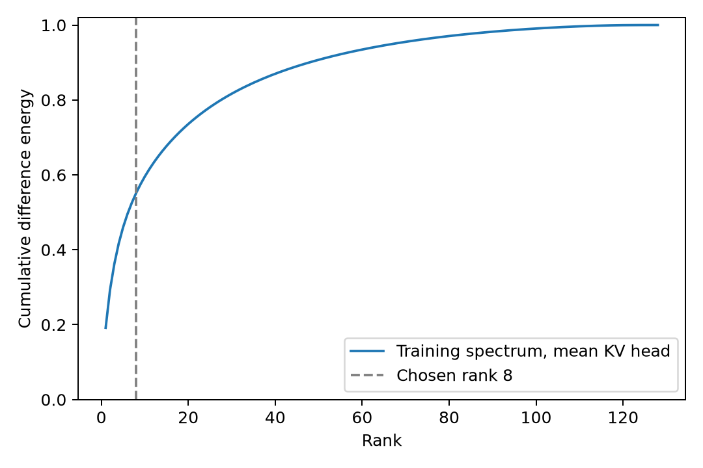

# ASTER 服务器执行报告：2026-10-30

本次完成真实预训练权重的数值接口验收、合成逻辑患者数据构造、键差分方向学习、统计诊断和冻结后的合成端到端对照。**未完成自然病历最小对临床语义金标核验；未运行临床内部确认、MEGA-CDP 官方测试或 MedGUIDE 临床来源留出。所有效能数字都不属于临床主表。**

## 版本与资源

- 分支 codex/aster-manuscript-implementation-20261030；开始时远端提交 78e8498244fbeb5fbecd464feecb20e0c063f3ee。
- 方法规格 60027c426a3155bf55c26273f4c3f49fd563ce1f，第 4.2–4.4 节和方法补充 A–D。
- 本轮代码 bb944d0a524c94d1a97f0ea273d5c6eb33016ff9，运行编号 run05。Qwen3-8B、Transformers 4.57.6、BF16、eager attention、单病例单设备、非量化 DynamicCache。
- 本地模型目录和既有下载清单均未保存上游修订。记录为 2026-10-14 本地 ModelScope 快照、上游修订未知，没有用当前远端版本冒充实际下载版本。
- 只用物理 GPU 0、1；实测峰值分配显存约 16.6 GB（BF16）、33.3 GB（FP32）。没有停止其他任务，没有修改公共环境或 PR #41 产物。
- 独立环境使用 venv-overlay 解释器，读取原 gcx261014 的包，不写公共环境。环境路径和依赖实际版本见 run_manifest.json。
- 原始提示、词元、表示、分类结果、生成文本及日志均留在服务器独立输出根 /home/gcx/aster_manuscript_20261030/。仓库只提交代码、公开合成示例和汇总/配置。未新增文件哈希计算。

## 真实接口验收与模板修复

63 项 test_aster*.py 测试全部通过，无跳过，包括真实 Transformers Qwen3/Llama 微型架构测试。预训练 Qwen3-8B 的 BF16、FP32 均实际执行了前向、缓存编辑和分段生成。修复后保留原始源处置的 72 组分词检查及两种精度的小样本权重验收均通过。

已验证三态目标词元/位置对齐、k_norm 后 RoPE 前采集、查询旋转及每 KV 头全部四个共享查询头、两患者共享同一原始前缀缓存、原缓存和值及非目标键不变、固定查询加性得分公式及舍入界、相同分段下零编辑与空专家 logits 一致、分类与生成共享同一未更新骨干、分类失败与 NONE 分开、祖先弃权关闭下游。真实非空专家的零增益及分数偏置零增益执行器也与原生分段前向逐项比较通过。

原模板会让处置末尾标点与紧随换行合并成一个词元。修复只在**处置片段外、换行前**加入空格，不扩大编辑范围。模板更新为 v2；禁止将旧专家与新模板混用。未知态 x=? 长度不齐的公开示例也已改成明确的未知编码。

全文与分段前向并非逐位相等：原始处置验收的最大 logits 误差，BF16 为 0.75，FP32 为 0.00016594，本例 argmax 相同。低精度微小位移可完全舍入为零，计划与实际非零变化数分别保存。

## 运行记录

| 编号 | 实际完成 | 失败或范围 |
|---|---|---|
| run01 | 环境与63项回归 | 未知态长度不齐，未加载权重 |
| run02 | v1 BF16/FP32接口验收 | 原始处置边界使72/72采集排除，未学习方向 |
| run03 | 固定Alpha/Beta合成处置；72组采集、学习校准、1440单元 | 完整保留旧结果，不与v2混合 |
| run04 | v2原始处置72组分词、公开示例、BF16/FP32真实权重验收 | 上游模型修订仍未知 |
| run05 | v2、原始源处置、原来源分组与候选重新冻结的完整机制实验 | 仍为合成逻辑患者 |

重跑依据是模板修复和恢复原始源处置，未按成绩选择重跑、种子或子集。旧失败及负结果均保存。

## 数据与真实分母

实读清单：MEGA-CDP train_val 1834棵树/34895例，官方test 440棵树/7458例；MedGUIDE 7747条、53个disease值。**这些是库存数量，不是已测临床例数。**

以规范化原文件名或完整递归条件/分支文本归并来源，未检出上述精确规范化形式的 train_val/test 重合；改写、跨语言及跨语料来源同一性未完全排除。PR #40 历史确认来源暴露尚未解决，因此本次留出只称探索性留出，不称盲测或独立外部验证。

30个来源：拟合12、温度校准4、选头6、开发4、探索性留出4。每指南两条目标规则，基本三元组60；留出另有事实扰动、改写、处置映射控制12组，共72。独立解析器读取 C 的显式0/1/2赋值，分别为不成立、成立、未记录；未知不当成否定。其他事实、问题、指南和处置固定，逐三元组真实分词核验。

当前分组使用源树根节点。临床全树层级适配尚未验收，祖先关闭只在接口/工程诊断中验证。独立核验的自然病历三态临床最小对数量为 **0**。

基本留出24条状态记录因相反目标共享患者，只有 **12个独立输入、4个指南簇**。加入三类控制后60条状态记录、48个独立输入。12方法×2路由×60状态记录=**1440个病例/方法单元**，不是1440名患者。全部记录保留，技术失败、无效生成与评分失败分别计数，无信号/实际未改键另列。

## 冻结配置和算子对照

秩候选1/2/4/8，样本量4/8/16/24对，3次固定重复。按选头集全部逐词元差分的能量保留减 rank/128 选秩，样本量只作敏感性分析。最多4头；K=1仅登记，未运行独立选头版本。严格要求分离度、正读取、负读取均为正，允许空专家。

最终秩 8；头集 ['21:4', '21:6', '24:3', '29:7']；温度 0.05；接受阈值 p=0.0、margin=0.0；正负增益均 0.25。温度来自独立来源的24条校准状态，落于预定下界，不能证明临床校准可靠。增益仅在开发集从0.25/1/4中按预登记规则确定。

所有平移对照固定判断、头集及位移范数；原始均值和固定随机方向均为加性位移，不是当前键投影。随机控制每头仅一个方向，种子20261030，不构成完整随机零分布。直接分数偏置按开发集固定查询得分扰动RMS校准每头单位尺度，共享增益搜索预算。

成本仅包含实测阶段墙钟时间/显存峰值及各方法生成词元数；未单独测量逐方法延迟，不能宣称完整临床成本。见 costs.json。

## 统计结构

全部 280 个有效候选KV头，rank=8 的训练谱能量平均保留 55.12%；固定训练子空间在留出全部逐词元差分上的保留 **35.93%**，4指南簇bootstrap 95%区间 **[35.22%, 37.64%]**；同秩随机子空间留出均值 **6.31%**。平均差分范数保留另列，未用它替代全部差分的谱集中性。

| 层:KV头 | 训练能量 | 留出能量 | 指南分半重叠 | 随机重叠 | 未见规则方向余弦 | 正向比例 |
|---|---:|---:|---:|---:|---:|---:|
| 21:4 | 0.694 | 0.494 | 0.566 | 0.063 | 0.595 | 1.000 |
| 21:6 | 0.623 | 0.409 | 0.542 | 0.066 | 0.496 | 1.000 |
| 24:3 | 0.630 | 0.369 | 0.519 | 0.059 | 0.526 | 1.000 |
| 29:7 | 0.604 | 0.188 | 0.317 | 0.066 | 0.460 | 1.000 |

完整谱、秩/样本量敏感性、近零与秩不足排除、逐病例/查询头/目标词元的读取响应以及后续生成注意力均保存。非决定性事实、改写、处置映射控制全部执行。共同显式数字编码仍可能构成混杂，不能从此推出临床适用性普遍具有同样结构。

## 冻结后合成行为

基本留出、实际预测路由如下；金标路由单列诊断，不进入可部署排名。未按测试金标筛选可编辑病例。实际预测均正确的批次不能估计真实错误路由代价。

| 方法 | 正确/状态记录 | 纠正/退化 | 首查询正确/兄弟注意力质量比 |
|---|---:|---:|---:|
| baseline | 20/24 | 0 / 0 | 1.979601202681686 |
| zero | 20/24 | 0 / 0 | 1.979601202681686 |
| spectral | 20/24 | 0 / 0 | 2.4083253218740763 |
| mean | 20/24 | 0 / 0 | 2.397572063628665 |
| random | 20/24 | 0 / 0 | 2.0112901612702507 |
| reverse | 20/24 | 0 / 0 | 1.6184745387210542 |
| score_bias | 20/24 | 0 / 0 | 2.3568617702420296 |
| enhance_only | 20/24 | 0 / 0 | 2.188741717266589 |
| suppress_only | 20/24 | 0 / 0 | 2.169113209412486 |
| direct_map | 24/24 | 4 / 0 | — |
| text_append | 24/24 | 4 / 0 | 1.885765952193994 |
| text_clip | 24/24 | 4 / 0 | None |

准确率及改变量的指南簇区间、技术失败、无效生成、路由可编辑覆盖、实际未改键、生成词元成本、后续位置注意力，均见 comparisons.json。仅4个来源簇；配对改变量为零时退化为点的bootstrap区间不能证明泛化等效。注意力比的成对指南簇区间及谱方法对均值/直接偏置的直接比较另存。

直接映射、文本附注、文本裁剪均共享同一未更新骨干产生的分类logits缓存。病例输出只按固定规则编号解析评分；未调用临床GPT/Qwen评审，未产生官方PCC/临床结论分数，也未测临床冲突表现。

## 对五个问题的当前回答

1. 低维结构：秩8保留全部差分留出能量35.93%（随机6.31%），存在集中性；不能视为通用低秩充分表征，临床场景未验证。
2. 跨规则复用：四个所选头的未见规则均值方向余弦为0.460–0.595，正向比例均100%；仅支持本逻辑构造，不外推到临床。
3. 双向读取：本批正负状态的逐共享查询头/目标词元响应均为正；联合编辑将首查询正确/兄弟质量比1.980提高至2.408，反向平移降至1.618；后续生成注意力也已记录。局部效果没有转化为准确率改善。
4. 谱方法独立收益：没有最终准确率优势。谱减均值的局部质量比差0.01075，指南簇区间[-0.00262,0.02413]；谱减直接偏置差0.05146，区间[0.03950,0.07028]。后者只表示本批局部注意力优势。
5. 最终行为：直接映射、文本附注和裁剪均为24/24。基本合成留出基线 83.33%、谱方法 83.33%，纠正 0、退化 0；这不是临床最终任务结论。

## 未完成与停止位置

临床阶段停在数据验收前：没有独立核验的自然病历三态最小对；跨语料来源同一性和PR #40历史确认暴露未排清；本地模型上游修订无记录。没有用分类器自产临床金标，没有将旧true/false查询任务改名成自然最小对，也未混用旧分支结果。

因此尚未执行MEGA-CDP临床内部确认、官方测试、MedGUIDE临床来源留出；临床组级适配及官方评分传输仍需在数据条件满足后继续验收。**完整执行委托尚未完成。** 现有GPU作业已结束，无持续监控。

## 复现与恢复

精确运行提交为 bb944d0a524c94d1a97f0ea273d5c6eb33016ff9。服务器完整脚本位于 run05/pipeline.sh；脚本只等待依赖阶段，无持续资源监控。配置、来源分组、候选网格与冻结参数在同目录JSON。新版一条命令流程为 bash experiments/aster_manuscript_20261030/run_pipeline.sh "$NEW_RUN_ROOT"；--original-actions 已逐条再生成并与本次72条记录比较一致。必须在不存在的新运行目录复现；保留source_actions原始处置，并同步交换action_mapping控制。

~~~bash
source /home/gcx/gcx261014/bin/activate
source /home/gcx/aster_manuscript_20261030/venv-overlay/bin/activate
python -m unittest discover -s tests -p 'test_aster*.py' -v
# collect 两个独立分片完成后：
python -m experiments.aster_manuscript_20261030.analyze --run "$NEW_RUN_ROOT"
CUDA_VISIBLE_DEVICES=0 python -m experiments.aster_manuscript_20261030.evaluate --run "$NEW_RUN_ROOT" --mode gain --shard 0
CUDA_VISIBLE_DEVICES=1 python -m experiments.aster_manuscript_20261030.evaluate --run "$NEW_RUN_ROOT" --mode gain --shard 1
python -m experiments.aster_manuscript_20261030.report freeze --run "$NEW_RUN_ROOT"
CUDA_VISIBLE_DEVICES=0 python -m experiments.aster_manuscript_20261030.evaluate --run "$NEW_RUN_ROOT" --mode evaluate --shard 0
CUDA_VISIBLE_DEVICES=1 python -m experiments.aster_manuscript_20261030.evaluate --run "$NEW_RUN_ROOT" --mode evaluate --shard 1
python -m experiments.aster_manuscript_20261030.report summarize --run "$NEW_RUN_ROOT"
python -m experiments.aster_manuscript_20261030.supplement --run "$NEW_RUN_ROOT"
~~~

evaluate --resume 只补缺失的(pair_id,state,route,method)，保留已有成功、失败和负结果，不按成绩重跑。骨干/模板和专家不一致会失败，旧v1与新v2专家不能混用。

详细日志只保留服务器，公开报告不含病历、原始提示或生成文本。
