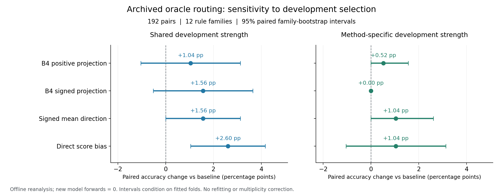

# CARE 模块二预实验：已执行审计与未完成项目

**状态：离线审计、历史结果复算与数学契约检查已执行；新的真实模型预实验尚未执行。新增模型前向次数为 0。**

本目录针对“模块一已经固定，接下来验证模块二是否有效”。输入仓库快照为 `7557d3150214a3894f2d340df6d9964de75efce1`。本次工作没有重训或修改模块一，没有改写历史模型输出。原始输入文件的指纹见 [source_snapshot.json](results/source_snapshot.json)。

当前计算入口 `10.29.128.115:22` 在获准尝试连接后返回 `Connection refused`；本地没有目标 GPU 执行环境、PyTorch、Transformers 或目标权重。两份冻结模块一对应的原始病例也仍只在服务器。新来源、信息充分性与组合基准尚未实例化，完整 P0–P6 神经运行器尚未实现，不能理解成“只差启动命令”。详见 [环境实测与恢复条件](ENVIRONMENT.md)。

## 1. 本次实际完成了什么

| 项目 | 实际执行 | 可以支持的结论 |
| --- | --- | --- |
| 固定模块一信号审计 | 读取并核验 192 + 100 条缓存及各自标签、规则 | 标签、门控、可连接性与数据覆盖范围 |
| 历史模块二独立复算 | 从三个 fold 的 9,792 条历史记录重新选取、评价和统计 | 历史 oracle 路由证据及其不确定性；不是新推断 |
| 模块二数值参考实现 | 配对差 SVD、均值方向、有符号键投影、坐标替换、GQA/RoPE 几何 | 公式与索引的数学契约 |
| 固定信号适配器 | 精确键连接、两种明确命名的门控语义 | 不借用 gold、不改写模块一的接口行为 |
| 自动检查 | 26 项测试全部通过 | 数学与数据契约通过；真实模型 P0 仍未通过 |
| 完整预实验协议 | P0–P6、数据预算、强基线、选择规则、失败条件和统计方案 | 后续执行范围；不是已生成的数据或效果证据 |

所有新模型实验结果字段保持为空。没有使用随机权重模型或模拟预测填补效果结果。

## 2. 最先需要解决的是接口，而不是再训练模块一

当前仓库的两份 V6 缓存，其最终适用性输出是顶层 `C`，取值 T/F/U。审计只复算这些已保存输出，不重新判断病例。

| 数据 | 保存的 C 与 gold 一致 | 原门控开启 | 严格门控下正向信号 | 负向信号 | 零信号 |
| --- | ---: | ---: | ---: | ---: | ---: |
| old192 | 151/192，78.65% | 26 | 26 | **0** | 166 |
| new100 | 73/100，73.00% | 11 | 11 | **0** | 89 |

数据来源：[冻结信号审计 JSON](results/frozen_signal_audit.json)，[逐例信号与门控表](results/frozen_signal_cases.csv)。old192 是旧结果离线重组的 V6 输出；new100 是保存的 V6 实际推断输出。它们不能被当成同一批独立病例。

**若把原来的 `allow_attention_intervention` 解释为所有路由的总开关，两批数据都不会触发负向抑制。** 因而直接复用原门控，无法检验“每条规则都可独立增强或抑制”。这不是模型效果差，而是控制信号没有进入该实验条件。

[frozen_adapter.py](frozen_adapter.py) 将两种模块二适配方式显式分开：

1. `strict_gate`：`sign(C) × 原 gate`，保留现有总门控语义。
2. `label_only_diagnostic`：仅按保存的 C 映射 T/F/U 为 +1/−1/0，保留原 gate 字段但不把它用于此次路由；它是取消门控的独立诊断条件。

第二种方式在 old192 产生 +85/−74/0=33，在 new100 产生 +30/−28/0=42。它没有读取 gold，也没有修改模块一，但不能被写成“严格原接口已经具有双向能力”。两种方式需要在同一批原始输入上与相同信号的提示、过滤和直接分数偏置比较。

适配器始终将 `source_target` 和 `decidability_target` 保持为 `None`。F 不等于“应当使用参数先验”；U 不等于“应当追问”。是否需要追问取决于缺失属性是否改变合法决策。

### 数据不能直接拼接

| 已有数据 | 唯一病例 | 配对 | 与当前 V6 缓存的对应情况 |
| --- | ---: | ---: | --- |
| old192 V6 | 192 | 不是模块二的 192 对 | 与历史模块二 ID 交集为 0 |
| new100 V6 | 100 | 独立新增集合 | 与历史模块二 ID 交集为 0 |
| 历史 signed 模块二 | 384 | 192 | 没有这两份缓存中对应的 V6 信号 |

不能按行号、样本数量或临床领域相似性连接。适配器当前核验的是缓存键 `(sample_id, rule_id)`。真正 P6 还必须核验原始病例文本、规则哈希和模块一版本。

旧 16 条规则的 action 全为空，新 9 条规则没有 action 字段。它们支持适用性判断审计，但尚不提供临床动作的独立评价真值。原始病例不能由 gold 或预测反向拼造。恢复原始输入后，还要明确合法下游任务，才能评价模块二对最终答案的作用。

## 3. 旧路由证据的独立复算

对象是仓库保存的 Qwen3-4B-Base 输出：384 个模拟病例、192 对、12 个规则族，三个按规则族划分的外层 fold。控制符号来自 **gold applicability oracle**。这轮不是当前冻结 V6 的端到端结果。

主要指标是“一个反事实对的两例都正确”。按历史共享开发集强度选择复算：

| 方法 | 正确对数 | 成对准确率 | 相对无干预的变化 | 配对家族 bootstrap 95% 区间 |
| --- | ---: | ---: | ---: | --- |
| 无干预 | 72/192 | 37.50% | — | — |
| B4 正向投影 | 74/192 | 38.54% | +1.04 个百分点 | [−1.04, +3.13] |
| B4 有符号投影 | 75/192 | 39.06% | +1.56 个百分点 | [−0.52, +3.65] |
| 配对差均值方向 | 75/192 | 39.06% | +1.56 个百分点 | [0.00, +3.13] |
| 直接注意力分数偏置 | 77/192 | 40.10% | +2.60 个百分点 | [+1.04, +4.17] |

复算入口：[replay_signed_results.py](replay_signed_results.py)。逐项统计及检查在 [results/replay](results/replay/)。该目录同时保存按方法单独选择开发集强度的结果、全部固定强度结果、逐例纠正与退化以及规则族分层。

目前可以说，正确适用性信号驱动的局部干预有小幅收益线索；**尚未证明学习投影优于直接偏置，也没有验证新提出的来源轴、可决断轴或二维可组合接口。** B4 有符号投影与均值方向的成对准确率相同。直接偏置减去 B4 有符号投影的差为 +1.04 个百分点，配对区间为 [−1.04, +3.65]，不足以确认两者的总体排序。

这种增益还对开发选择方式敏感：按各方法自己的开发集最优强度选择时，B4 有符号投影为 37.50%，直接偏置为 38.54%。不能根据测试结果再选择有利的强度协议。



图左为共享开发强度，图右为各方法独立选择开发强度。横线为条件于现有拟合 fold 的家族 bootstrap 区间；零宽区间不证明总体效应恰好为零。图由已保存统计生成，未进行新的模型推断。

### 少量规则族下的不确定性

本次另作探索性家族符号翻转检验：对 12 个规则族枚举全部 4,096 个符号组合。该检验条件于已有拟合结果，并依赖家族差值在零假设下的符号可交换性，不代替重新拟合或新确认集。

直接偏置净改善 5 对，来自 5 个规则族各改善 1 对。其双侧 p 值为 0.0625；四种干预分别与无干预比较后采用 Holm 校正，校正值为 0.25。这与历史 percentile bootstrap 区间为正同时报告，说明结论依赖有限样本下的推断方式。不能仅引用正区间，把探索性线索升级为稳健确认。

本次没有将这些后补分析写成历史预注册。12 个规则族也不能因存在 9,792 条日志或 1,920 条主要方法记录而被当成更大的独立样本。

### 键的系数符号尚不等于注意力分数的方向

历史日志中的实际扰动进一步支持这一点。主选择条件下，每个输入受干预因果位置中“注意力分数下降”的比例，再按输入等权平均为：

| 方法 | 适用病例 | 不适用病例 |
| --- | ---: | ---: |
| B4 有符号投影 | 31.16% | 68.95% |
| 配对差均值方向 | 48.66% | 51.53% |
| 直接分数偏置 | 0% | 100% |

因此，在适用病例里给键投影正系数，仍会使部分查询分数下降。这里统计的是每输入比例的均值，不是全部位置混池的比例；“非负”也不等于严格上升。详见 [score_sign_by_applicability.csv](results/replay/score_sign_by_applicability.csv)，须筛选 `selection_policy=common_tau`。

这不直接证明投影无效，但说明“逐规则可以给正负系数”只建立了算子的表达能力。还需要输出正确性、反事实一致性和实际模型干预来证明这种表达对应预期选择。

## 4. 数值实现已经检查到哪里

[linear_interface.py](linear_interface.py) 提供以下 NumPy 参考实现：

- 配对差的未中心化 SVD、显式中心化消融及均值方向；能量用平方奇异值。
- 相关性与适用性协方差先按迹归一化，再混合和重新提取正交空间。
- 每词元独立的正、负、零键系数。
- 在正交基中替换目标坐标、保留正交补，以及供体坐标交换。
- 非正交轴的 QR 坐标转换；拒绝把共线的两个方向当成二维平面。
- 共享 KV 头到查询头的 GQA 分组、模型提供的 RoPE 旋转和因果分数参考。
- 病例、配对、基础病例与家族划分的一致性检查。

检查还覆盖了两个容易误解的数学事实：对差分行随机翻转符号不会改变 `DᵀD`，因此不能当成谱空间的有效随机对照；正键系数也可能降低某个查询的注意力分数。

完整测试证据：[verification.json](results/verification.json) 与 [verification.log](results/verification.log)。26 项均通过。独立审阅发现的配对与家族检查缺口、基础病例跨划分、供体内容表述及 RoPE 数值参照已修正。

**这些函数不是 Transformer 神经运行器。** 它们没有验证真实激活、模型 hook、BF16 舍入、缓存路径、神经因果作用或跨内容泛化。供体坐标交换只保证正交补保持，仍可能复制该子空间内编码的答案内容。真实 P0 与 P3 还必须检验这些问题。

## 5. 恢复计算后，完整预实验如何依次推进

完整定义、预算、统计与每例结果字段见 [PROTOCOL.md](PROTOCOL.md) 及 [protocol.json](protocol.json)。所有真实模型实验当前都未运行。

| 顺序 | 要回答的问题 | 核心比较 | 完成依据 |
| --- | --- | --- | --- |
| P0 | 是否真的修改了声明的层、头和词元 | 零强度、零门控、目标与非目标位置、GQA/RoPE | 真实模型张量与 hook 审计 |
| P1 | 模型本来能否完成目标行为 | 明确策略指令、中性提示、宽残差交换 | 各模式基础能力和阳性干预响应 |
| P2 | 路由空间是否有适用性特异作用 | 均值、SVD、随机、重新配对、直接偏置、提示/过滤 | 新家族上的成对正确、误用和非目标损伤 |
| P3 | 来源控制能否跨内容复用 | C/P 双向；同题与跨题、不同答案供体 | 使用接收样本自己的答案，排除供体答案复制 |
| P4 | 可决断控制是否知道何时需要补信息 | 关键未知、无关未知、未知但结论不变、已知 | 错误决断、无必要追问、问对属性、补齐后正确 |
| P5 | 多规则与多轴能否组合 | 单项、两两、联合以及简单组合基线 | 同提示正负零控制与串扰 |
| P6 | 固定接口能否迁移并被真实模块一驱动 | 新规则/模板/答案映射；oracle 与冻结预测分开 | 同信号强基线收益与错误传播 |

优先让 P0、P1 和 P2 形成闭环，再扩展来源与信息充分性。P2 若不优于简单方法，应保留直接偏置作为有效的简化候选，不继续把更复杂的空间视为已经成立。来源或可决断单项不成立时，组合结果必须记录不受支持的组件，不能强行维持“二维可组合”的主张。

新机制数据预算按 24 个独立语义家族进行 12/4/8 的训练、开发、测试划分。旧 12 家族只作回归。每轴最多 8 个候选位置，秩 1/2/4，三个非零强度与零强度，参数只能在开发集选择。来源需要真实知识的闭卷能力筛查；可决断的策略 IIA 与事实正确性分别评价。没有任何新效果数字来自本预算。

当前协议是探索性预实验，没有设定确认性最小收益或可接受退化界限。要宣称“有效”，至少应依次建立语义可控制、强简单基线之外的增量价值、组合与迁移、冻结模块一端到端收益；不能以探针 AUC 或谱能量替代这些证据。

## 6. 复算与恢复入口

以下命令从仓库根目录执行。它们只运行离线工作，不启动模型；结果写入新的运行目录。

```bash
python -B experiments/care_module2_interface_20261020/audit_frozen_signals.py \
  --output experiments/care_module2_interface_20261020/runs/recheck_01/frozen

python -B experiments/care_module2_interface_20261020/replay_signed_results.py \
  --output experiments/care_module2_interface_20261020/runs/recheck_01/replay

python -B experiments/care_module2_interface_20261020/verify_local.py \
  --out experiments/care_module2_interface_20261020/runs/recheck_01/verification.json
```

新模型实验的下一步需要可访问的授权计算入口。恢复后先核验目标模型、原始病例哈希和合法下游任务，再实现、验证及执行神经运行器。连接与数据要求、预检命令及历史资源记录见 [ENVIRONMENT.md](ENVIRONMENT.md)。本次没有提交或修改主分支中的模块一、历史运行器和已有结果。
