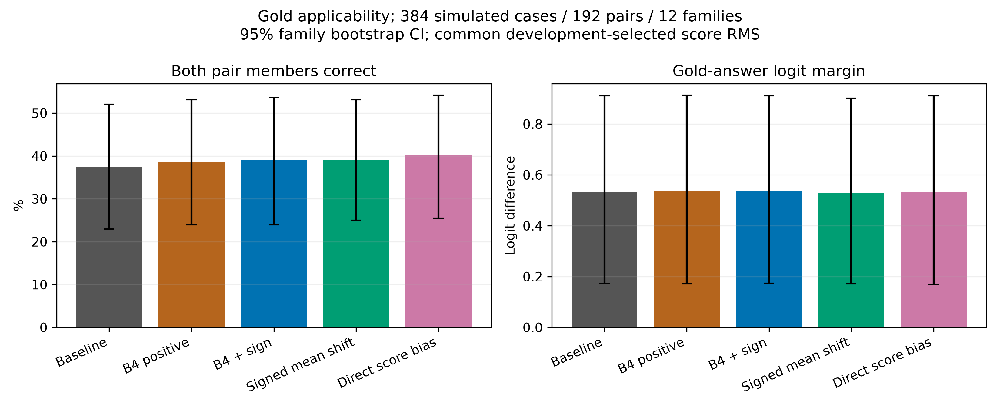
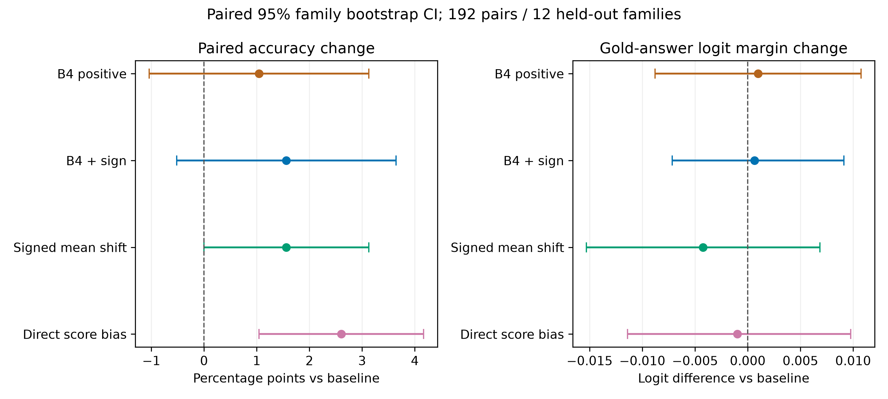
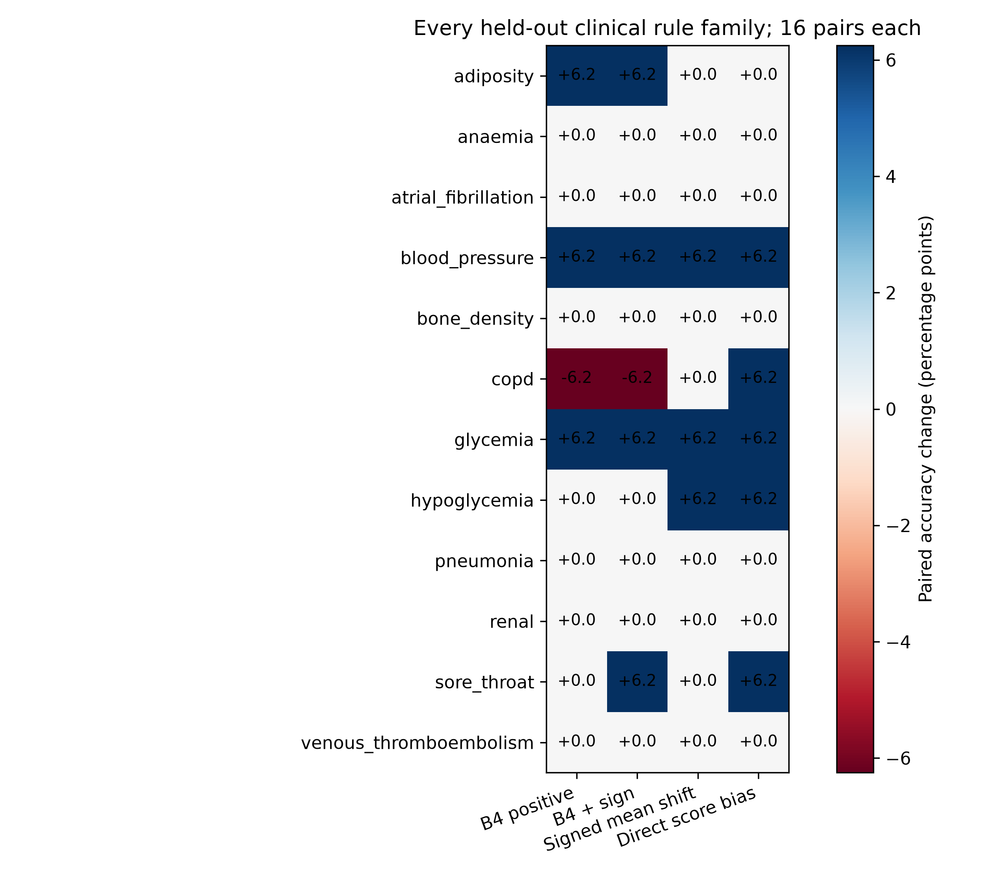
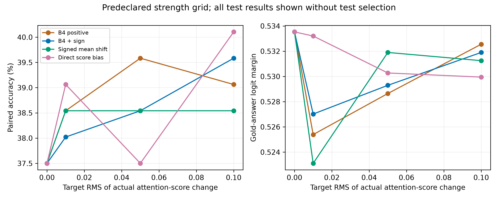

# CARE module two: gold-applicability diagnostic

Completed real Qwen3-4B-Base inference on GPU 0–3. 384 simulated cases, 192 pairs, 12 clinical rule families; exact archived three family splits.

| Method | Pair accuracy | Change vs baseline; paired 95% CI | App | Nonapp | Misuse | Gold logit margin | No-conflict retention |
|---|---:|---:|---:|---:|---:|---:|---:|
| Baseline | 37.50% | +0.00 pp [+0.00, +0.00] | 59.38% | 64.06% | 21.88% | 0.533529 | 100.00% |
| B4 positive | 38.54% | +1.04 pp [-1.04, +3.12] | 59.38% | 64.06% | 21.35% | 0.534505 | 97.99% |
| B4 + sign | 39.06% | +1.56 pp [-0.52, +3.65] | 59.38% | 65.10% | 20.31% | 0.534180 | 98.66% |
| Signed mean shift | 39.06% | +1.56 pp [+0.00, +3.12] | 60.42% | 64.58% | 20.83% | 0.529297 | 99.33% |
| Direct score bias | 40.10% | +2.60 pp [+1.04, +4.17] | 60.42% | 65.62% | 20.31% | 0.532552 | 100.00% |

No learned-direction advantage over direct score bias is established by these comparisons. Direct bias has the largest paired-accuracy point estimate, while its gold logit margin is slightly below baseline. Full paired comparisons, rather than rankings alone, should guide interpretation.

B4 is a positive semidefinite orthogonal projector P=UUᵀ followed by additive amplification along Pk. This is not a clamp of negative coordinates. Original code has no applicability sign input. A positive key coefficient does not guarantee positive QK-score change.

The new B4 signed method uses s=+1 for applicable and −1 otherwise. The signed mean shift uses s·mean(k_app−k_nonapp), estimated only from training families. The direct score bias uses s·tau. Gold applicability is supplied to interventions only and is never inserted into prompts.

All four methods share each fold’s frozen PR3 B4 development-selected location and rank, target action tokens, GQA query heads, and causal query/key support. B4 is refitted from freshly extracted training keys and checked against the archived projector. Mean shifts use the same training pairs.

Key edits are scalar-calibrated per input, without answer labels, to match actual post-RoPE fixed-query score RMS after BF16 rounding. Direct bias uses the nearest BF16 value. Calibration measures every causal entry at the edited head/span; see calibration.csv. Sign control does not force every query score to have the requested sign.

The common strength is selected before test inference using mean development pair accuracy across all four methods, then case accuracy, then smaller strength. Zero is eligible. Method-specific development selections and all fixed-strength test results are separately saved. No test outcome selects the reported strength.

Gold-answer logit margin is the gold candidate logit minus the largest other candidate logit; probability margin is also saved. All outcomes use identical single-token A/B/C/D scoring. Misuse is selection of the highlighted inapplicable action among nonapplicable cases.

The no-conflict set contains 176 cases with stable closedbook agreement, fixed by the archived screening. Retention conditions additionally on contextual-baseline correctness. All confidence intervals and denominators appear in metrics_ci.csv; all ten paired method comparisons appear in paired_comparisons.csv.

Intervals use 10,000 shared family-bootstrap resamples and condition on the three fitted outer folds. Only 12 families are available. Secondary comparisons have no multiplicity correction; sparse or zero-width empirical intervals do not establish a zero population effect.

The experiment isolates gold-applicability module-two behavior. It does not test module-one errors or establish clinical efficacy. Cases are simulated; thresholds and answers are from the unchanged archived executable rules.

See ../../PROTOCOL.md for formulas, selection policy, reproduction, audit details and limitations. Old B4 reproduction is a separate fourth-GPU task. All 384 cached key examples and archived B4 candidate distributions must match exactly before this report is produced.
