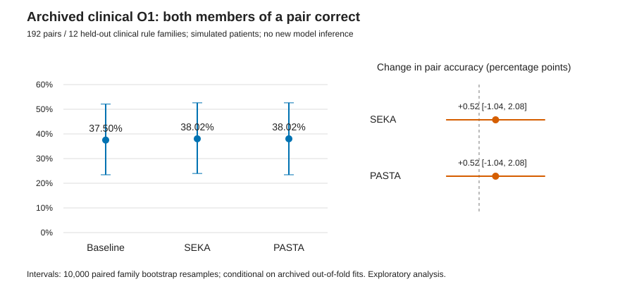

# CARE module 2 follow-up — 2026-10-17

## Status

**Completed:** new paired analysis of archived clinical O1 predictions, with saved metrics, family bootstrap intervals, answer changes and an SVG chart.
**Not run:** new model inference; B1–B4 projector comparison; random projector interventions; direct-score-bias control; subspace ablation; activation patching; Python tests and Python reproduction.

The host command interface failed before creating a process. SSH therefore did not execute; server reachability and free GPU memory are unknown. The Node execution interface separately failed on its sandbox working-directory URI before evaluating code. GitHub connector reads/writes and connector orchestration JavaScript were available. No server run or GPU allocation is claimed.

This work does not repeat the O2 head-selection statistical audit in PR #2.

## New analysis of existing clinical predictions

Input: `results/obs1_clinical/predictions.csv`, Git blob `359cae49be885750baa2f64ac120093fb3b603f3`, at source commit `8c5593e3d9e1a1bc9295bed916cb3e542198c574`.
Only the 1,152 **test** records were used: 384 examples × three methods, 192 complete pairs and 12 clinical rule families. Each family was held out in its outer fold.
All three fold manifests were checked for train/dev/test family separation, test-case membership and agreement between selected and evaluated strengths.

| Method | Case accuracy | Both pair members correct | Change in pair accuracy; 95% CI |
| --- | ---: | ---: | ---: |
| Baseline | 61.72% | 37.50% (72/192) | reference |
| Official SEKA | 61.98% | 38.02% (73/192) | +0.52 pp [−1.04, +2.08] |
| Official PASTA | 61.46% | 38.02% (73/192) | +0.52 pp [−1.04, +2.08] |

Intervals use 10,000 paired clinical-family bootstrap samples, preserving all cases and both methods within a family. They are conditional on the archived fitted outer folds; projection/strength fitting is not repeated in each resample. The analysis was designed after the predictions existed and is exploratory.

For the **25 pairs with both members prior-eligible**, all three methods have **20.0%** both-correct accuracy (5/25); each intervention's paired change is zero. The 153 individually eligible examples are reported separately, without pretending that they form 153 complete pairs.

For the **176 stable closed-book agreement cases**, all three methods have **84.66%** contextual accuracy. This is an operational no-prior-disagreement subgroup, not a claim of clinical safety or of identical case-level behavior.

### Error analysis

SEKA changes **8/384** answers: **4 corrections**, **3 newly wrong answers**, and **1 wrong-to-wrong** change. PASTA changes **5/384** answers: **2 corrections**, **3 newly wrong answers**.
SEKA's wrong-to-wrong glycemia example stops selecting the highlighted inapplicable branch but still misses the gold answer. A lower misuse rate therefore does not automatically imply better decisions.
Both methods hurt `hypoglycemia-hypo_one-06-non`; SEKA corrects the adjacent `hypoglycemia-hypo_one-07-non` case. All changed IDs, before/after answers and family results are saved in the CSVs.

These results provide a concrete baseline for the new subspace experiments. They do not establish that any new B1–B4 method improves decisions.



## Executable follow-up implementation

- `scripts/module2_subspaces.py`: B1 centered raw action-key PCA; B2 pinned official SEKA projectors; B3 uncentered paired-applicability-displacement PCA; B4 regularized generalized signal/background eigenspace; random orthogonal projectors.
- `scripts/run_module2_followup.py`: fixed-model loading and shard hashes, train/dev-only projector and parameter selection, resumable per-case inference journal, matched direct bias, ablation, opposite-applicability and same-label donor patching.
- `scripts/analyze_module2_followup.py`: complete-run analysis, family bootstrap, pairs, margins, misuse, stable-agreement subgroup and answer transitions; PNG/SVG/PDF from saved outputs.
- `scripts/analyze_module2_archive.py`: standard-library Python reproducer for the new archived clinical analysis, with optional Matplotlib exports.
- `tests/test_module2_followup.py`: disturbance budget, hook cleanup, projected patch, rank limits, background suppression, same-rule magnitude matching, causal mask/GQA support and incomplete pairs. **Not executed in this session.**

### B1–B4 definitions and controls

All operators act at QK-normalized **pre-RoPE** action keys, without editing candidate-option tokens. B1 and B3 use span-mean keys, matching the archived O2 representation unit. B3 uses applicable minus inapplicable keys; its main amplification does **not** receive the test applicability label.

B2 calls the unmodified official projection builder at commit `aab9cfed80dc012fb9e83f8bdefb8675c33f40e7`, using its 90%-spectrum positive projector and complement negative projector, combined as `(Ppos + .25 Pneg)/2`. Its rank is whatever the official algorithm returns. It is **not silently truncated to rank 1/4/16**. The controlled comparison explicitly normalizes the key disturbance per example; this is a **calibrated use of the official projection**, not an exact rerun of native uncalibrated SEKA. Archived native SEKA results above remain separate.

B4 background pairs must share the exact training rule, gold label and applicability, with numeric change magnitude within 15% of the applicability-flipping pair. The control IDs and both distances are saved. A configuration without controls is marked blocked rather than replaced by B3. Existing O2 same-side changes are one unit versus a four-unit flip; new training-only same-label values at a four-unit distance are constructed and truly forwarded before B4 fitting. Clinical controls use the existing training-family values; missing coverage remains visible in the audit. This controls one numeric-magnitude confound and is not evidence that every lexical or contextual confound is removed.

Random seeds 42/43/44 are reported separately; no best random seed is selected. Each method is selected on development both-correct pair accuracy, then case accuracy, then smaller disturbance/rank. Strength zero is included, so a method can select no intervention.

Main interventions use unsigned amplification, without applicability/gold labels. All projected edits have the same per-example relative Frobenius key disturbance. Uniform attention-score bias uses the same layer, four GQA query heads, target tokens and causal query positions, with RMS calibrated to the projected edit's actual BF16-induced score differences. It is calibrated using baseline Q/K, without the gold label. The equivalence smoke check compares a **nonuniform exact QK-difference mask** with a single-layer key edit; that mask is a numerical control, while the uniform RMS-matched mask is the scientific comparator.

For orthogonal B1/B3/B4/random projectors, ablation removes the selected subspace and patching replaces its coordinates using the paired patient's baseline action keys. B2 is a weighted sum of projectors, so its diagnostic modes instead remove the weighted operator component or interpolate the weighted donor difference; they must not be described as exact orthogonal subspace deletion/replacement. Both opposite-applicability and same-label donors are run, with numeric distances saved. These donors and labels are **oracle mechanism diagnostics**, separate from the deployable main decision comparison. Same-label clinical donor distances may be imperfectly matched; stratify by recorded distance before interpreting causal effects.

### Splits and scope

Clinical runs reuse the exact archived three outer-fold family manifests: six training families, two development families and four test families per fold. All training examples of those six families are used for every new projector. This gives more training examples to B2 than the original clinical O1 first-two-pair builder; the new comparison is internally matched and is reported separately from archived O1.

O2 reuses the verified original token-key tensor and official projections for the exact 36 training identifier groups, with 12 dev and 12 test groups. O2 contains one fictional grammar; its held-out groups **do not demonstrate unseen-rule-family generalization**. Clinical family-held-out performance is the relevant primary generalization evaluation.

Model: only `Qwen/Qwen3-4B-Base`, revision `906bfd4b4dc7f14ee4320094d8b41684abff8539`. Every safetensors shard must match the archived official hash; no model substitution or random weights. Clinical rules are source-grounded, patients simulated, and this work makes no clinical efficacy claim.

## Server execution

Before starting, report current GPU availability and the resource estimate to the user. Use one authorized physical GPU from 0/1/2/3/6/7, preferably GPU 0 if free; do not overwrite existing experiments.

Estimated full default grid: four fixed layer/KV-head locations (2/0, 20/5, 9/0, 35/0), ranks 1/4/16, three random seeds, four strengths including zero. Up to 76 candidate operators per fold; approximately **65,000 model forwards** across O2 and three clinical folds, depending on empirical rank/control availability. Estimated **10–14 GiB peak**, recommend **24 GiB** total memory, approximately **2–6 hours** on one suitable GPU. These are planning estimates, not observed use. The archived pilot peak was about 7.63 GiB; full runtime depends on actual hardware and prompt length.

From the new branch's experiment directory on the server:

```bash
source /home/gcx/gcx261014/bin/activate
# If external/SEKA is absent in this checkout:
# git clone https://github.com/waylonli/SEKA.git external/SEKA
# git -C external/SEKA checkout aab9cfed80dc012fb9e83f8bdefb8675c33f40e7
# Existing external/SEKA must have the exact pinned commit and no modifications.
python -m pytest -q tests/test_module2_followup.py
python scripts/analyze_module2_archive.py --verify
CUDA_VISIBLE_DEVICES=0 python -u scripts/run_module2_followup.py --dataset o2 --output results/module2_followup/o2_smoke --smoke
CUDA_VISIBLE_DEVICES=0 python -u scripts/run_module2_followup.py --dataset clinical --output results/module2_followup/clinical_smoke --smoke
CUDA_VISIBLE_DEVICES=0 python -u scripts/run_module2_followup.py --dataset o2 --output results/module2_followup/o2
CUDA_VISIBLE_DEVICES=0 python -u scripts/run_module2_followup.py --dataset clinical --output results/module2_followup/clinical
python scripts/analyze_module2_followup.py --run results/module2_followup/o2
python scripts/analyze_module2_followup.py --run results/module2_followup/clinical
```

Default artifact/model root: `/home/gcx/care_20261016/CARE_Codex_Pilot`. A cloned branch may reference that existing root via `--artifacts`; original data/results are read-only. Install/clone the pinned SEKA under the new branch experiment's `external/SEKA` if needed. Use distinct output folders for smoke and full runs. Journals resume only with an identical data/model/source/config fingerprint. Keep detailed logs in the experiment output directory; after stable launch, stop continuous monitoring as requested.

## Interpretation limits

1. New Python code is statically reviewed but **not syntax/runtime/test validated** in this session. Keep the PR a draft pending server tests and real-model smoke.
2. Cached O2 tensors and model shards could not be opened in this session; the server code verifies their hashes before reuse.
3. Single-location intervention results cannot be inferred from probe AUC. No new causal improvement is claimed.
4. Frozen clinical test predictions already existed; the next comparisons remain exploratory despite family isolation.
5. Three clinical outer folds share fitted training families; family-bootstrap intervals condition on fitted models and do not include model-selection uncertainty.
6. Archived statistics and charts here are real-data secondary analyses. No new GPU result, PNG/PDF export or completed B1–B4 table is implied.
