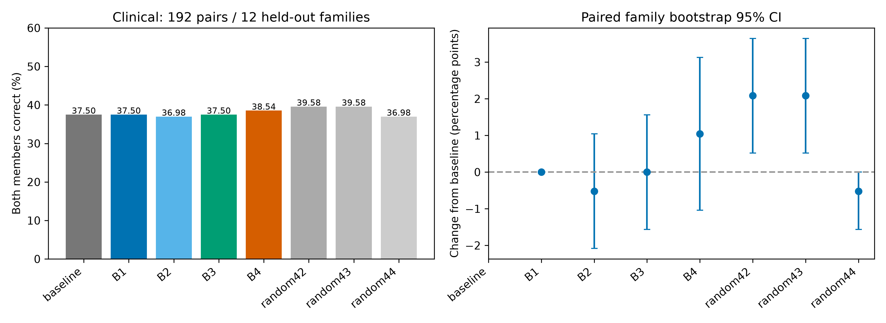
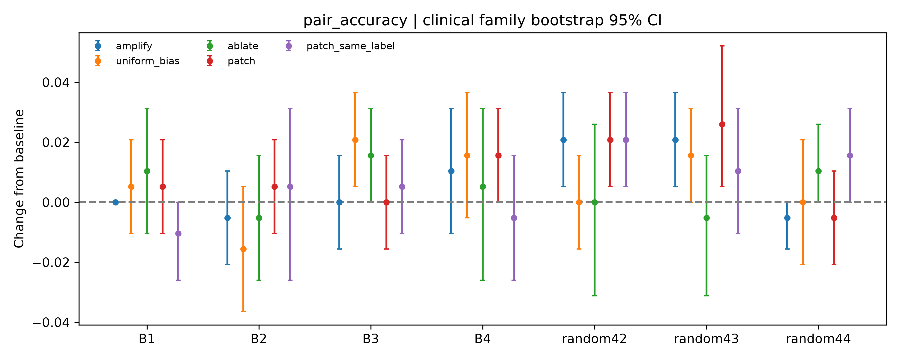
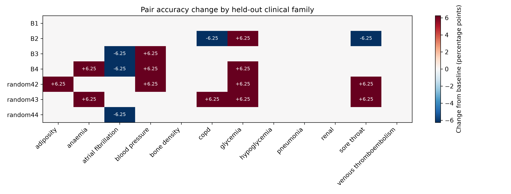

# CARE 模块二：B1–B4 四卡实测结果

**本轮实验已完成。没有发现 B3/B4 在未见临床规则家族上，带来优于随机投影或直接注意力分数偏置的可靠决策改善。** B4 的点估计略有改善，但区间包含零；成对替换也没有显示稳定的适用性特异作用。

结果全部来自服务器真实 Qwen3-4B-Base 前向计算。临床规则来自原 O1，病例均为模拟病例；O2 使用虚构规则。本轮未重复 PR #2 的 O2 统计复核。

## 临床主要结果

测试 384 例、192 对、12 个完整留出的规则家族。成对准确率要求一对中适用和不适用两例均答对。

| 方法 | 病例准确率 | 成对准确率 | 成对变化；95% CI |
|---|---:|---:|---:|
| 无干预 | 61.72% | 37.50%（72/192） | 参考 |
| B1 原始键 PCA | 61.46% | 37.50%（72/192） | 0.00 pp [0.00, 0.00] |
| B2 官方 SEKA 子空间，归一化扰动 | 61.20% | 36.98%（71/192） | −0.52 pp [−2.08, +1.04] |
| B3 适用性成对位移子空间 | 61.20% | 37.50%（72/192） | 0.00 pp [−1.56, +1.56] |
| B4 适用性对照子空间 | 62.24% | 38.54%（74/192） | +1.04 pp [−1.04, +3.13] |
| 随机投影，seed 42 | 62.76% | 39.58%（76/192） | +2.08 pp [+0.52, +3.65] |
| 随机投影，seed 43 | 62.50% | 39.58%（76/192） | +2.08 pp [+0.52, +3.65] |
| 随机投影，seed 44 | 61.46% | 36.98%（71/192） | −0.52 pp [−1.56, 0.00] |

区间为 10,000 次规则家族级配对 bootstrap，条件于已拟合的三个外层折。零宽经验区间不等于总体效应已被证明为零。三个随机种子分别报告，没有按测试结果挑选随机种子。

B4 比 B2 高 1.56 pp，95% CI [−0.52, +3.65]；比随机 seed 42/43 低 1.04 pp，95% CI [−3.13, +1.04]。查看主结果后增加的 11 项次要成对比较，采用家族级符号翻转与 Holm 校正，校正后 P 值均为 1。不能把这里的小幅差异作为子空间优越性的证据。

## 注意力分数偏置与子组

同层、同四个 GQA 查询头、同目标 token、同因果位置的均匀分数偏置，按所选键编辑的分数变化 RMS 匹配扰动。它沿用键方法的开发集参数，没有独立调到自身最佳。

| 对应子空间 | 键编辑成对准确率 | 匹配的分数偏置 |
|---|---:|---:|
| B1 | 37.50% | 38.02% |
| B2 | 36.98% | 35.94% |
| B3 | 37.50% | 39.58% |
| B4 | 38.54% | 39.06% |

B3/B4 没有显示优于这项简单对照。完整变化区间见主分析 JSON 和成对比较 CSV。

- 原 153 例稳定闭卷分歧子组：无干预准确率 39.87%，B3 为 39.22%，B4 为 40.52%。
- 两例都符合筛选条件的 25 对：无干预、B3、B4 的成对准确率均为 20%。
- 原 176 例稳定闭卷一致子组：无干预 84.66%，B3 为 84.09%，B4 为 85.23%。这些变化没有提供可靠的改善证据。

## 因果干预结果

已运行子空间移除、适用性相反患者的成对键替换，以及同标签患者的替换对照。替换只作用于所选投影分量；B2 是加权算子，其移除/替换不能解释为正交子空间的完全删除/替换。

B4 的相反适用性替换与同标签替换，在原正确答案概率优势上的差为 **+0.002688**，95% CI **[−0.000718, +0.006011]**。向供体正确答案方向的概率优势变化为 **+0.000514**，95% CI **[−0.001950, +0.002844]**。两者均未显示稳定效应。

同标签供体中，只有 **120/384 例（31.25%，覆盖全部 12 个家族）**的数值变化幅度能与原成对变化匹配到 ±15%。在该子集中，B4 替换与对照的差为 +0.002297，95% CI [−0.003061, +0.007534]。因此不能把未匹配替换差异直接解释为适用性机制。

B3 子空间移除后的成对准确率为 39.06%，没有出现“去掉适用性方向就稳定损害决策”的预期模式。随机投影的某些替换同样产生变化，支持谨慎解释这些小幅干预效果。

## 误差分析

B4 改变 7 例答案：**纠正 4 例、损害 2 例、另 1 例仍答错**。

- 纠正：blood_pressure-home_target-03-app、anaemia-anaemia_moderate-04-non、hypoglycemia-hypo_one-07-non、glycemia-fpg-01-non。
- 损害：hypoglycemia-hypo_one-06-non、atrial_fibrillation-af_one-00-non。
- glycemia-a1c-00-non 不再选择被高亮的不适用分支，但仍未选对答案。因此误用率降低不能自动等同于正确决策增加。
- 相邻的两个 hypoglycemia 样例一个被纠正、一个被损害；效果没有呈现稳定的跨病例改进。

逐例语义答案、家族指标和概率优势变化均已保存；图中全部家族保持完整，不筛选有利家族。

## O2 与非零强度补充对照

原 O2 的主方案只依据开发集选择参数，B1–B4 和三个随机投影均选择了 **零强度**。测试集 24 例、12 对的成对准确率均为 0%，病例准确率为 50%。这表示当前开发集选择策略没有找到有利的非零编辑；不能把零编辑表当作所有非零干预都无效的证明。

为区分这两件事，另做探索性的非零强度补充：从已保存的开发结果中选择最佳正强度，再进行 **360 次真实模型前向**（24 次基线、336 次干预）。没有用测试标签选参数，原主结果保留。

补充结果中，B2 为 1/12 对正确（8.33%）；B1、B3、B4、三个随机投影及匹配分数偏置均为 0/12。样本小，且该补充是在查看原主结果后设计，只能作为探索性结果。O2 所有组共享同一虚构语法，不能称为未见规则家族泛化。

## 实验设置与实际资源

- 模型固定为 Qwen/Qwen3-4B-Base，revision 906bfd4b4dc7f14ee4320094d8b41684abff8539；全部权重 SHA256 与原记录一致。
- 官方 SEKA 固定在 aab9cfed80dc012fb9e83f8bdefb8675c33f40e7，源码未修改。
- 四个固定层/KV 头：2/0、20/5、9/0、35/0；B1/B3/B4/随机投影秩为 1/4/16；B2 保留官方 90% 谱规则产生的秩。
- 相对键扰动强度为 0、0.01、0.05、0.1；每折 76 个候选算子，均由训练数据构建，只用开发集选头、秩和强度。
- 临床沿用原三个外层折：每折 6 个训练家族、2 个开发家族、4 个测试家族。各方法使用同样的训练样本和开发目标。
- B1 为原始动作键均值的中心化 PCA；B3 为成对适用性位移的非中心化 PCA；B4 用同规则、同标签、数值幅度匹配的背景位移构造正则化广义特征空间。
- B2 使用官方 (Ppos + 0.25 Pneg)/2，显式匹配相对键扰动。它是官方子空间的受控比较，并非原 O1 跨最后 10 层的原生 SEKA 重跑。
- 目标是 QK 归一化后、RoPE 前的动作片段键；不编辑候选选项。主要编辑不接收测试适用性标签；供体标签只用于单独报告的机制分析。
- GPU 0 跑 O2，GPU 1/2/3 跑三个临床折，全部为 A100 80 GB。O2 用时 170.26 秒；临床三折为 540.34、526.75、524.43 秒，最长约 **9 分钟**。
- 正式阶段最大 allocated 显存 **7.60 GiB**，最大 reserved **9.64 GiB**。独立 FP32 小规模诊断峰值 15.83 GiB。
- 主实验记录 **80,568 条**，包括零强度复用的真实基线输出；这不是 80,568 个独立病例，也不是相同数量的独立模型前向。另有 360 条非零强度补充记录。
- 主推断代码提交为 **9a56022dad02cf82b0a6475f80550c78afad4183**。后续提交增加补充对照、分析和打包。

## 验证与保存内容

11 项服务器测试通过。原 O2 张量的 18 个跨训练/开发/测试组样例重新提取后，最大差异为 0；新临床基线的完整候选概率与归档 O1 基线完全一致。

FP32 键编辑与非均匀分数偏置诊断的最大输出差异为 1.13e-6（O2）、1.34e-6（临床），低于 1e-4。BF16 差异单独保留，不宣称两条低精度路径完全等价。所有原始 RoPE buffer 精度在正式 BF16 计算前恢复。

完成后的压缩预测日志在服务器重新计算了 O2 和临床指标，均与原自动分析完全一致，见 verification.json。

completed_20261017 中包含：

- 四个主任务的压缩逐例开发/测试记录、投影算子、选择参数、分组和运行元数据。
- clinical_analysis、o2/analysis、final_analysis 中的指标、误差表及 PNG/SVG/PDF 图。
- o2_nonzero 中的补充选择和逐例结果。
- ARTIFACT_MANIFEST.json：随仓库保存文件的 SHA256。
- RAW_SNAPSHOT_MANIFEST.json：服务器完整原始文件的 SHA256。

未压缩的大型训练键张量和官方 builder 张量保存在服务器及完整归档中；仓库保存压缩逐例记录与所有投影算子，支持直接复算统计量。完整归档 CARE_module2_full_results_20261017.tar.gz 为 128,231,201 字节，SHA256：
cce01cd680ea046754ca9fea9755d3154ba3c140c58844e04f5a3459de49f544。

服务器：/home/gcx/care_module2_followup_20261017。正式原始输出：results/module2_followup/parallel_v3。原始输入和旧 O2 统计复核没有被重跑覆盖。

## 复现

所有模型和分析计算在服务器环境进行。压缩日志可由分析脚本直接读取。

    source /home/gcx/gcx261014/bin/activate
    cd /home/gcx/care_module2_followup_20261017
    python -m pytest -q tests/test_module2_followup.py
    python scripts/analyze_module2_followup.py --run exports/completed_20261017/clinical_fold0 exports/completed_20261017/clinical_fold1 exports/completed_20261017/clinical_fold2 --output exports/reproduce_check/clinical
    python scripts/analyze_module2_followup.py --run exports/completed_20261017/o2 --output exports/reproduce_check/o2
    python scripts/summarize_module2_followup.py --run-root results/module2_followup/parallel_v3

若从仓库复算，将上面的 exports/completed_20261017 换为本目录的 completed_20261017，并设置可写的输出目录。模型重跑需固定的本地权重和未修改的 external/SEKA；推断设置及模型文件摘要在各任务的 run_fingerprint.json。重新启动 GPU 前需按项目要求再次汇报资源；完成归档无需重启实验。

## 结论适用范围

本轮支持“B3/B4 的可解码方向尚未转化为可靠、特异的决策改善”这一有限结论，不支持宣称 CARE 模块二已证明有效。随机投影独立选择头和秩，并非逐项完全匹配的随机方向；分数偏置没有独立调参；供体分析使用额外标签。全部比较是探索性的单模型、小样本研究，不能外推为临床效果。

GPU 实验和补充对照均已结束；未创建持续监控。PR #3 提交真实结果供审阅，不自动合并。
