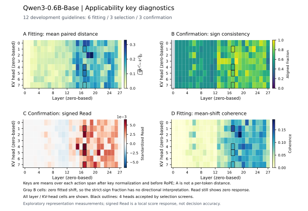
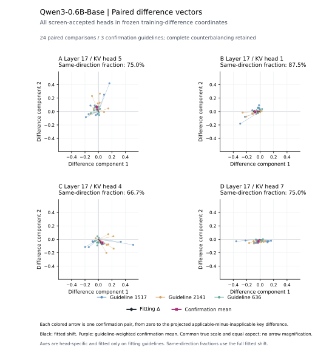
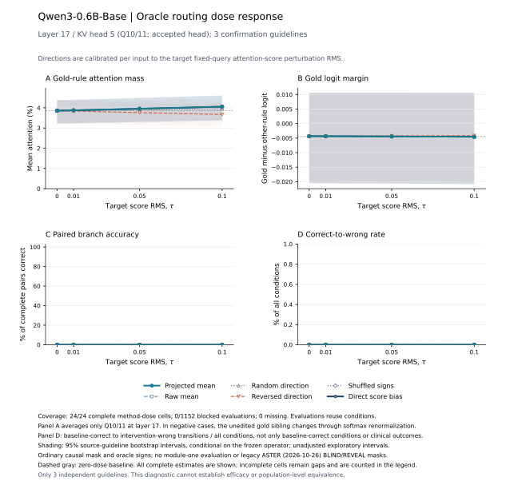

# 模块二：离线适用性子空间与规则路由预实验

**独立实验，2026-10-27。** 本目录实现用户提出的离线模块二，并把表示学习、在线路由及因果验证分开。方法说明见[科学修订稿](../../docs/ASTER/module2-applicability.zh.md)，预先规定的比较与限制见[协议](PROTOCOL.zh.md)。实际结果以运行目录的 `status.json`、原始测量、预测和统计为准；本说明不把未完成步骤写成模型发现。

## 已有真实结果

表示阶段已完成 144 次真实预训练模型前向。冻结筛选保留零起始的 `(17,5)`、`(17,1)`、`(17,4)`、`(17,7)` 四个层—KV 头。确认分区的平均读取仍为正，配对同向比例为 66.7%–87.5%。基线受约束 A/B 选择为 24/48 正确、0/24 对全对。它们是表示与读取诊断，不能当作干预收益。

因果对照已完整完成：[运行状态](results/qwen3_0_6b_cpu/causal/status.json)记录 24 个唯一提示、6 种方法、4 个固定剂量，共 1,152 条有效观测，24 个方法—剂量组合均完整，零阻断、零缺失。全部方法与剂量的受约束 A/B 准确率仍为 24/48（50%），目标配对全对率仍为 0/24；纠正与由对变错均为零。这是本轮未观察到分支选择改善，不是有效性、安全性或总体等效结论。

在预设最高剂量 0.1，投影均值使正确规则的局部注意力从 3.8560% 升至 4.0569%，但正确编号的分数间隔反而略降 0.0002087。直接分数偏置的局部注意力为 4.0517%，同样没有答案改善。详细全部剂量、配对差、分层及限制见[结果报告](RESULTS.zh.md)。最终统计只使用完整运行；两次因效率问题中断的尝试单独保留。







[绝对键的配对投影](figures/paired_shifts.svg)用于补充描述。所有图均附 PDF、SVG、PNG 与来源摘要。差分向量还保存为可直接复绘的 CSV。

原始表示数组为 62,659,618 字节，另以下载文件交付；Git 中保留[原始数组摘要](results/qwen3_0_6b_cpu/extraction_manifest.json)、完整元数据、拟合算子与逐头统计。复算因果结果时，将原始数组放回表示目录的 `extraction.npz`，或按下方命令重新提取。文件的 SHA-256 必须与摘要一致。

## 研究问题

同一规则由不适用变为适用时，处置键中是否存在跨指南稳定的变化方向？最后决策位置能否读取该方向？在固定患者适用性信号后，这个方向是否比直接注意力分数偏置更有用？

这三个问题依次需要表示、读取和真实干预证据。差分范数大、二维图分开、读取均值为正，分别不足以回答最后一个问题。新模块二不读取模块一结果；模块一的病例分布只负责在线选择规则和系数。

## 本轮数据

源数据是 MEGA-CDP 官方 `train_val/decision_trees.jsonl`，固定修订版本 `8f058c88ce1ed43693785b435ad0ff99907a2890`。未读取官方测试文件。构造代码要求同一父节点下两个叶兄弟、不同处置、路径深度不超过 4、路径谓词不重复。独立树执行器与规则合取执行器验证正负标签。

| 项目 | 数量与含义 |
|---|---|
| 源开发树 | 1,834 棵：英文 931，中文 903 |
| 满足本轮构造条件的英文指南 | 586 个 |
| 固定种子抽取的原指南 | 12 个；每个取一棵树和一个末端兄弟组 |
| 三元组 | 96 个；每组两个目标方向 × 两种处置映射 × 两种规则顺序 |
| 全部提示实例 | 288 个，去重后 144 个；不是 288 个独立病例 |
| 拟合／选择／确认 | 6／3／3 个原指南，所有变体严格同组 |

患者是复述树谓词并给出 YES／NO／UNKNOWN 的合成事实。指南是官方树衍生的局部兄弟子指南。它们用于逻辑与机制的可行性筛查，不等同于自然病历、完整指南、临床一致性或正式基准验证。问题只要求输出 A／B 规则编号，所以本轮指标是分支选择，尚不评价处置执行或自由文本路径。

动作置换保持条件与规则编号不变，因此本轮正确规则编号不随动作交换。它改变的是条件—处置关联，可能产生不符合原适应证的处置映射。这部分属于反事实规则遵循对照，不能当作新的临床推荐。配对和置换有助于检验动作先验，却不能保证模型只编码适用性。原始映射与置换映射需要分层报告，不能用混合平均结果替代原指南上的验证。

数据与审计保存在 [triplets.jsonl](results/data/triplets.jsonl) 和 [audit.json](results/data/audit.json)。原树文件的 SHA256 为 `490799bd49f23e98fdd3b1387d72ce23be5033c56f0162ed752a4d3da45c0f6b`。本轮三元组的 SHA256 为 `22e9fe7c7bdd287fdf6061f99798105baeca8f9851c45b793e0ecbf0bc293ac3`。

## 模型与算子

本轮显式选择 **Qwen/Qwen3-0.6B-Base**，修订版本 `da87bfb608c14b7cf20ba1ce41287e8de496c0cd`，CPU、单精度、`eager` 注意力。表示提取及因果预填充使用 4 个 PyTorch 线程，因果单词元决策使用 1 个线程。它有 28 层、16 个查询头、8 个 KV 头。不是历史 4B 实验的替代结果。权重和分词器的实际文件摘要写入运行指纹。

表示抽取使用处置片段内词元的均值。目标词元编号、绝对位置和总长度要求在正、负、中性版本完全一致，不截断，不填充。键在 `k_norm` 之后、旋转位置编码之前读取。有效查询按每个目标词元的实际位置旋转，并汇总共享 KV 头的全部查询头。

当前模型使用普通因果掩码。2026-10-27 主线以模块一独立条件视图实现处置盲判；本轮尚未连接该模块一及其最终执行提示。2026-10-26 的 BLIND／REVEAL 隔离掩码仅属于历史／可选消融，若恢复则须重新估计或验证迁移。

本轮预设秩 2，最多保留 4 个合格头。子空间只在拟合指南学习；读取与分离度在选择指南计算。读取的正、负分支均需通过预定符号门槛，还需方向一致性、拟合均值一致性及重采样稳定性。无合格头时输出空集合。冻结选择后再打开确认统计。

因果诊断只比较一个冻结位置：优先第一个合格头；没有合格头时，使用选择分数最高的候选头作为证伪诊断，并明确它未通过接受条件。实际编辑发生在首个答案查询之前的规则缓存键上。原前缀和值向量不变。

### 单目标干预的范围

真实运行器每次只编辑一条规则。对同一提示，增强适用规则和压低不适用兄弟规则是两次独立前向。本轮没有同时执行二者，也没有联合编辑多个头。单目标结果的平均不构成组内联合路由的证据。

正编辑系数不保证注意力分数或质量为正向变化。实际符号取决于查询、规则位置和学习位移。`Read` 是均匀平均分数响应；目标注意力质量依赖注意力加权响应；答案还依赖值向量和后续计算。这三个层面的证据分别报告。

后续需要“不编辑／仅增强／仅抑制／联合执行”的二因素实验。联合条件沿用各单独条件中冻结的每规则系数，报告联合收益及交互，并与直接偏置使用相同目标支持。精确的兄弟质量比公式和必要限定见[方法第 6.2 节](../../docs/ASTER/module2-applicability.zh.md#62-兄弟规则的反向系数不保证联合路由方向)，后续方案见[协议第 7.5 节](PROTOCOL.zh.md#75-后续联合增强与抑制的二因素实验)。

## 运行

本轮精确版本见[运行环境](results/environment.json)，包括 `torch==2.8.0+cpu`、`transformers==4.57.6`、`numpy==2.3.5`、`matplotlib==3.10.8`。数据审计与统计可独立于模型运行。所有命令从仓库根目录执行。

```bash
python scripts/prepare_module2_pairs.py \
  --trees /path/to/MEGA-CDP/train_val/decision_trees.jsonl \
  --output /path/to/new_run/data \
  --max-groups 12 --max-pairs-per-tree 1 --max-trees-per-group 1 --max-depth 4

python scripts/run_module2_preexperiment.py \
  --triplets /path/to/new_run/data/triplets.jsonl \
  --model /path/to/Qwen3-0.6B-Base \
  --model-id Qwen/Qwen3-0.6B-Base \
  --revision da87bfb608c14b7cf20ba1ce41287e8de496c0cd \
  --output /path/to/new_run/representation \
  --dtype float32 --device cpu --threads 4 --max-length 1024 \
  --rank 2 --max-heads 4 --bootstrap 2000 --stability-bootstrap 64

python scripts/run_module2_causal_tail_pilot.py \
  --triplets /path/to/new_run/data/triplets.jsonl \
  --representation-results /path/to/new_run/representation \
  --model /path/to/Qwen3-0.6B-Base \
  --output /path/to/new_run/representation/causal \
  --taus 0 .01 .05 .1 --threads 1

python scripts/plot_module2_preexperiment.py \
  --results /path/to/new_run/representation \
  --output /path/to/new_run/figures

python scripts/summarize_module2_causal_strata.py \
  --causal /path/to/new_run/representation/causal \
  --triplets /path/to/new_run/data/triplets.jsonl \
  --output /path/to/new_run/representation/causal/strata
```

运行输出目录必须独立，不能覆盖历史实验。模型路径、版本或硬件不满足要求时应记录失败；不自动替换模型。大模型后续实验须另建协议和结果目录。

后段执行入口固定预填充为 4 线程，决策使用 `--threads 1`，实际批量大小为 1，仍计算完整词表。固定单层干预不影响更低层的当前查询表示，因此可复用这些计算。逐提示的完整执行与后段执行比较必须逐位一致；来源及检查写入 `execution_optimization.json`。完整参考入口仍为 `run_module2_causal_pilot.py`。本轮中断的慢速尝试单独归档，最终统计只使用一份完整运行。

## 对照与指标

因果比较包括投影均值、原始均值、随机方向、反向方向、固定头下的组符号置乱方向，以及直接分数偏置。逐输入匹配实际固定查询分数变化的均方根，完整报告 `0、0.01、0.05、0.1` 四个预设强度，不在确认集选择最佳强度。

随机方向经分数尺度匹配后不再保证最终键位移范数与主方法相等。单次组符号置乱也不是整个选头流程的零假设分布。该匹配用于比较算子，不等价于部署时只由模块一置信度决定系数。

报告实际目标注意力质量、正确规则分数间隔、观测准确率、配对全对率、由对变错和由错变对。确认数据有 24 个唯一正负提示、48 条指定目标的干预观测、24 个指定目标的配对单元，但只有 **3 个独立原指南**。区间按原指南重采样，条件于已冻结的算子。小样本区间不能支持总体优越性或等效性声明。

## 图的证据范围

- 全层—KV 头热图同时展示配对变化、一致性和带符号的读取，避免将大范数直接解释为可用适用性方向。
- 配对投影图使用拟合差分的固定坐标，展示确认指南的规则片段均值。候选头由选择集预先排序；图形外观不参与选头。
- 因果剂量图必须来自真实预测和注意力记录，与直接分数偏置及方向负对照一起展示。

完整设计中仍需无关事实变化、同适用性事实改写、额外未知表述、完整指南、更多独立指南、秩选择和跨模型复现。当前小型逻辑任务未完成这些验证。

## 历史证据与本轮身份

[2026-10-19 的 Qwen3-4B-Base 诊断](../care_module2_signed_20261019/results/analysis/README.md)已比较有符号均值位移与直接分数偏置，当时未建立学习方向优势。新方案增加开发树平衡最小对、子空间投影、实际查询读取和重新选头，但不能把这些设计改进写成已经成立的性能结论。2026-10-27 的主线已更新为独立模块一、离线子空间与在线键平移；本轮沿用金标适用性，并未验收新版模块一或完整流水线。2026-10-26 的直接对数门控保留为必要基线，学习方向的增量价值仍由对照决定。
