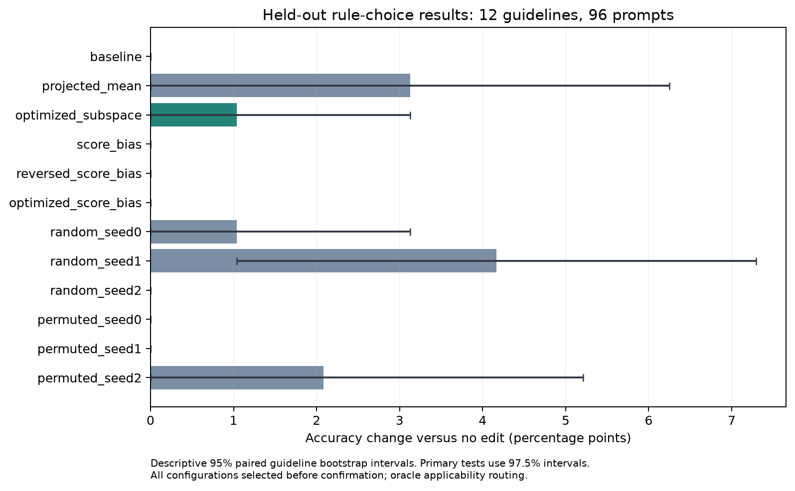

# 规则选择干预：2026-10-29 完整后续实验

**已完成，预定成功标准未达到。** 主要候选优化子空间为 49/96（51.04%），无干预及预选强直接偏置均为 48/96（50%）。增益的指南级配对 97.5% 区间为 [0.00, 4.17] 个百分点，未建立优于随机方向的证据。

使用 Qwen3-0.6B-Base 固定修订、FP32，在 115 服务器 GPU 0/1 完成。原实验的 12 个来源指南全部排除；新数据按来源指南分为 24/12/12。确认集为 12 个指南、96 个唯一正负提示、48 个最小对。原实验与原确认集未修改。

| 方法 | 准确率 | 配对全对率 |
| --- | ---: | ---: |
| 无干预 | 50.00% | 0.00% |
| 原投影均值 | 53.12% | 6.25% |
| 优化子空间 | 51.04% | 2.08% |
| 直接偏置 | 50.00% | 0.00% |
| 反向直接偏置 | 50.00% | 0.00% |
| 优化直接偏置 | 50.00% | 0.00% |
| random_seed0 | 51.04% | 2.08% |
| random_seed1 | 54.17% | 8.33% |
| random_seed2 | 50.00% | 0.00% |
| permuted_seed0 | 50.00% | 0.00% |
| permuted_seed1 | 50.00% | 0.00% |
| permuted_seed2 | 52.08% | 4.17% |

## 文件入口

- [完整中文研究报告](REPORT.zh.txt)
- [全部代码、逐例数据、日志及失败记录的完整压缩包](artifacts/triage_decision_results_20261029.zip)
- [冻结实验协议](PROTOCOL.json)、[实现代码](code/run_stages.py)
- [逐方法确认指标](summaries/heldout_metrics.csv)、[逐指南结果](summaries/heldout_by_guideline.csv)
- [单头/多头与增强/抑制/联合消融](summaries/heldout_ablation_metrics.csv)
- [任务与分词审计](summaries/scoring_audit.csv)、[因果定位汇总](summaries/localization_summary.csv)
- [覆盖与冻结摘要核验](summaries/completion_validation.json)
- [确认前冻结的选择](provenance/frozen_selection.json)、[数据与模型指纹](provenance/prepare_manifest.json)
- [文件与压缩包清单](PUBLICATION_MANIFEST.json)

图中为描述性 95% 指南级配对自助区间；主要两项比较采用协议指定的 97.5% 区间。全部配置在确认之前选定，随机及置乱种子均报告。

## 完成范围与解释

完成拟合/选择基线审计 288 条、反事实定位 14,688 条、训练日志 480 条、选择评估 76,128 条、确认主比较 1,152 条、确认消融 3,456 条。覆盖完整，无重复或缺失单元；冻结文件摘要一致。模型计算约 47.3 分钟，不含下载。

原单词元 A/B 审计在 288 个拟合/选择提示上全部选择 B。带空格答案评分也接近随机水平；这些结果不可视为自然病历或自由处置生成成绩。干预采用适用性真值路由，属于算子上界实验。

新确认集未用于本轮训练或选择，但其他项目对这些指南的历史接触情况尚未确认。本轮不声称假设成立。主要候选仅改对一例；原投影均值和一个随机方向的观察成绩更高。

## 复现

基础源码固定为 6078465acdbe9676678aa1db143d9954e5ed26ed。运行代码要求一个单独的该提交工作副本，通过 --repo 指定；本发布提交包含运行产物，不应被误当作原始基础源码。

在 115 服务器使用 /home/gcx/gcx261014 环境（PyTorch 2.8.0+cu128、Transformers 4.57.6），按 prepare → audit → localize → train → select → confirm → report 执行。示例：

    git worktree add --detach /path/to/base-6078465 6078465acdbe9676678aa1db143d9954e5ed26ed
    bash experiments/module2_decision_followup_20261029/code/run_server.sh /path/to/base-6078465 /path/to/new-run

模型为 Qwen/Qwen3-0.6B-Base，修订 da87bfb608c14b7cf20ba1ce41287e8de496c0cd。模型权重不入库；文件 SHA-256、原始开发数据修订与校验值见指纹。所有运行输出必须使用新目录。

压缩包保留 run02/ 的全部代码执行结果、日志、数据划分、训练系数与冻结配置，code/ 的实际运行代码，以及 run01_preparation_failure/ 的首次准备失败记录。首次失败是源码尚未展开导致导入失败；未覆盖该记录。原实验冻结算子的副本位于包内 original_reference/。

部分脚本保留原服务器路径，以记录实际执行；一般复现入口为上面的参数化脚本。最终整理脚本只读取完成的结果，没有再次运行模型。
