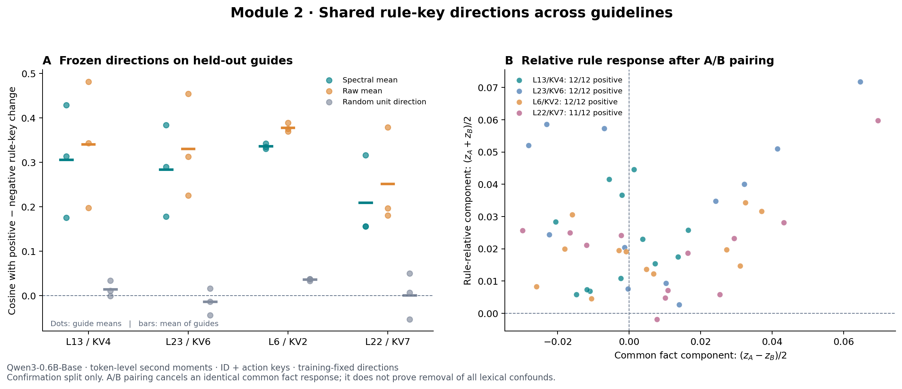
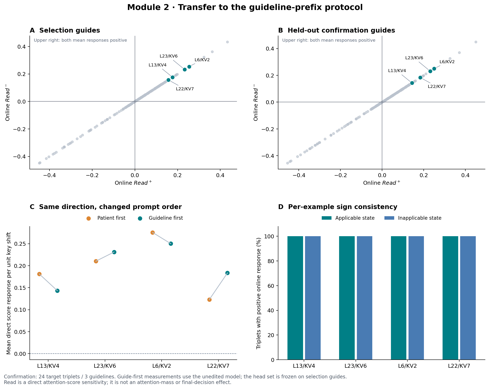
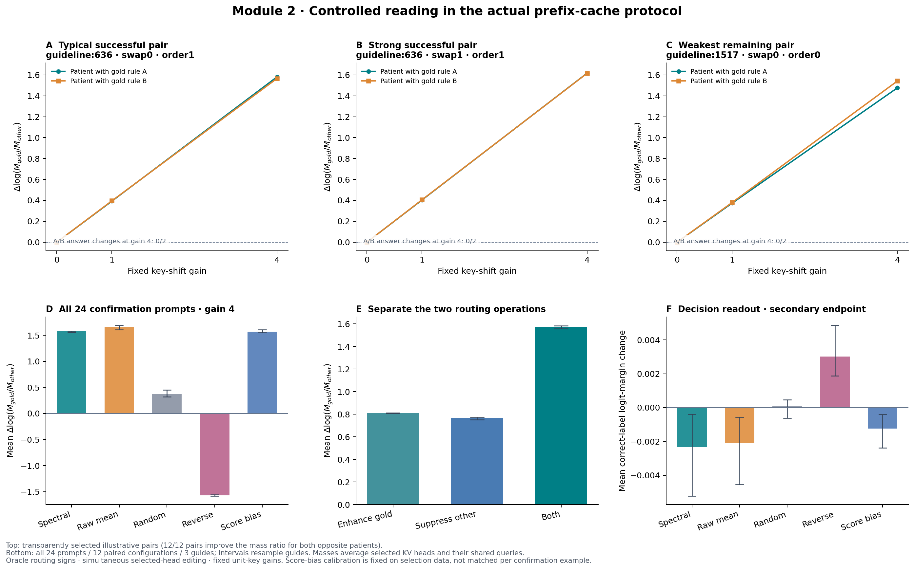

# 模块二机制实验：共享方向、跨顺序迁移与可控规则读取

**实验日期：2026-10-28。** 实验方法冻结于 main `e3d2bfb8da539c15527d607c155af73e44788eeb`；发布时另整合 main `bc34f439649a9a74344195a101a84893ea06abcd` 的公式排版与正式实验章节，未据此改动已运行配置。本轮的核心贡献是把模块二的验证收敛为一条能够实测的机制链：金标最小对给出共享有向变化，真实在线查询筛选可读方向，模块三按外部规则符号实施双向控制。

[固定协议](PROTOCOL.zh.md) · [复现入口](README.md) · [读出修正记录](READOUT_CORRECTION.zh.md) · [示范样本完整清单](results_analysis/CASE_STUDIES.zh.md)

## 1. 本轮能支持的结论

**在本次固定模型、开发指南与提示协议内，存在可跨规则复用的有向键变化；经过实际指南前置查询筛选后，它可以稳定增强适用规则、抑制不适用兄弟规则。** 在最高预设增益 4 下，全部 12 个确认配置中的两名相反患者都提高了正确/兄弟规则的注意力质量比。谱投影联合编辑的几何平均质量比增益约为 **4.83 倍**。

这一结论不要求模块二自己判断患者，也不要求每次读取变化都传到答案。实验中判断符号来自金标 oracle，模块二只提供一个共享专家及其固定方向。当前结果适合支撑“离线方向学习与在线目标选择解耦”的设计，不单独建立完整系统、临床处置或跨模型性能结论。

本轮也没有建立谱投影相对原始均值方向或直接分数偏置的增量优势。原始均值的方向一致性略强，直接偏置得到近似的读取效果；它们应当作为主文中的有效简单对照保留。

## 2. 为什么这样做实验

### 从模块职责确定终点

模块二学习的是如何改变规则读取，而适用分支由模块一判断。因此，将最终选择题准确率作为模块二唯一验收标准，会把分支判定、规则读取和下游输出等多个环节混在一起。本轮按三个连续问题组织证据：

1. **表示是否共享：**在没有参与方向拟合的规则上，正负差分是否继续与训练方向同向？
2. **方向是否可读：**换到实际“指南→患者→问题”的顺序后，正、负状态是否都对单位方向具有正的查询响应？
3. **编辑是否生效：**真正编辑指南缓存并执行整个患者后缀后，正确/兄弟规则的相对注意力是否按预期改变？

最终 A/B 编号选择作为附加终点。它与实际处置生成不是同一个任务。原始与修正后的读出均保留，修正原因见第 7 节。

### 与上一轮的区别

| 项目 | PR #38 的早期预实验 | 本轮当前正文实现 |
|---|---|---|
| 差分矩阵 | 先取片段均值再求外积 | 每个 token 求差分外积，再 pair 内平均 |
| 方向幅度 | 自然投影均值 | 投影均值归一化，幅度交给固定增益 |
| 目标位置 | 默认处置 | 编号与处置的并集 |
| 在线顺序 | 患者前置 | 指南前置 |
| 缓存干预时点 | 最后决策 token 之前 | 指南预填充之后、完整患者/问题后缀之前 |
| 执行范围 | 一个头、一个目标 | 冻结的四个头，正负双规则联合及单独消融 |
| 核心展示 | 层头统计、单目标剂量实验 | 共享方向、跨顺序读取、两名相反患者的成对控制 |

因此，本轮重新采集模型表示和干预数据。它不是将旧结果换一个标题。

## 3. 数据、模型与已完成运行

使用固定 `Qwen/Qwen3-0.6B-Base`，revision `da87bfb608c14b7cf20ba1ce41287e8de496c0cd`，CPU float32、eager、eval、batch 1，PyTorch 2.8.0+cpu / Transformers 4.57.6。

数据来自 MEGA-CDP 官方 train_val 决策树。复用前轮公开的 12 个指南及 6/3/3 的拟合、选择、确认划分，共 96 个目标三元组。每个指南包含两条互斥终末兄弟规则，交叉平衡两种处置映射、两种规则顺序和两个目标方向。患者是树条件的显式 YES/NO/UNKNOWN 模拟事实；不是原始自然病历。

| 单位 | 拟合 | 选择 | 确认 |
|---|---:|---:|---:|
| 原始指南 | 6 | 3 | 3 |
| 目标三元组 | 48 | 24 | 24 |
| 指南/映射/顺序配置 | 24 | 12 | 12 |

全部三状态词元对齐通过，**96/96** 三元组保留；无截断。按物理提示去重后，离线提取 **144 次**，在线正负状态提取 **48 次**，表示阶段耗时 **705.21 秒**。在线指南键对后续正负患者的变化为零，符合因果顺序；离线第一层配对键差分也为零。输入、源码、模型和实际位置均有审计记录。

因果阶段覆盖全部 **24 个物理患者提示 × 9 个配置 = 216 条记录**，无缺失，耗时 **501.58 秒**。固定秩 2、最多四头、归一化方向、统一增益 1 和 4，选择只使用 `select`。所有指南均为开发资料；这批确认指南在前轮已公开，不称作新盲测集。三份确认指南才是独立来源，24 个三元组或 12 个配置不能当成同等数量的独立指南。

这里的 24 个物理提示对应 **3 指南 × 2 基础患者状态 × 2 处置映射 × 2 规则顺序**，只包含 6 个基础患者状态。正文中的 12 个成对配置包含受控文本变体，不是 12 组互不相关的自然患者。

## 4. 共享方向与在线迁移

头编号从零开始。表中全部计数来自确认集，方向与头已在此前冻结。

| 层/KV 头 | 差分同向 | 差分平均余弦 | Read+ | Read− | A/B 相对分量为正 |
|---|---:|---:|---:|---:|---:|
| 13/4 | 21/24 | 0.3063 | 0.143258 | 0.143265 | 12/12 |
| 23/6 | 22/24 | 0.2842 | 0.231002 | 0.231071 | 12/12 |
| 6/2 | 19/24 | 0.3364 | 0.250201 | 0.250211 | 12/12 |
| 22/7 | 16/24 | 0.2098 | 0.183545 | 0.183491 | 11/12 |

不仅平均 Read 为正：对未编辑模型的末端回答前缀查询，四个头、每头两个共享查询头、全部确认目标编号和处置 token 的单位方向得分响应均为正。它支持外部符号的双向控制，不外推为后续所有生成位置都满足同样性质。正负 Read 很接近，则说明不能把这些读数解释为模型已经沿该方向自主完成了患者分类。



### 比普通 PCA 更合适的规则相对对照

同一指南配置下，两条目标规则的差分分别为

```math
d_A=k_A(P_A)-k_A(P_B),\qquad d_B=k_B(P_B)-k_B(P_A).
```

计算规则相对分量 $(d_A+d_B)/2$ 与共同事实分量 $(d_A-d_B)/2$。若某个患者事实词引起两条规则完全相同的表示漂移，它会在前一项抵消。四个头的规则相对分量在 12 个确认配置中分别有 12、12、12、11 个为正，较单纯展示两个 PCA 点云更直接地支持规则相对变化。

共同事实分量仍然存在，不同规则位置或内容对同一事实词的响应也可能不同，因此此对照不证明语义混杂已经全部消除。等义改写和非决定性事实扰动本轮未运行。



### 谱估计的实际作用

秩 2 投影保留了四个头约 **94.9%、85.2%、91.2%、88.3%** 的训练均值差分范数。它确实保留了均值方向的大部分分量，但原始均值在确认集上的平均余弦为 **0.3410、0.3312、0.3785、0.2520**，四头都高于谱投影。当前证据支持共享有向位移，不要求“谱投影一定优于直接均值”。

补充分析枚举六个训练指南的全部 64 种成组符号配置。正确标签方向在四头的确认平均投影排序为 7/64、6/64、5/64、2/64，未在所有头上唯一最优。该分析只检验有向均值敏感性：符号翻转不改变每个差分外积，不是谱结构的零分布或显著性检验。

## 5. 实际双向编辑结果

定义每个物理患者的读取变化为

```math
\delta R=\log\frac{M_{\mathrm{gold}}'}{M_{\mathrm{sibling}}'}-
\log\frac{M_{\mathrm{gold}}}{M_{\mathrm{sibling}}}.
```

其中 $M$ 为四个选中 KV 头及其共享查询头上、目标编号与处置位置的平均注意力质量。$\exp(\mathrm{Mean}\,\delta R)$ 是患者级质量比增益的几何平均，不是两组汇总质量之比。

| 方法 | 编辑模式 | 增益 | 平均 δR | 质量比几何平均倍数 | 两患者均改善的配置 |
|---|---|---:|---:|---:|---:|
| 谱投影均值 | 联合 | 1 | 0.393642 | 1.482 | 12/12 |
| 谱投影均值 | 联合 | 4 | 1.574251 | 4.827 | 12/12 |
| 谱投影均值 | 仅增强正确规则 | 4 | 0.810064 | 2.248 | 12/12 |
| 谱投影均值 | 仅抑制兄弟规则 | 4 | 0.764807 | 2.149 | 12/12 |
| 原始均值 | 联合 | 4 | 1.655685 | 5.237 | 12/12 |
| 固定随机方向 | 联合 | 4 | 0.370663 | 1.449 | 12/12 |
| 反向方向 | 联合 | 4 | -1.574346 | 0.207 | 0/12 |
| 直接分数偏置 | 联合 | 4 × 开发集尺度 | 1.571463 | 4.814 | 12/12 |

谱方向在增益 4 时的平均正确规则局部注意力质量从 **0.4695% 增至 1.0447%**，兄弟规则降至 **0.2195%**。正确规则质量大于兄弟规则的患者数，从基线 **12/24** 变为增益 1 时 **16/24**、增益 4 时 **24/24**。这些都是选中头的局部量，不是全模型总注意力或最终答案概率。

增强与抑制各自有效，联合效果更强；反向编辑使变化整体反向。随机方向这一次固定抽样也产生了较弱的正效果，不能将它描述为完全无效，更不能把一次随机向量当成所有随机方向的统计零分布。原始均值和直接偏置仍是有力基线。

单位向量对照匹配的是每个目标键的欧氏改变量。直接偏置的每头幅度由选择集最终查询的单位位移得分 RMS 校准后固定，作用全部患者后缀查询；不是对确认患者逐例严格匹配实际 QK 扰动。因此不把约 4.827 与 4.814 的细小差距解释为谱方法优越。

## 6. 示范样本与图的用法

示范以相同指南、处置映射和规则顺序下的**两名相反患者**为一组。按每组两患者中较小的 δR 排序，分别展示接近成功中位数的典型案例、其余成功组中效应最强的案例、其余全部配置中效应最弱的边界案例。规则在看见因果结果之前固定，不用答案正确率选样。

本轮全部 12 个配置在增益 4 下都满足双向读取成功。因而这里的“边界案例”是本批中较弱的成功例，不是人为补出一个失败例。完整排名与原始来源见 [case_selection_census.csv](results_analysis/case_selection_census.csv)；具体条件与答案观察见[案例说明](results_analysis/CASE_STUDIES.zh.md)。

| 示范 | 指南／处置映射／顺序 | 两患者中较小的 δR | 成对平均答案间隔变化 | 答案翻转 |
|---|---|---:|---:|---:|
| 典型 | 636／swap0／order1 | 1.566235 | +0.005031 | 0/2 |
| 最强 | 636／swap1／order1 | 1.616251 | +0.001067 | 0/2 |
| 最弱 | 1517／swap0／order0 | 1.476048 | −0.003980 | 0/2 |

前两个案例只改变处置映射，决定性患者事实保持相同；它们展示不同处置文本下的读取控制。第三例同时展示了局部质量比改善与答案间隔变差可以共存。三个案例均不用于估计额外的总体准确率收益。



正文推荐保留上述三图：共享方向、在线双状态读取、成对编辑示范。层—头热图或 PCA 可作为定位补充；它们不是最直接回答本轮三个问题的主证据。

图中区间来自 5,000 次按指南聚类的重采样，条件于已经固定的方向与头集。只有 3 个确认指南，因此将区间作为本批测量的描述，不据此声称总体显著性或广泛泛化。

## 7. 附加答案读出及数值验证

原始执行之后补查了答案标签在真实前缀末端的词元边界，并依据可核验的 tokenizer 行为将附加评分改为稳定的单 token ` A`／` B`。修正复跑的配置和主要读取终点保持冻结；全部原始记录保留，详见[修正记录](READOUT_CORRECTION.zh.md)。最终答案统计由独立修正目录生成，不混用原始裸字母读数。

修正后的九个配置，答案正确数均为 **12/24（50.0%）**，两名相反患者均答对的配置数均为 **1/12（8.3%）**。因此本轮没有观察到编号选择准确率或成对准确率收益；局部规则读取变得可控，不等于当前模型已经将这种变化转化为答案。也不能将这个小样本结果解释为所有模型、数据或增益下都不存在答案收益。

所有配置相对基线的答案翻转数均为 0。谱方向联合增益 4 时，正确编号的平均 logit 间隔从 **0.018132448** 变为 **0.015797377**，变化 **−0.002335072**，仅 **10/24** 个提示的间隔改善；反向方向的平均间隔反而上升。该附加结果进一步限制了本轮结论的范围，保留在第三图与全部患者汇总中。

边界修正完整重放 **216 条记录**，耗时 **348.12 秒**，通过 **48 项真实前缀边界检查**。每条重放的旧候选 logits 和逐查询头、逐目标 token 注意力，与原记录的最大绝对误差都为 **0**，旧候选排序完全相同。这是对同一批条件的读出校正与数值复核，不增加独立实验样本。

原因果运行完成 **24 个逐提示零编辑检查**和 **72 个非零代表配置的完整/后段执行比较**，后者和零编辑后段比较的 logits、attention、query 最大误差均为 **0**。另对 24 个基线提示比较完整提示与指南/后缀分段执行，全词表最大误差为 **3.37 × 10⁻⁵**，低于预设 `1e-4`。每个患者执行后逐张量检查共享指南缓存未变，运行源码与保存的指纹一致。

新代码的统计、对齐、划分隔离、前缀、多头编辑、恢复和因果配置共 **31 项检查**通过；最小对构造的 **10 项检查**通过；边界修正的 **7 项检查**通过。这是三个实际执行的检查批次。随机微型模型和解析数组仅用于这些代码测试，研究图表来自固定预训练权重。完整数值摘要与记录哈希见 [RUN_VALIDATION.json](RUN_VALIDATION.json)。

## 8. 建议如何写论文结论

可以将本轮结论写为：

> 在按指南隔离的开发预实验中，金标最小对产生的有向键变化可在未参与拟合的规则间复用。结合实际指南前置查询的双状态筛选后，固定正负键平移能在成对患者上增强适用规则、抑制不适用兄弟规则。该机制证据支持将患者适用性判断与规则读取执行分离。

应将“谱投影的必要性”“超越简单偏置”“真实模块一输出下的增量收益”“最终处置生成与跨模型泛化”列为独立问题。本轮不需要同时解决它们，便可以为共享方向和可控读取提供范围清楚的证据。

## 9. 产物与复算

- [原始输入与固定划分](inputs/triplets.jsonl)、[协议](PROTOCOL.zh.md)、[分析规则锁定](analysis_plan_lock.json)。
- [模型/源码指纹](results/fingerprint.json)、[冻结头与偏置尺度](results/selection.json)、[方向算子](results/operators.npz)。
- [全头方向统计](results_analysis/head_direction_metrics.csv)、[逐查询诊断](results_analysis/online_query_diagnostics.csv)、[64 种符号对照](results_analysis/group_sign_controls.csv)。
- [原始因果记录](results/causal/records.jsonl.gz)、[修正答案读出的完整因果记录](results/causal_boundary_readout/records.jsonl.gz)、[数值与归档核验](RUN_VALIDATION.json)。两份压缩文件均可解压为同目录的 `records.jsonl`；分析命令使用修正版本。
- [发布文件哈希清单](ARTIFACTS.json)，包含可重算输入、算子、汇总、三图和对应源码的摘要。
- [测量数组的下载与摘要](RAW_MEASUREMENTS.json)：97,530,179 bytes，SHA256 `24e89a7bc35f92850b02c512ad9e04b7704a8d3b7178f14cb91fd1aed601f8b3`。它保存重算拟合和统计所需的充分统计量，不是完整序列 token 激活转储。

复现命令见本目录 README。保留所有方法、所有固定增益、全部确认样本和两版答案读出；精选示范不替代全体结果。
