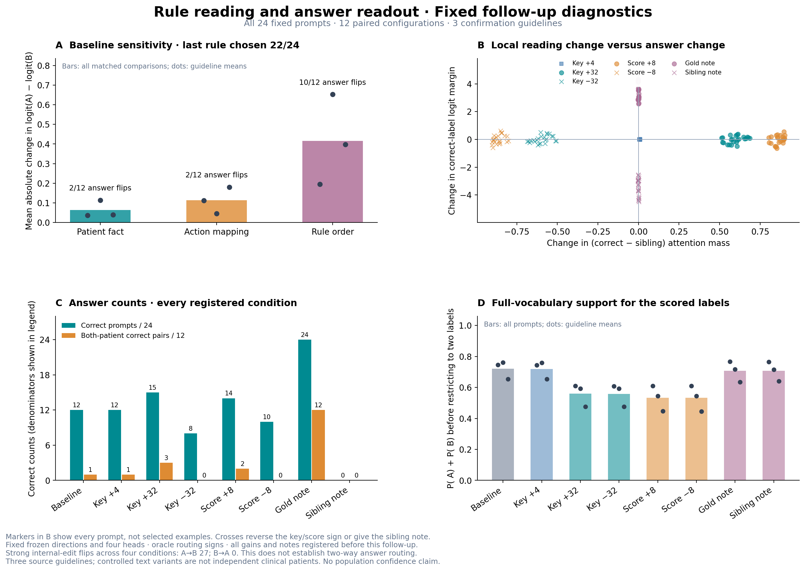

# 规则读取与答案读出的固定诊断

本页由完整真实记录自动生成，不进行拟合、重新选头、增益搜索或案例筛选。所有八配置均包含原固定的 24 个提示、12 个配对配置；独立来源为 3 个指南、6 个基础患者状态。

## 基线的规则顺序与患者敏感性

基线在 22/24 个提示中选择最后出现的规则；选中头聚合注意力在 24/24 个提示中偏向最后规则。相反患者中 10/12 对给出相同答案。

| 唯一改变的因素 | 答案翻转／匹配比较 | 平均绝对 A−B 间隔变化 |
|---|---:|---:|
| 患者决定事实 | 2/12 | 0.063498 |
| 处置映射 | 2/12 | 0.113231 |
| 规则顺序 | 10/12 | 0.415103 |

全部匹配比较、患者相对信号与共同标签偏好、三个指南的分别结果均在配套 CSV 中。比较使用完整配对，不按答案效果选例。

## 固定配置的全部结果

| 配置 | 答对／24 | 配对全对／12 | 翻转 | 纠正 | 伤害 | 平均正确标签间隔变化 | 平均正确规则质量 | 平均候选概率覆盖 | 选最后规则／24 |
|---|---:|---:|---:|---:|---:|---:|---:|---:|---:|
| baseline | 12 | 1 | 0 | 0 | 0 | +0.000000 | 0.004695 | 0.720315 | 22 |
| projected4 | 12 | 1 | 0 | 0 | 0 | -0.002335 | 0.010447 | 0.718929 | 22 |
| projected32 | 15 | 3 | 5 | 4 | 1 | -0.010680 | 0.596959 | 0.559301 | 21 |
| projected_minus32 | 8 | 0 | 6 | 1 | 5 | +0.007927 | 0.000038 | 0.558848 | 20 |
| score_plus8 | 14 | 2 | 8 | 5 | 3 | -0.028195 | 0.863337 | 0.533713 | 18 |
| score_minus8 | 10 | 0 | 8 | 3 | 5 | +0.010932 | 0.000000 | 0.533342 | 18 |
| note_gold | 24 | 12 | 12 | 12 | 0 | +3.387182 | 0.003080 | 0.706527 | 12 |
| note_sibling | 0 | 0 | 12 | 0 | 12 | -3.430740 | 0.003055 | 0.706533 | 12 |

纠正与伤害均相对于同一提示的 baseline。相反符号与 sibling note 是诊断性反向控制，不是拟采用的决策策略。

## 离散翻转方向与标签分层

下表保留全部患者，A/B 的金标分母各为 12。斜线分别列出两个标签或两个翻转方向的计数，不表示比例。

| 配置 | 预测 A／B | 翻转 A→B／B→A | 金标 A／B 答对 | 金标 A／B 被纠正 | 金标 A／B 被伤害 |
|---|---:|---:|---:|---:|---:|
| baseline | 14／10 | 0／0 | 7／5 | 0／0 | 0／0 |
| projected4 | 14／10 | 0／0 | 7／5 | 0／0 | 0／0 |
| projected32 | 9／15 | 5／0 | 6／9 | 0／4 | 1／0 |
| projected_minus32 | 8／16 | 6／0 | 2／6 | 0／1 | 5／0 |
| score_plus8 | 6／18 | 8／0 | 4／10 | 0／5 | 3／0 |
| score_minus8 | 6／18 | 8／0 | 2／8 | 0／3 | 5／0 |
| note_gold | 12／12 | 7／5 | 12／12 | 5／7 | 0／0 |
| note_sibling | 12／12 | 7／5 | 0／0 | 0／0 | 7／5 |

四种强内部编辑条件合计出现 27 次 A→B、0 次 B→A 翻转（这是同批患者在四条件中的事件计数，不增加独立样本）。正负编辑的正确数不同，并不能因此解释为两个答案方向都已稳定受控；必须同时检查预测标签偏移、纠正和伤害的金标分层。各指南同样的完整计数位于 `condition_summary.csv`。

## 固定读取阈值的达成率

目标质量门槛只用于描述干预是否达到较强读取；不是调整参数或筛样的依据。表中“被增强目标”在反向条件下是兄弟规则。baseline 的被增强目标列按正确规则计算，仅作为参照。

| 配置 | 正确规则质量≥0.8／24 | 正确规则质量≥0.9／24 | 被增强目标质量≥0.8／24 | 被增强目标质量≥0.9／24 |
|---|---:|---:|---:|---:|
| baseline | 0 | 0 | 0 | 0 |
| projected4 | 0 | 0 | 0 | 0 |
| projected32 | 0 | 0 | 0 | 0 |
| projected_minus32 | 0 | 0 | 0 | 0 |
| score_plus8 | 23 | 4 | 23 | 4 |
| score_minus8 | 0 | 0 | 23 | 4 |
| note_gold | 0 | 0 | 0 | 0 |
| note_sibling | 0 | 0 | 0 | 0 |

逐头的全部质量与阈值达成率见 `head_summary.csv`，包含每个条件、每个指南及全部提示；没有把四头平均超过阈值当成所有头都超过阈值。

## 正反控制与剂量差的匹配比较

| 比较（前者减后者） | 答案不同／24 | 正确标签间隔差 | 正确规则质量差 |
|---|---:|---:|---:|
| projected32 − projected_minus32 | 7 | -0.018607 | +0.596922 |
| score_plus8 − score_minus8 | 4 | -0.039127 | +0.863336 |
| note_gold − note_sibling | 24 | +6.817922 | +0.000025 |
| projected32 − projected4 | 5 | -0.008345 | +0.586512 |

## 读出范围

基线完整词表的最高概率词元在 24/24 个提示中属于规范 A/B 候选，平均候选概率覆盖为 0.7203。因此原候选评分并非只读取两个几乎没有模型支持的词元。

显式正确注释得到 24/24 正确、12/12 配对全对；相反注释得到 0/24 正确。这是已提供规则 ID 后的输出通路控制，不检验模型能否自动判断患者条件。

强内部编辑下，完整词表的最高概率词元可能移出规范 A/B。逐条件、逐指南的最高词元计数见 `top_token_summary.csv`，逐提示文本保存在 `patient_effects.csv`；不能把受限二选一正确率当成自由生成成绩，也不能仅凭首词元改变判定完整回答错误。

候选概率覆盖是完整词表上的 P( A)+P( B)，没有先限制答案集合；二选一正确率不代表自由生成正确率。注意力质量取固定四个 KV 头及其共享查询头的目标编号与处置均值，不代表全模型注意力。

所有统计是这批已使用开发指南上的后续诊断。没有新增独立指南、没有总体显著性推断，也不能将极强增益或 oracle 文本提示解释为正式端到端方法收益。
