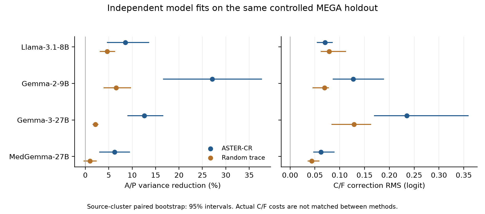

# 两项剩余实验结果（2026-11-11）

## A：同等证据代价的特征比较

本实验复用真实 Qwen3-8B 缓存，仅重新拟合必要的线性修正，不运行模型前向。所有特征使用相同训练配对、线性岭回归与 C/F 逐对约束规则，在开发集选择使实际 C/F 修正 RMS 接近 0.20 logit 的预算；冻结后评价既有留出。该留出此前已被项目分析，本实验属于回顾性、探索性分析。

| 特征 | 开发 C/F 修正 RMS | 开发 VR | 留出 C/F 修正 RMS | 留出 VR |
|---|---:|---:|---:|---:|
| 正交痕迹 N16 | 0.2000 | 4.5224% | 0.2510 | 4.0826% |
| 原始干扰子空间 U16 | 0.2000 | 1.9960% | 0.2134 | 2.2731% |
| 证据子空间 S16 | 0.2000 | 1.8963% | 0.1445 | 2.2916% |
| 50 个随机 16 维子空间均值 | 0.2000 | 1.3924% | 0.1906 | 1.6767% |

开发集 N 相对随机方向均值的 VR 差为 +3.1300 个百分点，来源簇自助重采样 95% 区间为 [1.3475, 5.9526]。留出差值为 +2.4059 个百分点，区间 [0.4606, 4.7802]；但留出的实际证据改动不同，差值不能证明同代价优势。留出 N 相对 S 的 VR 差区间包含零。N/U/S 未观察到新增 C/F 方向退化；个别随机配置有 1 对新增退化，详见逐配置结果。N 的留出动态路径正确数为 767/806，原模型为 768/806，未获得路径收益。

**结论：开发集支持正交痕迹在匹配证据改动下具有更高的干扰抑制效果；冻结配置尚未在既有留出上建立严格同代价、可重复的优势。** 完整固定预算曲线、50 随机分布、逐例数据和置信区间见 [matched_cost_feature_analysis](matched_cost_feature_analysis/)。

## B：四模型 MEGA 核心复现

受控留出评价已完成，官方 7,458 条路径推理运行中。四模型分别使用自己的注意力头、标准化、S/N、线性参数和截距；同维随机控制新拟合，未复用 Qwen 参数。各模型沿用 alpha=0.01、tau=0.1 的同一 A/P+C/F 协议。

| 模型 | ASTER VR | 随机 VR | ASTER C/F 修正 RMS | ASTER ER | 自然节点：原模型 / 仅截距 / ASTER / 随机 |
|---|---:|---:|---:|---:|---:|
| Llama-3.1-8B | 8.57% | 4.67% | 0.0706 | 100.15% | 354 / 359 / 359 / 360 / 372 |
| Gemma-2-9B | 27.08% | 6.55% | 0.1273 | 99.90% | 366 / 366 / 366 / 366 / 372 |
| Gemma-3-27B | 12.58% | 2.13% | 0.2352 | 99.60% | 369 / 367 / 368 / 367 / 372 |
| MedGemma-27B | 6.26% | 1.01% | 0.0622 | 100.14% | 369 / 369 / 369 / 368 / 372 |

四个模型均观察到正的干扰方差降低，说明分数修复机制可在多个模型中实现。各方法的实际证据改动未匹配，这些数字不证明跨模型同代价优势；自然节点正确数也没有一致提升。官方动态路径及其来源簇配对 95% 区间将在全部推理完成后补入。

### 已完成的官方路径结果：Llama-3.1-8B

7,458 条路径与 45,627 个参考路径节点全部完成，418 个来源簇，推理失败 0。

| 方法 | 正确路径 | 相对原模型 | 来源簇配对 95% CI（百分点） |
|---|---:|---:|---:|
| 原模型 | 5689/7458 | +0 | [0.000, 0.000] |
| 仅截距 | 5898/7458 | +209 | [1.652, 3.854] |
| ASTER-CR | 5879/7458 | +190 | [1.457, 3.621] |
| 随机痕迹 | 5867/7458 | +178 | [1.302, 3.442] |

ASTER-CR 相对原模型增加 190 条正确路径，区间高于零；但仅截距增加 209 条，比 ASTER-CR 多 19 条。因此，本模型的最终任务收益未显示超出仅截距校准，不能独立归因于正交痕迹修复。其余三模型官方结果仍待完成。

## 执行范围

已完成实验直接复用；本轮不运行 285 项矩阵，不扩展 NLI4CT 或 MedPIC，不生成模拟结果，不按测试结果调整预算或方法配置。
