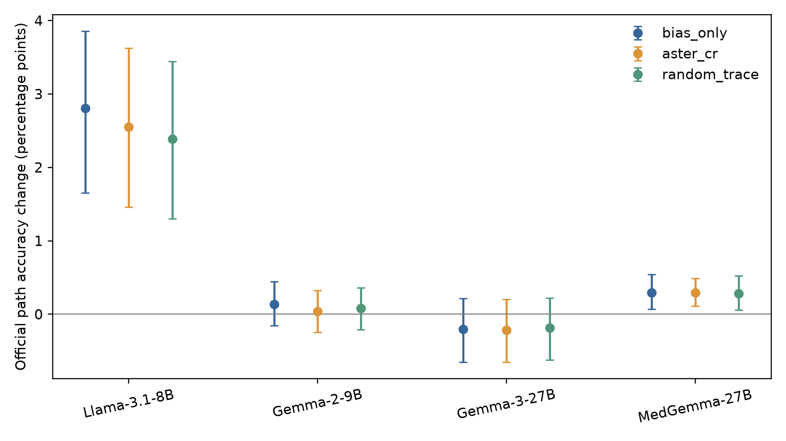

# 两项剩余实验结果（2026-11-11）

## A：同等证据代价的特征比较

本实验复用真实 Qwen3-8B 缓存，仅重新拟合必要的线性修正，不运行模型前向。所有特征使用相同训练配对、线性岭回归与 C/F 逐对约束规则，在开发集选择使实际 C/F 修正 RMS 接近 0.20 logit 的预算；冻结后评价既有留出。该留出此前已被项目分析，本实验属于回顾性、探索性分析。

| 特征 | 开发 C/F 修正 RMS | 开发 VR | 留出 C/F 修正 RMS | 留出 VR |
|---|---:|---:|---:|---:|
| 正交痕迹 N16 | 0.2000 | 4.5224% | 0.2510 | 4.0826% |
| 原始干扰子空间 U16 | 0.2000 | 1.9960% | 0.2134 | 2.2731% |
| 证据子空间 S16 | 0.2000 | 1.8963% | 0.1445 | 2.2916% |
| 50 个随机 16 维子空间均值 | 0.2000 | 1.3924% | 0.1906 | 1.6767% |

开发集 N 相对随机方向均值的 VR 差为 +3.1300 个百分点，来源簇自助重采样 95% 区间为 [1.3475, 5.9526]。留出差值为 +2.4059 个百分点，区间 [0.4606, 4.7802]；但留出的实际证据改动不同，差值不能证明同代价优势。留出 N 相对 S 的 VR 差区间包含零。N/U/S 未观察到新增 C/F 方向退化；个别随机配置有 1 对新增退化，详见逐配置结果。N 的留出动态路径正确数为 767/806，原模型为 768/806，未获得路径收益。

**结论：开发集支持正交痕迹在匹配证据改动下具有更高的干扰抑制效果；冻结配置尚未在既有留出上建立严格同代价、可重复的优势。** 完整固定预算曲线、50 随机分布、逐例数据和置信区间见 [matched_cost_feature_analysis](matched_cost_feature_analysis/)。

## B：四模型 MEGA 核心复现

四模型各自使用独立提取的特征、选头、标准化、S/N、线性参数和截距。复用已完成的本模型状态，补拟合同维随机控制，未复用 Qwen 参数。所有模型采用相同来源划分及 A/P+C/F 约束协议，按各模型分别报告 logit。

| 模型 | 受约束预测 R² | ASTER VR（95%来源簇区间） | 随机 VR | ASTER C/F RMS | ASTER ER |
|---|---:|---:|---:|---:|---:|
| Llama-3.1-8B | 0.0848 | 8.57% [4.59, 13.63] | 4.67% | 0.0706 | 100.15% |
| Gemma-2-9B | 0.2610 | 27.08% [16.60, 37.71] | 6.55% | 0.1273 | 99.90% |
| Gemma-3-27B | 0.1252 | 12.58% [8.99, 16.67] | 2.13% | 0.2352 | 99.60% |
| MedGemma-27B | 0.0477 | 6.26% [2.95, 9.56] | 1.01% | 0.0622 | 100.14% |

四模型在受控留出均有正的干扰方差降低，来源簇区间均高于零；平均证据响应保留接近 100%。这支持核心分数修复机制在四个模型复现。各模型实际证据代价未统一，不能据此证明同代价优势。各模型自然节点正确数也没有一致提高。

### 官方动态路径（4/4 模型已完成）

每个已完成模型均评估相同 7,458 条路径、45,627 个金标路径节点和 418 个来源簇。区间按来源簇对模型内逐例准确率差进行配对自助重采样。

| 模型 | 原模型 | 仅截距 | ASTER-CR | 随机痕迹 | ASTER 相对原模型差值与 95% CI（百分点） |
|---|---:|---:|---:|---:|---:|
| Llama-3.1-8B | 5689 | 5898 | 5879 | 5867 | +2.548 [+1.457, +3.621] |
| Gemma-2-9B | 6890 | 6900 | 6893 | 6896 | +0.040 [-0.246, +0.324] |
| Gemma-3-27B | 7094 | 7079 | 7078 | 7080 | -0.215 [-0.651, +0.202] |
| MedGemma-27B | 7103 | 7125 | 7125 | 7124 | +0.295 [+0.109, +0.490] |

相对原模型，ASTER 的路径差值区间高于零：Llama-3.1-8B、MedGemma-27B；低于零：无。路径正确数超过仅截距的模型：无。Llama 的 ASTER 比原模型多 190 条正确路径，但比仅截距少 19 条，因此该模型的路径收益不能独立归因于痕迹修复。

**核心分数修复机制可在四个模型复现；四模型官方路径正确数均未超过仅截距（分别少 19、7、1 条和持平）。** MedGemma 与仅截距同为 7,125 条正确，不代表逐例预测完全相同。Gemma-3 的 −16 条阴性结果完整保留。

[跨模型完整报告](cross_model_mega/REPORT.zh.md)包含全部方法的置信区间、逐例数据和来源级统计。

## 执行范围

已完成实验直接复用；本轮不运行 285 项矩阵，不扩展 NLI4CT 或 MedPIC，不生成模拟结果，不按测试结果调整预算或方法配置。
