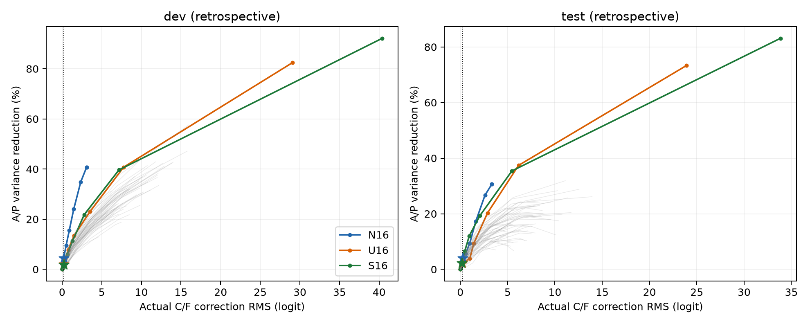
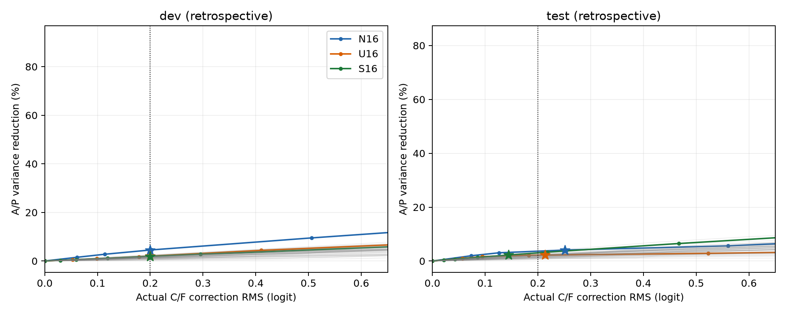
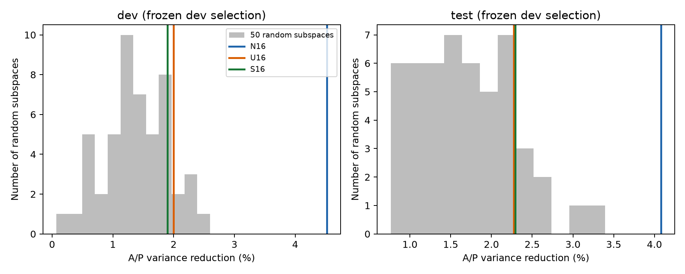

# 同证据代价特征比较（回顾性、探索性）

在开发集相同的实际证据修正 RMS=0.20 下，正交痕迹 N 的干扰方差降低率为 4.52%，高于未正交 U 的 2.00%、证据 S 的 1.90% 和 50 个随机子空间的均值 1.39%。N 相对三个对照的来源簇配对差值区间均为正。该结果支持当前开发来源上的选择性优势。

冻结后，测试集 N 的 VR 为 4.08%，但其实际证据代价升至 0.2510，U/S/随机均值为 0.2134/0.1445/0.1906。测试代价未能保持匹配，因此本次结果尚不能证明跨来源、严格同代价的稳定修复优势。N 的动态路径正确数也未增加：测试原模型 768/806，N 为 767/806，与仅截距校准相同。

全部使用真实 Qwen3-8B 缓存，新增模型前向为 0，不占 GPU。复用原 fit/dev/test 的 80/20/40 来源；A/P 配对数为 4,887/1,198/2,293，C/F 为 135/60/40。当前测试集此前已被项目分析，不作为全新确认性测试。

## 统一协议

N、U、S 和 50 个随机子空间均为 16 维，使用同一组 51 个已选注意力头及 fit 标准化。随机种子固定为 11–60，与已有随机方向定义相同。标准化、S/N/U 和无约束岭回归均复用已完成分析的设置，未重新选头或运行五折。

线性修正目标为 fit A/P 上的 Σ(原分数差+修正差)²+0.01‖w‖²，无配对回归截距；每个 fit C/F 对满足 |修正差|≤τ×fit A/P 原分数差 RMS。岭系数统一固定为已有值 0.01。仅在 dev C/F 上选择 τ，使实际 RMS 接近 0.20，不根据 dev A/P 优劣选择预算。先计算固定预算网格 [0,0.025,0.05,0.1,0.25,0.5,1,2,4]，再在第一个跨过 0.20 的相邻区间求根。全部 53 类特征均达到目标，最大绝对误差小于 0.000001 logit。

每个模型的节点截距只用 fit 原始自然节点标签校准，对配对分数差和 VR/ER 没有影响。每个特征的修正参数和预算冻结后直接应用于 test；test 不缩放、不重新选预算。

## 结果

| 特征 | 划分 | 实际证据 RMS | A/P VR | 证据 ER | 无约束预测 R² | 方向退化 | 超 fit 预算 | 动态路径正确数 |
|---|---|---:|---:|---:|---:|---:|---:|---:|
| raw | dev | 0.0000 | 0.00% | 100.00% | — | 0 | — | 384/420 |
| bias_only | dev | 0.0000 | 0.00% | 100.00% | — | 0 | — | 385/420 |
| N16 | dev | 0.2000 | 4.52% | 99.82% | 0.4069 | 0 | 11 | 384/420 |
| U16 | dev | 0.2000 | 2.00% | 100.00% | 0.8246 | 0 | 9 | 384/420 |
| S16 | dev | 0.2000 | 1.90% | 99.67% | 0.9206 | 0 | 1 | 385/420 |
| 50 随机均值 | dev | 0.2000 | 1.39% | 99.83% | 0.3118 | 0.00 | 8.22 | 384.50/420 |
| raw | test | 0.0000 | 0.00% | 100.00% | — | 0 | — | 768/806 |
| bias_only | test | 0.0000 | 0.00% | 100.00% | — | 0 | — | 767/806 |
| N16 | test | 0.2510 | 4.08% | 99.60% | 0.3059 | 0 | 11 | 767/806 |
| U16 | test | 0.2134 | 2.27% | 100.14% | 0.7333 | 0 | 6 | 767/806 |
| S16 | test | 0.1445 | 2.29% | 99.94% | 0.8311 | 0 | 0 | 767/806 |
| 50 随机均值 | test | 0.1906 | 1.68% | 99.85% | 0.1728 | 0.02 | 4.68 | 767.00/806 |

无约束预测 R² 衡量特征对 A/P 分数变化的预测能力，区别于受约束修复残差 R²。二者分别保存为 summary.csv 的 probe_R2 与 repair_R2，预测 RMSE、修复后 A/P 分数差 RMS 均单独保留。原始模型与仅截距方法没有训练预测探针，表中以横线表示。

N、U、S 在 dev/test 的 C/F 方向退化数均为 0；个别随机配置出现 1 个退化对。逐对 fit 约束不能保证留出对都满足同一上限。N 在 dev 的 60 个 C/F 对中有 11 个超 fit 预算，在 test 的 40 个对中有 11 个超限。ER 是汇总证据响应比例；不能把接近 100% 的 ER 解释为每个证据对都没有改动。

## 来源簇配对区间

| 比较 | 划分 | VR 差值（百分点） | 95% CI（百分点） |
|---|---|---:|---:|
| N16-minus-U16 | dev | 2.53 | [1.76, 3.46] |
| N16-minus-S16 | dev | 2.63 | [0.72, 5.54] |
| N16-minus-random_mean | dev | 3.13 | [1.35, 5.95] |
| N16-minus-U16 | test | 1.81 | [0.86, 2.88] |
| N16-minus-S16 | test | 1.79 | [-0.44, 4.38] |
| N16-minus-random_mean | test | 2.41 | [0.46, 4.78] |

每个来源整簇重采样 2,000 次，同一次重采样在方法间配对。随机对照使用 50 个独立修正模型的统计量均值，而非集成预测；区间描述来源不确定性，条件是这 50 个随机种子固定。随机种子的离散分布另存 random_distribution.csv。

开发集 N 的 VR 高于 50/50 个随机对照，随机 VR 范围为 0.07%–2.60%。测试 N 也高于 50/50 个随机对照，但测试证据代价不同，不能把这一排序直接称为同代价复现。测试 N 相对 S 的 VR 差区间跨 0。

## 完整代价曲线

完整固定预算网格、无约束端点、开发集所选点以及它们直接应用于测试集后的对应点均保存在 pareto.csv。星号表示唯一 dev 所选配置。下图同时保留全部范围及低代价区域；测试曲线只作描述，不从中选择新配置。

逐例配对结果：pair_predictions.csv.gz；逐节点：node_predictions.csv.gz；动态路径：path_predictions.csv.gz；来源统计：source_metrics.csv、path_source_metrics.csv；来源区间：bootstrap_intervals.csv、paired_comparisons.csv、path_bootstrap.csv；参数：fitted_models.npz；冻结配置：selection_freeze.json；运行设置与时间：config.json。
