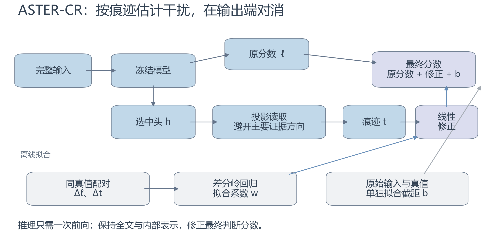
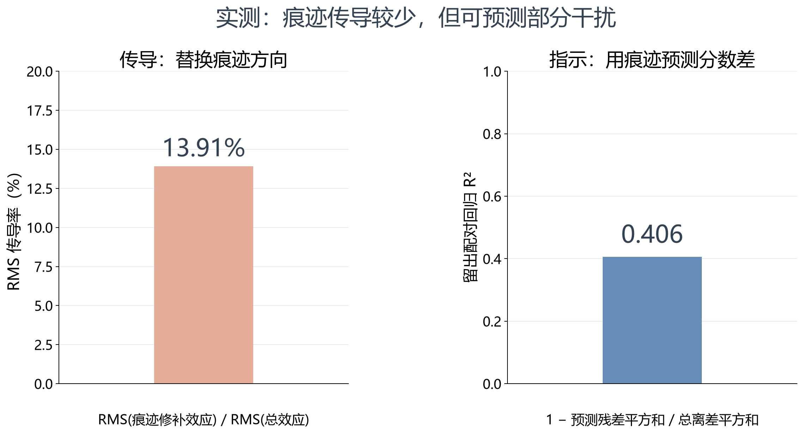
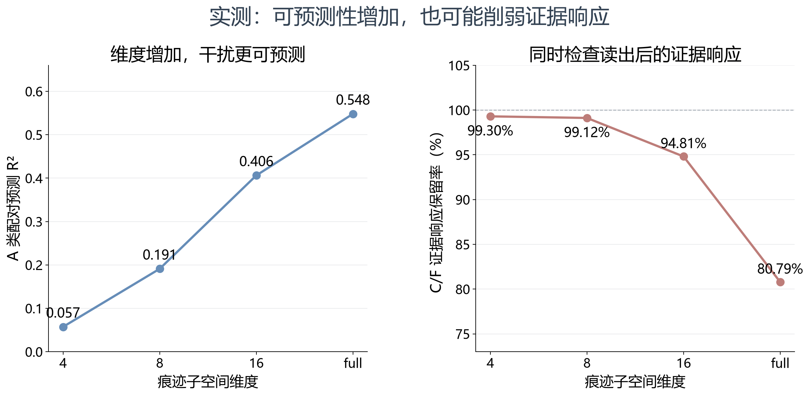
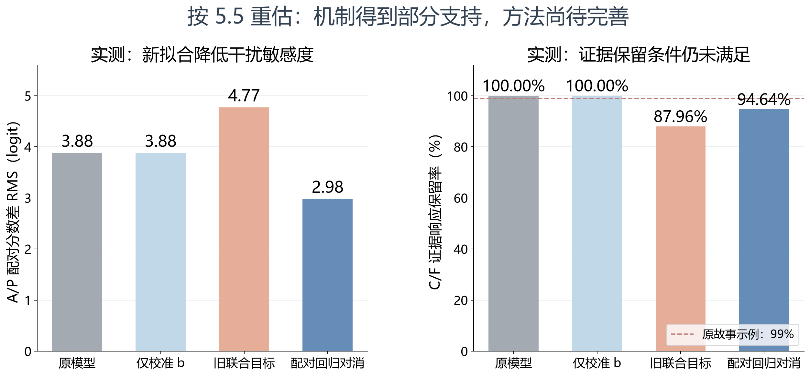
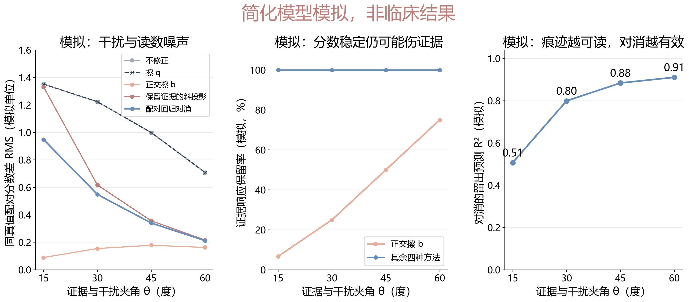

# 向老师汇报：对消，而非擦除

**题目**：*Cancel, Don't Erase: Repairing Unfaithful Guideline Judgments with the Nuisance Trace*

**当前结论**：固定 16 维配对差分方法后，真实开发集的 A/P 干扰方差下降 41.01%，C/F 证据响应保留 94.64%。方法已经改善分数不变性，当前需要同时优化干扰降低和证据保留。

**汇报目标**：说明问题为何成立、方法为何合理，以及目前哪些实验证据支持它。主数据为 MEGA-CDP，主模型为 Qwen3-8B；下面的真实结果来自 repair-v2 缓存与 CPU 差分回归。

**开场一句话**：模型判断当前条件时，会被后续处置带偏。我们保留指南全文，用内部痕迹预测这种偏移，再从判断分数里减去。

## 1. 研究问题：后续处置为什么会影响前置判断？（1 分钟）

指南规定，当前节点的真值由条件和患者事实决定。例如，判断“eGFR 是否达到阈值”，应依据阈值和化验值。后续推荐什么处置，不应反过来改变这个判断。

我们保持病例和条件不变，只改写分支后的处置文字，观察“是—否”分数差。变化很小也有意义：原判断接近 0 时，小幅偏移就会改变走向。历史结果中，处置改写的分数变化中位数约 0.5 logit，决定性事实约 50 logit [R5]。当前主实验采用 repair-v2；旧数字用于说明量级，新结果按统一数据另报。

**可直接讲**：“我们关心模型是否按规则使用信息。准确率接近满分时，仍可能存在后续处置对当前判断的干扰。”

## 2. 为什么保留全文？为什么不直接擦除？（1.5 分钟）

删去处置能去掉一部分干扰，却也可能删掉条件引用的定义。例如，“无该方案禁忌证”需要到方案说明里理解禁忌证。历史完整路径中，直接遮挡处置使正确路径从 404/432 降到 394/432 [R2]。

表示擦除面对另一个问题：证据和干扰可能共用方向。若要求编辑完全保留证据，同时消去与证据夹角为 θ 的干扰方向，线性编辑的最坏方向增益至少为 1/sinθ。夹角越小，编辑越容易放大某些误差。

这个下界刻画潜在的误差放大，实际任务影响由后面的实验检验。原方法还需要选择参考零点，并把修改写回后续层。因此，我们考虑只读取内部痕迹，在最终分数上修正。

**可直接讲**：“保留全文是为了保住条件定义。改最终分数，是为了避免把一个小修正写回模型、继续向后传播。”

## 3. 方法做什么：先估计分数变化，再对消（1.5 分钟）

**图 1 讲法**：“模型照常读完整指南。我们从少数头中提取痕迹，估计这次处置改写会把判断推偏多少，然后只修正最后一个分数。”

方法分三步：

1. 从拟合集配对定位相关注意力头，并估计主要证据方向。
2. 在干扰变化中去掉这些证据方向，得到痕迹坐标 t。
3. 用真值不变配对拟合 w，再单独校准 b：

$$
\ell'(x)=\ell(x)+w^\top t(x)+b.
$$

w 的目标是让同真值配对的分数差减小：

$$
\min_w\sum(\Delta\ell+w^\top\Delta t)^2+\lambda\|w\|^2.
$$

w 不通过标签分类损失训练；b 在固定 w 后，才用原始输入标签拟合。同真值不等于同证据：F0 改了事实数值，虽不跨阈值，也可能合理改变置信分数。将 F0 纳入拟合是额外追求同侧分数稳定的选择，要单列检查其对证据响应的影响。r=16 时，校正层有 17 个系数，子空间基与标准化参数另需存储。推理只用一次前向。

**本轮固定设置**：r=16、λ=0.01；w 使用 fit 的 A/P/F0 共 4,969 对；b 只用 fit 中 761 个自然原始节点。开发集分别报告自然原始节点 199 个和全部 full 节点 398 个，后者包含构造节点。

## 4. 真实机制结果：痕迹传导有限，但包含预测信息（2 分钟）

**图 2 讲法**：“这两个面板使用同一批 1,194 个处置改写配对、同一套 16 维痕迹。编辑这些方向产生的分数变化有限，但读这些方向可以预测一部分干扰。”

| repair-v2 开发集 A，1,194 对、20 来源 | 结果 |
|---|---:|
| 51 个选中头整体替换：总体绝对幅度比 | 82.71% |
| 随机 51 头整体替换：总体绝对幅度比 | 16.12% |
| 16 维痕迹修补：RMS 幅度比 | 13.91% |
| 直接用痕迹修补效应预测总分数差：R² | 0.0786 |
| 用痕迹坐标回归总分数差：R² | 0.4063 |

总体绝对幅度比是 Σ|修补效应|/Σ|总效应|；RMS 比衡量变化幅度，R² 衡量分数差的可预测程度。以上修补为单向 left→right，不沿用历史双向口径。

**支持的结论**：痕迹中的预测信息值得用于分数修正；它的价值不能只由擦除后的分数变化判断。

**图 3 讲法**：“这组结果里，增加痕迹维度提高了预测能力，也削弱了证据响应。我们要同时优化两侧。”

| 现有 A/P 诊断回归的维度 | A 类 R² | C/F 证据响应保留率 |
|---|---:|---:|
| 4 | 0.0574 | 99.30% |
| 8 | 0.1911 | 99.12% |
| 16 | 0.4063 | 94.81% |
| full | 0.5481 | 80.79% |

这些是已有 A/P 诊断回归的开发结果，正式 A/P/F0 方法采用下节事先固定的 r=16 设置。

现有只用 A/P 拟合的 rank=16 诊断回归，使 A/P 分数差 RMS 从 3.8794 降到 2.9870 logit，R² 为 0.4069。与此同时，C/F 真值方向的证据响应保留 94.81%，其中 C 为 90.97%、F 为 96.35%。

这套回归在 C/F 上的修正差 RMS 为 3.0869 logit，相当于 A/P 干扰 RMS 的 79.57%。因此，真实结果支持“可预测干扰”，也明确指出证据保留需要改进。原来的 1.03% 属于隐层修补；这里直接评价最终读出的分数变化。

## 5. 真实方法结果：固定差分回归，对比校准与旧 CR（1 分钟）

此处使用本轮固定的 A/P/F0 配对回归与单独校准 b，结果由 CPU 缓存计算。旧 CR 指交叉熵、配对与保真约束联合训练的版本；新版本把 w 的配对回归与 b 的校准分开。

| 真实开发结果 | A/P 分数差 RMS | A/P 方差下降 | C/F 证据响应保留 | 自然节点正确数 |
|---|---:|---:|---:|---:|
| 原模型 | 3.8794 | 0.00% | 100.00% | 195/199 |
| 单参数校准 | 3.8794 | 0.00% | 100.00% | 196/199 |
| 新配对差分 A/P/F0 | 2.9796 | 41.01% | 94.64% | 195/199 |
| A/P-only 回归＋校准 | 2.9870 | 40.71% | 94.81% | 195/199 |
| 旧联合目标 CR（既有选型） | 4.7706 | −51.12% | 87.96% | 196/199 |

新方法的 A/P 预测 R² 为 0.4098，方差降低为 41.01%；均值项使二者略有区别。C/F 修正差 RMS 为 3.1405 logit，相当于原 A/P 干扰的 80.95%。自然节点上，修正项与标签的相关系数为 −0.6010，作为描述与 C/F 影响一起分析。

全部 full 节点中，原模型、校准、新方法、旧 CR 分别为 391/398、392/398、391/398、391/398；这些节点包含构造边界样本，不能与自然节点混计。A 类配对全对数分别为 1169/1194、1171/1194、1169/1194、1170/1194；F 类新方法为 26/31，原模型为 25/31。

**实测对照图讲法**：“分开训练 w 和 b 后，干扰方差下降了约 41%，旧联合目标反而放大了干扰。当前改善集中在分数不变性，节点准确率还没有超过校准；接下来要同时提高证据保留。”

原模型与校准的 A/P 差分相同，因为同一个常数 b 会在配对相减时消失。旧 CR 使用既有开发集选型，本轮新方法的 r、λ 和拟合规则在看结果前固定。

## 6. 简化模型模拟：说明原理，不是临床结果（1.5 分钟）

**图 4 为模拟。** 这个小模型把证据与干扰的重叠程度设为已知，用于检查方法逻辑和理论的适用条件，不用于替代 MEGA-CDP 上的结果。

**模拟设定。** 用二维表示区分证据 e 与干扰 ν：

$$
h=(e+\cos\theta\,\nu+\varepsilon_x,\ 
\sin\theta\,\nu+\varepsilon_y),\qquad
\ell=h_1,\quad t=h_2.
$$

模拟中痕迹不含 e，这是已知设定。改变 θ 检查干扰与证据的重叠；噪声标准差为 σx=0.05、σy=0.25，模拟拟合 512 对、留出评价 4,096 对，固定随机种子。下表展示 θ=30°，图中同时展示 15°、30°、45°、60°。

**表：简化模型模拟，θ=30°，非临床结果。**

| 模拟方法 | 模拟配对差 RMS | 模拟证据响应保留 |
|---|---:|---:|
| 不修正 / 只擦正交痕迹 q | 1.2232 | 100% |
| 正交擦除干扰方向 b | 0.1543 | 25% |
| 保留证据的精确斜投影 | 0.6172 | 100% |
| 配对岭回归对消 | 0.5483 | 100% |

模拟中，对消的预测 R² 为 0.7990。精确斜投影系数为 −1.7321，带噪配对回归估计为 −1.3466：回归收缩了修正幅度，降低了带噪痕迹造成的误差。

只擦 q 不改变原分数；正交擦 b 虽大幅降低配对差，却也削弱证据；保留证据的斜投影会放大痕迹噪声。配对回归在这个已知模型中给出保留证据的统计折中。真实模型的主要困难，正是痕迹是否足够避开证据。

[模拟设定](toy/simulation_settings.json)与[模拟原始结果](toy/simulation_results.csv)可复算。

**模拟图讲法**：“在这个模拟里，证据和干扰是我们明确设定的，可以直接检查哪种操作保留了证据。它说明为什么读痕迹是合理选择；真实模型是否满足条件，要看前面的两侧评价。”

## 7. 下一步只做三件事（1 分钟）

1. **完成正式独立测试和路径评价。** 固定 fit 训练的 w、b，补齐测试前向，比较分数不变性、证据响应、自然节点与路径正确率。
2. **用同版数据完成关键表示编辑对照。** 同一痕迹、同一配对监督下比较输出对消与表示写回，并补齐几何分解和写回稳定性。
3. **完成临床抽样核验。** 已准备 A 类 30 对、P 类全部 32 对，共 62 个不同节点的材料；由医生确认改写确实保持或翻转应有真值。主结论围绕处置干扰，P 仅作探索。

**结束时可讲**：“目前最扎实的发现是：后续处置的干扰可以从内部痕迹预测。输出对消有明确的学习目标，也避开了写回操作。现在要解决的是，怎样在减少干扰的同时保住证据响应，并在独立测试和路径上验证。”

## 结果与材料

- [完整论文故事](../paper_story_latest.zh.md)
- [同批痕迹汇总](../trace/REPORT.zh.md)
- [证据响应数据](../trace/signed_response.csv)
- [本轮配对拟合与方法比较](paired_fit/REPORT.zh.md)
- [简化模型模拟设定](toy/simulation_settings.json)
- [模拟原始结果](toy/simulation_results.csv)
- [旧版同函数诊断报告](../../aster_h2_alignment_20261108/REPORT.zh.md)
- [临床核验材料](../clinical/review_cases.md)

实验方案补充：[多模型主实验与消融结果草案（模拟）](../simulated_study/REPORT.zh.md)。
