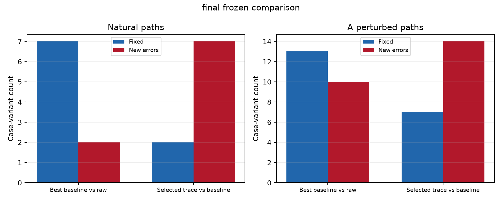
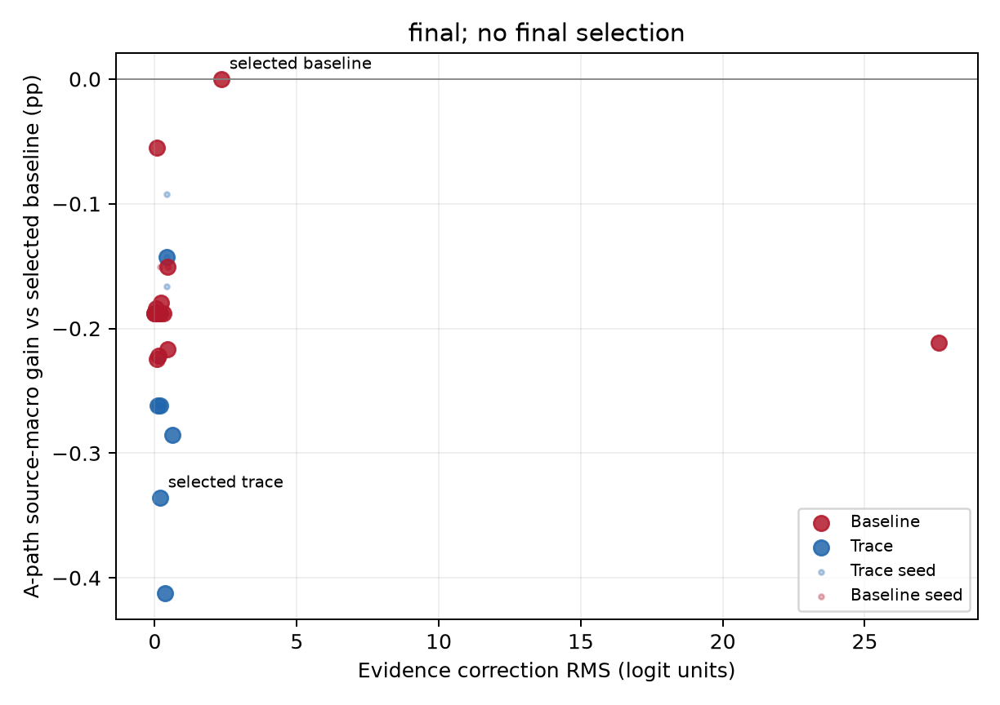

# 痕迹修正后续实验报告

本报告使用真实Qwen3-8B评分与保存的修正参数。所有方法、预算和种子在最终来源评分前冻结；最终评价不再选择模型。原有开发/测试和后续已查看结果只作为既有证据，不称为全新独立测试。

数据来自MEGA的指南决策树及其生成病例。旧拟合集包含80个指南来源、1712个原始生成病例；新开发集包含20个来源、256个原始生成病例；最终集包含60个来源、802个原始生成病例。新开发集与最终集每个来源最多15个病例。每个病例分别评价原始输入及处置删除、中性替换、处置互换三种A变体；变体不增加独立来源或病例数。

“新来源”指在本项目可核对的使用记录中，此前未参与选择或分析的MEGA指南来源，不是新增临床患者。来源名单、划分与使用记录保存在数据清单中。

C/F配对由同一Qwen模型进行源规则、病例事实及编辑标注，再通过程序检查与标签一致性验证，没有临床人工核验。旧拟合集的135个C/F配对用于训练证据约束；本轮新来源C/F配对仅用于冻结方法评价。P类作为节点配对诊断，不作为本轮主路径训练数据或主路径指标。

## Q1：自然判断错误是否与干扰有关？

dev原始自然路径有5条错误，其中5条首错节点具有同病例A变体评分；4条在至少一种A变体上判断正确，1条在所有已观察A变体上仍错。每一侧都按独立提供的金标判断，未把full或编辑侧分数当成真值。
final原始自然路径有48条错误，其中48条首错节点具有同病例A变体评分；24条在至少一种A变体上判断正确，24条在所有已观察A变体上仍错。每一侧都按独立提供的金标判断，未把full或编辑侧分数当成真值。

上述Q1诊断使用本轮新开发及最终来源的完整A覆盖：同一病例、同一节点的原始输入和三种A变体均进行真实全树评分，每一侧按各自标签判断。这区分了受控改动下可观察的改判和持续错误，不能单独证明错误的临床语义原因。旧开发集中19条PMA相关错误只属于既有诊断，不作为本轮新来源诊断或验证样本；既有文本与参考标签疑义也未用于修改本次标签。

## Q2：痕迹是否提供了校准和对照以外的信息？

开发集选中基线为 `AP_ridge_unbounded`，痕迹方法为 `label_linear_b0.05`。先要求自然路径来源等权正确率相对原模型下降不超过0.5个百分点，再最大化A路径正确率；同分优先更少参数、更小证据预算。仅比较预先标记的主候选，神经网络单种子不参与选择。
痕迹选择状态：passed。若未通过自然路径条件，仍冻结并报告最优痕迹候选，保留阴性结果。

| 划分/方法 | 自然路径来源等权正确率 | A路径来源等权正确率 | 自然修复/新增错误 | A修复/新增错误 |
|---|---:|---:|---:|---:|
| dev/raw | 98.11% | 98.88% | 0/1 | 1/5 |
| dev/AP_ridge_unbounded | 98.67% | 99.33% | 0/0 | 0/0 |
| dev/label_linear_b0.05 | 98.11% | 99.11% | 0/1 | 1/3 |
| final/raw | 94.32% | 94.57% | 2/7 | 10/13 |
| final/AP_ridge_unbounded | 94.90% | 94.75% | 0/0 | 0/0 |
| final/label_linear_b0.05 | 94.32% | 94.42% | 2/7 | 7/14 |

修复与新增错误以开发集选定的基线为参照，按病例变体计数。正确率先在同病例内平均有效A变体，再平均病例，最后平均指南来源；普通病例加权结果和所有预算、种子均保存在CSV。

## Q3：冻结关系能否迁移到新来源并提高正确率？

dev包含20个来源、1024个病例变体；缺失预测逐方法列在coverage.json。
自然路径相对冻结基线变化-0.56个百分点，2000次配对来源自助重采样95%区间[-1.67, +0.00]。
A路径相对冻结基线变化-0.22个百分点，2000次配对来源自助重采样95%区间[-0.56, +0.00]。
final包含60个来源、3208个病例变体；缺失预测逐方法列在coverage.json。
自然路径相对冻结基线变化-0.58个百分点，2000次配对来源自助重采样95%区间[-1.25, +0.12]。
A路径相对冻结基线变化-0.34个百分点，2000次配对来源自助重采样95%区间[-0.87, +0.13]。

最终阶段的主要比较为开发集选中的痕迹方法对选中的最强基线。其余最终结果为预先列出的辅助比较，不用于重新选择模型。置信区间跨0时，不把观察到的均值提高解释为明确的跨来源收益。

## Q4：干扰降低的证据保护代价是什么？

| 划分/方法 | AP方差降低VR | 原分数响应比ER | CF配对正确率 | CF修正RMS | 方向退化 | 超训练证据预算 |
|---|---:|---:|---:|---:|---:|---:|
| dev/raw | 0.00% | 100.00% | 33.33% | 0.0000 | 0 | 不适用 |
| dev/AP_ridge_unbounded | 17.90% | 94.24% | 33.33% | 2.3938 | 1 | 不适用 |
| dev/label_linear_b0.05 | -13.11% | 100.07% | 33.33% | 0.0883 | 0 | 1 |
| final/raw | 0.00% | 100.00% | 54.65% | 0.0000 | 0 | 不适用 |
| final/AP_ridge_unbounded | 18.43% | 97.60% | 55.25% | 2.3409 | 0 | 不适用 |
| final/label_linear_b0.05 | -6.71% | 99.84% | 54.65% | 0.1787 | 1 | 20 |
dev证据覆盖为18个C/F配对、6个来源；P类有效配对为1。
C/F覆盖18对、6个来源，来源较少，只能作为有限的个例代价观察。
原始C/F标签方向平均分数响应为20.9801。ER只衡量相对原分数响应；两侧是否正确另外报告为C/F配对正确率。
final证据覆盖为63个C/F配对、15个来源；P类有效配对为15。
C/F覆盖63对、15个来源；证据保护结论只适用于这些实际覆盖来源。
原始C/F标签方向平均分数响应为28.9609。ER只衡量相对原分数响应；两侧是否正确另外报告为C/F配对正确率。
旧strict/balanced的历史开发集RMS预算档位与本轮拟合集逐对最大差约束不同，未将其超预算计数填成0。

主表使用带金标的配对及来源等权统计；全部可评分节点的A/P统计另存。证据评价仅覆盖实际存在有效C/F配对的来源，不把它们冒称覆盖全部最终来源。相同训练预算不等于留出来源具有相同实际证据RMS，应结合权衡图评价。ER是平均有方向原分数响应之比，不能单独等同正确证据。C/F配对正确率要求两侧各自按标签判断且同时正确，并按来源等权统计；ER也不能替代逐对方向退化与超预算数量。

原有条件输入和证据对齐输入仅复用已经完成的既有开发结果，本次不新增这些模板在新来源的Qwen评分，也不把它们的收益归于痕迹。新来源的主要比较均使用固定原始提示与单节点痕迹修正。条件输入删除其他节点与处置，使A输入相同，其A不变性来自输入处理。

## 汇总

实验结果：在final中，选定痕迹方法相对最强基线的A路径变化为-0.34个百分点，自然路径变化为-0.58个百分点。
干扰增益成立：否（要求A路径差值95%区间下限大于0）。
自然非劣成立：否（要求自然路径差值95%区间下限不低于−0.5个百分点）。
总体成功判定要求上述两项同时成立，不能以自然路径点估计替代其置信区间。
科学结论：本次结果尚不足以确认痕迹在新来源上提供稳定的额外判断收益；预测干扰信息与改善最终判断应分别评价。

图1：修复与新增错误，分别展示自然路径和A路径。

图2：A路径增益与证据改动的关系。

运行配置与逐对、逐路径、逐来源结果见evaluation/；模型训练、内部来源选择及完整参数见training/。

## 交付验证

路径软件验证使用既有真实开发缓存重放：420/420条路径与保存的完整路径和叶子一致。金标符号oracle仅用于软件检查，不属于实验结果。
training/replay_parameters.py从真实拟合集缓存读取节点，独立重载保存参数，并比较所有模型的批量和单节点预测；不重新训练，也不使用开发或最终来源进行参数选择。
参数重放状态：passed；覆盖64个真实拟合节点、48个模型。详细误差保存在training/api_validation.json。
