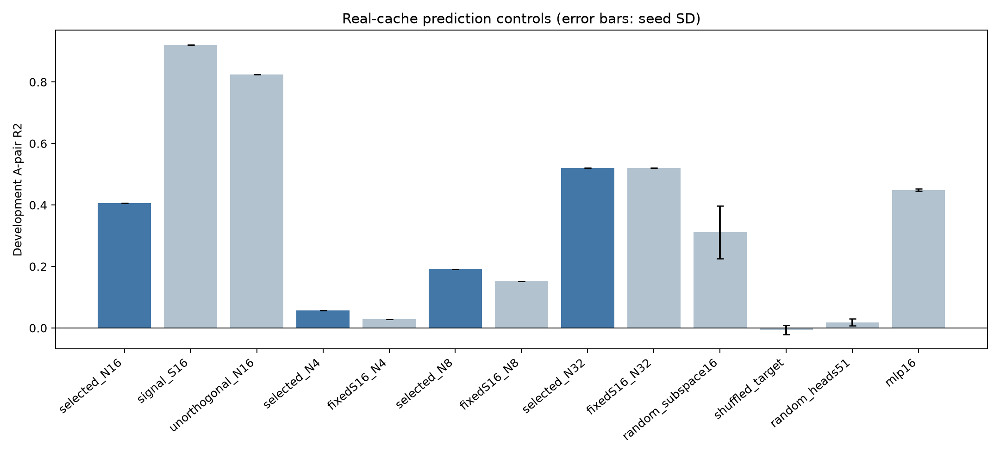
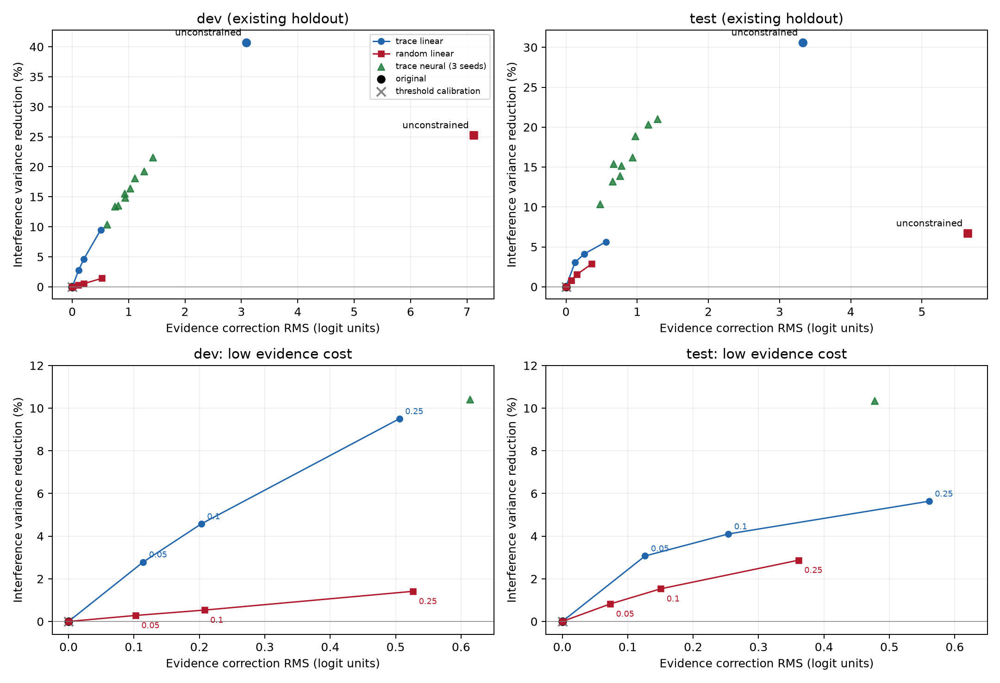

# ASTER-CR 内部痕迹的预测能力与实际作用

全部实验已在服务器完成，使用真实 Qwen3-8B repair-v2 评分与激活缓存，没有合成或模拟结果。原始 fit/dev/test 的80/20/40个来源及配对划分保持不变。完整五折新增真实单头干预，其余实验为真实缓存复算和新增小模型训练。旧实验结果和论文正文均未修改。

## Q1：16 维痕迹是否明显优于随机特征？

16维主方法在开发集1,194对A类上的 R²=0.4063，RMSE=2.9914；按20个来源进行2,000次成组自助重采样，R²的95%区间为[0.3074, 0.5044]。
训练统一为fit的4,887对A/P，岭系数0.01，无配对回归截距。标准化均值/尺度来自fit full视图，子空间来自fit配对，不额外按dev标准化。AP合并的1,198对结果另见CSV。

| 特征 | 次数 | 开发A R²（种子均值） | 种子标准差 | RMSE均值 |
|---|---:|---:|---:|---:|
| 选中51头的16维正交痕迹 | 1 | 0.4063 | 0.0000 | 2.9914 |
| 随机16维子空间 | 50 | 0.3115 | 0.0856 | 3.2150 |
| 随机51头的16维正交痕迹 | 50 | 0.0182 | 0.0111 | 3.8468 |
| 主要证据子空间16维 | 1 | 0.9211 | 0.0000 | 1.0905 |
| 未正交化干扰子空间16维 | 1 | 0.8249 | 0.0000 | 1.6244 |
| 打乱训练分数差 | 50 | -0.0062 | 0.0153 | 3.8943 |

| 主方法减去对照 | R²差值 | 来源自助重采样95%区间 |
|---|---:|---:|
| 随机16维子空间 | 0.0949 | [0.0391, 0.1998] |
| 随机51头的16维正交痕迹 | 0.3881 | [0.2725, 0.5042] |
| 打乱训练分数差 | 0.4125 | [0.3224, 0.5154] |
| 主要证据子空间16维 | -0.5148 | [-0.5958, -0.4022] |
| 未正交化干扰子空间16维 | -0.4186 | [-0.4745, -0.3265] |

主方法高于随机投影的平均水平，配对区间为正；50个随机投影中有41个低于主方法，仍有9个高于主方法，因此不能声称逐个随机投影都较差。随机头和打乱监督的50次结果均低于主方法。区间的对照统计量是50个种子各自R²的平均，不是50模型集成预测；它描述来源重采样的不确定性，不等于同时重采样随机种子的区间。

主要证据子空间和未正交化干扰子空间预测更强。因此选头有价值，正交痕迹也含有可靠预测信息，但预测信息并非其独有，不能仅凭0.4063证明干扰信息的选择性。正交化去除了大量可预测分数变化的方向；这些方向是否适合修复，要由Q4的证据代价评价判断。

参考结果均已找到归档程序并逐对复算：51头、16维、A类1,194对，直接修补 RMS 比例=13.9057%，痕迹预测 R²=0.40633266，直接修补 R²=0.07859726。后者定义为1−Σ(TE−IE)²/Σ(TE−mean(TE))²，没有再拟合IE→TE回归，也没有回归截距。其直接修补 RMS=0.5400，原分数差 RMS=3.8834。原始计算程序见trace/summarize_trace.py；本目录reference_audit.json记录路径及定义。paired_fit中加入F0的APF0修复属于另一拟合，不能和本次AP预测结果混用。

## Q2：增加维度或采用非线性函数，能提高多少预测能力？

主维度比较固定证据子空间S16、原始坐标标准化和训练对，只改变干扰痕迹维度，避免同时改变证据子空间。各维度有效秩均达到请求值，32维不存在秩不足。

| 痕迹维度（固定S16） | 开发A R² | RMSE | 岭回归参数数 |
|---|---:|---:|---:|
| 4 | 0.0286 | 3.8266 | 4 |
| 8 | 0.1517 | 3.5759 | 8 |
| 16 | 0.4063 | 2.9914 | 16 |
| 32 | 0.5197 | 2.6907 | 32 |

固定16维时，两层网络16→32→1（ReLU、577个参数）的3个固定种子平均 R²=0.4486，种子标准差=0.0040，RMSE=2.8829；相对16参数岭回归提高0.0423。32维线性的R²=0.5197，高于16维网络。
岭回归单次拟合约0.0034秒，网络完整fit重训平均约0.338秒，内部分组选择开销见nn_tuning.json（本次约2.18秒）。计时为服务器CPU墙钟时间；子空间计算成本在配置中另记，不能把岭回归几毫秒当作完整流程总成本。

网络超参数只在fit内部按来源划分的64/16来源上选择；内部训练来源重新估计标准化和S/N，之后全fit重新估计并训练。选头在该内部调参中保持既有fit选择，属于冻结选头条件下的调参，不使用dev/test。实验2网络直接输入两侧痕迹差，是预测探针；实验4另训练单节点修正函数，两者不可互换。

原仓库同一rank同时改变S和N的兼容结果也保留：r4/r8/r16/r32的R²分别为0.0574/0.1911/0.4063/0.5208。这些值不用于隔离痕迹维度的影响。

维度增加带来的提升大于本次小网络的提升，说明现有16维表示的信息范围是更明显的限制；非线性仍有小幅增益。本实验没有证明线性函数已经达到最优，也没有把32维探索结果用于重选测试配置。

## Q3：预测关系是否能跨指南来源迁移？

完整原流程五折在每折64个训练来源上重新计算加权梯度归因、每类top64候选、最多12个来源均衡配对的双向单头干预、交替融合51个头，以及标准化、S/N和AP岭回归；16个验证来源不参与这些步骤。总体AP R²=0.3454、RMSE=2.3641，A类单独 R²=0.3445。62/80个来源R²为正，来源中位数=0.2466。

| 折 | 完整流程AP R² | 完整流程A R² | 完整流程AP RMSE | 冻结选头AP R²（条件性） |
|---|---:|---:|---:|---:|
| 1 | 0.4651 | 0.4650 | 2.5359 | 0.4810 |
| 2 | 0.2166 | 0.2165 | 2.6975 | 0.2456 |
| 3 | 0.3208 | 0.3208 | 2.2805 | 0.3512 |
| 4 | 0.3559 | 0.3506 | 2.0314 | 0.4742 |
| 5 | 0.2911 | 0.2911 | 2.2464 | 0.3092 |

冻结51头的条件性诊断总体AP R²=0.3834；由于选头曾看过全部80个fit来源，该结果不替代完整流程。完整重选头后仍有预测能力，但比冻结头诊断有所下降。原dev本身与fit来源完全分离；其20个来源中17个AP R²为正、中位数0.2860，说明迁移并非所有来源同样稳定。

| 完整流程表现最差的来源 | 配对数 | R² | RMSE | 目标标准差 |
|---|---:|---:|---:|---:|
| train_val:304 | 132 | -1.3011 | 1.7428 | 1.1489 |
| train_val:772 | 36 | -0.9686 | 1.2996 | 0.9262 |
| train_val:1946 | 33 | -0.7099 | 2.0623 | 1.5772 |
| train_val:1781 | 24 | -0.6195 | 3.7128 | 2.9175 |
| train_val:446 | 36 | -0.5860 | 1.5643 | 1.2422 |

完整五折新增3,948次真实最终token前向，复用10,826条旧pair/head干预。GPU0/1峰值约17.968/17.962 GiB，两worker各自折的累计时间约199/154秒；实际明显低于启动前的保守估计。五折CPU重放的选头和预测完全一致，新增模型前向为0。

每来源指标见exp3/full/source_metrics.csv，dev指标见exp3/dev_source_metrics.csv，具体来源条件、均值和方差观察见exp3/source_context_diagnostics.json及README。低目标方差会使R²更易为负；另外一些来源有系统偏差或预测变化幅度不足。主题、语言和长度是可观察差异，当前实验不能把其中某一项认定为因果原因。

因此痕迹学到的关系能迁移到不少未参与本折选头和训练的来源，但不是来源无关的稳定关系，仍有一部分来源失效。现有test此前已被旧方案评价使用，本次仅作冻结配置的既有留出复算。未取得已有真实缓存且确认从未被用于选择/分析的新来源，因此没有全新独立测试。完整五折检查的是当前固定算法的来源迁移，不消除历史开发对算法设计的影响。

## Q4：这种预测能力最终带来了多少干扰降低，证据保护代价是什么？

所有修复拟合使用相同AP监督，三个预算0.05/0.1/0.25预先固定。约束为每个fit C/F对的 |修正差| ≤ 预算×fit AP原分数差RMS；它只在训练证据对保证成立。线性、随机投影和神经网络使用相同预算定义。随机投影固定seed11，与Q1随机投影同定义。节点校准截距只用761个fit自然节点标签估计，不影响配对分数差。

VR=1−Var(修正后AP分数差)/Var(原AP分数差)；ER=Σ标签方向×修正后CF分数差/Σ标签方向×原CF分数差；证据RMS=RMS(CF两侧修正差)。方向退化数统计原本标签方向响应>0、修正后≤0的对数。ER是汇总量，不能代替逐对检查。自然节点与自主动态路径分别评价，路径从首节点按修正分数逐步走到叶子，必须路径和叶子都匹配真值。dev/test动态路径分别420/806条，缓存覆盖完整。

**开发集全部预设配置**

| 方法 | VR | ER | 证据RMS | 方向退化数 | 自然节点正确率 | 动态路径正确率 |
|---|---:|---:|---:|---:|---:|---:|
| raw | 0.00% | 100.00% | 0.0000 | 0 | 97.99% | 91.43% |
| bias_only | 0.00% | 100.00% | 0.0000 | 0 | 98.49% | 91.67% |
| trace_unconstrained | 40.71% | 94.81% | 3.0869 | 1 | 97.99% | 91.19% |
| trace_bounded_0.05 | 2.79% | 99.94% | 0.1141 | 0 | 98.49% | 91.43% |
| trace_bounded_0.1 | 4.58% | 99.82% | 0.2029 | 0 | 98.49% | 91.43% |
| trace_bounded_0.25 | 9.50% | 99.49% | 0.5057 | 0 | 98.49% | 91.43% |
| random_unconstrained | 25.26% | 84.04% | 7.1193 | 2 | 97.99% | 91.67% |
| random_bounded_0.05 | 0.28% | 99.91% | 0.1025 | 0 | 98.49% | 91.67% |
| random_bounded_0.1 | 0.53% | 99.82% | 0.2077 | 0 | 98.49% | 91.67% |
| random_bounded_0.25 | 1.41% | 99.35% | 0.5266 | 0 | 98.49% | 91.67% |
| nn_seed11_bounded_0.05 | 13.38% | 98.60% | 0.7560 | 0 | 97.99% | 91.43% |
| nn_seed11_bounded_0.1 | 16.41% | 98.15% | 1.0227 | 0 | 97.99% | 91.43% |
| nn_seed11_bounded_0.25 | 21.54% | 97.52% | 1.4257 | 1 | 97.99% | 90.95% |
| nn_seed22_bounded_0.05 | 10.41% | 98.85% | 0.6134 | 0 | 98.49% | 91.67% |
| nn_seed22_bounded_0.1 | 13.53% | 98.50% | 0.8164 | 0 | 97.99% | 91.43% |
| nn_seed22_bounded_0.25 | 19.28% | 97.79% | 1.2737 | 1 | 97.99% | 91.19% |
| nn_seed33_bounded_0.05 | 14.83% | 98.09% | 0.9346 | 0 | 97.99% | 91.43% |
| nn_seed33_bounded_0.1 | 15.59% | 98.23% | 0.9256 | 0 | 97.99% | 91.43% |
| nn_seed33_bounded_0.25 | 18.11% | 98.08% | 1.1114 | 0 | 97.99% | 91.43% |

**既有测试留出集全部预设配置**

| 方法 | VR | ER | 证据RMS | 方向退化数 | 自然节点正确率 | 动态路径正确率 |
|---|---:|---:|---:|---:|---:|---:|
| raw | 0.00% | 100.00% | 0.0000 | 0 | 98.92% | 95.29% |
| bias_only | 0.00% | 100.00% | 0.0000 | 0 | 98.92% | 95.16% |
| trace_unconstrained | 30.61% | 91.67% | 3.3240 | 1 | 98.92% | 95.41% |
| trace_bounded_0.05 | 3.07% | 99.82% | 0.1266 | 0 | 98.92% | 95.16% |
| trace_bounded_0.1 | 4.10% | 99.60% | 0.2539 | 0 | 98.92% | 95.16% |
| trace_bounded_0.25 | 5.64% | 99.14% | 0.5607 | 1 | 98.92% | 95.16% |
| random_unconstrained | 6.70% | 86.47% | 5.6386 | 0 | 98.92% | 95.16% |
| random_bounded_0.05 | 0.82% | 99.89% | 0.0733 | 0 | 98.92% | 95.16% |
| random_bounded_0.1 | 1.53% | 99.80% | 0.1506 | 0 | 98.92% | 95.16% |
| random_bounded_0.25 | 2.87% | 99.39% | 0.3611 | 0 | 98.92% | 95.16% |
| nn_seed11_bounded_0.05 | 13.19% | 98.43% | 0.6527 | 0 | 98.92% | 95.29% |
| nn_seed11_bounded_0.1 | 16.23% | 97.71% | 0.9306 | 0 | 98.92% | 95.41% |
| nn_seed11_bounded_0.25 | 21.03% | 96.87% | 1.2812 | 0 | 98.92% | 95.66% |
| nn_seed22_bounded_0.05 | 10.36% | 98.74% | 0.4771 | 0 | 98.92% | 95.16% |
| nn_seed22_bounded_0.1 | 13.89% | 98.12% | 0.7560 | 0 | 98.92% | 95.29% |
| nn_seed22_bounded_0.25 | 20.34% | 97.19% | 1.1567 | 0 | 98.92% | 95.66% |
| nn_seed33_bounded_0.05 | 15.40% | 98.40% | 0.6647 | 0 | 98.92% | 95.53% |
| nn_seed33_bounded_0.1 | 15.16% | 98.07% | 0.7781 | 0 | 98.92% | 95.53% |
| nn_seed33_bounded_0.25 | 18.86% | 97.59% | 0.9722 | 0 | 98.92% | 95.53% |

开发集预算0.1时，线性痕迹方法的证据RMS=0.2029、VR=4.576%；随机投影的证据RMS=0.2077、VR=0.534%。实际证据改动接近，痕迹方法多降低约4.04个百分点干扰方差，ER分别99.822%和99.822%，均无方向退化。这支持所选痕迹具有可用于选择性修复的信息。预算0.05和0.25的完整结果也已列出，没有依据测试结果选择“最佳预算”。

无约束痕迹线性的开发VR为40.71%，但证据RMS升至3.0869、ER降至94.81%，并有1对方向退化。预算约束后VR降为2.79%/4.58%/9.50%，可用的安全修复幅度明显小于预测R²所暗示的干扰解释量。

同一训练预算不等于同一留出证据代价。神经网络在预算0.1下的开发VR为13.53%–16.41%，但证据RMS为0.8164–1.0227，远高于线性约0.20；60个dev证据对中有31–34个超出对应训练绝对预算。因此不能把这部分VR提升解释为相同证据保护代价下的非线性优势。exp4/summary.csv逐配置列出留出超预算数量。

动态路径尚未显示稳健收益：dev原模型384/420，阈值校准385/420，三个线性预算均384/420；test原模型768/806，三个线性预算均767/806。dev自然节点从195/199到196/199，阈值校准也达到196/199，不能将这一个节点的改进归因于痕迹。test自然节点各方法均368/372。预测和方差改善没有自动转化为最终路径正确率提高。

**汇总表**

| 问题 | 实测结论 |
|---|---|
| Q1 | N16 R²=0.4063；随机投影均值0.3115，差值区间为正；S16和未正交子空间更强，预测信息非痕迹独有。 |
| Q2 | 固定S16的N32 R²=0.5197；16维MLP=0.4486，维度增加的收益更大。 |
| Q3 | 每折重新选头总体AP R²=0.3454；62/80来源为正，迁移存在且不均衡。 |
| Q4 | dev实际证据RMS约0.20时，VR 4.58% vs随机0.53%；未观察到超过阈值基线的动态路径收益。 |

**一句话实验结果：** 所选痕迹比平均随机特征更能预测干扰分数变化，并能在较小证据改动下减少部分干扰，但跨来源表现不均衡，最终路径正确率未稳定提高。

**一句话科学结论：** ASTER-CR痕迹包含可迁移且部分可用于选择性修复的预测信息，预测相关性尚不足以证明独占的干扰机制或整体判断修复。

全部种子、配置、来源名单、训练开销、仓库起始提交、逐对预测、模型参数及重放检查均已保存在本目录；新增GPU干预时间与显存见exp3/full/worker_*_cost.json。参数重放检查见exp12/replay_check.json、exp3/replay_verification.json、exp4/replay_check.json。
