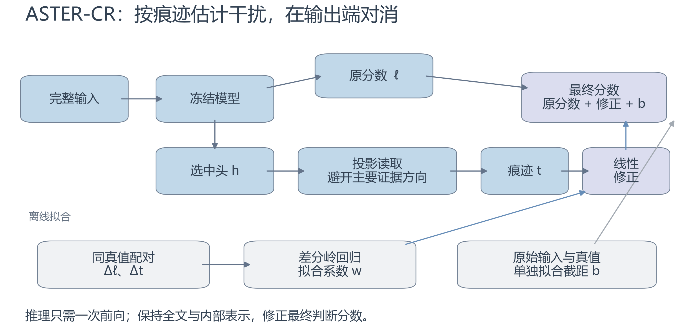
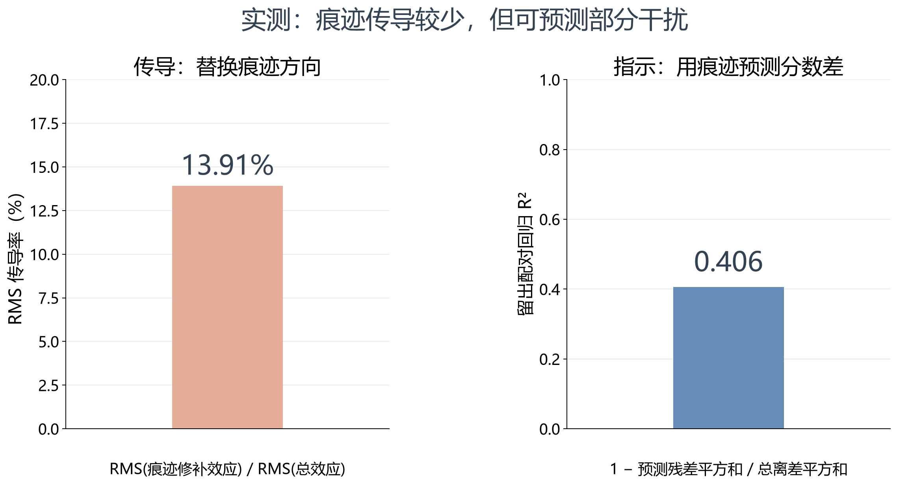
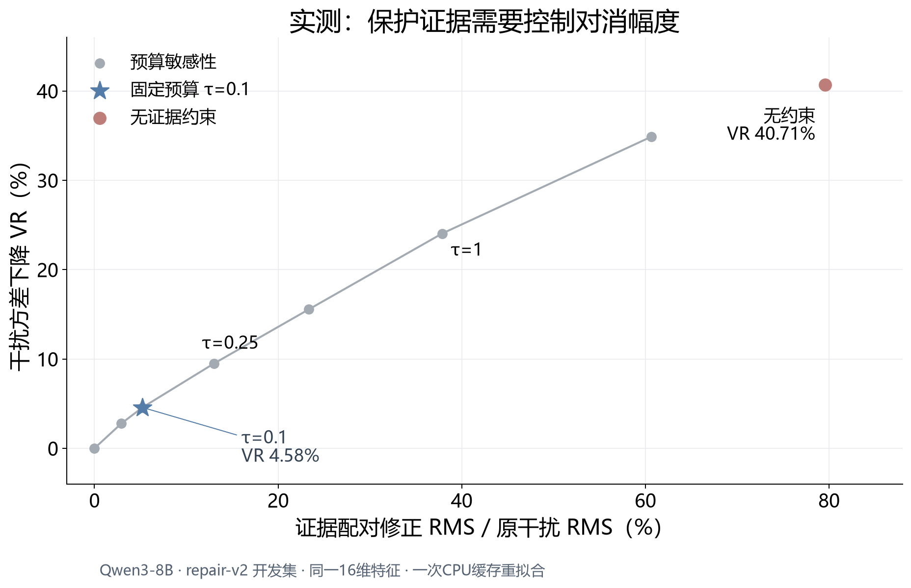
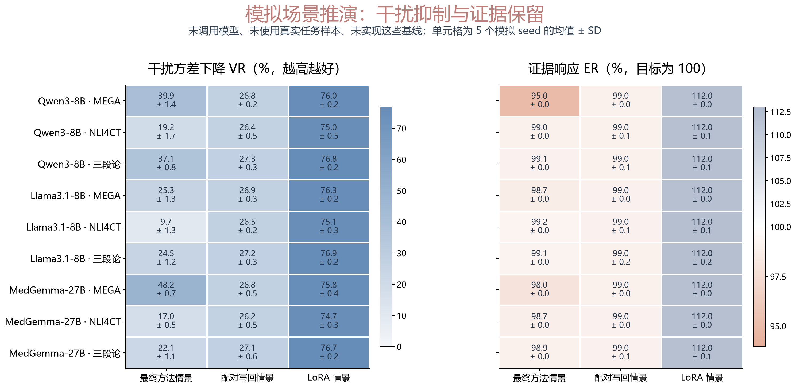
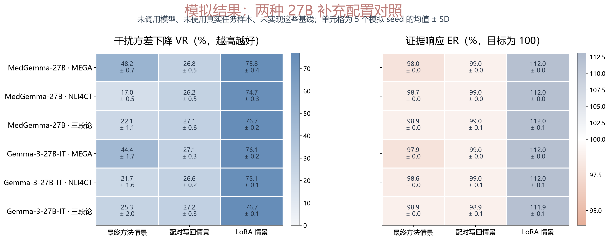
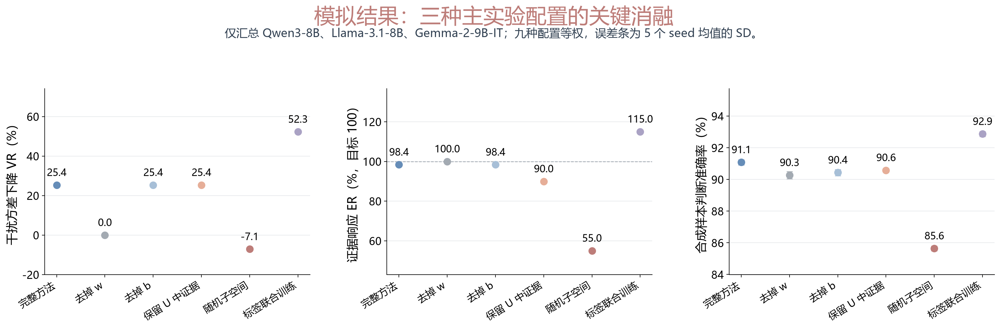
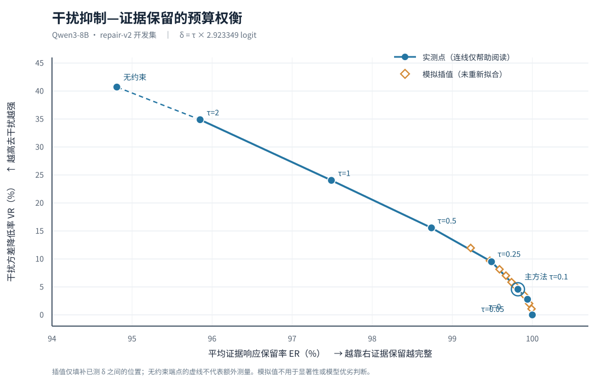

# 对消，而非擦除：用干扰痕迹修正大模型的指南条件判断

*Cancel, Don't Erase: Repairing Unfaithful Guideline Judgments with the Nuisance Trace*


## 摘要

大模型的指南条件判断会受后续处置影响，而规则要求判断依据条件界定与患者事实。ASTER-CR保留完整输入，用证据保持配对学习应抵消的分数变化，用证据变化配对约束修正，再独立校准阈值。混合痕迹的可行条件说明可用性取决于可辨识信息。已有Qwen3-8B受控留出实测中，线性实例干扰VR=4.10%、证据ER=99.60%；平衡扩展VR=14.59%、ER=99.77%、证据修正RMS=0.2403 logit。官方MEGA-CDP路径正确率为原模型94.36%、平衡配置94.41%，差值区间包含零；NLI4CT与MedPIC冻结迁移尚未显示总体正确率收益。结果支持部分干扰抑制与受控证据改动，忠实性和下游正确率分别评价。


## 1 Introduction 引言

按规则判断，应让结论依赖规则规定的信息。这一要求把忠实推理落实为可测的输入—决策关系，与解释忠实性（Jacovi & Goldberg, 2020）及反事实不变性（Veitch et al., 2021）相联系。

在指南节点上，当前真值由条件界定 C 和决定性事实 F 确定，即 y=g(C,F)。后续处置虽然与任务相关，却不应反过来决定前置条件。历史 Qwen3-8B 结果中，仅改写处置或无关背景，判断分数变化的中位数约为 0.5 logit；改变决定性事实时约为 50.8 logit [R5]。干扰较小，仍能翻转接近零阈值的判断；历史被编辑改变的节点原分数集中在 0、0.25 或 0.5 [R8]。

直接删除处置并不能可靠解决问题。历史 275 个可统计节点中，71 个需要条件句之外的定义；遮挡处置使完整路径正确数从 404/432 降至 394/432 [R2]。因此，我们保留全文，研究如何修复模型的判断依赖。

**任务需要判断不受干扰，完整表示擦除则要求更多。** 设模型表示为 h，后续读出为 G。若编辑后的表示在固定证据、改变处置时完全相同，任何固定 G 的输出都会相同。但输出相同并不要求表示相同：表示可以继续记录处置，只要它不推动当前条件判断。这个区别对线性和非线性方法都成立。非线性概念擦除扩大了可用方法范围（Ravfogel et al., 2022；Akbari et al., 2025），也使问题更清楚：为修复一个标量判断，是否有必要先清除高维表示中的干扰信息？这里必须区分两个问题：某个非线性函数能否从表示中识别干扰，以及修复指定判断是否需要使干扰在整个表示中不可恢复。前者涉及函数表达能力，后者涉及任务目标；即使前者成立，也不意味着后者是必要步骤。我们将二者分别检验，而不预设非线性擦除无效。

本文直接估计需要去掉的分数贡献，并限制修正对证据变化的响应。与证据方向正交的痕迹，即使自身传导的效应有限，也可能指示其他方向上的干扰变化；回归因而预测配对的总分数差，而非痕迹自己的修补效应。A/P 配对监督应去掉的变化，C/F 配对约束应保留的变化；差分消去常数零点，单独校准负责阈值。痕迹需要支持跨证据条件共享的贡献估计函数；神经网络可以增加该函数的表达能力。线性读出是当前可检验的实现选择。

本文围绕这一主张开展四项工作。第一，从规则确定的反事实关系出发，区分判断分数不变性、表示逐点不变性与观测统计独立，论证高维信息擦除不是指定标量判断修复的必要条件。第二，区分痕迹的干扰传导与对总干扰效应的预测，并在混合痕迹模型中刻画“抵消干扰、保留证据”的共同可行条件；针对满足同点切向约束的线性及可微非线性编辑，给出局部几何代价。第三，以 A/P 差分学习输入相关修正，以 C/F 配对直接限制证据改动，再独立拟合阈值，使有效性与保护要求落实到同一优化问题。第四，以同版机制诊断、真实留出测试、输出与末层表示编辑对照，以及进一步的缓存优化扩展，区分函数表达能力、修正位置、可用信息与证据预算对结果的作用。当前结果支持部分干扰抑制及受控证据改动，但尚未建立超过原模型的路径正确率优势。五模型医学扩展的预设模拟在实验章单列，完整表置于附录 D，不合并为真实模型实测。


## 2 Related Work 相关工作

### 2.1 忠实推理与推理内容效应

解释忠实性关注解释与实际决策过程的联系（Jacovi & Goldberg, 2020）。模型可能受到未在解释中充分承认的偏置影响（Turpin et al., 2023），因此本文直接改变输入组成并测量判断。反事实不变性研究也强调对排除因素保持稳定（Veitch et al., 2021）。

语言模型与人类均表现出推理内容效应（Lampinen et al., 2024）。后续处置影响前置条件判断，与结论可信度影响推理有相似之处；本文进一步用指南规则明确哪些信息应决定当前真值。

### 2.2 表示擦除、编辑与参数高效训练

LEACE 闭式去除线性概念信息，INLP 通过迭代投影消除可线性预测的属性（Belrose et al., 2023；Ravfogel et al., 2020）。它们提供可操作的表示干预，但概念可预测性不等同于下游因果作用。ITI 沿估计方向干预激活（Li et al., 2023），是相关的推理时编辑方法。

LoReFT 学习低秩表示干预，LoFiT 学习局部表示偏移，LoRA 学习权重低秩更新（Wu et al., 2024；Yin, Ye & Durrett, 2024；Hu et al., 2022）。本文将这些方法列为训练式对照，保留其监督和计算差异，不将 17 个输出系数等同于完整方法的成本。

非线性擦除已有直接研究。Ravfogel 等（2022）在核空间中进行对抗概念擦除；Akbari 等（2025）的 Obliviator 用迭代非线性映射优化擦除与任务效用。本文将核化擦除、Obliviator 和神经网络表示编辑纳入对照，比较相同任务指标下的权衡。[核化擦除](https://aclanthology.org/2022.emnlp-main.405/)、[Obliviator](https://arxiv.org/html/2603.07529v1)。

这些工作中以观测分布上的概念不可预测性或统计独立为目标的设定，与指南中的固定证据反事实不变性需要分别定义。本文研究的处置与证据可能在观测上相关，因此不能直接将“无法预测处置”作为忠实判断的充分必要条件。

### 2.3 校准与普通读出

上下文校准用内容无关参考估计标签先验（Zhao et al., 2021）。偏置校准可改变阈值，但同一个常数会在配对差分中抵消。普通线性读出直接用标签拟合分类方向。ASTER-CR 将输入相关修正 w 与阈值 b 分开：前者拟合 A/P 差分并接受 C/F 保留约束，后者再用原始输入标签校准，使两种作用可以分别检验。


## 3 Method 方法

### 3.1 任务定义与配对

输入包括指南决策树、患者病例和当前节点。模型只回答当前条件是否成立。记 z₊(x)、z₋(x) 分别为“是”和“否”的输出分数：

```math
\ell(x)=z_+(x)-z_-(x),\qquad\hat y=\mathbf{1}[\ell(x)>0].
```

程序控制器根据判断进入下一节点，到叶节点后返回指南原文中的处置。模型负责逐节点判断，控制器负责按树执行。主数据为 MEGA-CDP（Chen et al., 2026）。

**配对类型。**

以下仅为任务示意，不是数据集原文。当前条件为“eGFR ≥ 30 mL/min/1.73m²”，患者 eGFR 为 34，真值为“是”；两条分支分别给出继续或调整用药的后续处置。

| Type | Intervention | Label | Expected Response |
|---|---:|---:|---:|
| A 处置改写 | 分支后的处置文字 | 不变 | 保持稳定 |
| P 背景改写 | 与当前节点无关的病史、画像 | 不变 | 保持稳定 |
| C 条件改写 | 条件阈值或定义，如阈值从 30 改为 45 | 翻转 | 跟随真值改变 |
| F 事实改写 | 决定性事实，如数值从 34 改为 26 | 翻转 | 跟随真值改变 |

**Table 1:** 指南判断的反事实配对类型。A/P保持决定性证据，C/F改变真值；F0另行统计。


F0 表示事实数值改变但仍在阈值同侧，属于同真值、不同证据的配对。本文以保持证据的 A/P 配对定义主方法，F0 作为额外的同侧分数稳定扩展单列比较。某条信息的角色由当前节点决定：年龄可能在一个节点上无关，在年龄条件节点上成为决定性事实。

“真值不变”首先要求配对在语义上成立。处置改写若同时改变了条件定义，就不能作为合格的 A 配对；因此需由临床医生对配对样本进行核验。


### 3.2 痕迹构造与受约束输出修正

为了在完整前向中抵消判断的干扰贡献，读取痕迹 t 并计算 ℓ′(x)=ℓ(x)+cφ(t(x))+b。线性实例 cφ(t)=wᵀt，非线性实例可用小型网络。

**每一步只承担一个作用。** 选头减少要读取的特征；正交投影减少主要证据变化进入痕迹；A/P 目标学习应对消的变化；C/F 约束保护证据；截距 b 处理整体阈值。前两步准备特征，后两种配对共同决定最终修正，b 不改变任何配对分数差。

**步骤 1：定位包含干扰与证据信息的头。** 为了在有限特征中估计两类变化，在 fit 配对上先用梯度归因预筛，再用精确修补排序。A/P 与 C/F 分别排序后交替合并；Qwen 当前选取 51 个头。纳入证据头，是为了估计主要证据方向；最终读出再接受直接的证据配对约束。

**步骤 2：估计痕迹子空间。** 为了减少主要证据变化进入读出，用 fit 均值和标准差对选中头输出标准化：

```math
\tilde h(x)=(h(x)-\mu)\oslash s.
```

以 C/F 差分的前 r 个主方向形成 S，以 A/P 差分的主方向形成 U，再构造

```math
N=\mathrm{orth}\big((I-SS^\top)U\big),
\qquad t(x)=N^\top\tilde h(x).
```

有限秩的 S 近似主要证据变化。与 S 正交是特征构造，最终修正对证据的影响由留出 C/F 配对评价。

**步骤 3：在证据约束下拟合对消。** 为了防止混合痕迹中的证据成分进入修正，A/P 配对用于学习应抵消的分数变化，fit 的 C/F 配对用于限制修正对证据变化的响应。令 X 和 y 分别为 A/P 的痕迹差分矩阵与原分数差，E 为 C/F 的痕迹差分矩阵，求解

```math
\hat w=\arg\min_w\left(\|Xw+y\|_2^2+\lambda\|w\|_2^2\right)
```

并对每个拟合 C/F 配对施加以下修正预算约束：

```math
\left|(Ew)_j\right|\leq\delta,\qquad j=1,\ldots,m_{CF}.
```

约束直接作用于修正项，而非要求痕迹的每一维都不含证据。对每个受约束的证据配对，

```math
|\Delta\ell'_j-\Delta\ell_j|
=|w^\top\Delta t_j|\leq\delta.
```

因此，证据保护成为拟合条件，不再只靠子空间正交和训练后的平均指标。若原证据响应的绝对值大于 δ，修正也不会翻转该配对的响应方向。w=0 始终可行；无法在给定预算内消除的干扰保留在残差中。

既有实验固定 r=16、λ=0.01，并在查看新结果前设定 δ=0.1×fit A/P 原分数差 RMS。0.1 是既有实验采用的证据改动预算，不是已有通用标准。另报告预算变化的敏感性。拟合仅使用 fit 的 4,887 对 A/P 和 135 对 C/F；开发集的 C/F 用来检验约束能否迁移。135 对 C/F 使用痕迹变化提供保留约束，不用标签分类损失训练 w。

**无证据约束的回归作为消融。** 为了测量新增约束的作用，保留原 A/P 岭回归

```math
\hat w_{\mathrm{free}}=-(X^\top X+\lambda I)^{-1}X^\top y.
```

约束版本是小规模凸二次规划，仍只有 16 个修正系数。它把训练目标从“尽量解释干扰”改为“在证据改动预算内尽量解释干扰”。

**一般修正函数沿用相同约束。** 为了处理痕迹与分数的非线性关系，可分别对两侧应用共享函数 cφ：

```math
\min_\phi
\sum_{(L,R)\in A/P}
[\Delta\ell+c_\phi(t_R)-c_\phi(t_L)]^2+\lambda\Omega(\phi),
\qquad
|c_\phi(t_R)-c_\phi(t_L)|\leq\delta
\quad ((L,R)\in C/F_{\mathrm{fit}}).
```

非线性函数仍需以两侧输出之差训练，不能用 cφ(Δt) 替代。线性版本采用凸优化，非线性版本的优化与留出检验单列比较。

**独立校准整体阈值。** 为了处理整体偏置，固定 ŵ 或 φ 后，在 fit 的 761 个自然原始输入上用交叉熵单独拟合 b。b 在所有配对差分中抵消，不改变上述证据约束。在线性实例中，固定系数下更换特征中心只产生可由 b 吸收的常数；非线性实例保持训练时的标准化。


### 3.3 推理流程与成本

为了在部署时保留原有流程，推理仅执行一次模型前向，读取 ℓ 和选中头，再计算 ŵᵀt+b。测试输入无需额外参考提示或文本边界标注。

r=16 时，输出校正层有 17 个可拟合系数。选中头索引、均值、标准差和子空间基也需存储，因此“17 个参数”只指校正层，不代表完整方法全部存储量。离线头定位、配对特征提取和子空间估计成本另报。

当前主方法固定 r=16 和证据改动预算，开发集沿用旧结果，留出测试只评价既有系数。训练配对的硬约束具有直接保证，开发集与留出测试分别检验其迁移。单参数校准保留为零输入相关修正的基线。



**Figure 1:** 当前线性实例：用 A/P 差分拟合干扰修正，用 fit C/F 配对限制证据变化，再单独校准 b。推理读取一次原前向的特征，校正最终判断分数。一般函数沿用相同配对目标与约束。


### 3.4 核心理论结论

为了说明何时能同时去掉干扰并保留证据，考虑 ℓ=f(e)+γᵀν、t=Dν+He。精确线性对消与证据保留要求 Dᵀw=−γ、Hᵀw=0。取 Z 为 ker(Hᵀ) 的正交基，二者可同时满足，当且仅当 γ∈range(DᵀZ)。痕迹混入证据不自动使方法失效，关键是仍有能识别干扰且不响应证据的方向。

若可微编辑 T 在同一点保持证据切向 s、消去与其夹角为 θ 的干扰切向，则 ||I−J_T||₂≥cscθ。这是指定局部切向约束下的结论；允许证据重新编码或仅要求输出保持时，应使用相应任务约束评价。

一般函数修正要求需要抵消的标量贡献可由同一个痕迹函数确定。增加函数容量能拟合更复杂的关系，但不能补足特征中缺失的信息。完整命题、证明及反例见附录 A。


## 4 Experiments 实验

### 4.1 Experimental Setup

本研究以行为忠实性为主要目标：固定证据时减少干扰响应，改变证据时保留适当响应与方向。准确率评价下游效果。七个医学数据集共享这一框架，具体指标取决于有效干预配对；缺少配对填“—”，不拼成一个跨任务总分。

| Dataset / Task | Official Size / Native Splits | Local Availability | Evaluated Size | Evaluation |
|---|---:|---:|---:|---:|
| MEGA-CDP：指南节点与动态路径 | 2,274 棵树、42,353 路径；train_val 34,895，test 7,458 | 原生划分可用；原 fit/dev/留出为 1,712/420/806 路径 | 受控留出 3,100 输入、806 路径；官方 test 7,458 路径 | 干扰 VR/RMS、证据 ER/修正 RMS/方向、节点及路径正确率 |
| NLI4CT-2024：临床试验文本推断 | train/dev/practice_test/test 为 1,700/200/2,142/5,500 | 9,542 条跨 split 记录、9,342 原 ID；200 dev 也在 practice | 按原 split 分报 9,542 条；官方 test 原生保持/翻转 4,136/864 对 | 原生干预响应、配对全对、分类正确率 |
| MedPIC：患者特异的用药安全多标签题 | test 467 题，每题 5 选项；无原生训练划分 | 467 题、2,335 选项；90 组中 92 病例对映射为 244 翻转、216 保持选项对 | 已有冻结迁移 467 题和 460 选项对；本次不重复 | 答案集合全对、配对全对、证据响应与方向 |
| MedPAIR：医生句级相关性标注的单选题 | 官方标注覆盖 2,000 QA；发布题目/标注表，无本研究的原生 train/dev/test | 清理后 898 题；本地派生 train/dev/test 为 718/91/89 | 当前受约束方法新增实测 0；早期 180 题属历史版本 | 原题准确率，低相关与关键证据删除/补回的分数变化 |
| MedEinst：合成病例 control/trap 诊断配对 | 官方 reference train 10,689 对，test 5,383 对、49 疾病 | 历史行为缓存 train/test 10,244/5,372 对；缺项原因本次未确认 | 当前方法新增实测 0；历史缓存不冒充五模型实测 | 诊断、配对全对、Bias Trap Rate、证据响应 |
| MedGUIDE：指南单选题 | 7,747 题，55 棵 NCCN 树、17 类癌症；HF 单个 train 文件，无原生独立 test | 7,747 题，17 来源家族；历史子集另列 | 当前受约束方法新增实测 0 | 选择准确率、疾病宏平均；无干预配对，ER/VR“—” |
| TrialGPT：患者—试验条款匹配 | 专家条款标注 1,015 条，含证据句；HF 单个 train 文件，另有 training 标记 | 本地有官方代码和检索资源，尚无完整专家条款评测清单 | 当前方法新增实测 0；确定标签子集分母待实际清单确认 | 确定标签的平衡准确率、Macro-F1；无干预配对，ER/VR“—” |

**Table 2:** 医学评测数据集。官方发布、本地可用和实际评价规模分列；原生划分与本地派生划分分别注明。


官方发布规模、本地可用规模和实际评测分开。MedPAIR 本地 898 题不是官方总规模；MedEinst 本地 5,372 对不能替代官方 5,383 对。MedPIC 标签保持对仍改变患者信息，不能直接解释为纯干扰。新增模拟规模见第 4.3 节。

来源：[MEGA-CDP](https://arxiv.org/abs/2608.26592)、[NLI4CT](https://aclanthology.org/2023.emnlp-main.1041/)、[NLI4CT-2024](https://github.com/ai-systems/Task-2-SemEval-2024)、[MedPIC](https://huggingface.co/datasets/TIM0927/MedPIC-Bench)、[MedPAIR 作者项目](https://medpair.csail.mit.edu/)、[MedEinst 官方说明](https://github.com/zhui711/MedEinst/blob/main/README.md)、[MedGUIDE](https://arxiv.org/abs/2505.11613)、[TrialGPT 专家数据卡](https://huggingface.co/datasets/ncbi/TrialGPT-Criterion-Annotations)。本地计数依据见附录 B。

**Models and Compared Methods.** 五模型为Qwen3-8B、Llama-3.1-8B-Instruct、Gemma-2-9B-IT、Gemma-3-27B-IT和MedGemma-27B；当前实测模型为Qwen3-8B，其余模型扩展在4.3节标为预设模拟。表中使用固定方法名：Base Model为原模型；Bias Calibration仅拟合一个共享截距；Supervised Linear Readout用标签拟合读出；LEACE、ITI、Closed-form ASTER及参数高效训练方法保留各自名称。冻结的MEGA修正函数迁移与使用目标任务标签的适配分开报告，校准数据与额外监督写入表注。

ASTER-CR (Linear)使用16维痕迹及逐对C/F硬预算。同痕迹对照ASTER-CR (MLP, 16-d)为16→32→1输出网络；Linear/MLP Representation Editing分别在末层表示上编辑，不能与输出修正混称。ASTER-CR (MLP Ensemble, Balanced/Strong Protection)使用99→128→1三种子集成，特征为N16、S16、残差PCA64及3维分数特征，采用C/F均方惩罚与开发集保护档选择；它们与线性逐对硬约束分别解释。Trace-only MLP使用32维N/S痕迹，Score-only MLP只读取原分数特征。变体、系数数目与拟合细节见附录B、C。模拟中的MLP名称表示待比较的配置标签，没有执行对应训练。

**Evaluation Metrics.** 忠实性为主要评价，包含干扰抑制、证据响应保持及逐对方向；下游正确率单独报告。设原/修正配对差为Δℓ_i/Δℓ_m,i，修正差为Δc_i=Δℓ_m,i−Δℓ_i。干扰集合I保持决定性证据，证据集合E改变决定性信息：

```math
\mathrm{RMS}_{I}=\sqrt{\frac{1}{|\mathcal I|}\sum_{i\in\mathcal I}(\Delta\ell_{m,i})^2},
\qquad
\mathrm{VR}=100\left(1-\frac{\mathrm{Var}_{I}(\Delta\ell_m)}
{\mathrm{Var}_{I}(\Delta\ell)}\right).
```

```math
\mathrm{ER}=100\frac{\sum_{i\in\mathcal E}d_i\Delta\ell_{m,i}}
{\sum_{i\in\mathcal E}d_i\Delta\ell_i},
\qquad
\mathrm{RMS}_{\Delta c}=\sqrt{\frac{1}{|\mathcal E|}\sum_{i\in\mathcal E}(\Delta c_i)^2}.
```

$d_i$为期望标签响应方向；多类别配对固定相同类别对比，不能相减类别编号。VR越大表示干扰方差降低更多；ER以100%为响应保留参考，不按越高越好排序；$\mathrm{RMS}_{\Delta c}$越小表示证据响应改动越少。DU为$\mathrm{RMS}_{\Delta c}$除以原干扰RMS，百分比表显示100×DU。真实分数幅度单位为logit，预设模拟为score。若所需原方差、原响应总和或归一化分母为零，对应比率未定义。

令r_i=d_iΔℓ_i。方向退化数量N_deg统计r_i>0而d_iΔℓ_m,i≤0的配对；条件退化率为100×N_deg/N_+，N_+是原正向响应数量。表头Dir. Deg. (#)与Dir. Deg. (%)严格区分；“退化数/全部配对数”不是条件退化率。零退化不能单独证明忠实性，需结合ER、RMS_Δc及配对正确率。

单例Acc.以已核验原题为分母；MedPIC的Option Acc.以选项为分母，Set EM要求整题答案集合完全匹配，Pair EM要求病例对两端集合均正确。Pair Acc.要求配对两端分别符合各自标签，并注明单位是选项对还是病例对。MedGUIDE按疾病组等权计算Disease Macro Acc.；TrialGPT仅在确定标签上计算Balanced Acc.与Macro-F1。MedEinst另报Control/Trap Acc.及BTR，即control正确时trap仍预测control标签的条件比例。Path Acc.、Leaf Acc.与Node Acc.分别按完整路径、最终叶节点与指定节点统计，不能互换。MedPAIR的Key-Del. Ret.测关键删除响应保留，使用独立名称。全部公式、配对单位、分母、零分母规则和不确定性口径见附录B.1。

所有结果表统一以Method或Ablation标识方法，以↑/↓表示评价方向，以≈100标示响应保留参考；n/N为正确数/已评价数，#为计数，pp为百分点，CI为置信区间。均值±标准差在表注中说明种子类型。无有效干预配对的指标填“—”；不同任务不合成总分。

MedPAIR 使用固定原答案相对固定竞争项的分数差，分别报告低相关与关键证据删除/补回。删除后的原答案未经重新核验，不计算删句准确率；关键删除敏感性不直接等同于真值翻转 ER。MedGUIDE 仅输入病例、问题、选项，不输入金标路径。TrialGPT 判断是否满足该条款，保留纳入/排除的语义，未知及信息不足不转为“否”；training 标记和患者/试验关系需随未来实际划分清单报告。

**真实设置。** 原线性实例 r=16、λ=0.01、δ=0.2923349 logit；fit A/P=4,887 对、C/F=135 对，761 个自然节点校准 b。fit/dev/留出来源为 80/20/40。测试此前用于旧方案，优化扩展属于同一集合上的探索。训练种子波动和来源区间分别解释。62 节点的医生配对核验材料已准备，核验待完成。

<a id="measured-results"></a>


### 4.2 Main Results

行为忠实性与下游正确率按集合分别报告。以下全部沿用已有真实模型缓存，不在本次编辑中运行模型或重新拟合。

**受控留出集。** 2,293 对 A/P、40 对 C/F、372 自然节点、806 路径。P/F/F0 只有 10/7/6 对，来源较少。
| Method | $\mathrm{VR}_{I}$ (%) ↑ | $\mathrm{ER}_{E}$ (%) ≈100 | $\mathrm{RMS}_{\Delta c}$ (logit) ↓ | DU (%) ↓ | Dir. Deg. (#) ↓ | Pair Correct (I) (n/N) ↑ | Node Correct (n/N) ↑ | Path Correct (n/N) ↑ |
|---|---:|---:|---:|---:|---:|---:|---:|---:|
| Base Model | 0.00 | 100.00 | 0.0000 | 0.00 | 0 | 2258/2293 | 368/372 | 768/806 |
| Bias Calibration | 0.00 | 100.00 | 0.0000 | 0.00 | 0 | 2267/2293 | 368/372 | 767/806 |
| ASTER-CR (Linear) | 4.10 | 99.60 | 0.2539 | 9.66 | 0 | 2266/2293 | 368/372 | 767/806 |
| ASTER-CR (MLP Ensemble, Strong Protection) | 8.02 | 99.88 | 0.1201 | 4.57 | 0 | 2267/2293 | 368/372 | 767/806 |
| ASTER-CR (MLP Ensemble, Balanced) | 14.59 | 99.77 | 0.2403 | 9.14 | 0 | 2262/2293 | 368/372 | 768/806 |
| MLP Ensemble (High VR) | 18.17 | 98.97 | 0.3953 | 15.04 | 0 | 2262/2293 | 368/372 | 767/806 |
| MLP (Large Correction) | 25.74 | 97.93 | 0.8593 | 32.70 | 0 | 2262/2293 | 368/372 | 769/806 |
| MLP (Max. Dev VR) | 25.85 | 99.07 | 0.9425 | 35.86 | 2 | 2263/2293 | 369/372 | 765/806 |
| MLP (Dev Path Selection) | 17.85 | 98.85 | 0.5410 | 20.58 | 0 | 2264/2293 | 368/372 | 768/806 |
| Trace-only MLP | 10.56 | 99.44 | 0.2191 | 8.34 | 0 | 2262/2293 | 368/372 | 766/806 |
| Score-only MLP | 3.89 | 99.30 | 0.3113 | 11.85 | 0 | 2267/2293 | 368/372 | 767/806 |
| ASTER-CR (Expanded Linear) | 9.92 | 99.68 | 0.3831 | 14.58 | 0 | 2266/2293 | 368/372 | 768/806 |

**Table 3:** Qwen3-8B受控留出结果。干扰2,293对，证据40对，自然节点372个，动态路径806条。RMS以logit计，DU以百分比计；Dir. Deg.为证据方向退化数量。扩展配置使用冻结修正函数，不能与官方测试混合。


线性实例 VR=4.10%、ER=99.60%、证据修正 RMS=0.2539。平衡扩展在同一已用留出集为 VR=14.59%、ER=99.77%、RMS=0.2403；较强保护配置为 VR=8.02%、ER=99.88%、RMS=0.1201。40 对 C/F 中线性实例有 11 对超训练预算，没有新增方向退化。改进主要体现在干扰/证据权衡；平衡扩展路径 768/806 与原模型相同。

**MEGA-CDP 官方测试。** 7,458 动态路径与受控留出分开。官方 C/F、F0 尚未完成，受控集合配对指标不冒充官方配对测量。
| Method | Path Correct (n/N) ↑ | Path Acc. (%) ↑ | 95% Cluster CI (%) | Leaf Acc. (%) ↑ | Fixed / New Errors (#) | ΔAcc. (pp) | 95% CI of Δ (pp) |
|---|---:|---:|---:|---:|---:|---:|---:|
| Base Model | 7,037/7,458 | 94.36 | [93.44, 95.20] | 94.36 | — | — | — |
| Bias Calibration | 7,038/7,458 | 94.37 | [93.45, 95.21] | 94.37 | 45/44 | 0.01 | [-0.31, 0.31] |
| ASTER-CR (Linear) | 7,034/7,458 | 94.31 | [93.39, 95.18] | 94.31 | 43/46 | -0.04 | [-0.34, 0.24] |
| ASTER-CR (MLP Ensemble, Strong Protection) | 7,037/7,458 | 94.36 | [93.46, 95.21] | 94.36 | 26/26 | 0.00 | [-0.21, 0.20] |
| ASTER-CR (MLP Ensemble, Balanced) | 7,041/7,458 | 94.41 | [93.51, 95.24] | 94.41 | 20/16 | 0.05 | [-0.11, 0.21] |
| Trace-only MLP | 7,044/7,458 | 94.45 | [93.55, 95.28] | 94.45 | 23/16 | 0.09 | [-0.09, 0.27] |

**Table 4:** MEGA-CDP官方测试的7,458条动态路径。区间为来源簇配对重采样所得95%区间；差值以百分点计，相对于Base Model。Fixed/New Errors分别为同一已评价全集上的纠正与新增错误。


平衡配置路径差为 0.05 个百分点，来源区间 [−0.11, 0.21] 包含零。完整来源及历史分组见附录 C。

**NLI4CT-2024 官方测试。** 以下为冻结 MEGA 修正函数零样本迁移，未使用 NLI 标签拟合该函数及截距。
| Subset | Expected N | Method | Correct (n/N) ↑ | Acc. (%) ↑ |
|---|---:|---|---:|---:|
| 官方test声明（零样本迁移） | 5,500 | Base Model | 4,073/5,500 | 74.05 |
| 官方test声明（零样本迁移） | 5,500 | ASTER-CR (Linear) | 4,031/5,500 | 73.29 |
| 官方test声明（零样本迁移） | 5,500 | ASTER-CR (MLP Ensemble, Balanced) | 4,048/5,500 | 73.60 |
| 官方test声明（零样本迁移） | 5,500 | Bias Calibration | 4,033/5,500 | 73.33 |
| 官方test声明（零样本迁移） | 5,500 | ASTER-CR (MLP Ensemble, Strong Protection) | 4,042/5,500 | 73.49 |
| 官方test声明（零样本迁移） | 5,500 | Trace-only MLP | 4,040/5,500 | 73.45 |

**Table 5:** NLI4CT-2024官方测试的5,500条声明。所有修正函数及截距在MEGA上拟合并冻结，属于零样本迁移。


全体 9,542 跨 split 记录及 train/dev/practice 分项见附录 C；200 dev 记录与 practice 重叠。原生保持标签 4,136 对、真实翻转 864 对的响应如下。

| Method | $\mathrm{RMS}_{\mathrm{pres}}$ (logit) | $\mathrm{ER}_{E}$ (%) ≈100 | Pair Acc. (E) (%) ↑ | Correct Direction (n/N) ↑ |
|---|---:|---:|---:|---:|
| Base Model | 16.9688 | 100.00 | 61.81 | 749/864 |
| ASTER-CR (Linear) | 16.8750 | 99.48 | 61.11 | 748/864 |
| ASTER-CR (MLP Ensemble, Balanced) | 16.5619 | 97.38 | 61.46 | 750/864 |

**Table 6:** NLI官方原生配对响应。RMS针对4,136个标签保持对，ER与Pair Acc.针对864个真实翻转对；Correct Direction的分母为全部864对，与条件方向退化率不同。RMS单位为logit。


保持标签的原生变体并未全部核验为纯干扰。平均响应降低须和方向、配对全对一起解释；当前冻结迁移分类正确率低于原模型。

**固定错误池。** MEGA 424 路径、NLI 1,469 记录均固定为原16维方法的原错误，不能当作新全量准确率。MEGA 忠实性另取旧受控原错配对 A27、C/F21；NLI 另取保持1,606对、翻转336对。
| Method | Repaired / Retested (n/N) ↑ | Remaining Errors (#) | $\mathrm{VR}_{A,\mathrm{err}}$ (%) ↑ | $\mathrm{ER}_{E,\mathrm{err}}$ (%) ≈100 | Dir. Deg. (#) ↓ | Error-pair Correct (E) (n/N) ↑ |
|---|---:|---:|---:|---:|---:|---:|
| Base Model | 46/424 | 378 | 0.00 | 100.00 | 0 | 0/21 |
| ASTER-CR (Linear; MEGA Calibration) | 0/424 | 424 | 3.05 | 100.07 | 0 | 0/21 |
| ASTER-CR (MLP Ensemble, Balanced; MEGA Calibration) | 39/424 | 385 | 0.47 | 98.23 | 0 | 0/21 |
| MLP (Hard-pair Training; Dev Scaling) | 7/424 | 417 | -0.36 | 97.64 | 0 | 0/21 |
| MLP (Robust Loss; Dev Scaling) | 29/424 | 395 | 0.04 | 97.50 | 0 | 0/21 |

**Table 7:** 固定MEGA原错误池结果。路径修复分母为424；忠实性另用受控留出A27对与C/F21对，方向栏为数量。尚未复测原正确全集，不能推算净收益。


| Method | Repaired / Retested (n/N) ↑ | Remaining Errors (#) | $\mathrm{VR}_{\mathrm{pres,err}}$ (%) ↑ | $\mathrm{ER}_{\mathrm{chg,err}}$ (%) ≈100 | Dir. Deg. (#) ↓ | Error-pair Correct (E) (n/N) ↑ |
|---|---:|---:|---:|---:|---:|---:|
| Base Model | 98/1,469 | 1,371 | 0.00 | 100.00 | 0 | 24/336 |
| ASTER-CR (Linear; MEGA Calibration) | 0/1,469 | 1,469 | 0.86 | 98.24 | 2 | 0/336 |
| ASTER-CR (MLP Ensemble, Balanced; MEGA Calibration) | 47/1,469 | 1,422 | 3.91 | 87.49 | 1 | 14/336 |
| MLP (Hard-pair Training; Dev Scaling) | 8/1,469 | 1,461 | 5.76 | 93.41 | 1 | 1/336 |
| MLP (Robust Loss; Dev Scaling) | 35/1,469 | 1,434 | 6.21 | 90.32 | 2 | 9/336 |
| Supervised Residual Adaptation (NLI) | 207/1,469 | 1,262 | 55.79 | 40.10 | 18 | 37/336 |
| ASTER-CR (Linear) + NLI Calibration | 213/1,469 | 1,256 | 0.86 | 98.24 | 2 | 50/336 |
| ASTER-CR (MLP Ensemble, Balanced) + NLI Calibration | 214/1,469 | 1,255 | 3.91 | 87.49 | 1 | 46/336 |

**Table 8:** 固定NLI原错误池结果。记录修复分母为1,469，原生保持/翻转错误配对分别为1,606/336对。NLI监督残差及NLI截距适配使用目标任务train标签，其余配置冻结迁移。


两种新 MLP 未超过旧平衡方法的 MEGA 原错修复。NLI 监督残差修复 207/1,469，但证据错对 ER=40.10%；仅 NLI train 截距的两个对照修复213和214例，保持各自配对响应。新模型没有评价原正确全集，新增错误和净收益未知。旧冻结方法的全量新增错误背景及完整训练记录见附录 C。

**MedPIC 既有冻结迁移。** 保留另一线程已完成的实测，本次不重跑。
<!-- medpic-frozen-transfer:start -->
官方数据共467题、2,335个选项；现有90组含92个病例对，按选项文本映射得到244个标签翻转对和216个标签保持对。每个选项独立作是／否判断，再还原多选答案集合。全部复用既有权重、幅度和截距，无新增训练或校准。

| Method | $\mathrm{ER}_{E}$ (%) ≈100 | $\mathrm{RMS}_{\Delta c}$ (logit) ↓ | Dir. Deg. (#) ↓ | Option-pair Correct (E) (n/N) ↑ | Option Acc. (%) ↑ | Set EM, n/N (%) ↑ |
|---|---:|---:|---:|---:|---:|---:|
| Base Model | 100.00% | 0.0000 | 0 | 25/244 | 68.65% | 98/467（20.99%） |
| ASTER-CR (Linear) | 100.45% | 0.1179 | 0 | 31/244 | 65.82% | 70/467（14.99%） |
| ASTER-CR (MLP Ensemble, Balanced) | 93.82% | 0.9937 | 0 | 32/244 | 67.02% | 78/467（16.70%） |
| ASTER-CR (MLP Ensemble, Strong Protection) | 96.91% | 0.4968 | 0 | 33/244 | 66.85% | 78/467（16.70%） |

**Table 9:** MedPIC冻结迁移实测：467题、2,335选项、244个翻转选项对。Set EM要求整题集合完全正确；配对正确数以选项对为单位。RMS单位为logit，Dir. Deg.为计数。


既有实验结论：原16维方法保留了原模型的平均证据响应，翻转对全对由25/244升至31/244；但整题全对由98/467降至70/467。平衡版和严格保护版的翻转对全对分别为32/244和33/244，整题均为78/467，仍低于原模型。四种方法均无响应方向退化。当前冻结迁移未带来整体准确率提升，响应保留与任务准确性需分别评价。

标签保持的216对单列如下；患者信息仍有变化，不能直接视为无关信息扰动。

| Method | $\mathrm{RMS}_{\mathrm{base}}$ (logit) | $\mathrm{RMS}_{m}$ (logit) | $\mathrm{RMS}_{\Delta c}$ (logit) ↓ | Pair Correct (n/N) ↑ |
|---|---:|---:|---:|---:|
| Base Model | 4.5870 | 4.5870 | 0.0000 | 163/216 |
| ASTER-CR (Linear) | 4.5870 | 4.6249 | 0.0996 | 145/216 |
| ASTER-CR (MLP Ensemble, Balanced) | 4.5870 | 4.4393 | 0.5752 | 156/216 |
| ASTER-CR (MLP Ensemble, Strong Protection) | 4.5870 | 4.5046 | 0.2876 | 152/216 |

**Table 10:** MedPIC的216个标签保持选项对。患者事实仍改变，因此本表不将其命名为纯干扰；三种RMS分别为原响应、修正后响应和方法引起的配对差改动，单位均为logit。


响应保留率沿用既有计分接口，为标签方向加权后的平均响应相对原模型的比值；修正RMS计算配对分数差的改变量，方向退化计原本沿正确标签方向的响应变为非正的对数。响应保留率接近100%只说明接近原响应，需结合配对全对率判断。

全部选项和460个选项对均有结果。两个分片均通过原计分接口的一致性验证，零修正还原原始分数及预测。原16维方法固定保存798个错选项、397个错题和284个错误选项对，后续优化仅复测这些错例。

结果目录：`/home/gcx/aster_medpic_20261109`；逐例结果为 `option_results.jsonl`、`question_results.jsonl`、`pair_results.jsonl`，指标为 `metrics.json`，固定错例位于 `fixed_old_linear_errors/`。

<!-- medpic-frozen-transfer:end -->

<!-- medpic-intercept-adaptation:start -->
**MedPIC-Bench: Legal-Set Decoding and Bias Adaptation.**

按既有病例组抽取18组及57个单例，得到93个开发病例（465个选项）。随机种子20261109，同组不跨集合。四种方法各自仅用开发选项交叉熵拟合一个截距，替换旧截距，权重和修正幅度不变。

复测仅包含开发集以外、事先固定的原16维错题，共324题。另复测656个固定错选项及237个固定错误选项对，其中翻转177对、标签保持60对。以下均为错误子集结果，不代表完整467题准确率。

合法集合解码只允许“以上皆非”单选，或不含该项的其他选项非空子集，按已有logit选择最大独立二分类似然；无此选项的题沿用原独立判断。原模型也使用相同解码和校准。

| Method | Independent Set Correct (n/N) ↑ | Legal-Set Correct (n/N) ↑ | Calibrated Set Correct (n/N) ↑ | Calibration Fixed / New Errors (#) | Fitted Bias (logit) |
|---|---:|---:|---:|---:|---:|
| Base Model | 26/324 | 96/324 | 96/324 | 2／2 | -4.9716 |
| ASTER-CR (Linear) | 0/324 | 90/324 | 96/324 | 10／4 | -6.2211 |
| ASTER-CR (MLP Ensemble, Balanced) | 9/324 | 93/324 | 99/324 | 9／3 | -8.5298 |
| ASTER-CR (MLP Ensemble, Strong Protection) | 8/324 | 90/324 | 96/324 | 9／3 | -6.7534 |

**Table 11:** MedPIC固定324个原错误题的合法集合解码与截距适配。四方法共享解码规则，截距分别在独立93题开发集合拟合；正确数不代表完整467题准确率。

| Method | Legal-Set Pair Correct (n/N) ↑ | Calibrated Pair Correct (n/N) ↑ | ER (%) ≈100 | $\mathrm{RMS}_{\Delta c}$ (logit) ↓ | Dir. Deg. (#) ↓ |
|---|---:|---:|---:|---:|---:|
| Base Model | 28/177 | 21/177 | 100.00% | 0.0000 | 0 |
| ASTER-CR (Linear) | 37/177 | 21/177 | 100.26% | 0.1092 | 0 |
| ASTER-CR (MLP Ensemble, Balanced) | 37/177 | 21/177 | 91.95% | 0.9281 | 0 |
| ASTER-CR (MLP Ensemble, Strong Protection) | 37/177 | 21/177 | 95.97% | 0.4640 | 0 |

**Table 12:** MedPIC固定177个翻转错误选项对。配对全对数分别在合法集合解码与截距适配后计算；ER、修正RMS与方向退化按连续分数评价，截距不改变配对差。

相同解码和校准后，原模型在固定复测错题中全对96题，三个修正版本中最好为99题。修正版本在该固定错题子集上存在数值收益，不能据此推断全数据收益。

本轮校准对整题的收益较小，同时损害了固定翻转错对的配对判断：原模型由28/177降至21/177，三个修正版本均由37/177降至21/177。因此下一步保留合法集合解码作为统一读出方式，这次以独立选项交叉熵拟合的截距暂不作为最终配置。

截距在配对连续分数差中抵消，校准前后的ER、修正RMS及方向退化不变；合法集合的二值配对全对率另行统计。标签保持对仍是患者信息变化，不视作无关扰动。原16维在固定错例上的原准确率为零来自选集定义。

这是已看过整体结果后的探索性适配，开发拟合与本轮复测病例分开，没有根据复测结果选择截距或修改权重。原冻结迁移结果保留。全部复用缓存，没有GPU推理。

结果目录：/home/gcx/aster_medpic_20261109/intercept_adaptation/。split.json保存划分，frozen_intercepts.json保存参数，metrics.json与逐例JSONL保存结果。
<!-- medpic-intercept-adaptation:end -->


### 4.3 Medical Task Simulations

**医学任务扩展的预设分数模拟。** 此处承接重排前模拟章节的医学扩展安排；旧五模型三任务模拟保留于附录 D.2。新增结果独立保存在已有 simulated_study，不覆盖旧模拟。

本节数值为预填展示的模拟占位值，由固定生成规则计算，真实评测后按同一结构替换。六种条件共享潜在证据、干扰、噪声及随证据变化的修正特征；没有加载对应模型或运行数据集评测，也没有训练这些方法。五模型×五任务×六条件×五种子，共750条指标；种子11、22、33、44、55。完整逐模型均值±样本标准差表在附录 D.3，波动只反映生成过程。

每种子生成 MedPIC 467道五选项多标签题及92对合成病例，MedPAIR 898原题及删除/补回视图，MedEinst 5,383对49类诊断，MedGUIDE 7,747题及17个不均衡疾病组，TrialGPT 1,000条标签（250未知排除，确定标签750）。这些是合成设计计数，不能视作实际使用发布数据；也不与已有MedPIC选项映射实测合并。

以下为任务内概览：先平均每模型的五种子，再对五模型等权平均。完整各模型与生成波动见附录 D.3；不跨任务求总分。

方向退化率=原本沿正确方向响应、修正后变为非正的数量／原模型正向响应数量。它用于补充平均ER和证据修正RMS，分母为零时未定义；MedPIC按变化选项对计，MedPAIR按关键证据删除的固定margin计。原模型与仅校准的零值来自定义，其他条件不预设退化数，也不要求非零。方向退化率展示三位小数，逐种子整数分子、分母见CSV。


**MedPIC 五模型模拟概览。**

**预设模拟，未运行对应模型与数据集，待真实评测替换。**

| Method | ER (%) ≈100 | $\mathrm{RMS}_{\Delta c}$ (score) ↓ | Dir. Deg. (%) ↓ | Pair EM (%) ↑ | Set EM (%) ↑ |
|---|---:|---:|---:|---:|---:|
| Base Model | 100.00 | 0.00 | 0.000 | 49.96 | 57.87 |
| Bias Calibration | 100.00 | 0.00 | 0.000 | 54.17 | 63.73 |
| ASTER-CR w/o Evidence Constraints | 74.94 | 1.39 | 0.464 | 57.52 | 66.49 |
| ASTER-CR (Linear) | 99.47 | 0.37 | 0.000 | 55.70 | 64.84 |
| ASTER-CR (MLP, Balanced) | 96.87 | 1.16 | 0.087 | 55.91 | 64.34 |
| ASTER-CR (MLP, Strong Protection) | 98.92 | 0.62 | 0.000 | 57.96 | 66.70 |

**Table 13:** MedPIC五模型模拟概览。忠实性为ER、修正RMS和条件方向退化率；Pair EM以92病例对计，Set EM以467题计。每病例对含变化选项，方向退化以原正向变化选项对为分母。预设模拟，未运行对应模型与数据集，待真实评测替换。


**MedPAIR 五模型模拟概览。**

**预设模拟，未运行对应模型与数据集，待真实评测替换。**

| Method | $\mathrm{VR}_{\mathrm{low}}$ (%) ↑ | Key-Del. Ret. (%) ≈100 | $\mathrm{RMS}_{\Delta c}$ (score) ↓ | Dir. Deg. (%) ↓ | Original Acc. (%) ↑ |
|---|---:|---:|---:|---:|---:|
| Base Model | 0.00 | 100.00 | 0.00 | 0.000 | 86.71 |
| Bias Calibration | 0.00 | 100.00 | 0.00 | 0.000 | 86.71 |
| ASTER-CR w/o Evidence Constraints | 88.81 | 75.12 | 0.79 | 1.945 | 85.05 |
| ASTER-CR (Linear) | 9.33 | 99.53 | 0.21 | 0.076 | 87.17 |
| ASTER-CR (MLP, Balanced) | 46.33 | 97.17 | 0.65 | 1.008 | 84.93 |
| ASTER-CR (MLP, Strong Protection) | 24.97 | 99.10 | 0.35 | 0.205 | 87.69 |

**Table 14:** MedPAIR五模型模拟概览。低相关删除的VR与关键删除响应保留分别报告；Key-Del. Ret.是固定margin敏感性，不是真值翻转ER；准确率仅针对898道完整原题。预设模拟，未运行对应模型与数据集，待真实评测替换。


**MedEinst 五模型模拟概览。**

**预设模拟，未运行对应模型与数据集，待真实评测替换。**

| Method | ER (%) ≈100 | $\mathrm{RMS}_{\Delta c}$ (score) ↓ | Dir. Deg. (%) ↓ | Pair Acc. (%) ↑ | BTR (%) ↓ |
|---|---:|---:|---:|---:|---:|
| Base Model | 100.00 | 0.00 | 0.000 | 38.85 | 5.97 |
| Bias Calibration | 100.00 | 0.00 | 0.000 | 38.85 | 5.97 |
| ASTER-CR w/o Evidence Constraints | 75.05 | 1.86 | 0.038 | 36.63 | 2.94 |
| ASTER-CR (Linear) | 99.48 | 0.42 | 0.000 | 39.63 | 5.61 |
| ASTER-CR (MLP, Balanced) | 96.94 | 1.33 | 0.009 | 37.29 | 4.42 |
| ASTER-CR (MLP, Strong Protection) | 98.97 | 0.71 | 0.001 | 40.97 | 5.06 |

**Table 15:** MedEinst五模型模拟概览。每种子5,383个control/trap对；条件方向退化与Pair Acc.分别评价响应和双端正确性；BTR以control正确对为分母。预设模拟，未运行对应模型与数据集，待真实评测替换。


**MedGUIDE 五模型模拟概览。**

**预设模拟，未运行对应模型与数据集，待真实评测替换。**

| Method | ER (%) ≈100 | Dir. Deg. (%) ↓ | Acc. (%) ↑ | Disease Macro Acc. (%) ↑ |
|---|---:|---:|---:|---:|
| Base Model | — | — | 80.18 | 80.28 |
| Bias Calibration | — | — | 80.18 | 80.28 |
| ASTER-CR w/o Evidence Constraints | — | — | 81.23 | 81.30 |
| ASTER-CR (Linear) | — | — | 80.65 | 80.82 |
| ASTER-CR (MLP, Balanced) | — | — | 80.00 | 80.14 |
| ASTER-CR (MLP, Strong Protection) | — | — | 81.67 | 81.84 |

**Table 16:** MedGUIDE五模型模拟概览。每种子7,747题、17个疾病组；疾病组等权宏平均。无有效干预配对的忠实性指标填“—”。预设模拟，未运行对应模型与数据集，待真实评测替换。


**TrialGPT 五模型模拟概览。**

**预设模拟，未运行对应模型与数据集，待真实评测替换。**

| Method | ER (%) ≈100 | Dir. Deg. (%) ↓ | Balanced Acc. (%) ↑ | Macro-F1 (%) ↑ |
|---|---:|---:|---:|---:|
| Base Model | — | — | 88.54 | 88.97 |
| Bias Calibration | — | — | 89.32 | 88.48 |
| ASTER-CR w/o Evidence Constraints | — | — | 90.85 | 90.10 |
| ASTER-CR (Linear) | — | — | 89.53 | 88.72 |
| ASTER-CR (MLP, Balanced) | — | — | 89.93 | 89.07 |
| ASTER-CR (MLP, Strong Protection) | — | — | 90.19 | 89.41 |

**Table 17:** TrialGPT五模型模拟概览。1,000条生成标签中排除250未知，750确定标签用于Balanced Acc.与Macro-F1；无干预配对指标填“—”。预设模拟，未运行对应模型与数据集，待真实评测替换。

MedPIC 按每个选项二元分数还原答案集合。MedEinst 的 Bias Trap Rate=P(trap预测control标签 | control正确)。MedPAIR 分别展示低相关、关键证据删除与补回，删句不报告未经核验标签的准确率；关键删除响应保留比是删除敏感性，不是标签翻转 ER。MedGUIDE、TrialGPT 无配对，ER/VR“—”，也不产生路径成绩。

参数预先固定后直接计算，不依据结果调数、排序或删种子，允许无收益与性能下降。强保护/平衡等名称仅表示预设变换，未实际求解相应约束。原模型在有定义的干扰配对上 VR=0、证据配对上 ER=100%；仅校准保持差分，单选共享截距不改变排名。

代码与数据：[生成脚本](simulated_study/medical_extension.py)、[表格同步脚本](simulated_study/render_medical_extension_tables.py)、[参数](simulated_study/medical_extension_parameters.json)、[逐种子CSV](simulated_study/medical_extension_seed_metrics.csv)、[完整汇总CSV](simulated_study/medical_extension_summary.csv)。仅用 CPU，未启动真实模型实验。


## 5 Analysis 分析

### 5.1 Ablation and Nonlinear Comparisons

为了区分各因素，分别比较证据约束、维度、子空间和修正位置。开发集无约束 VR=40.71%、ER=94.81%、修正RMS=3.0869，加入约束后 VR=4.58%、ER=99.82%、RMS=0.2029。保护证据的同时保留更多干扰残差。

下面是相同受控留出集的核心消融；完整开发与测试预算扫描见附录 C。
| Ablation | $\mathrm{VR}_{I}$ (%) ↑ | $\mathrm{ER}_{E}$ (%) ≈100 | $\mathrm{RMS}_{\Delta c,E}$ (logit) ↓ | Node Correct (n/N) ↑ | Path Correct (n/N) ↑ |
|---|---:|---:|---:|---:|---:|
| w/o Input-dependent Correction | 0.00 | 100.00 | 0.0000 | 368/372 | 767/806 |
| ASTER-CR (Linear) | 4.10 | 99.60 | 0.2539 | 368/372 | 767/806 |
| w/o Bias Calibration | 4.10 | 99.60 | 0.2539 | 368/372 | 769/806 |
| w/o Evidence Constraints | 30.61 | 91.67 | 3.3240 | 368/372 | 769/806 |
| w/o Evidence Projection | 2.16 | 100.10 | 0.1826 | 368/372 | 767/806 |
| Evidence Subspace Only | 1.37 | 99.97 | 0.0858 | 368/372 | 767/806 |
| Random Subspace (Seed 11) | 1.53 | 99.80 | 0.1506 | 368/372 | 767/806 |
| Trace Dimension 8 | 3.34 | 99.76 | 0.1681 | 368/372 | 767/806 |
| Trace + Evidence Coordinates (32-d) | 4.03 | 99.56 | 0.2740 | 368/372 | 767/806 |
| 32-d w/o Evidence Constraints | 84.74 | 9.33 | 33.9492 | 315/372 | 460/806 |

**Table 18:** 受控留出的关键消融。各行共享原始划分，分别改变证据约束、痕迹维数和子空间；RMS单位为logit，计数均保留各自分母。


16维正交痕迹高于既有实验U、S、随机子空间的VR，8维与32维t＋S未超过主方法。无约束32维的高VR伴随证据与路径退化。去掉b不改变配对指标，却改变阈值。

**非线性与修正位置。** 以下三种子对照共享16维痕迹与fit配对，但相同fit预算没有带来相同留出证据改动。
| Method | # Coefficients | $\mathrm{VR}_{I}$ (%) ↑ | $\mathrm{ER}_{E}$ (%) ≈100 | $\mathrm{RMS}_{\Delta c,E}$ (logit) ↓ | DU (%) ↓ | Node Acc. (%) ↑ | Path Acc. (%) ↑ |
|---|---:|---:|---:|---:|---:|---:|---:|
| ASTER-CR (Linear) | 16＋b | 4.10 | 99.60 | 0.2539 | 9.66 | 98.92 | 95.16 |
| ASTER-CR (MLP, 16-d) | 576＋b | 14.59±0.24 | 98.49±0.17 | 0.6491±0.0479 | 24.70±1.82 | 98.92±0.00 | 95.62±0.07 |
| Linear Representation Editing | 256＋b | 3.48±1.11 | 99.69±0.11 | 0.1642±0.0576 | 6.25±2.19 | 98.92±0.00 | 95.16±0.00 |
| MLP Representation Editing | 1056＋b | 13.12±0.17 | 98.43±0.20 | 0.6704±0.0783 | 25.51±2.98 | 98.92±0.00 | 95.37±0.07 |

**Table 19:** 同痕迹的函数形式与修正位置对照。非线性及表示编辑报告三个训练种子的均值±样本标准差，非生成种子波动；系数栏含独立截距b。RMS单位为logit，DU以百分比计。


输出MLP和表示MLP均提高VR，同时增大证据改动，不能仅凭VR判定位置优劣。99维平衡扩展还同时改变特征、保护损失、集成和搜索规模，收益不能只归因于非线性。实际CPU合成机制实验放附录D.1，分别与模型实测及预设模拟解释。


### 5.2 Faithfulness and Error Analysis

痕迹的传导与预测是不同测量。在同版1,194对A配对上，16维痕迹修补RMS是总效应的13.91%，坐标预测总分数差R²=0.4063。前者测编辑该方向传导多少，后者测读取该方向能预测多少；不能作倍数比较。完整诊断见附录C.1。

**逐对方向。** 平均ER可以掩盖局部反向：两对原响应均为1，修正后为3和−1，ER仍为100%，但方向退化为1/2。方向退化因此是忠实性的重要补充；零退化不保证响应幅度或分类正确率保持。新增模拟用于演示这一计分口径，方法比较以实测为准。

**忠实性与正确率。** 截距在配对两端抵消，能修复分类阈值却不改变响应。输入相关修正可降低干扰，也不保证修复原模型没有读取的证据。NLI截距对照的条件修复较多，不能当作忠实性提高。

**代表性失败。** 开发集36条错误路径中34条首次错误分数绝对值超过5，19条集中于同一来源PMA时间条件，小幅对消难以改变这些高置信语义错误。NLI监督残差修复较多错例，却显著压低证据响应；MedPIC平均响应保留后整题准确率仍下降。
| 情况 | 会看到什么 | 对方法意味着什么 |
|---|---:|---:|
| 痕迹没有可迁移的干扰预测信息 | 留出 A/P 的 R² 或 VR 接近零、甚至为负 | 该痕迹不能支持有效对消 |
| 干扰与证据在可读特征中难以区分 | 收紧 C/F 预算后 VR 明显下降 | 保护证据限制了对消量，当前实测存在这一权衡 |
| 干扰贡献依赖证据，而痕迹不足以区分 | 同一痕迹函数在不同条件下系统性预测错误 | 需检验函数能力与特征信息，复杂函数不能保证补足缺失信息 |
| A/P 改写同时改变条件定义或事实 | 差分中混入本应保留的证据变化 | 配对监督不再对应目标，临床核验检查这一点 |
| 新指南的证据变化未被拟合配对覆盖 | 留出 C/F 超预算或出现方向退化 | 拟合约束的保证只覆盖训练配对，迁移须实测 |
| 原模型没有使用决定性事实 | 去掉干扰后仍判断错误 | 分数对消没有重新读取原文证据的机制 |

**Table 20:** 忠实性失败类型与可观察证据。各条件用于解释现有结果，不作为额外实测结论。


VR、ER、逐对方向、配对全对与原任务正确率共同解释。已有结果支持受控集合的部分干扰抑制；官方MEGA微小路径差、NLI和MedPIC迁移下降也作为结论依据。


## 6 Conclusion 结论

ASTER-CR 用证据保持配对学习分数对消，用证据变化配对约束修正，再独立校准阈值；推理保留完整指南与一次原模型前向。理论条件说明混合痕迹的可用性取决于可辨识信息。

已有受控留出中，线性实例VR=4.10%、ER=99.60%；平衡扩展VR=14.59%、ER=99.77%、证据修正RMS=0.2403。改善主要体现在干扰与证据的权衡。MEGA官方路径的小幅变化、NLI及MedPIC迁移结果尚未确立总体正确率优势。五模型医学扩展是预设模拟，用于明确未来实测的指标与对照，不作为已验证的跨数据集优势。


## Limitations

当前真实结果以Qwen3-8B和已有MEGA来源为主；测试此前用于旧方案，缓存优化又复用同一留出集。P/F/F0覆盖较少，62节点医生核验待完成。fit逐对预算不自动保证新输入。优化扩展同时改变特征、容量、损失与搜索规模。

官方MEGA C/F和F0仍缺，新难例模型只测原错误池，未测原正确全集。NLI跨split重复及共享试验、MedPIC患者信息变化按原关系解释。新增五模型模拟不能补足实测缺口。


## Ethical Considerations

医学数据和指南按各自发布条款使用。生成病例与模拟分数用于研究判断依赖，不能替代临床验证；测试标签关系不直接解释为临床因果关系。配对语义仍需专业核验，其完成状态如实记录。公开材料保留代码、汇总与发布来源，不复制受限患者文本。


## References

- Jacovi, A. & Goldberg, Y. (2020). *Towards Faithfully Interpretable NLP Systems: How Should We Define and Evaluate Faithfulness?* [ACL](https://aclanthology.org/2020.acl-main.386/).
- Veitch et al. (2021). *Counterfactual Invariance to Spurious Correlations: Why and How to Pass Stress Tests*. [原文](https://arxiv.org/abs/2106.00545).
- Turpin et al. (2023). *Language Models Don't Always Say What They Think: Unfaithful Explanations in Chain-of-Thought Prompting*. [NeurIPS](https://proceedings.neurips.cc/paper_files/paper/2023/hash/ed3fea9033a80fea1376299fa7863f4a-Abstract.html).
- Lampinen et al. (2024). *Language models, like humans, show content effects on reasoning tasks*. [PNAS Nexus](https://doi.org/10.1093/pnasnexus/pgae233).
- Chen et al. (2026). *Benchmarking Clinical Decision Pathway Adherence in Large Language Models*. [原文](https://arxiv.org/abs/2608.26592).
- Jullien et al. (2023). *NLI4CT: Multi-Evidence Natural Language Inference for Clinical Trial Reports*. [EMNLP](https://aclanthology.org/2023.emnlp-main.1041/).
- Belrose et al. (2023). *LEACE: Perfect linear concept erasure in closed form*. [原文](https://arxiv.org/abs/2306.03819).
- Ravfogel et al. (2020). *Null It Out: Guarding Protected Attributes by Iterative Nullspace Projection*. [ACL](https://aclanthology.org/2020.acl-main.647/).
- Ravfogel, S., Vargas, F., Goldberg, Y. & Cotterell, R. (2022). *Adversarial Concept Erasure in Kernel Space*（PDF 题名 *Kernelized Concept Erasure*）. [EMNLP](https://aclanthology.org/2022.emnlp-main.405/).
- Akbari, R., Afshari, M. & Boddeti, V. N. (2025). *Obliviator Reveals the Cost of Nonlinear Guardedness in Concept Erasure*. [NeurIPS 正式论文](https://proceedings.neurips.cc/paper_files/paper/2025/file/d55f39791f04745b2e0c8abebf3dd5d7-Paper-Conference.pdf)，[作者全文](https://arxiv.org/html/2603.07529v1).
- Li et al. (2023). *Inference-Time Intervention: Eliciting Truthful Answers from a Language Model*. [原文](https://arxiv.org/abs/2306.03341).
- Zhao et al. (2021). *Calibrate Before Use: Improving Few-Shot Performance of Language Models*. [ICML](https://proceedings.mlr.press/v139/zhao21c.html).
- Wu et al. (2024). *ReFT: Representation Finetuning for Language Models*. [原文](https://arxiv.org/abs/2404.03592).
- Yin, Ye & Durrett (2024). *LoFiT: Localized Fine-tuning on LLM Representations*. [原文](https://arxiv.org/abs/2406.01563).
- Hu et al. (2022). *LoRA: Low-Rank Adaptation of Large Language Models*. [原文](https://arxiv.org/abs/2106.09685).
- 官方模型资料：[Qwen3-8B](https://huggingface.co/Qwen/Qwen3-8B)、[Llama-3.1-8B-Instruct](https://huggingface.co/meta-llama/Llama-3.1-8B-Instruct)、[Gemma-2-9B-IT](https://huggingface.co/google/gemma-2-9b-it)、[MedGemma-27B](https://huggingface.co/google/medgemma-27b-text-it)、[Gemma-3-27B-IT](https://huggingface.co/google/gemma-3-27b-it)。

**仓库内证据**（chunxi-alpc/TRIAGE）
- [R1] ASTER 方法变体. https://github.com/chunxi-alpc/TRIAGE/blob/main/docs/ASTER/versions.zh.md
- [R2] ASTER 全部实验汇总与问题定位. https://github.com/chunxi-alpc/TRIAGE/blob/main/reports/aster_synthesis_20261106/ANALYSIS.zh.md
- [R3] 未筛选方向的全局均值与同事实参考对照. https://github.com/chunxi-alpc/TRIAGE/blob/main/results/aster_reference_anchor_20261106/REPORT.zh.md
- [R4] repair-v2 实验结果与分析. https://github.com/chunxi-alpc/TRIAGE/blob/main/reports/aster_cr_repair_v2_20261108/ANALYSIS.zh.md
- [R5] 冻结 M1：机制诊断与原文基础模型试测. https://github.com/chunxi-alpc/TRIAGE/blob/main/results/m1_diagnostics_20261106/REPORT.zh.md
- [R6] ASTER-CR 实现：experiments/aster_cr/mechanisms.py、readout.py. https://github.com/chunxi-alpc/TRIAGE/tree/main/experiments/aster_cr
- [R7] 原始病例监督的普通线性读出实验. https://github.com/chunxi-alpc/TRIAGE/blob/main/results/ordinary_readout_20261108/REPORT.zh.md
- [R8] ASTER 中文主稿. https://github.com/chunxi-alpc/TRIAGE/blob/main/docs/ASTER/manuscript.zh.md

**当前方法与结果。** 有约束拟合代码、实际指标、逐对结果与系数在 [meeting/evidence_preserving](meeting/evidence_preserving/)；纯痕迹合成训练与预设分数模拟的代码和逐种子结果在 [simulated_study](simulated_study/)。新增实测的版本、划分、分母与配对数在正文说明，模拟不合入实测均值。
- MedPIC-Bench. *Evaluating Counterfactual Sensitivity to Patient Information in Medication-Safety Reasoning*. [论文](https://arxiv.org/abs/2608.03028)、[作者数据卡](https://huggingface.co/datasets/TIM0927/MedPIC-Bench)。
- Hao et al. (2025). *MedPAIR: Measuring Physicians and AI Relevance Alignment in Medical Question Answering*. [作者项目](https://medpair.csail.mit.edu/)、[论文](https://arxiv.org/abs/2505.24040)。
- Chen, W., Zhu, Z., Huang, G. & Wang, W. (2026). *MedEinst: Benchmarking the Einstellung Effect in Medical LLMs through Counterfactual Differential Diagnosis*. [论文](https://arxiv.org/abs/2601.06636)、[官方说明](https://github.com/zhui711/MedEinst/blob/main/README.md)。
- Li et al. (2025). *MedGUIDE: Benchmarking Clinical Decision-Making in Large Language Models*. [论文](https://arxiv.org/abs/2505.11613)、[数据](https://huggingface.co/datasets/MedGUIDE/MedGUIDE-MCQA-8K)。
- Jin et al. (2024). *Matching patients to clinical trials with large language models*. [Nature Communications](https://doi.org/10.1038/s41467-024-53081-z)、[专家条款数据](https://huggingface.co/datasets/ncbi/TrialGPT-Criterion-Annotations)。
- ACLPUB. [Paper formatting guidelines](https://acl-org.github.io/ACLPUB/formatting.html)。


## Appendix A 详细证明与理论条件

标量贡献的识别条件说明对消何时成立，局部几何下界解释保留原证据方向时的编辑代价。方法的实际效果与成本通过同目标对照评价。

### A.1 命题 1：保留证据切向的擦除具有局部几何代价

为了分析线性和非线性擦除在相同局部约束下的代价，设 s、q 为正交单位向量，s 属于证据切空间，单位干扰方向为

```math
b=\cos\theta\,s+\sin\theta\,q,\qquad 0<\theta\leq\pi/2.
```

在线性编辑 E 中，若 Es=s 且 Eb=0，则

```math
\|I-E\|_2\geq\csc\theta.
```

对任意在 h₀ 可微的非线性编辑 T，令 J=J_T(h₀)。若它在同一点保持证据切向且消去干扰切向，即 Js=s、Jb=0，同样有

```math
\boxed{\|I-J_T(h_0)\|_2\geq\csc\theta.}
```

证明：由 Jb=0、Js=s 得 Jq=−cotθ·s，故 (I−J)q=q+cotθ·s，其范数为 cscθ。线性情形取 J=E 即得。

若允许误差 ||Js−s||≤ε_s、||Jb||≤ε_b，则三角不等式给出

```math
\|I-J\|_2\geq
\frac{[1-\cos\theta\,\varepsilon_s-\varepsilon_b]_+}{\sin\theta}.
```

该命题说明，增加非线性并不自动消除“同点保持原有证据切向、同时压平干扰切向”的局部约束。它给出编辑改变量的局部最坏方向增益；实际误差取决于数据、误差方向及后续计算。只保持最终任务分数而允许证据表示重编码的编辑，采用的是更弱的保留条件，应通过对应任务目标评价。

θ=45° 的精确下界为约 1.414。历史约 1.412 的算子值 [R2] 仅作为不同实测条件下的近似参照，不作严格数值验证。

### A.2 命题 2：混合痕迹下的对消与证据保留

为了明确痕迹混入证据后何时仍可使用，考虑局部模型

```math
\ell=f(e)+\gamma^\top\nu,
\qquad t=D\nu+He.
```

D 描述干扰进入痕迹的方式，H 描述证据进入痕迹的方式。加入线性修正后，

```math
\ell'=f(e)+(\gamma+D^\top w)^\top\nu+w^\top He+b.
```

同时完全对消干扰、保持原证据响应，要求

```math
D^\top w=-\gamma,\qquad H^\top w=0.
```

取 Z 为 ker(Hᵀ) 的正交基，则 w=Zα。上述两个条件可同时满足，当且仅当

```math
\boxed{\gamma\in\mathrm{range}(D^\top Z).}
```

证明：Hᵀw=0 等价于 w=Zα；代入干扰条件后，方程 DᵀZα=−γ 可解恰好等价于上述值域条件。最小范数解可写为 w*=−Z(DᵀZ)⁺γ。

**痕迹混入证据并不自动使对消失效。** 所需条件是仍存在一个对证据不响应、又能识别判断相关干扰贡献的读出方向。H=0 时，条件退化为 γ∈range(Dᵀ)，痕迹不必恢复全部干扰变量。若干扰与证据在可读特征中完全重合，精确保留可能只允许 w=0；在上述线性修正与精确证据保留要求下，此时无法取得非零对消。

**配对分别监督两个条件。** 在固定证据的 A/P 配对中，Δt=DΔν、Δℓ=γᵀΔν，因而差分损失监督 γ+Dᵀw。在固定干扰的证据配对中，Δt=HΔe，限制 wᵀΔt 则直接限制 Hᵀw 在所覆盖证据变化上的作用。这比仅要求 N 与有限秩 S 正交更直接。

实际特征带噪、证据变化有限，因此主方法采用 |Ew|≤δ 的有界约束。它给出训练配对的逐对响应改动界，并由独立留出的证据配对检验迁移。若 E 满列秩，δ=0 只能得到零修正；报告非零预算的干扰降低和证据改动，可以明确展示两者的实际权衡。

**只识别与判断相关的干扰仍是较弱目标。** 所需的是 γᵀν，而非重建全部 ν；表示也可继续保存处置信息。岭惩罚进一步控制小奇异值与痕迹噪声带来的系数放大。本文的结构选择保持原前向，通过受约束的标量估计修复判断。

### A.3 预测能力与方差降低的关系

为了将诊断与最终效果对齐，令原配对分数差为 z，预测要减去的干扰差为 p，修正后差值为 r=z−p。中心化 R² 与方差降低比例分别为

```math
R^2=1-\frac{\sum r_i^2}{\sum(z_i-\bar z)^2},
\qquad
\mathrm{VR}=1-\frac{\mathrm{Var}(r)}{\mathrm{Var}(z)}.
```

采用一致的总体方差约定时，

```math
\mathrm{VR}=R^2+\frac{\bar r^2}{\mathrm{Var}(z)}.
```

残差均值接近零时两者接近。开发集预测关系在留出测试上保持，才支持对消关系的迁移；同一残差的两种汇总不能作为两份独立机制证据。

### A.4 共享非线性修正的成立条件

为了将对消扩展到一般函数，要求分数中需要移除的贡献可由同一个痕迹函数确定：存在共享函数 a 和仅依赖证据的 f_*，使

```math
\ell(e,\nu)=f_*(e)+a(t(e,\nu)).
```

取 cφ=−a，则 ℓ′=f_*(e)+b，实现固定证据时的干扰不变性。痕迹只需确定这个标量贡献；神经网络增加对 a 的拟合能力。

共享函数的存在是信息条件。例如 ℓ=e+eν、t=ν，且 e 可取正负值时，同一干扰变化在不同证据条件下产生相反的分数变化，单个 c(t) 无法同时抵消。此时需要检验痕迹是否还提供了区分这些贡献的信息。后续交叉配对将检查同一个冻结函数能否跨条件使用；第 D.1 节合成实验检验的是可加场景。

为了同时保持原分数在固定干扰下的证据响应，还需 a(t(e,ν)) 在固定 ν 时不随 e 改变。局部模型中 H=0 且分数可加时满足这一要求。若目标包含证据与干扰的交互，去掉交互贡献也可能改变原 C/F 响应，因此 ER 与逐对方向、正确率共同解释。

A/P 配对监督干扰修正的变化，C/F 约束限制随证据变化的 k(e)，全局加法常数由 b 校准。有限配对所覆盖的变化具有直接约束，留出证据配对用于检验同一函数的迁移。线性实例的特征中心平移只产生常数，一般非线性实例保持训练时的标准化。

表示编辑也能实现与输出修正相同的分数函数。同监督对照比较达到相同不变性和证据保留时的数据、计算及实现代价。痕迹噪声与不同条件下的迁移通过留出预测评价。

### A.5 非线性分离、信息可辨识性与决策修复

线性子空间中证据与干扰的方向重叠，并不构成非线性不可分的证明。一个由坐标乘积或更复杂的交互决定的属性，可能不能由单个线性判别边界准确恢复，却能由神经网络恢复。因此，本文不把第 5.2 节的方向重叠诊断解释为“所有线性模型均无法分离”，更不推出“非线性分离不可能”。但能够识别干扰与能够在保留证据时安全删除干扰，是两个不同命题；是否有必要删除，则是第三个、由任务决定的问题。

**表达能力与可用信息必须区分。** 例如 ℓ(e,ν)=e+eν 且 t(e,ν)=ν，在不同 e 下，同一 ν 变化对分数产生不同幅度甚至不同方向的影响；任何只以 t 为输入的共享修正 c(t)，不论是线性函数还是神经网络，都不能同时准确抵消所有条件下的贡献。相反，如果增加的痕迹坐标提供了 e 或相关交互信息，一个非线性 cφ(t) 就可能实现线性函数无法实现的修正。这说明更高的函数容量有价值，但不能凭空补足缺失的可辨识信息。

更极端地，若可读表示只有 h=e+ν，且 e、ν∈{0,1}，那么 h=1 同时对应 (e,ν)=(1,0) 和 (0,1)。仅凭 h 无法唯一恢复期望的证据判断 e；换用任意复杂的非线性函数也不能解除这个输入歧义。这只是信息不足的反例，不意味着实际大模型的完整表示具有同样的歧义，亦不排除读取其他层或其他特征后恢复可辨识性。

**非线性表示编辑仍须明确保留约束。** 第 A.1 节的雅可比下界适用于在同一点严格保留原证据切向、同时消去干扰切向的可微编辑。它不是所有非线性编辑的无条件不可能定理：允许证据重编码、改变保护对象或只要求输出不变时，约束可能更弱，非线性方法也可能取得更好效果。因此，应在同一任务指标和可比较的证据保护预算下检验，而不是凭函数类别断言优劣。

**修正函数的非线性与干预位置彼此独立。** 即使神经网络能把两类信息分开，我们仍可以用该网络估计最终分数应减去多少，而无需写回隐藏状态。第 C.9 节用同一 16 维痕迹比较输出 MLP 与末层表示编辑，第 C.11 节进一步扩大特征和证据保护训练；两者共同检验“更多表达能力是否有益”与“为什么修正必须放在表示层”这两个独立问题。


## Appendix B 数据与实现细节

以下保留原任务定义、实现及设置，引用改为当前章节编号。


### B.1 任务、配对与完整指标

**指南节点判断**

输入包括指南决策树、患者病例和当前节点。模型只回答当前条件是否成立。记 z₊(x)、z₋(x) 分别为“是”和“否”的输出分数：

```math
\ell(x)=z_+(x)-z_-(x),\qquad\hat y=\mathbf{1}[\ell(x)>0].
```

程序控制器根据判断进入下一节点，到叶节点后返回指南原文中的处置。模型负责逐节点判断，控制器负责按树执行。主数据为 MEGA-CDP（Chen et al., 2026）。

**配对类型**

以下仅为任务示意，不是数据集原文。当前条件为“eGFR ≥ 30 mL/min/1.73m²”，患者 eGFR 为 34，真值为“是”；两条分支分别给出继续或调整用药的后续处置。

| Type | Intervention | Label | Expected Response |
|---|---:|---:|---:|
| A 处置改写 | 分支后的处置文字 | 不变 | 保持稳定 |
| P 背景改写 | 与当前节点无关的病史、画像 | 不变 | 保持稳定 |
| C 条件改写 | 条件阈值或定义，如阈值从 30 改为 45 | 翻转 | 跟随真值改变 |
| F 事实改写 | 决定性事实，如数值从 34 改为 26 | 翻转 | 跟随真值改变 |

**Table B1:** 任务、配对与完整指标：3.1 配对类型。百分比、比例与整数计数按表头区分；完整定义见附录B.1。


F0 表示事实数值改变但仍在阈值同侧，属于同真值、不同证据的配对。本文以保持证据的 A/P 配对定义主方法，F0 作为额外的同侧分数稳定扩展单列比较。某条信息的角色由当前节点决定：年龄可能在一个节点上无关，在年龄条件节点上成为决定性事实。

“真值不变”首先要求配对在语义上成立。处置改写若同时改变了条件定义，就不能作为合格的 A 配对；因此需由临床医生对配对样本进行核验。

**Evaluation Metrics.** 本文以配对行为忠实性为主要目标，分别测量干扰抑制与证据响应，任务正确率为下游评价。表中“↑”表示越大越好，“↓”表示越小越好，“≈100”表示保留原平均响应，以100%为参考。“—”表示任务不适用或指标未定义；零表示在评价样本中计得零。各表注明评价单位、范围和分母。

**Scores and paired differences.** 记原判断分数为 $\ell(x)$，方法 $m$ 的输出为 $\ell_m(x)=\ell(x)+c_m(x)$，$c_m$ 包括输入相关修正与截距。二元任务使用固定正、负答案的logit差；MedPIC按选项独立作二元判断。多类别配对固定同一个类别对比，在两端计算该对比的分数差，而不相减类别编号；MedEinst对比为trap金标类别分数减control金标类别分数。记两端为 $x_i^L,x_i^R$，则

```math
\Delta\ell_i=\ell(x_i^R)-\ell(x_i^L),\quad
\Delta\ell_{m,i}=\ell_m(x_i^R)-\ell_m(x_i^L),\quad
\Delta c_{m,i}=\Delta\ell_{m,i}-\Delta\ell_i.
```

所有方法使用相同配对方向、类别对比及评价单位。真实模型幅度的单位为logit，预设模拟使用生成分数单位（score），二者不直接比较。二元任务以分数大于零判为正；单选任务取最高分选项；多标签保留独立选项判断，采用合法集合解码时另行注明。给单选题全部选项加同一截距不改变排序；额外解码或校准及其拟合数据在相应表中说明。

**Interference suppression.** 令 $\mathcal I$ 为保持决定性证据的干扰配对集合，干扰响应均方根（interference RMS）和干扰方差降低率（variance reduction, VR）为

```math
\mathrm{RMS}_{I}(m)=
\sqrt{\frac{1}{|\mathcal I|}\sum_{i\in\mathcal I}(\Delta\ell_{m,i})^2},
\qquad
\mathrm{VR}(m)=100\left[
1-\frac{\mathrm{Var}_{\mathcal I}(\Delta\ell_m)}
        {\mathrm{Var}_{\mathcal I}(\Delta\ell)}
\right].
```

方差按相同配对集合的中心化总体方差计算；表头分别为 $\mathrm{RMS}_{I}$（logit或score，↓）与VR（%，↑）。VR允许为负，原模型VR为0，原方差为零时未定义。VR衡量中心化方差，RMS同时包含均值偏移，不能互换。MedPIC标签保持对仍改变患者事实，不自动作为纯干扰；NLI原生保持关系按实际两端标签同异分组，并说明相应语义假设。

干扰差分预测的决定系数为

```math
R^2(m)=1-
\frac{\sum_{i\in\mathcal I}(\Delta\ell_{m,i})^2}
     {\sum_{i\in\mathcal I}(\Delta\ell_i-\overline{\Delta\ell})^2}.
```

被方法减去的差分是对原干扰差分的预测，残差是修正后差分。$R^2$ 可为负，原差分无变异时未定义。未标“%”的表头使用比例原值；只有百分比表头乘100。它与VR的差异来自残差均值项，不作为另一份独立机制证据。

**Evidence response retention.** 令 $\mathcal E$ 为有效的决定性证据变化配对，$d_i$ 为期望响应方向。二元标签翻转取 $d_i=y_i^R-y_i^L\in\{-1,1\}$，MedPIC按变化选项确定方向，MedEinst在前述固定类别对比上取 $d_i=1$。证据响应保留率（evidence response retention, ER）为

```math
\mathrm{ER}(m)=100\,
\frac{\sum_{i\in\mathcal E}d_i\Delta\ell_{m,i}}
     {\sum_{i\in\mathcal E}d_i\Delta\ell_i}.
```

ER是有向响应总和之比，不是逐对比值的均值。表头写为ER（%，≈100）。100%表示接近原平均响应；放大、减弱、反向均结合逐对方向和正确率解释。原分母为零时ER未定义；若原平均有向响应本身非正，应说明该基准未满足正向响应，不能将保留它解释为响应正确。

证据修正均方根（evidence correction RMS）和以原干扰幅度归一化的修正量（DU）为

```math
\mathrm{RMS}_{\Delta c}(m)=
\sqrt{\frac{1}{|\mathcal E|}\sum_{i\in\mathcal E}(\Delta c_{m,i})^2},
\qquad
\mathrm{DU}(m)=
\frac{\mathrm{RMS}_{\Delta c}(m)}
     {\mathrm{RMS}_{I}(\mathrm{base})}.
```

$\mathrm{RMS}_{\Delta c}$ 的单位为logit或score，评价目标为小幅改动（↓）。 主证据指标默认对$\mathcal E$求均值；在标签保持、删除或其他视图上使用同一修正RMS时，以表注指定的配对集合替代$\mathcal E$，不将该集合自动解释为真值翻转证据。DU本身是无量纲比值，表头DU（%）或“修正/干扰（%）”展示 $100\,\mathrm{DU}$；原干扰RMS为零时DU未定义。截距在两端相减时抵消，仅截距校准的配对指标保持原值。DU与ER分别对照原干扰尺度与原证据响应，不能互相替代。

**Response direction.** 令 $r_i=d_i\Delta\ell_i$、$r_{m,i}=d_i\Delta\ell_{m,i}$。原正向响应数、方向退化数及条件退化率为

```math
N_+=\sum_{i\in\mathcal E}\mathbf1[r_i>0],\qquad
N_{\mathrm{deg}}(m)=
\sum_{i\in\mathcal E}\mathbf1[r_i>0\ \land\ r_{m,i}\leq0],
\qquad
\mathrm{Dir.\ Deg.}(m)=100\,\frac{N_{\mathrm{deg}}(m)}{N_+}.
```

“Dir. Deg.（#，↓）”表示整数计数，“Dir. Deg.（%，↓）”表示条件退化率；$N_+=0$ 时条件退化率未定义。历史表的“退化数/全部配对数”只报告计数及覆盖范围，全部配对数不能替代条件退化率的分母。原模型和仅截距校准的新增退化为0。“正确方向/总对数”另统计 $\sum_i\mathbf1[r_{m,i}>0]/|\mathcal E|$，分母是全部配对，能够反映原错误方向的修复，与新增退化不同。零退化不能证明幅度保持或分类正确。MedPIC方向单位为变化选项对，病例集合正确率另计。

**Task and paired accuracy.** 在标签已核验的评价集合 $\mathcal D$ 上，

```math
\mathrm{Acc.}(m)=
\frac{100}{|\mathcal D|}
\sum_{x\in\mathcal D}\mathbf1[\hat y_m(x)=y(x)].
```

Option Acc.以全部选项为分母；多标签答案集合全对率（set exact match, Set EM）以原题为分母，要求整题预测集合与金标完全相同：

```math
\mathrm{Set\ EM}(m)=
\frac{100}{N_{\mathrm{questions}}}
\sum_q\mathbf1[\widehat Y_{m,q}=Y_q].
```

配对全对率（paired accuracy, Pair Acc.）要求两端分别符合各自标签：

```math
\mathrm{Pair\ Acc.}(m)=
\frac{100}{N_{\mathrm{pairs}}}
\sum_i\mathbf1[\hat y^L_{m,i}=y_i^L\ \land\ \hat y^R_{m,i}=y_i^R].
```

MedPIC病例对的两端均用Set EM，选项对则核对两个二元标签，表头或表注明确两种单位。

MedPIC病例对的集合配对全对率明确记为Pair EM：
```math
\mathrm{Pair\ EM}(m)=\frac{100}{N_{\mathrm{case\ pairs}}}
\sum_i\mathbf1[\widehat Y^L_{m,i}=Y_i^L\ \land\ \widehat Y^R_{m,i}=Y_i^R].
```
Pair Acc.不超过同一配对集合上任一端准确率，此上界不能直接用于全部原题准确率。计数表写“正确数/已评价数”，百分比表明确“（%）”；原题、构造配对及固定错误子集分别统计。

F0判断稳定率为

```math
\mathrm{Stability}_{F0}(m)=
\frac{100}{|\mathcal F_0|}
\sum_{i\in\mathcal F_0}\mathbf1[\hat y^L_{m,i}=\hat y^R_{m,i}].
```

稳定不等于正确；F0改变证据数值但保持二元标签，不自动属于同证据干扰。真实Path Acc.以已评价病例为分母。控制器按该方法自身分数动态选择分支，只有执行无错误、访问的带标签节点序列与参考gold_path完全一致、终点与gold_leaf相同，才计路径正确；Leaf Acc.仅要求最终叶节点正确；Node Acc.仅针对指定自然节点集合。模拟的共享节点序列全对率只检查预设序列的所有判断同时正确，不命名为真实动态路径准确率。

**Class and disease averaging.** 对确定标签的 $C$ 个类别，平衡准确率（balanced accuracy, Balanced Acc.）及Macro-F1为

```math
\mathrm{Balanced\ Acc.}(m)=
\frac{100}{C}\sum_{k=1}^{C}
\frac{\mathrm{TP}_k}{\mathrm{TP}_k+\mathrm{FN}_k},
\qquad
\mathrm{Macro\text{-}F1}(m)=
\frac{100}{C}\sum_{k=1}^{C}
\frac{2\mathrm{TP}_k}{2\mathrm{TP}_k+\mathrm{FP}_k+\mathrm{FN}_k}.
```

TrialGPT只在预先确定的已知标签子集计分；未知及信息不足不转为负类。条款满足与否保留纳入/排除语义，不等同于整个试验的入组结论。若某类别缺少金标样本，不能按完整类别集解释平衡准确率，应报告支持数。F1分母为零时依现有评价实现记为0，同时报告该类支持数，不静默删除类别。

MedGUIDE的疾病宏平均准确率（Disease Macro Acc.）对有评价样本的 $G$ 个疾病组等权平均：

```math
\mathrm{Disease\ Macro\ Acc.}(m)=\frac{1}{G}\sum_{g=1}^{G}\mathrm{Acc.}_g(m).
```

每组内按原题数计算准确率，并报告覆盖组数；宏平均不再按组样本量加权。MedGUIDE不输入金标路径。无有效干预配对的MedGUIDE、TrialGPT不补造VR、ER、方向或路径分数。

**Bias Trap Rate.** MedEinst的control与trap分别用其自身诊断标签。Bias Trap Rate（BTR，%，↓）为control正确的配对中，trap仍预测control标签的比例：

```math
\mathrm{BTR}(m)=100\,
\frac{\sum_i\mathbf1[\hat y^{\mathrm{control}}_{m,i}=y_i^{\mathrm{control}}
 \ \land\ \hat y^{\mathrm{trap}}_{m,i}=y_i^{\mathrm{control}}]}
 {\sum_i\mathbf1[\hat y^{\mathrm{control}}_{m,i}=y_i^{\mathrm{control}}]}.
```

同时报告Control Acc.、Trap Acc.与Pair Acc.；control正确数为零时BTR未定义，不能记为零。

**MedPAIR deletion and restoration.** 每道原题固定金标答案 $a$ 和竞争项 $b$，用 $M_m(x)=s_{m,a}(x)-s_{m,b}(x)$ 表示margin。对比项在干预前确定，所有视图使用同一对比项。新增模拟使用 $(a+1)\bmod K$ 为竞争项，只是计分展示规则；真实评测另报选择方式。令 $v\in\{\mathrm{low},\mathrm{key}\}$ 表示低相关、关键证据句，$x_{-v}$ 为删除视图，$x_{-v,+v}$ 为补回视图：

```math
D_{m,v}=M_m(x_{-v})-M_m(x),\quad
A_{m,v}=M_m(x_{-v,+v})-M_m(x_{-v}),\quad
R_{m,v}=M_m(x_{-v,+v})-M_m(x).
```

分别报告删除、补回的平均有向变化 $\overline D_{m,v},\overline A_{m,v}$ 及其RMS，恢复误差为 $\sqrt{\mathrm{mean}(R_{m,v}^2)}$，单位为logit或score。有向变化正负表示固定原答案相对竞争项的变化；关键删除RMS是敏感性描述，不以越小越好解释。恢复误差越小越接近原分数。只有语义上成立的低相关干扰才按 $\mathcal I$ 计算VR及干扰RMS。

关键删除响应保留比（Key-Del. Ret.，%，≈100）为

```math
\mathrm{Key\text{-}Del.\ Ret.}(m)=100\,
\frac{\sum_q[M_m(x_q)-M_m(x_{q,-\mathrm{key}})]}
     {\sum_q[M_{\mathrm{base}}(x_q)-M_{\mathrm{base}}(x_{q,-\mathrm{key}})]}.
```

分母为零时未定义。该比值测关键删除的分数敏感性，不命名为真值翻转ER。MedPAIR表中的修正RMS针对“完整原题−关键删除”的固定margin响应，计算方法响应相对原模型响应的差之RMS；MedPAIR的关键删除方向退化，以原本为正的 $M_{\mathrm{base}}(x)-M_{\mathrm{base}}(x_{-\mathrm{key}})$ 为参考，检查方法的同一响应是否变为非正；它不是删除后的答案错误率。原答案未经删句后重新核验，准确率仅报告有金标的完整原题，不沿用原标签评价删句答案。

**Fixed error subsets.** 修复数为固定原错误池中已复测且重新答对的数量，修复率分母为已复测原错误数；同一单位上的修复数与仍错数之和等于已复测总数。未复测原正确全集时，修复率不代表全量准确率、净收益或新增错误率。完整集合的“纠正/新增错误”相对同一基线，在共有已评价病例上分别计数；准确率差使用百分点（pp）。

**Uncertainty and aggregation.** 真实来源区间按来源成组配对重采样，同一次抽样同时用于所有方法，再计算指标或方法差的百分位95%区间。受控留出以指南来源为组，官方MEGA测试以指南同源簇为组；已报告区间使用2,000次抽样、种子11。NLI基础声明及其变体、患者与试验相关记录按相应实验说明成组，不作独立新增样本重复计算。受控留出实现对各指标的重采样值过滤非有限结果，再取2.5%与97.5%分位数；稀疏分组没有配对或分母为零的抽样因此不进入该指标区间。官方路径实现跳过没有已评价病例的抽样。后续真实评测应同样报告未定义情况及有效抽样数。

训练种子波动、来源区间与模拟生成波动分开报告。均值±样本标准差采用 $s=\sqrt{\sum_j(z_j-\bar z)^2/(S-1)}$，少于两个有效种子时标准差未定义。第D.1节合成拟合用3种子，第D.2节旧模拟、第D.3节医学预设模拟各用明确列出的5个生成种子，其标准差不是对应真实模型的置信区间。新增模拟先逐种子算比率再取均值；方向退化率仅汇总有定义的种子，并保存有效种子数。五模型概览先对每模型求种子均值，再对模型等权平均；跨任务不计算单一总分。


### B.2 完整方法及实现说明

ASTER-CR 直接学习干扰对判断分数的贡献。模型保持原前向，从选中头读取痕迹 t，以共享标量函数 cφ 形成修正：

```math
\ell'(x)=\ell(x)+c_\phi(t(x))+b.
```

cφ 学习输入相关的对消，b 校准整体阈值。线性实例取 cφ(t)=wᵀt；非线性实例可以使用小型神经网络。两者遵循同一个 A/P 配对目标、C/F 保护约束和留出评价。

**为什么直接修正分数？**

**修复目标由规则决定。** 对相同证据 e 和不同干扰 ν、ν′，目标是 ℓ′(e,ν)=ℓ′(e,ν′)，同时保留证据改变引起的响应。若一个表示编辑 T 满足 T(h(e,ν))=T(h(e,ν′))，它足以保证任意固定后续读出不变；但对当前固定读出而言，表示中的某些变化可以保留。以 G(z₁,z₂)=z₁ 为例，(f(e),ν) 的表示随 ν 改变，判断仍完全遵循证据。这是两个优化目标的直接区别。

| Comparison | Counterfactual Representation Erasure | Output Correction |
|---|---:|---:|
| 要稳定的对象 | 编辑后的高维表示 | 当前判断的标量分数 |
| 对干扰信息的要求 | 消除指定表示变化或概念可恢复性，按具体方法定义 | 允许信息保留，只抵消其判断贡献 |
| 后续模型输入 | 编辑后的隐藏状态 | 原始前向得到的隐藏状态 |
| 可用函数 | 线性、核方法或神经网络 | 线性或神经网络 |
| 任务评价 | 干扰降低、证据保留和正确率 | 相同的任务评价 |

**Table B2:** 完整方法及实现说明：修复目标由规则决定。百分比、比例与整数计数按表头区分；完整定义见附录B.1。


表中的逐点表示不变性与概念擦除的统计保护目标分别定义。若证据与处置在观测数据中相关，忠实分数 f(e) 仍可能预测处置；反过来，统计独立也不保证固定证据的每一对反事实都不变。例如独立均匀二元 e、ν 下，Z=e XOR ν 与 ν 统计独立，但固定 e 改 ν 会翻转 Z。因此，我们用规则规定的配对变化直接监督判断修复。

**痕迹是预测参考，不要求它承担主要传导。** 其学习目标是同证据配对的**总**分数差，而非痕迹方向本身的修补效应。传导能力衡量编辑该方向在指定修补实验中改变多少输出；预测能力衡量读取该方向能解释多少总分数差。二者不等价。在同批 1,194 个 A 配对上，16 维痕迹的修补效应 RMS 为总效应的 13.91%，而痕迹坐标预测总分数差的 R² 为 0.4063；直接以痕迹修补效应作预测的 R² 仅为 0.0786（第 C.1 节）。这些数字支持“弱传导也可携带预测信息”，但量纲、预测对象与干预对象不同，不能以 40.63% 和 13.91% 的数值大小直接证明方法优越。

**A/P 差分识别的是需要去掉的变化，而不是唯一的绝对干扰分数。** 为了分析这一点，可将原分数形式化为 ℓ(e,ν)=f(e)+g(e,ν)，其中 g 允许依赖证据，分解本身也不唯一。在合格的同证据 A/P 配对中，Δνℓ=g(e,ν_R)−g(e,ν_L)，因而 f(e) 在差分中消去；这无需知道每个输入在“完全无干扰”状态下的绝对分数。然而，仅使用 A/P 的目标不能辨识随证据改变、但在固定证据配对内不变的修正偏移 k(e)。若修正函数能够表达这种偏移，它不会改变 A/P 损失，却可能扰动证据响应。C/F 配对因此不是事后的附加评价，而是限制这一不可辨识自由度的直接监督；全局常数 b 则只承担阈值校准，不能替代 C/F 约束。

**单例推理的依据是共享贡献估计。** 拟合时使用左右两侧的痕迹差分；部署时只读取一个输入的 t(x) 并计算 cφ(t(x))。这要求同一函数能够跨所覆盖的证据条件预测需要抵消的输入相关贡献，而不要求恢复完整处置内容。若干扰贡献随证据交互，且 t 不提供区分该交互的信息，任何只读取 t 的共享函数都会有残差；第 A.2、A.4、A.5 节刻画相应条件。

第 A.2 节的标量识别条件是方法的正面依据，第 A.1 节的几何下界解释保留原证据方向时的编辑代价。实际效果通过同配对监督、同任务指标的比较评价。早期闭式 ASTER [R1]、旧联合 readout [R6]、普通 PCA 读出 [R7]分别保留为对照。本文把输入相关修正与阈值校准分开，使学习目标与配对不变性直接对应。

**定位、痕迹构造与配对差分拟合**

**每一步只承担一个作用。** 选头减少要读取的特征；正交投影减少主要证据变化进入痕迹；A/P 目标学习应对消的变化；C/F 约束保护证据；截距 b 处理整体阈值。前两步准备特征，后两种配对共同决定最终修正，b 不改变任何配对分数差。

**步骤 1：定位包含干扰与证据信息的头。** 为了在有限特征中估计两类变化，在 fit 配对上先用梯度归因预筛，再用精确修补排序。A/P 与 C/F 分别排序后交替合并；Qwen 当前选取 51 个头。纳入证据头，是为了估计主要证据方向；最终读出再接受直接的证据配对约束。

**步骤 2：估计痕迹子空间。** 为了减少主要证据变化进入读出，用 fit 均值和标准差对选中头输出标准化：

```math
\tilde h(x)=(h(x)-\mu)\oslash s.
```

以 C/F 差分的前 r 个主方向形成 S，以 A/P 差分的主方向形成 U，再构造

```math
N=\mathrm{orth}\big((I-SS^\top)U\big),
\qquad t(x)=N^\top\tilde h(x).
```

有限秩的 S 近似主要证据变化。与 S 正交是特征构造，最终修正对证据的影响由留出 C/F 配对评价。

**步骤 3：在证据约束下拟合对消。** 为了防止混合痕迹中的证据成分进入修正，A/P 配对用于学习应抵消的分数变化，fit 的 C/F 配对用于限制修正对证据变化的响应。令 X 和 y 分别为 A/P 的痕迹差分矩阵与原分数差，E 为 C/F 的痕迹差分矩阵，求解

```math
\hat w=\arg\min_w\left(\|Xw+y\|_2^2+\lambda\|w\|_2^2\right)
```

并对每个拟合 C/F 配对施加以下修正预算约束：

```math
\left|(Ew)_j\right|\leq\delta,\qquad j=1,\ldots,m_{CF}.
```

约束直接作用于修正项，而非要求痕迹的每一维都不含证据。对每个受约束的证据配对，

```math
|\Delta\ell'_j-\Delta\ell_j|
=|w^\top\Delta t_j|\leq\delta.
```

因此，证据保护成为拟合条件，不再只靠子空间正交和训练后的平均指标。若原证据响应的绝对值大于 δ，修正也不会翻转该配对的响应方向。w=0 始终可行；无法在给定预算内消除的干扰保留在残差中。

本次固定 r=16、λ=0.01，并在查看新结果前设定 δ=0.1×fit A/P 原分数差 RMS。0.1 是本轮采用的证据改动预算，不是已有通用标准。另报告预算变化的敏感性。拟合仅使用 fit 的 4,887 对 A/P 和 135 对 C/F；开发集的 C/F 用来检验约束能否迁移。135 对 C/F 使用痕迹变化提供保留约束，不用标签分类损失训练 w。

**无证据约束的回归作为消融。** 为了测量新增约束的作用，保留原 A/P 岭回归

```math
\hat w_{\mathrm{free}}=-(X^\top X+\lambda I)^{-1}X^\top y.
```

约束版本是小规模凸二次规划，仍只有 16 个修正系数。它把训练目标从“尽量解释干扰”改为“在证据改动预算内尽量解释干扰”。

**一般修正函数沿用相同约束。** 为了处理痕迹与分数的非线性关系，可分别对两侧应用共享函数 cφ：

```math
\min_\phi
\sum_{(L,R)\in A/P}
[\Delta\ell+c_\phi(t_R)-c_\phi(t_L)]^2+\lambda\Omega(\phi),
\qquad
|c_\phi(t_R)-c_\phi(t_L)|\leq\delta
\quad ((L,R)\in C/F_{\mathrm{fit}}).
```

非线性函数仍需以两侧输出之差训练，不能用 cφ(Δt) 替代。线性版本采用凸优化，非线性版本的优化与留出检验单列比较。

**独立校准整体阈值。** 为了处理整体偏置，固定 ŵ 或 φ 后，在 fit 的 761 个自然原始输入上用交叉熵单独拟合 b。b 在所有配对差分中抵消，不改变上述证据约束。在线性实例中，固定系数下更换特征中心只产生可由 b 吸收的常数；非线性实例保持训练时的标准化。

**通过证据配对限制证据相关偏移。** 为了约束 A/P 损失看不到的 k(e)，C/F 直接限制不同证据之间的修正变化。约束对已覆盖的证据变化有明确作用；开发集逐对结果用于检验其泛化，不能把有限配对解释为对全部证据空间的证明。

**F0 保持独立角色。** 为了使干扰监督对应固定证据，A/P 配对需保持条件和决定性事实的语义。F0 改变事实数值但不跨阈值；此前把它加入干扰目标的版本保留为历史扩展，本轮新增证据约束不使用 F0。临床抽样核验检查 A/P 改写是否同时改变条件定义。

w 通过干扰差分与证据保留约束学习，b 单独使用原始输入标签校准。整套方法使用规则信息确认两类配对；它的监督目标是修复判断依赖，而非重新拟合真值分类器。

**对最终修正函数进行两侧评价**

为了判断痕迹回归是否值得使用，开发集上同时评价干扰预测与证据保留，所有指标针对同一个冻结的修正函数。

**干扰侧。** 在留出 A 配对上报告 R²、修正后的分数差 RMS、残差均值及临界节点翻转率。P 单列，不用 A/P 合并数掩盖 P 样本稀少。

**证据侧。** 令 c(x)=cφ(t(x))，线性实例为 ŵᵀt(x)，对 C/F 配对首先报告**平均证据响应保留率（ER）**：

```math
\mathrm{ER}_{C/F}=
\frac{\mathbb{E}[d_{ac}\Delta\ell'_{ac}]}
{\mathbb{E}[d_{ac}\Delta\ell_{ac}]},
\qquad
d_{ac}=y_c-y_a\in\{-1,1\}.
```

同时报告**证据修正幅度（以原始干扰 RMS 为单位，记为 DU）**：

```math
\mathrm{DU}_{C/F}=
\frac{\mathrm{RMS}_{C/F}(\Delta c)}
{\mathrm{RMS}_{A/P}(\Delta\ell)}.
```

为了检查平均量是否掩盖个别方向变化，C、F 分别报告上述指标，以及原响应为正、修正后不为正的对数和反向改善对数。逐对 |Δc| 报告中位数、95 分位数、最大值及其干扰单位；另报留出配对超过训练预算的数量。自然节点和配对分类报告纠正及新增错误，第 4.2 节给出本轮实际汇总。

原始输入上修正项与标签的相关性作为补充分析，并结合节点和干扰分布解释。总体相关既不能单独证明修正使用了证据，也不能证明修正不含证据。

是否启用 w、何时退回只校准 b，应在留出测试前确定。验收阈值需预先确定，不以隐层扰动比替代输出修正的证据保留评价。

**推理与成本**

为了在部署时保留原有流程，推理仅执行一次模型前向，读取 ℓ 和选中头，再计算 ŵᵀt+b。测试输入无需额外参考提示或文本边界标注。

r=16 时，输出校正层有 17 个可拟合系数。选中头索引、均值、标准差和子空间基也需存储，因此“17 个参数”只指校正层，不代表完整方法全部存储量。离线头定位、配对特征提取和子空间估计成本另报。

当前主方法固定 r=16 和证据改动预算，开发集沿用旧结果，留出测试只评价既有系数。训练配对的硬约束具有直接保证，开发集与留出测试分别检验其迁移。单参数校准保留为零输入相关修正的基线。


**Figure 2:** 当前线性实例：用 A/P 差分拟合干扰修正，用 fit C/F 配对限制证据变化，再单独校准 b。推理读取一次原前向的特征，校正最终判断分数。一般函数沿用相同配对目标与约束。


### B.3 历史实验设置、基线与消融安排

**B.3 真实数据、划分与固定设置**

<!-- aster-official-expansion-dataset:start -->
本研究使用 **MEGA-CDP**。发布数据包含 2,274 棵指南决策树、42,353 个生成病例及对应参考路径；这些病例为根据指南路径生成的 vignette。

原始 train_val 含 1,834 棵树、34,895 条路径；官方 test 含 440 棵树、7,458 条路径。发布树的全部根到叶路径数与现存参考路径数一致。

repair-v2 原实验从 train_val 中按来源选取子集，fit/dev/原留出测试分别为 1,712/420/806 条病例路径。下表的配对数量和第 C.6–C.11 节的 806 条路径结果继续使用这一子集口径。

本轮另将固定方法用于官方 test 的全部 7,458 条路径，涉及 440 棵树和 418 个既有同源簇；扩展结果见第 C.12 节。官方 test 扩展与原 train_val 留出测试分别报告。
<!-- aster-official-expansion-dataset:end -->


实测使用 Qwen3-8B 的 repair-v2 分数及头表示缓存。既有选中头、标准化和 S/N 子空间保持不变；本轮固定 r=16、λ=0.01，不根据开发结果重新选型，测试集仅用于本轮评价，未参与拟合或配置选择；该集合此前已用于旧版方案评价。

**表：repair-v2 配对数量。fit、dev、test 缓存均完整，测试评分见第 C.6–C.10 节。**

| 划分 | A | P | C | F | F0 |
|---|---:|---:|---:|---:|---:|
| fit | 4869 | 18 | 66 | 69 | 82 |
| dev | 1194 | 4 | 29 | 31 | 29 |
| test | 2283 | 10 | 33 | 7 | 6 |

**Table B3:** 历史实验设置、基线与消融安排：表：repair-v2 配对数量。fit、dev、test 缓存均完整，测试评分见第 C.6–C.10 节。百分比、比例与整数计数按表头区分；完整定义见附录B.1。


主方法使用 4,887 个 fit A/P 配对拟合干扰目标，135 个 fit C/F 配对施加逐对证据约束，再用 761 个自然原始 fit 节点校准 b。固定 δ=0.1×fit A/P 原 RMS=0.2923349 logit；无约束回归和预算变化单列消融。fit 与 dev 分别包含 80 和 20 个 source_id，交集为 0，本轮没有更改数据划分。自然原始节点定义为 original=True 且 variant=full；开发集自然节点为 199 个，全部 full 节点为 398 个，另含 199 个构造节点。本轮复用 CPU 缓存，并在 GPU 0、1 训练三个新增小模型；没有新增主干前向。留出测试与 806 例动态路径已完成。

**B.3 五模型与三任务的扩展安排**

五模型分成两组，分别回答家族差异和医学模型适用性。它们不是一个严格控制模型规模、训练数据和后训练方式的因果实验。

| Subset | Model | Rationale | Comparison |
|---|---:|---:|---:|
| 三个约 8–9B 家族 | Qwen3-8B | 当前真实机制与方法结果的基础模型 | 与其他家族比较是否可迁移 |
| 三个约 8–9B 家族 | Llama-3.1-8B-Instruct | 相近规模的另一通用家族 | 检查结论是否依赖 Qwen |
| 三个约 8–9B 家族 | Gemma-2-9B-IT | Gemma 家族中接近 8B 的指令模型 | 增加第三个家族；不作为 MedGemma 的匹配底座 |
| 27B 补充组 | MedGemma-27B | 医学适配模型 | 检查医学模型中的干扰与修复 |
| 27B 补充组 | Gemma-3-27B-IT | 同系列、同规模的通用模型 | 为 27B 医学模型提供更接近的通用参照 |

**Table B4:** 历史实验设置、基线与消融安排：B.3 五模型与三任务的扩展安排。百分比、比例与整数计数按表头区分；完整定义见附录B.1。


MedGemma 基于 Gemma3，Gemma2-9B 与它跨代且规模不同。27B 组虽更接近，仍存在后训练差异，因此只比较实际行为，不把差异全部归因于医学训练。

三个任务依次检验指南执行、医学文本推断和一般逻辑判断。正式实验使用真实任务；第 D.2 节的“式”表示按这些任务设计的合成情景。

| Task | Decision Evidence | Nuisance Pairs | Evidence Pairs | Evaluation Question |
|---|---:|---:|---:|---:|
| MEGA-CDP 指南节点 | 条件界定、患者决定性事实 | 后续处置、当前无关背景 | 条件阈值或决定性事实 | 能否修复本文的主要问题？ |
| NLI4CT 文本推断 | 声明与临床试验报告中的证据 | 保持证据的无关句改写 | 改变蕴含或矛盾关系的决定性内容 | 能否迁移到另一医学判断任务？ |
| 三段论有效性 | 前提、结论与逻辑形式 | 保持形式的内容可信度改写 | 确实翻转有效性的形式变化 | 能否减弱内容影响并保留逻辑响应？ |

**Table B5:** 历史实验设置、基线与消融安排：B.3 五模型与三任务的扩展安排。百分比、比例与整数计数按表头区分；完整定义见附录B.1。


NLI 的无关句/决定性证据配对由本研究扩展，保持标注证据与实体指代才可视为干扰；原生证据选择不在当前数值中。三段论需在前提与结论中一致替换谓词、保持逻辑形式；翻转配对需由形式逻辑判定确实改变有效性。

正式扩展实验统一数据、提示、答案计分与调参预算，Qwen 固定非思考模式，各模型独立定位头、估计子空间及拟合。第 D.2 节在附录列出旧五模型三任务的预设模拟和消融；对应真实模型实验按上述安排开展。

**B.3 基线与公平比较**

下表概述相关对照类别及本文方法；本轮实际完成的冻结基线列于第 C.6 节。paired_n/paired_ns 与 ASTER-CR 共享头、子空间和配对监督，主要比较写回与输出修正；普通 PCA 读出使用同样 17 个校正系数，但通过标签训练。

| Category | Method | Supervision | Edits Representations | Additional Fitting | Extra Test Forwards |
|---|---|---:|---:|---:|---:|
| 原模型与校准 | Base Model, Bias Calibration, Contextual Calibration; Temperature Scaling | bias/温度用 fit 标签；context 用内容无关参考估计标签先验 | 否 | 校准拟合或参考提示；先验可缓存 | 通常 0；context 取决于缓存方式 |
| 输入修改 | Action Deletion, Semantic Extraction | 规则文本与任务边界；自建任务适配 | 否，修改输入 | 语义抽取可能需独立提取步骤 | 删除为 0；抽取按实现另计 |
| 线性表示擦除 | LEACE, INLP, Closed-form ASTER | 干扰标记或配对；闭式版本还估计证据方向 | 是 | 子空间/分类器拟合；真实成本另测 | 通常 0 |
| 非线性表示擦除 | Kernel Erasure, Obliviator, MLP Editing | 各自概念监督与任务保留信号；与配对版本分别报告 | 是 | 核拟合或神经网络训练 | 通常 0；按实际实现记录 |
| 表示定向编辑 | ITI, Paired Representation Editing (N / N+S) | ITI 用正确/错误答案信息；后两者与对消共享配对监督 | 是 | 方向估计、选择或配对拟合 | 通常 0；若需逐例参考须另计 |
| 普通读出 | Supervised Linear Readout (PCA) | fit 真值标签 | 否，替换/调整输出读出 | PCA 与监督拟合 | 0 |
| 参数高效训练 | LoReFT, LoFiT, LoRA | fit 标签；配对一致性若启用须匹配预算 | 是，训练表示或模型参数 | 实际训练及 LoFiT 选头阶段 | 通常 0 |
| 本文方法 | ASTER-CR | A/P 配对拟合干扰差分；C/F 配对约束证据修正；自然原始输入标签拟合 b | 否，只改最终分数 | 头定位、子空间、有约束差分拟合及校准 | 0 |

**Table B6:** 历史实验设置、基线与消融安排：B.3 基线与公平比较。百分比、比例与整数计数按表头区分；完整定义见附录B.1。


温度缩放会同时压低干扰和证据，不应仅按干扰 RMS 判断成功。context calibration 的内容无关参考可以离线缓存，不一概算作每个测试输入额外一次。输入删除及语义抽取为自建任务适配，语义抽取的构造覆盖率需另报，当前只在 MEGA 式模拟中使用。

训练式方法沿用旧流程冻结的 LoReFT、LoFiT、LoRA 和末层偏移配置，不重复训练或搜索。其历史训练成本保留原记录，本轮仅复算逐例评价指标。


**B.3 用同一目标比较线性与非线性方法**

为区分函数表达能力与修正位置，真实比较使用既有线性输出对消、MLP 输出对消、线性末层表示编辑及 MLP 末层表示编辑。三类新增模型共享 16 维痕迹、fit A/P 与 C/F 配对、证据预算和单独校准流程，具体训练、计分与参数量见第 C.9 节。

表示编辑只改缓存末层残差，再经真实冻结的最终 RMSNorm 和“是／否”输出权重计算修正。它检验这一位置的输出行为，不代称完整概念擦除。所有方法共同报告 A/P、C/F、F0、自然节点与动态路径。来源是置信区间的抽样单位，新增训练种子波动另报。

**B.3 方法设计与消融的对应关系**

为确定哪一步有效，消融每次只改变一个主要因素，并同时报告干扰 VR、证据 ER、证据修正 RMS 和分类结果。不同证据预算的结果沿权衡曲线比较，不仅按 VR 排名。

| Design Choice | Control / Ablation | Evaluation Target | Evidence / Status |
|---|---:|---:|---:|
| 输入相关的修正 w | Bias Calibration Only | 校准能否解释全部收益 | 第 C.2 节真实主表 |
| 直接保护证据 | w/o Evidence Constraints | 干扰收益是否依赖证据改动 | 第 C.2、C.4 节实测 |
| 明确改动预算 δ | Budget Sweep: τ=0–2 and Unconstrained | VR 与证据修正如何变化 | 第 C.3 节实测 |
| 主要证据方向之外的痕迹 | Unprojected U, Evidence-only S, Random Heads / Subspaces | 预测信息与证据混入 | 第 C.8 节真实消融；随机子空间种子 11 |
| 有限维痕迹 | Trace + Evidence Coordinates (32-d) | 增加容量能否改善相同预算下的表现 | 第 C.5 节真实探索 |
| A/P 差分监督 | Label-supervised Readout; Joint Classification Objective | 是学干扰变化还是重训分类器 | 第 B.3 节正式对照；第 D.2 节旧版预设 |
| 最终分数对消 | Representation Editing with Matched Features and Supervision | 修正位置带来的效果和成本 | 第 C.9 节真实模型；第 D.1 节合成 |
| 线性修正函数 | MLP with Matched Trace Features | 表达能力是否不足 | 第 C.9 节真实模型；第 D.1 节合成 |
| 单独校准 b | Fixed Correction w/o Bias Calibration | 分类阈值与干扰不变性能否分开 | 差分指标不变；第 C.8 节真实分类结果 |
| 排除 F0 的主监督 | Legacy A/P/F0 Objective | 同真值是否被误当成同证据 | 第 D.2 节历史预设，主方法不使用 F0 |

**Table B7:** 历史实验设置、基线与消融安排：B.3 方法设计与消融的对应关系。百分比、比例与整数计数按表头区分；完整定义见附录B.1。


当前真实比较覆盖原模型、校准、冻结基线、核心消融与末层非线性对照，结果见第 4.2 节。第 D.2 节将旧版预设条件单列，避免用预设基线的高低解释真实算法优劣。


### B.4 新增医学资源的本地计数口径

MedPAIR本地898题为 /home/gcx/work3-migration-20261104/target/data/private/medpair/processed/physician_clean.jsonl，prepare_report.json记载派生划分718/91/89。官方2,000题、清理后的898题、早期180题试测分别报告。

MedEinst本地10,244/5,372对来自 /home/gcx/experiment_data_reuse_20261105/medeinst_restore.json 记载的历史行为缓存；官方10,689/5,383对来自作者说明。本次未下载或补齐，也不据缓存数量推算当前成绩。

TrialGPT发布1,015条专家标注，包括expert_eligibility、expert_sentences和training。HF文件名train不是全部条目可用于拟合的证明；未来按training、患者及试验说明实际划分。本次未建立专家数据真实评测清单。未知/信息不足排除，不映射成否；排除标准的满足与否不直接当作试验整体资格。

MedPAIR固定原gold及竞争项计算删句/补回margin，不报告删除后标签准确率；低相关标注不自动保证任意删除语义无关。MedEinst的Bias Trap Rate分母为control正确数，分子为其中trap仍预测control标签的数。多标签任务以答案集合匹配保留原生计分。


### B.5 原动机与实验对应表

| Research Question | Design | Experiment | Finding |
|---|---:|---:|---:|
| 答案正确仍可能依赖处置 | 用 A/P 分数差衡量干扰，而非只看准确率 | 第 3.1 节指标、第 5.2 节诊断 | 可直接测到规则排除信息对判断的影响 |
| 删除处置可能同时丢失定义 | 保留完整输入 | 第 1 节历史遮挡结果 | 路径从 404/432 降至 394/432，删除需要谨慎 |
| 干扰方向与主要证据方向重叠 | 读取正交痕迹，预测总分数变化 | 第 C.1 节同批修补与回归 | 痕迹修补 RMS 幅度比 13.91%；坐标预测 R²=0.4063 |
| 有预测信息仍可能错误对消证据 | A/P 差分目标＋C/F 修正约束 | 第 C.2–C.4 节真实主实验、预算和逐对消融 | 证据修正 RMS 减少 93.43%，ER=99.82%，VR=4.58% |
| 线性函数可能不够灵活 | 将输出位置与函数表达能力分开比较 | 第 D.1 节实际合成训练、第 C.9 节真实对照 | 16 维 MLP 提高干扰降低率，同时增大证据改动；非线性本身不等同于表示擦除 |
| 比较方法的关键是联合目标而非单一干扰指标 | 在证据改动预算下比较干扰抑制，并单列路径表现 | 第 C.6、C.9、C.11 节 | 扩展输出修正改善干扰／证据权衡；当前路径正确率未超过原模型 |
| 混合痕迹是否仍可使用 | 约束加权修正，而非要求每维都纯净 | 第 A.2 节条件、第 D.1 节实际合成拟合 | 可解场景保留对消收益；信息冲突时出现权衡 |
| 能否跨模型、跨任务使用 | 五模型、三任务统一指标和基线 | 第 B.3 节设置、第 D.2 节预设模拟 | 完整展示比较方案，推广效果由实际模型运行确认 |

**Table B8:** 原动机与实验对应表。百分比、比例与整数计数按表头区分；完整定义见附录B.1。


## Appendix C 完整实测表与历史优化记录

保留原实测数值、当时配置、覆盖及失败尝试。以下历史“本轮”指原运行记录，并非此次文档重排运行；本次没有新增模型实验。


### C.1 传导、预测与同一修正函数的诊断

所有诊断关注生成答案前最后一个输入位置的注意力头输出。本节将 repair-v2 同版缓存结果与旧构造版本分别说明，历史结果仅用于解释方法选择。

**C.1 干扰从哪里进入判断？**

判断是否可以从少数头中提取修正所需的信息。

历史双向修补中，51/1,152 个头复现了 A/P 效应的 87.71%/84.11%；随机同数目头为 7.8%–21.0%。MedGemma-27B 按类型选择的头复现了 74.17%/82.10% [R2]、[R5]。

本轮在 repair-v2 的同一批 1,194 个 A 类开发配对上，51 个选中头的联合替换达到 82.71% 的总体绝对幅度比，即 Σ|修补效应|/Σ|总效应|，随机 51 头为 16.12%。这次缓存使用单向 left→right 修补，与历史双向结果分别报告，不能直接当作同口径重现。

repair-v2 支持干扰的作用集中经由少数选中头进入判断。双向口径及跨模型结果仍待统一复算。

**C.1 干扰与证据能分开吗？**

判断可保留证据的擦除能覆盖多少干扰效应。

历史结果中，A 类效应复现率从整个头的 87.7%，降到干扰方向的 63.1%，再降到与证据夹角至少 45° 的方向上的 11.9%；P 类对应为 84.1%、69.3% 和 11.9% [R2]。同一筛选还移除了大量已捕获干扰能量，提示干扰与证据存在明显重叠。

这些夹角与能量结论将用 repair-v2 重算。当前痕迹修补结果见第 C.1 节，它使用正交投影，不等同于历史“夹角至少 45°”筛选，两个数不能互相替代。

历史结果支持共享方向的解释；正式的同版几何证据仍需补齐。我们据此选择读取痕迹，而不对这些方向实施擦除。

**C.1 头表示能否支持纠错？**

检验一个直接用标签训练的线性读出，是否能从现有表示中恢复原模型的错误判断。

repair-v2 上，选中头探针在 398 个开发节点上的准确率为 98.74%；在 202 个原模型判错节点上仅为 9.90%，打乱标签对照为 58.42%。其中 195 个错误节点来自历史构造集，须单列 [R4]。

现有探针没有在这个错误子集上恢复真值。它说明“再训练一个线性读出即可纠错”缺乏支持，但不足以证明全部表示都缺少正确证据，也不能排除其他位置、非线性读出或其他训练方式的作用。

本方法因此只估计配对中的分数变化，不承担重新读取证据的功能。对未被模型有效使用的证据，分数对消本身没有恢复机制。

**C.1 写回表示是否稳定？**

检验参考零点与多层传播对实际编辑效果的影响。

历史实验中，同一个投影以全局均值为参考时，使 A/P 分数整体平均偏移约 17 logit，测试配对宏平均从 96.57% 降到 77.56%，新增 92 个错误。换成人工同事实参考后，新增错误降到 6 个，但需要额外构造参考提示，且 610 个输入上的判断与直接读参考提示相同 [R3]。

历史多层编辑的实际效果与单层设计平均相差约 0.59 logit，与当时约 0.5 logit 的干扰中位数接近 [R2]。

这些结果提示写回存在参考与传播问题，仍需在 repair-v2 上同版复算。分数对消把修正放在输出端，能够直接避开这两项具体操作。

**C.1 同一痕迹的传导与预测**

在同一批留出配对、同一痕迹子空间上，分别测量修补传导与分数预测，避免将不同数据版本的约 12% 和约 41% 拼接比较。

本轮复用 repair-v2 的 h2_dev.jsonl 中 leakage_by_rank、total_effect，以及相应特征和子空间缓存，无需新前向。回归仅在 fit 的 A/P 配对差分上训练，开发集只用于评估。

| 同一组 rank=16 痕迹 | A：1,194 对、20 来源 | A/P：1,198 对、20 来源 |
|---|---:|---:|
| 修补效应 RMS / 原总效应 RMS | 13.91% | 13.90% |
| 总体绝对幅度比 Σ\|修补效应\| / Σ\|总效应\| | 20.41% | 20.38% |
| A/P 无截距差分回归 R² | 0.4063 | 0.4069 |

**Table C1:** 传导、预测与同一修正函数的诊断：C.1 同一痕迹的传导与预测。百分比、比例与整数计数按表头区分；完整定义见附录B.1。


P 仅有 4 对、2 个来源，其 11.91% 的 RMS 传导比和 0.8295 的 R² 仅作探索性结果。正式主线以 A 类为主。

这些方向传导的效应幅度有限，同时能预测一部分干扰分数差。修补幅度比与 R² 的量纲和含义不同，不能把二者相减，或把“41% 大于 14%”直接当作方法优势。

在统一的平方残差口径下，直接用痕迹修补效应预测 A 类分数差的 R² 为 0.0786，而痕迹坐标回归为 0.4063。这比较的是两种预测量与总分数差的关系，不能据此替代最终方法比较。

这里真正需要检验的区别是：擦除依靠编辑这些方向改变模型，而对消利用这些方向提供的信息预测分数。最终哪种方式更有效，仍由同监督、同子空间的方法比较决定。

**C.1 同一个修正函数的证据响应**

为了评价将要使用的读出，干扰侧与证据侧必须采用同一个回归函数。

已有同函数诊断表明，rank=16 无截距回归的 A/P R² 为 0.4069，A/P 分数差 RMS 从 3.8794 降到 2.9870 logit。与此同时，C/F 修正差的 RMS 为 3.0869 logit，占 C/F 原始分数差 RMS 的 7.32%，占 A/P 原始干扰 RMS 的 79.57%。

原有 1.03% 衡量的是隐层痕迹交换对证据效应的扰动，衡量对象不同，不能用它证明这个输出回归器“基本不含证据”。

进一步汇总真值方向上的证据响应，rank=16 回归在 C/F 上保留 94.81%（60 对），其中 C 为 90.97%（29 对），F 为 96.35%（31 对）。7.32% 是修正幅度比，不能直接当作响应损失率；后者由真值方向的变化另算。

同一回归在干扰配对上降低分数变化，也明显改变了证据配对的分数。这项诊断促使主方法加入 C/F 证据约束：直接限制最终修正的证据变化，而非继续把痕迹正交视为充分保证。第 4.2 节比较约束前后及不同预算的实际结果。留出测试结果见第 C.6–C.10 节。



**Figure 3:** 同批 1,194 个 A 配对、同一 rank=16 痕迹。RMS 幅度比与回归 R² 分面报告，分别衡量传导变化和预测信息，不作倍数比较。


### C.2 证据约束直接减少错误对消

**实测：Qwen3-8B、repair-v2 开发集。主预算在本轮计算结果前固定为 τ=0.1；δ=τ×fit A/P RMS。**

| Method | $\mathrm{RMS}_{I}$ (logit) ↓ | $\mathrm{VR}_{I}$ (%) ↑ | $\mathrm{ER}_{E}$ (%) ≈100 | $\mathrm{RMS}_{\Delta c,E}$ (logit) ↓ | DU (%) ↓ | Node Correct (n/N) ↑ |
|---|---:|---:|---:|---:|---:|---:|
| Base Model | 3.8794 | 0.00 | 100.00 | 0.0000 | 0.00 | 195/199 |
| Bias Calibration | 3.8794 | 0.00 | 100.00 | 0.0000 | 0.00 | 196/199 |
| ASTER-CR w/o Evidence Constraints | 2.9870 | 40.71 | 94.81 | 3.0869 | 79.57 | 195/199 |
| ASTER-CR (Linear) | 3.7924 | 4.58 | 99.82 | 0.2029 | 5.23 | 196/199 |

**Table C2:** 证据约束直接减少错误对消：实测：Qwen3-8B、repair-v2 开发集。主预算在本轮计算结果前固定为 τ=0.1；δ=τ×fit A/P RMS。涉及RMS的列以logit计。百分比、比例与整数计数按表头区分；完整定义见附录B.1。


证据约束将 C/F 修正 RMS 从 3.0869 降至 0.2029 logit，减少 93.43%；该幅度从原干扰的 79.57% 降至 5.23%。平均 ER 从 94.81% 提高到 99.82%，C 和 F 分别为 99.69% 和 99.87%。这项比较直接回答混合痕迹的风险：保留主要证据方向只是特征准备，最终保护由修正项约束完成。

与此同时，干扰 VR 从 40.71% 降至 4.58%，A/P RMS 为 3.7924 logit。当前特征下，更强的证据保护需要保留更多干扰残差。结果支持“在明确证据预算内做对消”，没有同时获得无约束版本的全部干扰收益。


### C.3 预算决定实际权衡

**实测预算消融。τ=0.1 是本轮固定候选，其余用于敏感性分析，不据开发结果改称独立选型。**

| τ (ratio) | $\mathrm{VR}_{I}$ (%) ↑ | $\mathrm{ER}_{E}$ (%) ≈100 | $\mathrm{RMS}_{\Delta c,E}$ (logit) ↓ | Node Correct (n/N) ↑ |
|---|---:|---:|---:|---:|
| 0 | 0.00 | 100.00 | 0.0000 | 196/199 |
| 0.05 | 2.79 | 99.94 | 0.1141 | 196/199 |
| 0.1 | 4.58 | 99.82 | 0.2029 | 196/199 |
| 0.25 | 9.50 | 99.49 | 0.5057 | 196/199 |
| 0.5 | 15.55 | 98.74 | 0.9056 | 195/199 |
| 1 | 24.04 | 97.49 | 1.4691 | 195/199 |
| 2 | 34.88 | 95.85 | 2.3533 | 195/199 |

**Table C3:** 预算决定实际权衡：实测预算消融。τ=0.1 是本轮固定候选，其余用于敏感性分析，不据开发结果改称独立选型。涉及RMS的列以logit计。百分比、比例与整数计数按表头区分；完整定义见附录B.1。


fit 的 135×16 证据差分矩阵秩为 16，最小奇异值为 5.508；逐对要求完全零变化时，只能得到 w=0。非零预算给出连续的实际折中。例如 τ=0.25 时，VR 为 9.50%、ER 为 99.49%。该表说明证据保护的成本，不能把增加预算得到的 VR 解释为同等证据保护下的提升。



**Figure 4:** 同一 16 维特征、相同配对与正则下改变证据改动预算。横轴为开发集证据修正 RMS 相对原干扰的百分比，纵轴为干扰方差降低；实心主点为本轮固定 τ=0.1。


### C.4 留出配对与分类变化

**实测：同一个冻结修正函数，60 对留出 C/F 配对与 199 个自然节点。**

| Method | Median $\lvert\Delta c\rvert$ (logit) ↓ | P95 $\lvert\Delta c\rvert$ (logit) ↓ | Max $\lvert\Delta c\rvert$ (logit) ↓ | Dir. Deg. (# / Pairs) ↓ | Pair Correct (E) (n/N) ↑ | Node Fixed / New Errors (#) |
|---|---:|---:|---:|---:|---:|---:|
| Base Model | 0.0000 | 0.0000 | 0.0000 | 0/60 | 35/60 | 0/0 |
| Bias Calibration | 0.0000 | 0.0000 | 0.0000 | 0/60 | 35/60 | 1/0 |
| ASTER-CR w/o Evidence Constraints | 1.6059 | 5.8768 | 8.9449 | 1/60 | 36/60 | 0/0 |
| ASTER-CR (Linear) | 0.1305 | 0.3402 | 0.5158 | 0/60 | 35/60 | 1/0 |

**Table C4:** 留出配对与分类变化：实测：同一个冻结修正函数，60 对留出 C/F 配对与 199 个自然节点。百分比、比例与整数计数按表头区分；完整定义见附录B.1。


幅度单位均为 logit。“方向退化”指原真值方向响应大于零、修正后不大于零；它与两侧分类全对是不同指标。无约束回归新增 1 对方向退化，加入约束后为 0。受约束方法 A/P 两侧全对为 1,175/1,198，C/F 为 35/60；自然节点相对原模型纠正 1 个、新增错误 0 个，与单参数校准一致。全部 full 节点为 392/398，其中包含构造节点。

训练 C/F 配对全部满足 0.2923 logit 预算；60 对开发 C/F 中有 11 对超过同一预算，最大为 0.5158 logit。训练约束因而不能直接写成全部输入的逐对保证；留出集显示平均改动与方向退化明显降低，留出测试的迁移结果见第 C.6 节。


### C.5 特征容量不能替代证据约束

为了检查能否用证据坐标补偿痕迹中的证据成分，另做一次后续探索：将 t 的 16 维与 S 的 16 维坐标拼接，仍采用同一 A/P 目标、C/F 约束及 λ。τ=0.1 时，32 维版本 VR 为 5.51%、ER 为 99.81%、证据修正 RMS 为 0.2781 logit，自然节点为 196/199；留出超预算配对增至 20/60。该扩展未替换主方法。

32 维无约束回归虽然达到 VR=92.57%，ER 却降至 6.73%，自然节点降至 172/199，并新增 10 对证据响应方向退化。这说明仅让干扰分数差变小会得到误导性的高分，必须同时控制证据。该探索用于检查特征扩充，不作为留出测试。

历史无约束维度诊断中，r=4/8/16/full 的 C/F ER 分别为 99.30%/99.12%/94.81%/80.79%；F0 扩展的 VR=41.01%、ER=94.64%。这些结果与新增约束共同说明，更多可预测信息并不自动带来更可靠的修正。

本节可复现代码、实际指标、逐对结果与系数保存于 meeting/evidence_preserving/。本小节仅讨论开发集上的特征容量消融；已完成的留出测试和动态路径结果见第 C.6–C.11 节。


### C.6 Qwen 留出测试与冻结基线

本轮完成 3,100 个测试输入和 806 例真实动态路径评价。该集合此前已用于旧版方案评价，因此称为“留出测试集”。当前主方法直接读取既有 r=16、λ=0.01、τ=0.1 的 w 与 b；既有开发集结果沿用。新增拟合仅使用原 fit 配对，测试用于评价。fit/dev/test 分别有 80/20/40 个来源。

所有旧基线使用冻结配置和现有逐例分数：普通读出为 ordinary_r8，匹配系数读出另列；LoRA、LoFiT、LoReFT、末层偏移分别沿用学习率 0.001、0.001、0.01、0.0001。没有重新搜索学习率、训练基线或运行主干。不同监督和作用位置按各自实现解释，基线结果用于共同任务指标比较。

下表的证据修正是“方法引起的配对分数差变化”，单位 logit；“修正／干扰”用测试原始 A/P RMS 作分母。方向退化只计原本沿真值方向响应、修正后变为非正的配对。自然节点为 original=True 且 variant=full 的 372 例。

| Method | $\mathrm{RMS}_{I}$ (logit) ↓ | VR (%) ↑ | $\mathrm{ER}_{E}$ (%) ≈100 | $\mathrm{RMS}_{\Delta c,E}$ (logit) ↓ | DU (%) ↓ | Dir. Deg. (#) ↓ | Pair Correct (I) (n/N) ↑ | Pair Correct (E) (n/N) ↑ | Node Correct (n/N) ↑ | Path Correct (n/N) ↑ |
|---|---:|---:|---:|---:|---:|---:|---:|---:|---:|---:|
| Base Model | 2.6282 | 0.00 | 100.00 | 0.0000 | 0.00 | 0 | 2258/2293 | 19/40 | 368/372 | 768/806 |
| w/o Input-dependent Correction | 2.6282 | 0.00 | 100.00 | 0.0000 | 0.00 | 0 | 2267/2293 | 19/40 | 368/372 | 767/806 |
| ASTER-CR (Linear) | 2.5730 | 4.10 | 99.60 | 0.2539 | 9.66 | 0 | 2266/2293 | 19/40 | 368/372 | 767/806 |
| LEACE | 2.5524 | 6.13 | 98.73 | 1.1118 | 42.30 | 0 | 2262/2293 | 19/40 | 368/372 | 767/806 |
| ITI | 1.1752 | 81.23 | 8.14 | 33.4525 | 1272.85 | 4 | 581/2293 | 0/40 | 193/372 | 45/806 |
| Closed-form ASTER | 2.5499 | 6.76 | 99.88 | 0.5896 | 22.43 | 1 | 2262/2293 | 19/40 | 368/372 | 771/806 |
| Supervised Linear Readout | 1.3591 | 75.20 | 31.06 | 25.3734 | 965.44 | 0 | 2257/2293 | 20/40 | 367/372 | 737/806 |
| Supervised Linear Readout (Parameter-matched) | 1.2938 | 77.02 | 30.70 | 25.8109 | 982.09 | 1 | 2262/2293 | 20/40 | 366/372 | 734/806 |
| Final-layer Shift | 2.6266 | 0.11 | 99.96 | 0.0172 | 0.65 | 0 | 2258/2293 | 19/40 | 368/372 | 769/806 |
| LoReFT | 2.6282 | 0.00 | 100.00 | 0.0000 | 0.00 | 0 | 2258/2293 | 19/40 | 368/372 | 768/806 |
| LoRA | 2.3588 | 20.33 | 50.09 | 20.8974 | 795.14 | 2 | 2272/2293 | 20/40 | 369/372 | 773/806 |
| LoFiT | 2.4911 | 10.66 | 91.93 | 4.6130 | 175.52 | 0 | 2259/2293 | 19/40 | 368/372 | 769/806 |

**Table C5:** Qwen 留出测试与冻结基线。涉及RMS的列以logit计。百分比、比例与整数计数按表头区分；完整定义见附录B.1。


主方法的 A/P 方差降低为 4.10%，平均 C/F ER 为 99.60%，证据修正 RMS 为 0.2539 logit，40 对证据配对没有新增方向退化；其中 11/40 超过训练预算，最大修正 0.5569 logit。训练逐对约束仍需留出评价。主方法自然节点为 368/372，与原模型、仅校准一致；路径为 767/806，原模型为 768/806，仅校准为 767/806。A/P 全对数比原模型多 8 对，但比仅校准少 1 对，因此分类收益不能归因于输入相关修正。

ITI 和普通读出虽大幅降低干扰变化，也大幅压低证据响应；无约束 32 维对消同样出现明显退化。LEACE、闭式擦除和参数高效方法的保护条件与主方法不同，不能只按 VR 排名。旧 LoReFT 缓存的测试分数与原模型一致，按实际零变化结果报告。


### C.7 A/P、C/F 分项与 F0

A 有 2,283 对、40 个来源；P 有 10 对、5 个来源；C 有 33 对、11 个来源；F 有 7 对、2 个来源；F0 有 6 对、2 个来源。P、F 和 F0 的来源覆盖较少。下面逐项列出 RMS 和保留率，避免由 A 主导的汇总掩盖其他类型。新增三种子模型列均值；逐种子值、全部配对全对率及置信区间见 [summary.csv](meeting/real_completion/summary.csv) 与 [metrics.json](meeting/real_completion/metrics.json)。

| Method | $\mathrm{RMS}_{A}$ (logit) ↓ | $\mathrm{VR}_{A}$ (%) ↑ | $\mathrm{RMS}_{P}$ (logit) ↓ | $\mathrm{VR}_{P}$ (%) ↑ | $\mathrm{RMS}_{F0}$ (logit) | $\mathrm{VR}_{F0}$ (%) |
|---|---:|---:|---:|---:|---:|---:|
| Base Model | 2.5586 | 0.00 | 9.4496 | 0.00 | 4.1847 | 0.00 |
| w/o Input-dependent Correction | 2.5586 | 0.00 | 9.4496 | 0.00 | 4.1847 | 0.00 |
| ASTER-CR (Linear) | 2.5018 | 4.36 | 9.4437 | 0.08 | 4.0291 | 8.41 |
| LEACE | 2.5077 | 4.38 | 7.6265 | 36.15 | 4.1567 | 8.96 |
| ITI | 1.1762 | 80.17 | 0.9259 | 99.03 | 1.1018 | 93.57 |
| Closed-form ASTER | 2.4919 | 6.08 | 8.5546 | 17.74 | 4.1615 | -3.51 |
| Supervised Linear Readout | 1.3603 | 73.79 | 1.0775 | 98.84 | 1.9307 | 81.81 |
| Supervised Linear Readout (Parameter-matched) | 1.2952 | 75.70 | 0.9423 | 99.15 | 2.4044 | 77.89 |
| Final-layer Shift | 2.5572 | 0.11 | 9.4388 | 0.23 | 4.1876 | -0.10 |
| LoReFT | 2.5586 | 0.00 | 9.4496 | 0.00 | 4.1847 | 0.00 |
| LoRA | 2.3541 | 16.27 | 3.2562 | 88.24 | 5.8342 | -109.23 |
| LoFiT | 2.4548 | 8.47 | 6.8693 | 46.85 | 4.5262 | -10.01 |
| w/o Bias Calibration | 2.5018 | 4.36 | 9.4437 | 0.08 | 4.0291 | 8.41 |
| w/o Evidence Constraints | 2.1678 | 28.13 | 4.9868 | 71.90 | 2.7169 | 55.40 |
| Trace Dimension 8 | 2.5133 | 3.40 | 9.3327 | 2.40 | 4.1148 | 4.07 |
| w/o Evidence Projection | 2.5268 | 2.40 | 9.5188 | -1.37 | 4.0735 | 6.26 |
| Evidence Subspace Only | 2.5417 | 1.31 | 9.3341 | 2.45 | 4.1882 | -0.28 |
| Random Subspace (Seed 11) | 2.5397 | 1.48 | 9.3333 | 2.49 | 4.0577 | 5.66 |
| Trace + Evidence Coordinates (32-d) | 2.5034 | 4.22 | 9.3906 | 1.14 | 3.9780 | 9.88 |
| ASTER-CR (MLP, 16-d) | 2.3722 | 13.93 | 8.1477 | 25.49 | 3.8203 | 14.42 |
| Linear Representation Editing | 2.5110 | 3.57 | 9.3521 | 1.97 | 4.0948 | 4.55 |
| MLP Representation Editing | 2.3915 | 12.52 | 8.2819 | 23.01 | 3.8152 | 15.65 |

**Table C6:** A/P、C/F 分项与 F0。涉及RMS的列以logit计。百分比、比例与整数计数按表头区分；完整定义见附录B.1。


**C 证据配对。**

| Method | ER (%) ≈100 | $\mathrm{RMS}_{\Delta c}$ (logit) ↓ | DU (%) ↓ | Dir. Deg. (#) ↓ | Pair Acc. (%) ↑ |
|---|---:|---:|---:|---:|---:|
| Base Model | 100.00 | 0.0000 | 0.00 | 0 | 48.48 |
| w/o Input-dependent Correction | 100.00 | 0.0000 | 0.00 | 0 | 48.48 |
| ASTER-CR (Linear) | 99.65 | 0.2482 | 9.45 | 0 | 48.48 |
| LEACE | 98.88 | 1.1487 | 43.71 | 0 | 48.48 |
| ITI | 7.81 | 33.1607 | 1261.75 | 4 | 0.00 |
| Closed-form ASTER | 99.81 | 0.6203 | 23.60 | 1 | 48.48 |
| Supervised Linear Readout | 30.95 | 25.0260 | 952.23 | 0 | 51.52 |
| Supervised Linear Readout (Parameter-matched) | 29.72 | 25.5289 | 971.36 | 1 | 51.52 |
| Final-layer Shift | 99.96 | 0.0171 | 0.65 | 0 | 48.48 |
| LoReFT | 100.00 | 0.0000 | 0.00 | 0 | 48.48 |
| LoRA | 48.39 | 20.7706 | 790.31 | 2 | 51.52 |
| LoFiT | 90.11 | 4.5922 | 174.73 | 0 | 48.48 |
| w/o Bias Calibration | 99.65 | 0.2482 | 9.45 | 0 | 48.48 |
| w/o Evidence Constraints | 92.45 | 3.1253 | 118.92 | 1 | 48.48 |
| Trace Dimension 8 | 99.74 | 0.1610 | 6.12 | 0 | 48.48 |
| w/o Evidence Projection | 100.06 | 0.1766 | 6.72 | 0 | 48.48 |
| Evidence Subspace Only | 99.89 | 0.0809 | 3.08 | 0 | 48.48 |
| Random Subspace (Seed 11) | 99.91 | 0.1277 | 4.86 | 0 | 48.48 |
| Trace + Evidence Coordinates (32-d) | 99.63 | 0.2671 | 10.16 | 0 | 48.48 |
| ASTER-CR (MLP, 16-d) | 98.84 | 0.5701 | 21.69 | 0 | 48.48 |
| Linear Representation Editing | 99.68 | 0.1682 | 6.40 | 0 | 48.48 |
| MLP Representation Editing | 98.73 | 0.6040 | 22.98 | 0 | 48.48 |

**Table C7:** A/P、C/F 分项与 F0：C 证据配对。涉及RMS的列以logit计。百分比、比例与整数计数按表头区分；完整定义见附录B.1。


**F 证据配对。**

| Method | ER (%) ≈100 | $\mathrm{RMS}_{\Delta c}$ (logit) ↓ | DU (%) ↓ | Dir. Deg. (#) ↓ | Pair Acc. (%) ↑ |
|---|---:|---:|---:|---:|---:|
| Base Model | 100.00 | 0.0000 | 0.00 | 0 | 42.86 |
| w/o Input-dependent Correction | 100.00 | 0.0000 | 0.00 | 0 | 42.86 |
| ASTER-CR (Linear) | 99.39 | 0.2789 | 10.61 | 0 | 42.86 |
| LEACE | 98.14 | 0.9178 | 34.92 | 0 | 42.86 |
| ITI | 9.44 | 34.7953 | 1323.95 | 0 | 0.00 |
| Closed-form ASTER | 100.17 | 0.4154 | 15.80 | 0 | 42.86 |
| Supervised Linear Readout | 31.51 | 26.9506 | 1025.46 | 0 | 42.86 |
| Supervised Linear Readout (Parameter-matched) | 34.65 | 27.1007 | 1031.17 | 0 | 42.86 |
| Final-layer Shift | 99.96 | 0.0174 | 0.66 | 0 | 42.86 |
| LoReFT | 100.00 | 0.0000 | 0.00 | 0 | 42.86 |
| LoRA | 56.93 | 21.4851 | 817.50 | 0 | 42.86 |
| LoFiT | 99.30 | 4.7096 | 179.20 | 0 | 42.86 |
| w/o Bias Calibration | 99.39 | 0.2789 | 10.61 | 0 | 42.86 |
| w/o Evidence Constraints | 88.57 | 4.1342 | 157.31 | 0 | 42.86 |
| Trace Dimension 8 | 99.85 | 0.1981 | 7.54 | 0 | 42.86 |
| w/o Evidence Projection | 100.29 | 0.2087 | 7.94 | 0 | 42.86 |
| Evidence Subspace Only | 100.27 | 0.1058 | 4.03 | 0 | 42.86 |
| Random Subspace (Seed 11) | 99.36 | 0.2297 | 8.74 | 0 | 42.86 |
| Trace + Evidence Coordinates (32-d) | 99.29 | 0.3044 | 11.58 | 0 | 42.86 |
| ASTER-CR (MLP, 16-d) | 97.09 | 0.9320 | 35.46 | 0 | 42.86 |
| Linear Representation Editing | 99.75 | 0.1440 | 5.48 | 0 | 42.86 |
| MLP Representation Editing | 97.19 | 0.9207 | 35.03 | 0 | 42.86 |

**Table C8:** A/P、C/F 分项与 F0：F 证据配对。涉及RMS的列以logit计。百分比、比例与整数计数按表头区分；完整定义见附录B.1。


F0 只作单列评价，不进入本轮 A/P 拟合或 C/F 约束。ER 是方向加权平均响应之比，可能略高于 100%；它不表示逐对响应完全保留。


### C.8 核心消融与预算权衡

除明确去掉 C/F 的对照外，新增线性消融使用同一 fit A/P、λ=0.01、逐对预算 δ=0.2923349 logit，再单独拟合 b。未正交化 U 使用原 fit A/P 标准化差分的前 16 个方向；S 和正交痕迹沿用既有子空间；随机子空间固定种子 11。8 维沿用既有支持空间，32 维是既有 t＋S 扩展，不将其称为 32 维纯干扰子空间。去掉 w、去掉 b、无约束及 32 维结果复用已有系数。

| Ablation | $\mathrm{VR}_{I}$ (%) ↑ | $\mathrm{ER}_{E}$ (%) ≈100 | $\mathrm{RMS}_{\Delta c,E}$ (logit) ↓ | Node Correct (n/N) ↑ | Path Correct (n/N) ↑ |
|---|---:|---:|---:|---:|---:|
| w/o Input-dependent Correction | 0.00 | 100.00 | 0.0000 | 368/372 | 767/806 |
| ASTER-CR (Linear) | 4.10 | 99.60 | 0.2539 | 368/372 | 767/806 |
| w/o Bias Calibration | 4.10 | 99.60 | 0.2539 | 368/372 | 769/806 |
| w/o Evidence Constraints | 30.61 | 91.67 | 3.3240 | 368/372 | 769/806 |
| w/o Evidence Projection | 2.16 | 100.10 | 0.1826 | 368/372 | 767/806 |
| Evidence Subspace Only | 1.37 | 99.97 | 0.0858 | 368/372 | 767/806 |
| Random Subspace (Seed 11) | 1.53 | 99.80 | 0.1506 | 368/372 | 767/806 |
| Trace Dimension 8 | 3.34 | 99.76 | 0.1681 | 368/372 | 767/806 |
| Trace + Evidence Coordinates (32-d) | 4.03 | 99.56 | 0.2740 | 368/372 | 767/806 |
| 32-d w/o Evidence Constraints | 84.74 | 9.33 | 33.9492 | 315/372 | 460/806 |

**Table C9:** 核心消融与预算权衡。涉及RMS的列以logit计。百分比、比例与整数计数按表头区分；完整定义见附录B.1。


在相同训练预算下，16 维正交痕迹优于本轮 U、S 和随机子空间的干扰降低率，8 维及 32 维扩展没有在测试上超过 16 维主方法。去掉 b 不改变差分指标，却将路径数从 767 改为 769；该测试现象只作消融解释，不据此重选配置。

**既有预算曲线的留出评价。** 不同预算逐点列出，允许的保护条件随 τ 改变；无约束单独标明。

| Features | τ (ratio) | $\mathrm{VR}_{I}$ (%) ↑ | $\mathrm{ER}_{E}$ (%) ≈100 | $\mathrm{RMS}_{\Delta c,E}$ (logit) ↓ | Dir. Deg. (#) ↓ |
|---|---:|---:|---:|---:|---:|
| 16 维 | 0.0 | 0.00 | 100.00 | 0.0000 | 0 |
| 16 维 | 0.05 | 3.07 | 99.82 | 0.1266 | 0 |
| 16 维 | 0.1 | 4.10 | 99.60 | 0.2539 | 0 |
| 16 维 | 0.25 | 5.64 | 99.14 | 0.5607 | 1 |
| 16 维 | 0.5 | 9.38 | 98.22 | 0.9933 | 1 |
| 16 维 | 1.0 | 17.36 | 96.35 | 1.6394 | 1 |
| 16 维 | 2.0 | 26.71 | 93.63 | 2.6094 | 0 |
| 16 维 | 无约束 | 30.61 | 91.67 | 3.3240 | 1 |
| 32 维 | 0.0 | 0.00 | 100.00 | 0.0000 | 0 |
| 32 维 | 0.1 | 4.03 | 99.56 | 0.2740 | 0 |
| 32 维 | 0.25 | 7.38 | 98.73 | 0.6530 | 1 |
| 32 维 | 无约束 | 84.74 | 9.33 | 33.9492 | 1 |

**Table C10:** 核心消融与预算权衡：既有预算曲线的留出评价。涉及RMS的列以logit计。百分比、比例与整数计数按表头区分；完整定义见附录B.1。


### C.9 真实非线性对照：函数与修正位置

为比较函数表达能力与作用位置，三个新增模型都读取相同 16 维痕迹。MLP 为 16→32→1 或 16→32→16，隐藏层用 GELU 和偏置，末层不加偏置；线性末层表示编辑为无偏置 16→16。它们分别有 576、1,056、256 个训练系数，另各有单独校准的 b。

末层表示编辑采用 h′=h+Vg(t)，V 是原 fit A/P 末层残差差分的前 16 个方向。G 使用真实模型冻结的最终 RMSNorm 权重、原 epsilon 和“是／否”输出行进行 FP32 计算。分数按 ℓ_cache+[G(h′)−G(h)] 锚定原缓存；零编辑时修正严格为 0。该实现是末层表示编辑，评价当前输出行为，不作为完整概念擦除的证明；既有主干分数重建检查沿用。

每个新增模型使用种子 11、22、33，各训练 600 步；Adam 学习率 0.001，每步随机抽取 64 对 fit A/P，并使用全部 135 对 fit C/F。目标为 A/P 差分均方误差，正则为 0.01×系数平方和／4,887，与线性求和损失中的 λ 对齐；超预算平方惩罚权重为 100。所有末层权重零初始化。训练后仅按 fit C/F 检查修正幅度，每次减半，最多 20 次，不满足则使用零修正；随后单独校准 b，没有配置搜索。三类模型均满足原训练预算。

下表为真实缓存测试，均值±样本标准差来自三个训练种子；线性输出主方法为既有单次确定性拟合。各次训练的尺度、最大 fit 证据修正和实际成本保存在同目录 JSON 中。

| Method | # Coefficients | $\mathrm{VR}_{I}$ (%) ↑ | $\mathrm{ER}_{E}$ (%) ≈100 | $\mathrm{RMS}_{\Delta c,E}$ (logit) ↓ | DU (%) ↓ | Node Acc. (%) ↑ | Path Acc. (%) ↑ |
|---|---:|---:|---:|---:|---:|---:|---:|
| ASTER-CR (Linear) | 16＋b | 4.10 | 99.60 | 0.2539 | 9.66 | 98.92 | 95.16 |
| ASTER-CR (MLP, 16-d) | 576＋b | 14.59±0.24 | 98.49±0.17 | 0.6491±0.0479 | 24.70±1.82 | 98.92±0.00 | 95.62±0.07 |
| Linear Representation Editing | 256＋b | 3.48±1.11 | 99.69±0.11 | 0.1642±0.0576 | 6.25±2.19 | 98.92±0.00 | 95.16±0.00 |
| MLP Representation Editing | 1056＋b | 13.12±0.17 | 98.43±0.20 | 0.6704±0.0783 | 25.51±2.98 | 98.92±0.00 | 95.37±0.07 |

**Table C11:** 真实非线性对照：函数与修正位置。涉及RMS的列以logit计。百分比、比例与整数计数按表头区分；完整定义见附录B.1。


MLP 输出和 MLP 末层表示编辑的平均 VR 分别为 14.59% 和 13.12%，均高于线性输出的 4.10%；它们的平均证据修正 RMS 也更大。相同 fit 预算没有使留出集的保护程度相同，因此这些结果说明表达能力与保护迁移的权衡，不能据此声称某一修正位置全面更优。三个新增模型的全部测试证据配对均未新增方向退化。

线性末层表示编辑的平均 VR 为 3.48%，路径均为 767/806；MLP 输出的路径分别为 771、771、770/806，MLP 末层表示编辑为 769、768、769/806。MLP 输出相对于线性输出的平均路径正确率差为 0.455 个百分点，按来源的 95% 区间为 [0.000, 0.982] 个百分点；测试集覆盖下的改变量较小。


### C.10 来源不确定性、复算与成本

按 40 个测试来源成组抽样 2,000 次，种子 11；同一次来源抽样同时用于所有方法，直接计算方法差的百分位 95% 区间。下表的新增模型区间先对固定的三个拟合种子取指标均值，再对来源抽样；它与三次训练的标准差分别解释。第 D.1 节合成生成种子波动保持原口径，第 D.2 节预设模拟不并入真实不确定性。

| Method | 95% CI of $\mathrm{VR}_{I}$ (%) | 95% CI of $\mathrm{ER}_{E}$ (%) | 95% CI of Path Acc. (%) |
|---|---:|---:|---:|
| ASTER-CR (Linear) | [2.02, 6.77] | [99.42, 100.56] | [93.42, 96.80] |
| ASTER-CR (MLP, 16-d) | [11.37, 18.70] | [97.47, 100.28] | [93.90, 97.22] |
| Linear Representation Editing | [2.29, 5.22] | [99.57, 100.36] | [93.42, 96.80] |
| MLP Representation Editing | [10.22, 17.05] | [97.86, 100.46] | [93.60, 97.05] |

**Table C12:** 来源不确定性、复算与成本。百分比、比例与整数计数按表头区分；完整定义见附录B.1。


主方法路径相对原模型的差为 −0.124 个百分点，来源区间为 [−0.932, 0.655] 个百分点，当前结果不支持准确率提升或 −0.5 个百分点界限下的非劣性结论。P、F、F0 少量来源的部分重采样没有该类配对，未定义指标从对应区间计算中排除；分项样本数与来源数始终列出。

路径由每个方法从根节点按自身分数动态选择分支；只有决策序列与目标叶节点均正确才计整条路径正确。所有可达节点来自既有缓存。新评估器复算的 806 条原模型路径与旧记录逐例一致，零编辑最大分数误差为 0，所有数据及选定基线的配对、节点和路径结果均无缺项。新增三类训练的 fit C/F 均满足 δ；测试超预算另报。

CPU 共读取 27,425 个不同特征文件，整理 28,186 条输入及路径节点记录，准备约 34.6 秒。GPU 0、1 仅运行小模型，未加载 8B 主干；实际峰值分配显存最高约 0.43 GiB，各次 600 步训练约 2 秒，完整计时及训练缩放记录随结果保存。此成本不含历史主干前向、选头、子空间估计和基线训练，也不作为在线端到端延迟。

复算入口为 [prepare.py](meeting/real_completion/prepare.py)、[train.py](meeting/real_completion/train.py)、[evaluate.py](meeting/real_completion/evaluate.py)、[comparisons.py](meeting/real_completion/comparisons.py)。完整指标见 [metrics.json](meeting/real_completion/metrics.json)，来源配对比较见 [comparisons.json](meeting/real_completion/comparisons.json)，训练种子波动见 [seed_summary.json](meeting/real_completion/seed_summary.json)，覆盖和预算核对见 [verification.json](meeting/real_completion/verification.json)。旧缓存、权重及冻结配置保持原版本，新增结果独立保存。


### C.11 缓存优化扩展：更丰富的特征与证据保护

为提高实际效果，我们在固定线性实例之后开展缓存级开发搜索。CPU 完成 540 个线性拟合，GPU 0、1 完成 334 次小网络训练，共 874 个拟合或训练配置；神经网络保存 470 个检查点。随后评价 2,008 个线性幅度／阈值配置、1,868 个神经网络工作点和 64 个有限集成。所有训练、标准化、降维与配置选择使用 fit/dev，没有新增主干前向、其他模型或其他数据集。测试仍是此前用于旧版评价的同一留出集合。

**扩展模型。** 平衡配置读取既有 N、S 各 16 维的头坐标、在 761 个自然 fit 节点上标准化并估计的末层残差 PCA 64 维，以及原分数的 ℓ/10、|ℓ|/10、tanh(ℓ/4) 三个特征，共 99 维。网络为 99→128→1，GELU 隐藏层带偏置、输出层无偏置，每个网络 12,928 个系数。种子 11、22、33 的三个网络等权平均修正，共 38,784 个训练系数，另有一个截距。该扩展直接在输出端修正，加入了末层残差信息和原分数，与原 16 维线性实例分别报告。

为提高保护的迁移性，C/F 两侧加入相同的标准化输入高斯扰动，标准差 0.1，再惩罚共享扰动下的修正差。平衡配置每个种子训练 1,600 步，AdamW 学习率 0.001、weight decay 0.001；每步 128 对 A/P，其中固定抽取 12 对 P，其余从全部 A/P 抽取。使用全部 135 对 C/F 和 761 个自然 fit 节点。损失包含 A/P 差分均方误差、权重 10,000 的 C/F 修正均方误差、权重 1 的自然节点分类损失，以及权重 0.00001 的自然节点修正平方均值。末层零初始化。

原线性实例采用逐对硬预算；扩展采用证据均方惩罚，并按开发集“证据修正 RMS／原始 A/P RMS”的 5%、10%、20%、40% 档选择修正幅度。两种保护条件分别记录，不将其视为同一个训练约束。平衡配置的开发集为 VR=16.99%、ER=99.61%，使用路径校准截距时为 388/420；较强保护配置为 VR=8.92%。

**校准对照。** 开发集路径选择截距使原模型从 384/420 提高到 388/420，但该截距在测试上仅为 744/806；平衡扩展对应为 754/806。修正的差分指标不受常数截距影响，因此我们统一补报所有搜索时已保存的 fit 自然节点交叉熵截距。以下表格使用这些预存截距；网络、幅度和截距均未用测试标签拟合。补报发生在首次扩展测试之后，按统一规则覆盖全部入选配置，作为同一留出集上的校准消融报告，不称为一次新的独立测试。完整 dev 路径截距结果同样保留。

| Method | $\mathrm{VR}_{I}$ (%) ↑ | $\mathrm{ER}_{E}$ (%) ≈100 | $\mathrm{RMS}_{\Delta c}$ (logit) ↓ | DU (%) ↓ | Dir. Deg. (#) ↓ | Pair Correct (I) (n/N) ↑ | Node Correct (n/N) ↑ | Path Correct (n/N) ↑ |
|---|---:|---:|---:|---:|---:|---:|---:|---:|
| Base Model | 0.00 | 100.00 | 0.0000 | 0.00 | 0 | 2258/2293 | 368/372 | 768/806 |
| Bias Calibration | 0.00 | 100.00 | 0.0000 | 0.00 | 0 | 2267/2293 | 368/372 | 767/806 |
| ASTER-CR (Linear) | 4.10 | 99.60 | 0.2539 | 9.66 | 0 | 2266/2293 | 368/372 | 767/806 |
| ASTER-CR (MLP Ensemble, Strong Protection) | 8.02 | 99.88 | 0.1201 | 4.57 | 0 | 2267/2293 | 368/372 | 767/806 |
| ASTER-CR (MLP Ensemble, Balanced) | 14.59 | 99.77 | 0.2403 | 9.14 | 0 | 2262/2293 | 368/372 | 768/806 |
| MLP Ensemble (High VR) | 18.17 | 98.97 | 0.3953 | 15.04 | 0 | 2262/2293 | 368/372 | 767/806 |
| MLP (Large Correction) | 25.74 | 97.93 | 0.8593 | 32.70 | 0 | 2262/2293 | 368/372 | 769/806 |
| MLP (Max. Dev VR) | 25.85 | 99.07 | 0.9425 | 35.86 | 2 | 2263/2293 | 369/372 | 765/806 |
| MLP (Dev Path Selection) | 17.85 | 98.85 | 0.5410 | 20.58 | 0 | 2264/2293 | 368/372 | 768/806 |
| Trace-only MLP | 10.56 | 99.44 | 0.2191 | 8.34 | 0 | 2262/2293 | 368/372 | 766/806 |
| Score-only MLP | 3.89 | 99.30 | 0.3113 | 11.85 | 0 | 2267/2293 | 368/372 | 767/806 |
| ASTER-CR (Expanded Linear) | 9.92 | 99.68 | 0.3831 | 14.58 | 0 | 2266/2293 | 368/372 | 768/806 |

**Table C13:** 缓存优化扩展：更丰富的特征与证据保护：校准对照。涉及RMS的列以logit计。百分比、比例与整数计数按表头区分；完整定义见附录B.1。


**实际改进。** 平衡扩展的测试 VR 从原线性实例的 4.10% 提高至 14.59%，证据修正 RMS 从 0.2539 略降至 0.2403 logit，ER 从 99.60% 提高到 99.77%，40 对 C/F 没有新增方向退化。按来源配对抽样，VR 增量为 10.49 个百分点，95% 区间 [6.94, 13.92] 个百分点。与原三种子 16 维 MLP 输出的平均结果相比，干扰降低率接近，证据修正 RMS 从约 0.6491 降至 0.2403 logit。

较强保护配置将证据修正 RMS 降至 0.1201 logit，VR 为 8.02%；相对原线性实例，证据改动约减半，干扰降低率约翻倍。平衡配置的自然节点为 368/372、路径为 768/806，原线性实例为 368/372、767/806，原模型为 368/372、768/806。平衡配置相对原线性实例的路径差区间为 [−0.443, 0.806] 个百分点，当前改进集中在干扰与证据的权衡，不能据此声称分类正确率显著提高。A/P 全对数也须单列，平衡配置为 2262/2293，原线性实例为 2266/2293。

**分项测试。** 以下为原线性实例、较强保护与平衡配置。A/P、C/F 分别报告，F0 只评价，不作拟合监督。

| Method | $\mathrm{VR}_{A}$ (%) ↑ | $\mathrm{VR}_{P}$ (%) ↑ | $\mathrm{ER}_{C}$ (%) ≈100 | $\mathrm{RMS}_{\Delta c,C}$ (logit) ↓ | $\mathrm{ER}_{F}$ (%) ≈100 | $\mathrm{RMS}_{\Delta c,F}$ (logit) ↓ | $\mathrm{VR}_{F0}$ (%) |
|---|---:|---:|---:|---:|---:|---:|---:|
| ASTER-CR (Linear) | 4.36 | 0.08 | 99.65 | 0.2482 | 99.39 | 0.2789 | 8.41 |
| ASTER-CR (MLP Ensemble, Strong Protection) | 8.03 | 7.72 | 99.87 | 0.1319 | 99.94 | 0.0221 | 0.47 |
| ASTER-CR (MLP Ensemble, Balanced) | 14.54 | 15.06 | 99.74 | 0.2638 | 99.89 | 0.0443 | 0.95 |
| MLP (Large Correction) | 24.55 | 45.36 | 98.10 | 0.8070 | 97.25 | 1.0721 | 21.49 |

**Table C14:** 缓存优化扩展：更丰富的特征与证据保护：分项测试。涉及RMS的列以logit计。百分比、比例与整数计数按表头区分；完整定义见附录B.1。


平衡架构三个独立种子的测试 VR 为 14.96%、13.70%、14.46%，均值±样本标准差为 14.38±0.63 个百分点；它们的证据修正 RMS 为 0.2356、0.2409、0.2448。集成先平均修正，再采用预存的统一幅度和截距，因而其指标不等于逐种子指标均值。来源抽样与训练种子波动分别保存。

配置、训练脚本、入选模型和逐例结果见 [optimization](meeting/optimization/)。[selected_calibration_ablation.json](meeting/optimization/selected_calibration_ablation.json) 保存冻结的模型、幅度及两个预存截距，[metrics.json](meeting/optimization/metrics.json) 和 [comparisons.json](meeting/optimization/comparisons.json) 保存全部分项、来源区间与配对差。原始逐例缓存和未入选搜索结果保留在服务器 /home/gcx/aster_optimization_20261109；原方法、开发集结果和五模型模拟表均保留。

**扩展结果对方法机制的意义。** 16 维线性方案、同痕迹 16 维 MLP 与 99 维集成 MLP 分别改变了函数容量、可用特征、证据保护损失及训练规模，不能把扩展配置的收益单独归因于“非线性”或某一特征。平衡扩展在同一留出集上以与线性实例相近的证据修正幅度取得更大的 VR；较强保护扩展在更小证据改动下也取得非零且更高的 VR。这支持“当前线性实例的权衡并非输出端修正的固有限制”，但 874 次缓存级配置搜索、预存校准重评估和此前已被旧方案使用的测试集合，要求将这些结果表述为已有留出集上的探索性改进，而非在全新独立测试上确立的普遍优势。对照的共同结论是输出端允许使用更丰富的非线性估计器，是否形成稳健收益仍需新的指南来源和严格冻结后的独立评价。

<!-- aster-official-expansion-section:start -->


### C.12 开发集错因与官方测试扩展

**开发集错误分布。** 分析使用既有开发集节点分数和参考路径，定位首次错误及重复来源。

| Method | Path Correct (n/N) ↑ | Incorrect Paths (#) | First-error Source–Node Pairs (#) | First-error Sources (#) |
|---|---:|---:|---:|---:|
| Base Model | 384/420 | 36 | 15 | 11 |
| ASTER-CR (Linear) | 384/420 | 36 | 15 | 11 |
| ASTER-CR (MLP Ensemble, Strong Protection) | 383/420 | 37 | 16 | 11 |
| ASTER-CR (MLP Ensemble, Balanced) | 383/420 | 37 | 16 | 11 |

**Table C15:** 开发集错因与官方测试扩展：开发集错误分布。百分比、比例与整数计数按表头区分；完整定义见附录B.1。


原模型 36 条错误路径中，34 条首次错误的原分数绝对值超过 5 logit。其中一个来源-节点在 19 条路径中重复出现。错误集中程度和较大的原分数幅度，有助于解释小幅对消为何未必改变整条路径的正确数。

PMA 时间条件在原模型错误路径中占 19/36。这一集中现象与个别病例文字、条件及参考标签可能存在不一致的线索，均作为待核对观察；本轮保留原参考标签，不将其解释为已确认的数据错误或临床原因。

四种方法共同判断错误的 gold 节点实例为 35 个，涉及 14 个来源-节点。实例数与独立节点数分别报告。

既有 fit 路径索引为空，因此本次不推断 fit 完整路径正确率。

**开发集输入提示对照。** 证据对齐提示保留原输入，并补充变量、时间点、单位与阈值的判断要求；当前条件提示保留完整病例、定义和当前条件，移除其他树节点与动作。以下仅为开发集观察，两个候选分别报告。

| Input / Configuration | Dev Path Correct (n/N) ↑ | Fit Node Correct (n/N) ↑ | Dev Node Correct (n/N) ↑ | PMA Correct (n/N) ↑ | Fixed / New Path Errors (#) | 95% CI of ΔPath (pp) |
|---|---:|---:|---:|---:|---:|---:|
| Base Model | 384/420 | 754/761 | 195/199 | 0/19 | — | — |
| Evidence-aligned Prompt | 385/420 | 756/761 | 196/199 | 1/19 | 9/8 | [-2.29, 2.07] |
| Evidence-aligned Prompt + Bias Calibration | 383/420 | 757/761 | 196/199 | 1/19 | 9/10 | [-2.64, 1.57] |
| Current-condition Prompt | 388/420 | 745/761 | 198/199 | 12/19 | 26/22 | [-3.78, 7.59] |
| Current-condition Prompt + Bias Calibration | 390/420 | 747/761 | 197/199 | 16/19 | 28/22 | [-4.13, 9.18] |

**Table C16:** 开发集错因与官方测试扩展：开发集输入提示对照。百分比、比例与整数计数按表头区分；完整定义见附录B.1。


证据对齐提示（对照）相对原模型的路径正确率差为 0.24 个百分点，来源 95% 区间为 [-2.29, 2.07] 个百分点。该区间包含 0，路径提升尚无充分证据。

当前条件提示（对照）＋fit 校准相对原模型的路径正确率差为 1.43 个百分点，来源 95% 区间为 [-4.13, 9.18] 个百分点。该区间包含 0，路径提升尚无充分证据。

下表汇总已完成的 A/P、C/F 与 F0 配对评价。差分指标不随常数 b 改变，提示候选各列一行；不同 b 的路径和自然节点正确数见上表。

| Method | $\mathrm{RMS}_{I}$ (logit) ↓ | $\mathrm{VR}_{I}$ (%) ↑ | $\mathrm{ER}_{E}$ (%) ≈100 | $\mathrm{RMS}_{\Delta c,E}$ (logit) ↓ | DU (%) ↓ | Dir. Deg. (#) ↓ | $\mathrm{RMS}_{F0}$ (logit) | $\mathrm{VR}_{F0}$ (%) |
|---|---:|---:|---:|---:|---:|---:|---:|---:|
| Base Model | 3.8794 | 0.00 | 100.00 | 0.0000 | 0.00 | 0 | 4.6613 | 0.00 |
| ASTER-CR (Linear) | 3.7924 | 4.58 | 99.82 | 0.2029 | 5.23 | 0 | 4.6783 | 0.08 |
| Evidence-aligned Prompt | 2.6131 | 54.88 | 105.06 | 4.6490 | 119.84 | 4 | 5.2382 | -11.24 |
| Current-condition Prompt + Bias Calibration | 0.1666 | 99.82 | 112.78 | 12.5204 | 322.75 | 1 | 7.6325 | -188.05 |

**Table C17:** 开发集错因与官方测试扩展：开发集输入提示对照。涉及RMS的列以logit计。百分比、比例与整数计数按表头区分；完整定义见附录B.1。


对应 A/P、C/F、F0 配对数分别为 1,198/60/29；A、P、C、F 的逐项指标及来源区间保存在对应 pair_metrics.json。

输入提示对照未施加原方法的逐对 fit C/F 硬约束。表中的证据改动是开发集实测，表示不同保护条件，不能当作相同保护预算下的比较；本表不据开发集数值推断 fit 预算是否满足。

**官方 test 扩展。** 为扩大完整路径评价，本轮使用 7,458 个原始官方 test 病例和参考路径，覆盖 418 个指南同源簇。各配置在其扩展评分前固定；本轮扩大路径评价，未用官方 test 重新拟合或选择配置。完整路径要求决策序列与目标叶节点同时正确，叶节点正确率另列。配对干扰 VR、证据 ER 与证据修正幅度继续见第 C.11 节。

| Method | Path Correct (n/N) ↑ | Path Acc. (%) ↑ | 95% Cluster CI (%) | Leaf Acc. (%) ↑ | Fixed / New Errors (#) | ΔAcc. (pp) | 95% CI of Δ (pp) |
|---|---:|---:|---:|---:|---:|---:|---:|
| Base Model | 7,037/7,458 | 94.36 | [93.44, 95.20] | 94.36 | — | — | — |
| Bias Calibration | 7,038/7,458 | 94.37 | [93.45, 95.21] | 94.37 | 45/44 | 0.01 | [-0.31, 0.31] |
| ASTER-CR (Linear) | 7,034/7,458 | 94.31 | [93.39, 95.18] | 94.31 | 43/46 | -0.04 | [-0.34, 0.24] |
| ASTER-CR (MLP Ensemble, Strong Protection) | 7,037/7,458 | 94.36 | [93.46, 95.21] | 94.36 | 26/26 | 0.00 | [-0.21, 0.20] |
| ASTER-CR (MLP Ensemble, Balanced) | 7,041/7,458 | 94.41 | [93.51, 95.24] | 94.41 | 20/16 | 0.05 | [-0.11, 0.21] |
| Trace-only MLP | 7,044/7,458 | 94.45 | [93.55, 95.28] | 94.45 | 23/16 | 0.09 | [-0.09, 0.27] |

**Table C18:** 开发集错因与官方测试扩展：官方 test 扩展。百分比、比例与整数计数按表头区分；完整定义见附录B.1。


平衡配置（fit 校准）相对原模型的路径正确率差为 0.05 个百分点，来源 95% 区间为 [-0.11, 0.21] 个百分点。该区间包含 0，路径提升尚无充分证据。

| Method | Expected Cases (#) | Records (#) | Evaluated (#) | Failures (#) | Missing (#) |
|---|---:|---:|---:|---:|---:|
| Base Model | 7,458 | 7,458 | 7,458 | 0 | 0 |
| Bias Calibration | 7,458 | 7,458 | 7,458 | 0 | 0 |
| ASTER-CR (Linear) | 7,458 | 7,458 | 7,458 | 0 | 0 |
| ASTER-CR (MLP Ensemble, Strong Protection) | 7,458 | 7,458 | 7,458 | 0 | 0 |
| ASTER-CR (MLP Ensemble, Balanced) | 7,458 | 7,458 | 7,458 | 0 | 0 |
| Trace-only MLP | 7,458 | 7,458 | 7,458 | 0 | 0 |

**Table C19:** 开发集错因与官方测试扩展：官方 test 扩展。百分比、比例与整数计数按表头区分；完整定义见附录B.1。


来源区间按指南同源簇进行 2,000 次配对重采样，种子为 11。纠正／新增错误和差值只在与原模型共有的已评价病例上计算。

按既有同源归并，官方 test 的来源与当前 fit、dev 和原 806 条测试子集的来源无交集。其中 172 条路径的来源出现在更早输入记录中，7,286 条未见已盘点历史输入记录。来源标记依据已有划分和历史记录，“未见记录”表示当前盘点范围，不作为此前从未使用的保证。

**按使用记录分组。** 各字段形成的分组可能重叠，路径数不直接相加。

| Subset | Source Clusters (#) | Expected Paths (#) | Method | Correct (n/N) ↑ | Path Acc. (%) ↑ | ΔAcc. (pp) |
|---|---:|---:|---|---:|---:|---:|
| 新增病例组 | 418 | 7,458 | Base Model | 7,037/7,458 | 94.36 | — |
| 新增病例组 | 418 | 7,458 | Bias Calibration | 7,038/7,458 | 94.37 | 0.01 |
| 新增病例组 | 418 | 7,458 | ASTER-CR (Linear) | 7,034/7,458 | 94.31 | -0.04 |
| 新增病例组 | 418 | 7,458 | ASTER-CR (MLP Ensemble, Strong Protection) | 7,037/7,458 | 94.36 | 0.00 |
| 新增病例组 | 418 | 7,458 | ASTER-CR (MLP Ensemble, Balanced) | 7,041/7,458 | 94.41 | 0.05 |
| 新增病例组 | 418 | 7,458 | Trace-only MLP | 7,044/7,458 | 94.45 | 0.09 |
| 已有更早输入记录 | 8 | 172 | Base Model | 165/172 | 95.93 | — |
| 已有更早输入记录 | 8 | 172 | Bias Calibration | 163/172 | 94.77 | -1.16 |
| 已有更早输入记录 | 8 | 172 | ASTER-CR (Linear) | 162/172 | 94.19 | -1.74 |
| 已有更早输入记录 | 8 | 172 | ASTER-CR (MLP Ensemble, Strong Protection) | 164/172 | 95.35 | -0.58 |
| 已有更早输入记录 | 8 | 172 | ASTER-CR (MLP Ensemble, Balanced) | 164/172 | 95.35 | -0.58 |
| 已有更早输入记录 | 8 | 172 | Trace-only MLP | 164/172 | 95.35 | -0.58 |
| 未见已盘点历史输入记录 | 410 | 7,286 | Base Model | 6,872/7,286 | 94.32 | — |
| 未见已盘点历史输入记录 | 410 | 7,286 | Bias Calibration | 6,875/7,286 | 94.36 | 0.04 |
| 未见已盘点历史输入记录 | 410 | 7,286 | ASTER-CR (Linear) | 6,872/7,286 | 94.32 | 0.00 |
| 未见已盘点历史输入记录 | 410 | 7,286 | ASTER-CR (MLP Ensemble, Strong Protection) | 6,873/7,286 | 94.33 | 0.01 |
| 未见已盘点历史输入记录 | 410 | 7,286 | ASTER-CR (MLP Ensemble, Balanced) | 6,877/7,286 | 94.39 | 0.07 |
| 未见已盘点历史输入记录 | 410 | 7,286 | Trace-only MLP | 6,880/7,286 | 94.43 | 0.11 |
| official_test | 418 | 7,458 | Base Model | 7,037/7,458 | 94.36 | — |
| official_test | 418 | 7,458 | Bias Calibration | 7,038/7,458 | 94.37 | 0.01 |
| official_test | 418 | 7,458 | ASTER-CR (Linear) | 7,034/7,458 | 94.31 | -0.04 |
| official_test | 418 | 7,458 | ASTER-CR (MLP Ensemble, Strong Protection) | 7,037/7,458 | 94.36 | 0.00 |
| official_test | 418 | 7,458 | ASTER-CR (MLP Ensemble, Balanced) | 7,041/7,458 | 94.41 | 0.05 |
| official_test | 418 | 7,458 | Trace-only MLP | 7,044/7,458 | 94.45 | 0.09 |
| 当前 fit/dev 之外来源 | 418 | 7,458 | Base Model | 7,037/7,458 | 94.36 | — |
| 当前 fit/dev 之外来源 | 418 | 7,458 | Bias Calibration | 7,038/7,458 | 94.37 | 0.01 |
| 当前 fit/dev 之外来源 | 418 | 7,458 | ASTER-CR (Linear) | 7,034/7,458 | 94.31 | -0.04 |
| 当前 fit/dev 之外来源 | 418 | 7,458 | ASTER-CR (MLP Ensemble, Strong Protection) | 7,037/7,458 | 94.36 | 0.00 |
| 当前 fit/dev 之外来源 | 418 | 7,458 | ASTER-CR (MLP Ensemble, Balanced) | 7,041/7,458 | 94.41 | 0.05 |
| 当前 fit/dev 之外来源 | 418 | 7,458 | Trace-only MLP | 7,044/7,458 | 94.45 | 0.09 |

**Table C20:** 开发集错因与官方测试扩展：按使用记录分组。百分比、比例与整数计数按表头区分；完整定义见附录B.1。


原模型、仅 fit 校准、原线性方法和固定优化配置共同报告；方法间的路径正确率差与来源区间按实际结果解释。本节保持旧 806 条测试、开发集、合成实验和五模型预设模拟的原有结果。

完整扩展指标见 [test_expansion/metrics.json](meeting/test_expansion/metrics.json)，来源分组见同目录 summary.csv，开发集错因与复算代码一并保存。
<!-- aster-official-expansion-section:end -->

<!-- aster-primary-full-section:start -->


### C.13 主方法的全量真实任务评价

本轮优先评价已冻结的主方法和必要对照，执行顺序为 MEGA-CDP 官方 test、NLI4CT-2024、MEGA-CDP train_val。全部阶段沿用既有模型、修正函数与校准参数，没有新增训练或按这些扩展结果重新选型。这里的“全部任务”按论文的三类任务界定：MEGA-CDP、NLI4CT及三段论有效性；服务器其他QA、数值和多选数据不并入本轮。

| Dataset | Original Split | Evaluation Unit | Planned N | Status |
|---|---:|---:|---:|---:|
| MEGA-CDP | official_test | 完整路径 | 7,458 | 已汇总 |
| NLI4CT-2024 | train/dev/practice_test/official_test separately | 二元声明 | 9,542 | 已汇总 |
| MEGA-CDP | train_val; current fit/dev/old_test/remaining cases separately | 完整路径 | 34,895 | 本轮未继续（转为错误复测） |

**Table C21:** 主方法的全量真实任务评价。百分比、比例与整数计数按表头区分；完整定义见附录B.1。


MEGA-CDP 的完整路径正确与 NLI 的二元分类正确分别计算，不混合成跨任务总体正确率。NLI 使用在 MEGA-CDP 上拟合的修正函数进行零样本迁移，并未在 NLI 的 train 或 dev 上重新拟合。NLI 的9,542条为跨原始划分记录，对应9,342个不同原始ID；200条dev也在practice中，按原始划分分项报告。NLI 的来源区间以试验编号组合为重采样单位；不同组合可能共享试验，其独立性未得到保证，也不代表独立患者样本。MEGA-CDP train_val 包含此前 fit、dev及原留出测试，分组结果用于描述，不称作新增独立测试。

**MEGA-CDP：official_test。** 预期 7,458 条，覆盖 418 个来源分组。

| Method | Correct (n/N) ↑ | Acc. (%) ↑ | 95% Cluster CI (%) | Fixed / New Errors (#) | ΔAcc. (pp) | 95% CI of Δ (pp) |
|---|---:|---:|---:|---:|---:|---:|
| Base Model | 7,037/7,458 | 94.36 | [93.44, 95.20] | — | — | — |
| ASTER-CR (Linear) | 7,034/7,458 | 94.31 | [93.39, 95.18] | 43/46 | -0.04 | [-0.34, 0.24] |
| ASTER-CR (MLP Ensemble, Balanced) | 7,041/7,458 | 94.41 | [93.51, 95.24] | 20/16 | 0.05 | [-0.11, 0.21] |
| Bias Calibration | 7,038/7,458 | 94.37 | [93.45, 95.21] | 45/44 | 0.01 | [-0.31, 0.31] |
| ASTER-CR (MLP Ensemble, Strong Protection) | 7,037/7,458 | 94.36 | [93.46, 95.21] | 26/26 | 0.00 | [-0.21, 0.20] |
| Trace-only MLP | 7,044/7,458 | 94.45 | [93.55, 95.28] | 23/16 | 0.09 | [-0.09, 0.27] |

**Table C22:** 主方法的全量真实任务评价：MEGA-CDP：official_test。百分比、比例与整数计数按表头区分；完整定义见附录B.1。


完整来源分组、失败及配对差值见 [primary_full/mega_official_test/metrics.json](meeting/primary_full/mega_official_test/metrics.json)。

**NLI4CT-2024：train/dev/practice_test/official_test separately。** 预期 9,542 条，覆盖 1,150 个来源分组。

| Method | Correct (n/N) ↑ | Acc. (%) ↑ | 95% Cluster CI (%) | Fixed / New Errors (#) | ΔAcc. (pp) | 95% CI of Δ (pp) |
|---|---:|---:|---:|---:|---:|---:|
| Base Model | 7,041/9,542 | 73.79 | [72.28, 75.23] | — | — | — |
| ASTER-CR (Linear) | 6,988/9,542 | 73.23 | [71.73, 74.75] | 113/166 | -0.56 | [-0.89, -0.21] |
| ASTER-CR (MLP Ensemble, Balanced) | 7,014/9,542 | 73.51 | [72.01, 74.97] | 56/83 | -0.28 | [-0.53, -0.03] |
| Bias Calibration | 6,987/9,542 | 73.22 | [71.71, 74.72] | 117/171 | -0.57 | [-0.92, -0.24] |
| ASTER-CR (MLP Ensemble, Strong Protection) | 7,017/9,542 | 73.54 | [72.04, 75.00] | 83/107 | -0.25 | [-0.52, 0.03] |
| Trace-only MLP | 7,013/9,542 | 73.50 | [71.98, 74.96] | 83/111 | -0.29 | [-0.57, -0.02] |

**Table C23:** 主方法的全量真实任务评价：NLI4CT-2024：train/dev/practice_test/official_test separately。百分比、比例与整数计数按表头区分；完整定义见附录B.1。


| Subset | Expected N | Method | Correct (n/N) ↑ | Acc. (%) ↑ |
|---|---:|---|---:|---:|
| 官方test声明（零样本迁移） | 5,500 | Base Model | 4,073/5,500 | 74.05 |
| 官方test声明（零样本迁移） | 5,500 | ASTER-CR (Linear) | 4,031/5,500 | 73.29 |
| 官方test声明（零样本迁移） | 5,500 | ASTER-CR (MLP Ensemble, Balanced) | 4,048/5,500 | 73.60 |
| 官方test声明（零样本迁移） | 5,500 | Bias Calibration | 4,033/5,500 | 73.33 |
| 官方test声明（零样本迁移） | 5,500 | ASTER-CR (MLP Ensemble, Strong Protection) | 4,042/5,500 | 73.49 |
| 官方test声明（零样本迁移） | 5,500 | Trace-only MLP | 4,040/5,500 | 73.45 |
| practice_test声明（零样本迁移） | 2,142 | Base Model | 1,594/2,142 | 74.42 |
| practice_test声明（零样本迁移） | 2,142 | ASTER-CR (Linear) | 1,580/2,142 | 73.76 |
| practice_test声明（零样本迁移） | 2,142 | ASTER-CR (MLP Ensemble, Balanced) | 1,587/2,142 | 74.09 |
| practice_test声明（零样本迁移） | 2,142 | Bias Calibration | 1,580/2,142 | 73.76 |
| practice_test声明（零样本迁移） | 2,142 | ASTER-CR (MLP Ensemble, Strong Protection) | 1,589/2,142 | 74.18 |
| practice_test声明（零样本迁移） | 2,142 | Trace-only MLP | 1,588/2,142 | 74.14 |
| 原dev声明（零样本迁移） | 200 | Base Model | 151/200 | 75.50 |
| 原dev声明（零样本迁移） | 200 | ASTER-CR (Linear) | 150/200 | 75.00 |
| 原dev声明（零样本迁移） | 200 | ASTER-CR (MLP Ensemble, Balanced) | 148/200 | 74.00 |
| 原dev声明（零样本迁移） | 200 | Bias Calibration | 150/200 | 75.00 |
| 原dev声明（零样本迁移） | 200 | ASTER-CR (MLP Ensemble, Strong Protection) | 150/200 | 75.00 |
| 原dev声明（零样本迁移） | 200 | Trace-only MLP | 150/200 | 75.00 |
| 原train声明（零样本迁移） | 1,700 | Base Model | 1,223/1,700 | 71.94 |
| 原train声明（零样本迁移） | 1,700 | ASTER-CR (Linear) | 1,227/1,700 | 72.18 |
| 原train声明（零样本迁移） | 1,700 | ASTER-CR (MLP Ensemble, Balanced) | 1,231/1,700 | 72.41 |
| 原train声明（零样本迁移） | 1,700 | Bias Calibration | 1,224/1,700 | 72.00 |
| 原train声明（零样本迁移） | 1,700 | ASTER-CR (MLP Ensemble, Strong Protection) | 1,236/1,700 | 72.71 |
| 原train声明（零样本迁移） | 1,700 | Trace-only MLP | 1,235/1,700 | 72.65 |

**Table C24:** 主方法的全量真实任务评价：NLI4CT-2024：train/dev/practice_test/official_test separately。百分比、比例与整数计数按表头区分；完整定义见附录B.1。


**NLI 原生变体分项。** 保持或改变关系按原生配对两端 Label 的同异确定，不根据干预名称推断标签翻转。配对后处理区间按基础声明及其派生变体分组，总体分类区间按试验编号组合分组，两种口径分别报告。

| Official Test Subset | Expected N | Method | Correct (n/N) ↑ | Acc. (%) ↑ |
|---|---:|---|---:|---:|
| test:original | 500 | Base Model | 378/500 | 75.60 |
| test:original | 500 | ASTER-CR (Linear) | 372/500 | 74.40 |
| test:original | 500 | ASTER-CR (MLP Ensemble, Balanced) | 376/500 | 75.20 |
| test:preserving | 4,136 | Base Model | 3,008/4,136 | 72.73 |
| test:preserving | 4,136 | ASTER-CR (Linear) | 3,000/4,136 | 72.53 |
| test:preserving | 4,136 | ASTER-CR (MLP Ensemble, Balanced) | 2,997/4,136 | 72.46 |
| test:changing | 864 | Base Model | 687/864 | 79.51 |
| test:changing | 864 | ASTER-CR (Linear) | 659/864 | 76.27 |
| test:changing | 864 | ASTER-CR (MLP Ensemble, Balanced) | 675/864 | 78.12 |

**Table C25:** 主方法的全量真实任务评价：NLI 原生变体分项。百分比、比例与整数计数按表头区分；完整定义见附录B.1。


| Native Intervention / Relation | Expected Pairs (#) | Method | $\mathrm{RMS}_{\mathrm{pair}}$ (logit) | $\mathrm{RMS}_{\mathrm{base}}$ (logit) | $\mathrm{RMS}_{\Delta c}$ (logit) ↓ | Pair Acc. (%) ↑ |
|---|---:|---|---:|---:|---:|---:|
| test:all:preserving | 4,136 | Base Model | 16.9688 | 16.9688 | 0.0000 | 62.69 |
| test:all:preserving | 4,136 | ASTER-CR (Linear) | 16.8750 | 16.9688 | 0.1934 | 61.17 |
| test:all:preserving | 4,136 | ASTER-CR (MLP Ensemble, Balanced) | 16.5619 | 16.9688 | 0.9645 | 62.23 |
| test:all:changing | 864 | Base Model | 38.2049 | 38.2049 | 0.0000 | 61.81 |
| test:all:changing | 864 | ASTER-CR (Linear) | 37.9992 | 38.2049 | 0.2926 | 61.11 |
| test:all:changing | 864 | ASTER-CR (MLP Ensemble, Balanced) | 37.2498 | 38.2049 | 1.4982 | 61.46 |
| test:Contradiction:preserving | 750 | Base Model | 25.7327 | 25.7327 | 0.0000 | 55.20 |
| test:Contradiction:preserving | 750 | ASTER-CR (Linear) | 25.6508 | 25.7327 | 0.2125 | 49.73 |
| test:Contradiction:preserving | 750 | ASTER-CR (MLP Ensemble, Balanced) | 25.3934 | 25.7327 | 1.1004 | 53.33 |
| test:Contradiction:changing | 750 | Base Model | 38.5835 | 38.5835 | 0.0000 | 62.67 |
| test:Contradiction:changing | 750 | ASTER-CR (Linear) | 38.3770 | 38.5835 | 0.2968 | 62.67 |
| test:Contradiction:changing | 750 | ASTER-CR (MLP Ensemble, Balanced) | 37.6227 | 38.5835 | 1.5300 | 62.53 |
| test:Numerical_contradiction:preserving | 162 | Base Model | 21.7204 | 21.7204 | 0.0000 | 63.58 |
| test:Numerical_contradiction:preserving | 162 | ASTER-CR (Linear) | 21.6501 | 21.7204 | 0.1460 | 59.88 |
| test:Numerical_contradiction:preserving | 162 | ASTER-CR (MLP Ensemble, Balanced) | 21.4764 | 21.7204 | 0.8656 | 62.96 |
| test:Numerical_contradiction:changing | 114 | Base Model | 35.6138 | 35.6138 | 0.0000 | 56.14 |
| test:Numerical_contradiction:changing | 114 | ASTER-CR (Linear) | 35.4136 | 35.6138 | 0.2634 | 50.88 |
| test:Numerical_contradiction:changing | 114 | ASTER-CR (MLP Ensemble, Balanced) | 34.6973 | 35.6138 | 1.2698 | 54.39 |
| test:Numerical_paraphrase:preserving | 224 | Base Model | 14.8039 | 14.8039 | 0.0000 | 61.61 |
| test:Numerical_paraphrase:preserving | 224 | ASTER-CR (Linear) | 14.6935 | 14.8039 | 0.1686 | 61.61 |
| test:Numerical_paraphrase:preserving | 224 | ASTER-CR (MLP Ensemble, Balanced) | 14.2869 | 14.8039 | 0.9323 | 62.05 |
| test:Paraphrase:preserving | 1,500 | Base Model | 11.5306 | 11.5306 | 0.0000 | 67.60 |
| test:Paraphrase:preserving | 1,500 | ASTER-CR (Linear) | 11.4545 | 11.5306 | 0.1555 | 67.13 |
| test:Paraphrase:preserving | 1,500 | ASTER-CR (MLP Ensemble, Balanced) | 11.1664 | 11.5306 | 0.8475 | 67.47 |
| test:Text_appended:preserving | 1,500 | Base Model | 15.6917 | 15.6917 | 0.0000 | 61.60 |
| test:Text_appended:preserving | 1,500 | ASTER-CR (Linear) | 15.5608 | 15.6917 | 0.2231 | 61.00 |
| test:Text_appended:preserving | 1,500 | ASTER-CR (MLP Ensemble, Balanced) | 15.1305 | 15.6917 | 1.0152 | 61.40 |

**Table C26:** 主方法的全量真实任务评价：NLI 原生变体分项。涉及RMS的列以logit计。百分比、比例与整数计数按表头区分；完整定义见附录B.1。


所有方法的原生变体指标及可用配对分母见同阶段 pair_summary/metrics.json；未将这些原生关系重命名为 MEGA 的 A/P/C/F。

完整来源分组、失败及配对差值见 [primary_full/nli4ct_all/metrics.json](meeting/primary_full/nli4ct_all/metrics.json)。

**MEGA-CDP：train_val; current fit/dev/old_test/remaining cases separately。** 原计划 34,895 条完整路径，本轮未继续（转为错误复测）；尚无全量汇总，不填写全量正确数或正确率。现有缓存保留，本轮不承诺自动续跑。

**尚无真实数据的任务。**

| Task | Status |
|---|---:|
| syllogism validity | Only existing simulated results found; no prepared real dataset located |

**Table C27:** 主方法的全量真实任务评价：尚无真实数据的任务。百分比、比例与整数计数按表头区分；完整定义见附录B.1。


三段论的既有模拟继续标为模拟，未列为完成的真实实验。

各阶段规模来自 primary_plan.json，执行状态结合实际调度记录。本轮未继续的范围保留现有缓存，后续仅开展已明确安排的错误复测，不承诺恢复全量运行。
<!-- aster-primary-full-section:end -->

<!-- aster-faithfulness-main:start -->


### C.14 忠实性主指标、覆盖与局限

行为忠实性为主要评价目标；准确率和路径正确率用于检验任务能力保留。VR须与证据响应、方向退化和全对率联合解释，不能单独按越高越好排序。

本节按第 4.1 节的原定义补报干扰VR、配对预测R²、证据ER、证据修正RMS及其干扰单位、方向退化、配对全对率和F0判断不翻转率，各项分别报告。这些指标衡量指定输入改变后的输出依赖，属于行为层面的忠实性；它们不证明内部表示、隐含推理或显式思维链使用了正确证据。

记原／修正后的配对分数差为d₀、d，VR=1−Var(d)/Var(d₀)，R²=1−mean(d²)/Var(d₀)。前者使用中心化方差，后者还计入残差均值，不能混用。C/F的ER按真实标签方向的平均响应求修正前后之比。证据修正为d−d₀，干扰单位使用原A/P分数差RMS。F0不翻转率只判断两端预测是否相同，与两端是否都正确分别报告。

**MEGA既有留出配对。** 以下仍是3,100输入、806条路径对应的旧train_val留出集合，此前用于旧版及优化方案评价，不是新官方测试。全部五种方法沿用冻结权重与截距，本次仅复算已有结果，无新增拟合或主干前向。

| Type | Pairs (#) | Sources (#) | Missing (#) |
|---|---:|---:|---:|
| A | 2283 | 40 | 0 |
| P | 10 | 5 | 0 |
| AP | 2293 | 40 | 0 |
| C | 33 | 11 | 0 |
| F | 7 | 2 | 0 |
| CF | 40 | 12 | 0 |
| F0 | 6 | 2 | 0 |

**Table C28:** 忠实性主指标、覆盖与局限：MEGA既有留出配对。百分比、比例与整数计数按表头区分；完整定义见附录B.1。


| Type | Method | Pairs (#) | $\mathrm{RMS}_{\mathrm{pair}}$ (logit) | VR (%) ↑ | $R^2$ (%) ↑ | ER (%) ≈100 | $\mathrm{RMS}_{\Delta c}$ (logit) ↓ | DU (%) ↓ | Dir. Deg. (#) ↓ | Pair Acc. (%) ↑ |
|---|---|---:|---:|---:|---:|---:|---:|---:|---:|---:|
| A | Base Model | 2283 | 2.5586 | 0.00 | -0.13 | — | 0.0000 | 0.00 | — | 98.47 |
| A | ASTER-CR (Linear) | 2283 | 2.5018 | 4.36 | 4.26 | — | 0.3753 | 14.28 | — | 98.82 |
| A | ASTER-CR (MLP Ensemble, Strong Protection) | 2283 | 2.4529 | 8.03 | 7.97 | — | 0.2245 | 8.54 | — | 98.86 |
| A | ASTER-CR (MLP Ensemble, Balanced) | 2283 | 2.3638 | 14.54 | 14.53 | — | 0.4490 | 17.08 | — | 98.64 |
| A | Trace-only MLP | 2283 | 2.4231 | 10.23 | 10.20 | — | 0.3420 | 13.01 | — | 98.64 |
| P | Base Model | 10 | 9.4496 | 0.00 | -1.17 | — | 0.0000 | 0.00 | — | 100.00 |
| P | ASTER-CR (Linear) | 10 | 9.4437 | 0.08 | -1.05 | — | 0.1008 | 3.84 | — | 100.00 |
| P | ASTER-CR (MLP Ensemble, Strong Protection) | 10 | 9.0634 | 7.72 | 6.93 | — | 0.4468 | 17.00 | — | 100.00 |
| P | ASTER-CR (MLP Ensemble, Balanced) | 10 | 8.6831 | 15.06 | 14.58 | — | 0.8935 | 34.00 | — | 100.00 |
| P | Trace-only MLP | 10 | 8.6536 | 16.08 | 15.15 | — | 0.8137 | 30.96 | — | 100.00 |
| AP | Base Model | 2293 | 2.6282 | 0.00 | -0.14 | — | 0.0000 | 0.00 | — | 98.47 |
| AP | ASTER-CR (Linear) | 2293 | 2.5730 | 4.10 | 4.02 | — | 0.3745 | 14.25 | — | 98.82 |
| AP | ASTER-CR (MLP Ensemble, Strong Protection) | 2293 | 2.5196 | 8.02 | 7.96 | — | 0.2259 | 8.60 | — | 98.87 |
| AP | ASTER-CR (MLP Ensemble, Balanced) | 2293 | 2.4274 | 14.59 | 14.58 | — | 0.4519 | 17.19 | — | 98.65 |
| AP | Trace-only MLP | 2293 | 2.4844 | 10.56 | 10.52 | — | 0.3455 | 13.15 | — | 98.65 |
| C | Base Model | 33 | 35.9897 | — | — | 100.00 | 0.0000 | 0.00 | 0 | 48.48 |
| C | ASTER-CR (Linear) | 33 | 35.8235 | — | — | 99.65 | 0.2482 | 9.45 | 0 | 48.48 |
| C | ASTER-CR (MLP Ensemble, Strong Protection) | 33 | 35.9682 | — | — | 99.87 | 0.1319 | 5.02 | 0 | 48.48 |
| C | ASTER-CR (MLP Ensemble, Balanced) | 33 | 35.9473 | — | — | 99.74 | 0.2638 | 10.04 | 0 | 48.48 |
| C | Trace-only MLP | 33 | 35.8347 | — | — | 99.48 | 0.2081 | 7.92 | 0 | 48.48 |
| F | Base Model | 7 | 37.7140 | — | — | 100.00 | 0.0000 | 0.00 | 0 | 42.86 |
| F | ASTER-CR (Linear) | 7 | 37.4534 | — | — | 99.39 | 0.2789 | 10.61 | 0 | 42.86 |
| F | ASTER-CR (MLP Ensemble, Strong Protection) | 7 | 37.6922 | — | — | 99.94 | 0.0221 | 0.84 | 0 | 42.86 |
| F | ASTER-CR (MLP Ensemble, Balanced) | 7 | 37.6704 | — | — | 99.89 | 0.0443 | 1.68 | 0 | 42.86 |
| F | Trace-only MLP | 7 | 37.4547 | — | — | 99.29 | 0.2652 | 10.09 | 0 | 42.86 |
| CF | Base Model | 40 | 36.2973 | — | — | 100.00 | 0.0000 | 0.00 | 0 | 47.50 |
| CF | ASTER-CR (Linear) | 40 | 36.1140 | — | — | 99.60 | 0.2539 | 9.66 | 0 | 47.50 |
| CF | ASTER-CR (MLP Ensemble, Strong Protection) | 40 | 36.2758 | — | — | 99.88 | 0.1201 | 4.57 | 0 | 47.50 |
| CF | ASTER-CR (MLP Ensemble, Balanced) | 40 | 36.2547 | — | — | 99.77 | 0.2403 | 9.14 | 0 | 47.50 |
| CF | Trace-only MLP | 40 | 36.1234 | — | — | 99.44 | 0.2191 | 8.34 | 0 | 47.50 |
| F0 | Base Model | 6 | 4.1847 | 0.00 | — | — | 0.0000 | 0.00 | — | 100.00 |
| F0 | ASTER-CR (Linear) | 6 | 4.0291 | 8.41 | — | — | 0.2083 | 7.93 | — | 100.00 |
| F0 | ASTER-CR (MLP Ensemble, Strong Protection) | 6 | 4.1760 | 0.47 | — | — | 0.0148 | 0.56 | — | 100.00 |
| F0 | ASTER-CR (MLP Ensemble, Balanced) | 6 | 4.1673 | 0.95 | — | — | 0.0295 | 1.12 | — | 100.00 |
| F0 | Trace-only MLP | 6 | 4.0741 | 4.41 | — | — | 0.1468 | 5.59 | — | 100.00 |

**Table C29:** 忠实性主指标、覆盖与局限：MEGA既有留出配对。涉及RMS的列以logit计。百分比、比例与整数计数按表头区分；完整定义见附录B.1。


| Method | 95% CI of $\mathrm{VR}_{I}$ (%) | 95% CI of $\mathrm{ER}_{E}$ (%) | F0 Consistency (%) ↑ | 95% CI of F0 Consistency (%) | F0 Pair Acc. (%) ↑ |
|---|---:|---:|---:|---:|---:|
| Base Model | [0.00, 0.00] | [100.00, 100.00] | 100.00 | [100.00, 100.00] | 100.00 |
| ASTER-CR (Linear) | [2.02, 6.77] | [99.42, 100.56] | 100.00 | [100.00, 100.00] | 100.00 |
| ASTER-CR (MLP Ensemble, Strong Protection) | [5.61, 10.59] | [99.80, 100.49] | 100.00 | [100.00, 100.00] | 100.00 |
| ASTER-CR (MLP Ensemble, Balanced) | [10.11, 19.36] | [99.60, 100.98] | 100.00 | [100.00, 100.00] | 100.00 |
| Trace-only MLP | [7.58, 13.85] | [99.31, 100.06] | 100.00 | [100.00, 100.00] | 100.00 |

**Table C30:** 忠实性主指标、覆盖与局限：MEGA既有留出配对。百分比、比例与整数计数按表头区分；完整定义见附录B.1。


旧留出P仅10对、F仅7对、F0仅6对，来源分别为5、2、2个。这些项的覆盖有限，F0六对全不翻转不等于已验证更广泛场景。MEGA区间沿用按指南来源成组的2,000次重采样，种子11。

**官方 MEGA-CDP 的新增配对范围。** 按最新安排，本轮已停止扩测，官方首节点A/P队列未启动，不再安排自动续跑；官方C/F及F0仍未测。此前已完成的路径与NLI原生变体结果继续保留，不以路径正确率代替配对评价。

**NLI原生鲁棒性与响应。** NLI使用冻结MEGA修正函数进行零样本迁移。保持／改变依据两端真实Label是否相同，而不是按干预名称猜测。同标签不自动等于MEGA的相同证据条件，下面的中心化VR和分数差仅描述原生变体变化；真实翻转对另报沿标签方向的平均响应保留率。区间以同一基础声明及其派生变体成组抽样；不同组仍可能共享试验材料，不视为独立患者。

| Native Relation | Method | Pairs (#) | VR (%) ↑ | 95% Cluster CI of VR (%) | $\mathrm{RMS}_{\mathrm{pair}}$ (logit) | $\mathrm{ER}_{E}$ (%) ≈100 | Correct Direction (Base / Edited) | Dir. Deg. (#) ↓ | Pair Acc. (%) ↑ |
|---|---|---:|---:|---:|---:|---:|---:|---:|---:|
| preserving | Base Model | 4136 | 0.00 | [0.00, 0.00] | 16.9688 | — | — | — | 62.69 |
| preserving | ASTER-CR (Linear) | 4136 | 1.04 | [0.92, 1.16] | 16.8750 | — | — | — | 61.17 |
| preserving | ASTER-CR (MLP Ensemble, Strong Protection) | 4136 | 2.35 | [2.02, 2.66] | 16.7597 | — | — | — | 62.14 |
| preserving | ASTER-CR (MLP Ensemble, Balanced) | 4136 | 4.53 | [3.88, 5.15] | 16.5619 | — | — | — | 62.23 |
| preserving | Trace-only MLP | 4136 | 7.26 | [6.67, 7.84] | 16.3182 | — | — | — | 62.09 |
| changing | Base Model | 864 | 0.00 | [0.00, 0.00] | 38.2049 | 100.00 | 749/749 | 0 | 61.81 |
| changing | ASTER-CR (Linear) | 864 | 1.11 | [0.98, 1.24] | 37.9992 | 99.48 | 749/748 | 2 | 61.11 |
| changing | ASTER-CR (MLP Ensemble, Strong Protection) | 864 | 2.38 | [2.04, 2.73] | 37.7229 | 98.69 | 749/750 | 0 | 61.00 |
| changing | ASTER-CR (MLP Ensemble, Balanced) | 864 | 4.62 | [3.96, 5.30] | 37.2498 | 97.38 | 749/750 | 1 | 61.46 |
| changing | Trace-only MLP | 864 | 7.00 | [6.40, 7.62] | 36.8294 | 96.37 | 749/746 | 4 | 61.00 |

**Table C31:** 忠实性主指标、覆盖与局限：NLI原生鲁棒性与响应。涉及RMS的列以logit计。百分比、比例与整数计数按表头区分；完整定义见附录B.1。


| Native Intervention | Observed Label Relation | Method | Pairs (#) | $\mathrm{RMS}_{\mathrm{pair}}$ (logit) | VR (%) ↑ | $\mathrm{ER}_{E}$ (%) ≈100 | $\mathrm{RMS}_{\Delta c}$ (logit) ↓ | Pair Acc. (%) ↑ |
|---|---:|---|---:|---:|---:|---:|---:|---:|
| Paraphrase | preserving | Base Model | 1500 | 11.5306 | 0.00 | — | 0.0000 | 67.60 |
| Paraphrase | preserving | ASTER-CR (Linear) | 1500 | 11.4545 | 1.32 | — | 0.1555 | 67.13 |
| Paraphrase | preserving | ASTER-CR (MLP Ensemble, Balanced) | 1500 | 11.1664 | 6.24 | — | 0.8475 | 67.47 |
| Contradiction | preserving | Base Model | 750 | 25.7327 | 0.00 | — | 0.0000 | 55.20 |
| Contradiction | preserving | ASTER-CR (Linear) | 750 | 25.6508 | 0.64 | — | 0.2125 | 49.73 |
| Contradiction | preserving | ASTER-CR (MLP Ensemble, Balanced) | 750 | 25.3934 | 2.62 | — | 1.1004 | 53.33 |
| Contradiction | changing | Base Model | 750 | 38.5835 | 0.00 | 100.00 | 0.0000 | 62.67 |
| Contradiction | changing | ASTER-CR (Linear) | 750 | 38.3770 | 1.12 | 99.49 | 0.2968 | 62.67 |
| Contradiction | changing | ASTER-CR (MLP Ensemble, Balanced) | 750 | 37.6227 | 4.68 | 97.41 | 1.5300 | 62.53 |
| Text_appended | preserving | Base Model | 1500 | 15.6917 | 0.00 | — | 0.0000 | 61.60 |
| Text_appended | preserving | ASTER-CR (Linear) | 1500 | 15.5608 | 1.25 | — | 0.2231 | 61.00 |
| Text_appended | preserving | ASTER-CR (MLP Ensemble, Balanced) | 1500 | 15.1305 | 6.28 | — | 1.0152 | 61.40 |
| Numerical_paraphrase | preserving | Base Model | 224 | 14.8039 | 0.00 | — | 0.0000 | 61.61 |
| Numerical_paraphrase | preserving | ASTER-CR (Linear) | 224 | 14.6935 | 1.27 | — | 0.1686 | 61.61 |
| Numerical_paraphrase | preserving | ASTER-CR (MLP Ensemble, Balanced) | 224 | 14.2869 | 5.91 | — | 0.9323 | 62.05 |
| Numerical_contradiction | preserving | Base Model | 162 | 21.7204 | 0.00 | — | 0.0000 | 63.58 |
| Numerical_contradiction | preserving | ASTER-CR (Linear) | 162 | 21.6501 | 0.58 | — | 0.1460 | 59.88 |
| Numerical_contradiction | preserving | ASTER-CR (MLP Ensemble, Balanced) | 162 | 21.4764 | 2.39 | — | 0.8656 | 62.96 |
| Numerical_contradiction | changing | Base Model | 114 | 35.6138 | 0.00 | 100.00 | 0.0000 | 56.14 |
| Numerical_contradiction | changing | ASTER-CR (Linear) | 114 | 35.4136 | 1.06 | 99.42 | 0.2634 | 50.88 |
| Numerical_contradiction | changing | ASTER-CR (MLP Ensemble, Balanced) | 114 | 34.6973 | 4.09 | 97.12 | 1.2698 | 54.39 |

**Table C32:** 忠实性主指标、覆盖与局限：NLI原生鲁棒性与响应。涉及RMS的列以logit计。百分比、比例与整数计数按表头区分；完整定义见附录B.1。


**同步收缩的实测现象。** 下列组的分数差均值绝对值与方差都下降；这一事实本身不能区分有选择的干扰降低与整体响应减弱。

| Native Relation | Method | Mean Δℓ (Base → Edited) | Var Δℓ (Base → Edited) | $\mathrm{ER}_{E}$ (%) ≈100 | Pair Acc. (%) ↑ |
|---|---|---:|---:|---:|---:|
| preserving | ASTER-CR (Linear) | -4.0433 → -3.9978 | 271.5936 → 268.7817 | — | 61.17 |
| preserving | ASTER-CR (MLP Ensemble, Strong Protection) | -4.0433 → -3.9580 | 271.5936 → 265.2209 | — | 62.14 |
| preserving | ASTER-CR (MLP Ensemble, Balanced) | -4.0433 → -3.8727 | 271.5936 → 259.2987 | — | 62.23 |
| preserving | Trace-only MLP | -4.0433 → -3.7970 | 271.5936 → 251.8662 | — | 62.09 |
| changing | ASTER-CR (Linear) | -28.6978 → -28.5478 | 636.0517 → 628.9625 | 99.48 | 61.11 |
| changing | ASTER-CR (MLP Ensemble, Strong Protection) | -28.6978 → -28.3212 | 636.0517 → 620.9313 | 98.69 | 61.00 |
| changing | ASTER-CR (MLP Ensemble, Balanced) | -28.6978 → -27.9446 | 636.0517 → 606.6496 | 97.38 | 61.46 |
| changing | Trace-only MLP | -28.6978 → -27.6560 | 636.0517 → 591.5538 | 96.37 | 61.00 |

**Table C33:** 忠实性主指标、覆盖与局限：同步收缩的实测现象。百分比、比例与整数计数按表头区分；完整定义见附录B.1。


ER接近100%表示相对于原响应的平均比例，不表示原模型方向本来正确；因此同时列原／新正确方向数、方向退化和全对率。全部五方法、practice分项及各干预的family区间见配套metrics.json和summary.csv。

**方法能够与尚不能解决的问题。** 原16维线性实例只对135对fit C/F施加逐对硬预算，这一保证不自动推广到新输入。优化MLP采用证据均方惩罚和开发集修正RMS档，同时读取证据子空间、残差与原分数，不能称作原硬约束的等价实现，其收益也不能全部归于原16维干扰痕迹。

现有分数修正不能补读痕迹中没有可辨识信息的证据，也不保证修复变量、时间点、单位或逻辑条件的高置信错误。开发集36条原模型错误路径中34条首次错误的原分数绝对值超过5，19条集中于同一来源PMA条件；输入语义核对与输出端干扰降低需要分别验证。fit A/P覆盖也不均，A有4,869对而P只有18对。减少干扰并不必然提高节点或路径正确率，截距校准与真实纠错应分别报告。

可继续在fit/dev上检验三个方向：补充P及时间点、变量和单位相关的真实可核验配对；对MLP比较证据误差尾部及方向保护，并沿VR与证据改动的权衡选择配置；对语义错误另比较证据核对或二次读取模块，保留额外前向成本和信息范围。这些为后续优化方向，本轮未修改权重或使用官方测试重新调参。

独立主指标汇总与复算代码见 [faithfulness](meeting/primary_full/faithfulness/)。
<!-- aster-faithfulness-main:end -->

<!-- aster-error-retest-main:start -->


### C.15 优化方法对原错误案例的复测

本轮按最新安排停止继续全量扩测，仅对原16维线性方法（old_linear）判断错误的已有案例重放冻结优化模型。使用现有缓存和原参考标签，没有新增训练、主干前向或按错误池调参。这些数字是“原方法已经出错”这一条件下的修复率，不是新的全量准确率，也不是独立新增测试集。此前已完成的官方MEGA及NLI全量结果继续保留，不能用下表替换。

条件修复率=修复案例数／有可用缓存并完成重放的原错例数；原错误池规模、已复测数与缺失数分别列出。MEGA按方法自己的动态路径重放，NLI按冻结二元判断重放。

**MEGA-CDP 官方test：原错误池。** 原池424条，有缓存424条。

| Method | Fixed Error Pool (#) | Retested (#) | Repaired (#) ↑ | Remaining Errors (#) | Missing (#) | Conditional Repair (%) ↑ |
|---|---:|---:|---:|---:|---:|---:|
| ASTER-CR (Linear) | 424 | 424 | 0 | 424 | 0 | 0.00 |
| Base Model | 424 | 424 | 46 | 378 | 0 | 10.85 |
| Bias Calibration | 424 | 424 | 5 | 419 | 0 | 1.18 |
| ASTER-CR (MLP Ensemble, Strong Protection) | 424 | 424 | 20 | 404 | 0 | 4.72 |
| ASTER-CR (MLP Ensemble, Balanced) | 424 | 424 | 39 | 385 | 0 | 9.20 |
| Trace-only MLP | 424 | 424 | 34 | 390 | 0 | 8.02 |

**Table C34:** 优化方法对原错误案例的复测：MEGA-CDP 官方test：原错误池。百分比、比例与整数计数按表头区分；完整定义见附录B.1。


| Original Split | Fixed Error Pool (#) | Method | Retested (#) | Repaired (#) ↑ | Conditional Repair (%) ↑ | Missing (#) |
|---|---:|---|---:|---:|---:|---:|
| official_test | 424 | ASTER-CR (Linear) | 424 | 0 | 0.00 | 0 |
| official_test | 424 | Base Model | 424 | 46 | 10.85 | 0 |
| official_test | 424 | Bias Calibration | 424 | 5 | 1.18 | 0 |
| official_test | 424 | ASTER-CR (MLP Ensemble, Strong Protection) | 424 | 20 | 4.72 | 0 |
| official_test | 424 | ASTER-CR (MLP Ensemble, Balanced) | 424 | 39 | 9.20 | 0 |
| official_test | 424 | Trace-only MLP | 424 | 34 | 8.02 | 0 |

**Table C35:** 优化方法对原错误案例的复测：MEGA-CDP 官方test：原错误池。百分比、比例与整数计数按表头区分；完整定义见附录B.1。


**既有缓存内的新增错误背景。** 下表单列原方法正确的已有案例，作为判断修复代价的背景；不把它们并入原错例修复率的分母，也不据此生成新全量准确率。

| Method | Original Correct Pool (#) | Cached (#) | New Errors in Cache (#) |
|---|---:|---:|---:|
| ASTER-CR (Linear) | 7,034 | 7,034 | 0 |
| Base Model | 7,034 | 7,034 | 43 |
| Bias Calibration | 7,034 | 7,034 | 1 |
| ASTER-CR (MLP Ensemble, Strong Protection) | 7,034 | 7,034 | 17 |
| ASTER-CR (MLP Ensemble, Balanced) | 7,034 | 7,034 | 32 |
| Trace-only MLP | 7,034 | 7,034 | 24 |

**Table C36:** 优化方法对原错误案例的复测：既有缓存内的新增错误背景。百分比、比例与整数计数按表头区分；完整定义见附录B.1。


**NLI4CT-2024 全部原始split：原错误池。** 原池2,554条，有缓存2,554条。

| Method | Fixed Error Pool (#) | Retested (#) | Repaired (#) ↑ | Remaining Errors (#) | Missing (#) | Conditional Repair (%) ↑ |
|---|---:|---:|---:|---:|---:|---:|
| ASTER-CR (Linear) | 2,554 | 2,554 | 0 | 2,554 | 0 | 0.00 |
| Base Model | 2,554 | 2,554 | 166 | 2,388 | 0 | 6.50 |
| Bias Calibration | 2,554 | 2,554 | 6 | 2,548 | 0 | 0.23 |
| ASTER-CR (MLP Ensemble, Strong Protection) | 2,554 | 2,554 | 59 | 2,495 | 0 | 2.31 |
| ASTER-CR (MLP Ensemble, Balanced) | 2,554 | 2,554 | 83 | 2,471 | 0 | 3.25 |
| Trace-only MLP | 2,554 | 2,554 | 55 | 2,499 | 0 | 2.15 |

**Table C37:** 优化方法对原错误案例的复测：NLI4CT-2024 全部原始split：原错误池。百分比、比例与整数计数按表头区分；完整定义见附录B.1。


| Original Split | Fixed Error Pool (#) | Method | Retested (#) | Repaired (#) ↑ | Conditional Repair (%) ↑ | Missing (#) |
|---|---:|---|---:|---:|---:|---:|
| NLI4CT-2024:dev | 50 | ASTER-CR (Linear) | 50 | 0 | 0.00 | 0 |
| NLI4CT-2024:dev | 50 | Base Model | 50 | 4 | 8.00 | 0 |
| NLI4CT-2024:dev | 50 | Bias Calibration | 50 | 0 | 0.00 | 0 |
| NLI4CT-2024:dev | 50 | ASTER-CR (MLP Ensemble, Strong Protection) | 50 | 1 | 2.00 | 0 |
| NLI4CT-2024:dev | 50 | ASTER-CR (MLP Ensemble, Balanced) | 50 | 1 | 2.00 | 0 |
| NLI4CT-2024:dev | 50 | Trace-only MLP | 50 | 1 | 2.00 | 0 |
| NLI4CT-2024:official_test | 1,469 | ASTER-CR (Linear) | 1,469 | 0 | 0.00 | 0 |
| NLI4CT-2024:official_test | 1,469 | Base Model | 1,469 | 98 | 6.67 | 0 |
| NLI4CT-2024:official_test | 1,469 | Bias Calibration | 1,469 | 3 | 0.20 | 0 |
| NLI4CT-2024:official_test | 1,469 | ASTER-CR (MLP Ensemble, Strong Protection) | 1,469 | 29 | 1.97 | 0 |
| NLI4CT-2024:official_test | 1,469 | ASTER-CR (MLP Ensemble, Balanced) | 1,469 | 47 | 3.20 | 0 |
| NLI4CT-2024:official_test | 1,469 | Trace-only MLP | 1,469 | 28 | 1.91 | 0 |
| NLI4CT-2024:practice_test | 562 | ASTER-CR (Linear) | 562 | 0 | 0.00 | 0 |
| NLI4CT-2024:practice_test | 562 | Base Model | 562 | 40 | 7.12 | 0 |
| NLI4CT-2024:practice_test | 562 | Bias Calibration | 562 | 1 | 0.18 | 0 |
| NLI4CT-2024:practice_test | 562 | ASTER-CR (MLP Ensemble, Strong Protection) | 562 | 16 | 2.85 | 0 |
| NLI4CT-2024:practice_test | 562 | ASTER-CR (MLP Ensemble, Balanced) | 562 | 20 | 3.56 | 0 |
| NLI4CT-2024:practice_test | 562 | Trace-only MLP | 562 | 14 | 2.49 | 0 |
| NLI4CT-2024:train | 473 | ASTER-CR (Linear) | 473 | 0 | 0.00 | 0 |
| NLI4CT-2024:train | 473 | Base Model | 473 | 24 | 5.07 | 0 |
| NLI4CT-2024:train | 473 | Bias Calibration | 473 | 2 | 0.42 | 0 |
| NLI4CT-2024:train | 473 | ASTER-CR (MLP Ensemble, Strong Protection) | 473 | 13 | 2.75 | 0 |
| NLI4CT-2024:train | 473 | ASTER-CR (MLP Ensemble, Balanced) | 473 | 15 | 3.17 | 0 |
| NLI4CT-2024:train | 473 | Trace-only MLP | 473 | 12 | 2.54 | 0 |

**Table C38:** 优化方法对原错误案例的复测：NLI4CT-2024 全部原始split：原错误池。百分比、比例与整数计数按表头区分；完整定义见附录B.1。


**既有缓存内的新增错误背景。** 下表单列原方法正确的已有案例，作为判断修复代价的背景；不把它们并入原错例修复率的分母，也不据此生成新全量准确率。

| Method | Original Correct Pool (#) | Cached (#) | New Errors in Cache (#) |
|---|---:|---:|---:|
| ASTER-CR (Linear) | 6,988 | 6,988 | 0 |
| Base Model | 6,988 | 6,988 | 113 |
| Bias Calibration | 6,988 | 6,988 | 7 |
| ASTER-CR (MLP Ensemble, Strong Protection) | 6,988 | 6,988 | 30 |
| ASTER-CR (MLP Ensemble, Balanced) | 6,988 | 6,988 | 57 |
| Trace-only MLP | 6,988 | 6,988 | 30 |

**Table C39:** 优化方法对原错误案例的复测：既有缓存内的新增错误背景。百分比、比例与整数计数按表头区分；完整定义见附录B.1。


**原错误配对上的行为指标。** 配对池只按原16维方法先前“两端未全对”选择，不按优化后结果选样本。下表列优化平衡MLP的核心条件指标；旧MEGA为既用留出配对，NLI维持原生标签关系。

| Error-pair Subset | Original Error Pairs (#) | Repaired / Retested (n/N) ↑ | VR (%) ↑ | ER (%) ≈100 | New Errors / Base-correct Pairs (#) |
|---|---:|---:|---:|---:|---:|
| MEGA_previous_controlled:A | 27 | 0/27 | 0.47 | — | 4/2,256 |
| MEGA_previous_controlled:CF | 21 | 0/21 | — | 98.23 | 0/19 |
| NLI4CT-2024:test:all:preserving | 1,606 | 74/1,606 | 3.91 | — | 30/2,530 |
| NLI4CT-2024:test:all:changing | 336 | 14/336 | — | 87.49 | 11/528 |

**Table C40:** 优化方法对原错误案例的复测：原错误配对上的行为指标。百分比、比例与整数计数按表头区分；完整定义见附录B.1。


旧MEGA的P、F0均无原错误对，写为“无旧错对”，不补填VR为0。这些是原错误条件下的点估计，未新增置信区间。五种方法、所有分项与原配对总体背景见结果包。

旧MEGA留出A原错对27个，平衡MLP的VR为0.47%，修复0/27。NLI官方真实翻转原错对336个，平均有向响应3.3896→2.9654，ER为87.49%（全体翻转对97.38%），表明错误子集平均响应保留较低；正确方向数221→222，修复14/336。

NLI按原始split保留分项；200条dev记录也出现在practice中，不将跨split记录视为独立新增样本。逐例结果保留原首次错误、新首次错误及缓存一致性记录，以区分整条路径被修复和错误位置改变。错误池来自原方法，比较不等于在该池上重新训练；本轮未自动恢复已停止的全量train_val或官方配对扩测。

完整错误池覆盖、冻结模型及逐例修复／新增错误见 [error_retest](meeting/primary_full/error_retest/)。
<!-- aster-error-retest-main:end -->

<!-- aster-hard-optimization-main:start -->


### C.16 针对错误原因的新训练与原错例复测

行为忠实性仍为主要评价目标；条件修复率用于检查在既有错误上是否有用，不能单独证明忠实性提高或全量任务能力提升。所有复测池事先固定为原16维线性方法（old_linear）的原错误案例；MEGA官方test为424条动态路径，NLI官方test为1,469条二元记录。本轮新模型及新截距只复测这些原错例，原正确全集没有重新评价，因此新增错误和全量净收益未知。C.15节中旧模型的32／30例新增错误背景不适用于本轮新模型。此前官方全量结果和C.15旧冻结模型复测均保留。

**训练数据与冻结流程。** 从原fit缓存gold节点中去掉与原761个自然节点重复的96个case／节点后，新增1,720个带标签节点，来自原80个fit来源中的12个来源，没有新增dev或test来源。这些节点不是1,720个独立病例，也不代Table 80个fit来源均获得同等覆盖。原761节点与新增节点各占自然监督损失的0.5，组内按来源均衡。两种预先指定损失（难配对平方损失、稳健损失）各用11／22／33三个种子，共6次训练，每次1,200步；仍用4,887个fit A/P配对和135个fit C/F配对，模型是原平衡MLP的延续训练。训练后按原fit逐对C/F预算δ=0.2923349缩放输出，再只用原761节点交叉熵校准截距。三种子输出等权平均；种子波动与论文第 D.1、D.2 节的模拟生成波动分开解释。

**开发集结果与失败尝试。** 幅度1时两个新集成均仅381／420条路径全对，并损伤dev证据响应。随后对每个既定集成仅解析计算一个幅度 g=min(1,0.1×原dev A/P RMS／该模型dev C/F修正RMS)，将C/F修正RMS控制在原dev A/P RMS的0.1；不对官方test选择幅度，截距仍只按原fit校准。这里的dev均方保护与原方法在fit上的逐对硬预算应分别理解。

| Method | Output Scale | Dev Path Correct (n/N) ↑ | $\mathrm{VR}_{I}$ (%) ↑ | $\mathrm{ER}_{E}$ (%) ≈100 | DU (ratio) ↓ | Dir. Deg. (#) ↓ |
|---|---:|---:|---:|---:|---:|---:|
| ASTER-CR (Linear; MEGA Calibration) | 1.0000 | 384/420 | 4.58 | 99.82 | 0.0523 | 0 |
| ASTER-CR (MLP Ensemble, Balanced; MEGA Calibration) | 1.0000 | 383/420 | 16.99 | 99.61 | 0.1000 | 0 |
| MLP (Hard-pair Training; Scale 1) | 1.0000 | 381/420 | 58.18 | 91.99 | 1.0857 | 6 |
| MLP (Robust Loss; Scale 1) | 1.0000 | 381/420 | 49.62 | 96.63 | 0.5214 | 5 |
| MLP (Hard-pair Training; Dev Scaling) | 0.0921 | 385/420 | 8.02 | 99.26 | 0.1000 | 0 |
| MLP (Robust Loss; Dev Scaling) | 0.1918 | 383/420 | 13.07 | 99.35 | 0.1000 | 0 |

**Table C41:** 针对错误原因的新训练与原错例复测：开发集结果与失败尝试。百分比、比例与整数计数按表头区分；完整定义见附录B.1。


另一个CPU对照在旧平衡输出上拟合32维线性残差，使用fit难A/P权重、来源均衡自然监督和逐对C/F硬约束。预定幅度0／0.25／0.5／0.75／1经dev选择为0.0000：所有正幅度均超出dev的0.1保护档，路径也未改善，因此未将非零线性残差用于官方复测。

**MEGA官方原错误路径。** 下表路径修复分母为424；忠实性列另取此前已使用的MEGA受控留出原错误配对（A为27对、C/F为21对），它们不是这424条官方路径的新配对指标。P与F0没有原错误对；官方MEGA C/F和F0仍缺项，不能把本轮写成完整官方忠实性验证。

| Method | Repaired / Retested (n/N) ↑ | Remaining Errors (#) | $\mathrm{VR}_{A,\mathrm{err}}$ (%) ↑ | $\mathrm{ER}_{E,\mathrm{err}}$ (%) ≈100 | Dir. Deg. (#) ↓ | Error-pair Correct (E) (n/N) ↑ |
|---|---:|---:|---:|---:|---:|---:|
| Base Model | 46/424 | 378 | 0.00 | 100.00 | 0 | 0/21 |
| ASTER-CR (Linear; MEGA Calibration) | 0/424 | 424 | 3.05 | 100.07 | 0 | 0/21 |
| ASTER-CR (MLP Ensemble, Balanced; MEGA Calibration) | 39/424 | 385 | 0.47 | 98.23 | 0 | 0/21 |
| MLP (Hard-pair Training; Dev Scaling) | 7/424 | 417 | -0.36 | 97.64 | 0 | 0/21 |
| MLP (Robust Loss; Dev Scaling) | 29/424 | 395 | 0.04 | 97.50 | 0 | 0/21 |

**Table C42:** 针对错误原因的新训练与原错例复测：MEGA官方原错误路径。百分比、比例与整数计数按表头区分；完整定义见附录B.1。


**NLI官方原错误记录与原生错误配对。** 单例修复分母为1,469；配对忠实性使用实际标签保持的1,606个原错对和真实翻转的336个原错对，两种分母不可互换。NLI原生变体不是MEGA A/P/C/F。原16维及旧平衡方法采用MEGA fit校准，两个新MLP直接零样本迁移；下面的NLI监督适配与NLI train截距校准则使用NLI train的1,700条标签，单列为任务内监督对照。

| Method | Repaired / Retested (n/N) ↑ | Remaining Errors (#) | $\mathrm{VR}_{\mathrm{pres,err}}$ (%) ↑ | $\mathrm{ER}_{\mathrm{chg,err}}$ (%) ≈100 | Dir. Deg. (#) ↓ | Error-pair Correct (E) (n/N) ↑ |
|---|---:|---:|---:|---:|---:|---:|
| Base Model | 98/1,469 | 1,371 | 0.00 | 100.00 | 0 | 24/336 |
| ASTER-CR (Linear; MEGA Calibration) | 0/1,469 | 1,469 | 0.86 | 98.24 | 2 | 0/336 |
| ASTER-CR (MLP Ensemble, Balanced; MEGA Calibration) | 47/1,469 | 1,422 | 3.91 | 87.49 | 1 | 14/336 |
| MLP (Hard-pair Training; Dev Scaling) | 8/1,469 | 1,461 | 5.76 | 93.41 | 1 | 1/336 |
| MLP (Robust Loss; Dev Scaling) | 35/1,469 | 1,434 | 6.21 | 90.32 | 2 | 9/336 |
| Supervised Residual Adaptation (NLI) | 207/1,469 | 1,262 | 55.79 | 40.10 | 18 | 37/336 |
| ASTER-CR (Linear) + NLI Calibration | 213/1,469 | 1,256 | 0.86 | 98.24 | 2 | 50/336 |
| ASTER-CR (MLP Ensemble, Balanced) + NLI Calibration | 214/1,469 | 1,255 | 3.91 | 87.49 | 1 | 46/336 |

**Table C43:** 针对错误原因的新训练与原错例复测：NLI官方原错误记录与原生错误配对。百分比、比例与整数计数按表头区分；完整定义见附录B.1。


NLI监督残差适配在官方原错池修复207/1,469，但真实翻转错对的平均有向ER仅40.10%，修正RMS为9.1447，方向退化18对。原16维方法和旧平衡MLP仅在NLI train拟合一个截距，分别修复213和214例，ER分别保持98.24%和87.49%，与各自校准前函数一致。截距在配对两端抵消，因此改变分类阈值而不改善配对响应。这说明监督权重适配的条件修复并未显示优于简单截距对照，且存在更大的响应保护代价；两类方法的修复集合并不完全重合，不能把权重适配修复的案例全部归因于截距。

监督残差适配在NLI dev200上选择16维、λ=0.01；train为1,213/1,700，dev为152/200。两个截距对照仅在train1700最小化交叉熵，dev只检查、不扫阈值。监督残差适配没有加入NLI原生配对保护约束；截距对照保持各自原修正函数。所有拟合都未使用官方错例标签。

本轮结果应按各自训练条件与分母解读：dev响应保护不自动保证跨来源或跨任务的难例响应，分类阈值校准带来的修复也不是证据响应改善。所有新模型、新截距的原正确全集均未测，不能推算全量准确率或净收益。NLI其他split细项保留在结果包；practice包含200条dev原记录及共享family，不作为独立新增测试证据。完整配置、逐例原错复测和配对分项见 [hard_optimization](meeting/primary_full/hard_optimization/)。
<!-- aster-hard-optimization-main:end -->


<!-- medpic-frozen-transfer:start -->


### C.17 MedPIC冻结迁移完整结果

官方数据共467题、2,335个选项；现有90组含92个病例对，按选项文本映射得到244个标签翻转对和216个标签保持对。每个选项独立作是／否判断，再还原多选答案集合。全部复用既有权重、幅度和截距，无新增训练或校准。

| Method | $\mathrm{ER}_{E}$ (%) ≈100 | $\mathrm{RMS}_{\Delta c}$ (logit) ↓ | Dir. Deg. (#) ↓ | Option-pair Correct (E) (n/N) ↑ | Option Acc. (%) ↑ | Set EM, n/N (%) ↑ |
|---|---:|---:|---:|---:|---:|---:|
| Base Model | 100.00% | 0.0000 | 0 | 25/244 | 68.65% | 98/467（20.99%） |
| ASTER-CR (Linear) | 100.45% | 0.1179 | 0 | 31/244 | 65.82% | 70/467（14.99%） |
| ASTER-CR (MLP Ensemble, Balanced) | 93.82% | 0.9937 | 0 | 32/244 | 67.02% | 78/467（16.70%） |
| ASTER-CR (MLP Ensemble, Strong Protection) | 96.91% | 0.4968 | 0 | 33/244 | 66.85% | 78/467（16.70%） |

**Table C44:** MedPIC冻结迁移完整结果。涉及RMS的列以logit计。百分比、比例与整数计数按表头区分；完整定义见附录B.1。


本轮结论：原16维方法保留了原模型的平均证据响应，翻转对全对由25/244升至31/244；但整题全对由98/467降至70/467。平衡版和严格保护版的翻转对全对分别为32/244和33/244，整题均为78/467，仍低于原模型。四种方法均无响应方向退化。当前冻结迁移未带来整体准确率提升，响应保留与任务准确性需分别评价。

标签保持的216对单列如下；患者信息仍有变化，不能直接视为无关信息扰动。

| Method | $\mathrm{RMS}_{\mathrm{base}}$ (logit) | $\mathrm{RMS}_{m}$ (logit) | $\mathrm{RMS}_{\Delta c}$ (logit) ↓ | Pair Correct (n/N) ↑ |
|---|---:|---:|---:|---:|
| Base Model | 4.5870 | 4.5870 | 0.0000 | 163/216 |
| ASTER-CR (Linear) | 4.5870 | 4.6249 | 0.0996 | 145/216 |
| ASTER-CR (MLP Ensemble, Balanced) | 4.5870 | 4.4393 | 0.5752 | 156/216 |
| ASTER-CR (MLP Ensemble, Strong Protection) | 4.5870 | 4.5046 | 0.2876 | 152/216 |

**Table C45:** MedPIC冻结迁移完整结果。涉及RMS的列以logit计。百分比、比例与整数计数按表头区分；完整定义见附录B.1。


响应保留率沿用既有计分接口，为标签方向加权后的平均响应相对原模型的比值；修正RMS计算配对分数差的改变量，方向退化计原本沿正确标签方向的响应变为非正的对数。响应保留率接近100%只说明接近原响应，需结合配对全对率判断。

全部选项和460个选项对均有结果。两个分片均通过原计分接口的一致性验证，零修正还原原始分数及预测。原16维方法固定保存798个错选项、397个错题和284个错误选项对，后续优化仅复测这些错例。

结果目录：`/home/gcx/aster_medpic_20261109`；逐例结果为 `option_results.jsonl`、`question_results.jsonl`、`pair_results.jsonl`，指标为 `metrics.json`，固定错例位于 `fixed_old_linear_errors/`。


### C.18 既有方法补充比较表

| Method | $\mathrm{VR}_{I}$ (%) ↑ | $\mathrm{ER}_{E}$ (%) ≈100 | $\mathrm{RMS}_{\Delta c,E}$ (logit) ↓ | Path Correct (n/N) ↑ |
|---|---:|---:|---:|---:|
| Base Model | 0.00 | 100.00 | 0.0000 | 768/806 |
| Bias Calibration | 0.00 | 100.00 | 0.0000 | 767/806 |
| Supervised Linear Readout | 75.20 | 31.06 | 25.3734 | 737/806 |
| LEACE | 6.13 | 98.73 | 1.1118 | 767/806 |
| Closed-form ASTER | 6.76 | 99.88 | 0.5896 | 771/806 |
| ASTER-CR (Linear) | 4.10 | 99.60 | 0.2539 | 767/806 |
| ASTER-CR (MLP, 16-d) | 14.59 | 98.49 | 0.6491 | 770–771/806 |
| MLP Representation Editing | 13.12 | 98.43 | 0.6704 | 768–769/806 |
| ASTER-CR (MLP Ensemble, Strong Protection) | 8.02 | 99.88 | 0.1201 | 767/806 |
| ASTER-CR (MLP Ensemble, Balanced) | 14.59 | 99.77 | 0.2403 | 768/806 |

**Table C46:** 既有方法补充比较表。涉及RMS的列以logit计。百分比、比例与整数计数按表头区分；完整定义见附录B.1。


## Appendix D 合成实验与预设模拟

实际合成训练、旧预设模拟与新增医学模拟分别说明。


### D.1 实际合成机制实验

**D.1 估计器的表达能力**

**本节在 CPU 上实际训练并计算，数据与固定读出均为合成，不是语言模型、MEGA-CDP 或官方擦除算法的实测。** 它直接检验两个问题：线性估计何时足够，以及非线性表示编辑能否达到同样的分数不变性。

设证据 e 与干扰 ν 独立，痕迹有 16 维，其中 t₁=ν+0.1ζ，其余为独立噪声。隐藏表示为 h=(u,t)，u=e+a(ν)，固定后续读出为 G(h)=u+0.05t₁²。近线性场景取 a(ν)=ν；非线性场景取 a(ν)=0.5ν+1.1(ν²−1)。干扰配对固定 e、改变 ν；证据配对只改变 e、保持 ν 与 t。

比较线性岭回归、16→32→1 的 GELU 输出 MLP，以及相同规模的表示编辑 MLP。后者实际执行 T(h)=(u+gφ(t),0₁₆)，再运行冻结 G；它清零了全部痕迹坐标，但这不等于证明其他坐标中的全部干扰信息均不可恢复。两个 MLP 均无输出偏置，576 个系数，使用相同初始化、训练数据、批次和 600 步优化预算。每场景 3 个随机种子，fit 1,000 对、dev 300 对、test 1,000 对；开发和测试均不参与选型。表为独立合成测试集的均值±样本标准差。

| Method | # Coefficients (excl. b) | Near-linear VR (%) ↑ | Nonlinear VR (%) ↑ |
|---|---:|---:|---:|
| Base Model | 0 | 0.00±0.00 | 0.00±0.00 |
| ASTER-CR (Linear) | 16 | 98.53±0.05 | 7.52±1.01 |
| ASTER-CR (MLP, 16-d) | 576 | 98.59±0.09 | 96.48±0.35 |
| MLP Representation Editing + Trace Removal | 576 | 98.60±0.07 | 96.55±0.32 |

**Table D1:** 实际合成机制实验：本节在 CPU 上实际训练并计算，数据与固定读出均为合成，不是语言模型、MEGA-CDP 或官方擦除算法的实测。RMS幅度以score计。百分比、比例与整数计数按表头区分；完整定义见附录B.1。


近线性时，16 系数的线性对消与两个 MLP 的干扰降低接近；非线性时，MLP 输出对消明显提高预测能力。这说明方法应坚持的是“用痕迹估计并对消分数贡献”，而非固定使用线性函数。表示编辑 MLP 同样有效，显示非线性擦除类方案值得真实比较；输出对消在本例达到相近的任务效果，同时保留原始表示。

所有方法的 ER 约为 100%，来自本实验“痕迹不含证据、证据配对只改 e”的构造，不作为真实模型证据安全性的证明。本实验检验函数能力与修正位置；第 D.2 节的五模型表属于另一组预设分数关系模拟。源码与逐种子结果保存在 simulated_study/controlled_nonlinear.py 和 controlled_nonlinear_results.csv。

**D.1 混合痕迹下能否保护证据？**

**实际 CPU 合成拟合。** 为了直接检验 t=Dν+He 的风险，令 ℓ=2e+ν，痕迹为 16 维并加入标准差 0.03 的独立噪声。可解场景设 D=(1,0,…)、H=(0.8,1,0,…)；A/P 保持 e、改变 ν，C/F 保持 ν、将 e 从 −1 改为 1。每个种子 fit A/P 为 5,000 对、C/F 为 200 对，合成 test A/P 为 2,000 对、C/F 为 1,000 对。固定 λ=0.01、τ=0.1，使用种子 11、22、33；合成测试独立生成，未参与拟合。

| Method | 合成测试干扰 VR% | 证据 ER% | DU (%) ↓ |
|---|---:|---:|---:|
| ASTER-CR w/o Evidence Constraints | 99.91±0.00 | 60.03±0.83 | 114.91±3.45 |
| Evidence-constrained Correction | 99.85±0.00 | 99.65±0.29 | 4.11±0.27 |
| Oracle Evidence-preserving Reference | 99.85±0.01 | 100.03±0.07 | 3.89±0.11 |

**Table D2:** 实际合成机制实验：实际 CPU 合成拟合。RMS幅度以score计。百分比、比例与整数计数按表头区分；完整定义见附录B.1。


表为三个生成种子的均值±样本标准差，±0.00 是四舍五入。无约束回归能解释几乎全部干扰，却同时削弱了证据；证据约束在这个可解场景中保留了干扰收益，并将证据响应恢复到约 100%。这说明所需的不是每一维痕迹都纯净，而是最终读出避开证据变化。

在另一个 D=H=(1,0,…) 的场景中，二者在可读特征上重合。受约束方法 VR 为 13.15%、ER 为 96.60%，呈现同一可行条件下的冲突；无法用优化凭空增加区分信息。已知 H 的参考方法也没有正的干扰降低收益。

合成训练约束全部满足；可解场景测试中满足相同预算的配对比例为 97.8%–99.2%，再次说明拟合保证与留出迁移需要区分。源码和实际结果为 meeting/evidence_preserving/mixed_trace_control.py、mixed_trace_results.csv、mixed_trace_metrics.json。

<a id="five-model-simulations"></a>


### D.2 旧五模型三任务的预设分数模拟

**本节为预设分数模拟。五个模型名称与各基线名称表示模拟情景，未加载这些模型，也未运行对应官方基线。完整表格保留于本附录，数值沿用原始模拟记录。真实方法结果见第 4.2 节。**

下面统一将旧模拟行命名为“旧版对消”。它沿用 A/P/F0 稳定目标的早期命名，预设输出分数，没有求解第 3 节的新约束优化。它说明指标在不同假设下的行为，不能作为当前有约束 ASTER-CR 的多模型成绩。

| Comparison | 第 4.2 节当前 ASTER-CR | 本节旧版对消预设 |
|---|---:|---:|
| 干扰目标 | 实际拟合 A/P 分数差 | 用预设 Q 等系数形成残余干扰 |
| 证据保护 | 实际施加逐对 C/F 约束 | 用预设 γ 形成证据混入，没有该约束 |
| F0 | 不进入主方法目标 | full/APF0 为旧脚本的条件名称 |
| 分类阈值 | 用自然 fit 标签拟合 b | 按生成条件指定偏置 |
| 数字含义 | 真实模型缓存上的开发集评价 | 假设条件下的合成分数行为 |

**Table D3:** 预设模拟，未运行对应模型与数据集，待真实评测替换。


本节回答多模型、多任务时应报告哪些对照，以及同一组指标能否区分干扰下降、证据变化和分类变化。当前受约束方法的实际推广效果按第 4.1 节方案检验。

**D.2 目的、生成关系与范围**

本节用模拟检查指标和对照能否区分干扰降低、证据保留与分类变化。模型/基线名称是拟实验条件标签，未加载对应模型、运行真实 benchmark 或执行官方基线。五个生成种子为 11、22、33、44、55，不代表五次真实训练。

同一场景共享证据 E、干扰 N、痕迹噪声 T、编辑误差 X 和未解决噪声 B，各方法通过预设系数形成分数：

```math
\ell_m=g_mE+a_mN+c_mT+d_mX+B+b_m.
```

同真值配对保持 E、改写 N/T；翻转配对改变证据、保持干扰。g 控制证据响应，a 控制残余干扰，c/d 控制参考与编辑误差。对消示意采用 a=1−Q、c=−√(Q(1−Q))、g=1−Qγ，Q 与 γ 是预设可读性和证据混入。模拟 R² 描述这些假设的结果，不反过来证明假设。

每场景每种子包含 2,000 个同真值配对、1,000 个翻转配对及另 1,500 个原任务样本。MEGA 式另抽取 200 条共享六节点序列，不模拟动态决策树；其他任务路径记为“—”。NLI macro-F1 与证据选择未生成，不填相应数值。

**D.2 五模型模拟概要与三个家族主表**

**五模型概要，均为预设模拟。** 下表提取旧版对消各场景的均值，便于先看完整范围。每格为 **干扰 VR% / 证据 ER% / 分类 Acc%**，不代表当前有约束方法。

| Model | MEGA 式 | NLI 式 | 三段论式 |
|---|---:|---:|---:|
| Qwen3-8B | 39.92 / 94.96 / 96.65 | 19.17 / 99.00 / 90.89 | 37.10 / 99.05 / 88.35 |
| Llama-3.1-8B-Instruct | 25.35 / 98.70 / 96.47 | 9.65 / 99.20 / 89.19 | 24.53 / 99.12 / 84.99 |
| Gemma-2-9B-IT | 30.14 / 97.83 / 97.24 | 13.73 / 99.02 / 89.83 | 28.58 / 98.65 / 86.16 |
| MedGemma-27B | 48.19 / 98.00 / 97.59 | 17.01 / 98.74 / 90.59 | 22.12 / 98.90 / 88.15 |
| Gemma-3-27B-IT | 44.37 / 97.93 / 97.63 | 21.68 / 98.62 / 90.59 | 25.32 / 98.92 / 88.13 |

**Table D4:** 预设模拟，未运行对应模型与数据集，待真实评测替换。


完整基线表按第 B.3 节的类别解释：原模型与校准、输入修改、线性擦除、表示编辑、标签读出、参数高效训练。核化擦除和神经网络编辑的比较按第 B.3 节另做，本组旧预设没有相应运行结果。下面保留每个模型、任务和条件的模拟均值与波动。


单元格依次为 **VR% / ER% / Acc%**，每项为 5 个模拟种子的均值±样本标准差。每个场景、每个种子生成 2,000 个同真值配对、1,000 个翻转配对及另 1,500 个原任务模拟样本。ER 接近 100% 表示平均证据响应接近原模型，仍需检查逐对改动。VR 和 Acc 分别描述不变性与分类效果，不以单项确定总排名。

**模拟主实验：约 8–9B 的三个模型家族**

**模拟表：Qwen3-8B**

| Method | MEGA 式 | NLI 式 | 三段论式 |
|---|---:|---:|---:|
| Base Model | 0.00±0.00 / 100.00±0.00 / 95.80±0.85 | 0.00±0.00 / 100.00±0.00 / 89.87±1.23 | 0.00±0.00 / 100.00±0.00 / 85.37±0.74 |
| Bias Calibration | 0.00±0.00 / 100.00±0.00 / 96.41±0.58 | 0.00±0.00 / 100.00±0.00 / 90.47±1.10 | 0.00±0.00 / 100.00±0.00 / 86.20±0.83 |
| Contextual Calibration | 0.00±0.00 / 100.00±0.00 / 96.31±0.62 | 0.00±0.00 / 100.00±0.00 / 90.49±0.97 | 0.00±0.00 / 100.00±0.00 / 85.96±0.61 |
| Action Deletion | 95.42±0.13 / 91.00±0.01 / 98.92±0.43 | — | — |
| Semantic Extraction | 91.30±0.17 / 99.00±0.02 / 98.65±0.56 | — | — |
| Closed-form ASTER | 25.22±0.63 / 92.99±0.05 / 95.35±0.97 | 24.58±1.12 / 92.97±0.16 / 89.05±0.96 | 25.95±0.51 / 93.01±0.29 / 83.51±0.36 |
| LEACE | 89.26±0.23 / 71.99±0.03 / 97.95±0.66 | 88.10±0.50 / 71.99±0.09 / 93.77±0.78 | 90.24±0.16 / 72.00±0.21 / 91.31±0.45 |
| INLP | 89.04±0.46 / 57.99±0.05 / 97.56±0.67 | 87.82±0.67 / 57.98±0.15 / 92.65±0.52 | 90.15±0.30 / 58.01±0.34 / 89.75±1.26 |
| ITI | 31.38±0.60 / 102.00±0.04 / 96.81±0.53 | 30.68±1.10 / 101.97±0.16 / 91.17±0.70 | 32.15±0.49 / 102.01±0.28 / 87.60±0.47 |
| Paired Representation Editing (N) | 26.82±0.22 / 99.00±0.02 / 96.73±0.49 | 26.36±0.50 / 98.99±0.08 / 90.96±0.83 | 27.25±0.27 / 99.00±0.14 / 87.25±0.68 |
| Paired Representation Editing (N+S) | 77.32±0.94 / 77.99±0.08 / 97.51±0.60 | 75.99±1.40 / 77.96±0.25 / 92.40±0.67 | 78.68±0.74 / 78.01±0.48 / 89.43±1.14 |
| Supervised Linear Readout (PCA) | 53.15±0.41 / 89.99±0.04 / 96.81±0.51 | 52.27±0.89 / 89.98±0.14 / 91.56±0.57 | 53.99±0.37 / 90.01±0.26 / 88.03±0.59 |
| LoReFT | 52.80±0.18 / 108.00±0.02 / 97.39±0.50 | 52.05±0.54 / 107.98±0.08 / 92.41±0.91 | 53.44±0.25 / 108.00±0.12 / 89.33±0.53 |
| LoFiT | 63.89±0.16 / 103.00±0.02 / 97.55±0.57 | 63.04±0.50 / 102.99±0.07 / 92.88±0.83 | 64.59±0.21 / 103.00±0.11 / 89.92±0.44 |
| LoRA | 76.02±0.18 / 112.00±0.01 / 97.97±0.59 | 75.05±0.46 / 111.99±0.06 / 94.07±0.76 | 76.80±0.18 / 112.00±0.08 / 91.52±0.62 |
| Legacy Output Cancellation | 39.92±1.35 / 94.96±0.00 / 96.65±0.57 | 19.17±1.75 / 99.00±0.00 / 90.89±0.84 | 37.10±0.78 / 99.05±0.00 / 88.35±0.39 |

**Table D5:** 预设模拟，未运行对应模型与数据集，待真实评测替换。


**模拟表：Llama-3.1-8B-Instruct**

| Method | MEGA 式 | NLI 式 | 三段论式 |
|---|---:|---:|---:|
| Base Model | 0.00±0.00 / 100.00±0.00 / 96.08±0.24 | 0.00±0.00 / 100.00±0.00 / 88.65±0.83 | 0.00±0.00 / 100.00±0.00 / 83.07±1.36 |
| Bias Calibration | 0.00±0.00 / 100.00±0.00 / 96.20±0.47 | 0.00±0.00 / 100.00±0.00 / 88.93±0.83 | 0.00±0.00 / 100.00±0.00 / 83.71±1.02 |
| Contextual Calibration | 0.00±0.00 / 100.00±0.00 / 96.19±0.36 | 0.00±0.00 / 100.00±0.00 / 88.96±0.54 | 0.00±0.00 / 100.00±0.00 / 83.69±0.91 |
| Action Deletion | 95.58±0.07 / 91.01±0.01 / 98.84±0.20 | — | — |
| Semantic Extraction | 91.54±0.14 / 99.01±0.02 / 98.61±0.23 | — | — |
| Closed-form ASTER | 25.50±0.76 / 93.03±0.04 / 95.80±0.34 | 24.93±0.42 / 93.10±0.23 / 88.01±1.27 | 25.86±0.57 / 92.95±0.47 / 82.16±1.74 |
| LEACE | 89.55±0.19 / 72.02±0.02 / 98.04±0.38 | 88.20±0.24 / 72.05±0.16 / 92.72±0.95 | 90.36±0.09 / 71.92±0.29 / 90.15±0.76 |
| INLP | 89.44±0.30 / 58.04±0.03 / 97.68±0.34 | 88.05±0.25 / 58.09±0.26 / 91.69±0.75 | 90.33±0.29 / 57.88±0.48 / 88.49±1.13 |
| ITI | 31.68±0.71 / 102.03±0.05 / 96.85±0.44 | 31.01±0.41 / 102.10±0.22 / 90.32±0.70 | 32.08±0.53 / 101.97±0.47 / 85.49±0.93 |
| Paired Representation Editing (N) | 26.95±0.32 / 99.02±0.02 / 96.63±0.50 | 26.46±0.22 / 99.05±0.11 / 89.69±0.46 | 27.22±0.25 / 98.98±0.23 / 84.96±0.94 |
| Paired Representation Editing (N+S) | 78.08±0.70 / 78.05±0.07 / 97.53±0.40 | 76.55±0.54 / 78.15±0.37 / 91.72±0.52 | 78.94±0.74 / 77.90±0.75 / 87.83±1.05 |
| Supervised Linear Readout (PCA) | 53.48±0.49 / 90.03±0.04 / 96.96±0.46 | 52.48±0.34 / 90.09±0.20 / 90.51±0.84 | 54.01±0.33 / 89.95±0.41 / 85.97±1.19 |
| LoReFT | 53.02±0.25 / 108.01±0.03 / 97.35±0.52 | 52.11±0.27 / 108.05±0.10 / 91.47±0.69 | 53.48±0.18 / 108.00±0.23 / 87.45±0.85 |
| LoFiT | 64.13±0.22 / 103.01±0.02 / 97.47±0.49 | 63.07±0.28 / 103.04±0.08 / 91.84±0.78 | 64.66±0.15 / 102.99±0.19 / 88.29±0.81 |
| LoRA | 76.27±0.20 / 112.01±0.02 / 98.08±0.45 | 75.07±0.28 / 112.03±0.06 / 93.17±0.82 | 76.89±0.15 / 112.02±0.15 / 90.43±0.60 |
| Legacy Output Cancellation | 25.35±1.34 / 98.70±0.00 / 96.47±0.50 | 9.65±1.32 / 99.20±0.00 / 89.19±0.96 | 24.53±1.24 / 99.12±0.00 / 84.99±0.69 |

**Table D6:** 预设模拟，未运行对应模型与数据集，待真实评测替换。


**模拟表：Gemma-2-9B-IT**

| Method | MEGA 式 | NLI 式 | 三段论式 |
|---|---:|---:|---:|
| Base Model | 0.00±0.00 / 100.00±0.00 / 96.37±0.45 | 0.00±0.00 / 100.00±0.00 / 89.05±0.65 | 0.00±0.00 / 100.00±0.00 / 83.83±0.73 |
| Bias Calibration | 0.00±0.00 / 100.00±0.00 / 96.75±0.61 | 0.00±0.00 / 100.00±0.00 / 89.33±0.50 | 0.00±0.00 / 100.00±0.00 / 84.44±0.55 |
| Contextual Calibration | 0.00±0.00 / 100.00±0.00 / 96.68±0.65 | 0.00±0.00 / 100.00±0.00 / 89.28±0.55 | 0.00±0.00 / 100.00±0.00 / 84.32±0.40 |
| Action Deletion | 95.22±0.25 / 91.00±0.01 / 98.99±0.09 | — | — |
| Semantic Extraction | 91.12±0.26 / 99.00±0.02 / 98.87±0.12 | — | — |
| Closed-form ASTER | 25.29±0.91 / 92.99±0.06 / 95.81±0.47 | 24.38±0.79 / 93.18±0.13 / 87.96±1.14 | 26.40±1.00 / 93.07±0.29 / 82.61±0.26 |
| LEACE | 89.10±0.36 / 71.99±0.04 / 98.24±0.23 | 87.85±0.23 / 72.08±0.09 / 93.35±0.51 | 90.26±0.38 / 72.03±0.17 / 91.07±0.57 |
| INLP | 88.93±0.69 / 57.99±0.06 / 97.84±0.20 | 87.82±0.23 / 58.14±0.14 / 92.19±0.37 | 90.32±0.64 / 58.05±0.29 / 89.55±0.59 |
| ITI | 31.44±0.88 / 101.99±0.06 / 97.32±0.42 | 30.47±0.76 / 102.20±0.14 / 90.60±0.52 | 32.58±0.97 / 102.07±0.29 / 86.31±0.89 |
| Paired Representation Editing (N) | 26.79±0.41 / 99.00±0.03 / 97.20±0.58 | 26.11±0.38 / 99.09±0.06 / 90.08±0.42 | 27.40±0.43 / 99.03±0.14 / 85.77±0.64 |
| Paired Representation Editing (N+S) | 77.42±1.36 / 77.99±0.10 / 97.73±0.32 | 76.39±0.59 / 78.28±0.21 / 91.88±0.42 | 79.25±1.27 / 78.10±0.46 / 88.95±0.47 |
| Supervised Linear Readout (PCA) | 53.12±0.64 / 89.99±0.05 / 97.39±0.47 | 51.99±0.59 / 90.16±0.12 / 90.84±0.45 | 54.26±0.74 / 90.06±0.26 / 86.97±0.68 |
| LoReFT | 52.71±0.33 / 108.00±0.03 / 97.85±0.34 | 51.72±0.37 / 108.10±0.07 / 91.85±0.34 | 53.51±0.38 / 108.04±0.14 / 88.24±0.64 |
| LoFiT | 63.77±0.24 / 103.00±0.02 / 97.96±0.30 | 62.69±0.33 / 103.08±0.05 / 92.27±0.45 | 64.60±0.31 / 103.03±0.12 / 88.95±0.68 |
| LoRA | 75.88±0.19 / 112.00±0.02 / 98.27±0.24 | 74.70±0.29 / 112.08±0.05 / 93.73±0.61 | 76.77±0.25 / 112.03±0.10 / 90.85±0.64 |
| Legacy Output Cancellation | 30.14±0.78 / 97.83±0.00 / 97.24±0.41 | 13.73±1.77 / 99.02±0.00 / 89.83±0.80 | 28.58±1.84 / 98.65±0.00 / 86.16±0.83 |

**Table D7:** 预设模拟，未运行对应模型与数据集，待真实评测替换。




**模拟图说明。** 主实验包含三个约 8–9B 模型条件、三个任务，共 9 个场景；两个面板分别报告干扰方差下降和证据响应保留。它们帮助检查不同家族条件下的实验设计，实际跨模型一致性仍由真实实验评价。

**D.2 同系列、同规模的 27B 补充模拟**

**模拟表：MedGemma-27B**

| Method | MEGA 式 | NLI 式 | 三段论式 |
|---|---:|---:|---:|
| Base Model | 0.00±0.00 / 100.00±0.00 / 96.68±0.45 | 0.00±0.00 / 100.00±0.00 / 89.92±0.77 | 0.00±0.00 / 100.00±0.00 / 86.45±0.80 |
| Bias Calibration | 0.00±0.00 / 100.00±0.00 / 96.93±0.76 | 0.00±0.00 / 100.00±0.00 / 90.33±0.54 | 0.00±0.00 / 100.00±0.00 / 87.56±0.37 |
| Contextual Calibration | 0.00±0.00 / 100.00±0.00 / 97.01±0.80 | 0.00±0.00 / 100.00±0.00 / 90.27±0.66 | 0.00±0.00 / 100.00±0.00 / 87.40±0.58 |
| Action Deletion | 95.20±0.20 / 91.00±0.00 / 99.12±0.38 | — | — |
| Semantic Extraction | 91.10±0.29 / 99.00±0.01 / 99.03±0.34 | — | — |
| Closed-form ASTER | 25.26±0.87 / 92.99±0.03 / 95.97±0.50 | 24.51±1.09 / 93.02±0.08 / 88.91±0.83 | 25.64±1.28 / 93.04±0.20 / 85.05±0.78 |
| LEACE | 89.07±0.36 / 71.99±0.01 / 98.43±0.27 | 87.78±0.47 / 72.00±0.08 / 93.95±0.68 | 90.13±0.26 / 72.05±0.12 / 92.87±0.35 |
| INLP | 88.88±0.42 / 57.98±0.02 / 98.12±0.32 | 87.65±0.66 / 58.00±0.12 / 93.12±0.87 | 89.99±0.43 / 58.07±0.20 / 91.68±0.84 |
| ITI | 31.40±0.85 / 101.99±0.04 / 97.45±0.62 | 30.59±1.06 / 102.02±0.07 / 91.49±0.68 | 31.85±1.22 / 102.03±0.21 / 88.85±0.58 |
| Paired Representation Editing (N) | 26.80±0.45 / 98.99±0.02 / 97.33±0.62 | 26.20±0.51 / 99.01±0.04 / 91.21±0.65 | 27.14±0.61 / 99.02±0.10 / 88.51±0.38 |
| Paired Representation Editing (N+S) | 77.20±0.81 / 77.98±0.05 / 97.97±0.40 | 76.22±1.19 / 78.03±0.14 / 92.99±1.03 | 78.31±1.00 / 78.08±0.32 / 91.13±0.70 |
| Supervised Linear Readout (PCA) | 53.08±0.71 / 89.99±0.03 / 97.52±0.59 | 52.09±0.84 / 90.01±0.08 / 91.52±0.72 | 53.78±0.88 / 90.04±0.18 / 89.23±0.45 |
| LoReFT | 52.70±0.46 / 108.00±0.02 / 97.96±0.57 | 51.80±0.47 / 108.01±0.03 / 92.53±0.62 | 53.35±0.50 / 108.01±0.10 / 90.52±0.52 |
| LoFiT | 63.75±0.41 / 103.00±0.01 / 98.08±0.56 | 62.75±0.40 / 103.01±0.03 / 93.07±0.45 | 64.52±0.37 / 103.01±0.08 / 91.03±0.62 |
| LoRA | 75.84±0.36 / 112.00±0.01 / 98.61±0.43 | 74.73±0.35 / 112.01±0.01 / 94.55±0.66 | 76.74±0.25 / 112.00±0.07 / 92.96±0.45 |
| Legacy Output Cancellation | 48.19±0.72 / 98.00±0.00 / 97.59±0.65 | 17.01±0.47 / 98.74±0.00 / 90.59±0.62 | 22.12±1.14 / 98.90±0.00 / 88.15±0.54 |

**Table D8:** 预设模拟，未运行对应模型与数据集，待真实评测替换。


**模拟表：Gemma-3-27B-IT**

| Method | MEGA 式 | NLI 式 | 三段论式 |
|---|---:|---:|---:|
| Base Model | 0.00±0.00 / 100.00±0.00 / 96.71±0.18 | 0.00±0.00 / 100.00±0.00 / 89.69±1.22 | 0.00±0.00 / 100.00±0.00 / 86.41±0.44 |
| Bias Calibration | 0.00±0.00 / 100.00±0.00 / 97.05±0.20 | 0.00±0.00 / 100.00±0.00 / 90.25±0.75 | 0.00±0.00 / 100.00±0.00 / 86.91±0.35 |
| Contextual Calibration | 0.00±0.00 / 100.00±0.00 / 96.97±0.21 | 0.00±0.00 / 100.00±0.00 / 90.21±0.81 | 0.00±0.00 / 100.00±0.00 / 87.05±0.46 |
| Action Deletion | 95.30±0.11 / 91.00±0.01 / 99.05±0.17 | — | — |
| Semantic Extraction | 91.27±0.16 / 98.99±0.02 / 98.87±0.25 | — | — |
| Closed-form ASTER | 25.84±0.61 / 92.98±0.04 / 96.17±0.17 | 25.32±0.37 / 92.97±0.18 / 89.33±0.90 | 25.85±0.74 / 92.76±0.21 / 84.72±1.04 |
| LEACE | 89.29±0.17 / 71.99±0.02 / 98.20±0.32 | 88.25±0.11 / 72.00±0.11 / 93.91±0.56 | 90.08±0.17 / 71.83±0.16 / 92.43±0.69 |
| INLP | 89.09±0.10 / 57.98±0.04 / 97.99±0.18 | 88.14±0.37 / 58.00±0.18 / 92.87±0.47 | 89.92±0.44 / 57.73±0.26 / 91.04±0.88 |
| ITI | 31.97±0.57 / 101.98±0.04 / 97.33±0.38 | 31.39±0.34 / 101.96±0.17 / 91.19±0.87 | 32.04±0.69 / 101.77±0.20 / 88.88±0.17 |
| Paired Representation Editing (N) | 27.11±0.33 / 98.99±0.02 / 97.15±0.30 | 26.63±0.22 / 98.98±0.08 / 90.83±0.86 | 27.21±0.27 / 98.89±0.10 / 88.21±0.30 |
| Paired Representation Editing (N+S) | 77.54±0.12 / 77.96±0.06 / 97.89±0.26 | 76.89±0.52 / 77.96±0.28 / 92.59±0.41 | 78.30±1.00 / 77.61±0.35 / 90.20±0.66 |
| Supervised Linear Readout (PCA) | 53.54±0.38 / 89.98±0.04 / 97.44±0.30 | 52.76±0.21 / 89.98±0.15 / 91.60±0.73 | 53.86±0.45 / 89.79±0.19 / 89.01±0.50 |
| LoReFT | 53.00±0.26 / 107.99±0.02 / 97.72±0.33 | 52.25±0.17 / 107.98±0.08 / 92.61±0.66 | 53.36±0.17 / 107.90±0.09 / 90.24±0.31 |
| LoFiT | 64.00±0.22 / 102.99±0.02 / 97.84±0.32 | 63.17±0.14 / 102.98±0.07 / 93.08±0.77 | 64.50±0.11 / 102.91±0.08 / 90.87±0.43 |
| LoRA | 76.05±0.20 / 111.99±0.01 / 98.40±0.21 | 75.13±0.11 / 111.98±0.06 / 94.36±0.78 | 76.70±0.10 / 111.94±0.05 / 92.67±0.36 |
| Legacy Output Cancellation | 44.37±1.70 / 97.93±0.00 / 97.63±0.39 | 21.68±1.62 / 98.62±0.00 / 90.59±0.74 | 25.32±2.00 / 98.92±0.00 / 88.13±0.65 |

**Table D9:** 预设模拟，未运行对应模型与数据集，待真实评测替换。




**模拟图说明。** Gemma-3-27B-IT 与 MedGemma-27B 分列三个任务，共 6 个补充场景。差异由各自预设参数产生，不据此推断实际医学训练的因果作用。

**D.2 十五个模拟场景的完整指标**

本表列均值，标准差与逐种子数据见 CSV。绝对干扰 RMS 在同一模型内解释；跨模型主要看 VR、R²、ER 与扰动单位。不变/翻转全对率分别统计两种配对。MEGA 式额外报告 200 条共享、长度为 6 的合成节点序列全对率，其他任务为“—”。

| Simulation Scenario | Method | $\mathrm{RMS}_{I}$ (score) ↓ | VR (%) ↑ | $R^2$ (ratio) ↑ | ER (%) ≈100 | DU (ratio) ↓ | Pair Acc. (I) (%) ↑ | Pair Acc. (E) (%) ↑ | Acc. (%) ↑ | Synthetic Sequence EM (%) ↑ |
|---|---|---:|---:|---:|---:|---:|---:|---:|---:|---:|
| Qwen / MEGA 式 | Base Model | 1.224 | 0.00 | -0.0003 | 100.00 | 0.000 | 93.97 | 92.60 | 95.80 | 75.60 |
| Qwen / MEGA 式 | Legacy Output Cancellation | 0.949 | 39.92 | 0.3990 | 94.96 | 1.039 | 94.74 | 93.96 | 96.65 | 80.80 |
| Qwen / NLI 式 | Base Model | 1.517 | 0.00 | -0.0011 | 100.00 | 0.000 | 83.00 | 80.00 | 89.87 | — |
| Qwen / NLI 式 | Legacy Output Cancellation | 1.363 | 19.17 | 0.1912 | 99.00 | 0.056 | 84.11 | 81.04 | 90.89 | — |
| Qwen / 三段论式 | Base Model | 1.663 | 0.00 | -0.0007 | 100.00 | 0.000 | 75.70 | 70.12 | 85.37 | — |
| Qwen / 三段论式 | Legacy Output Cancellation | 1.319 | 37.10 | 0.3704 | 99.05 | 0.030 | 78.57 | 74.76 | 88.35 | — |
| Llama / MEGA 式 | Base Model | 1.325 | 0.00 | -0.0002 | 100.00 | 0.000 | 93.60 | 92.20 | 96.08 | 78.90 |
| Llama / MEGA 式 | Legacy Output Cancellation | 1.145 | 25.35 | 0.2531 | 98.70 | 0.227 | 94.26 | 93.20 | 96.47 | 80.10 |
| Llama / NLI 式 | Base Model | 1.640 | 0.00 | -0.0013 | 100.00 | 0.000 | 82.31 | 77.20 | 88.65 | — |
| Llama / NLI 式 | Legacy Output Cancellation | 1.559 | 9.65 | 0.0952 | 99.20 | 0.038 | 82.86 | 77.96 | 89.19 | — |
| Llama / 三段论式 | Base Model | 1.792 | 0.00 | -0.0003 | 100.00 | 0.000 | 72.86 | 66.54 | 83.07 | — |
| Llama / 三段论式 | Legacy Output Cancellation | 1.557 | 24.53 | 0.2450 | 99.12 | 0.024 | 75.58 | 70.38 | 84.99 | — |
| Gemma2-9B / MEGA 式 | Base Model | 1.263 | 0.00 | -0.0004 | 100.00 | 0.000 | 93.45 | 92.72 | 96.37 | 78.70 |
| Gemma2-9B / MEGA 式 | Legacy Output Cancellation | 1.056 | 30.14 | 0.3011 | 97.83 | 0.417 | 94.37 | 93.28 | 97.24 | 83.80 |
| Gemma2-9B / NLI 式 | Base Model | 1.569 | 0.00 | -0.0005 | 100.00 | 0.000 | 82.97 | 78.44 | 89.05 | — |
| Gemma2-9B / NLI 式 | Legacy Output Cancellation | 1.457 | 13.73 | 0.1368 | 99.02 | 0.051 | 83.08 | 79.36 | 89.83 | — |
| Gemma2-9B / 三段论式 | Base Model | 1.733 | 0.00 | -0.0005 | 100.00 | 0.000 | 74.21 | 67.90 | 83.83 | — |
| Gemma2-9B / 三段论式 | Legacy Output Cancellation | 1.464 | 28.58 | 0.2853 | 98.65 | 0.040 | 76.68 | 72.50 | 86.16 | — |
| MedGemma27B / MEGA 式 | Base Model | 1.123 | 0.00 | -0.0004 | 100.00 | 0.000 | 94.75 | 92.98 | 96.68 | 82.70 |
| MedGemma27B / MEGA 式 | Legacy Output Cancellation | 0.809 | 48.19 | 0.4812 | 98.00 | 0.502 | 96.10 | 95.50 | 97.59 | 86.00 |
| MedGemma27B / NLI 式 | Base Model | 1.401 | 0.00 | -0.0013 | 100.00 | 0.000 | 85.27 | 80.26 | 89.92 | — |
| MedGemma27B / NLI 式 | Legacy Output Cancellation | 1.276 | 17.01 | 0.1695 | 98.74 | 0.086 | 86.53 | 82.86 | 90.59 | — |
| MedGemma27B / 三段论式 | Base Model | 1.534 | 0.00 | -0.0002 | 100.00 | 0.000 | 77.55 | 72.80 | 86.45 | — |
| MedGemma27B / 三段论式 | Legacy Output Cancellation | 1.354 | 22.12 | 0.2210 | 98.90 | 0.043 | 78.90 | 76.56 | 88.15 | — |
| Gemma3-27B / MEGA 式 | Base Model | 1.182 | 0.00 | -0.0004 | 100.00 | 0.000 | 94.37 | 92.92 | 96.71 | 82.40 |
| Gemma3-27B / MEGA 式 | Legacy Output Cancellation | 0.881 | 44.37 | 0.4436 | 97.93 | 0.485 | 95.70 | 95.26 | 97.63 | 87.50 |
| Gemma3-27B / NLI 式 | Base Model | 1.487 | 0.00 | -0.0002 | 100.00 | 0.000 | 83.97 | 80.66 | 89.69 | — |
| Gemma3-27B / NLI 式 | Legacy Output Cancellation | 1.315 | 21.68 | 0.2168 | 98.62 | 0.085 | 84.72 | 82.12 | 90.59 | — |
| Gemma3-27B / 三段论式 | Base Model | 1.602 | 0.00 | -0.0004 | 100.00 | 0.000 | 78.25 | 71.44 | 86.41 | — |
| Gemma3-27B / 三段论式 | Legacy Output Cancellation | 1.385 | 25.32 | 0.2526 | 98.92 | 0.039 | 79.66 | 75.50 | 88.13 | — |

**Table D10:** 预设模拟，未运行对应模型与数据集，待真实评测替换。


此模拟设定下，旧版对消 的 VR 为 9.65%–48.19%，ER 为 94.96%–99.20%。校准只改变阈值，不改变配对差分；LoRA 条件预设更强的干扰压制和证据放大，因此分类正确率更高。Llama–NLI 情景中 旧版对消 的 VR 为 9.65%，低于 paired_n 的 26.46%，保留了弱收益情景。

合成节点序列从同一批 1,500 个模拟样本有放回抽取，所有方法共享序列索引；它检查节点错误的组合影响，不模拟真实决策树的动态路径选择。

**D.2 五模型预设消融与方法模块的对应**

本组消融通过改变生成系数表达不同假设，未训练真实模型，也未求解当前 C/F 约束。新方法的真实约束、预算和容量消融见第 4.2 节；本组用于补全特征、监督和校准的比较设计。

各表单元格为 **VR% / ER% / Acc%**，5 个模拟种子的均值±样本标准差。A/P/F0 与 full 使用完全相同的定义，重复行保留在原始 CSV，表中合并为“旧版对消 A/P/F0”。

**模拟消融：三个主模型的 MEGA 式任务**

| Ablation | Qwen | Llama | Gemma2-9B |
|---|---:|---:|---:|
| Legacy Output Cancellation (A/P/F0) | 39.92±1.35 / 94.96±0.00 / 96.65±0.57 | 25.35±1.34 / 98.70±0.00 / 96.47±0.50 | 30.14±0.78 / 97.83±0.00 / 97.24±0.41 |
| w/o Input-dependent Correction | 0.00±0.00 / 100.00±0.00 / 96.41±0.58 | 0.00±0.00 / 100.00±0.00 / 96.20±0.47 | 0.00±0.00 / 100.00±0.00 / 96.75±0.61 |
| w/o Bias Calibration | 39.92±1.35 / 94.96±0.00 / 96.00±0.99 | 25.35±1.34 / 98.70±0.00 / 96.24±0.27 | 30.14±0.78 / 97.83±0.00 / 96.67±0.32 |
| A/P-only Condition | 38.69±1.34 / 95.93±0.00 / 96.64±0.54 | 24.59±1.34 / 99.24±0.00 / 96.44±0.52 | 29.24±0.76 / 98.50±0.00 / 97.21±0.39 |
| w/o Evidence Projection | 39.92±1.35 / 81.52±0.00 / 96.35±0.71 | 25.35±1.34 / 90.38±0.01 / 96.19±0.49 | 30.14±0.78 / 87.91±0.01 / 97.01±0.46 |
| Evidence Subspace Only | 15.48±0.20 / 78.00±0.02 / 95.95±0.72 | 15.55±0.29 / 78.02±0.01 / 95.92±0.34 | 15.46±0.37 / 78.00±0.03 / 96.29±0.76 |
| Random Heads | -13.16±1.05 / 87.99±0.04 / 96.05±0.61 | -13.40±1.93 / 88.03±0.03 / 95.99±0.58 | -13.80±1.29 / 87.99±0.05 / 96.13±0.65 |
| Random Subspace | -6.56±1.29 / 54.99±0.05 / 95.19±0.79 | -6.61±2.45 / 55.04±0.03 / 95.11±0.49 | -7.26±1.79 / 54.99±0.07 / 95.23±0.71 |
| Joint Classification Objective | 52.43±0.18 / 115.00±0.02 / 97.45±0.62 | 52.59±0.48 / 115.02±0.03 / 97.45±0.47 | 52.21±0.42 / 114.99±0.04 / 97.88±0.32 |
| Representation Editing | -22.77±5.06 / 94.94±0.15 / 96.04±0.39 | -36.53±4.46 / 98.80±0.15 / 95.96±0.45 | -30.52±5.58 / 97.80±0.19 / 96.44±0.54 |
| Trace Dimension 8 | 25.67±1.18 / 97.54±0.00 / 96.49±0.46 | 16.46±1.33 / 99.37±0.00 / 96.33±0.51 | 19.64±0.57 / 98.94±0.00 / 97.03±0.58 |

**Table D11:** 预设模拟，未运行对应模型与数据集，待真实评测替换。


**模拟跨任务消融：Gemma-2-9B-IT**

| Ablation | NLI 式：VR / ER / Acc | 三段论式：VR / ER / Acc |
|---|---:|---:|
| Legacy Output Cancellation (A/P/F0) | 13.73±1.77 / 99.02±0.00 / 89.83±0.80 | 28.58±1.84 / 98.65±0.00 / 86.16±0.83 |
| w/o Input-dependent Correction | 0.00±0.00 / 100.00±0.00 / 89.33±0.50 | 0.00±0.00 / 100.00±0.00 / 84.44±0.55 |
| w/o Bias Calibration | 13.73±1.77 / 99.02±0.00 / 89.27±0.97 | 28.58±1.84 / 98.65±0.00 / 85.51±0.61 |
| A/P-only Condition | 13.31±1.75 / 99.34±0.00 / 89.75±0.72 | 27.69±1.82 / 99.27±0.00 / 86.12±0.84 |
| w/o Evidence Projection | 13.73±1.77 / 94.22±0.01 / 89.45±0.69 | 28.58±1.84 / 89.04±0.02 / 85.23±0.83 |
| Random Heads | -14.05±1.89 / 88.14±0.11 / 88.01±0.45 | -11.76±0.77 / 88.05±0.23 / 82.48±1.02 |
| Joint Classification Objective | 51.22±0.63 / 115.13±0.09 / 91.96±0.26 | 53.36±0.38 / 115.05±0.18 / 88.71±0.71 |
| Representation Editing | -48.25±3.67 / 99.64±0.43 / 88.01±0.66 | -29.72±6.28 / 98.87±0.94 / 82.87±0.28 |
| Trace Dimension 8 | 8.86±1.50 / 99.52±0.00 / 89.72±0.70 | 18.29±1.58 / 99.34±0.00 / 85.40±0.79 |

**Table D12:** 预设模拟，未运行对应模型与数据集，待真实评测替换。


**模拟补充消融：27B 组的 MEGA 式任务**

| Ablation | MedGemma-27B：VR / ER / Acc | Gemma-3-27B-IT：VR / ER / Acc |
|---|---:|---:|
| Legacy Output Cancellation (A/P/F0) | 48.19±0.72 / 98.00±0.00 / 97.59±0.65 | 44.37±1.70 / 97.93±0.00 / 97.63±0.39 |
| w/o Input-dependent Correction | 0.00±0.00 / 100.00±0.00 / 96.93±0.76 | 0.00±0.00 / 100.00±0.00 / 97.05±0.20 |
| w/o Bias Calibration | 48.19±0.72 / 98.00±0.00 / 96.89±0.37 | 44.37±1.70 / 97.93±0.00 / 96.81±0.18 |
| w/o Evidence Projection | 48.19±0.72 / 82.00±0.01 / 97.29±0.65 | 44.37±1.70 / 83.21±0.01 / 97.40±0.44 |
| Joint Classification Objective | 52.03±0.77 / 115.00±0.03 / 98.00±0.63 | 52.59±0.43 / 114.99±0.03 / 97.83±0.31 |
| Representation Editing | -13.23±2.80 / 97.97±0.11 / 96.81±0.76 | -17.82±4.02 / 97.86±0.13 / 96.67±0.39 |
| Trace Dimension 8 | 31.53±0.93 / 99.02±0.00 / 97.39±0.67 | 28.87±1.74 / 98.99±0.00 / 97.41±0.35 |

**Table D13:** 预设模拟，未运行对应模型与数据集，待真实评测替换。


去掉 b 后，RMS、VR、R²、ER 及扰动单位与完整方法逐种子一致，因为常数在差分中抵消；Acc 和配对全对率可以随阈值改变。去掉 w 后恢复校准条件，VR 为 0。随机头/随机子空间和不去证据成分分别表达预测信息不足与证据混入。完整 15 场景消融见 ablation_summary.csv。



**模拟图说明。** 去掉 w、去掉 b、痕迹不去证据成分、随机方向和标签联合目标分别改变预测、阈值或证据混入，图中主实验组与补充 27B 组分开解释。

F0 只保持二元真值，改变了决定性事实数值。将其纳入稳定目标是额外建模选择，不自动满足“同证据”的识别假设。A/P-only 与 A/P/F0 分别报告；full 与 A/P/F0 定义相同，数值完全一致。


**D.2 如何把模拟与方法主张对应**

模拟中，校准改善阈值而不改变分数差；擦除可能压低干扰并削弱证据；训练条件可能提高分类并放大证据。旧版对消预设的收益随 Q、γ 改变，保留弱收益和不同纯度条件，并非所有场景占优。ER 接近 100% 是保留原证据响应的目标，不将证据放大一概视为有害或更优。

部分 ER 标准差接近零，可能直接来自固定 g，而非真实运行特别稳定。基线差异也来自预设系数，不构成实际算法排名。去掉 b 的差分指标与完整方法完全相同是代数关系，Acc 与配对全对率则可改变。模拟检验这些统计与设计逻辑，跨模型有效性仍需真实执行。


本组模拟可检查指标和展示结构。例如去掉 b 后差分指标逐种子不变，去掉 w 后 VR 回到零；随机特征与标签目标的行展示预设证据混入或预测不足会如何反映在表中。表中的基线参数由脚本指定，不能据此证明对应算法的排名。

当前方法的评价以第 B.3 节为准：在真实特征上逐项重新拟合，在相同 C/F 保护要求下比较。五模型表提供完整展示结构，第 4.2 节提供本轮可使用的实际方法结论。


### D.3 医学任务扩展：生成规则与完整表

新增模拟代码medical_extension.py与参数medical_extension_parameters.json位于已有simulated_study；原generator.py、configuration.json、旧CSV不覆盖。

本节为模拟占位，验证表格与计分流程；对应真实模型实验待执行。原规则让修正特征在证据配对两端完全相同，配对差只剩正系数g乘原证据差，方向退化必为零。该版源代码及结果保存在[medical_extension_v1](simulated_study/medical_extension_v1/)，不作为证据保护的验证。

更新规则显式假设修正特征也随证据改变：T(E)=T+H⊙E，X(E)=X+J⊙E；按 s_m=g_m E+a_eff N+c_m T(E)+d_m X(E)+B+b_m 生成分数，a_eff=1−(1−a_m)×trace_quality。H、J逐样本逐选项独立服从N(0,1)，同一病例的各视图和六条件共享。H、J使用独立随机流，原潜变量、六条件系数g/a/c/d/b及五个种子保持不变。此时配对响应包含c_m H⊙ΔE+d_m J⊙ΔE，允许逐对反向；没有指定退化数量，也不保证每个条件出现反向。

模型名称只索引预设强度、噪声及痕迹质量，方法名称只索引预设变换，不表示实际训练或约束求解。耦合分布也是模拟假设，不是从这些模型或医学数据估计得到；数值不用于预测真实退化率或建立方法排名。固定规则后直接计算，不按结果调参数或筛选种子，保留无收益与性能下降。

MedPIC逐选项二元计分并还原集合；病例对只改变部分选项标签与对应证据。MedEinst两侧共享干扰、改变gold，用trap gold−control gold的固定对比测响应。MedPAIR低相关删除只改干扰，关键删除将证据缩放到0.25；补回恢复原成分，另加所有条件共享的标准差0.08的上下文顺序噪声。固定原gold及竞争项(gold+1) mod K计算margin；删句后不假定原答案仍正确。

MedGUIDE按17个不均衡疾病组求宏平均，不模拟金标路径输入。TrialGPT生成1,000条中的250未知全部排除，750确定标签计算平衡准确率及Macro-F1；模拟类别不冒充真实确定标签子集规模。

各表为五生成种子均值±样本标准差，不是模型训练波动或真实置信区间。“方向退化%”先逐种子用退化数除以原模型正向响应数，再求均值及样本标准差；“退化数/原正向数”分别显示五种子的平均计数，完整整数分子、分母在逐种子CSV。分母为零时未定义。MedPIC的92个病例对含138个变化选项对，方向以选项对为单位、配对集合全对仍以病例对为单位。MedPAIR按原固定margin对关键证据删除的正向响应统计，不赋予删句后的原答案正确标签。无定义的ER/VR、方向及路径均填“—”。

复现顺序为先运行[分数生成脚本](simulated_study/medical_extension.py)，再运行[表格同步脚本](simulated_study/render_medical_extension_tables.py)。CPU已完成750条模拟指标生成、150条件汇总及计分验证，包括ER=100%仍可有方向退化的确定性例子。真实评测时用各视图模型分数重新计算ER、修正RMS、退化整数分子与分母，并连同下游正确率一起替换本节全部占位值；已有MedPIC实测保持单列。


**MedPIC 五模型完整模拟。**

**预设模拟，未运行对应模型与数据集，待真实评测替换。**

| Model | Method | ER (%) ≈100 | $\mathrm{RMS}_{\Delta c}$ (score) ↓ | Dir. Deg. (%) ↓ | Deg. / Eligible (#) | Pair EM (%) ↑ | Set EM (%) ↑ |
|---|---|---:|---:|---:|---:|---:|---:|
| Qwen3-8B | Base Model | 100.00±0.00 | 0.00±0.00 | 0.000±0.000 | 0.0/138.0 | 45.65±3.61 | 55.20±1.58 |
| Qwen3-8B | Bias Calibration | 100.00±0.00 | 0.00±0.00 | 0.000±0.000 | 0.0/138.0 | 50.87±2.81 | 60.34±2.43 |
| Qwen3-8B | ASTER-CR w/o Evidence Constraints | 75.13±2.11 | 1.31±0.10 | 0.435±0.648 | 0.6/138.0 | 53.70±2.62 | 65.74±1.33 |
| Qwen3-8B | ASTER-CR (Linear) | 99.38±0.78 | 0.34±0.02 | 0.000±0.000 | 0.0/138.0 | 52.39±2.92 | 61.37±2.67 |
| Qwen3-8B | ASTER-CR (MLP, Balanced) | 96.60±2.60 | 1.07±0.04 | 0.145±0.324 | 0.2/138.0 | 55.43±4.86 | 62.87±0.58 |
| Qwen3-8B | ASTER-CR (MLP, Strong Protection) | 98.78±1.42 | 0.57±0.02 | 0.000±0.000 | 0.0/138.0 | 55.65±4.02 | 64.58±2.12 |
| Llama-3.1-8B-Instruct | Base Model | 100.00±0.00 | 0.00±0.00 | 0.000±0.000 | 0.0/138.0 | 41.96±1.82 | 50.32±2.55 |
| Llama-3.1-8B-Instruct | Bias Calibration | 100.00±0.00 | 0.00±0.00 | 0.000±0.000 | 0.0/138.0 | 43.91±3.57 | 56.06±2.26 |
| Llama-3.1-8B-Instruct | ASTER-CR w/o Evidence Constraints | 73.12±2.70 | 1.28±0.03 | 0.145±0.324 | 0.2/138.0 | 49.78±3.95 | 60.04±1.53 |
| Llama-3.1-8B-Instruct | ASTER-CR (Linear) | 100.13±0.84 | 0.34±0.02 | 0.000±0.000 | 0.0/138.0 | 45.43±3.39 | 57.09±2.33 |
| Llama-3.1-8B-Instruct | ASTER-CR (MLP, Balanced) | 98.81±2.61 | 1.06±0.06 | 0.000±0.000 | 0.0/138.0 | 47.83±3.69 | 57.39±3.48 |
| Llama-3.1-8B-Instruct | ASTER-CR (MLP, Strong Protection) | 99.95±1.41 | 0.57±0.03 | 0.000±0.000 | 0.0/138.0 | 48.04±2.36 | 59.40±3.07 |
| Gemma-2-9B-IT | Base Model | 100.00±0.00 | 0.00±0.00 | 0.000±0.000 | 0.0/138.0 | 51.30±7.55 | 59.57±1.78 |
| Gemma-2-9B-IT | Bias Calibration | 100.00±0.00 | 0.00±0.00 | 0.000±0.000 | 0.0/138.0 | 55.65±4.31 | 65.65±1.26 |
| Gemma-2-9B-IT | ASTER-CR w/o Evidence Constraints | 73.30±3.67 | 1.45±0.13 | 0.580±0.606 | 0.8/138.0 | 57.39±11.12 | 64.20±3.16 |
| Gemma-2-9B-IT | ASTER-CR (Linear) | 99.81±1.05 | 0.36±0.04 | 0.000±0.000 | 0.0/138.0 | 57.39±5.00 | 67.45±1.32 |
| Gemma-2-9B-IT | ASTER-CR (MLP, Balanced) | 97.64±3.04 | 1.14±0.12 | 0.145±0.324 | 0.2/138.0 | 56.74±7.23 | 65.27±2.92 |
| Gemma-2-9B-IT | ASTER-CR (MLP, Strong Protection) | 99.31±1.61 | 0.61±0.06 | 0.000±0.000 | 0.0/138.0 | 58.48±7.66 | 68.39±1.95 |
| Gemma-3-27B-IT | Base Model | 100.00±0.00 | 0.00±0.00 | 0.000±0.000 | 0.0/138.0 | 56.74±4.57 | 62.10±1.71 |
| Gemma-3-27B-IT | Bias Calibration | 100.00±0.00 | 0.00±0.00 | 0.000±0.000 | 0.0/138.0 | 62.39±2.94 | 68.99±2.30 |
| Gemma-3-27B-IT | ASTER-CR w/o Evidence Constraints | 76.69±2.82 | 1.47±0.15 | 0.725±0.725 | 1.0/138.0 | 63.04±3.84 | 72.76±1.75 |
| Gemma-3-27B-IT | ASTER-CR (Linear) | 98.81±0.98 | 0.40±0.04 | 0.000±0.000 | 0.0/138.0 | 63.48±3.22 | 69.81±1.80 |
| Gemma-3-27B-IT | ASTER-CR (MLP, Balanced) | 94.92±2.92 | 1.27±0.11 | 0.000±0.000 | 0.0/138.0 | 60.87±3.69 | 68.82±2.19 |
| Gemma-3-27B-IT | ASTER-CR (MLP, Strong Protection) | 97.89±1.55 | 0.68±0.06 | 0.000±0.000 | 0.0/138.0 | 65.43±4.24 | 70.92±1.71 |
| MedGemma-27B | Base Model | 100.00±0.00 | 0.00±0.00 | 0.000±0.000 | 0.0/138.0 | 54.13±5.00 | 62.14±1.07 |
| MedGemma-27B | Bias Calibration | 100.00±0.00 | 0.00±0.00 | 0.000±0.000 | 0.0/138.0 | 58.04±4.65 | 67.58±0.99 |
| MedGemma-27B | ASTER-CR w/o Evidence Constraints | 76.46±2.86 | 1.46±0.13 | 0.435±0.648 | 0.6/138.0 | 63.70±4.96 | 69.72±1.91 |
| MedGemma-27B | ASTER-CR (Linear) | 99.22±1.42 | 0.40±0.01 | 0.000±0.000 | 0.0/138.0 | 59.78±6.87 | 68.48±0.32 |
| MedGemma-27B | ASTER-CR (MLP, Balanced) | 96.37±4.49 | 1.26±0.03 | 0.145±0.324 | 0.2/138.0 | 58.70±5.27 | 67.37±0.81 |
| MedGemma-27B | ASTER-CR (MLP, Strong Protection) | 98.69±2.42 | 0.68±0.02 | 0.000±0.000 | 0.0/138.0 | 62.17±5.67 | 70.19±1.04 |

**Table D14:** MedPIC逐模型预设模拟。五个生成种子的均值±样本标准差；RMS及margin单位为score，方向退化为条件百分比，Deg./Eligible显示平均计数。预设模拟，未运行对应模型与数据集，待真实评测替换。


**MedPAIR 五模型完整模拟。**

**预设模拟，未运行对应模型与数据集，待真实评测替换。**

| Model | Method | $\mathrm{VR}_{\mathrm{low}}$ (%) ↑ | Low-Del. RMS (score) | Low-Add. RMS (score) | Key-Del. RMS (score) | Key-Add. RMS (score) | Key-Del. Ret. (%) ≈100 | $\mathrm{RMS}_{\Delta c}$ (score) ↓ | Dir. Deg. (%) ↓ | Deg. / Eligible (#) | Original Acc. (%) ↑ |
|---|---|---:|---:|---:|---:|---:|---:|---:|---:|---:|---:|
| Qwen3-8B | Base Model | 0.00±0.00 | 1.58±0.05 | 1.58±0.05 | 1.98±0.02 | 1.98±0.02 | 100.00±0.00 | 0.00±0.00 | 0.000±0.000 | 0.0/896.4 | 86.10±0.53 |
| Qwen3-8B | Bias Calibration | 0.00±0.00 | 1.58±0.05 | 1.58±0.05 | 1.98±0.02 | 1.98±0.02 | 100.00±0.00 | 0.00±0.00 | 0.000±0.000 | 0.0/896.4 | 86.10±0.53 |
| Qwen3-8B | ASTER-CR w/o Evidence Constraints | 91.00±0.00 | 0.47±0.02 | 0.48±0.02 | 1.60±0.03 | 1.60±0.03 | 75.75±0.94 | 0.75±0.00 | 2.075±0.539 | 18.6/896.4 | 84.45±1.05 |
| Qwen3-8B | ASTER-CR (Linear) | 9.75±0.00 | 1.50±0.05 | 1.51±0.05 | 1.97±0.01 | 1.97±0.01 | 99.28±0.29 | 0.20±0.01 | 0.111±0.137 | 1.0/896.4 | 86.79±0.93 |
| Qwen3-8B | ASTER-CR (MLP, Balanced) | 48.16±0.00 | 1.14±0.04 | 1.14±0.04 | 2.00±0.02 | 2.00±0.02 | 96.40±0.95 | 0.63±0.02 | 1.049±0.515 | 9.4/896.4 | 84.41±1.26 |
| Qwen3-8B | ASTER-CR (MLP, Strong Protection) | 26.04±0.00 | 1.36±0.05 | 1.36±0.05 | 1.98±0.01 | 1.98±0.01 | 98.69±0.52 | 0.34±0.01 | 0.268±0.150 | 2.4/896.4 | 87.17±0.79 |
| Llama-3.1-8B-Instruct | Base Model | 0.00±0.00 | 1.75±0.03 | 1.75±0.03 | 1.87±0.01 | 1.87±0.01 | 100.00±0.00 | 0.00±0.00 | 0.000±0.000 | 0.0/896.4 | 81.40±1.63 |
| Llama-3.1-8B-Instruct | Bias Calibration | 0.00±0.00 | 1.75±0.03 | 1.75±0.03 | 1.87±0.01 | 1.87±0.01 | 100.00±0.00 | 0.00±0.00 | 0.000±0.000 | 0.0/896.4 | 81.40±1.63 |
| Llama-3.1-8B-Instruct | ASTER-CR w/o Evidence Constraints | 83.60±0.00 | 0.71±0.01 | 0.71±0.01 | 1.51±0.02 | 1.51±0.02 | 75.13±0.79 | 0.71±0.02 | 2.165±0.394 | 19.4/896.4 | 82.36±0.41 |
| Llama-3.1-8B-Instruct | ASTER-CR (Linear) | 8.32±0.00 | 1.68±0.02 | 1.68±0.03 | 1.87±0.01 | 1.87±0.01 | 99.60±0.15 | 0.19±0.01 | 0.111±0.137 | 1.0/896.4 | 81.87±1.37 |
| Llama-3.1-8B-Instruct | ASTER-CR (MLP, Balanced) | 41.94±0.00 | 1.33±0.02 | 1.34±0.02 | 1.91±0.01 | 1.91±0.02 | 97.40±0.39 | 0.60±0.02 | 1.182±0.330 | 10.6/896.4 | 80.76±0.79 |
| Llama-3.1-8B-Instruct | ASTER-CR (MLP, Strong Protection) | 22.38±0.00 | 1.54±0.02 | 1.55±0.02 | 1.88±0.01 | 1.88±0.01 | 99.23±0.20 | 0.32±0.01 | 0.334±0.223 | 3.0/896.4 | 82.63±1.51 |
| Gemma-2-9B-IT | Base Model | 0.00±0.00 | 1.47±0.02 | 1.48±0.02 | 2.07±0.03 | 2.07±0.03 | 100.00±0.00 | 0.00±0.00 | 0.000±0.000 | 0.0/896.8 | 88.71±0.93 |
| Gemma-2-9B-IT | Bias Calibration | 0.00±0.00 | 1.47±0.02 | 1.48±0.02 | 2.07±0.03 | 2.07±0.03 | 100.00±0.00 | 0.00±0.00 | 0.000±0.000 | 0.0/896.8 | 88.71±0.93 |
| Gemma-2-9B-IT | ASTER-CR w/o Evidence Constraints | 86.31±0.00 | 0.55±0.01 | 0.55±0.01 | 1.66±0.03 | 1.67±0.03 | 75.23±0.79 | 0.79±0.01 | 1.717±0.216 | 15.4/896.8 | 85.37±1.32 |
| Gemma-2-9B-IT | ASTER-CR (Linear) | 8.80±0.00 | 1.41±0.02 | 1.41±0.02 | 2.07±0.03 | 2.08±0.03 | 99.48±0.38 | 0.21±0.01 | 0.067±0.100 | 0.6/896.8 | 88.42±0.85 |
| Gemma-2-9B-IT | ASTER-CR (MLP, Balanced) | 44.05±0.00 | 1.10±0.01 | 1.11±0.01 | 2.12±0.03 | 2.12±0.03 | 97.00±1.22 | 0.66±0.02 | 0.981±0.215 | 8.8/896.8 | 84.88±0.72 |
| Gemma-2-9B-IT | ASTER-CR (MLP, Strong Protection) | 23.61±0.00 | 1.29±0.02 | 1.29±0.02 | 2.08±0.03 | 2.09±0.03 | 99.00±0.67 | 0.35±0.01 | 0.178±0.127 | 1.6/896.8 | 88.57±0.34 |
| Gemma-3-27B-IT | Base Model | 0.00±0.00 | 1.55±0.02 | 1.55±0.03 | 2.18±0.02 | 2.18±0.02 | 100.00±0.00 | 0.00±0.00 | 0.000±0.000 | 0.0/896.8 | 88.78±0.48 |
| Gemma-3-27B-IT | Bias Calibration | 0.00±0.00 | 1.55±0.02 | 1.55±0.03 | 2.18±0.02 | 2.18±0.02 | 100.00±0.00 | 0.00±0.00 | 0.000±0.000 | 0.0/896.8 | 88.78±0.48 |
| Gemma-3-27B-IT | ASTER-CR w/o Evidence Constraints | 92.98±0.00 | 0.41±0.01 | 0.42±0.01 | 1.75±0.02 | 1.75±0.02 | 74.72±0.91 | 0.83±0.02 | 1.829±0.407 | 16.4/896.8 | 86.57±1.38 |
| Gemma-3-27B-IT | ASTER-CR (Linear) | 10.22±0.00 | 1.47±0.02 | 1.47±0.03 | 2.18±0.03 | 2.19±0.02 | 99.62±0.27 | 0.22±0.01 | 0.022±0.050 | 0.2/896.8 | 89.96±0.87 |
| Gemma-3-27B-IT | ASTER-CR (MLP, Balanced) | 50.16±0.00 | 1.09±0.02 | 1.10±0.02 | 2.23±0.04 | 2.23±0.04 | 97.36±0.82 | 0.70±0.02 | 1.003±0.620 | 9.0/896.8 | 87.68±1.07 |
| Gemma-3-27B-IT | ASTER-CR (MLP, Strong Protection) | 27.24±0.00 | 1.32±0.02 | 1.32±0.02 | 2.19±0.03 | 2.20±0.03 | 99.19±0.44 | 0.38±0.01 | 0.111±0.193 | 1.0/896.8 | 90.58±0.62 |
| MedGemma-27B | Base Model | 0.00±0.00 | 1.66±0.03 | 1.66±0.03 | 2.22±0.03 | 2.23±0.03 | 100.00±0.00 | 0.00±0.00 | 0.000±0.000 | 0.0/896.8 | 88.55±1.61 |
| MedGemma-27B | Bias Calibration | 0.00±0.00 | 1.66±0.03 | 1.66±0.03 | 2.22±0.03 | 2.23±0.03 | 100.00±0.00 | 0.00±0.00 | 0.000±0.000 | 0.0/896.8 | 88.55±1.61 |
| MedGemma-27B | ASTER-CR w/o Evidence Constraints | 90.14±0.00 | 0.52±0.01 | 0.53±0.01 | 1.78±0.02 | 1.78±0.02 | 74.78±0.84 | 0.85±0.03 | 1.940±0.167 | 17.4/896.8 | 86.48±1.35 |
| MedGemma-27B | ASTER-CR (Linear) | 9.56±0.00 | 1.58±0.03 | 1.58±0.03 | 2.22±0.04 | 2.23±0.04 | 99.70±0.36 | 0.22±0.00 | 0.067±0.100 | 0.6/896.8 | 88.82±1.14 |
| MedGemma-27B | ASTER-CR (MLP, Balanced) | 47.35±0.00 | 1.20±0.02 | 1.21±0.02 | 2.27±0.05 | 2.28±0.05 | 97.67±1.14 | 0.69±0.01 | 0.825±0.391 | 7.4/896.8 | 86.90±0.64 |
| MedGemma-27B | ASTER-CR (MLP, Strong Protection) | 25.56±0.00 | 1.43±0.02 | 1.44±0.02 | 2.24±0.04 | 2.24±0.04 | 99.37±0.62 | 0.37±0.01 | 0.134±0.145 | 1.2/896.8 | 89.49±0.73 |

**Table D15:** MedPAIR逐模型预设模拟。五个生成种子的均值±样本标准差；RMS及margin单位为score，方向退化为条件百分比，Deg./Eligible显示平均计数。预设模拟，未运行对应模型与数据集，待真实评测替换。


**MedPAIR 有向删除、补回及恢复误差。**

**预设模拟，未运行对应模型与数据集，待真实评测替换。**

| Model | Method | Low-Del. Δm (score) | Low-Add. Δm (score) | Low-Restore RMS (score) ↓ | Key-Del. Δm (score) | Key-Add. Δm (score) | Key-Restore RMS (score) ↓ |
|---|---|---:|---:|---:|---:|---:|---:|
| Qwen3-8B | Base Model | -0.02±0.07 | 0.02±0.07 | 0.11±0.00 | -1.87±0.02 | 1.87±0.02 | 0.11±0.00 |
| Qwen3-8B | Bias Calibration | -0.02±0.07 | 0.02±0.07 | 0.11±0.00 | -1.87±0.02 | 1.87±0.02 | 0.11±0.00 |
| Qwen3-8B | ASTER-CR w/o Evidence Constraints | -0.01±0.02 | 0.00±0.02 | 0.09±0.00 | -1.42±0.03 | 1.42±0.03 | 0.08±0.00 |
| Qwen3-8B | ASTER-CR (Linear) | -0.02±0.07 | 0.01±0.07 | 0.11±0.00 | -1.86±0.01 | 1.86±0.02 | 0.11±0.00 |
| Qwen3-8B | ASTER-CR (MLP, Balanced) | -0.01±0.05 | 0.01±0.05 | 0.11±0.00 | -1.80±0.02 | 1.80±0.02 | 0.11±0.00 |
| Qwen3-8B | ASTER-CR (MLP, Strong Protection) | -0.01±0.06 | 0.01±0.06 | 0.11±0.00 | -1.85±0.02 | 1.85±0.02 | 0.11±0.00 |
| Llama-3.1-8B-Instruct | Base Model | -0.01±0.06 | 0.01±0.06 | 0.11±0.00 | -1.76±0.01 | 1.76±0.01 | 0.11±0.00 |
| Llama-3.1-8B-Instruct | Bias Calibration | -0.01±0.06 | 0.01±0.06 | 0.11±0.00 | -1.76±0.01 | 1.76±0.01 | 0.11±0.00 |
| Llama-3.1-8B-Instruct | ASTER-CR w/o Evidence Constraints | 0.00±0.02 | 0.01±0.02 | 0.08±0.00 | -1.32±0.02 | 1.32±0.02 | 0.08±0.00 |
| Llama-3.1-8B-Instruct | ASTER-CR (Linear) | -0.01±0.06 | 0.01±0.06 | 0.11±0.00 | -1.76±0.01 | 1.75±0.01 | 0.11±0.00 |
| Llama-3.1-8B-Instruct | ASTER-CR (MLP, Balanced) | -0.01±0.04 | 0.01±0.04 | 0.11±0.00 | -1.72±0.01 | 1.72±0.01 | 0.11±0.00 |
| Llama-3.1-8B-Instruct | ASTER-CR (MLP, Strong Protection) | -0.01±0.05 | 0.01±0.05 | 0.11±0.00 | -1.75±0.01 | 1.75±0.01 | 0.11±0.00 |
| Gemma-2-9B-IT | Base Model | 0.01±0.04 | -0.01±0.04 | 0.11±0.00 | -1.96±0.03 | 1.96±0.03 | 0.11±0.00 |
| Gemma-2-9B-IT | Bias Calibration | 0.01±0.04 | -0.01±0.04 | 0.11±0.00 | -1.96±0.03 | 1.96±0.03 | 0.11±0.00 |
| Gemma-2-9B-IT | ASTER-CR w/o Evidence Constraints | 0.00±0.01 | -0.01±0.01 | 0.08±0.00 | -1.48±0.03 | 1.48±0.03 | 0.08±0.00 |
| Gemma-2-9B-IT | ASTER-CR (Linear) | 0.01±0.04 | -0.01±0.04 | 0.11±0.00 | -1.95±0.03 | 1.95±0.02 | 0.11±0.00 |
| Gemma-2-9B-IT | ASTER-CR (MLP, Balanced) | 0.01±0.03 | -0.01±0.03 | 0.11±0.00 | -1.90±0.03 | 1.90±0.02 | 0.11±0.00 |
| Gemma-2-9B-IT | ASTER-CR (MLP, Strong Protection) | 0.01±0.03 | -0.01±0.03 | 0.11±0.00 | -1.94±0.02 | 1.94±0.02 | 0.11±0.00 |
| Gemma-3-27B-IT | Base Model | 0.00±0.04 | 0.00±0.04 | 0.11±0.00 | -2.07±0.02 | 2.07±0.02 | 0.11±0.00 |
| Gemma-3-27B-IT | Bias Calibration | 0.00±0.04 | 0.00±0.04 | 0.11±0.00 | -2.07±0.02 | 2.07±0.02 | 0.11±0.00 |
| Gemma-3-27B-IT | ASTER-CR w/o Evidence Constraints | 0.00±0.01 | 0.00±0.01 | 0.09±0.00 | -1.54±0.02 | 1.55±0.02 | 0.08±0.00 |
| Gemma-3-27B-IT | ASTER-CR (Linear) | 0.00±0.04 | 0.00±0.04 | 0.11±0.00 | -2.06±0.03 | 2.06±0.03 | 0.11±0.00 |
| Gemma-3-27B-IT | ASTER-CR (MLP, Balanced) | 0.00±0.03 | 0.00±0.03 | 0.11±0.00 | -2.01±0.04 | 2.01±0.03 | 0.11±0.00 |
| Gemma-3-27B-IT | ASTER-CR (MLP, Strong Protection) | 0.00±0.04 | 0.00±0.04 | 0.11±0.00 | -2.05±0.03 | 2.05±0.03 | 0.11±0.00 |
| MedGemma-27B | Base Model | 0.02±0.04 | -0.02±0.04 | 0.11±0.00 | -2.11±0.03 | 2.11±0.04 | 0.11±0.00 |
| MedGemma-27B | Bias Calibration | 0.02±0.04 | -0.02±0.04 | 0.11±0.00 | -2.11±0.03 | 2.11±0.04 | 0.11±0.00 |
| MedGemma-27B | ASTER-CR w/o Evidence Constraints | 0.01±0.01 | -0.01±0.01 | 0.09±0.00 | -1.57±0.01 | 1.58±0.02 | 0.09±0.00 |
| MedGemma-27B | ASTER-CR (Linear) | 0.02±0.03 | -0.02±0.04 | 0.11±0.00 | -2.10±0.04 | 2.10±0.04 | 0.11±0.00 |
| MedGemma-27B | ASTER-CR (MLP, Balanced) | 0.02±0.03 | -0.02±0.03 | 0.11±0.00 | -2.06±0.05 | 2.06±0.06 | 0.11±0.00 |
| MedGemma-27B | ASTER-CR (MLP, Strong Protection) | 0.02±0.03 | -0.02±0.03 | 0.11±0.00 | -2.09±0.04 | 2.10±0.05 | 0.11±0.00 |

**Table D16:** MedPAIR删除与补回的有向margin变化及恢复误差。五生成种子均值±样本标准差，单位为score；删除敏感性不按越小越好排序，恢复误差以零为目标。预设模拟，未运行对应模型与数据集，待真实评测替换。


**MedEinst 五模型完整模拟。**

**预设模拟，未运行对应模型与数据集，待真实评测替换。**

| Model | Method | ER (%) ≈100 | $\mathrm{RMS}_{\Delta c}$ (score) ↓ | Dir. Deg. (%) ↓ | Deg. / Eligible (#) | Pair Acc. (%) ↑ | Control Acc. (%) ↑ | Trap Acc. (%) ↑ | BTR (%) ↓ |
|---|---|---:|---:|---:|---:|---:|---:|---:|---:|
| Qwen3-8B | Base Model | 100.00±0.00 | 0.00±0.00 | 0.000±0.000 | 0.0/5383.0 | 36.96±0.50 | 91.79±0.39 | 40.09±0.50 | 6.38±0.30 |
| Qwen3-8B | Bias Calibration | 100.00±0.00 | 0.00±0.00 | 0.000±0.000 | 0.0/5383.0 | 36.96±0.50 | 91.79±0.39 | 40.09±0.50 | 6.38±0.30 |
| Qwen3-8B | ASTER-CR w/o Evidence Constraints | 75.21±0.24 | 1.78±0.01 | 0.048±0.028 | 2.6/5383.0 | 36.69±0.60 | 79.66±0.52 | 45.91±0.43 | 2.66±0.13 |
| Qwen3-8B | ASTER-CR (Linear) | 99.46±0.11 | 0.41±0.00 | 0.000±0.000 | 0.0/5383.0 | 37.94±0.38 | 91.49±0.67 | 41.30±0.39 | 5.98±0.29 |
| Qwen3-8B | ASTER-CR (MLP, Balanced) | 96.92±0.34 | 1.28±0.01 | 0.004±0.008 | 0.2/5383.0 | 36.43±0.49 | 84.51±0.52 | 43.04±0.40 | 4.62±0.33 |
| Qwen3-8B | ASTER-CR (MLP, Strong Protection) | 98.96±0.18 | 0.69±0.00 | 0.000±0.000 | 0.0/5383.0 | 39.58±0.28 | 90.85±0.39 | 43.35±0.45 | 5.36±0.20 |
| Llama-3.1-8B-Instruct | Base Model | 100.00±0.00 | 0.00±0.00 | 0.000±0.000 | 0.0/5382.8 | 30.07±0.68 | 86.94±0.10 | 34.04±0.71 | 6.84±0.46 |
| Llama-3.1-8B-Instruct | Bias Calibration | 100.00±0.00 | 0.00±0.00 | 0.000±0.000 | 0.0/5382.8 | 30.07±0.68 | 86.94±0.10 | 34.04±0.71 | 6.84±0.46 |
| Llama-3.1-8B-Instruct | ASTER-CR w/o Evidence Constraints | 75.03±0.34 | 1.68±0.01 | 0.022±0.016 | 1.2/5382.8 | 30.85±0.81 | 76.86±0.48 | 40.19±0.80 | 4.22±0.35 |
| Llama-3.1-8B-Instruct | ASTER-CR (Linear) | 99.50±0.11 | 0.38±0.00 | 0.000±0.000 | 0.0/5382.8 | 30.67±0.53 | 86.74±0.39 | 34.85±0.51 | 6.52±0.33 |
| Llama-3.1-8B-Instruct | ASTER-CR (MLP, Balanced) | 97.00±0.33 | 1.19±0.01 | 0.000±0.000 | 0.0/5382.8 | 30.56±0.48 | 80.23±0.34 | 37.83±0.52 | 5.21±0.41 |
| Llama-3.1-8B-Instruct | ASTER-CR (MLP, Strong Protection) | 99.00±0.17 | 0.64±0.00 | 0.000±0.000 | 0.0/5382.8 | 32.33±0.74 | 86.25±0.43 | 36.95±0.69 | 6.02±0.36 |
| Gemma-2-9B-IT | Base Model | 100.00±0.00 | 0.00±0.00 | 0.000±0.000 | 0.0/5383.0 | 42.24±0.29 | 94.25±0.37 | 44.83±0.27 | 5.86±0.20 |
| Gemma-2-9B-IT | Bias Calibration | 100.00±0.00 | 0.00±0.00 | 0.000±0.000 | 0.0/5383.0 | 42.24±0.29 | 94.25±0.37 | 44.83±0.27 | 5.86±0.20 |
| Gemma-2-9B-IT | ASTER-CR w/o Evidence Constraints | 74.92±0.25 | 1.87±0.02 | 0.033±0.024 | 1.8/5383.0 | 35.91±0.73 | 80.03±0.51 | 44.84±0.54 | 3.11±0.18 |
| Gemma-2-9B-IT | ASTER-CR (Linear) | 99.51±0.07 | 0.42±0.00 | 0.000±0.000 | 0.0/5383.0 | 42.80±0.33 | 93.75±0.55 | 45.52±0.33 | 5.47±0.32 |
| Gemma-2-9B-IT | ASTER-CR (MLP, Balanced) | 97.00±0.25 | 1.33±0.01 | 0.015±0.016 | 0.8/5383.0 | 38.97±0.37 | 86.05±0.40 | 45.08±0.36 | 4.33±0.23 |
| Gemma-2-9B-IT | ASTER-CR (MLP, Strong Protection) | 99.00±0.13 | 0.72±0.00 | 0.000±0.000 | 0.0/5383.0 | 43.67±0.38 | 92.78±0.34 | 47.03±0.36 | 4.93±0.37 |
| Gemma-3-27B-IT | Base Model | 100.00±0.00 | 0.00±0.00 | 0.000±0.000 | 0.0/5383.0 | 43.43±0.75 | 94.52±0.28 | 45.73±0.83 | 5.44±0.34 |
| Gemma-3-27B-IT | Bias Calibration | 100.00±0.00 | 0.00±0.00 | 0.000±0.000 | 0.0/5383.0 | 43.43±0.75 | 94.52±0.28 | 45.73±0.83 | 5.44±0.34 |
| Gemma-3-27B-IT | ASTER-CR w/o Evidence Constraints | 75.13±0.40 | 1.96±0.02 | 0.052±0.008 | 2.8/5383.0 | 40.35±0.95 | 81.04±0.53 | 49.59±1.12 | 2.30±0.24 |
| Gemma-3-27B-IT | ASTER-CR (Linear) | 99.48±0.11 | 0.45±0.00 | 0.000±0.000 | 0.0/5383.0 | 44.41±0.26 | 94.11±0.21 | 46.97±0.31 | 4.99±0.37 |
| Gemma-3-27B-IT | ASTER-CR (MLP, Balanced) | 96.97±0.33 | 1.41±0.01 | 0.015±0.024 | 0.8/5383.0 | 40.96±0.73 | 86.58±0.32 | 47.34±0.71 | 3.96±0.24 |
| Gemma-3-27B-IT | ASTER-CR (MLP, Strong Protection) | 98.99±0.17 | 0.76±0.01 | 0.007±0.017 | 0.4/5383.0 | 45.69±0.40 | 93.43±0.22 | 48.81±0.28 | 4.50±0.31 |
| MedGemma-27B | Base Model | 100.00±0.00 | 0.00±0.00 | 0.000±0.000 | 0.0/5383.0 | 41.57±0.65 | 93.44±0.47 | 44.34±0.48 | 5.34±0.16 |
| MedGemma-27B | Bias Calibration | 100.00±0.00 | 0.00±0.00 | 0.000±0.000 | 0.0/5383.0 | 41.57±0.65 | 93.44±0.47 | 44.34±0.48 | 5.34±0.16 |
| MedGemma-27B | ASTER-CR w/o Evidence Constraints | 74.94±0.45 | 2.01±0.03 | 0.033±0.016 | 1.8/5383.0 | 39.38±0.77 | 81.17±0.68 | 48.52±0.52 | 2.43±0.19 |
| MedGemma-27B | ASTER-CR (Linear) | 99.45±0.17 | 0.46±0.01 | 0.000±0.000 | 0.0/5383.0 | 42.34±0.47 | 93.09±0.27 | 45.34±0.40 | 5.08±0.19 |
| MedGemma-27B | ASTER-CR (MLP, Balanced) | 96.81±0.54 | 1.44±0.02 | 0.011±0.010 | 0.6/5383.0 | 39.54±0.54 | 85.58±0.38 | 46.16±0.63 | 3.98±0.15 |
| MedGemma-27B | ASTER-CR (MLP, Strong Protection) | 98.89±0.29 | 0.77±0.01 | 0.000±0.000 | 0.0/5383.0 | 43.57±0.67 | 92.26±0.28 | 47.17±0.50 | 4.49±0.13 |

**Table D17:** MedEinst逐模型预设模拟。五个生成种子的均值±样本标准差；RMS及margin单位为score，方向退化为条件百分比，Deg./Eligible显示平均计数。预设模拟，未运行对应模型与数据集，待真实评测替换。


**MedGUIDE 五模型完整模拟。**

**预设模拟，未运行对应模型与数据集，待真实评测替换。**

| Model | Method | ER (%) ≈100 | VR (%) ↑ | Dir. Deg. (%) ↓ | Acc. (%) ↑ | Disease Macro Acc. (%) ↑ |
|---|---|---:|---:|---:|---:|---:|
| Qwen3-8B | Base Model | — | — | — | 79.36±0.63 | 79.32±1.02 |
| Qwen3-8B | Bias Calibration | — | — | — | 79.36±0.63 | 79.32±1.02 |
| Qwen3-8B | ASTER-CR w/o Evidence Constraints | — | — | — | 81.80±0.76 | 81.87±1.10 |
| Qwen3-8B | ASTER-CR (Linear) | — | — | — | 79.87±0.70 | 80.00±0.75 |
| Qwen3-8B | ASTER-CR (MLP, Balanced) | — | — | — | 79.92±0.72 | 80.11±1.06 |
| Qwen3-8B | ASTER-CR (MLP, Strong Protection) | — | — | — | 81.12±0.77 | 81.17±0.99 |
| Llama-3.1-8B-Instruct | Base Model | — | — | — | 74.08±0.44 | 74.41±0.70 |
| Llama-3.1-8B-Instruct | Bias Calibration | — | — | — | 74.08±0.44 | 74.41±0.70 |
| Llama-3.1-8B-Instruct | ASTER-CR w/o Evidence Constraints | — | — | — | 76.62±0.39 | 76.96±0.35 |
| Llama-3.1-8B-Instruct | ASTER-CR (Linear) | — | — | — | 74.67±0.43 | 74.91±0.64 |
| Llama-3.1-8B-Instruct | ASTER-CR (MLP, Balanced) | — | — | — | 75.03±0.47 | 75.21±0.49 |
| Llama-3.1-8B-Instruct | ASTER-CR (MLP, Strong Protection) | — | — | — | 75.94±0.37 | 76.26±0.61 |
| Gemma-2-9B-IT | Base Model | — | — | — | 82.51±0.43 | 82.47±0.29 |
| Gemma-2-9B-IT | Bias Calibration | — | — | — | 82.51±0.43 | 82.47±0.29 |
| Gemma-2-9B-IT | ASTER-CR w/o Evidence Constraints | — | — | — | 80.91±0.65 | 80.67±0.54 |
| Gemma-2-9B-IT | ASTER-CR (Linear) | — | — | — | 82.81±0.53 | 82.99±0.54 |
| Gemma-2-9B-IT | ASTER-CR (MLP, Balanced) | — | — | — | 80.89±0.56 | 80.96±0.83 |
| Gemma-2-9B-IT | ASTER-CR (MLP, Strong Protection) | — | — | — | 83.36±0.51 | 83.58±0.52 |
| Gemma-3-27B-IT | Base Model | — | — | — | 82.70±0.35 | 82.65±0.35 |
| Gemma-3-27B-IT | Bias Calibration | — | — | — | 82.70±0.35 | 82.65±0.35 |
| Gemma-3-27B-IT | ASTER-CR w/o Evidence Constraints | — | — | — | 83.68±0.46 | 83.86±0.49 |
| Gemma-3-27B-IT | ASTER-CR (Linear) | — | — | — | 83.24±0.34 | 83.05±0.31 |
| Gemma-3-27B-IT | ASTER-CR (MLP, Balanced) | — | — | — | 82.40±0.30 | 82.47±0.60 |
| Gemma-3-27B-IT | ASTER-CR (MLP, Strong Protection) | — | — | — | 84.35±0.35 | 84.30±0.25 |
| MedGemma-27B | Base Model | — | — | — | 82.25±0.40 | 82.56±0.40 |
| MedGemma-27B | Bias Calibration | — | — | — | 82.25±0.40 | 82.56±0.40 |
| MedGemma-27B | ASTER-CR w/o Evidence Constraints | — | — | — | 83.15±0.39 | 83.16±0.61 |
| MedGemma-27B | ASTER-CR (Linear) | — | — | — | 82.65±0.36 | 83.13±0.61 |
| MedGemma-27B | ASTER-CR (MLP, Balanced) | — | — | — | 81.76±0.25 | 81.96±0.44 |
| MedGemma-27B | ASTER-CR (MLP, Strong Protection) | — | — | — | 83.57±0.26 | 83.91±0.48 |

**Table D18:** MedGUIDE逐模型预设模拟。五生成种子均值±样本标准差；Disease Macro Acc.对17个疾病组等权平均，无有效配对的VR、ER与方向指标填“—”。预设模拟，未运行对应模型与数据集，待真实评测替换。


**TrialGPT 五模型完整模拟。**

**预设模拟，未运行对应模型与数据集，待真实评测替换。**

| Model | Method | ER (%) ≈100 | VR (%) ↑ | Dir. Deg. (%) ↓ | Balanced Acc. (%) ↑ | Macro-F1 (%) ↑ |
|---|---|---:|---:|---:|---:|---:|
| Qwen3-8B | Base Model | — | — | — | 88.05±1.45 | 88.51±1.38 |
| Qwen3-8B | Bias Calibration | — | — | — | 88.98±0.76 | 88.35±0.78 |
| Qwen3-8B | ASTER-CR w/o Evidence Constraints | — | — | — | 90.91±1.06 | 90.39±1.23 |
| Qwen3-8B | ASTER-CR (Linear) | — | — | — | 89.34±0.85 | 88.69±0.97 |
| Qwen3-8B | ASTER-CR (MLP, Balanced) | — | — | — | 89.46±0.82 | 88.78±1.08 |
| Qwen3-8B | ASTER-CR (MLP, Strong Protection) | — | — | — | 89.80±0.56 | 89.21±0.77 |
| Llama-3.1-8B-Instruct | Base Model | — | — | — | 85.75±1.40 | 86.02±1.44 |
| Llama-3.1-8B-Instruct | Bias Calibration | — | — | — | 86.34±1.70 | 85.30±1.65 |
| Llama-3.1-8B-Instruct | ASTER-CR w/o Evidence Constraints | — | — | — | 88.05±1.50 | 87.06±1.17 |
| Llama-3.1-8B-Instruct | ASTER-CR (Linear) | — | — | — | 86.60±1.71 | 85.65±1.85 |
| Llama-3.1-8B-Instruct | ASTER-CR (MLP, Balanced) | — | — | — | 87.13±1.65 | 86.15±1.87 |
| Llama-3.1-8B-Instruct | ASTER-CR (MLP, Strong Protection) | — | — | — | 87.37±1.65 | 86.44±1.84 |
| Gemma-2-9B-IT | Base Model | — | — | — | 89.68±1.31 | 90.07±1.35 |
| Gemma-2-9B-IT | Bias Calibration | — | — | — | 90.44±1.45 | 89.58±1.45 |
| Gemma-2-9B-IT | ASTER-CR w/o Evidence Constraints | — | — | — | 90.74±1.16 | 89.95±1.37 |
| Gemma-2-9B-IT | ASTER-CR (Linear) | — | — | — | 90.36±1.40 | 89.52±1.42 |
| Gemma-2-9B-IT | ASTER-CR (MLP, Balanced) | — | — | — | 90.28±1.44 | 89.36±1.40 |
| Gemma-2-9B-IT | ASTER-CR (MLP, Strong Protection) | — | — | — | 90.66±1.52 | 89.87±1.52 |
| Gemma-3-27B-IT | Base Model | — | — | — | 90.29±1.48 | 90.92±1.28 |
| Gemma-3-27B-IT | Bias Calibration | — | — | — | 91.14±1.67 | 90.25±1.72 |
| Gemma-3-27B-IT | ASTER-CR w/o Evidence Constraints | — | — | — | 93.11±0.55 | 92.36±0.78 |
| Gemma-3-27B-IT | ASTER-CR (Linear) | — | — | — | 91.40±1.82 | 90.47±1.73 |
| Gemma-3-27B-IT | ASTER-CR (MLP, Balanced) | — | — | — | 92.15±1.80 | 91.13±1.69 |
| Gemma-3-27B-IT | ASTER-CR (MLP, Strong Protection) | — | — | — | 92.04±1.76 | 91.21±1.60 |
| MedGemma-27B | Base Model | — | — | — | 88.94±0.88 | 89.33±0.67 |
| MedGemma-27B | Bias Calibration | — | — | — | 89.71±0.99 | 88.91±1.00 |
| MedGemma-27B | ASTER-CR w/o Evidence Constraints | — | — | — | 91.47±0.43 | 90.72±0.59 |
| MedGemma-27B | ASTER-CR (Linear) | — | — | — | 89.94±1.27 | 89.26±1.21 |
| MedGemma-27B | ASTER-CR (MLP, Balanced) | — | — | — | 90.61±0.48 | 89.92±0.47 |
| MedGemma-27B | ASTER-CR (MLP, Strong Protection) | — | — | — | 91.08±0.64 | 90.34±0.76 |

**Table D19:** TrialGPT逐模型预设模拟。五生成种子均值±样本标准差；Balanced Acc.与Macro-F1仅在750个确定标签上计算，无有效干预配对的指标填“—”。预设模拟，未运行对应模型与数据集，待真实评测替换。


### D.4 历史预算曲线的实测锚点与模拟插值

**D.4 预算曲线的细分展示：实测点与模拟插值严格分开**

前述第 C.3 节已经给出真实的预算扫描。为了直观展示证据响应保留率（ER）与干扰方差降低率（VR）的取舍，下面把已有测量点转换为实际约束预算 δ，并在相邻实测 δ 之间加入若干**模拟插值**。注意：**模拟插值不是重新优化 w、没有新模型前向，也不能用于证明方法在这些 δ 上的性能。**

归一化预算定义为 τ=δ/RMS_fit(A/P)，本轮 RMS_fit(A/P)=2.923349 logit。实测列来自本节原始预算消融；模拟点仅使用实测有限 δ 数据，通过形状保持三次 Hermite 插值（PCHIP）分别计算 VR、ER 和 C/F 修正 RMS。**不对离散的节点正确数进行插值**。无约束版本是真实观测的独立端点，不在最后一个有限预算与无约束之间外推。

| δ (logit) | τ (ratio) | $\mathrm{VR}_{I}$ (%) ↑ | $\mathrm{ER}_{E}$ (%) ≈100 | $\mathrm{RMS}_{\Delta c,E}$ (logit) ↓ | Node Correct (n/N) ↑ | Evidence Type |
|---|---:|---:|---:|---:|---:|---:|
| 0.0000 | 0.0000 | 0.00% | 100.00% | 0.0000 | 196/199 | 实测 |
| 0.0500 | 0.0171 | 1.08% | 99.99% | 0.0420 | 未测 | 模拟插值 |
| 0.1000 | 0.0342 | 2.03% | 99.96% | 0.0810 | 未测 | 模拟插值 |
| 0.1462 | 0.0500 | 2.79% | 99.94% | 0.1141 | 196/199 | 实测 |
| 0.2000 | 0.0684 | 3.51% | 99.90% | 0.1480 | 未测 | 模拟插值 |
| 0.2923 | 0.1000 | 4.58% | 99.82% | 0.2029 | 196/199 | 实测 |
| 0.3500 | 0.1197 | 5.26% | 99.78% | 0.2410 | 未测 | 模拟插值 |
| 0.4000 | 0.1368 | 5.85% | 99.74% | 0.2756 | 未测 | 模拟插值 |
| 0.5000 | 0.1710 | 7.02% | 99.67% | 0.3472 | 未测 | 模拟插值 |
| 0.6000 | 0.2052 | 8.15% | 99.59% | 0.4187 | 未测 | 模拟插值 |
| 0.7308 | 0.2500 | 9.50% | 99.49% | 0.5057 | 196/199 | 实测 |
| 0.7500 | 0.2566 | 9.68% | 99.47% | 0.5175 | 未测 | 模拟插值 |
| 1.0000 | 0.3421 | 11.96% | 99.23% | 0.6658 | 未测 | 模拟插值 |
| 1.4617 | 0.5000 | 15.55% | 98.74% | 0.9056 | 195/199 | 实测 |
| 2.9233 | 1.0000 | 24.04% | 97.49% | 1.4691 | 195/199 | 实测 |
| 5.8467 | 2.0000 | 34.88% | 95.85% | 2.3533 | 195/199 | 实测 |
| ∞ | ∞ | 40.71% | 94.81% | 3.0869 | 195/199 | 实测（无约束） |

**Table D20:** 历史预算曲线的实测锚点与模拟插值：D.4 预算曲线的细分展示：实测点与模拟插值严格分开。涉及RMS的列以logit计。百分比、比例与整数计数按表头区分；完整定义见附录B.1。




**Figure 5:** 横轴为平均证据响应保留率 ER，纵轴为干扰方差降低率 VR。实心圆为真实开发集重算点；空心菱形为在相邻实测预算之间的模拟插值。圈出的 τ=0.1 为计算前固定的主方法；无约束端点单列。图中连线与模拟点仅用于说明预算位置，不是独立重复实验或统计置信区间。

**复现材料：** [真实锚点与模拟补点 CSV](meeting/evidence_preserving/delta_scan_measured_and_illustrative.csv)；[插值与绘图复现脚本](meeting/evidence_preserving/reproduce_delta_tradeoff.py)。

**解读边界：** 放松 δ 通常允许更多干扰降低，但同时可能损伤证据；模拟中间点不能替代逐个 δ 的真实重新拟合。本文的真实独立测试预算结果另见第 C.8 节，不能与开发集曲线混为一条实测曲线。

---
