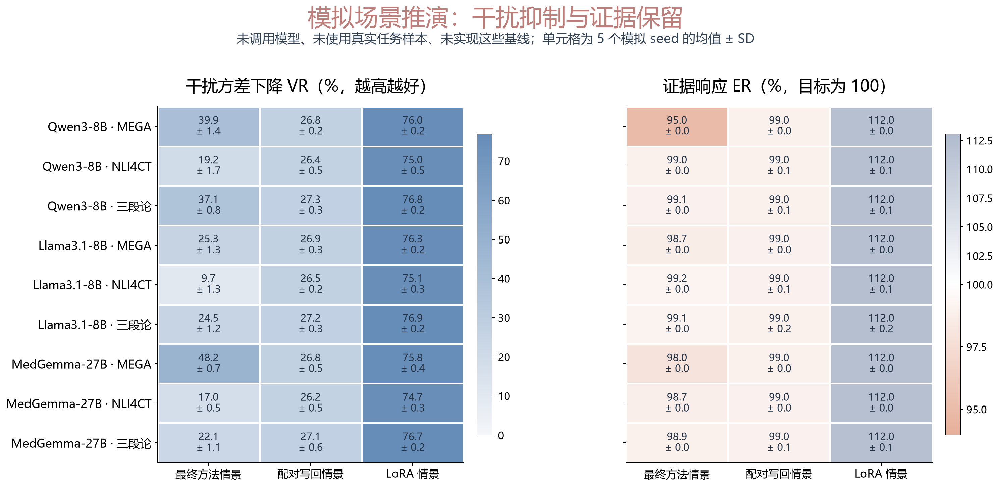
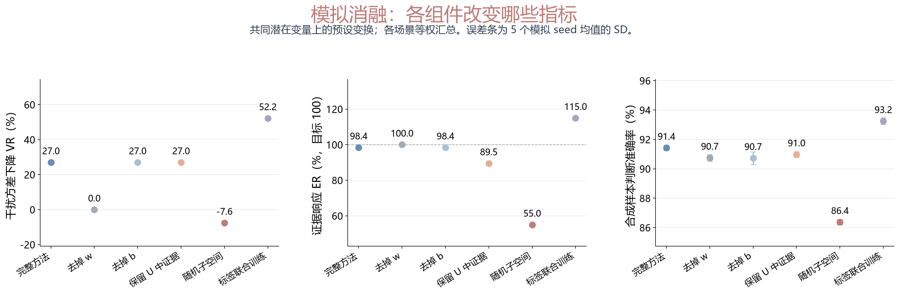

# 最终方法主实验与消融：模拟研究方案及结果

**模拟结果。** 下面用统一的潜在分数模型推演主实验与消融。模型、数据集名称表示拟开展的实验条件；本次没有调用这些语言模型、运行真实 benchmark 或训练官方 baseline。所有模拟方法共享同一批生成样本，结果来自公开保存的生成关系、参数和 5 个模拟随机种子。

这组模拟用于检查实验设计是否能区分“干扰降低”“证据保留”和“分类改善”，并形成后续真实实验的表格。ASTER-CR 的模拟允许比目前真实诊断更纯的痕迹；这是需要在真实实验中达到的条件。

## 1. 实验条件与要回答的问题

| 模拟条件 | 研究问题 | 证据变化 | 干扰变化 | 任务指标 |
|---|---|---|---|---|
| MEGA-CDP 式节点判断 | 后续处置是否影响当前条件判断 | 条件定义或决定性事实 | 后续处置与无关背景 | 二分类、配对指标 |
| NLI4CT 式二分类 | 临床试验文本关系是否受背景影响 | 蕴含/矛盾关系所需事实 | 保持关系的背景变化 | 二分类、配对指标 |
| 三段论信念偏差式判断 | 逻辑有效性是否受结论可信度影响 | 逻辑形式 | 保持有效性的内容可信度变化 | 二分类、配对指标 |

模型条件为 Qwen3-8B、Llama-3.1-8B-Instruct、MedGemma-27B，共 9 个场景。不同模型条件采用不同预设噪声、偏置与干扰强度。5 个模拟种子衡量生成样本波动，不代表真实训练或推理的重复实验。

NLI4CT 保留原生 Entailment/Contradiction 二分类；无关句与决定性证据改写是本研究另构造的配对，保持标注证据和实体指代才可视为干扰，不把它们说成原生 A/P/C/F。原生证据选择任务不在本次评价中。

三段论的可信度配对需在前提和结论中一致替换谓词、保持逻辑形式，不能只改结论内容；翻转配对需经形式逻辑判定确实改变有效性。这里推演的是拟建配对条件。MEGA 式任务额外生成共享的固定节点序列，评价六个节点是否全部正确；NLI 和三段论记为“—”，不称作真实路径执行结果。

本次主要回答：

1. 输出对消能否在降低干扰时保留证据响应？
2. 对消与表示擦除、写回、校准和标签读出分别改变了什么？
3. 观察到的变化来自痕迹选择、差分训练还是阈值校准？

## 2. 基线分类与公平比较

表中说明拟真实实验的作用与监督需求；本次用 configuration.json 中的分数变换系数表达这些设计差别。

| 类别 | 对照方法 | 使用的信息 | 是否改内部表示 | 校准/训练额外计算 | 测试每例额外前向 |
|---|---|---|---|---|---|
| 原模型与校准 | 原模型、bias-only、contextual calibration；温度缩放作解释性对照 | bias/温度用 fit 标签；context 用内容无关参考估计标签先验 | 否 | 校准拟合或参考提示；先验可缓存 | 通常 0；context 取决于缓存方式 |
| 输入修改 | 直接删除处置、语义抽取 | 规则文本与任务边界；自建任务适配 | 否，修改输入 | 语义抽取可能需独立提取步骤 | 删除为 0；抽取按实现另计 |
| 表示擦除 | LEACE、INLP、早期闭式 ASTER | 干扰标记或配对；闭式版本还估计证据方向 | 是 | 子空间/分类器拟合；真实成本另测 | 通常 0 |
| 表示定向编辑 | ITI、paired_n、paired_ns | ITI 用正确/错误答案信息；后两者与对消共享配对监督 | 是 | 方向估计、选择或配对拟合 | 通常 0；若需逐例参考须另计 |
| 普通读出 | PCA 特征上的线性读出 | fit 真值标签 | 否，替换/调整输出读出 | PCA 与监督拟合 | 0 |
| 参数高效训练 | LoReFT、LoFiT、LoRA | fit 标签；配对一致性若启用须匹配预算 | 是，训练表示或模型参数 | 实际训练及 LoFiT 选头阶段 | 通常 0 |
| 本文方法 | ASTER-CR | 同真值配对拟合 w；自然原始输入标签拟合 b | 否，只改最终分数 | 头定位、子空间与差分拟合 | 0 |

“额外前向”以一次正常任务前向为基准。contextual calibration 的参考计算可离线缓存，不能笼统算成每个测试样本都多一次。输入修改为本任务自建对照；语义抽取的输入构造覆盖率列入真实实验评价。

温度缩放把所有分数除以同一正数 T，可以同时缩小干扰和证据而不改变零阈值分类。因此，单看干扰 RMS 会给它虚假的优势，必须同时报告证据响应；它不作为模拟主表中的“修复成功”方法。

公平比较采用以下约定：

- 模拟方法共享相同生成样本；拟真实实验中还需匹配数据划分、标签和配对预算。
- paired_n、paired_ns 与 ASTER-CR 共享选中头、痕迹子空间和差分监督，主要差别是将修正写回表示还是作用于最终分数。
- 普通读出与 ASTER-CR 均采用 16 维特征加截距，即 17 个校正系数；子空间、均值和标准差的存储另算。
- 训练式方法保留其合理表达能力，拟采用 LoReFT 秩 1–8、LoFiT 选头数 4–16、LoRA 秩 4–16。实际参数量、训练耗时和显存需由真实运行导出，本次不编造。
- 输入修改仅在有清楚对应关系的 MEGA 式任务提供数值，另外两类任务记为“—”；语义抽取不是通用跨任务方法。

### 模拟生成关系

每个场景与种子共享潜在证据 E、干扰 N、痕迹噪声 T、额外编辑误差 X 和未解决的分数噪声 B。各方法只改变预设系数：

$$
\ell_m=g_mE+a_mN+c_mT+d_mX+B+b_m.
$$

同真值配对保持 E 不变、重写 N/T；翻转配对改变证据方向、保持干扰。g 控制证据响应，a 控制残余干扰，c/d 控制修正与编辑误差，b 控制阈值偏置。参数按场景预先指定，原始样本与噪声在各方法间保持一致。

对消的示意参数满足 a=1−Q、c=−√(Q(1−Q))、g=1−Qγ，其中 Q 表示预设痕迹可读性，γ 表示预设证据混入。它们是情景假设，模拟 R² 用于描述这些假设产生的结果，不再反过来当作验证假设的证据。完整参数见 configuration.json。

## 3. 指标：将干扰、证据和分类分开看

设一对样本的分数差为 Δℓ，原分数为 ℓ，方法输出为 ℓ′，修正为 c=ℓ′−ℓ。真值不变配对用 I 表示，真值翻转配对用 E 表示。

模拟分数使用 logit 形式的数值尺度；它是生成器的设定单位，不是实际模型测量。

**干扰 RMS，单位为模拟 logit：**

$$
\mathrm{RMS}_I=\sqrt{\mathbb E_I[(\Delta\ell')^2]}.
$$

它保留绝对量级。另报告干扰方差降低比例：

$$
\mathrm{VR}=1-\frac{\operatorname{Var}_I(\Delta\ell')}
{\operatorname{Var}_I(\Delta\ell)}.
$$

**预设修正的 R²，拟真实实验在留出集评价：**

$$
R^2=1-\frac{\sum_I(\Delta\ell')^2}
{\sum_I(\Delta\ell-\overline{\Delta\ell})^2}.
$$

这里用被方法减去的分数差预测原干扰差，残差就是修正后的差值。R² 与 VR 因残差均值项而可能不同；同批、同分母下的平方残差改善属于定义关系，不能作为独立机制证据。正式实验应在独立测试上评价迁移；这里计算预设情景及新生成样本下的指标。

**真值方向的证据响应保留率：**

$$
\mathrm{ER}=
\frac{\sum_E d_i\,\Delta\ell'_i}
{\sum_E d_i\,\Delta\ell_i},
\qquad d_i=y_{\mathrm{right},i}-y_{\mathrm{left},i}.
$$

ER 接近 100% 表示平均证据响应得到保留；低于 100% 表示减弱，高于 100% 表示放大，不能把越高当作越好。

**以干扰为单位的证据修正幅度：**

$$
\mathrm{扰动单位}=
\frac{\mathrm{RMS}_E(\Delta c)}
{\mathrm{RMS}_I(\Delta\ell)}.
$$

它防止证据幅度很大时，相对证据看似很小的改动掩盖了与目标干扰相当的扰动。

分类指标包括模拟原任务二分类正确率 Acc、同真值配对两侧全对率、真值翻转配对两侧全对率。原任务模拟样本与新增配对分别统计，配对正确率不替代原任务正确率。本次未生成 NLI macro-F1 或证据选择结果。MEGA 式的“合成节点序列全对率”只评价共享六节点序列的组合正确性。

所有均值和标准差按 5 个模拟种子计算。百分比指标先转换成百分数；标准差为样本标准差，只反映生成样本的波动。

## 4. 模拟主实验

以下各表均为模拟。主表单元格依次为 **VR% / ER% / Acc%**，每项为 5 个模拟种子的均值±样本标准差。每个场景、每个种子生成 2,000 个同真值配对、1,000 个翻转配对及另 1,500 个原任务模拟样本。ER 看与 100% 的接近程度，VR 和 Acc 越高越好。

### 模拟主表：Qwen3-8B

| 方法 | MEGA 式 | NLI 式 | 三段论式 |
|---|---:|---:|---:|
| 原模型 | 0.00±0.00 / 100.00±0.00 / 95.80±0.85 | 0.00±0.00 / 100.00±0.00 / 89.87±1.23 | 0.00±0.00 / 100.00±0.00 / 85.37±0.74 |
| bias-only | 0.00±0.00 / 100.00±0.00 / 96.41±0.58 | 0.00±0.00 / 100.00±0.00 / 90.47±1.10 | 0.00±0.00 / 100.00±0.00 / 86.20±0.83 |
| context 校准 | 0.00±0.00 / 100.00±0.00 / 96.31±0.62 | 0.00±0.00 / 100.00±0.00 / 90.49±0.97 | 0.00±0.00 / 100.00±0.00 / 85.96±0.61 |
| 删除处置 | 95.42±0.13 / 91.00±0.01 / 98.92±0.43 | — | — |
| 语义抽取 | 91.30±0.17 / 99.00±0.02 / 98.65±0.56 | — | — |
| 早期闭式 | 25.22±0.63 / 92.99±0.05 / 95.35±0.97 | 24.58±1.12 / 92.97±0.16 / 89.05±0.96 | 25.95±0.51 / 93.01±0.29 / 83.51±0.36 |
| LEACE | 89.26±0.23 / 71.99±0.03 / 97.95±0.66 | 88.10±0.50 / 71.99±0.09 / 93.77±0.78 | 90.24±0.16 / 72.00±0.21 / 91.31±0.45 |
| INLP | 89.04±0.46 / 57.99±0.05 / 97.56±0.67 | 87.82±0.67 / 57.98±0.15 / 92.65±0.52 | 90.15±0.30 / 58.01±0.34 / 89.75±1.26 |
| ITI | 31.38±0.60 / 102.00±0.04 / 96.81±0.53 | 30.68±1.10 / 101.97±0.16 / 91.17±0.70 | 32.15±0.49 / 102.01±0.28 / 87.60±0.47 |
| paired_n | 26.82±0.22 / 99.00±0.02 / 96.73±0.49 | 26.36±0.50 / 98.99±0.08 / 90.96±0.83 | 27.25±0.27 / 99.00±0.14 / 87.25±0.68 |
| paired_ns | 77.32±0.94 / 77.99±0.08 / 97.51±0.60 | 75.99±1.40 / 77.96±0.25 / 92.40±0.67 | 78.68±0.74 / 78.01±0.48 / 89.43±1.14 |
| PCA 读出 | 53.15±0.41 / 89.99±0.04 / 96.81±0.51 | 52.27±0.89 / 89.98±0.14 / 91.56±0.57 | 53.99±0.37 / 90.01±0.26 / 88.03±0.59 |
| LoReFT | 52.80±0.18 / 108.00±0.02 / 97.39±0.50 | 52.05±0.54 / 107.98±0.08 / 92.41±0.91 | 53.44±0.25 / 108.00±0.12 / 89.33±0.53 |
| LoFiT | 63.89±0.16 / 103.00±0.02 / 97.55±0.57 | 63.04±0.50 / 102.99±0.07 / 92.88±0.83 | 64.59±0.21 / 103.00±0.11 / 89.92±0.44 |
| LoRA | 76.02±0.18 / 112.00±0.01 / 97.97±0.59 | 75.05±0.46 / 111.99±0.06 / 94.07±0.76 | 76.80±0.18 / 112.00±0.08 / 91.52±0.62 |
| ASTER-CR | 39.92±1.35 / 94.96±0.00 / 96.65±0.57 | 19.17±1.75 / 99.00±0.00 / 90.89±0.84 | 37.10±0.78 / 99.05±0.00 / 88.35±0.39 |

### 模拟主表：Llama-3.1-8B-Instruct

| 方法 | MEGA 式 | NLI 式 | 三段论式 |
|---|---:|---:|---:|
| 原模型 | 0.00±0.00 / 100.00±0.00 / 96.08±0.24 | 0.00±0.00 / 100.00±0.00 / 88.65±0.83 | 0.00±0.00 / 100.00±0.00 / 83.07±1.36 |
| bias-only | 0.00±0.00 / 100.00±0.00 / 96.20±0.47 | 0.00±0.00 / 100.00±0.00 / 88.93±0.83 | 0.00±0.00 / 100.00±0.00 / 83.71±1.02 |
| context 校准 | 0.00±0.00 / 100.00±0.00 / 96.19±0.36 | 0.00±0.00 / 100.00±0.00 / 88.96±0.54 | 0.00±0.00 / 100.00±0.00 / 83.69±0.91 |
| 删除处置 | 95.58±0.07 / 91.01±0.01 / 98.84±0.20 | — | — |
| 语义抽取 | 91.54±0.14 / 99.01±0.02 / 98.61±0.23 | — | — |
| 早期闭式 | 25.50±0.76 / 93.03±0.04 / 95.80±0.34 | 24.93±0.42 / 93.10±0.23 / 88.01±1.27 | 25.86±0.57 / 92.95±0.47 / 82.16±1.74 |
| LEACE | 89.55±0.19 / 72.02±0.02 / 98.04±0.38 | 88.20±0.24 / 72.05±0.16 / 92.72±0.95 | 90.36±0.09 / 71.92±0.29 / 90.15±0.76 |
| INLP | 89.44±0.30 / 58.04±0.03 / 97.68±0.34 | 88.05±0.25 / 58.09±0.26 / 91.69±0.75 | 90.33±0.29 / 57.88±0.48 / 88.49±1.13 |
| ITI | 31.68±0.71 / 102.03±0.05 / 96.85±0.44 | 31.01±0.41 / 102.10±0.22 / 90.32±0.70 | 32.08±0.53 / 101.97±0.47 / 85.49±0.93 |
| paired_n | 26.95±0.32 / 99.02±0.02 / 96.63±0.50 | 26.46±0.22 / 99.05±0.11 / 89.69±0.46 | 27.22±0.25 / 98.98±0.23 / 84.96±0.94 |
| paired_ns | 78.08±0.70 / 78.05±0.07 / 97.53±0.40 | 76.55±0.54 / 78.15±0.37 / 91.72±0.52 | 78.94±0.74 / 77.90±0.75 / 87.83±1.05 |
| PCA 读出 | 53.48±0.49 / 90.03±0.04 / 96.96±0.46 | 52.48±0.34 / 90.09±0.20 / 90.51±0.84 | 54.01±0.33 / 89.95±0.41 / 85.97±1.19 |
| LoReFT | 53.02±0.25 / 108.01±0.03 / 97.35±0.52 | 52.11±0.27 / 108.05±0.10 / 91.47±0.69 | 53.48±0.18 / 108.00±0.23 / 87.45±0.85 |
| LoFiT | 64.13±0.22 / 103.01±0.02 / 97.47±0.49 | 63.07±0.28 / 103.04±0.08 / 91.84±0.78 | 64.66±0.15 / 102.99±0.19 / 88.29±0.81 |
| LoRA | 76.27±0.20 / 112.01±0.02 / 98.08±0.45 | 75.07±0.28 / 112.03±0.06 / 93.17±0.82 | 76.89±0.15 / 112.02±0.15 / 90.43±0.60 |
| ASTER-CR | 25.35±1.34 / 98.70±0.00 / 96.47±0.50 | 9.65±1.32 / 99.20±0.00 / 89.19±0.96 | 24.53±1.24 / 99.12±0.00 / 84.99±0.69 |

### 模拟主表：MedGemma-27B

| 方法 | MEGA 式 | NLI 式 | 三段论式 |
|---|---:|---:|---:|
| 原模型 | 0.00±0.00 / 100.00±0.00 / 96.68±0.45 | 0.00±0.00 / 100.00±0.00 / 89.92±0.77 | 0.00±0.00 / 100.00±0.00 / 86.45±0.80 |
| bias-only | 0.00±0.00 / 100.00±0.00 / 96.93±0.76 | 0.00±0.00 / 100.00±0.00 / 90.33±0.54 | 0.00±0.00 / 100.00±0.00 / 87.56±0.37 |
| context 校准 | 0.00±0.00 / 100.00±0.00 / 97.01±0.80 | 0.00±0.00 / 100.00±0.00 / 90.27±0.66 | 0.00±0.00 / 100.00±0.00 / 87.40±0.58 |
| 删除处置 | 95.20±0.20 / 91.00±0.00 / 99.12±0.38 | — | — |
| 语义抽取 | 91.10±0.29 / 99.00±0.01 / 99.03±0.34 | — | — |
| 早期闭式 | 25.26±0.87 / 92.99±0.03 / 95.97±0.50 | 24.51±1.09 / 93.02±0.08 / 88.91±0.83 | 25.64±1.28 / 93.04±0.20 / 85.05±0.78 |
| LEACE | 89.07±0.36 / 71.99±0.01 / 98.43±0.27 | 87.78±0.47 / 72.00±0.08 / 93.95±0.68 | 90.13±0.26 / 72.05±0.12 / 92.87±0.35 |
| INLP | 88.88±0.42 / 57.98±0.02 / 98.12±0.32 | 87.65±0.66 / 58.00±0.12 / 93.12±0.87 | 89.99±0.43 / 58.07±0.20 / 91.68±0.84 |
| ITI | 31.40±0.85 / 101.99±0.04 / 97.45±0.62 | 30.59±1.06 / 102.02±0.07 / 91.49±0.68 | 31.85±1.22 / 102.03±0.21 / 88.85±0.58 |
| paired_n | 26.80±0.45 / 98.99±0.02 / 97.33±0.62 | 26.20±0.51 / 99.01±0.04 / 91.21±0.65 | 27.14±0.61 / 99.02±0.10 / 88.51±0.38 |
| paired_ns | 77.20±0.81 / 77.98±0.05 / 97.97±0.40 | 76.22±1.19 / 78.03±0.14 / 92.99±1.03 | 78.31±1.00 / 78.08±0.32 / 91.13±0.70 |
| PCA 读出 | 53.08±0.71 / 89.99±0.03 / 97.52±0.59 | 52.09±0.84 / 90.01±0.08 / 91.52±0.72 | 53.78±0.88 / 90.04±0.18 / 89.23±0.45 |
| LoReFT | 52.70±0.46 / 108.00±0.02 / 97.96±0.57 | 51.80±0.47 / 108.01±0.03 / 92.53±0.62 | 53.35±0.50 / 108.01±0.10 / 90.52±0.52 |
| LoFiT | 63.75±0.41 / 103.00±0.01 / 98.08±0.56 | 62.75±0.40 / 103.01±0.03 / 93.07±0.45 | 64.52±0.37 / 103.01±0.08 / 91.03±0.62 |
| LoRA | 75.84±0.36 / 112.00±0.01 / 98.61±0.43 | 74.73±0.35 / 112.01±0.01 / 94.55±0.66 | 76.74±0.25 / 112.00±0.07 / 92.96±0.45 |
| ASTER-CR | 48.19±0.72 / 98.00±0.00 / 97.59±0.65 | 17.01±0.47 / 98.74±0.00 / 90.59±0.62 | 22.12±1.14 / 98.90±0.00 / 88.15±0.54 |

### 模拟完整指标：9 个场景的原模型与 ASTER-CR

本表列均值，标准差与逐种子数据见 CSV。扰动单位指证据修正 RMS / 原干扰 RMS；不变/翻转全对率分别统计两种配对。MEGA 式额外报告 200 条共享、长度为 6 的合成节点序列全对率；NLI 与三段论为“—”。

| 模拟场景 | 方法 | 干扰 RMS | VR% | R² | ER% | 扰动单位 | 不变全对% | 翻转全对% | Acc% | 合成节点序列全对% |
|---|---|---:|---:|---:|---:|---:|---:|---:|---:|---:|
| Qwen / MEGA 式 | 原模型 | 1.224 | 0.00 | -0.0003 | 100.00 | 0.000 | 93.97 | 92.60 | 95.80 | 75.60 |
| Qwen / MEGA 式 | ASTER-CR | 0.949 | 39.92 | 0.3990 | 94.96 | 1.039 | 94.74 | 93.96 | 96.65 | 80.80 |
| Qwen / NLI 式 | 原模型 | 1.517 | 0.00 | -0.0011 | 100.00 | 0.000 | 83.00 | 80.00 | 89.87 | — |
| Qwen / NLI 式 | ASTER-CR | 1.363 | 19.17 | 0.1912 | 99.00 | 0.056 | 84.11 | 81.04 | 90.89 | — |
| Qwen / 三段论式 | 原模型 | 1.663 | 0.00 | -0.0007 | 100.00 | 0.000 | 75.70 | 70.12 | 85.37 | — |
| Qwen / 三段论式 | ASTER-CR | 1.319 | 37.10 | 0.3704 | 99.05 | 0.030 | 78.57 | 74.76 | 88.35 | — |
| Llama / MEGA 式 | 原模型 | 1.325 | 0.00 | -0.0002 | 100.00 | 0.000 | 93.60 | 92.20 | 96.08 | 78.90 |
| Llama / MEGA 式 | ASTER-CR | 1.145 | 25.35 | 0.2531 | 98.70 | 0.227 | 94.26 | 93.20 | 96.47 | 80.10 |
| Llama / NLI 式 | 原模型 | 1.640 | 0.00 | -0.0013 | 100.00 | 0.000 | 82.31 | 77.20 | 88.65 | — |
| Llama / NLI 式 | ASTER-CR | 1.559 | 9.65 | 0.0952 | 99.20 | 0.038 | 82.86 | 77.96 | 89.19 | — |
| Llama / 三段论式 | 原模型 | 1.792 | 0.00 | -0.0003 | 100.00 | 0.000 | 72.86 | 66.54 | 83.07 | — |
| Llama / 三段论式 | ASTER-CR | 1.557 | 24.53 | 0.2450 | 99.12 | 0.024 | 75.58 | 70.38 | 84.99 | — |
| MedGemma / MEGA 式 | 原模型 | 1.123 | 0.00 | -0.0004 | 100.00 | 0.000 | 94.75 | 92.98 | 96.68 | 82.70 |
| MedGemma / MEGA 式 | ASTER-CR | 0.809 | 48.19 | 0.4812 | 98.00 | 0.502 | 96.10 | 95.50 | 97.59 | 86.00 |
| MedGemma / NLI 式 | 原模型 | 1.401 | 0.00 | -0.0013 | 100.00 | 0.000 | 85.27 | 80.26 | 89.92 | — |
| MedGemma / NLI 式 | ASTER-CR | 1.276 | 17.01 | 0.1695 | 98.74 | 0.086 | 86.53 | 82.86 | 90.59 | — |
| MedGemma / 三段论式 | 原模型 | 1.534 | 0.00 | -0.0002 | 100.00 | 0.000 | 77.55 | 72.80 | 86.45 | — |
| MedGemma / 三段论式 | ASTER-CR | 1.354 | 22.12 | 0.2210 | 98.90 | 0.043 | 78.90 | 76.56 | 88.15 | — |

此模拟设定下，ASTER-CR 的 VR 为 9.65%–48.19%，ER 为 94.96%–99.20%。校准只改变阈值，不改变配对差分；LoRA 条件预设更强的干扰压制和证据放大，因此分类正确率更高。Llama–NLI 情景中 ASTER-CR 的 VR 为 9.65%，低于 paired_n 的 26.46%，用于保留弱收益情景，而非预设所有条件下输出对消都占优。

合成节点序列从同一批 1,500 个模拟样本有放回抽取，所有方法共享序列索引；它检查节点错误的组合影响，不模拟真实决策树的动态路径选择。

**模拟图说明。** 两个面板分别看干扰方差下降和证据响应保留。此模拟设定下的预设差异用于说明表格能区分两类效果，真实方法效果仍需真实实验确定。

## 5. 模拟消融：每一项设计改变什么？

### 模拟消融：MEGA 式任务、3 个模型条件

单元格为 **VR% / ER% / Acc%**，5 个模拟种子的均值±样本标准差。A/P/F0 与 full 使用完全相同的定义，重复行保留在原始 CSV，表中合并为“完整 A/P/F0”。

| 消融 | Qwen | Llama | MedGemma |
|---|---:|---:|---:|
| 完整 A/P/F0 | 39.92±1.35 / 94.96±0.00 / 96.65±0.57 | 25.35±1.34 / 98.70±0.00 / 96.47±0.50 | 48.19±0.72 / 98.00±0.00 / 97.59±0.65 |
| 去掉 w | 0.00±0.00 / 100.00±0.00 / 96.41±0.58 | 0.00±0.00 / 100.00±0.00 / 96.20±0.47 | 0.00±0.00 / 100.00±0.00 / 96.93±0.76 |
| 去掉 b | 39.92±1.35 / 94.96±0.00 / 96.00±0.99 | 25.35±1.34 / 98.70±0.00 / 96.24±0.27 | 48.19±0.72 / 98.00±0.00 / 96.89±0.37 |
| 仅 A/P | 38.69±1.34 / 95.93±0.00 / 96.64±0.54 | 24.59±1.34 / 99.24±0.00 / 96.44±0.52 | 46.76±0.74 / 99.03±0.00 / 97.59±0.64 |
| 不去证据成分 U | 39.92±1.35 / 81.52±0.00 / 96.35±0.71 | 25.35±1.34 / 90.38±0.01 / 96.19±0.49 | 48.19±0.72 / 82.00±0.01 / 97.29±0.65 |
| 只用证据 S | 15.48±0.20 / 78.00±0.02 / 95.95±0.72 | 15.55±0.29 / 78.02±0.01 / 95.92±0.34 | 15.48±0.38 / 77.99±0.01 / 96.68±0.84 |
| 随机头 | -13.16±1.05 / 87.99±0.04 / 96.05±0.61 | -13.40±1.93 / 88.03±0.03 / 95.99±0.58 | -14.72±2.30 / 87.99±0.02 / 96.41±0.60 |
| 随机子空间 | -6.56±1.29 / 54.99±0.05 / 95.19±0.79 | -6.61±2.45 / 55.04±0.03 / 95.11±0.49 | -8.60±2.90 / 54.98±0.02 / 95.57±0.70 |
| 标签联合目标 | 52.43±0.18 / 115.00±0.02 / 97.45±0.62 | 52.59±0.48 / 115.02±0.03 / 97.45±0.47 | 52.03±0.77 / 115.00±0.03 / 98.00±0.63 |
| 写回表示 | -22.77±5.06 / 94.94±0.15 / 96.04±0.39 | -36.53±4.46 / 98.80±0.15 / 95.96±0.45 | -13.23±2.80 / 97.97±0.11 / 96.81±0.76 |
| 痕迹维度 8 | 25.67±1.18 / 97.54±0.00 / 96.49±0.46 | 16.46±1.33 / 99.37±0.00 / 96.33±0.51 | 31.53±0.93 / 99.02±0.00 / 97.39±0.67 |

### 模拟关键消融：NLI 与三段论

以下固定 Qwen 条件，完整 9 场景数据见 ablation_summary.csv。

| 消融 | NLI 式：VR / ER / Acc | 三段论式：VR / ER / Acc |
|---|---:|---:|
| 完整 A/P/F0 | 19.17±1.75 / 99.00±0.00 / 90.89±0.84 | 37.10±0.78 / 99.05±0.00 / 88.35±0.39 |
| 去掉 w | 0.00±0.00 / 100.00±0.00 / 90.47±1.10 | 0.00±0.00 / 100.00±0.00 / 86.20±0.83 |
| 去掉 b | 19.17±1.75 / 99.00±0.00 / 90.37±1.25 | 37.10±0.78 / 99.05±0.00 / 86.83±0.57 |
| 仅 A/P | 18.60±1.74 / 99.42±0.00 / 90.89±0.81 | 35.99±0.78 / 99.82±0.00 / 88.35±0.48 |
| 不去证据成分 U | 19.17±1.75 / 92.60±0.01 / 90.48±0.82 | 37.10±0.78 / 86.89±0.03 / 87.31±0.43 |
| 随机头 | -14.84±3.15 / 87.98±0.13 / 89.29±0.73 | -13.06±0.78 / 88.00±0.24 / 84.05±0.89 |
| 标签联合目标 | 51.39±1.08 / 114.98±0.11 / 92.73±0.70 | 53.07±0.23 / 115.00±0.15 / 89.72±0.58 |
| 写回表示 | -45.19±5.37 / 98.91±0.52 / 89.05±0.98 | -24.41±3.74 / 99.07±0.89 / 84.21±0.97 |
| 痕迹维度 8 | 12.57±1.64 / 99.51±0.00 / 90.71±0.90 | 24.09±0.78 / 99.54±0.00 / 87.43±0.60 |

去掉 b 后，RMS、VR、R²、ER 及扰动单位与完整方法逐种子一致，因为常数在差分中抵消；Acc 和配对全对率可以随阈值改变。去掉 w 后恢复校准条件，VR 为 0。随机头/随机子空间和不去证据成分分别表达预测信息不足与证据混入，具体结果由各自预设系数推演。

**模拟图说明。** 去掉 w 应消除输入相关的对消；去掉 b 应只改变分类阈值，所有配对差分指标保持一致。其余消融检查痕迹是否带入证据、随机方向是否提供预测信息，以及标签联合目标如何改变两侧结果。

F0 只保持二元真值，改变了决定性事实数值。将其纳入稳定目标是额外建模选择，不自动满足“同证据”的识别假设。因此，A/P-only 与 A/P/F0 分别报告；若模拟 full 与其中某项定义相同，数值应完全一致。

## 6. 如何解释模拟结果

此模拟设定下，只有把干扰降低、证据保留和分类正确率一起看，才能判断一个修正做了什么。干扰 RMS 很小但 ER 同时大幅下降，表示方法压缩了证据；Acc 提高但干扰指标不变，可能主要来自阈值校准。

ASTER-CR 在模拟中的优势依赖预设的可读性、有限证据污染及可迁移关系。更纯痕迹是需要达到的理想化条件，真实模型的证据污染仍由实测评价。线性输出修正也可能通过合适的表示编辑实现；这里比较的是给定写回噪声与编辑约束下的权衡，不推出所有表示编辑都会更差。

### 独立的实测锚点

> **实测，不属于上述模拟表。** repair-v2 缓存上，固定 r=16 的 A/P/F0 差分拟合使开发集干扰方差下降 41.01%，C/F 证据响应保留 94.64%，自然节点为 195/199；单参数校准为 196/199。真实结果说明已有可用预测信息，同时证据保留仍需改进。

实测细节见[配对拟合报告](../meeting/paired_fit/REPORT.zh.md)。模拟推演与这组实测分别保存，不能合并计算平均数或作为同一张结果表的不同 seed。

## 7. 文件与复算

<!-- FILES_START -->
- 生成关系与预设参数：[configuration.json](configuration.json)
- 数据来源与运行说明：[metadata.json](metadata.json)
- 主实验逐种子结果：[main_seed_metrics.csv](main_seed_metrics.csv)
- 主实验均值与标准差：[main_summary.csv](main_summary.csv)
- 消融逐种子结果：[ablation_seed_metrics.csv](ablation_seed_metrics.csv)
- 消融均值与标准差：[ablation_summary.csv](ablation_summary.csv)
- 可复现生成器：[generator.py](generator.py)
- 指标与逻辑一致性说明：[REVIEW_NOTES.zh.md](REVIEW_NOTES.zh.md)
- 数值核对结果：[validation.json](validation.json)
<!-- FILES_END -->

## 方法与任务来源

以下为拟真实实验的方法、模型与任务来源。

- 模型：[Qwen3-8B](https://huggingface.co/Qwen/Qwen3-8B)、[Llama-3.1-8B-Instruct](https://huggingface.co/meta-llama/Llama-3.1-8B-Instruct)、[MedGemma-27B](https://huggingface.co/google/medgemma-27b-text-it)。
- 任务：[MEGA-CDP](https://arxiv.org/abs/2608.26592)、[NLI4CT，Jullien et al., 2023](https://aclanthology.org/2023.emnlp-main.1041/)、[内容效应，Dasgupta et al., 2024 版本](https://arxiv.org/abs/2207.07051)。
- 校准：[Zhao et al., 2021](https://proceedings.mlr.press/v139/zhao21c.html)。
- 擦除：[LEACE，Belrose et al., 2023](https://arxiv.org/abs/2306.03819)、[INLP，Ravfogel et al., 2020](https://aclanthology.org/2020.acl-main.647/)。
- 表示编辑：[ITI，Li et al., 2023](https://arxiv.org/abs/2306.03341)、[LoReFT，Wu et al., 2024](https://arxiv.org/abs/2404.03592)。
- 参数高效训练：[LoFiT，Yin, Ye & Durrett, 2024](https://arxiv.org/abs/2406.01563)、[LoRA，Hu et al., 2022](https://arxiv.org/abs/2106.09685)。

