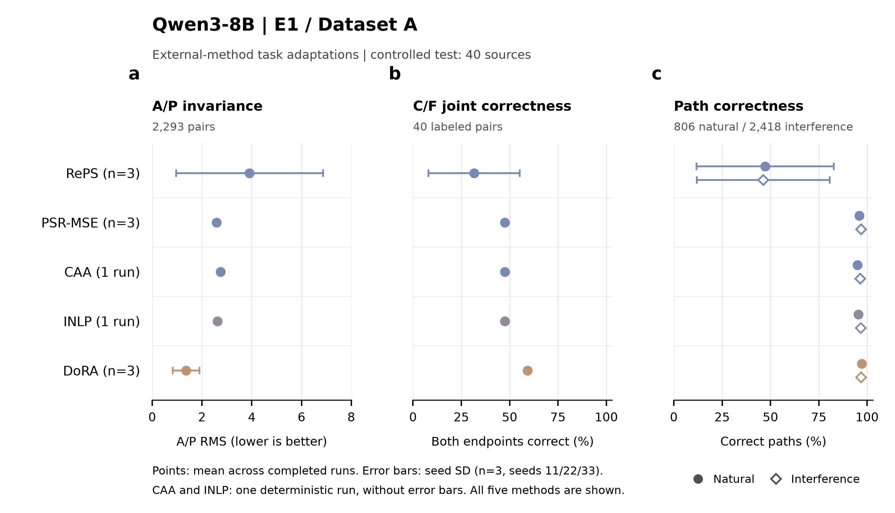

# External-method results: figure for Section 4.5

This quantitative three-panel figure compares the five completed task adaptations
of external methods on the same controlled test. Panel a reports A/P score
stability, panel b reports joint correctness on C/F pairs, and panel c reports
complete-path correctness. The display order follows the method categories
(RePS, PSR, CAA, concept erasure, parameter-efficient tuning), without ranking or
filtering methods using test results.

## Data and reproducibility

- Model: Qwen3-8B.
- Fitting data: E1 / Dataset A, 2,540 pairs from 80 fitting sources.
- Development set: 20 sources; training and development choices precede test scoring.
- Evaluation scope: historical 40-source controlled test. This is the historical
  evaluation set described in the experiment report, distinct from the official
  7,458-case MEGA test.
- Plotted means and standard deviations are read directly from
  [section4_5_method_summary.csv](../section4_5_method_summary.csv).
- Per-run values and metric denominators are read from
  [section4_5_new_methods.csv](../section4_5_new_methods.csv).
- [source_data.csv](source_data.csv) retains both summary and individual-run rows,
  raw proportions, plot values, seed counts, denominators, units, and source paths.
  Select record_type=summary to reproduce the 20 plotted means.
- Reproduce from the repository root:
  `python -m experiments.aster_codex03_external_20261112.plot_results`.
  The script runs on CPU and only reads completed results.

## Methods and repeated runs

| Plot label | Full method name | Completed runs | Seeds |
|---|---|---:|---|
| RePS | RePS-E1-task-adapted | 3 | 11;22;33 |
| PSR-MSE | PSR-MSE-E1-task-adapted | 3 | 11;22;33 |
| CAA | CAA-E1-task-adapted | 1 | deterministic |
| INLP | INLP-task-adapted | 1 | deterministic |
| DoRA | DoRA-E1-SFT | 3 | 11;22;33 |

All five methods are task adaptations as identified by their full names above.
PSR-MSE denotes the MSE version of PSR. Labels are shortened only in the figure.

Points are the arithmetic mean across completed runs. For the three stochastic
methods, error bars are plus/minus one sample standard deviation across seeds
11, 22, and 33 (ddof=1, n=3). CAA and INLP each have one deterministic result;
their SD fields remain empty and no error bars are added. A measured SD of zero
remains zero. Seed SD describes training-seed variation and is not a confidence
interval over evaluation examples. No significance tests or comparisons selected
from test results are added.

## Metrics and denominators

| Panel / metric | Definition | Per-run denominator | Direction / plot unit |
|---|---|---:|---|
| a: A/P RMS | Square root of the mean squared difference between the method's right and left scores across A/P pairs: sqrt(mean((ell_right - ell_left)^2)) | 2,293 A/P pairs, spanning 40 sources | Lower; score units |
| b: C/F joint correctness | Fraction of labeled C/F pairs for which both endpoint predictions equal their labels | 40 labeled C/F pairs, spanning 12 sources | Higher; percent |
| c: Natural path accuracy | Fraction of original paths whose complete node/decision sequence and terminal leaf match gold | 806 original paths | Higher; percent |
| c: Interference path accuracy | Fraction of paths under action_presence, action_neutral, and action_swap whose complete sequence and leaf match gold | 2,418 paths (3 variants per case) | Higher; percent |

The pair RMS uses the method's score difference, not its correction relative to
the raw model. Prediction uses the existing evaluation rule (ell > 0).
All proportion means and their SD are multiplied by 100 for plotting.
Thus accuracy SD is expressed in percentage points; RMS is not rescaled.
All methods and seeds have the same denominators. Seed-level accuracies are
averaged without pooling the examples across repeated runs. F0 pairs are
excluded from these panels, following the shared A/P and C/F protocol.

## Figure files

- [PNG, 400 dpi](section4_5_external_methods.png)
- [SVG with editable text](section4_5_external_methods.svg)
- [PDF with embedded TrueType text](section4_5_external_methods.pdf)
- [Compact preview](preview.png)
- [Source data](source_data.csv)

The canvas is 183 by 105 mm. Ratio axes show the full 0-100% range; the RMS axis
starts at zero and includes every mean plus its SD. No methods, seeds, or error
bars are omitted. Shape distinguishes natural and interference paths, with
consistent method-family colors across panels. Matplotlib generates every
format from the same figure; no manual image edits are applied.
