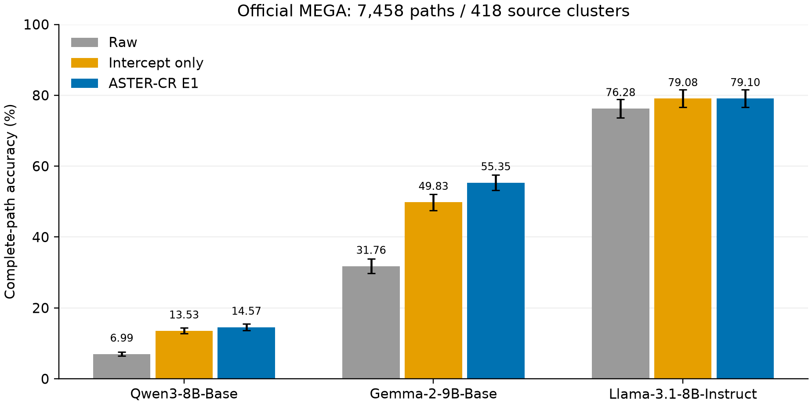

# ASTER-CR 本轮补缺实验：结果与结论（2026-11-14）

<!-- HISTORICAL-SCOPE-START -->
> **历史批次/审计快照。** 以下完成或缺失状态对应当时范围；后续CPU补算已完成，GPU接续按统一队列执行。当前逐项状态见[实验框架](../../docs/ASTER/experiments.zh.md)及其执行状态附件。原始数值和审计证据保留。
<!-- HISTORICAL-SCOPE-END -->

本轮保留范围全部完成：统一队列 **46个单元完成、0个失败、3个重复流程取消**。本报告汇总Codex02的E5补缺，以及共享队列的两个Base、已完成跨模型源任务、缺失迁移和Base/IT比较。历史报告与论文正文保持原样。

**两个Base检查点在官方MEGA完整路径上均获得准确率收益，相对独立截距仍有额外提升；冻结跨任务迁移的效果随模型与任务变化。** E5分别报告响应抑制、证据响应改动、任务准确率和概率校准，完整保留各随机种子。

## 1. 官方MEGA：7,458条路径

每模型覆盖418来源、7,458条动态路径、45,627个金标准路径节点，三个方法合计22,374条路径预测。Qwen Base复用已完成的2,380条路径，GPU0/1/4/5/6接续其余5,078条，五卡阶段约35分钟完成。沿用既有E1参数、开发集冻结配置及原评价器。

| 模型 | 原模型 | 仅截距 | ASTER-CR E1 | E1－原模型，百分点 [95% CI] | E1－仅截距，百分点 [95% CI] |
|---|---:|---:|---:|---:|---:|
| Qwen3-8B-Base | 521/7458 (6.99%) | 1009/7458 (13.53%) | 1087/7458 (14.57%) | +7.59 [+6.68, +8.51] | +1.05 [+0.53, +1.58] |
| Gemma-2-9B-Base | 2369/7458 (31.76%) | 3716/7458 (49.83%) | 4128/7458 (55.35%) | +23.59 [+20.50, +26.74] | +5.52 [+4.45, +6.62] |
| Llama-3.1-8B-Instruct | 5689/7458 (76.28%) | 5898/7458 (79.08%) | 5899/7458 (79.10%) | +2.82 [+1.69, +3.90] | +0.01 [-0.48, +0.47] |

Qwen Base完整路径正确数从521增至1,087；仅截距达到1,009，输入相关修正在此基础上增加78条。Gemma2 Base相对仅截距再增加412条。两项相对截距的差值区间均高于零，支持在这两个检查点分别报告校准收益与额外修正收益。

Llama的E1比原模型增加210条，较仅截距增加1条；相对截距的区间包含零，该项主要体现校准收益。

[完整指标](official_MEGA_7458.csv)；[逐例预测目录](official_prediction_exports.json)。官方集合保留逐例既往来源与输入使用记录，不表述为全新独立测试。

## 2. E5基线补缺与第4.5节数据

本轮完成12种方法、18行实际运行结果，另列原模型、固定0.95缩放、冻结ASTER-CR E1三个参照。训练使用E1 / Dataset A 2,540对，A/P/C/F各635；监督端点共4,637个。LoRA/LoFiT保留完整词表交叉熵目标，LoReFT二元监督以及LEACE-pair、ITI-style、SEA的任务适配配置单独标注。

LoReFT旧适配器失效已确认，修复通过参数更新、分数变化及保存重载测试后才补跑。超参数按开发集冻结，三个随机种子完整列出。

| 方法/运行 | A/P响应RMS | C/F修正RMS | 自然路径全对 | 路径正确率95% CI |
|---|---:|---:|---:|---:|
| 原模型（复用） | 2.6282 | 0.0000 | 768/806 | [93.52, 96.99]% |
| 固定0.95缩放 | 2.4967 | 1.8149 | 768/806 | [93.52, 96.99]% |
| ASTER-CR E1（冻结复用） | 2.6118 | 0.0950 | 768/806 | [93.60, 96.93]% |
| Temperature Scaling | 0.3827 | 31.0113 | 768/806 | [93.39, 97.07]% |
| 仅截距校准 | 2.6282 | 0.0000 | 763/806 | [91.33, 96.99]% |
| 仿射校准 | 0.3894 | 30.9196 | 769/806 | [92.86, 97.34]% |
| 监督线性读出 | 0.7781 | 29.7900 | 766/806 | [93.22, 96.63]% |
| LoRA SFT / seed 11 | 2.4343 | 18.7347 | 756/806 | [91.20, 96.18]% |
| LoRA SFT / seed 22 | 2.3109 | 14.8424 | 774/806 | [94.25, 97.62]% |
| LoRA SFT / seed 33 | 2.5171 | 12.6124 | 737/806 | [88.75, 93.85]% |
| LoFiT SFT / seed 11 | 2.6273 | 0.0430 | 768/806 | [93.52, 96.99]% |
| LoFiT SFT / seed 22 | 2.6269 | 0.0462 | 769/806 | [93.63, 97.14]% |
| LoFiT SFT / seed 33 | 2.6280 | 0.0575 | 769/806 | [93.63, 97.14]% |
| LoReFT二元适配 / seed 11 | 2.1317 | 13.4324 | 764/806 | [93.19, 96.58]% |
| LoReFT二元适配 / seed 22 | 1.8515 | 14.7455 | 772/806 | [93.56, 97.64]% |
| LoReFT二元适配 / seed 33 | 1.8679 | 18.8384 | 650/806 | [75.58, 85.15]% |
| LEACE-pair（任务适配） | 2.6346 | 0.5563 | 767/806 | [93.28, 96.94]% |
| ITI-style（任务适配） | 1.1040 | 31.9052 | 321/806 | [32.11, 49.13]% |
| SEA（任务适配） | 2.1519 | 9.6976 | 768/806 | [93.52, 96.95]% |
| CC | 2.6282 | 0.0000 | 769/806 | [93.63, 97.14]% |
| 强证据提示 | 2.7475 | 2.1024 | 772/806 | [94.34, 97.31]% |

A/P响应RMS衡量标签保持配对的分数变化；C/F修正RMS衡量方法对标签翻转配对原有分数差的改动。两者结合路径正确率解释。

温度缩放将A/P响应RMS从2.6282降至0.3827，同时C/F修正RMS为31.0113，自然路径维持768/806。其自然节点Brier由0.010661降至0.007842，log loss由0.084546降至0.043146，支持概率校准收益。冻结E1的C/F修正RMS为0.0950，保留较接近原模型的证据响应。

LoRA三种子路径正确率为91.44%—96.03%，均值93.76%；LoFiT为95.29%—95.41%，均值95.37%；LoReFT为80.65%—95.78%，均值90.41%。完整种子结果均保留，汇总不按测试表现挑选种子。ITI任务适配为321/806，须结合其具体训练目标和适配配置解释。

评价总体为有历史使用记录的40来源、2,293个A/P对、40个C/F对、806条自然路径。输出控制另有2,418条干扰路径，未计算该项的方法留空。[第4.5节完整表及A/P、C/F、路径95%区间](section_4_5_E1_with_95ci.csv)；[种子变异](E5_seed_variation.csv)。

Codex03的RePS、PSR-MSE、CAA、INLP、DoRA共11次冻结测试已在主分支单独交付，见[外部候选报告](../aster_codex03_external_20261112/REPORT.zh.md)。

## 3. 冻结跨任务迁移

下表使用冻结源任务E1参数及源任务独立截距。MedPIC报告整题选项集合全对率，本组未加入目标任务M4集合校准。指定Qwen NLI500、MedPIC188结果直接复用。

| 模型 | 评价总体 | 原模型 | 仅截距 | E1 | E1－原模型，百分点 [95% CI] |
|---|---|---:|---:|---:|---:|
| Llama-3.1-8B-Instruct | NLI原声明500 | 347/500 (69.40%) | 342/500 (68.40%) | 343/500 (68.60%) | -0.80 [-3.03, +0.84] |
| Llama-3.1-8B-Instruct | NLI正式5500 | 3883/5500 (70.60%) | 3941/5500 (71.65%) | 3923/5500 (71.33%) | +0.73 [-0.04, +1.50] |
| Llama-3.1-8B-Instruct | MedPIC冻结188 | 59/188 (31.38%) | 63/188 (33.51%) | 63/188 (33.51%) | +2.13 [-1.61, +5.85] |
| Llama-3.1-8B-Instruct | MedPIC全题467 | 144/467 (30.84%) | 149/467 (31.91%) | 147/467 (31.48%) | +0.64 [-1.51, +2.74] |
| Gemma-2-9B-IT | NLI原声明500 | 359/500 (71.80%) | 368/500 (73.60%) | 366/500 (73.20%) | +1.40 [-0.26, +3.04] |
| Gemma-2-9B-IT | NLI正式5500 | 4101/5500 (74.56%) | 4122/5500 (74.95%) | 4109/5500 (74.71%) | +0.15 [-0.31, +0.59] |
| Gemma-2-9B-IT | MedPIC冻结188 | 24/188 (12.77%) | 23/188 (12.23%) | 25/188 (13.30%) | +0.53 [+0.00, +1.64] |
| Gemma-2-9B-IT | MedPIC全题467 | 78/467 (16.70%) | 70/467 (14.99%) | 75/467 (16.06%) | -0.64 [-1.94, +0.63] |
| Gemma-3-27B-IT | NLI原声明500 | 374/500 (74.80%) | 382/500 (76.40%) | 381/500 (76.20%) | +1.40 [-0.94, +3.37] |
| Gemma-3-27B-IT | NLI正式5500 | 4280/5500 (77.82%) | 4246/5500 (77.20%) | 4250/5500 (77.27%) | -0.55 [-1.35, +0.25] |
| Gemma-3-27B-IT | MedPIC冻结188 | 61/188 (32.45%) | 46/188 (24.47%) | 48/188 (25.53%) | -6.91 [-11.73, -2.51] |
| Gemma-3-27B-IT | MedPIC全题467 | 157/467 (33.62%) | 120/467 (25.70%) | 124/467 (26.55%) | -7.07 [-10.09, -4.15] |
| MedGemma-27B-Text-IT | NLI原声明500 | 364/500 (72.80%) | 366/500 (73.20%) | 366/500 (73.20%) | +0.40 [-1.76, +2.78] |
| MedGemma-27B-Text-IT | NLI正式5500 | 4171/5500 (75.84%) | 4172/5500 (75.85%) | 4176/5500 (75.93%) | +0.09 [-0.58, +0.73] |
| MedGemma-27B-Text-IT | MedPIC冻结188 | 74/188 (39.36%) | 77/188 (40.96%) | 74/188 (39.36%) | +0.00 [-2.60, +2.59] |
| MedGemma-27B-Text-IT | MedPIC全题467 | 199/467 (42.61%) | 201/467 (43.04%) | 197/467 (42.18%) | -0.43 [-2.16, +1.46] |

NLI正式5,500条中，四模型E1相对原模型的差值区间均包含零。MedPIC188中，Gemma3从61题降至48题，差值−6.91个百分点，区间低于零；其他三个模型差值区间包含或接触零。源任务完整路径收益与目标任务结果分别报告，跨任务效应按模型和任务判断。

Gemma3、MedGemma复用已拟合参数，补完缺失开发集计算、冻结与迁移；NLI500的本轮统计直接使用已有缓存。MedPIC467包含既有开发题，作为全题描述性结果，188题冻结测试单列。[完整迁移数值及95%区间](frozen_transfer_results_95ci.csv)。

## 4. Base/IT检查点比较

Qwen与Gemma2的Base和IT均各自选择51个头。Qwen共享20个头，Jaccard为0.2439；Gemma2共享36个头，Jaccard为0.5455。两组比较记录各自子空间谱、有效秩和修正行为，属于检查点描述性比较。[比较表](Base_IT_head_comparison.csv)；[详细结果](../aster_e678_20261112/base_it)。

## 5. 协议和产物

- 正式训练固定E1的2,540对；旧A/P 4,887对、C/F 135对结果另存历史层。CAD、SEA、温度的既有完整评价保留原协议记录。
- 各方法原生目标与任务适配目标逐项记录。没有新增Qwen IT的ASTER-CR训练，也未重复指定Qwen迁移评价。
- E5复用各方法已有2,000次来源聚类百分位区间，本次补齐统一表中的已有区间。
- 上方MEGA相对原模型区间复用原评价文件；绝对正确率、相对截距区间及迁移汇总区间使用既有逐例预测，在CPU按来源联合重采样2,000次，随机种子11，各方法共享采样索引。CSV同时保留原MEGA差值区间。
- 本轮保留范围完成。Gemma3/MedGemma的E1源任务受控测试及官方MEGA、Gemma2 IT未完成的本轮官方MEGA保留缺项状态；旧协议结果另列。未运行方法或总体没有填入数值表。

| 交付项 | 文件 |
|---|---|
| E5兼容性矩阵 | [当前矩阵](../aster_e5_gaps_20261112/compatibility_matrix_current.csv) |
| 复用结果 | [清单](../aster_e5_gaps_20261112/reused_results.json)、[完整索引](../aster_e5_gaps_20261112/existing_results_inventory.json) |
| 新增运行 | [运行清单](../aster_e5_gaps_20261112/new_runs_current.json)、[统一队列完成记录](queue/completion.json) |
| 逐例预测 | [发布文件索引](artifact_manifest.csv)、[官方MEGA合并预测](official_prediction_exports.json) |
| 共同指标和95%区间 | [E5](section_4_5_E1_with_95ci.csv)、[官方MEGA](official_MEGA_7458.csv)、[迁移](frozen_transfer_results_95ci.csv) |
| 协议差异 | [说明](../aster_e5_gaps_20261112/PROTOCOL_DIFFERENCES.zh.md)、[CSV](../aster_e5_gaps_20261112/protocol_differences.csv) |
| E6受控测试 | [数据](E6_controlled_source_test.csv) |
| 代码和配置 | [E5](../../experiments/aster_e5_gaps_20261112)、[E6/E7/E8](../../experiments/aster_e678)、[CPU汇总](../../experiments/aster_completion_20261114) |
| 完成核对 | [记录](publication_validation.json) |

逐例JSONL以gzip保存原始字节；文件索引映射服务器原文件与GitHub文件。大体积激活缓存和预训练权重保留在服务器，见[服务器产物记录](server_artifacts.json)。历史报告按原内容归档，其中的阶段状态以本报告及最终完成记录为准。
