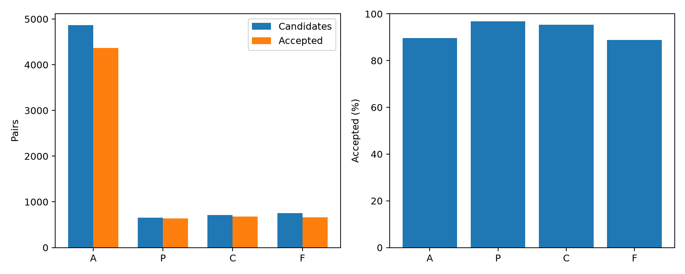
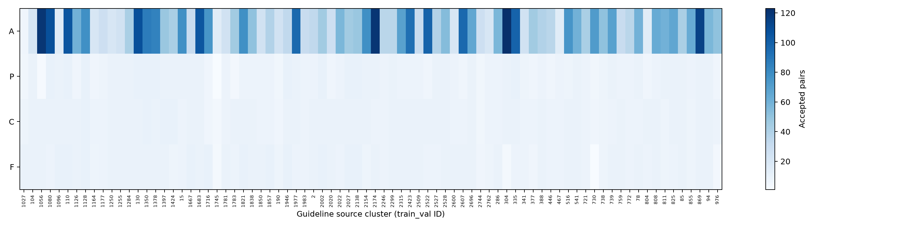

# ASTER-CR 配对训练数据扩充与独立审核

2026-11-11完成。全部合格池 **6,345对**；类别均衡集 **每类635对，共2,540对**。四类均覆盖全部80个拟合来源。新增候选只使用MEGA-CDP拟合集；开发和测试来源保持隔离。

[完整报告](REPORT.zh.md) · [服务器复现结果](reproduction_result.json) · [程序与复现](../../experiments/aster_cr_pair_dataset_20261111/README.md) · [类别统计](pair_statistics.csv) · [来源覆盖](source_coverage.csv) · [数据版本说明](dataset_manifest.json)

| 类别 | 历史合格复用 | 新增合格 | 全部合格 | 来源数 | 全部池病例数 | 均衡集病例数 |
|---|---:|---:|---:|---:|---:|---:|
| A | 4,368 | 0 | 4,368 | 80 | 911 | 635 |
| P | 9 | 626 | 635 | 80 | 622 | 622 |
| C | 40 | 636 | 676 | 80 | 650 | 635 |
| F | 18 | 648 | 666 | 80 | 646 | 635 |

生成由GPT-6.1 Sol/high完成，审核由独立GPT-6.1 Sol/xhigh完成。三窗口各最多3个子智能体，按来源分片，作者结束后由新的审核者接替；每项只审核一次。新增1,962对候选中1,910对通过，22对失败、30对无法确定，通过率97.35%。另有188个生成任务未形成有效候选。

数据版本为20261111-sol-agents-v2。均衡集优先不同病例，再按来源、语言和决策树复杂度分层选择；v1均衡子集及其说明保留在服务器备份中。全部合格池和已完成的语义审核记录保持原样。

按用户要求，GitHub只收录程序、说明、汇总统计和两张图。配对JSONL、原始指南和病例、逐条审核记录、人工抽查清单均留在服务器 /home/gcx/aster_cr_pair_dataset_20261111/。manifest中的数据文件名与大小描述服务器交付，不表示已上传这些数据。

本轮为智能体审核和程序验证，没有临床专家参与。已准备150条人工抽查清单，实际人工审核0条。F0的82对单独保存，不进入四类训练数据。本轮未训练模型，未修改模型结构、训练目标或论文实验结论。

