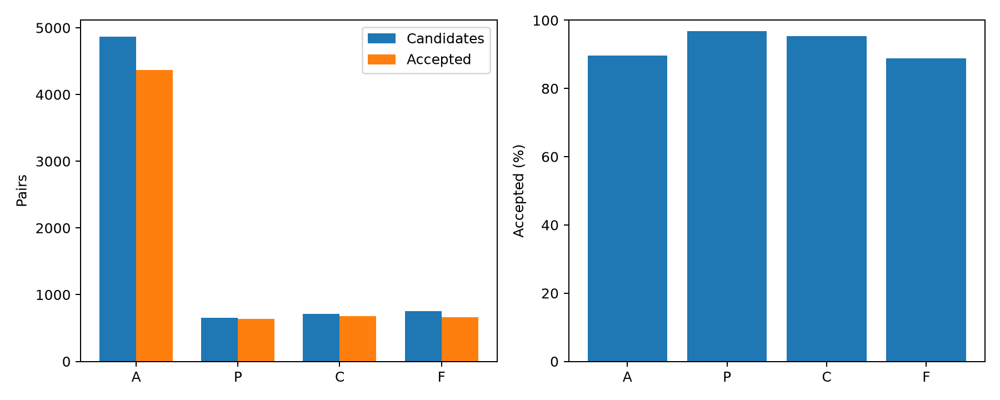
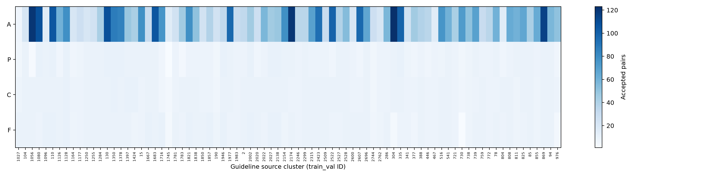

# ASTER-CR 配对训练数据构建报告

生成与单轮审核完成时间：2026-11-11 12:30（北京时间）；数据选择版本：20261111-sol-agents-v2。本轮只构建数据，不报告新增模型训练或评价结果。

## 全部合格数据

| 类别 | 历史候选 | 历史最终合格 | 新增候选 | 新增最终合格 | 全部最终合格 | 指南来源 | 不同病例 |
|---|---:|---:|---:|---:|---:|---:|---:|
| A | 4,869 | 4,368 | 0 | 0 | 4,368 | 80 | 911 |
| P | 18 | 9 | 638 | 626 | 635 | 80 | 622 |
| C | 66 | 40 | 643 | 636 | 676 | 80 | 650 |
| F | 69 | 18 | 681 | 648 | 666 | 80 | 646 |
| 合计 | 5,022 | 4,435 | 1,962 | 1,910 | 6,345 | — | — |

拟合集包含80个独立来源簇、89篇指南、1,712个病例、11,722个金标准路径节点。来源簇和指南文档分别计数；同一病例可贡献不同节点或不同编辑，配对数不等于独立病例数。

全部6,984对候选经过一次独立语义审核及确定性验证，最终保留6,345对、排除639对。历史语义审核PASS 4,478对、FAIL 323对、UNCERTAIN 221对；其中43对语义PASS被程序识别为未解决的近重复，故历史最终合格为4,435对。新增通过语义审核的1,910对同时通过程序检查。

[类别汇总](pair_statistics.csv)中的ai_pass是智能体语义审核PASS数量，accepted还要求程序结构与重复检查通过及独立标签一致。图中的合格率和CSV的acceptance_rate均为最终合格数除以该类全部候选数，包含历史与新增，不应与新增候选97.35%的通过率混用。

## 新增生成和单轮审核

先完成历史恢复与审核，再按P/C/F缺口选择一次有限生成批次。作者使用GPT-6.1 Sol/high；独立审核者使用GPT-6.1 Sol/xhigh，新的审核者使用独立上下文，不接收作者生成推理或标签推导。记录的是请求的模型和推理配置，运行环境未暴露精确后端快照。

| 类别 | 生成任务 | 有效候选 | PASS | FAIL | UNCERTAIN | PASS/有效候选 |
|---|---:|---:|---:|---:|---:|---:|
| P | 737 | 638 | 626 | 9 | 3 | 98.12% |
| C | 690 | 643 | 636 | 2 | 5 | 98.91% |
| F | 723 | 681 | 648 | 11 | 22 | 95.15% |
| 合计 | 2,150 | 1,962 | 1,910 | 22 | 30 | 97.35% |

188个任务主动弃权或未形成可规范化的候选，不能作为新增有效样本计数。2150是本轮有限任务规模，不是合格数据池上限。A类历史合格数量充足，没有新增A。三个窗口按来源分工，分别处理705、723、722项任务，来源之间不重叠；各窗口生成与审核阶段各最多3个子智能体并行。新数据阶段约75分钟，使用0张GPU、0显存，没有服务器模型API或Codex CLI调用。

P只改与当前目标无关的背景，标签保持；C只改目标指南条件、患者不变，标签翻转；F只改一项决定性患者事实、指南条件不变，标签翻转。C/F明确标记为人工反事实。A只改后续处置、当前标签保持。审核失败和不确定项不进入训练数据，也没有修改后反复送审。

确定性验证包括JSON Schema、原始来源和病例ID、原始金标准标签、编辑范围、类别标签关系、精确与近重复、拟合/开发/测试来源隔离和覆盖统计。可执行C/F规则重新计算；无法自动计算的语义仍记为UNCERTAIN，由独立审核者给出语义判断，程序不将其自行判为语义PASS。

## 两版训练数据

**Dataset A**为均衡集，按来源、语言、决策树复杂度分层选取，每类635对，共2540对。**Dataset B**为全部合格池，6345对，保留全部4368对合格A。后续比较应固定模型、特征维数、目标和评价集；Dataset B采用类别均衡采样或类别权重。本轮没有进行该训练比较。

| 类别 | 均衡集配对 | 来源数 | 不同病例 |
|---|---:|---:|---:|
| A | 635 | 80 | 635 |
| P | 635 | 80 | 622 |
| C | 635 | 80 | 635 |
| F | 635 | 80 | 635 |

发布整理时发现v1桶内按病例ID排序会反复选择同一病例，A类635对仅覆盖155个病例。v2改为优先尚未选择的病例，再在病例已覆盖后选择额外配对；类别数量、来源覆盖、全部合格池和语义审核结果不变。v1子集及原说明保存在服务器reports/dataset_versions/v1/。v2四类均超过300个不同病例，不通过重复采样增加数量。

## 人工审核与交付

本轮没有临床专家审核。服务器的human_audit.csv为150条分层待审清单，C/F各50条、A/P各25条；实际人工审核0条、人工通过率未有。F0的82对单独保留作诊断，排除在四类主训练数据外。

完整配对数据、作者编辑、原文证据和逐条审核记录只保存在服务器/home/gcx/aster_cr_pair_dataset_20261111/。GitHub发布程序、汇总表、统计元数据和两张图，不上传配对数据或逐条记录。[dataset_manifest.json](dataset_manifest.json)描述服务器版本、模型配置和交付文件大小，未执行哈希审计。

[复现入口](../../experiments/aster_cr_pair_dataset_20261111/README.md)在新输出目录复用冻结记录，运行确定性验证和分层选择，不重新生成或审核、不训练模型，不覆盖原实验。

