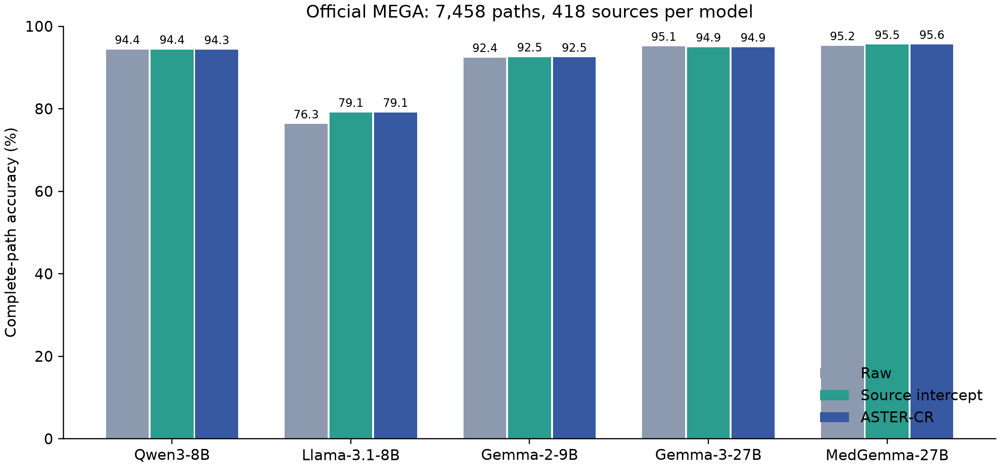
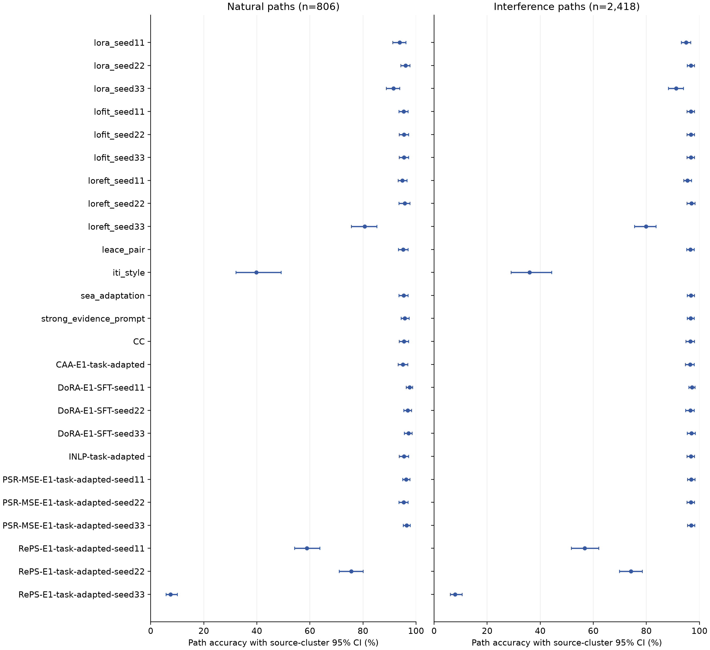

# ASTER-CR 最小补实验结果

当前E1协议的四个官方MEGA缺口、两款27B受控评价、E5十三行干扰评价和批准的CPU统计已完成。全部结果使用既有冻结参数，新增训练和模型下载均为0。

## 结果分析

官方MEGA上，Llama的E1相对raw增加210条正确路径，差值为2.82个百分点，95%区间为[1.69, 3.90]；MedGemma增加24条，差值为0.32个百分点，区间为[0.08, 0.57]。Qwen、Gemma2和Gemma3的差值区间均覆盖零。独立截距分别解释了Llama的209条和MedGemma的22条净提升，E1在此基础上再增加1条和2条。因此，校准收益与输入相关修正收益应分别报告。

E5的随机方法呈现种子差异，应保留三个种子并汇总其变化。LoFiT三个种子的干扰路径正确性均与raw一致；SEA的正确总数与raw相同，但逐例纠正与新增错误相互抵消，对应差值区间为[-0.16, 0.16]个百分点。逐例结果支持分别分析纠正、新增错误及A/P、C/F指标。

Qwen冻结迁移中，E1相对raw在NLI500、NLI5500和MedPIC467分别少3、30和5个正确样本。三项任务保留既定源任务截距和原评价总体；跨任务结果与MEGA结果分别呈现。

## E6 官方MEGA

| 模型 | raw正确/7458 | 独立截距正确/7458 | E1正确/7458 | E1相对raw差值及95%区间（百分点） |
| --- | ---: | ---: | ---: | --- |
| Qwen3-8B-IT | 7037 | 7038 | 7033 | -0.05 [-0.36, 0.25] |
| Llama-3.1-8B-Instruct | 5689 | 5898 | 5899 | 2.82 [1.69, 3.90] |
| Gemma-2-9B-IT | 6890 | 6900 | 6896 | 0.08 [-0.19, 0.35] |
| Gemma-3-27B-IT | 7094 | 7079 | 7078 | -0.21 [-0.65, 0.18] |
| MedGemma-27B-Text-IT | 7103 | 7125 | 7127 | 0.32 [0.08, 0.57] |

每模型均覆盖7,458条唯一路径、418来源；三方法共享当前检查点前向，保留45,627个金标准自然节点。Llama完整结果沿用既有归档。Gemma2保留原2,379条，接续5,079条。

## 两款27B受控评价

| 模型 | raw正确/806 | 独立截距正确/806 | E1正确/806 | 新前向 |
| --- | ---: | ---: | ---: | ---: |
| gemma3 | 787 | 774 | 775 | 0 |
| medgemma | 773 | 772 | 771 | 0 |

受控路径由已审计全头缓存和当前E1参数重建，覆盖40来源。A/P、C/F、纠正和新增错误及来源配对区间保存在对应指标文件。

## E5 自然与干扰路径

| 方法/种子 | 自然正确/806 | 干扰正确/2418 | 干扰相对raw差值及95%区间（百分点） |
| --- | ---: | ---: | --- |
| lora_seed11 | 756 | 2296 | -1.78 [-3.23, -0.34] |
| lora_seed22 | 774 | 2341 | 0.08 [-1.25, 1.41] |
| lora_seed33 | 737 | 2205 | -5.54 [-7.82, -3.46] |
| lofit_seed11 | 768 | 2339 | 0.00 [0.00, 0.00] |
| lofit_seed22 | 769 | 2339 | 0.00 [0.00, 0.00] |
| lofit_seed33 | 769 | 2339 | 0.00 [0.00, 0.00] |
| loreft_seed11 | 764 | 2309 | -1.24 [-2.65, 0.16] |
| loreft_seed22 | 772 | 2344 | 0.21 [-0.49, 0.95] |
| loreft_seed33 | 650 | 1930 | -16.91 [-21.30, -12.70] |
| leace_pair | 767 | 2336 | -0.12 [-0.36, 0.10] |
| iti_style | 321 | 869 | -60.79 [-67.57, -53.01] |
| sea_adaptation | 768 | 2339 | 0.00 [-0.16, 0.16] |
| strong_evidence_prompt | 772 | 2338 | -0.04 [-0.83, 0.74] |
| CC | 769 | 2335 | -0.17 [-0.56, 0.15] |
| CAA-E1-task-adapted | 766 | 2332 | -0.29 [-0.69, 0.09] |
| DoRA-E1-SFT-seed11 | 786 | 2351 | 0.50 [-0.91, 2.01] |
| DoRA-E1-SFT-seed22 | 781 | 2334 | -0.21 [-1.93, 1.45] |
| DoRA-E1-SFT-seed33 | 783 | 2345 | 0.25 [-1.41, 1.91] |
| INLP-task-adapted | 769 | 2339 | 0.00 [0.00, 0.00] |
| PSR-MSE-E1-task-adapted-seed11 | 776 | 2343 | 0.17 [-0.21, 0.59] |
| PSR-MSE-E1-task-adapted-seed22 | 768 | 2339 | 0.00 [0.00, 0.00] |
| PSR-MSE-E1-task-adapted-seed33 | 777 | 2343 | 0.17 [-0.29, 0.62] |
| RePS-E1-task-adapted-seed11 | 474 | 1372 | -39.99 [-44.59, -34.99] |
| RePS-E1-task-adapted-seed22 | 609 | 1793 | -22.58 [-27.03, -18.61] |
| RePS-E1-task-adapted-seed33 | 60 | 191 | -88.83 [-90.87, -86.15] |

每行使用同一组40来源抽样，同时计算方法和raw的差值；2,000次配对来源重采样。A/P为2,293对、C/F为40对、F0为6对另列。所有随机种子均保留。

## Qwen迁移评价

| 总体 | 方法 | 正确/分母 | 准确率95%区间（%） | 来源簇 |
| --- | --- | ---: | --- | ---: |
| nli500 | raw | 378/500 | [72.52, 78.87] | 113 |
| nli500 | calibration | 372/500 | [71.21, 77.95] | 113 |
| nli500 | E1 | 375/500 | [71.86, 78.32] | 113 |
| nli5500 | raw | 4073/5500 | [71.85, 76.10] | 500 |
| nli5500 | calibration | 4033/5500 | [71.14, 75.43] | 500 |
| nli5500 | E1 | 4043/5500 | [71.33, 75.63] | 500 |
| medpic467 | raw | 188/467 | [36.09, 44.22] | 376 |
| medpic467 | calibration | 184/467 | [35.24, 43.68] | 376 |
| medpic467 | E1 | 183/467 | [34.88, 43.37] | 376 |

NLI500按113个试验或试验组合聚类；NLI5500按500个原始声明及其变体聚类。两种口径已经用户确认并分别标注。MedPIC467包含开发题，作为描述性评价，按376来源聚类。独立截距来自MEGA的761个拟合节点、80个来源；未使用目标任务标签拟合或选参。

## 复用与文件入口

- E5保留已修复LoReFT适配器、全部原随机种子和训练参数；PSR seed22训练及既有11行前向均未重跑。
- 同卡LoRA/LoFiT任务连续复用主干；LoReFT三个种子及LEACE/ITI/SEA分别共享合法的原模型提示前缀，修正分数独立保存。
- SEA新增最终层原始残差保存在服务器private_cache目录，公开归档保存数值预测和缓存位置。
- E7其他四模型前向与完整统计、Qwen MedPIC188及E8比较沿用既有结果。模型版本追溯见provenance/model_identity.json。
- 完整表格：e6_official_summary.csv、e5_path_summary.csv、e7_qwen_summary.csv；逐例及参数文件见artifact_manifest.json。
- 代码位于experiments/aster_final_gap_completion_20261114；授权和协议选择见authorization.json，调度及性能见queue_status.json和各worker记录。
