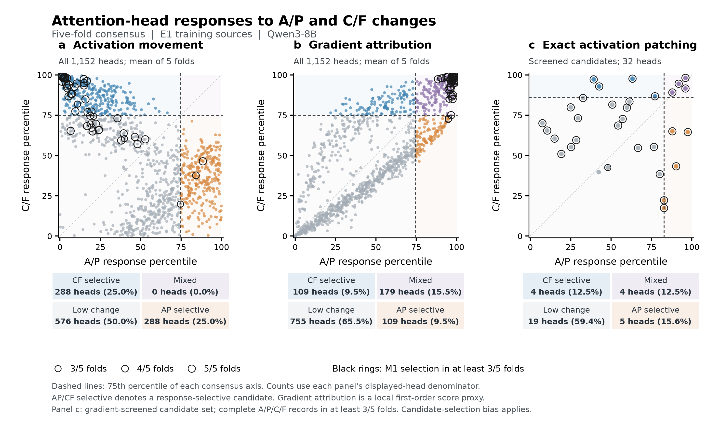
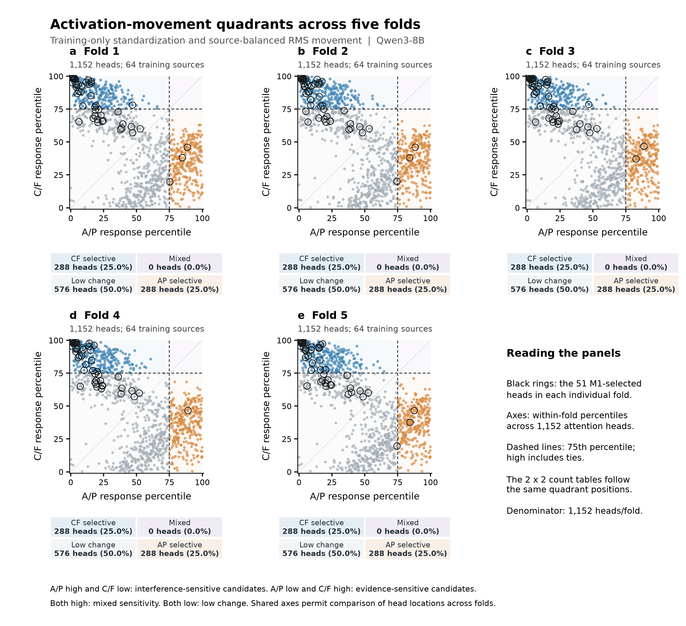

# E1 注意力头的 A/P–C/F 四象限诊断

**全头激活移动呈现稳定的 A/P 与 C/F 响应差异；M1 入选头的分数敏感性多数同时涉及两类变化。** 按预定75分位阈值，A/P敏感候选与C/F敏感候选各288头，1,061/1,152头（92.10%）五折象限一致。梯度视图显示179个混合敏感头；在M1的255次折内入选记录中，246次（96.47%）落入当折梯度混合象限。已有修补在32个共同覆盖头中与梯度排序高度相关，A/P、C/F的Spearman相关分别为0.880和0.920。

本次复用缓存完成，**无GPU、无模型前向、无梯度重算、无注意力头修补重跑、无M1重跑**。数值计算约60秒，17项单元测试全部通过。

## 全头激活移动：两类响应差异跨折稳定

|75分位主结果|分母|A/P高、C/F低|A/P低、C/F高|两轴都高|两轴都低|
|---|---:|---:|---:|---:|---:|
|标准化激活移动|1,152|288（25.00%）|288（25.00%）|0（0.00%）|576（50.00%）|
|梯度归因|1,152|109（9.46%）|109（9.46%）|179（15.54%）|755（65.54%）|
|候选集精确修补|32|5（15.63%）|4（12.50%）|4（12.50%）|19（59.38%）|

激活移动两轴的Spearman相关为−0.630。A/P候选的 A/P−C/F 百分位差中位数为+50.69个百分点；C/F候选为−68.50个百分点，两个群体具有明确的离对角位置。A/P候选中262/288头（90.97%）五折象限一致，C/F候选中272/288头（94.44%）五折一致。

全部头中1,118/1,152头（97.05%）至少四折与共识象限一致。任意两折的激活象限一致率为95.49%–97.14%。各折的象限数量均为288/288/0/576；头身份在阈值附近有少量变化。每层计数完整保存在 `quadrant_summary.json → views → activation → layer_distribution`；层号与头号均从0开始。

标准化激活图中的右上头数为0。梯度图中混合头占全部头15.54%，占至少一轴高响应的397头的45.09%。修补图相应为4/32（12.50%）和4/13（30.77%）。75分位阈值限制每轴高响应集合的规模，所以“多数”的分母必须与这些比例一同阅读。

## 激活移动与分数敏感性分别提供信息

|共识视图比较|共同头数|A/P Spearman|C/F Spearman|象限同名比例|
|---|---:|---:|---:|---:|
|激活移动 vs 梯度归因|1,152|−0.093|0.748|52.00%|
|激活移动 vs 精确修补|32|0.446|0.526|15.63%|
|梯度归因 vs 精确修补|32|0.880|0.920|12.50%|

A/P激活移动排名与目标分数归因排名的相关接近0，C/F两种排名则有较强对应。A/P激活候选288头中，213头落入梯度低响应象限、73头落入梯度A/P象限、2头落入梯度混合象限。较大的表示移动对目标分数的贡献需要通过归因与干预结果判断。

候选修补采用32头内的共识阈值，梯度采用全部1,152头的阈值。这32头在全头梯度图中全部属于混合象限，在候选修补图中再按候选内相对位置分成四象限。因此，涉及修补的象限同名比例同时受候选筛选与阈值分母影响；候选内排序相关直接刻画归因与修补的对应程度。

各折每类64个梯度候选中的“归因原值—精确修补效应”Spearman相关范围为：A 0.725–0.811、P 0.185–0.495、C 0.894–0.920、F 0.958–0.966。C/F的对应最稳定，P类别的关系随折变化较大。这里的范围是五折描述性范围；本次未进行来源bootstrap或计算置信区间。

## 已有修补支持哪些选择性判断

共同修补覆盖要求同一头在同一折A/P/C/F四类分数均存在，以保留两类别等权平均的定义。每折完整覆盖为32、32、31、33、32头；至少三折完整的头为32个，其中31头五折完整，1头三折完整。另有1头有两折完整记录，保留在数值表中。四类候选记录的组并集交集每折为43、46、46、46、43头，单类记录均保留，缺失类别不补零。

各折每一类别均覆盖64个候选、64个训练来源与64个来源代表配对；每类逐行修补文件有4,096条已有记录。本分析直接使用 `m1.json["exact_scores"]` 的平均绝对双向修补效应。

|按激活共识象限分组|共同修补覆盖头数|A/P原始平均效应|C/F原始平均效应|C/F大于A/P的头数|
|---|---:|---:|---:|---:|
|A/P敏感候选|0|—|—|—|
|C/F敏感候选|26|0.1194|2.2678|26/26|
|低变化|6|0.1618|0.8673|6/6|
|全部共同覆盖|32|0.1274|2.0052|32/32|

原始效应的单位沿用已有M1目标分数。表中先在同折对A/P与C/F各自取两类别均值，再在该头的完整覆盖折间平均，最后在表内头集合中平均。

激活C/F候选中，已有直接干预证据覆盖26/288头，26头的C/F修补效应均大于A/P。激活A/P候选的共同覆盖为0，本次对这288头的因果选择性结论留空。

修补图右下的5头表示“在A/P候选排名较高、在C/F候选排名较低”：其原始平均效应为A/P 0.1666、C/F 0.9003，5头均为C/F效应更大。跨类别百分位反映各自候选分布中的相对位置，原始幅度回答跨类别效应大小。现有结果支持稳定的响应差异和候选范围内的C/F干预优势；双分支结构的检验还需A/P候选的直接干预证据。

## M1选择及折间稳定性

|折|训练配对数|训练端点数|缓存覆盖|M1激活象限：A/P / C/F / 混合 / 低|M1梯度象限：A/P / C/F / 混合 / 低|
|---|---:|---:|---:|---|---|
|1|2,035|3,713|100%|3 / 31 / 0 / 17|3 / 0 / 48 / 0|
|2|2,054|3,759|100%|2 / 32 / 0 / 17|2 / 0 / 49 / 0|
|3|2,050|3,753|100%|2 / 34 / 0 / 15|2 / 0 / 49 / 0|
|4|2,021|3,662|100%|1 / 33 / 0 / 17|0 / 0 / 51 / 0|
|5|2,000|3,661|100%|2 / 32 / 0 / 17|2 / 0 / 49 / 0|

表内使用当折象限，每行均为当折51个M1入选头；255次入选记录包含同一头在多个折的重复。激活C/F象限占162/255次（63.53%），梯度混合象限占246/255次（96.47%）。按共识象限统计这些入选记录时，计数分别为161和248；两种计数的标签定义不同，完整字段保留在JSON中。

五折M1选择并集为56头，交集为45头；52头至少入选三折，主图对这52头增加黑圈。共同修补32头中31头五折记录完整，其中25/31头（80.65%）修补象限五折一致。梯度图有1,112/1,152头（96.53%）五折象限一致。

## 中位数阈值敏感性

|50分位阈值|分母|A/P高、C/F低|A/P低、C/F高|两轴都高|两轴都低|
|---|---:|---:|---:|---:|---:|
|激活移动|1,152|484|484|93|91|
|梯度归因|1,152|143|143|433|433|
|候选修补|32|8|8|8|8|

激活图的两个离对角象限合计968/1,152头（84.03%）；梯度混合头433个，占至少一轴高响应719头的60.22%。阈值变化保留了激活响应差异与梯度共同敏感性的对照。边界并列归入高响应，因此某一轴的高响应数量可略高于分位规则对应的整数数量。主图保持预定75分位阈值。

## 数据与计算

输入来自 E1 已完成的五折 M1 与训练缓存：`models/E1/fold{1..5}/m1.json`、`m1_exact_{A,P,C,F}.json`、`folds.json`、E1 配对和 `runtime/fit_heads.npy`、`fit_uids.json`、`fit_present.npy`。原始缓存目录见 [configuration.json](configuration.json)。激活缓存为 9,969 × 1,152 × 128，保存为 float16；统计累积采用 float64。

每折使用其64个训练来源。验证/测试来源的激活不参与轴值、标准化或阈值。五折划分来自同一80来源池，训练来源有重叠，折间一致性描述这一来源池内的划分稳定性。

设类别为 $q$，该类别含 $S_q$ 个来源，来源 $s$ 含 $n_{q,s}$ 个配对。全体训练配对的权重为

$$
w_j=\frac{1}{4S_qn_{q,s}},\qquad
\nu_u=\sum_{j:u\in\{L_j,R_j\}}\frac{w_j}{2}.
$$

相同端点的权重相加。按 M2 的加权总体标准差定义，逐头、逐通道计算

$$
\mu_{h,d}=\sum_u\nu_u H_{u,h,d},\qquad
\sigma_{h,d}=\max\!\left(\sqrt{\sum_u\nu_u(H_{u,h,d}-\mu_{h,d})^2},10^{-5}\right).
$$

类别内计算调用等价的 `pair_weights(category_pairs, "E1")`，此时 $\omega_j=1/(S_qn_{q,s})$、各类权重和为1。标准化移动定义为

$$
M_{q,h}=\sqrt{\sum_{j\in q}\omega_j\frac{1}{128}
\sum_d\left(\frac{H_{R_j,h,d}-H_{L_j,h,d}}{\sigma_{h,d}}\right)^2},
$$

$$
M_{AP,h}=\sqrt{(M_{A,h}^2+M_{P,h}^2)/2},\qquad
M_{CF,h}=\sqrt{(M_{C,h}^2+M_{F,h}^2)/2}.
$$

每折先对两个移动量分别在全部1,152头间转为百分位，再对每个头取五折均值。百分位采用 $100(r-0.5)/N$，$r$ 为从1开始的平均秩；并列值共享平均秩。

梯度视图直接使用缓存的四类归因值。各折各类别分别在全部头中转百分位，A/P及C/F各取两类别均值，再取五折均值。梯度归因衡量目标分数的局部一阶敏感性。

修补视图使用已有的平均绝对双向激活修补效应。每类先在原64个候选中取百分位，再对同折四类记录齐全的头计算 A/P、C/F 两类均值；共识要求至少3/5折记录完整。缺失类别保留为空值。单类原值与百分位均保留在完整指标表中。

三个面板独立对各自共识坐标取第75百分位作为阈值，等于阈值计为高。主图采用预先确定的75分位；50分位结果单列。四象限依次为 A/P高且C/F低、A/P低且C/F高、两轴都高、两轴都低。象限稳定次数统计各头折内象限与该视图共识象限的一致折数。

## 图表含义

主图的激活移动、梯度归因、精确修补分别回答“表示移动多大”“目标分数局部敏感性多大”“已有干预产生多大分数变化”。修补效应为干预幅度，任务性能改善需由任务指标另行评价。

精确修补候选经过梯度 top-64 筛选，面板分母为已有完整覆盖的头，其分布和相关性描述这一候选范围。单头干预效应还受干预输入与幅度影响。四象限说明响应选择性的差异；独立计算模块的判断需要进一步实验。

主图黑圈表示至少3/5折入选 M1，圈大小区分3、4、5折。五折图分别标出当折51头。图中百分位是相对位置，原始标准化 RMS 与修补分数幅度见 CSV。

## 复现与交付

[README.md](README.md) 提供完整运行命令及文件索引。数值脚本输出5,760行折内记录和1,152行共识记录；折内表同时携带共识坐标、象限和稳定次数。PNG、PDF及可编辑SVG均已生成，图中数量与JSON摘要一致。

环境：Python 3.12.3、NumPy 2.5.4、SciPy 1.18.1、matplotlib 3.11.2。分析通过内存映射分批读取缓存，标准化下限影响的通道数为2、2、3、3、2（每折总计147,456个头通道）；其余通道直接使用训练加权标准差。全部训练端点可用，缺失原因为无。

17项单元测试覆盖平均秩和并列、类别/来源/配对权重、共享端点权重、逐通道总体标准差及下限、RMS、象限边界、缺失修补处理和五折汇总；访问限制测试确认零权重端点不被标准化读取。详细运行日志保留在本次目录的 `logs/` 下。

本次新增代码、配置、表格、图形与报告放在独立目录，主稿、旧实验结果与PR #71保持原状。
