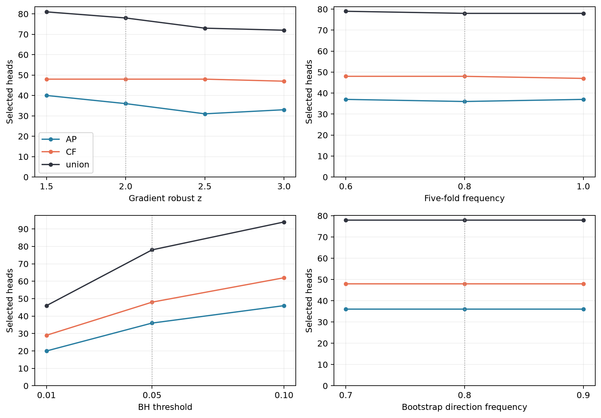
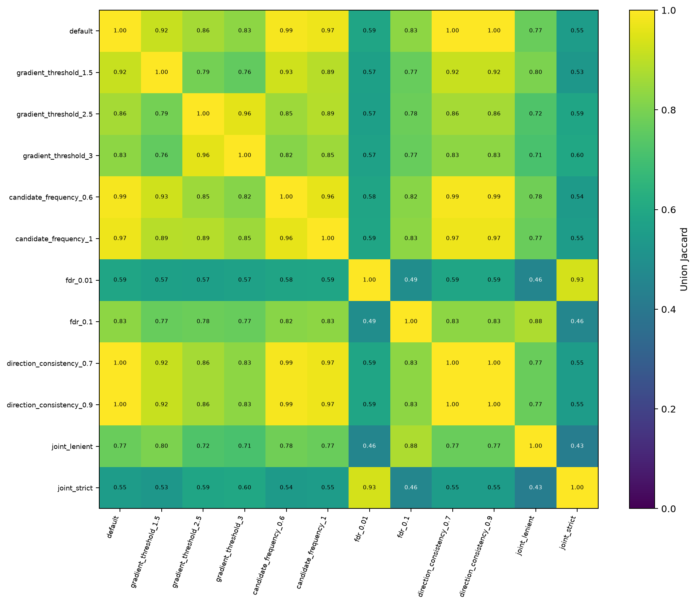
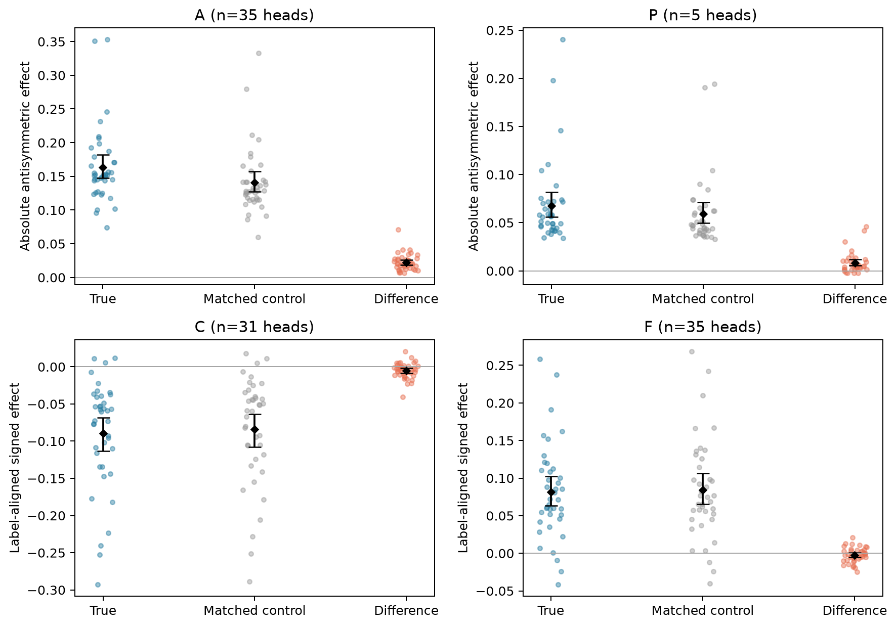
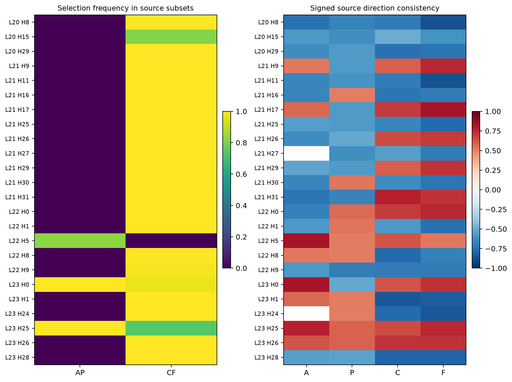

# 新 M1 筛选规则敏感性与稳健性验证

结论：**C。现有结果不足以支持固定该默认配置，尚未建立满足预设标准的可重复头集合。**

Qwen3-8B 的默认配置选出 78 个头：A/P 36、C/F 48、交集 6；来源子集入选频率达到 0.80 的默认核心共有 43 个。没有预设最终头数量。

## 版本、数据与复用

实际统计执行提交：d07800bcc506d4c8604251db951313c480e5b66d。GPU 执行提交见 execution_manifest.json。PR #81 原始修补提交 f3cc86a9fa8ef53ff8bb0470496e72185144c7a7；本分支基于 b4cecd8feba6f20aface290aa355d98f11b09b21。

全部分析使用 E1 的 80 个训练来源和 2,540 对配对。候选筛选与验证各 40 个来源，来源不重叠。开发/测试来源不参与新规则筛选、零对照、阈值设定或稳定性统计。

匹配对照后有效配对数：{"A": 300, "P": 311, "C": 304, "F": 308}；有效来源数：{"A": 40, "P": 39, "C": 40, "F": 40}。32 对缺少同来源、同类别、同标签转换的其他配对，报告为不具备对照；其他有效配对未筛掉负效应。

复用 1,337,228 个真实/自身替换分数。新增 2,795,150 个匹配对照分数，另计划 2,251 次基线重放；实际调用、恢复复用及显存见 workers/*/completion.json。全部所需真实修补已覆盖，新增真实修补为 0。

旧零对照、旧五折功能分组与冻结集合诊断的版本和复用边界见 history_search/REPORT.zh.md。旧实验原文件保持不变。

## 配置与完整结果

默认：梯度稳健标准分数 2.0、五折入选频率 0.80、BH 阈值 0.05、方向一致率 0.80、至少 5 个有效来源。扫描和两个联合配置均在新对照产生前固定；详见 configuration.json 与 PROTOCOL.zh.md。

|配置|A/P|C/F|交集|并集|稳定核心|BY并集|
|---|---:|---:|---:|---:|---:|---:|
|default|36|48|6|78|43|42|
|gradient_threshold_1.5|40|48|7|81|43|44|
|gradient_threshold_2.5|31|48|6|73|41|42|
|gradient_threshold_3|33|47|8|72|43|43|
|candidate_frequency_0.6|37|48|6|79|44|43|
|candidate_frequency_1|37|47|6|78|43|42|
|fdr_0.01|20|29|3|46|28|35|
|fdr_0.1|46|62|14|94|55|46|
|direction_consistency_0.7|36|48|6|78|43|42|
|direction_consistency_0.9|36|48|6|78|43|42|
|joint_lenient|53|63|15|101|59|52|
|joint_strict|17|29|3|43|28|35|

全部 12 个配置均对各自候选家族重新计算 BH。all_configuration_heads.csv.gz 保存全部 1,152×4 个类别—头位置在每个配置下的筛选状态与统计量；未成为候选或未测量的值标记缺失，不置零。32 个配对的对照不可用不等于整体配置不可用；有效来源数已单列。

## 稳定性与默认建议

本轮标准为并集 Jaccard ≥0.80、可比较功能组 Jaccard ≥0.70、并集数量变化≤25%、来源子集频率≥0.80的核心覆盖默认集合至少80%。完整结果见 stability_criteria.csv 和 source_subset_counts.csv。

包含默认值并符合标准的连续扫描取值：{"gradient_threshold": [], "candidate_frequency": [], "fdr": [], "direction_consistency": []}。

未满足全部操作标准的配置：default、gradient_threshold_1.5、gradient_threshold_2.5、gradient_threshold_3、candidate_frequency_0.6、candidate_frequency_1、fdr_0.01、fdr_0.1、direction_consistency_0.7、direction_consistency_0.9、joint_lenient、joint_strict。极端联合配置作描述性比较；不会据此替换默认阈值。

64 次子集分析分别从候选和验证来源中不放回保留 80%，每次重算候选、来源效应统计、检验、BH 与方向一致率。子集之间有重叠，不作为独立重复证据。core_heads.csv 保存全部默认头的入选频率与功能集合归属。

## 统计审计

双向修补使用目标自身替换参照，反对称效应为 (uL−uR)/2。A/P 检验绝对幅度超过匹配对照的单侧假设；C/F 检验标签对齐有向响应相对匹配对照的双侧假设。不同统计量分别报告，原始效应大小不作跨组强弱排名。

符号翻转以来源为单位，采用 262,143 次随机翻转；小样本枚举。随机检验 p=(b+1)/(B+1)，不产生零 p 值。每配置的 BH 家族包含全部候选类别—头假设；来源不足者 p=1。来源聚类 bootstrap 为1,999次，均值95%区间为百分位区间。

符号翻转的均值检验依赖来源对比的对称性，来源符号检验另列诊断。BH 的依赖条件未经数据证明；BY 列提供更保守的依赖诊断。方向一致率附加筛选以及物理头去重并集不自动继承逐头 FDR 保证。

图3与逐头区间描述当前来源上的效应，未进行选头后的区间校正。扫描用于探索稳定区间，不构成12次独立确认。新默认值若需改变，须在另行确认的独立训练来源上验证。

## 四张主图

图3在A/P与C/F各自统计量内比较；点为来源，误差线为来源bootstrap区间。无入选头的类别显示空集合，未改用其他头补图。

图4按头编号展示前24个稳定核心；全量统计在CSV中。共享或分化的集合归属只描述本次干预响应，不证明机制完全独立。

## 已支持与尚未支持

已测量：固定规则在当前训练来源上产生 78 个默认头；12个配置的数量、集合交集、Jaccard、来源效应和64次重选频率已完整报告。是否支持稳定识别以本报告 C 类建议及逐项标准为准。

尚未证明：在全新来源或其他模型上的可重复性、功能机制完全独立、最终任务准确率最优或有提升、探索后更换默认规则的无偏确认。此次未训练M2/M3、未修改M4，也没有用最终准确率选头。

统计方法依据：[BH](https://doi.org/10.1111/j.2517-6161.1995.tb02031.x)、[BY及依赖条件](https://www.math.tau.ac.il/~ybenja/MyPapers/benjamini_yekutieli_ANNSTAT2001.pdf)、[随机置换p值](https://gksmyth.github.io/pubs/PermPValuesPreprint.pdf)。
