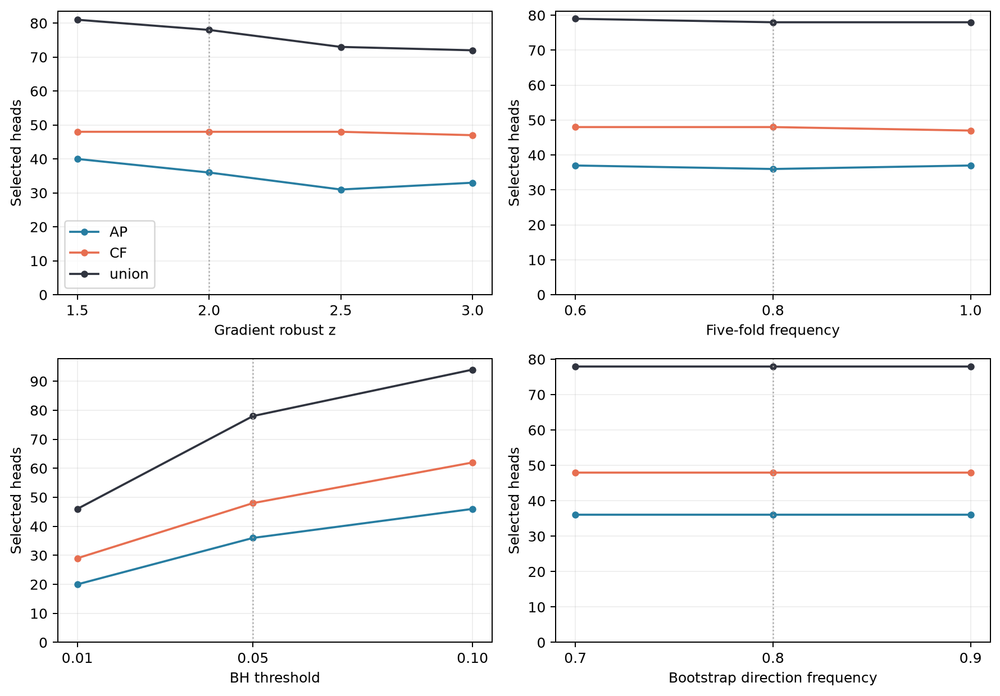
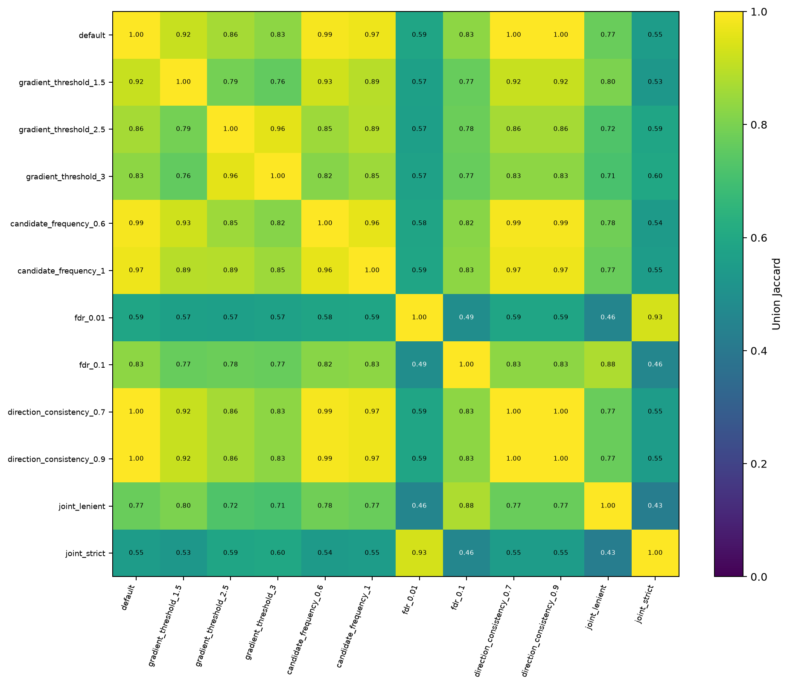

# M1 敏感性实验：结果解读

Qwen3-8B 的新统计规则在不预设最终头数量的条件下选出78个头。梯度阈值、候选频率和方向门槛的扫描较稳定，主要变化来自FDR阈值。默认集合中43个头在64个训练来源子集中至少80%入选，覆盖率55.1%，未达到预先规定的80%覆盖标准。因此，本轮建议为 **C：现有证据不足以固定默认配置**。

## 两张优先图回答的问题

| 扫描参数 | 取值与并集头数 | 与默认集合的并集 Jaccard |
|---|---|---|
| 梯度阈值 | 1.5:81；2.0:78；2.5:73；3.0:72 | 0.916；1.000；0.864；0.829 |
| 五折候选频率 | 0.6:79；0.8:78；1.0:78 | 0.987；1.000；0.975 |
| FDR阈值 | 0.01:46；0.05:78；0.10:94 | 0.590；1.000；0.830 |
| 方向一致率 | 0.7:78；0.8:78；0.9:78 | 1.000；1.000；1.000 |

梯度阈值1.5—3.0、候选频率0.6—1.0、方向门槛0.7—0.9的已扫描取值，相对默认配置均满足预设的集合相似度及数量变化标准。方向门槛在这次扫描中未进一步改变入选集合。覆盖率标准同时约束跨来源稳定性，全部配置的核心覆盖率为53.1%—65.1%，因此没有形成满足全部预设标准的扫描区间。该判断适用于已扫描取值，连续取值之间未另行验证。

FDR从0.05放宽至0.10增加16个头；这16个头在对应配置下的来源子集入选频率中位数为39.1%，全部低于80%。梯度阈值降到1.5新增5个头，其中1个达到80%；候选频率降到0.6新增1个头，频率71.9%；宽松联合配置新增23个头，其中3个达到80%。因此，增加头数量的主要来源是对子集变化较敏感的头。更严格配置也未达到预设核心覆盖率标准，本轮保留全部配置结果，未依据扫描结果更换默认值。

## 跨来源表现与功能分组

默认集合包含A/P 36个、C/F 48个、交集6个。64次完整重选中，15个头满足A/P入选频率≥0.8且C/F≤0.2，24个头满足相反条件，2个头在两组均≥0.8；另外2个核心头具有其余频率组合。这些分组支持当前来源子集中的响应分化，独立来源上的功能分化尚待验证。

默认选中类别—头的来源效应同号比例范围分别为A 55.0%—90.0%、P 61.5%—84.6%、C 57.5%—87.5%、F 60.0%—87.5%。该比例采用多数符号占有效来源的比例；bootstrap均值方向一致率是另一项已预定统计量。各类别中单一来源绝对效应占比的最大值分别为24.6%、18.9%、18.0%、12.8%；来源子集重选保留了相应影响变化。单一占比指标不能排除少数来源共同影响筛选。

C类选中头有15个正差、16个负差，F类有13个正差、22个负差，双侧检验保留了两个方向。图3的类别平均差及95%描述性区间为A 0.02246 [0.01893,0.02628]、P 0.00843 [0.00540,0.01206]、C −0.00507 [−0.00851,−0.00188]、F −0.00226 [−0.00521,0.00072]。F类平均区间包含零；逐头的方向差异会在跨头平均中相互抵消。逐头数值完整保存在 all_configuration_heads.csv.gz。A/P与C/F采用不同效应统计量，以上数值分别在各类别内解释。

## 完成情况与结论范围

2026-11-17 18:11（北京时间）队列全部完成，四个GPU任务和CPU统计任务均成功。2,795,150个新增匹配对照分数全部保存，1,337,228个真实/自身替换分数直接复用；12个配置、64次完整来源子集重选、四张主图和论文小节均已完成。真实GPU等价核验86项分数逐项一致，10项统计与绘图测试通过。

本轮使用80个训练来源，候选和确认各40个且不重叠；有效确认来源A/P/C/F为40/39/40/40。12个配置全部可评价；32对因缺少合格同来源供体排除。新筛选未使用开发或测试来源，没有新增来源泄漏。历史测试来源的既往使用记录按原报告保留。

已支持：新规则能够产生由干预统计决定的头数量；当前来源内存在43个子集入选频率≥80%的核心头；多数阈值方向具有较高集合相似度；放宽FDR主要增加子集稳定性较低的头。

尚未证明：默认78头集合达到预设的整体稳健性标准；43个核心头在全新来源中重复出现；A/P与C/F的因果机制完全独立；新M1改善下游准确率或使M2/M3最优。64个来源子集重叠，其结果按稳健性分析解释。后续若修订默认规则，应预先指定依据并用独立来源确认。本轮没有新增后续训练或自动采用新的阈值。

## 交付入口

- [完整研究报告](REPORT.zh.md)、[原规则统计审计](AUDIT.zh.md)、[历史结果检索](history_search/REPORT.zh.md)
- [论文小节](PAPER_SECTION.zh.md)、[固定协议](PROTOCOL.zh.md)、[全部配置](configuration.json)
- [逐配置数量](configuration_counts.csv)、[集合相似度](jaccard.csv)、[核心头统计](core_heads.csv)
- [全部逐头结果](all_configuration_heads.csv.gz)、[来源级效应](matched_source_effects.csv.gz)
- [首次优先图表提交](priority_figures/README.zh.md)、[机器可读结果解读](final_review.json)
