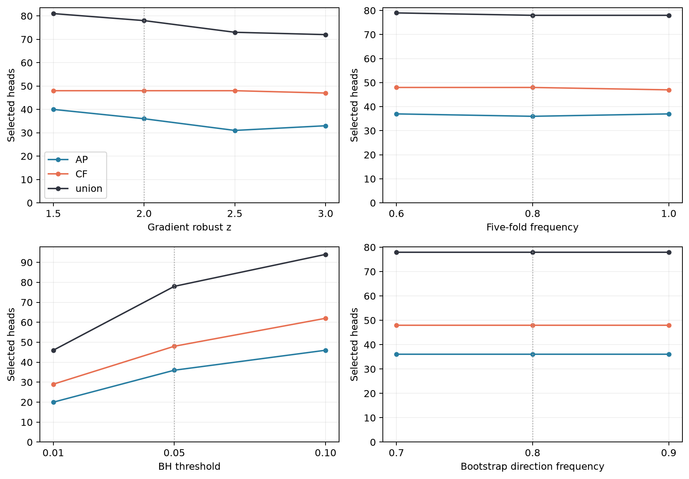
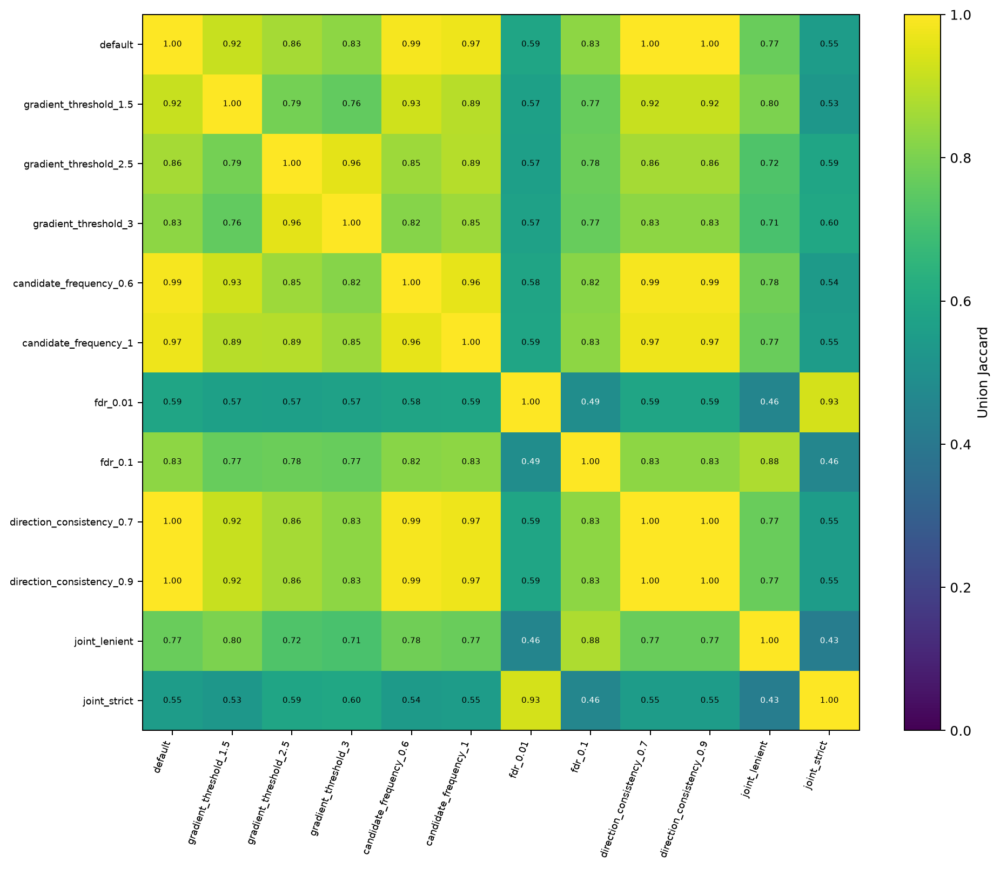

# M1 阈值敏感性：优先图表

图1和图2使用完整确认来源及全部已完成的匹配对照。每个配置分别重算候选家族的 BH 校正。所有阈值沿用预先固定配置，展示最终筛选集合。来源子集重选随后执行，稳健性 A/B/C 建议见完成后的总报告。

模型：Qwen3-8B；候选来源40个、确认来源40个；有效来源数：{"A": 40, "P": 39, "C": 40, "F": 40}。

实际提交：3947e1924a1ff452c205a26dfa36aa514b1bb1b6。

图1为单因素扫描，虚线标记默认值；A/P、C/F 与并集分别显示。图2为全部12个预定配置的并集 Jaccard，两个集合均为空时显示 NA。数据文件保存 A/P、C/F、并集相似度、各配置数量和完整选头集合。图中的相似度反映阈值变化，跨来源重复性由后续子集统计评价。
