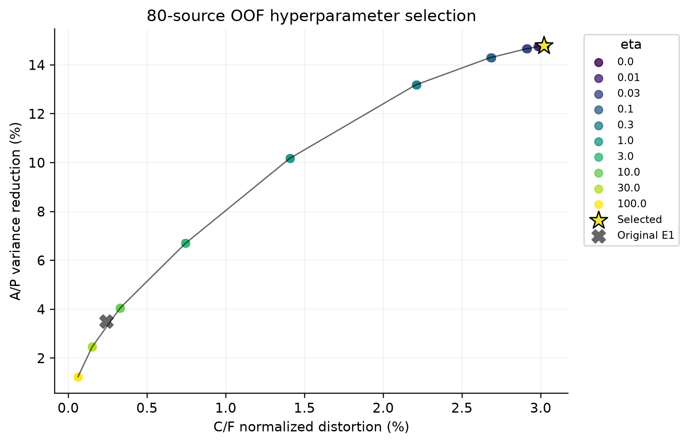
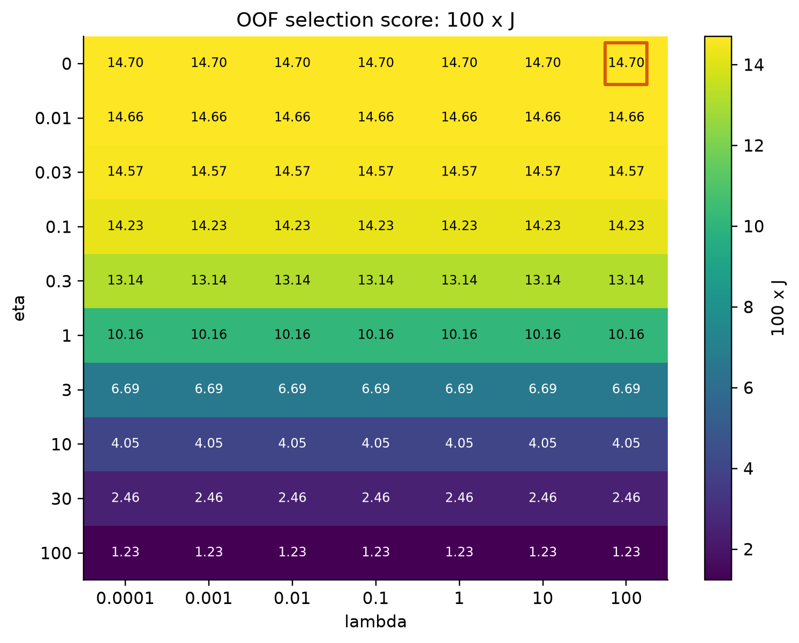
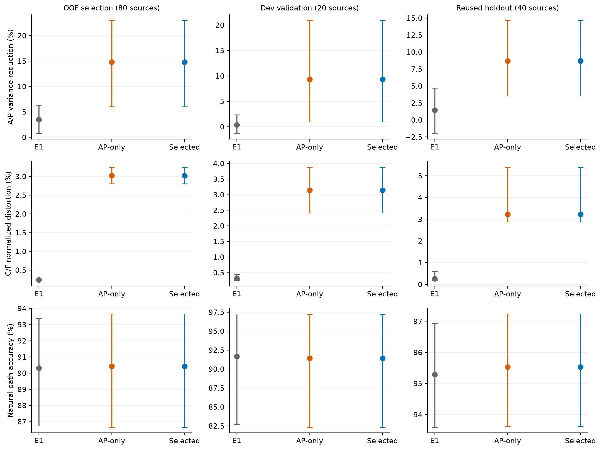
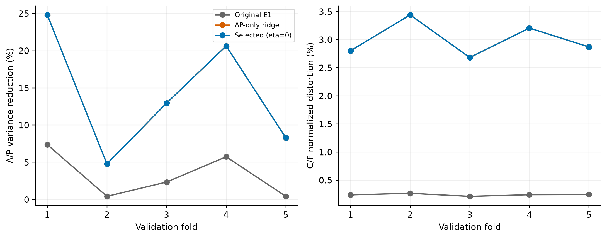

# ASTER-CR M3 ???????

?????????? E1 ???? A/P ????? C/F ??????? dev ????????????????

80?????????? eta=0?lambda=100?J=0.146984??? eta=0 ? A/P-only ?????????? AP-only ???????????? A/P ????????C/F ???????????????????????????????????

## ?????????

???2026-11-16????80???????????20?? dev ????????????? issue #75??????????????????1?3?????70????Pareto?????????????dev ?40?? test ?????????

???64??? Dataset A?E1????? M3????????51? M1 ?16? M2??????16??????? Dataset B ????????? E1 ?????????????????80???2,540? E1 ?????dev/test ??????????

???????? training.pair_weights(..., 'E1')???????????????A/P ? C/F ????????4,887????? E1 ????????????????????????2,000????????????????????????

M3 ???? Cholesky ?? L_AP + eta L_CF + lambda ||w||??A/P ??? y+Xw?C/F ???? ||X_CF w||????????? M2 ? standardization_ids/weights????????????????

M4 ?? E1 ???????????????beta=1??????761??????PR #74 ??????? Platt?????????1???? E1 ????????????????????????????????????

## ????

|???|??|A/P VR|C/F D|J|C/F??RMS|ER|
|---|---|---:|---:|---:|---:|---:|
|????80??|raw|0.000%|0.000%|0.00000|0.00000|1.00000|
|????80??|old_E1|3.498%|0.242%|0.03497|0.12252|0.99984|
|????80??|ap_only|14.790%|3.019%|0.14698|1.52905|0.99880|
|????80??|dual|14.790%|3.019%|0.14698|1.52905|0.99880|
|dev??20??|raw|0.000%|0.000%|0.00000|0.00000|1.00000|
|dev??20??|old_E1|0.387%|0.316%|0.00386|0.13346|1.00006|
|dev??20??|ap_only|9.342%|3.141%|0.09243|1.32547|0.99832|
|dev??20??|dual|9.342%|3.141%|0.09243|1.32547|0.99832|
|????40??|raw|0.000%|0.000%|0.00000|0.00000|1.00000|
|????40??|old_E1|1.460%|0.262%|0.01459|0.09498|1.00102|
|????40??|ap_only|8.688%|3.226%|0.08584|1.17087|0.98757|
|????40??|dual|8.688%|3.226%|0.08584|1.17087|0.98757|

D_CF ????? C/F ??? RMS ???????????? RMS ??????? over_budget_rate ? N/A?

### ???? E1?????????95%??

|???|VR??????|D??????|C/F??RMS?|??????????|
|---|---:|---:|---:|---:|
|OOF selection (80 sources)|+11.2915 [+4.3053, +17.2462]|+2.7772 [+2.5747, +2.9968]|+1.4065 [+1.3079, +1.5037]|+0.1168 [-0.7502, +0.9141]|
|Dev validation (20 sources)|+8.9546 [+1.5945, +19.2539]|+2.8252 [+2.1271, +3.5292]|+1.1920 [+0.7346, +1.4779]|-0.2381 [-0.7093, +0.0000]|
|Reused holdout (40 sources)|+7.2285 [+0.9358, +14.0443]|+2.9641 [+2.6203, +4.8858]|+1.0759 [+0.7536, +1.1876]|+0.2481 [-0.5314, +1.0113]|

### A/P ? C/F ????

|???|??|A/P??RMS|A/P???RMS|A/P?????|C/F??RMS|C/F???RMS|C/F?????/??|C/F?????|C/F?????|
|---|---|---:|---:|---:|---:|---:|---:|---:|---:|
|oof_selection|old_E1|2.61648|2.56654|99.380%|50.64528|50.63724|0/0.000%|86.736%|86.811%|
|oof_selection|ap_only|2.61648|2.41163|99.380%|50.64528|50.61924|3/0.224%|86.811%|86.885%|
|oof_selection|dual|2.61648|2.41163|99.380%|50.64528|50.61924|3/0.224%|86.811%|86.885%|
|dev|old_E1|3.87935|3.87661|98.080%|42.19247|42.20143|0/0.000%|58.333%|58.333%|
|dev|ap_only|3.87935|3.69291|97.913%|42.19247|42.08961|1/1.667%|58.333%|58.333%|
|dev|dual|3.87935|3.69291|97.913%|42.19247|42.08961|1/1.667%|58.333%|58.333%|
|test|old_E1|2.62815|2.61184|98.866%|36.29733|36.32801|0/0.000%|47.500%|47.500%|
|test|ap_only|2.62815|2.51554|98.561%|36.29733|35.73753|1/2.500%|47.500%|47.500%|
|test|dual|2.62815|2.51554|98.561%|36.29733|35.73753|1/2.500%|47.500%|47.500%|

### ?????

|???|??|????|????|????|
|---|---|---:|---:|---:|
|oof_selection|raw|99.080%|90.479%|91.939%|
|oof_selection|old_E1|99.080%|90.304%|91.316%|
|oof_selection|ap_only|99.080%|90.421%|92.192%|
|oof_selection|dual|99.080%|90.421%|92.192%|
|dev|raw|97.990%|91.429%|92.698%|
|dev|old_E1|98.492%|91.667%|93.175%|
|dev|ap_only|97.990%|91.429%|93.175%|
|dev|dual|97.990%|91.429%|93.175%|
|test|raw|98.925%|95.285%|96.733%|
|test|old_E1|98.925%|95.285%|96.485%|
|test|ap_only|98.925%|95.533%|96.733%|
|test|dual|98.925%|95.533%|96.733%|

### ????

|?|??|AP??|CF??|A/P VR|C/F D|J|????|????|
|---|---|---:|---:|---:|---:|---:|---:|---:|
|fold1|old_E1|987|260|7.371%|0.239%|0.07370|85.460%|88.625%|
|fold1|ap_only|987|260|24.803%|2.803%|0.24724|85.460%|89.120%|
|fold1|dual|987|260|24.803%|2.803%|0.24724|85.460%|89.120%|
|fold2|old_E1|957|267|0.432%|0.267%|0.00431|87.425%|87.625%|
|fold2|ap_only|957|267|4.784%|3.440%|0.04666|88.323%|89.421%|
|fold2|dual|957|267|4.784%|3.440%|0.04666|88.323%|89.421%|
|fold3|old_E1|1004|263|2.348%|0.213%|0.02348|96.522%|97.681%|
|fold3|ap_only|1004|263|12.953%|2.682%|0.12881|97.391%|97.681%|
|fold3|dual|1004|263|12.953%|2.682%|0.12881|97.391%|97.681%|
|fold4|old_E1|1118|270|5.745%|0.242%|0.05744|89.646%|91.644%|
|fold4|ap_only|1118|270|20.635%|3.207%|0.20533|88.556%|92.098%|
|fold4|dual|1118|270|20.635%|3.207%|0.20533|88.556%|92.098%|
|fold5|old_E1|937|282|0.434%|0.244%|0.00434|92.401%|90.780%|
|fold5|ap_only|937|282|8.297%|2.870%|0.08214|92.401%|92.503%|
|fold5|dual|937|282|8.297%|2.870%|0.08214|92.401%|92.503%|

## ?????

?? eta=0???? dual ???????????????????????? ap_only?????????????????????

40?????????A/P VR?? E1 ?1.46%???8.69%?C/F??????0.26%???3.23%?????RMS?0.095???1.171?C/F?????0???1??????????95.29%???95.53%?

dev??A/P VR?0.39%???9.34%?C/F??????0.32%???3.14%????????????????A/P?????C/F????????RMS???J?????????A/P????????????????J?????????????

dev?1,198?A/P??20????60?C/F??11????test?2,293?A/P??40????40?C/F??12???????bootstrap??????????????????bootstrap.csv?
AP-only??? eta=0 ?7?lambda?????????? lambda=100?J=0.146984?
????? J ????????? |ER?1|???????C/F?????????????????lambda?

??????????????????????dev ???????????40?? test ?????????????????????????????????????????

PR #71 ???????????? M2 ?????????????????????16? M2 ?? E1 ??????????????

## ??????????

??258,254??????????????6? M1/M2??????100%?GPU??????????????0?
??70???5?????/AP-only????????352??????CPU????3.97????????????????

solver_diagnostics.csv ????????????????????????????????models/ ?????????????????? logs/?

????? 7.23?46???????? 2.57e+04????????? 6.78e-16?

?? MEGA ?????? 46,184?????????????????????? mega:test:308:8:G16???????????????? optional_official_cache.json??????????NLI4CT/MedPIC ????

## ?????

????????? README.md???????? logs/tests.log???70???? oof_grid_70.csv????????????? bootstrap.csv??????? source_metrics.csv??????????? evaluation/?
