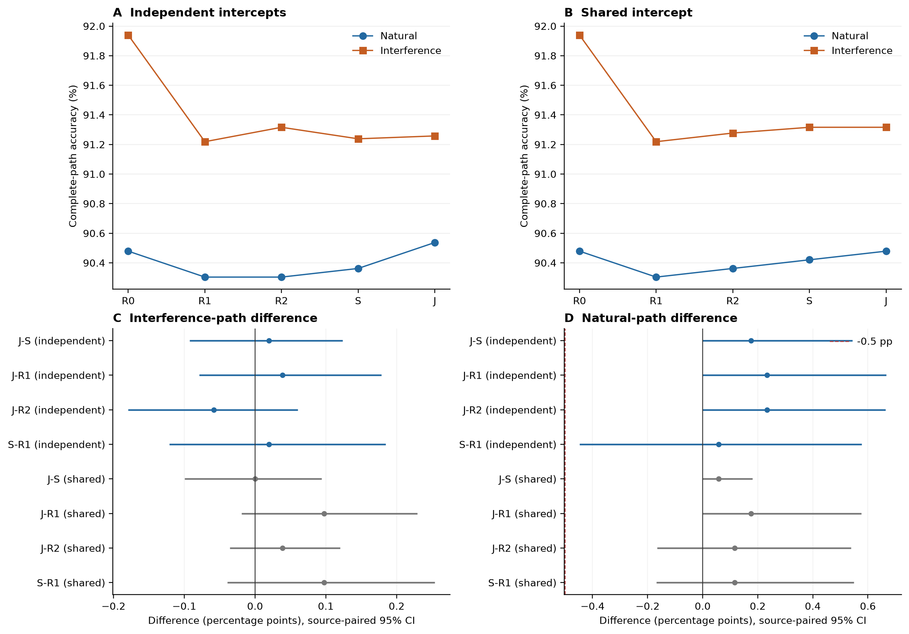

# ASTER-CR 第三模块联合监督与决策校准实验

**问题一：加入任务监督是否提高了正确率？**

S − R1，独立截距：自然路径差 0.058 个百分点，95% CI [-0.447, 0.577]；干扰路径差 0.019 个百分点，95% CI [-0.121, 0.185]。预设的干扰增益和自然非劣联合条件未满足。

J − R2，独立截距：自然路径差 0.234 个百分点，95% CI [0.000, 0.664]；干扰路径差 -0.058 个百分点，95% CI [-0.179, 0.060]。预设的干扰增益和自然非劣联合条件未满足。

**问题二：A/P目标是否提供额外贡献？**

首要比较 J − S，独立截距：自然路径差 0.175 个百分点，95% CI [0.000, 0.543]；干扰路径差 0.019 个百分点，95% CI [-0.093, 0.124]。预设的干扰增益和自然非劣联合条件未满足。

**问题三：联合方法是否超过独立截距校准？**

共享截距 J − R1，探索性：自然路径差 0.175 个百分点，95% CI [0.000, 0.577]；干扰路径差 0.097 个百分点，95% CI [-0.019, 0.229]。预设的干扰增益和自然非劣联合条件未满足。

独立截距 J − R1，第二顺序比较：自然路径差 0.234 个百分点，95% CI [0.000, 0.666]；干扰路径差 0.039 个百分点，95% CI [-0.079, 0.178]。预设的干扰增益和自然非劣联合条件未满足。

**问题四：证据保护是否仍成立？**

J 外折 C/F 有向响应保留率为 99.998%，修正 RMS 为 0.1277 logit，双端全对率为 86.513%，方向退化 0 对，超预算比例 2.683%。
全部十个折内 S/J 模型满足训练逐对预算容差。
J_independent minus R1，interference_path：错误改对 7，正确改错 5，保持正确 4680，保持错误 444。
J_independent minus R1，natural_path：错误改对 4，正确改错 0，保持正确 1546，保持错误 162。
J_independent minus R1，pair_CF_both_correct：错误改对 0，正确改错 2，保持正确 1161，保持错误 179。
J_independent minus S_independent，interference_path：错误改对 5，正确改错 4，保持正确 4682，保持错误 445。
J_independent minus S_independent，natural_path：错误改对 3，正确改错 0，保持正确 1547，保持错误 162。
J_independent minus S_independent，pair_CF_both_correct：错误改对 0，正确改错 0，保持正确 1161，保持错误 181。

**问题五：如果没有成功，下一步最值得修改什么？**

证据约束直接限制了当前纠错可达性。固定原模型截距 b0，在全部16维线性权重中求最有利修正，150/166 个 R1 自然首错节点在原 C/F 预算内仍不可达；将预算上界按齐次性扩为2倍后，134 个仍不可达，16 个由不可达变为单节点可达。这为标签感知证据约束提供了直接实验依据。J2已完成，当前方向监督与非对称松弛的组合尚未建立任务成功。J2−R1干扰路径差为 0.117 个百分点，95% CI [0.000, 0.253]。

J 的最终任务/AP 梯度在 5/5 折呈负余弦，支持两个训练目标存在局部方向冲突。它解释当前解附近的优化关系；证据约束的可达性上界决定本轮更优先的修改方向。

S_independent 在 R1 的 166 个可定位自然首错节点中修复 5 个；161 个修正后仍错，其中 159 个实际分数变化的绝对值小于原边界距离。这些未修复节点的平均有向 margin 为 -11.5785 → -11.3463 logit。

J_independent 在 R1 的 166 个可定位自然首错节点中修复 4 个；162 个修正后仍错，其中 160 个实际分数变化的绝对值小于原边界距离。这些未修复节点的平均有向 margin 为 -11.5080 → -11.3193 logit。

S 从共享截距换为独立截距，自然/干扰路径点估计分别变化 -0.058 / -0.078 个百分点；该变化单独归入校准分析。

J 从共享截距换为独立截距，自然/干扰路径点估计分别变化 0.058 / -0.058 个百分点；该变化单独归入校准分析。

R0原始分数答对自然/干扰路径 1549/4722 条，R1自然节点截距校准后为 1546/4685 条。校准使自然/干扰正确数分别变化 -3/-37 条。这一描述性对照直接显示当前自然节点BCE截距校准在干扰路径上的损失。后续应将校准目标和证据约束分别作为控制因素；首轮J−S与J−R1的主要比较保持不变。

共享与独立截距的结果均按各自区间判断；本轮截距变化尚未建立任务成功。上述上界对应固定 b0 的单节点纠错，重新拟合截距及多个节点同时纠正需要用完整路径评价验证。J2沿用相同16维痕迹和线性容量，结果作为单独探索实验保存。当前状态：complete。

若继续，优先在新训练来源中分离证据方向监督与非对称松弛的贡献，固定对照后再用新来源确认。本轮搜索范围已经结束。当前证据同时涉及约束、局部目标冲突和边界距离，无法唯一归因为特征不足。

## 实验状态与结果资格

本轮真实五折对照已完成。

R0/R1/R2 复用或重放归档模型。S/J 是原 80 来源上的新增方法实验；各外折验证来源未进入对应折的拟合和内部选型。这些来源已有历史使用记录。本轮结果属于历史研究来源上的重新评价；方案冻结后的新来源承担独立确认。

内部选择条件于由全部外折训练来源得到的固定 M1/M2 表示。每折仅比较 AP 权重 0.1、1、10；S 固定为 0。主要校准条件预先指定为独立截距，共享截距另列探索性结果。

运行状态见 [status.json](status.json)，配置及版本见 [configuration.json](configuration.json)，来源与分数重建核验见 [verification.json](verification.json)。

```json
{
  "state": "complete",
  "stage": "evaluation_complete",
  "completed_folds": 5,
  "code_commit": "bb6724d40a4cab5831d3c8e61f2a4f1d3318b4e1",
  "seconds": 591.0287094310042,
  "real_experiment": true,
  "gpu_devices": [],
  "peak_gpu_memory_gib": 0,
  "independent_confirmation": false
}
```

## 路径正确率与配对区间

|方法|自然正确/总数|自然正确率%|干扰正确/总数|干扰正确率%|
|---|---|---|---|---|
|R0|1549/1712|90.479|4722/5136|91.939|
|R1|1546/1712|90.304|4685/5136|91.219|
|R2_shared|1547/1712|90.362|4688/5136|91.277|
|S_shared|1548/1712|90.421|4690/5136|91.316|
|J_shared|1549/1712|90.479|4690/5136|91.316|
|R2_independent|1546/1712|90.304|4690/5136|91.316|
|S_independent|1547/1712|90.362|4686/5136|91.238|
|J_independent|1550/1712|90.537|4687/5136|91.258|

每次重采样重新合并来源内的路径计数；不平均折级比率。配对区间使用完全相同的 2,000 组来源抽样，种子 20261111。

|比较|资格|自然路径差|干扰路径差|
|---|---|---|---|
|J_shared minus S_shared|exploratory|0.058 个百分点，95% CI [0.000, 0.181]|0.000 个百分点，95% CI [-0.099, 0.094]|
|J_shared minus R1|exploratory|0.175 个百分点，95% CI [0.000, 0.577]|0.097 个百分点，95% CI [-0.019, 0.229]|
|J_shared minus R2_shared|exploratory|0.117 个百分点，95% CI [-0.165, 0.538]|0.039 个百分点，95% CI [-0.036, 0.120]|
|S_shared minus R1|exploratory|0.117 个百分点，95% CI [-0.168, 0.550]|0.097 个百分点，95% CI [-0.039, 0.254]|
|J_independent minus S_independent|primary_fixed_sequence|0.175 个百分点，95% CI [0.000, 0.543]|0.019 个百分点，95% CI [-0.093, 0.124]|
|J_independent minus R1|primary_fixed_sequence|0.234 个百分点，95% CI [0.000, 0.666]|0.039 个百分点，95% CI [-0.079, 0.178]|
|J_independent minus R2_independent|exploratory|0.234 个百分点，95% CI [0.000, 0.664]|-0.058 个百分点，95% CI [-0.179, 0.060]|
|S_independent minus R1|exploratory|0.058 个百分点，95% CI [-0.447, 0.577]|0.019 个百分点，95% CI [-0.121, 0.185]|

显著性判断固定顺序为独立截距 J−S，再到 J−R1。每步同时要求干扰差值 95% CI 下限严格大于 0、自然差值下限不低于 −0.5 个百分点；首步未通过时，第二步保留估计与区间。共享截距、J−R2、S−R1及各候选结果均为探索性，不追加正式显著性声明。

- J_independent minus S_independent：自然非劣=True，干扰增益=False，通过预设顺序判断=False。
- J_independent minus R1：自然非劣=True，干扰增益=False，通过预设顺序判断=False。

## 配对机制与证据指标

|方法|AP差RMS|AP方差降低%|CF有向保留%|CF修正RMS|CF双端全对%|方向退化数|外折超预算%|
|---|---|---|---|---|---|---|---|
|R0|2.6165|0.000|100.000|0.0000|87.407|0|0.000|
|R1|2.6165|0.000|100.000|0.0000|86.662|0|0.000|
|S_shared|2.6413|-2.228|99.998|0.1315|86.513|0|2.683|
|S_independent|2.6413|-2.228|99.998|0.1315|86.513|0|2.683|
|J_shared|2.6178|-0.350|99.998|0.1277|86.513|0|2.683|
|J_independent|2.6178|-0.350|99.998|0.1277|86.513|0|2.683|
|R2_shared|2.5665|3.498|99.984|0.1225|86.736|0|1.863|
|R2_independent|2.5665|3.498|99.984|0.1225|86.736|0|1.863|

逐对结果见 [pair_predictions.jsonl](evaluation/pair_predictions.jsonl.gz)；逐来源指标见 [source_metrics.csv](evaluation/source_metrics.csv)。三个层次分别报告，不构造综合分数。

## 实际训练目标与归一化

令自然训练节点权重 $a_i=1/n$，$\mu_{\rm train}=\sum_i a_i t_i$，$c_i=w^\top(t_i-\mu_{\rm train})$。自然监督与两个截距拟合使用同一折的原始自然节点，所有训练标签来自当前训练来源。

$b_0=\arg\min_b\sum_i a_i\operatorname{BCE}(\ell_i+b,y_i)$，训练修正器时固定该值。

$Z_{\rm task}=\max\{\sum_i a_i\operatorname{BCE}(\ell_i+b_0,y_i),10^{-12}\}$，$L_{\rm task}=\sum_i a_i\operatorname{BCE}(\ell_i+b_0+c_i,y_i)/Z_{\rm task}$。

AP权重为 $u_j=1/(K\,|S_k|\,n_{ks})$：类型等权、每种类型内来源等权、同类型同来源的配对等权，$\sum_j u_j=1$，A/P均存在时各占0.5。令 $d_j=\ell_{r_j}-\ell_{l_j}$，$Z_{AP}=\max\{\sum_j u_j d_j^2,1\}$，$L_{AP}=\sum_j u_j[d_j+w^\top(t_{r_j}-t_{l_j})]^2/Z_{AP}$。

$L=L_{\rm task}+\lambda_{AP}L_{AP}+0.01\|w\|_2^2$，对全部训练C/F配对施加 $|w^\top(t_r-t_l)|\leq0.2923349$。S取 $\lambda_{AP}=0$；J的核心新增项为AP损失。

这里的0.01作用于分别归一化后的损失。R2保留原AP权重总和4,887的历史目标与参数；它的历史正则相对尺度见等价性审计。S/J使用完全相同的正则尺度。

训练结束后，共享方案使用原b0；独立方案在相同自然训练节点上另拟合各自截距。原E1经中心化后的独立截距为 `b_old + mu_train @ w`，从而重建原完整分数。

|折|方法|AP权重|任务归一化常数|AP归一化常数|原BCE|原AP MSE|归一化任务项|加权AP项|正则项|总目标|
|---|---|---|---|---|---|---|---|---|---|---|
|fold1|S|0.0|0.1050|5.0233|0.1009|5.4746|0.9610|0.0000|0.0000635|0.9610|
|fold1|J|0.1|0.1050|5.0233|0.1010|5.2536|0.9625|0.1046|0.0000552|1.0671|
|fold2|S|0.0|0.0906|5.7110|0.0859|6.0430|0.9474|0.0000|0.0000692|0.9474|
|fold2|J|0.1|0.0906|5.7110|0.0859|5.8389|0.9483|0.1022|0.0000687|1.0506|
|fold3|S|0.0|0.1083|5.1774|0.1052|5.3386|0.9714|0.0000|0.0000597|0.9715|
|fold3|J|0.1|0.1083|5.1774|0.1054|5.1000|0.9735|0.0985|0.0000636|1.0720|
|fold4|S|0.0|0.0549|5.8338|0.0494|5.9973|0.9010|0.0000|0.0000653|0.9011|
|fold4|J|0.1|0.0549|5.8338|0.0495|5.9021|0.9024|0.1012|0.0000624|1.0037|
|fold5|S|0.0|0.1088|6.2709|0.1052|6.2189|0.9670|0.0000|0.0000733|0.9671|
|fold5|J|10.0|0.1088|6.2709|0.1079|5.6808|0.9924|9.0589|0.0000389|10.0514|

### 梯度与损失变化

|折|方法|初始余弦|最终余弦|任务梯度范数|加权AP梯度范数|正则梯度范数|任务损失变化|加权AP损失变化|
|---|---|---|---|---|---|---|---|---|
|fold1|S|-0.1586|-0.6204|0.5588|0.0000|0.0016|-0.0390|0.0000|
|fold1|J|-0.1586|-0.6349|0.5594|0.2484|0.0015|-0.0375|0.0046|
|fold2|S|-0.2419|-0.5028|0.6939|0.0000|0.0017|-0.0526|0.0000|
|fold2|J|-0.2419|-0.5785|0.6964|0.2178|0.0017|-0.0517|0.0022|
|fold3|S|-0.4653|-0.5519|0.5338|0.0000|0.0015|-0.0286|0.0000|
|fold3|J|-0.4653|-0.6404|0.5366|0.2419|0.0016|-0.0265|-0.0015|
|fold4|S|-0.0015|-0.4913|1.4609|0.0000|0.0016|-0.0990|0.0000|
|fold4|J|-0.0015|-0.4960|1.4610|0.2237|0.0016|-0.0976|0.0012|
|fold5|S|-0.0751|-0.3787|0.5125|0.0000|0.0017|-0.0330|0.0000|
|fold5|J|-0.0751|-0.2424|0.5324|16.1674|0.0012|-0.0076|-0.9411|

### 训练C/F约束残差

逐对残差为 `abs(delta_c) − 0.2923349`，最大违反量取其正部；求解容差1e−7。完整逐对残差保存在各折模型JSON。

|折|方法|CF约束数|最大绝对修正|最大违反量|活跃约束数|迭代数|
|---|---|---|---|---|---|---|
|fold1|S|1017|0.29233490|0.0000000000|15|6|
|fold1|J|1017|0.29233490|0.0000000000|16|4|
|fold2|S|1025|0.29233490|0.0000000000|15|6|
|fold2|J|1025|0.29233490|0.0000000000|15|6|
|fold3|S|1027|0.29233490|0.0000000000|15|6|
|fold3|J|1027|0.29233490|0.0000000000|14|7|
|fold4|S|1014|0.29233490|0.0000000000|16|3|
|fold4|J|1014|0.29233490|0.0000000000|14|6|
|fold5|S|997|0.29233490|0.0000000000|15|8|
|fold5|J|997|0.29233490|0.0000000000|15|14|

### 截距、训练样本与权重

|折|方法|自然节点|训练来源|共享b0|独立bw|任务权重和|AP权重和|
|---|---|---|---|---|---|---|---|
|fold1|S|607|64|-0.08084195|-0.04563990|1.0000|1.0000|
|fold1|J|607|64|-0.08084195|-0.12087822|1.0000|1.0000|
|fold2|S|615|64|5.84843092|6.10397038|1.0000|1.0000|
|fold2|J|615|64|5.84843092|6.06219527|1.0000|1.0000|
|fold3|S|615|64|-0.04412538|0.06461176|1.0000|1.0000|
|fold3|J|615|64|-0.04412538|-0.01947588|1.0000|1.0000|
|fold4|S|604|64|1.25918031|1.49455363|1.0000|1.0000|
|fold4|J|604|64|1.25918031|1.44952654|1.0000|1.0000|
|fold5|S|603|64|5.84719287|5.70745134|1.0000|1.0000|
|fold5|J|603|64|5.84719287|5.88668879|1.0000|1.0000|

各节点和配对的ID、权重、校准来源、w与中心化均值保存在 `models/foldK/{S,J}.json`。

## 全部候选与选择

|折|方法|AP权重|内层自然%|内层干扰%|方向退化|CF超预算%|CF修正RMS|选中|
|---|---|---|---|---|---|---|---|---|
|fold1|S|0.0|94.286|94.709|0|1.075|0.1145|固定S|
|fold1|J|0.1|94.286|94.709|0|0.717|0.1069|是|
|fold1|J|1.0|94.286|94.603|0|3.584|0.1272|否|
|fold1|J|10.0|93.968|94.603|0|2.509|0.1347|否|
|fold2|S|0.0|92.701|92.701|0|4.231|0.1350|固定S|
|fold2|J|0.1|92.701|93.025|0|2.692|0.1320|是|
|fold2|J|1.0|92.701|92.701|0|1.538|0.1263|否|
|fold2|J|10.0|92.457|92.620|0|0.769|0.1146|否|
|fold3|S|0.0|89.318|92.285|1|2.574|0.1177|固定S|
|fold3|J|0.1|89.614|92.384|0|1.471|0.1088|是|
|fold3|J|1.0|89.318|92.285|0|2.206|0.1281|否|
|fold3|J|10.0|89.318|92.186|0|1.838|0.1284|否|
|fold4|S|0.0|90.709|91.606|0|1.434|0.1242|固定S|
|fold4|J|0.1|90.709|91.443|0|1.434|0.1217|是|
|fold4|J|1.0|90.709|91.361|0|1.075|0.1152|否|
|fold4|J|10.0|90.709|91.280|0|1.075|0.1143|否|
|fold5|S|0.0|89.963|90.706|0|4.120|0.1404|固定S|
|fold5|J|0.1|89.963|90.706|0|3.371|0.1379|否|
|fold5|J|1.0|89.963|90.830|0|3.745|0.1347|否|
|fold5|J|10.0|89.963|90.830|0|1.873|0.1183|是|

选择先控制相对R1自然路径下降不超过0.5个百分点，再比较干扰正确率，随后比较证据损害和较小AP权重。所有候选均保留；外折16来源不参与选型。确定性求解器的随机种子和内部划分见配置，未制造多随机种子波动。

## 错误转移与首错边界

|比较|层级|错误改对|正确改错|保持正确|保持错误|总数|
|---|---|---|---|---|---|---|
|J_independent minus R1|interference_path|7|5|4680|444|5136|
|J_independent minus R1|natural_path|4|0|1546|162|1712|
|J_independent minus R1|pair_CF_both_correct|0|2|1161|179|1342|
|J_independent minus R2_independent|interference_path|4|7|4683|442|5136|
|J_independent minus R2_independent|natural_path|4|0|1546|162|1712|
|J_independent minus R2_independent|pair_CF_both_correct|0|3|1161|178|1342|
|J_independent minus S_independent|interference_path|5|4|4682|445|5136|
|J_independent minus S_independent|natural_path|3|0|1547|162|1712|
|J_independent minus S_independent|pair_CF_both_correct|0|0|1161|181|1342|
|J_shared minus R1|interference_path|8|3|4682|443|5136|
|J_shared minus R1|natural_path|3|0|1546|163|1712|
|J_shared minus R1|pair_CF_both_correct|0|2|1161|179|1342|
|J_shared minus R2_shared|interference_path|5|3|4685|443|5136|
|J_shared minus R2_shared|natural_path|3|1|1546|162|1712|
|J_shared minus R2_shared|pair_CF_both_correct|0|3|1161|178|1342|
|J_shared minus S_shared|interference_path|4|4|4686|442|5136|
|J_shared minus S_shared|natural_path|1|0|1548|163|1712|
|J_shared minus S_shared|pair_CF_both_correct|0|0|1161|181|1342|
|S_independent minus R1|interference_path|8|7|4678|443|5136|
|S_independent minus R1|natural_path|4|3|1543|162|1712|
|S_independent minus R1|pair_CF_both_correct|0|2|1161|179|1342|
|S_shared minus R1|interference_path|10|5|4680|441|5136|
|S_shared minus R1|natural_path|3|1|1545|163|1712|
|S_shared minus R1|pair_CF_both_correct|0|2|1161|179|1342|

S_independent minus R1：可定位首错 166 个，节点修复 5 个，修正前平均绝对分数 11.2391，平均绝对分数变化 0.6137 logit。

J_independent minus R1：可定位首错 166 个，节点修复 4 个，修正前平均绝对分数 11.2391，平均绝对分数变化 0.5032 logit。

J_independent minus S_independent：可定位首错 165 个，节点修复 3 个，修正前平均绝对分数 11.1048，平均绝对分数变化 0.1676 logit。

[逐例首错及前后margin](evaluation/natural_first_error.jsonl.gz)、[逐来源首错](evaluation/natural_first_error_by_source.csv)、[逐来源四向错误转移](evaluation/source_transitions.csv)均独立保存。已读取逐来源首错记录 1440 行。

### 各来源正确率的变化

|比较|指标|改善来源|下降来源|相同来源|有效来源|
|---|---|---|---|---|---|
|J_shared minus S_shared|自然路径|1|0|79|80|
|J_shared minus S_shared|干扰路径|3|3|74|80|
|J_shared minus R1|自然路径|1|0|79|80|
|J_shared minus R1|干扰路径|6|2|72|80|
|J_shared minus R2_shared|自然路径|1|1|78|80|
|J_shared minus R2_shared|干扰路径|3|1|76|80|
|S_shared minus R1|自然路径|1|1|78|80|
|S_shared minus R1|干扰路径|6|3|71|80|
|J_independent minus S_independent|自然路径|1|0|79|80|
|J_independent minus S_independent|干扰路径|4|3|73|80|
|J_independent minus R1|自然路径|2|0|78|80|
|J_independent minus R1|干扰路径|5|4|71|80|
|J_independent minus R2_independent|自然路径|2|0|78|80|
|J_independent minus R2_independent|干扰路径|3|5|72|80|
|S_independent minus R1|自然路径|2|1|77|80|
|S_independent minus R1|干扰路径|4|5|71|80|

## 固定截距下的纠错可达性上界

对 R1 的 166 个可定位自然路径首错节点逐一求解，有限上界 166 个。原预算下 150 个不可达；2倍预算上界下 134 个不可达，16 个在不超过2倍预算时变为单节点可达。
166 条首错记录对应 166 个唯一输入，重复记录 0 条。零痕迹方向 0 个。


记 $s_i=2y_i-1$，$E_j=t_{r_j}-t_{l_j}$，$m_i=s_i(\ell_i+b_0)$。逐节点上界为

\[B_i(\delta)=\max_{w\in\mathbb R^{16}}s_i(t_i-\mu_{\rm train})^\top w\quad\text{s.t.}\quad-\delta\le E_j^\top w\le\delta,\ j\in CF_{\rm train}.\]

当 $m_i+B_i(\delta)<-10^{-7}$ 时，该节点在固定 $b_0$ 与这些训练约束下无法由任何16维线性权重纠正。求解不加入任务、AP或正则惩罚，因而覆盖原可行域内所有线性权重。

由齐次性，$B_i(2\delta)=2B_i(\delta)$。2倍预算数字由此直接计算，没有重新执行训练预算扫描。每个节点分别采用最有利权重，单节点可达数与多个节点同时修复数分别解释。这组主上界固定b0；记录中以当前bw计算的辅助边界也固定该已拟合截距。重新拟合bw后须重新检查边界。

|折|首错节点|δ下不可达，固定b0|2δ下不可达，固定b0|≤2δ新增可达|δ下不可达，固定当前bw|
|---|---|---|---|---|---|
|fold1|49|43|32|11|43|
|fold2|43|42|40|2|42|
|fold3|11|9|8|1|9|
|fold4|38|35|34|1|35|
|fold5|25|21|20|1|21|

原 J 的训练约束与原模型证据方向：

|折|训练CF对|活跃约束|原证据方向非正|其中活跃|
|---|---|---|---|---|
|fold1|1017|16|3|0|
|fold2|1025|15|4|0|
|fold3|1027|14|3|0|
|fold4|1014|14|2|0|
|fold5|997|15|4|0|

这些记录将主要问题定位到当前证据可行域与错误边界距离的关系。局部目标冲突和截距作用分别报告；特征表达能力的判断由相应对照实验承担。

[上界汇总](diagnostics/correction_bounds_summary.json) · [逐节点LP结果](diagnostics/correction_bounds.jsonl)。

## 历史等价性与复用

**结论：已归档实验中没有与本轮 S/J 完全等价的监督对照。正式 E1 五折的 R0、R1、R2 参数及预测可以复用；S/J 需要按照当前数据、表示、任务标签和校准条件补齐。**

完整对应关系、历史分数及路径映射见 [HISTORICAL_AUDIT.zh.md](HISTORICAL_AUDIT.zh.md)。历史监督读出、监督痕迹修正和99维非线性方法不作为当前S/J的等价对照。

## 测试、版本与运行限制

### 自动化测试

14项合成测试通过，失败0，错误0；耗时2.435秒。执行环境：gcx261014 on 10.29.128.115。 详见 [tests.json](tests.json)。

扩展测试（包含首轮与J2测试模块）：22项合成测试通过，失败0，错误0；耗时1.439秒。执行环境：gcx261014 on 10.29.128.115。 详见 [extended_tests.json](extended_tests.json)。

### 真实数据重建与来源核验

```json
{
  "archived_score_replay": [
    {
      "fold": "fold1",
      "passed": true,
      "archive": "/home/gcx/aster-cr-diagnostics-e3cv-20261111/reports/aster_cr_diagnostics_e3cv_20261111/evaluation/cv_fold1_common/predictions.jsonl.gz",
      "compared": {
        "R0": 31530,
        "R1": 31530,
        "R2": 31530
      },
      "max_abs_difference": {
        "R0": 0.0,
        "R1": 0.0,
        "R2": 7.105427357601002e-15
      },
      "intercept_difference": 0.0,
      "tolerance": 1e-08,
      "dynamic_paths": {
        "passed": true,
        "archive": "/home/gcx/aster-cr-diagnostics-e3cv-20261111/reports/aster_cr_diagnostics_e3cv_20261111/evaluation/cv_fold1_common/path_predictions.jsonl.gz",
        "compared": 4044,
        "differences": 0
      }
    },
    {
      "fold": "fold2",
      "passed": true,
      "archive": "/home/gcx/aster-cr-diagnostics-e3cv-20261111/reports/aster_cr_diagnostics_e3cv_20261111/evaluation/cv_fold2_common/predictions.jsonl.gz",
      "compared": {
        "R0": 35779,
        "R1": 35779,
        "R2": 35779
      },
      "max_abs_difference": {
        "R0": 0.0,
        "R1": 0.0,
        "R2": 1.4210854715202004e-14
      },
      "intercept_difference": 0.0,
      "tolerance": 1e-08,
      "dynamic_paths": {
        "passed": true,
        "archive": "/home/gcx/aster-cr-diagnostics-e3cv-20261111/reports/aster_cr_diagnostics_e3cv_20261111/evaluation/cv_fold2_common/path_predictions.jsonl.gz",
        "compared": 4008,
        "differences": 0
      }
    },
    {
      "fold": "fold3",
      "passed": true,
      "archive": "/home/gcx/aster-cr-diagnostics-e3cv-20261111/reports/aster_cr_diagnostics_e3cv_20261111/evaluation/cv_fold3_common/predictions.jsonl.gz",
      "compared": {
        "R0": 34764,
        "R1": 34764,
        "R2": 34764
      },
      "max_abs_difference": {
        "R0": 0.0,
        "R1": 0.0,
        "R2": 7.105427357601002e-15
      },
      "intercept_difference": 0.0,
      "tolerance": 1e-08,
      "dynamic_paths": {
        "passed": true,
        "archive": "/home/gcx/aster-cr-diagnostics-e3cv-20261111/reports/aster_cr_diagnostics_e3cv_20261111/evaluation/cv_fold3_common/path_predictions.jsonl.gz",
        "compared": 4140,
        "differences": 0
      }
    },
    {
      "fold": "fold4",
      "passed": true,
      "archive": "/home/gcx/aster-cr-diagnostics-e3cv-20261111/reports/aster_cr_diagnostics_e3cv_20261111/evaluation/cv_fold4_common/predictions.jsonl.gz",
      "compared": {
        "R0": 31998,
        "R1": 31998,
        "R2": 31998
      },
      "max_abs_difference": {
        "R0": 0.0,
        "R1": 0.0,
        "R2": 7.105427357601002e-15
      },
      "intercept_difference": 0.0,
      "tolerance": 1e-08,
      "dynamic_paths": {
        "passed": true,
        "archive": "/home/gcx/aster-cr-diagnostics-e3cv-20261111/reports/aster_cr_diagnostics_e3cv_20261111/evaluation/cv_fold4_common/path_predictions.jsonl.gz",
        "compared": 4404,
        "differences": 0
      }
    },
    {
      "fold": "fold5",
      "passed": true,
      "archive": "/home/gcx/aster-cr-diagnostics-e3cv-20261111/reports/aster_cr_diagnostics_e3cv_20261111/evaluation/cv_fold5_common/predictions.jsonl.gz",
      "compared": {
        "R0": 24090,
        "R1": 24090,
        "R2": 24090
      },
      "max_abs_difference": {
        "R0": 0.0,
        "R1": 0.0,
        "R2": 7.105427357601002e-15
      },
      "intercept_difference": 0.0,
      "tolerance": 1e-08,
      "dynamic_paths": {
        "passed": true,
        "archive": "/home/gcx/aster-cr-diagnostics-e3cv-20261111/reports/aster_cr_diagnostics_e3cv_20261111/evaluation/cv_fold5_common/path_predictions.jsonl.gz",
        "compared": 3948,
        "differences": 0
      }
    }
  ],
  "cf_training_constraints": true,
  "outer_sources_disjoint": true,
  "fold_specific_M1_M2": true,
  "automatic_tests": "see tests.json",
  "complete": true
}
```

|配置字段|值|
|---|---|
|seed|20261115|
|bootstrap_seed|20261111|
|gpu_devices|[]|
|gpu_memory_gib|0|
|code_commit|bb6724d40a4cab5831d3c8e61f2a4f1d3318b4e1|
|historical_data_commit|5a329fe68eaa84fb5f7a791c50d15a47181ac4f2|
|historical_model|/home/gcx/TRIAGE/models/modelscope/Qwen3-8B|
|historical_model_dtype|bfloat16|
|historical_frozen_model|True|

## 图表与结论



[PDF图](artifacts/summary.pdf)。上排区分共享和独立截距，下排显示来源配对95%区间；自然路径虚线对应−0.5个百分点。

|问题|结论|
|---|---|
|任务收益|S−R1未满足双条件；J−R2未满足双条件；J−R1未满足双条件。正式顺序判断见上文|
|AP独立贡献|J−S未满足双条件|
|自然路径非劣（主要J−S）|满足|
|进入J2|探索性 J2 已完成；首轮 S/J 的主要比较和成功判定保持原记录。|
|结果资格|R0/R1/R2历史复评；S/J为已使用80来源上的新增实验；新来源独立验证尚未开展|

## J2探索性后续

探索性 J2 已完成；首轮 S/J 的主要比较和成功判定保持原记录。

J2保留16维线性容量，增加标签感知证据方向监督，并将训练C/F修正界改为有利方向≤2δ、有害方向≤δ。原绝对幅度≤δ的训练保证据此改变；外折超原预算率和方向退化继续独立记录。

J2−J，探索性：自然路径差 -0.058 个百分点，95% CI [-0.192, 0.000]；干扰路径差 0.078 个百分点，95% CI [-0.020, 0.187]。预设的干扰增益和自然非劣联合条件未满足。

J2−R1，探索性：自然路径差 0.175 个百分点，95% CI [0.000, 0.474]；干扰路径差 0.117 个百分点，95% CI [0.000, 0.253]。预设的干扰增益和自然非劣联合条件未满足。

原约束限制可达性，当前J2松弛组合尚未建立任务成功。后续优先在新训练来源分离方向监督与非对称松弛的贡献，冻结方案后用新来源确认；本轮首要机制比较与结论保持不变，搜索范围已经结束。

全部J2候选、训练目标、证据保证变化、错误转移和结论见 [J2_REPORT.zh.md](J2_REPORT.zh.md)。
