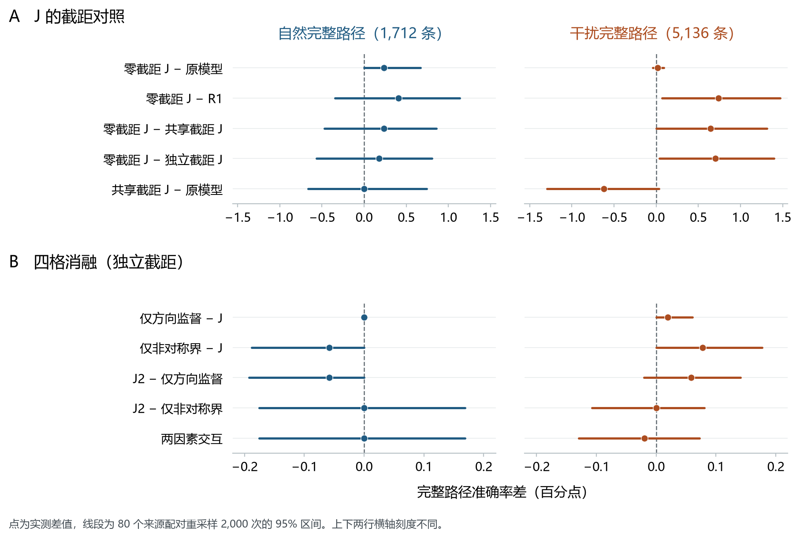

# ASTER-CR 缺失对照：零截距 J 与 J2 四格消融

## 去重结果

执行前检索了服务器更新后的 111 个 origin 引用（含 HEAD）和路径错误分析工作分支，搜索范围覆盖 `docs/ASTER`、`reports`、`experiments` 和 `results` 的报告及代码。核对了归档方法名、配置、预测文件和评价分母。

| 对照 | 归档证据 | 本轮处理 |
|---|---|---|
| R0、R1、J 共享／独立截距 | S/J 研究保存了模型、逐输入分数和动态路径 | 复用，并逐路径核验。[S/J 主报告](../aster_m3_joint_study_20261115/REPORT.zh.md) |
| J 零截距 | S/J 归档保存了中心化修正量和未校准分数，路径表缺少零截距 J | 新增动态回放 |
| 原对称界下仅加标签方向监督 | J2 保存的是方向监督与非对称界同时启用的预测 | 新增 5 折，沿用归档内层选参规则 |
| 无方向监督，仅放宽修正界 | J 和 J2 归档均缺少该组合 | 新增 5 折，方向损失权重固定为 0 |
| J2 完整方法 | 原分支已有权重、截距、逐例预测和完整评价 | 直接读取和核验。[J2 主报告](../aster_m3_joint_study_20261115/J2_REPORT.zh.md) |
| E1 截距消融、MedPIC 解码诊断 | 使用 E1 配对修正器或多选解码，评价对象与 J 不同 | 保留历史结果。[既有诊断](../aster_cr_m3_intercept_diagnostics_20261112/REPORT.zh.md) |

main 检索版本为 `53171678`。S/J 和 J2 来自原实验分支 `experiment/aster-m3-joint-20261115` 的 `e2e7e4f0`。另核对了 M3 双目标网格（`2f184903`）及其 Pareto 分析（`a72a6f5b`），两者使用另一套配对目标。表 2 的工作分支（`ba4a8aad`）使用自适应选头与 40 个留出来源。整合分支（`fe9b2a2f`）和截距诊断分支（`9c98cc96`）亦无这三项同协议实测。

## 两个问题的实测回答

**零截距 J 相对原模型净多走对 4 条自然路径和 1 条干扰路径。** 自然路径有 4 条改对、0 条改错，改善集中在 2 个来源。干扰路径有 3 条改对、2 条改错，2 个来源净改善、1 个来源净下降。按来源配对的准确率差为自然 +0.234 个百分点 [0.000, +0.668]、干扰 +0.019 个百分点 [−0.041, +0.091]。两项区间均含零。固定 J 的修正量、移除独立截距时，干扰路径则净增 36 条，差值 +0.701 个百分点 [+0.040, +1.398]。后一个对照量化了截距的影响。

**独立截距下，仅方向监督比 J 多走对 1 条干扰路径，自然路径持平。仅放宽约束多走对 4 条干扰路径、少走对 1 条自然路径。** 两因素同时启用时，路径正确总数与仅放宽约束相同。所有路径对比的区间均含零，干扰路径交互为 −0.019 个百分点 [−0.130, +0.072]。仅放宽约束使 C/F 修正 RMS 相对 J 增加 0.01770 logit [0.01166, 0.02374]，超原预算率增加 2.981 个百分点 [1.550, 4.546]。仅方向监督使 A/P 方差降低率进一步下降 0.388 个百分点 [−0.689, −0.034]。

**决策：停止在这 80 个历史来源上继续开发当前 16 维分数修正方向。** 零截距相对原模型的净路径收益缺乏稳定证据。放宽约束增加了外折 C/F 修正幅度和超预算配对，路径差的区间仍含零。所有四格的 A/P 方差降低率均为负，即修正后的配对分数差方差高于原分数。该决策针对本次冻结的数据、特征和修正器。



## 四格结果

独立截距为主协议，共享截距为预定对照。J 与 J2 复用旧预测。表中“仅方向”和“仅非对称”为新增实测。八组分数在自然节点上均正确 754/761。

| 截距 | 四格 | 自然正确 / 1,712 | 干扰正确 / 5,136 | A/P 双端全对 / 5,003 | C/F 双端全对 / 1,342 |
|---|---:|---:|---:|---:|---:|
| 独立 | J | 1550 (90.537%) | 4687 (91.258%) | 4973 | 1161 |
| 独立 | 仅方向 | 1550 (90.537%) | 4688 (91.277%) | 4973 | 1161 |
| 独立 | 仅非对称 | 1549 (90.479%) | 4691 (91.336%) | 4973 | 1159 |
| 独立 | J2 | 1549 (90.479%) | 4691 (91.336%) | 4972 | 1161 |
| 共享 | J | 1549 (90.479%) | 4690 (91.316%) | 4973 | 1161 |
| 共享 | 仅方向 | 1549 (90.479%) | 4690 (91.316%) | 4973 | 1161 |
| 共享 | 仅非对称 | 1548 (90.421%) | 4689 (91.297%) | 4973 | 1160 |
| 共享 | J2 | 1546 (90.304%) | 4689 (91.297%) | 4972 | 1162 |

下表报告折外配对指标。A/P 方差降低率为 1 减去修正后与原始配对差的方差比。C/F 有向响应保留为修正后与原始有向分数差的均值比。方向退化统计原本沿正确方向变化、修正后变为零或反向的配对。训练最大违约量取各折真实训练约束的最大正残差。外折超界使用原实现的 1×10⁻⁹ logit 数值容差。

| 四格 | A/P 方差降低 | C/F 有向响应保留 | C/F 修正 RMS（logit） | 方向退化 | 超原 δ / 1,342 | 超自身下界 / 上界 | 训练最大违约量（logit） |
|---|---:|---:|---:|---:|---:|---:|---:|
| J | -0.350% | 99.9980% | 0.12773 | 0 | 36 | 10 / 26 | 1.17e-12 |
| 仅方向 | -0.738% | 99.9997% | 0.12891 | 0 | 35 | 11 / 24 | 2.47e-14 |
| 仅非对称 | -1.478% | 100.0077% | 0.14543 | 0 | 76 | 29 / 1 | 3.91e-12 |
| J2 | -1.581% | 100.0140% | 0.14512 | 0 | 71 | 21 / 1 | 4.17e-12 |

仅非对称界下，1,342 个外折 C/F 对中有 76 对超过原对称预算，30 对超过该格自身的有向预算。J2 对应为 71 对和 22 对。各格训练约束均满足求解容差 1×10⁻⁷ logit。逐折训练残差和逐对外折超界可分别复核。[训练约束](b_train_constraints.csv) · [外折逐对记录](b_cf_budgets.jsonl.gz)

## 原始分数、截距与动态路径

R0 直接使用原分数，R1 在原分数上加训练自然节点拟合的 b₀。J 零截距将归档 J 的完整中心化修正加到原分数。其余两种 J 分别在此基础上加共享 b₀ 或 J 的独立截距。158,161 条折外输入的零截距分数均与归档未校准分数逐条相等。每种方法按自身节点预测选择下一分支。

| 分数 | 自然节点 / 761 | 自然完整路径 / 1,712 | 干扰完整路径 / 5,136 |
|---|---:|---:|---:|
| 原分数 R0 | 754 (99.080%) | 1549 (90.479%) | 4722 (91.939%) |
| 原分数＋截距 R1 | 754 (99.080%) | 1546 (90.304%) | 4685 (91.219%) |
| J 零截距 | 754 (99.080%) | 1553 (90.713%) | 4723 (91.959%) |
| J 共享截距 | 754 (99.080%) | 1549 (90.479%) | 4690 (91.316%) |
| J 独立截距 | 754 (99.080%) | 1550 (90.537%) | 4687 (91.258%) |

下表差值单位为百分点，区间为 80 个来源共同重采样 2,000 次所得的 95% 百分位区间。各次抽样按该次路径总数计算准确率。

| 比较（左减右） | 自然净条数 | 自然差 [95% 区间] | 干扰净条数 | 干扰差 [95% 区间] |
|---|---:|---:|---:|---:|
| J 零截距 − 原分数 R0 | +4 | +0.234 [0.000, +0.668] | +1 | +0.019 [−0.041, +0.091] |
| J 零截距 − 原分数＋截距 R1 | +7 | +0.409 [−0.346, +1.131] | +38 | +0.740 [+0.068, +1.469] |
| J 零截距 − J 共享截距 | +4 | +0.234 [−0.473, +0.857] | +33 | +0.643 [0.000, +1.315] |
| J 零截距 − J 独立截距 | +3 | +0.175 [−0.564, +0.806] | +36 | +0.701 [+0.040, +1.398] |
| J 共享截距 − 原分数 R0 | 0 | 0.000 [−0.663, +0.742] | −32 | −0.623 [−1.296, +0.035] |

对照中，J 零截距与 J 共享／独立截距的全部变化可归于截距。J 零截距与 R0 的变化来自固定中心化修正。5,003 对 A/P 与 1,342 对 C/F 两端加同一截距后，配对分数差的最大数值偏差为 1.42×10⁻¹⁴ logit。已按逐输入 ID 保存原分数、修正量、五种预测分数和实际走过的路径。[分数表](A_scores.jsonl.gz) · [动态路径](A_paths.jsonl.gz) · [配对差核验](A_verification.json)

## 错误转移、首次错误和来源区间

表内四向计数均按 **错→对 / 对→错 / 对→对 / 错→错** 排列。比较方向为从差值右项改用左项。

| 从右项改用左项 | 自然路径四向计数 | 干扰路径四向计数 |
|---|---:|---:|
| J 零截距 − 原分数 R0 | 4 / 0 / 1549 / 159 | 3 / 2 / 4720 / 411 |
| J 零截距 − 原分数＋截距 R1 | 13 / 6 / 1540 / 153 | 60 / 22 / 4663 / 391 |
| J 零截距 − J 共享截距 | 10 / 6 / 1543 / 153 | 53 / 20 / 4670 / 393 |
| J 零截距 − J 独立截距 | 10 / 7 / 1543 / 152 | 56 / 20 / 4667 / 393 |
| J 共享截距 − 原分数 R0 | 9 / 9 / 1540 / 154 | 23 / 55 / 4667 / 391 |

J 零截距相对 R0 改对的 4 条自然路径，首次错误节点沿正确答案方向的分数从 [−0.447, −0.037] 移至 [+0.114, +2.008] logit。干扰路径改对的 3 条从 [−0.684, −0.038] 移至 [+0.147, +0.531]。新增错误的两条由 +0.437、+0.088 降至 −0.041、−0.613。逐例记录列出两种方法各自的首次错误节点、该节点在两种分数下的边界以及是否在实际路径上到达。[逐例首错](A_first_error_boundaries.jsonl.gz) · [逐来源净收益](A_source_transitions.tsv) · [全部 A 对照](A_comparisons.tsv)

### 四格路径差与交互

两因素交互按 J2 − 仅方向 − 仅非对称 + J 计算，各项使用相同来源抽样。

| 截距 | 对比 | 自然差 [95% 区间] | 干扰差 [95% 区间] |
|---|---:|---:|---:|
| 独立 | 仅方向 − J | 0.000 [0.000, 0.000] | +0.019 [0.000, +0.061] |
| 独立 | 仅非对称 − J | −0.058 [−0.188, 0.000] | +0.078 [0.000, +0.177] |
| 独立 | J2 − 仅方向 | −0.058 [−0.192, 0.000] | +0.058 [−0.020, +0.141] |
| 独立 | J2 − 仅非对称 | 0.000 [−0.176, +0.169] | 0.000 [−0.107, +0.080] |
| 独立 | 交互 | 0.000 [−0.176, +0.169] | −0.019 [−0.130, +0.072] |
| 共享 | 仅方向 − J | 0.000 [0.000, 0.000] | 0.000 [0.000, 0.000] |
| 共享 | 仅非对称 − J | −0.058 [−0.188, 0.000] | −0.019 [−0.089, +0.042] |
| 共享 | J2 − 仅方向 | −0.175 [−0.475, 0.000] | −0.019 [−0.107, +0.062] |
| 共享 | J2 − 仅非对称 | −0.117 [−0.439, +0.123] | 0.000 [−0.107, +0.080] |
| 共享 | 交互 | −0.117 [−0.439, +0.123] | 0.000 [−0.107, +0.080] |

| 截距 | 从右项改用左项 | 自然路径四向计数 | 干扰路径四向计数 |
|---|---:|---:|---:|
| 独立 | 仅方向 − J | 0 / 0 / 1550 / 162 | 1 / 0 / 4687 / 448 |
| 独立 | 仅非对称 − J | 0 / 1 / 1549 / 162 | 4 / 0 / 4687 / 445 |
| 独立 | J2 − 仅方向 | 0 / 1 / 1549 / 162 | 4 / 1 / 4687 / 444 |
| 独立 | J2 − 仅非对称 | 1 / 1 / 1548 / 162 | 2 / 2 / 4689 / 443 |
| 共享 | 仅方向 − J | 0 / 0 / 1549 / 163 | 0 / 0 / 4690 / 446 |
| 共享 | 仅非对称 − J | 0 / 1 / 1548 / 163 | 1 / 2 / 4688 / 445 |
| 共享 | J2 − 仅方向 | 0 / 3 / 1546 / 163 | 2 / 3 / 4687 / 444 |
| 共享 | J2 − 仅非对称 | 1 / 3 / 1545 / 163 | 2 / 2 / 4687 / 445 |

完整结果含路径、自然节点、A/P 与 C/F 双端全对的四向转移，以及各配对指标的差值区间。[逐来源指标](b_source_metrics.csv) · [逐来源错误转移](b_source_transitions.csv) · [全部区间](b_paired_intervals.csv) · [逐例配对](b_pairs.jsonl.gz) · [逐例路径](b_paths.jsonl.gz)

## 固定协议、复跑与适用范围

- 冻结 Qwen3-8B 和最终答案分数。训练使用 E1 / Dataset A 的 2,540 对，机制评价沿用共同 E2 池的 6,345 对。复用原五折，每折 64 个训练来源、16 个折外来源，51 个头和 16 维痕迹。
- 自然节点损失、A/P 损失、中心化和 0.01‖w‖² 正则均沿用 J。各折 A/P 权重依次为 0.1、0.1、0.1、0.1、10。仅方向格按 J2 的归一化有向 softplus、原 48/16 来源划分和原排序规则，从 {0.1, 1, 10} 选出 0.1、0.1、0.1、1、0.1。仅非对称格的方向损失权重为 0。令 s 为右标签减左标签，非对称界为 −δ ≤ s·(c右−c左) ≤ 2δ，对称界为 |c右−c左| ≤ δ，δ = 0.2923349 logit。
- J/J2 各 13,696 条归档动态路径记录与重放完全一致。五折新增 15 次内层候选拟合和 10 次外折拟合。所有计算在服务器 CPU 上完成，主干前向、显存占用和 M1/M2 重估均为零。[固定配置与缓存版本信息](configuration.json) · [求解器输出与模型](b_models) · [四格分数](b_scores.jsonl.gz) · [状态与代码版本](status.json)
- 在指定服务器从本分支仓库根目录执行下列命令。默认读取服务器上 S/J 归档的五折投影缓存、配对表和路径树。可用 `ASTER_JOINT_ARCHIVE` 指定完整归档目录，用 `ASTER_CONTROLS_OUTPUT` 指定新的结果目录。[CPU 入口](../../experiments/aster_m3_missing_controls_20261123/run.sh)

```bash
bash experiments/aster_m3_missing_controls_20261123/run.sh
```

80 个来源已经在 S/J、J2 和本轮补充对照中反复使用。结果描述历史来源上的事后机制拆分，变化路径的数量较少。来源级区间反映这批来源的抽样波动，未覆盖跨新来源的表现、因果效应或临床收益。
