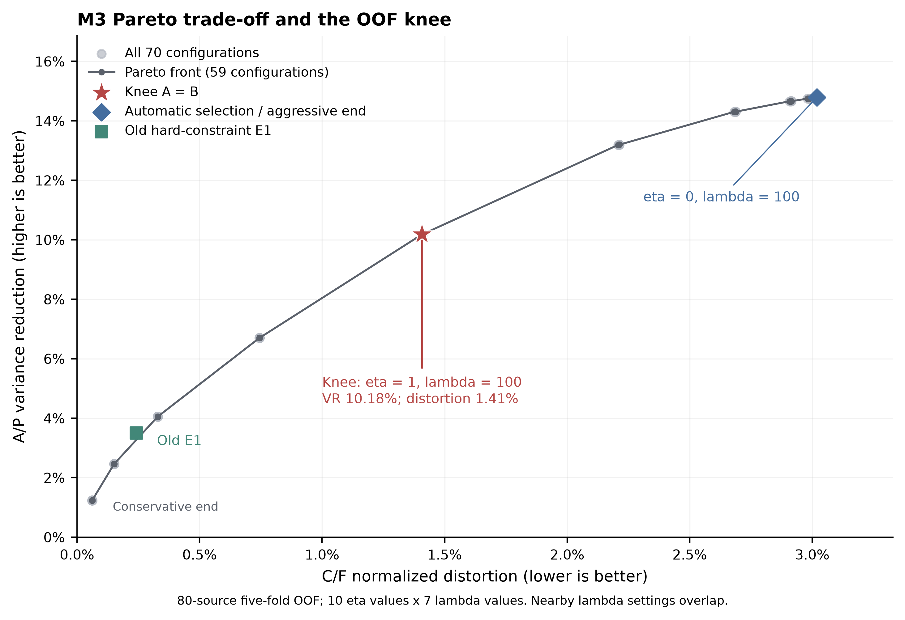
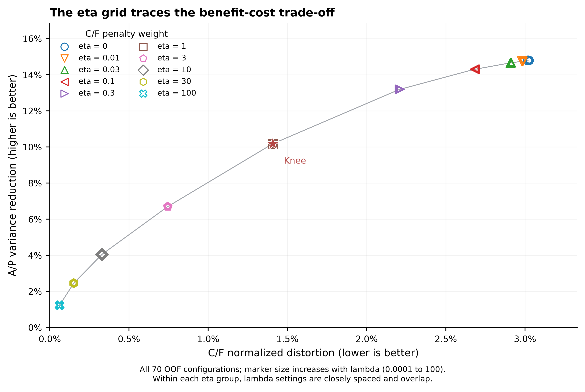
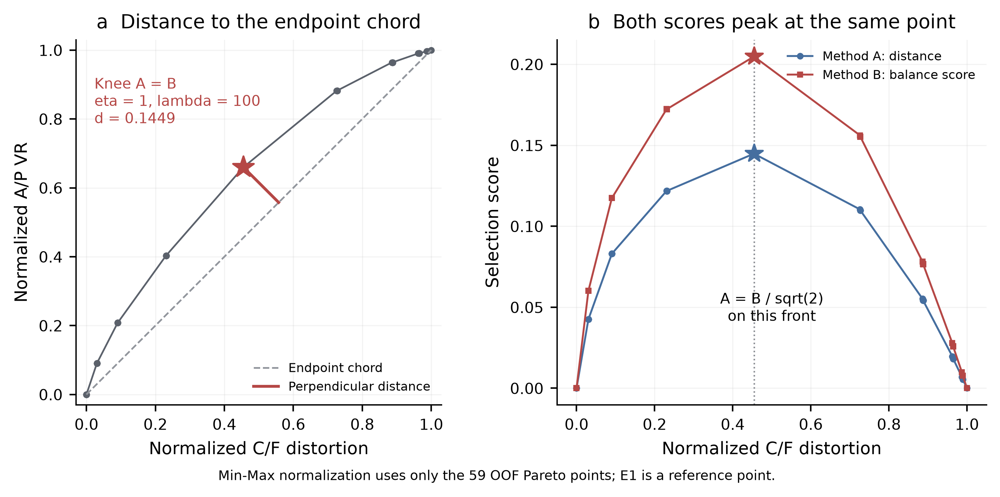

# 新版 M3 Pareto 曲线与拐点分析

**80 来源折外结果呈现明确的收益递减趋势，拐点集中在 eta=1。两种方法均选中 eta=1、lambda=100（e05_l06）：A/P VR 为 10.180%，C/F 扰动为 1.408%。**相对当前 eta=0 配置，C/F 扰动减少 53.38%，保留 68.83% 的 A/P 消减收益。

## 1. 数据、评价与选点范围

直接读取 [PR #76 结果目录](https://github.com/chunxi-alpc/TRIAGE/tree/codex/aster-m3-dual-objective-20261116/reports/aster_m3_dual_objective_20261116) 中的 oof_grid_70.csv、pareto_front.csv、selection.json、grid_bootstrap.csv，以及 evaluation/{oof_selection,dev,test}/metrics.csv 和 bootstrap.csv。来源提交为 2f1849037223fb785056c19dab364043c0d9738c。

70 组配置覆盖 10 个 eta 与 7 个 lambda；每组使用 80 来源五折折外结果，汇总 5,003 个 A/P 对、1,342 个 C/F 对、1,712 条自然路径和 5,136 条干扰路径。Pareto 和拐点计算函数只接收该折外网格。选点完成后读取旧 E1、20 来源开发集与40 来源复用留出集结果，补充对照表。

沿用 PR #76 的固定 51 头 M1、16 维 M2、E1 自然节点加性截距校准和 beta=1 评价协议。本次使用 1 个 CPU 线程；GPU、显存占用、训练、重新拟合、模型前向和新增 Bootstrap 抽样均为 0。所有新增代码和结果位于独立目录，PR #76 原文件和主稿保持原样。

横轴 D = C/F 修正 RMS / C/F 原始响应 RMS，越小越好；纵轴 VR = 1 − Var(A/P 修正后差值) / Var(A/P 原始差值)，越大越好。C/F ER 是按标签方向对齐后的平均响应之比。路径指标沿用现有自然路径和干扰路径准确率。

## 2. Pareto 前沿与拐点

按“扰动不增、VR 不降，且至少一项严格改善”的支配定义重算，70 个配置中有 **59 个 Pareto 配置**；与原有 pareto_front.csv 的成员集合一致。旧 E1 作为外部参考点展示，保持 70 点网格独立用于前沿和归一化。

方法 A 对前沿两坐标分别 Min-Max 归一化，再按扰动升序连接两端点，计算点到端点连线的垂直距离。一般式为 d = |(x₂−x₁)(y−y₁) − (y₂−y₁)(x−x₁)| / sqrt((x₂−x₁)²+(y₂−y₁)²)。方法 B 在同一归一化前沿上最大化 S = y − x。

**方法 A：e05_l06，eta=1、lambda=100，d=0.14488038。**  
**方法 B：e05_l06，eta=1、lambda=100，S=0.20489180。**

两种方法结果一致。本前沿归一化后的端点为 (0,0) 与 (1,1)，所有中间点均位于端点连线上方，因此 d = S / sqrt(2)，两种排序在该前沿上数学等价。如果某个前沿存在连线下方且绝对偏离更大的点，方法 A 的绝对距离与方法 B 的有向得分可能选出不同点。

前两名分别是 eta=1、lambda=100 与 eta=1、lambda=10；距离得分相差 0.00020630（最大得分的 0.142%）。eta=1 的七个 lambda 占据距离排名前七名。因而曲线给出了清晰的 eta≈1 平衡区域，lambda=100 是已测网格中的数值最优点；相邻 lambda 的实际差异很小。

|eta（lambda=100）|A/P VR|C/F 扰动|平衡得分 S|
|---:|---:|---:|---:|
|3|6.700%|0.745%|0.172373|
|1|10.180%|1.408%|0.204892|
|0.3|13.189%|2.208%|0.156151|
|0|14.790%|3.019%|0.000000|

沿扰动增大的方向，eta=3→1 每增加 1 个百分点 C/F 扰动，获得约 5.25 个百分点 VR；eta=1→0.3 时该收益降至 3.76，eta=0.3→0 时降至 1.97。这解释了 eta=1 附近的收益递减。

图 1：全部 70 个配置、重算前沿、两种方法共同拐点、当前自动选择点和旧 E1。同一 eta 下多个 lambda 的坐标接近，散点存在重叠；连线只连接已测配置。

图 2：颜色与形状区分 eta，点大小随 lambda 增加，展示完整参数网格。

图 3：左图展示归一化前沿与垂直距离，右图比较两种得分。所有坐标来自 80 来源折外结果。

## 3. 关键配置对照

以下为同一 80 来源上的现有结果。CSV 保留原始比例值；表中 VR、扰动和准确率显示为百分数。方法 A/B 为同一配置，自动选择点也正好是最激进端点。

|配置|eta|lambda|A/P VR|C/F 扰动|C/F ER|C/F 修正 RMS|自然路径准确率|干扰路径准确率|
|---|---:|---:|---:|---:|---:|---:|---:|---:|
|Knee A|1|100|10.180%|1.408%|0.999315|0.7129|90.537%|91.667%|
|Knee B|1|100|10.180%|1.408%|0.999315|0.7129|90.537%|91.667%|
|自动选择|0|100|14.790%|3.019%|0.998796|1.5290|90.421%|92.192%|
|旧版 E1|—|—|3.498%|0.242%|0.999840|0.1225|90.304%|91.316%|
|保守端点|100|100|1.233%|0.062%|0.999965|0.0312|90.362%|91.219%|
|激进端点|0|100|14.790%|3.019%|0.998796|1.5290|90.421%|92.192%|

### 相比当前 eta=0

Knee 的 C/F 扰动从 3.019% 降至 1.408%，减少 1.612 个百分点（53.38%）；C/F 修正 RMS 从 1.5290 降至 0.7129。A/P VR 从 14.790% 变为 10.180%，相差 4.609 个百分点，保留 68.83% 的收益。自然路径准确率增加 0.117 个百分点，干扰路径准确率下降 0.526 个百分点。

### 相比旧版硬约束 E1

Knee 将 A/P VR 从 3.498% 提升到 10.180%，增加 6.682 个百分点，达到旧 E1 的 2.91 倍。对应 C/F 扰动从 0.242% 增至 1.408%（增加 1.166 个百分点），C/F 修正 RMS 从 0.1225 增至 0.7129，ER 从 0.999840 变为 0.999315。自然路径和干扰路径准确率分别增加 0.234、0.350 个百分点。旧 E1 对应更小的响应扰动，Knee 对应更强的干扰消减。

## 4. 复用 Bootstrap 与现有开发集、留出集评价

直接复用 PR #76 的 2,000 次来源级 Bootstrap 边际 95% 区间。下表为选中配置的既有区间；拐点位置及新配置间差值的区间尚未评价。边际区间用于描述单配置指标的不确定性，选点按折外点估计完成。

|Knee 指标|点估计|既有 95% 区间|
|---|---:|---:|
|A/P VR|10.180%|[4.039%, 15.701%]|
|C/F 扰动|1.408%|[1.312%, 1.505%]|
|C/F ER|0.999315|[0.997712, 1.000891]|
|C/F 修正 RMS|0.7129|[0.6681, 0.7587]|
|自然路径准确率|90.537%|[86.929%, 93.599%]|
|干扰路径准确率|91.667%|[88.496%, 94.481%]|

Knee A/B（eta=1、lambda=100）和保守端点缺少现成的开发集与留出集评价，相应指标全部标记“未评价”。旧 E1 和 eta=0 使用 PR #76 既有结果；这些数据在拐点选择之后加入对照表。

|集合|配置|A/P VR|C/F 扰动|C/F ER|C/F 修正 RMS|自然路径准确率|干扰路径准确率|
|---|---|---:|---:|---:|---:|---:|---:|
|开发集（20 来源）|Knee A|未评价|未评价|未评价|未评价|未评价|未评价|
|开发集（20 来源）|自动选择|9.342%|3.141%|0.998321|1.3255|91.429%|93.175%|
|开发集（20 来源）|旧版 E1|0.387%|0.316%|1.000063|0.1335|91.667%|93.175%|
|复用留出集（40 来源）|Knee A|未评价|未评价|未评价|未评价|未评价|未评价|
|复用留出集（40 来源）|自动选择|8.688%|3.226%|0.987567|1.1709|95.533%|96.733%|
|复用留出集（40 来源）|旧版 E1|1.460%|0.262%|1.001016|0.0950|95.285%|96.485%|

## 5. 论文推荐配置

**建议论文以 eta=1、lambda=100 作为平衡 A/P 消减与 C/F 响应保持的推荐参数。**核心结果是：在 80 来源折外评价中，约 1.41% 的 C/F 响应扰动对应 10.18% 的 A/P 方差降低；相对 eta=0，扰动减半并保留约七成消减收益。这一推荐以折外权衡为依据，开发集和 40 来源留出集的 Knee 指标标记为未评价。eta=0 保留为最大 A/P 消减对照，旧 E1 保留为低响应扰动对照。

## 6. 交付与复现

- 独立脚本与单元测试：experiments/aster_m3_pareto_knee_20261116/。
- 三幅主图：PNG，同时提供可编辑 SVG 和 PDF。
- pareto_grid_annotated.csv：70 组原始结果及重算前沿标记。
- pareto_front_recomputed.csv：59 个前沿配置、归一化坐标和两种得分。
- pareto_key_points.csv：六个指定关键配置在折外集的指标和开发/留出评价状态。
- key_points_evaluation.csv：六个关键配置 × 三个集合；未评价指标为空。
- bootstrap_key_points.csv：直接摘录的既有区间及缺失状态。
- knee_selection.json、configuration.json：选点结果、分析配置和数据来源。
- logs/：CPU 执行和单元测试记录。复现命令见独立脚本目录 README.md。
