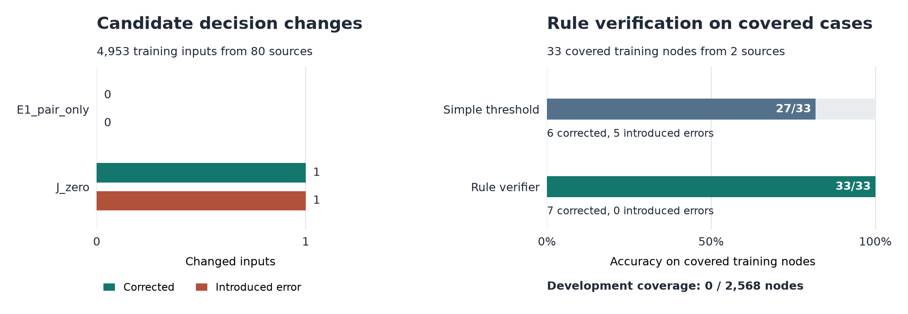

# ASTER-CR V3 选择性改判与预测保持实验总报告

**现有两套候选的改判事件不足以训练监督门控。** 在 80 个拟合来源的 4,953 个去重训练输入中，E1 没有改判，J 纠正 1 个、误修 1 个。按 V3 停止监督训练。两条能定位测量对象与单位的规则，在发现它们的两个来源覆盖 33 个节点，纠正 7 个、误修 0 个。20 个开发来源的 2,568 个自然节点均未匹配这两条规则。

## 实验复用与首错归因

读取 main 的 V3 和去重审计，逐项核对已完成及未合并工作。直接复用历史 27,392 条路径的核对结果、166 个首次错误的线性规划和 70 点网格。逐例索引覆盖 32 个原始文件、68,130 条跨版本关联键。全程使用服务器 CPU，模型主干前向、历史模型重训、完整路径回放和 GPU 用量均为零。[身份与缓存核对](S0_AUDIT.zh.md) · [分任务复用量、新增量、来源和成本](TASK_LEDGER.csv)

R0 与零截距 J 的首错并集有 581 条病例、节点和输入版本记录，来自 46 个指南来源。折叠同一病例节点的重复版本后为 245 个。8 个有历史案例阅读，6 个新增数值和条件核验，2 个出现文本或标签矛盾，229 个原因待审。151 条自然首错关联到相同 UID 的原 R1 边界记录。可达性、规则结构、文本证据和审核状态分别列示。[首错逐例与按来源统计](s1/REPORT.zh.md)

## 改判事件与停止决定

训练总体采用 Dataset A 的 2,540 对端点与 761 个自然校准节点的 UID 并集。改判、标签或预测的重复出现均按输入去重。两列事件分别给出事件数和覆盖的来源数。理想上界使用已知标签，仅供事后估计纠正空间。

|冻结候选|纠正数 / 来源数|误修数 / 来源数|保持正确|保持错误|理想门控正确数 / 总数|
|---|---:|---:|---:|---:|---:|
|E1_pair_only|0 / 0|0 / 0|4777|176|4777 / 4953|
|J_zero|1 / 1|1 / 1|4776|175|4778 / 4953|

V3 要求纠正与误修各至少 30 个去重节点，且各覆盖至少 10 个来源。把同一病例和节点的多个变体再合并，两候选的纠正与误修计数保持相同。把范围扩到有标签的全部 48,865 个历史输入，E1 为 4/2，J 为 16/3。另有 109,296 个输入缺标签。自然路径上 J 相对 R0 纠正 4 条、误修 0 条；干扰路径上纠正 3 条、误修 2 条。这些路径有共同来源和重复节点，仅用于动态终点分析。[训练资格、条件误修率、按来源区间与路径四向计数](s2_events/README.zh.md)

**预测保持。** E1 的训练改判集合为空，按预设取阈值 +∞。在已存的 80 来源训练、20 来源开发划分上，开发阶段 33,341 个分数的分支决策均与无保护 E1 相同，拦下有效纠正和误修均为 0。自然路径正确数由 R0 的 384/420 变为 E1 的 383/420，干扰路径由 1,168/1,260 变为 1,169/1,260。开发 A/P 方差降低 0.387%，C/F 修正 RMS 为 0.13346，方向正确 59/60，双端全对 35/60，1/60 超过训练预算。F0 双端全对 29/29。训练预算缩放系数为 0.9999999999999964；同幅对照与保护输出相同。单一数值比较的 152 个开发评价节点无改判，唯一被误修的评价节点结构未知。[开发配对](s2_development/pair_metrics.csv) · [开发四向计数](s2_development/pooled_transitions.csv) · [来源区间](s2_development/new_intervals.csv) · [五折冻结配对核对](s2_pairs/REPORT.zh.md)

**五折配对补全。** 公共评价池的 5,003 个 A/P 对上，E1 的方差降低率为 +3.50%，J 为 −0.35%。1,342 个 C/F 对上，R0、E1、J 双端全对均为 1,173 对，超过原预算的配对分别为 0、25、36 对。11 个来源的 82 个 F0 对中，J 缺少右端分数。用原折已有激活和冻结参数补算 82 个 CPU 标量后，三种方法均有 73/82 对双端全对。[冻结配对结果与来源区间](s2_pairs/REPORT.zh.md)

**原五折的保护评价列为 blocked。** 五套 J 内部留出的 M3 在 48 个来源上拟合，所用 M1/M2 表示已在外层全部 64 个训练来源上拟合。未找到这五组 48 来源各自独立的表示及同协议分数。80 来源合并计算的 J 阈值为 0.9320。把它用于原五折会用到相应验证来源。服务器也缺少在全部 80 来源拟合的同版冻结 J，因而没有 J 的 80→20 保护结果。[五折缓存身份](s2_events/cache_and_export_check.json)

## 数值条件核验

在拟合来源首错中选定术前血红蛋白阈值和收缩压区间，冻结测量对象、单位、时间条件及回退规则。每次判断只使用当前指南条件和患者文本。全量正确数包括回退 R0 的节点。历史 R0 在拟合和开发上分别为 11,516/11,722 和 2,532/2,568。

|来源与方法|覆盖 / 全量节点|覆盖内正确|纠正|误修|全量正确|
|---|---:|---:|---:|---:|---:|
|拟合 · 同单位首值对照|33 / 11,722|27 / 33|6|5|11,517 / 11,722|
|拟合 · 对象与单位核验|33 / 11,722|33 / 33|7|0|11,523 / 11,722|
|开发 · 同单位首值对照|0 / 2,568|无适用节点|0|0|2,532 / 2,568|
|开发 · 对象与单位核验|0 / 2,568|无适用节点|0|0|2,532 / 2,568|

收缩压规则覆盖的 7 个节点中，同单位首值对照答对 1 个，定位收缩压后答对 7 个。术前血红蛋白的 26 个节点两种方法均答对。拟合来源的结果说明测量对象选择能影响这些病例的判断。开发来源覆盖为零，跨来源效果尚待验证。[冻结规则与逐来源结果](s1/REPORT.zh.md)

## 独立确认与交付

S4 核对 13 个已用队列、25 个划分。当前可访问的数据中，符合指南家族、模板隔离、许可及审核要求的新来源有 0 个，独立确认列为 blocked。样本量情景按原正确节点的误修率列出，并单列来源聚类带来的需求。[来源排重与样本量](s4/REPORT.zh.md)

S0、S2 事件统计、E1 开发保护、S3 程序核验及 S4 来源审计已完成。临床复核和独立确认的缺口已记录。论文正文沿用现有证据，本次负结果与局部纠正结果归入独立实验报告。[运行命令](COMMANDS.zh.md) · [逐项完成状态](TASK_LEDGER.csv)
