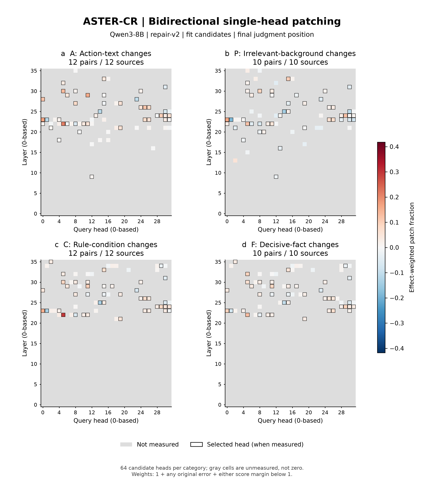
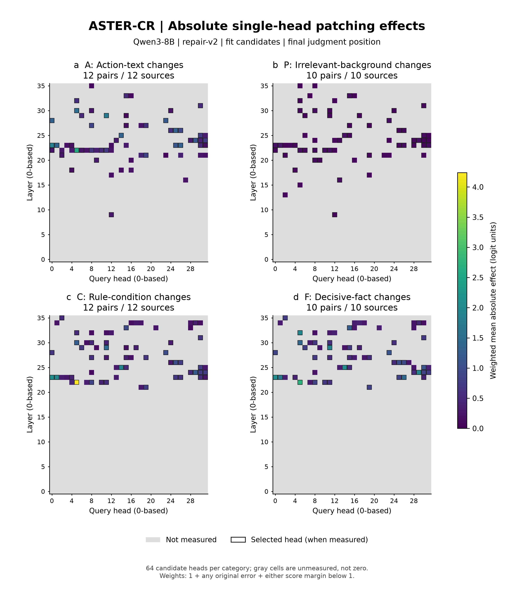

# ASTER-CR 最新方法的修补热力图

使用 **Qwen3-8B / ASTER-CR / repair-v2** 已保存的单头双向精确修补结果绘图。此次只在服务器 CPU 上整理已有数据，没有新模型前向、训练或 GPU 占用。

这些图用于查看候选注意力头对判断分数的干预效应及正反方向差异。数据来自 **fit 定位阶段**，不是独立测试，也不是最终读出或 M3 的收益图。

## 图与下载

| 图 | 内容 | 导出 |
|---|---|---|
| 双向平均 | 保留方向的、效应加权的平均修补比例 | [PNG](mean_patch_heatmap.png) · [PDF](mean_patch_heatmap.pdf) · [SVG](mean_patch_heatmap.svg) · [TIFF](mean_patch_heatmap.tiff) |
| 正反向对照 | 正向、反向和双向平均并排，使用统一色标 | [PNG](directional_patch_heatmaps.png) · [PDF](directional_patch_heatmaps.pdf) · [SVG](directional_patch_heatmaps.svg) · [TIFF](directional_patch_heatmaps.tiff) |
| 绝对效应 | 与当前精确候选排序一致的加权双向绝对效应 | [PNG](absolute_patch_heatmap.png) · [PDF](absolute_patch_heatmap.pdf) · [SVG](absolute_patch_heatmap.svg) · [TIFF](absolute_patch_heatmap.tiff) |





## 如何读图

横轴为查询头，纵轴为 Transformer 层，均从 0 开始编号。每个面板为 36 层 × 32 个查询头。

- 红色：分数朝供体运行的方向变化；蓝色：朝相反方向变化。白色附近表示已测但效应较小。
- 灰色：没有精确修补测量，不能解释为零效应。
- 黑框：该头属于最新选择的 51 头集合，并且在当前类别中有精确测量。没有黑框的彩色格仍是已测候选。
- 绝对效应图另用顺序色标，仅表示影响幅度，不表示有益或有害。
- 单头效应不能相加后当作联合恢复率；跨层替换也不等于恢复原始计算路径。

## 数据规模

共 2,816 条精确修补记录，每条包含两个方向。各类别先经归因预筛，再对 64 个候选头精确测量；四类候选并集为 103 头。不得将此图称为全模型逐头穷举结果。

| 类别 | 输入变化 | 配对 / 来源数 | 精确候选头 | 本类测得的已选头 |
|---|---|---:|---:|---:|
| A | 处置文本删除、调换或中性化；保持金标 | 12 / 12 | 64 | 42 / 51 |
| P | 无关患者背景变化；保持金标 | 10 / 10 | 64 | 44 / 51 |
| C | 规则条件变化，并翻转金标 | 12 / 12 | 64 | 41 / 51 |
| F | 决定性患者事实变化，并翻转金标 | 10 / 10 | 64 | 40 / 51 |

A/P 的两侧通常没有正确标签变化，所以图中“修补比例”描述分数变化，不是错误答案恢复率。每类仅 10–12 个 fit 来源，图是定位阶段的描述性汇总。

## 指标定义

设原两侧判断分数为 ell_L、ell_R，TE = ell_R - ell_L。

正向把右侧头输出放入左侧运行，IE_f = ell_patched_left - ell_L；反向把左侧头输出放入右侧运行，IE_r = ell_patched_right - ell_R。判断分数是“是”减“否”的 logit 差。

沿用定位时保存的权重 w = 1 + 任一原始预测错误 + 任一侧分数绝对值小于 1。各头在对应类别内汇总：

- 正向比例 F = sum(w × sign(TE) × IE_f) / sum(w × abs(TE))。
- 反向比例 R = sum(w × sign(TE) × (-IE_r)) / sum(w × abs(TE))。
- 双向平均 M = (F + R) / 2。
- 绝对效应 Q = sum(w × (abs(IE_f) + abs(IE_r)) / 2) / sum(w)。

F/R/M 是本次新增的描述性统计，采用效应加权以减少小 TE 对逐对比例均值的放大，**不能冒充原来的选头指标**。Q 与当前精确候选排序使用的统计一致；最后的 51 头集合还经过类别排名合并。

所有方向面板共享一个以零为中心的完整色标；绝对效应面板共享另一个色标。不做分位数截断，不将比例限制在 0–1 内，不填补未测值。

## 可复现材料

- [全部格子的源数据 CSV](head_effects.csv)：包含 measured、selected、两方向、平均和绝对效应；未测值留空。
- [精确修补原始记录](source/fit_exact.jsonl)。
- [本轮选头快照](source/selection.json)。
- [配对类别、划分和来源](source/pairs.json)。
- [统计与配置](summary.json)。
- [绘图脚本](../../scripts/plot_aster_cr_heatmaps.py)。

沿用项目 Python 环境，运行：

```bash
python scripts/plot_aster_cr_heatmaps.py --run <repair-v2运行目录> --out results/aster_cr_heatmaps_20261109
```

所有绘图和导出均在服务器执行，PNG/TIFF 为 300 dpi，SVG/PDF 保留可编辑文字。已预览检查图例、坐标、色标和布局。详细运行日志留在服务器，没有提交其他在跑实验的代码或产物。

